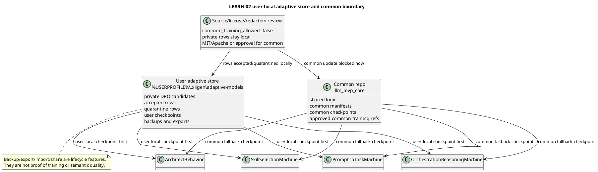

# User-Local Adaptive Store Plan v1

Phase: `LEARN-02`.

This document describes where the adaptive half of each learning machine lives, how it can be backed up or moved, and what must happen before any later training phase. It does not train a model, mutate checkpoints, update the common model, or claim learnability.

## Human Summary

The project has two legs for each trainable area:

1. The common leg lives in `C:\Projects\llm_mvp_core`. It contains shared logic, shared manifests, approved common checkpoints, and common training references.
2. The user leg lives on the user's computer under `%USERPROFILE%\.xiigen\adaptive-models\<machine>`. It contains private/user-local DPO candidates, accepted rows, quarantined rows, backups, and the user's adaptive checkpoint.

Runtime should load the user-local checkpoint first. If it is missing or invalid, runtime may fall back to the common repo checkpoint. Training must never overwrite the common checkpoint during local adaptation.

## Simple UML

## No-Code Algorithm

1. Read the local candidate rows from `local-dpo-candidates-v1.jsonl`.
2. Assign every row to exactly one target machine store slot.
3. Classify the row as user-local/private, shared-redacted-summary-only, or mixed local-visible/shared-redacted.
4. Keep every row out of common training for now.
5. Before future continue-training, create a backup of the current user-local checkpoint.
6. Load order for runtime and training is: user-local current checkpoint, then user-local latest valid backup, then common repo checkpoint fallback.
7. Export/share packets may contain manifests, hashes, and redacted row references, not raw private prompt text.
8. Continue-training must use an existing checkpoint and record the base hash. Retrain-from-zero is not allowed unless explicitly approved and labelled cold-start.

## Machine Slots

| Machine | User-local slot | Candidate rows | Why local |
|---|---|---|---|
| `PromptToTaskMachine` | `%USERPROFILE%\.xiigen\adaptive-models\prompt-to-task` | `LDPO-003`, `LDPO-011`, `LDPO-012` | These rows adapt prompt interpretation, debug visibility, and error wording to the user. |
| `OrchestrationReasoningMachine` | `%USERPROFILE%\.xiigen\adaptive-models\orchestration-reasoning` | `LDPO-002`, `LDPO-005`, `LDPO-006`, `LDPO-010` | These rows adapt execution ordering, overclaim boundaries, universalization, and checkpoint safety. |
| `SkillSelectionMachine` | `%USERPROFILE%\.xiigen\adaptive-models\skill-selection` | `LDPO-001`, `LDPO-007`, `LDPO-009` | These rows adapt skill choice while guarding against candidate-order and missing-input shortcuts. |
| `ArchitectBehavior` | `%USERPROFILE%\.xiigen\adaptive-models\architect-behavior` | `LDPO-004`, `LDPO-008` | These rows are behavior preferences from this user/session and stay local by default. |

## Backup / Export / Import / Share

Backup before training:

- copy the current user-local checkpoint to `backups/<timestamp>`;
- write the base checkpoint hash into the manifest;
- record the exact candidate rows included in the training packet.

Export:

- include manifest, checkpoint hash, redacted row refs, source/license decision, held-out split hash, rollback ref;
- exclude raw private prompts unless the user explicitly approves sharing them.

Import:

- verify schema, machine id, checkpoint hash, and redaction review;
- place imported checkpoint into a staged import folder before making it current;
- keep the previous current checkpoint as rollback.

Share:

- user-local rows can be shared only as redacted packets;
- common training remains blocked until source/license/redaction review explicitly permits it.

## Limitations

This phase proves that the local/common boundary and storage lifecycle are specified. It does not prove the local model learned, does not run training, does not mutate checkpoints, and does not prove semantic quality.
