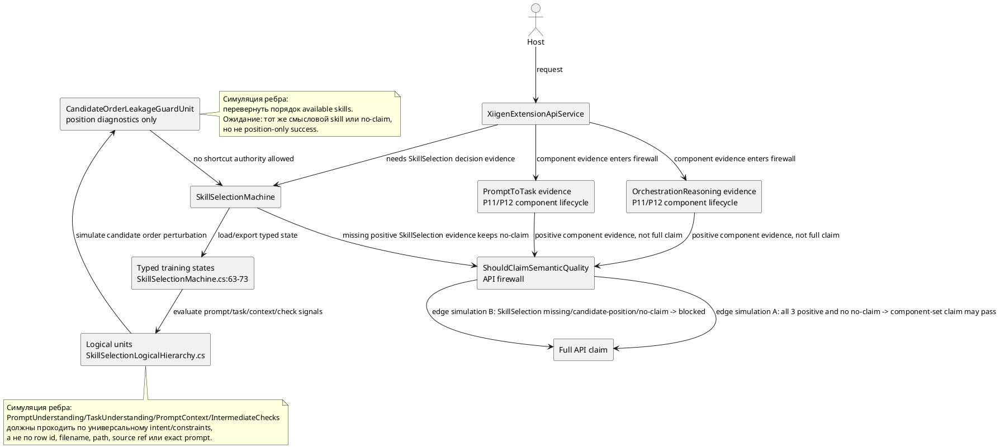

# P16A: план unitization для SkillSelection

## Краткий вывод

P16A остается только планом и доказательным артефактом. В этой фазе не менялись production code, тесты, training data, DPO-строки, checkpoint, dashboard, host runtime и model assets.

Исправление после parent review учтено: текущий `SkillSelectionMachine` уже содержит типизированные верхнеуровневые training-state поля и конкретные logical units. Значит, проблема не в том, что unitization отсутствует полностью. Реальный разрыв такой: текущий SkillSelection допустим как baseline/no-claim слой, но еще не дает source-disjoint positive evidence, checkpoint lifecycle evidence и API-firewall-compatible proof.

Что уже приемлемо как baseline:

- `SkillSelectionMachine.cs:62` хранит `_candidatePositionWeights` как diagnostics/leakage-guard input.
- `SkillSelectionMachine.cs:63-73` содержит typed training-state поля для prompt understanding, task understanding, task type, routing, skill candidates, skill selection, prompt context, result gap, output validation, task completion и intermediate checks.
- `SkillSelectionLogicalHierarchy.cs` содержит concrete logical units, включая `CandidateOrderLeakageGuardUnit`, `PromptUnderstandingSkillUnit`, `TaskUnderstandingSkillUnit`, `PromptContextSkillSelectionUnit` и `IntermediateChecksSkillUnit`.
- Вложенные словари внутри private training-state классов допустимы только как внутреннее storage, которое питает typed exported state. Они не должны становиться shortcut authority.

Что все еще блокирует положительное evidence для SkillSelection:

- нет принятого source-disjoint материала SkillSelection с ролями train/eval/holdout;
- нет DPO/materialization ledger для SkillSelection;
- нет source-disjoint eval и ablation пакета для SkillSelection;
- нет SkillSelection checkpoint rewrite, fresh-load, import/export/share и continue-training lifecycle evidence;
- API firewall обязан сохранять no-claim, пока SkillSelection не даст positive evidence наряду с PromptToTask и OrchestrationReasoning.

## PlantUML для draw.io



## Симуляции на ребрах

| Сценарий | Ожидаемый baseline outcome | Что должен доказать будущий P16 gate |
|---|---|---|
| Нет загруженного состояния SkillSelection | Возврат no-ready/no-claim поведения | API не выдает положительный claim без SkillSelection evidence |
| Prompt содержит смысловые признаки выбора навыка | Runtime chain пробует prompt/task/routing/context units | Выбор зависит от универсального смысла, а не от позиции кандидата |
| Context содержит project/root/provenance признаки | `PromptContextSkillSelectionUnit` может учесть безопасные redacted факты | Path, filename и source-id не становятся authority |
| Кандидаты переставлены местами | `CandidateOrderLeakageGuardUnit` фиксирует риск | Итог не зависит от индекса кандидата |
| Есть intermediate checks | `IntermediateChecksSkillUnit` может влиять на выбор | Влияние обучается source-disjoint строками, а не `test name` или marker |

## Текущий no-code алгоритм

1. Training path: `LearnPair` получает pair, определяет target adapter, обновляет соответствующий typed training-state объект и дополнительно увеличивает `_candidatePositionWeights` как diagnostics.
2. Runtime path: `DecideFromTrainedState` сначала вызывает `TryDecideWithSemanticUnitsOnly`.
3. Runtime chain идет в таком порядке: prompt context, result gap, output validation, task completion, intermediate checks, skill selection, skill candidates, routing, task type, task understanding, prompt understanding.
4. Если chain не находит supported decision, компонент возвращает no-claim/no-trained-state поведение вместо искусственного positive decision.
5. Candidate position разрешена только как leakage guard. Она не должна становиться final selection authority.
6. Будущий lifecycle должен работать так: load user/cache first, repo/common fallback, затем backup/export/import/share только через явные manifests. Continue-training from existing checkpoint должен сохранять previous source refs и добавлять только parent-approved new refs.

## Конкретные blueprint-блоки по unit и method

### 1. Candidate position leakage guard

Текущая цитата:

```csharp
// 43.SmartSkillsDomain/SkillSelectionMachine.cs:62
private readonly Dictionary<int, int> _candidatePositionWeights = new();

// 43.SmartSkillsDomain/SkillSelectionLogicalHierarchy.cs:271,295
public sealed class CandidateOrderLeakageGuardUnit : ILogicalUnit<SkillSelectionRequest, CandidateOrderLeakageReport>
public CandidateOrderLeakageReport Evaluate(SkillSelectionRequest request)
```

Текущий class/state/input/output:

- Existing ILogicalUnit class signature: `public sealed class CandidateOrderLeakageGuardUnit : ILogicalUnit<SkillSelectionRequest, CandidateOrderLeakageReport>`.
- Input: `SkillSelectionRequest`.
- Output: `CandidateOrderLeakageReport`.
- State: `CandidateOrderLeakageGuardState`.
- Existing KNN/nearest method: отсутствует. Это правильно: guard сравнивает candidate-position diagnostics и perturbation behavior. KNN здесь был бы ошибкой, потому что unit должен обнаруживать leakage, а не учить nearest position pattern.

#### Соседний блок решения

- Сейчас: `_candidatePositionWeights` заполняется через `LearnPair` и экспортируется в guard state.
- Оценка: это допустимо как leakage diagnostics; плохо только если влияет на selected skill.
- Точная цель: P16C должен создать `Tests/SkillSelectionP16CandidateOrderLeakageGuardTests.cs` и проверить, что reverse order в `AvailableSkillIds` не меняет meaning-based decision, а `CandidateOrderLeakageReport` помечает candidate-position-only evidence как diagnostics.
- Точные будущие файлы: `43.SmartSkillsDomain/SkillSelectionMachine.cs`, `43.SmartSkillsDomain/SkillSelectionLogicalHierarchy.cs`, `43.SmartSkillsDomain/SkillSelectionContracts.cs`, `Tests/SkillSelectionP16CandidateOrderLeakageGuardTests.cs`, плюс P16E ablation artifacts.
- Затронутые assets/manifests: SkillSelection checkpoint manifest должен включать `candidate_position_weights` только в `diagnostics` или `leakage_controls`, но не в `learned_authority`.
- Rebuild/quarantine rule: если chosen skill меняется только из-за позиции кандидата, строка уходит в quarantine и common checkpoint rebuild блокируется.

#### Положительная DPO-строка

```json
{
  "row_id": "P16B-SS-CANDPOS-001",
  "source_ref": "p16b-local-redacted:skill-routing-position-invariance-001",
  "machine_target": "SkillSelection",
  "prompt_input": "User asks for a risk-first review of a proposed change before implementation.",
  "available_skills": ["implementation", "code_review", "test_integrity"],
  "chosen": "code_review",
  "rejected": "implementation",
  "rejected_type": "candidate_position_shortcut",
  "teaches_boundary": "Choose by requested review intent, not by list index.",
  "forbidden_signals": ["candidate_index", "row_id", "source_ref", "filename", "path", "exact_prompt"],
  "common_or_adaptive_route": "common only after source/license verification; otherwise evidence-only"
}
```

#### Карантинная строка

```json
{
  "row_id": "P16B-SS-CANDPOS-Q001",
  "source_ref": "private-session:path-heavy-skill-list-001",
  "reason": "The only visible signal is that the chosen skill appeared first in a private candidate list.",
  "status": "quarantine"
}
```

### 2. PromptUnderstandingSkillUnit

Текущая цитата:

```csharp
// 43.SmartSkillsDomain/SkillSelectionLogicalHierarchy.cs:429,437
public sealed class PromptUnderstandingSkillUnit
public PromptUnderstandingSkillEvidence Evaluate(PromptUnderstandingSkillInput input)

// 43.SmartSkillsDomain/SkillSelectionContracts.cs:125,139,143
public sealed record PromptUnderstandingSkillUnitState(...)
public sealed record PromptUnderstandingSkillInput(...)
public sealed record PromptUnderstandingSkillEvidence(...)
```

Текущий class/state/input/output:

- Class: `PromptUnderstandingSkillUnit`.
- Input: `PromptUnderstandingSkillInput`.
- Output/evidence: `PromptUnderstandingSkillEvidence`.
- State: `PromptUnderstandingSkillUnitState`.
- Existing KNN/nearest method: не найден для этого unit. Сейчас он оценивает typed prompt feature profiles напрямую. P16C может добавить nearest-helper только если он будет построен из approved train rows и exposed через typed state, а не из eval markers.

#### Соседний блок решения

- Сейчас: prompt features могут голосовать за skill profiles.
- Оценка: skeleton допустим; не хватает source-disjoint positive evidence и ablations против exact prompt lookup.
- Точная цель: P16B создает source ledger и DPO rows для prompt intent; P16C добавляет `Tests/SkillSelectionP16PromptUnderstandingSourceDisjointTests.cs` с проверками paraphrase и exact-prompt-control; P16D включает `PromptUnderstandingSkillUnitState` в candidate manifest.
- Точные будущие файлы: P16B artifacts под `p16b-skill-selection-source-dpo-materialization`, `Tests/SkillSelectionP16PromptUnderstandingSourceDisjointTests.cs`, и позднее `43.SmartSkillsDomain/SkillSelectionLogicalHierarchy.cs` только если parent разрешит code repair.
- Lifecycle: load user/cache first для user-adaptive prompt patterns; repo/common fallback для approved common patterns; backup/export/import/share в P16F; continue-training from existing checkpoint только с appended parent-approved refs.

#### Положительная DPO-строка

```json
{
  "row_id": "P16B-SS-PROMPT-001",
  "source_ref": "p16b-public-candidate:openai-cookbook-task-routing-redacted-001",
  "machine_target": "SkillSelection",
  "prompt_input": "User asks to break down an ambiguous request into a plan before implementation.",
  "available_skills": ["planning", "implementation", "browser_qa"],
  "chosen": "planning",
  "rejected": "implementation",
  "rejected_type": "execution_first_shortcut",
  "teaches_boundary": "Prompt intent requires planning/decomposition before execution.",
  "forbidden_signals": ["exact_prompt", "source_title", "filename", "path", "source_family_id", "row_id"],
  "common_or_adaptive_route": "common only if LICENSE is verified as MIT/Apache-2.0; otherwise evidence-only/adaptive"
}
```

#### Карантинная строка

```json
{
  "row_id": "P16B-SS-PROMPT-Q001",
  "source_ref": "private-chat:literal-skill-name-001",
  "prompt_input_summary": "Prompt literally names an internal skill file.",
  "reason": "The chosen skill can be inferred from exact title/filename, not prompt meaning.",
  "status": "quarantine"
}
```

#### License verification

- Candidate common source family: `openai-cookbook-task-routing-examples`.
- Required P16B step: сохранить local source pointer, проверить repository `LICENSE`, принять common-learning row только при MIT или Apache-2.0.
- Если license отсутствует, неоднозначна или не MIT/Apache-2.0, строка идет в `evidence_only` или private adaptive cache, но не в common training.

### 3. TaskUnderstandingSkillUnit

Текущая цитата:

```csharp
// 43.SmartSkillsDomain/SkillSelectionLogicalHierarchy.cs:550,558
public sealed class TaskUnderstandingSkillUnit
public TaskUnderstandingSkillEvidence Evaluate(TaskUnderstandingSkillInput input)

// 43.SmartSkillsDomain/SkillSelectionContracts.cs:156,179,183
public sealed record TaskUnderstandingUnitState(...)
public sealed record TaskUnderstandingSkillInput(...)
public sealed record TaskUnderstandingSkillEvidence(...)
```

Текущий class/state/input/output:

- Class: `TaskUnderstandingSkillUnit`.
- Input: `TaskUnderstandingSkillInput`.
- Output/evidence: `TaskUnderstandingSkillEvidence`.
- State: `TaskUnderstandingUnitState`.
- Existing KNN/nearest method: не найден для этого unit. Сейчас он оценивает learned task/profile weights напрямую. KNN-like tests должны быть выражены как profile similarity checks, если будущий авторизованный change не добавит typed nearest method.

#### Соседний блок решения

- Сейчас: task profiles могут влиять на skill selection.
- Оценка: baseline корректен; не хватает доказательства, что task goal/constraints/deliverables управляют решением сильнее, чем source marker или keyword-only shortcut.
- Точная цель: P16B rows должны включать `task_goal`, `constraints`, `deliverables` и `gates`; P16C добавляет `Tests/SkillSelectionP16TaskUnderstandingAblationTests.cs`.
- Точные будущие файлы: P16B role ledger, P16C focused tests, P16D checkpoint source manifest, P16E ablation result JSONL.
- Rebuild/quarantine rule: если task row проходит только при keyword вроде `review`, но падает на paraphrase с теми же constraints, строка уходит в quarantine или остается adaptive-only.

#### Положительная DPO-строка

```json
{
  "row_id": "P16B-SS-TASK-001",
  "source_ref": "p16b-local-redacted:task-contract-review-first-001",
  "machine_target": "SkillSelection",
  "prompt_input": "User asks for findings, risks, and missing tests before any patch.",
  "available_skills": ["code_review", "patch_implementation", "test_runner"],
  "chosen": "code_review",
  "rejected": "patch_implementation",
  "rejected_type": "task_contract_ignored",
  "teaches_boundary": "Task contract asks for review output, not implementation.",
  "forbidden_signals": ["keyword_only", "source_ref", "file_path", "row_id", "candidate_position"],
  "common_or_adaptive_route": "common if source is clean and source-disjoint; otherwise evidence-only"
}
```

#### Карантинная строка

```json
{
  "row_id": "P16B-SS-TASK-Q001",
  "source_ref": "private-repo:test-name-heavy-001",
  "reason": "The skill can be chosen from a test/class name rather than task contract.",
  "status": "quarantine"
}
```

### 4. PromptContextSkillSelectionUnit

Текущая цитата:

```csharp
// 43.SmartSkillsDomain/SkillSelectionLogicalHierarchy.cs:1015,1016,1025
public sealed class PromptContextSkillSelectionUnit
    : ILogicalUnit<PromptContextSkillInput, PromptContextSkillEvidence>
public PromptContextSkillEvidence Evaluate(PromptContextSkillInput input)

// 43.SmartSkillsDomain/SkillSelectionContracts.cs:407,423,427
public sealed record PromptContextSkillSelectionUnitState(...)
public sealed record PromptContextSkillInput(...)
public sealed record PromptContextSkillEvidence(...)
```

Текущий class/state/input/output:

- Existing ILogicalUnit class signature: `public sealed class PromptContextSkillSelectionUnit : ILogicalUnit<PromptContextSkillInput, PromptContextSkillEvidence>`.
- Input: `PromptContextSkillInput`.
- Output/evidence: `PromptContextSkillEvidence`.
- State: `PromptContextSkillSelectionUnitState`.
- Existing KNN/nearest method: named `FindNearest...` method для prompt context не найден. Unit использует prompt/context signal intersection и typed profiles. Это допустимо, если path/provenance facts остаются redacted и non-authoritative.

#### Соседний блок решения

- Сейчас: context signals включают host facts, project root presence, provenance ref presence и redacted path-like facts.
- Оценка: это полезно для private adaptation; небезопасно для common model authority, если path/title/source ref доминирует.
- Точная цель: разделить common-trainable context и user-private adaptive context; P16E ablations должны проваливать path/title/source-id-only controls.
- Точные будущие файлы: `SkillSelectionContracts.cs` для авторизованного будущего split common/private context state, `SkillSelectionLogicalHierarchy.cs` для context scoring при необходимости, `Tests/SkillSelectionP16PromptContextBoundaryTests.cs`, а также P16B/P16E artifacts.
- Затронутые assets/manifests: checkpoint source manifest должен помечать context rows как `common`, `adaptive_user_cache` или `evidence_only`.
- Rebuild/quarantine rule: любая common row, которой нужен local path, source title или provenance ref для выбора skill, уходит в quarantine.

#### Положительная DPO-строка

```json
{
  "row_id": "P16B-SS-CONTEXT-001",
  "source_ref": "p16b-local-redacted:docs-only-context-001",
  "machine_target": "SkillSelection",
  "prompt_input": "User asks for a docs-only repair with no code or tests.",
  "available_skills": ["documentation_sync", "implementation", "test_integrity"],
  "chosen": "documentation_sync",
  "rejected": "implementation",
  "rejected_type": "scope_boundary_ignored",
  "teaches_boundary": "Context restricts work to documentation evidence, not runtime changes.",
  "forbidden_signals": ["path", "filename", "source_ref", "project_root", "exact_prompt"],
  "common_or_adaptive_route": "common only for universal scope-boundary wording; project context remains adaptive_user_cache"
}
```

#### Карантинная строка

```json
{
  "row_id": "P16B-SS-CONTEXT-Q001",
  "source_ref": "private-workspace:path-selects-doc-skill-001",
  "reason": "The skill choice depends on a local path and file title instead of a universal scope boundary.",
  "status": "quarantine"
}
```

### 5. IntermediateChecksSkillUnit

Текущая цитата:

```csharp
// 43.SmartSkillsDomain/SkillSelectionLogicalHierarchy.cs:2042,2050,2096
public sealed class IntermediateChecksSkillUnit
public IReadOnlyList<IntermediateChecksKnnExample> FindNearestCheckExamples(
public IntermediateChecksSkillEvidence Evaluate(IntermediateChecksSkillInput input)

// 43.SmartSkillsDomain/SkillSelectionContracts.cs:602,617,633
public sealed record IntermediateChecksSkillUnitState(...)
public sealed record IntermediateChecksSkillInput(...)
public sealed record IntermediateChecksSkillEvidence(...)
```

Текущий class/state/input/output:

- Class: `IntermediateChecksSkillUnit`.
- Input: `IntermediateChecksSkillInput`.
- Output/evidence: `IntermediateChecksSkillEvidence`.
- State: `IntermediateChecksSkillUnitState`.
- Existing KNN/nearest method signature: `public IReadOnlyList<IntermediateChecksKnnExample> FindNearestCheckExamples(...)` at `SkillSelectionLogicalHierarchy.cs:2050`.

#### Соседний блок решения

- Сейчас: intermediate checks могут использовать nearest examples.
- Оценка: KNN support конкретный, но все еще нужен source-disjoint proof, что check semantics важнее labels/markers.
- Точная цель: P16B accepted rows должны включать check failure type, expected next skill и rejected shortcut; P16C добавляет `Tests/SkillSelectionP16IntermediateChecksKnnTests.cs`; P16E controls включают `test_name_only`, `marker_only` и `nearest_only_without_semantic_overlap`.
- Точные будущие файлы: P16B accepted/quarantine JSONL, P16C test file, P16D checkpoint candidate, P16E ablation report.
- Rebuild/quarantine rule: если nearest example проходит из-за copied test name или marker, строка уходит в quarantine и требуется новая source-disjoint row.

#### Положительная DPO-строка

```json
{
  "row_id": "P16B-SS-CHECKS-001",
  "source_ref": "p16b-local-redacted:failed-consistency-check-001",
  "machine_target": "SkillSelection",
  "prompt_input": "Intermediate evidence says artifact JSON parses but count consistency failed.",
  "available_skills": ["verification_before_completion", "implementation", "image_generation"],
  "chosen": "verification_before_completion",
  "rejected": "implementation",
  "rejected_type": "late_verification_skipped",
  "teaches_boundary": "Failed intermediate evidence requires verification/repair before more execution.",
  "forbidden_signals": ["test_name", "marker", "row_id", "file_path", "source_family_id"],
  "common_or_adaptive_route": "common if source-disjoint and license/source boundary is clean"
}
```

#### Карантинная строка

```json
{
  "row_id": "P16B-SS-CHECKS-Q001",
  "source_ref": "private-test-log:literal-test-class-001",
  "reason": "The chosen skill is inferable from a test class name, not from the failed-check semantics.",
  "status": "quarantine"
}
```

### 6. Runtime chain: `TryDecideWithSemanticUnitsOnly`

Текущая цитата:

```csharp
// 43.SmartSkillsDomain/SkillSelectionMachine.cs:169-211
private SkillSelectionDecision? TryDecideWithSemanticUnitsOnly(SkillSelectionRequest request)
```

Текущий input/output/state:

- Input: `SkillSelectionRequest`.
- Output: nullable `SkillSelectionDecision`.
- State sources: все typed training-state поля из `SkillSelectionMachine.cs:63-73`.
- Existing KNN/nearest methods used by downstream units: task type, routing, skill candidates, skill selection, result gap, output validation, task completion и intermediate checks имеют explicit `FindNearest...Examples` methods. Prompt understanding, task understanding и prompt context не expose named nearest methods в текущем коде.

#### Соседний блок решения

- Сейчас: chain возвращает первый supported decision.
- Оценка: runtime skeleton допустим; branch order может скрыть отсутствие покрытия, если tests покрывают только happy path.
- Точная цель: P16C добавляет `Tests/SkillSelectionP16RuntimeChainBranchTests.cs` с assertions для каждой ветки: prompt context, intermediate checks, task understanding, prompt understanding, no-decision fallback и candidate order perturbation.
- Точные будущие файлы: P16C tests; P16D manifest and source manifest; P16E per-branch reserved positives and controls; P16F fresh-load and continue-training evidence; P16G API firewall checks.
- Rebuild/quarantine rule: если любая ветка проходит по row id, exact prompt, source family, filename/path/title или candidate position, checkpoint candidate отклоняется.

#### Положительная DPO-строка

```json
{
  "row_id": "P16B-SS-CHAIN-001",
  "source_ref": "p16b-local-redacted:branch-priority-review-before-implementation-001",
  "machine_target": "SkillSelection",
  "prompt_input": "User asks to review a proposed change and list risks before editing files.",
  "available_skills": ["implementation", "code_review", "test_integrity"],
  "chosen": "code_review",
  "rejected": "implementation",
  "rejected_type": "runtime_chain_execution_first",
  "teaches_boundary": "Runtime chain must prefer review/verification branch when the task contract asks for review first.",
  "forbidden_signals": ["candidate_position", "exact_prompt", "source_ref", "row_id", "path"],
  "common_or_adaptive_route": "common after source-disjoint review; otherwise evidence-only"
}
```

#### Карантинная строка

```json
{
  "row_id": "P16B-SS-CHAIN-Q001",
  "source_ref": "private-transcript:old-approval-marker-001",
  "reason": "Decision depends on an old approval/status marker, not on the current task contract.",
  "status": "quarantine"
}
```

## Примеры источников и лицензий

Конкретный candidate source family для P16B review:

```json
{
  "source_family": "openai-cookbook-task-routing-examples",
  "candidate_use": "common Prompt/Task/SkillSelection routing examples",
  "required_license_step": "license verification: read local or fetched LICENSE and accept only MIT or Apache-2.0 before common training",
  "if_not_verified": "route to evidence_only or adaptive_user_cache, never common checkpoint"
}
```

Второй candidate source family:

```json
{
  "source_family": "locally-owned-redacted-operator-prompts",
  "candidate_use": "private adaptive SkillSelection examples",
  "required_license_step": "operator-owned/private provenance must be recorded; no common publication without explicit source boundary",
  "if_not_verified": "adaptive_user_cache only"
}
```

## Будущие фазы

| Фаза | Точные deliverables | Точные tests/checks | Assets/manifests |
|---|---|---|---|
| P16B | `p16b-skill-selection-source-ledger.jsonl`, accepted rows, quarantine rows, DPO card, license ledger | JSON/JSONL parse; raw-private-text scan; license verification; source-disjoint grouping check | no checkpoint; row refs only |
| P16C | focused branch and unit tests | `SkillSelectionP16CandidateOrderLeakageGuardTests`, `SkillSelectionP16PromptUnderstandingSourceDisjointTests`, `SkillSelectionP16TaskUnderstandingAblationTests`, `SkillSelectionP16PromptContextBoundaryTests`, `SkillSelectionP16IntermediateChecksKnnTests`, `SkillSelectionP16RuntimeChainBranchTests` | no model overwrite |
| P16D | SkillSelection checkpoint candidate, manifest, source manifest, locator candidate | checkpoint hash check; forbidden-row scan; manifest refs resolve | candidate only under P16D artifacts |
| P16E | source-disjoint eval and ablation evidence | exact prompt/source/row/path/position/nearest-only controls; positive reserved rows | eval artifacts only |
| P16F | lifecycle evidence | fresh-load/import/export/share; backup; continue-training from existing checkpoint with approved delta or explicit no-op | user/cache first, repo/common fallback recorded |
| P16G | API firewall and docs/dashboard boundary | `ShouldClaimSemanticQuality` positive-control/no-claim checks; dashboard QA only if API/result display changed | no host readiness without host evidence |

## Чеклист готовности к родительскому review

Этот исправленный артефакт больше не является абстрактным prompt/spec текстом, потому что содержит:

- importable PlantUML с edge simulations;
- точные существующие unit signatures и record names там, где они уже есть в коде;
- явное указание, когда у unit нет KNN/nearest method и почему его нельзя выдумывать в P16A;
- конкретные значения для positive DPO row;
- конкретные значения для quarantine row;
- шаги license verification для common learning;
- точные будущие files, tests, assets, manifests и rebuild/quarantine rules;
- lifecycle wording: load user/cache first, repo/common fallback, backup/export/import/share и continue-training from existing checkpoint;
- нет claim о full API readiness, final model readiness, host runtime readiness или SkillSelection positive evidence.
