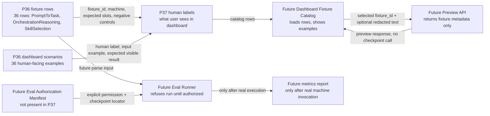

# P37 - wiring design: dashboard/API и будущий runner

## Короткий смысл

P37 не запускает обучение, не запускает eval и не меняет checkpoints. Этот срез делает только проект связи: как 36 строк из P36 должны стать понятными человеку test cases в dashboard/API, и как будущий runner должен читать те же строки без права притворяться, что preview или smoke test уже доказали качество модели.

Главное правило: dashboard preview показывает пример и границу доказательства. Runner execution появится только в будущей фазе, после отдельной авторизации eval и checkpoint lifecycle.

## UML / Mermaid flow для draw.io

## Симуляции по веткам

| Ветка | Пример входа | Ожидаемый результат |
|---|---|---|
| Fixture -> label | `P36-PROMPTTOTASK-01` | Dashboard показывает русское имя, redacted input, expected slots и предупреждение, что eval не запускался. |
| Label -> dashboard | Пользователь выбирает строку SkillSelection | Поле ввода заполняется примером, рядом видно что должно быть в ответе и какие debug-поля ожидаются. |
| Dashboard -> preview API | Нажат preview/run на P37 surface | API возвращает metadata preview. Checkpoint, training и eval runner не вызываются. |
| Fixture -> future runner без authorization | Runner получает P36 row с `eval_execution_allowed=false` | Runner обязан отказать в выполнении и вернуть честный not-authorized result. |
| Future runner с authorization | Будущая фаза даст eval manifest + checkpoint locator | Только тогда runner может вызвать machine и записать numeric metrics; P37 этого не делает. |

## Алгоритмы без кода

### Алгоритм 1. Как fixture row становится видимой строкой dashboard

1. Будущий `ApiEvalFixtureCatalog` читает `p36-eval-fixtures.jsonl` и `p37-dashboard-human-labels.jsonl`.
2. Он соединяет строки по `fixture_id`.
3. Для каждой строки dashboard показывает: человеческое имя API, безопасный redacted input, ожидаемый видимый результат, debug-поля и границу доказательства.
4. Если у fixture нет label row, dashboard QA должна падать: такой пример нельзя считать удобным для пользователя.
5. Эта ветка не запускает модель. Она только делает будущие проверки видимыми и проверяемыми.

### Алгоритм 2. Как dashboard preview должен работать позже

1. Пользователь выбирает fixture row.
2. Dashboard отправляет `fixture_id` и optional redacted input в будущий `ApiEvalFixturePreviewService`.
3. Preview service возвращает expected slots, warnings и evidence boundary.
4. Если `eval_execution_allowed=false`, service не вызывает runner и не читает checkpoint.
5. UI показывает результат как preview/design evidence, а не как качество модели.

### Алгоритм 3. Как будущий runner должен потреблять эти строки

1. Будущий `EvalFixtureRunner` читает fixture batch и source-disjoint manifest.
2. До любого вызова модели он проверяет authorization manifest.
3. Если authorization отсутствует, runner возвращает отказ: строки готовы к wiring, но eval execution запрещен.
4. Если authorization появится в будущей фазе, runner проверит source-family disjointness и negative controls.
5. Только после реального вызова машины runner сможет записать metrics. Static JSON, preview или dashboard smoke не могут закрыть semantic quality.

## Поверхности dashboard/API, которые должна реализовать будущая фаза

| Поверхность | Человеческое имя | Что вводит пользователь | Что видит пользователь | Что это доказывает |
|---|---|---|---|---|
| Fixture catalog | Каталог проверочных примеров API | Ничего или фильтр по машине | Список примеров с русскими названиями | Только видимость test cases. |
| Fixture preview | Предпросмотр одного проверочного примера | Redacted prompt или выбранный fixture | Expected slots, warnings, debug fields | Только handler/dashboard wiring. |
| Future eval run | Будущий authorized eval runner | Eval manifest + checkpoint locator + fixture batch | Numeric metrics after real run | Только будущая фаза может доказать качество. |

## Как P36 строки становятся test cases

- Каждая строка `p36-dashboard-api-scenarios.jsonl` получает human label в `p37-dashboard-human-labels.jsonl`.
- `p37-test-plan.jsonl` описывает будущие unit, integration, dashboard e2e и QA checks.
- QA должна проверять не только что кнопка нажалась, но и что человек понимает: имя API, пример ввода, ожидаемый результат, debug boundary, warnings.
- Если dashboard показывает только технический id или JSON без объяснения, P37-design считается неисполненным в будущей фазе.

## Что остается вне P37

- Нет product-code edits.
- Нет реального dashboard implementation.
- Нет runner implementation.
- Нет training run.
- Нет eval run.
- Нет checkpoint rewrite.
- Нет promotion.
- Нет Claude/Cursor/Codex host runtime evidence.

P37 создает карту проводов и тестовые ожидания. Следующая implementation-фаза должна будет доказать эти ожидания кодом и QA automation, но P37 сам этого не утверждает.
