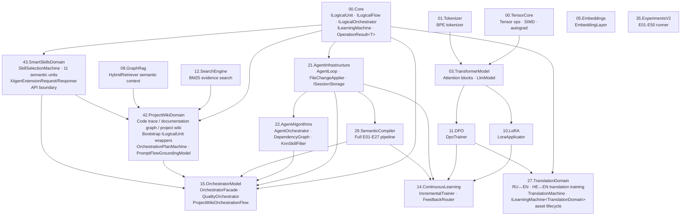
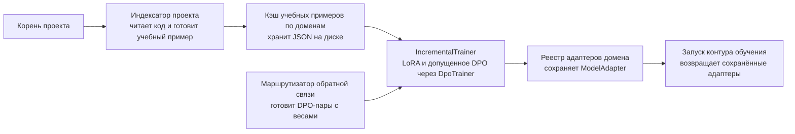
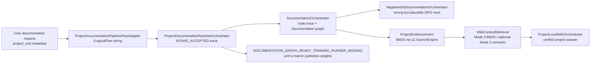
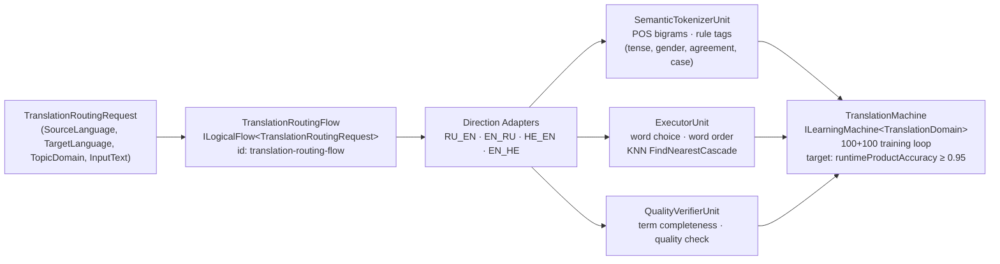
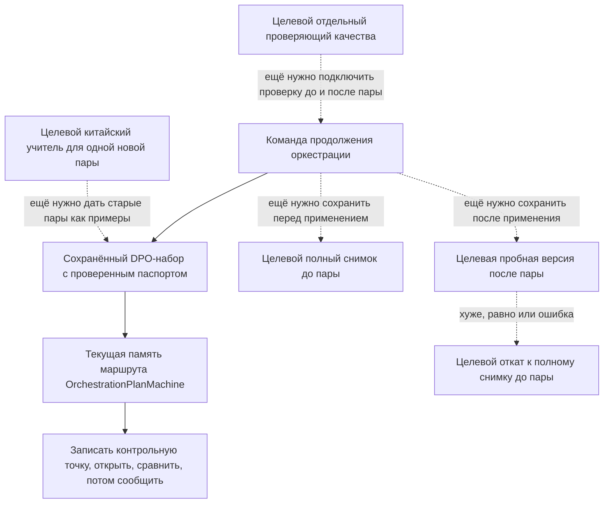
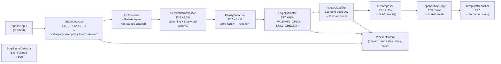
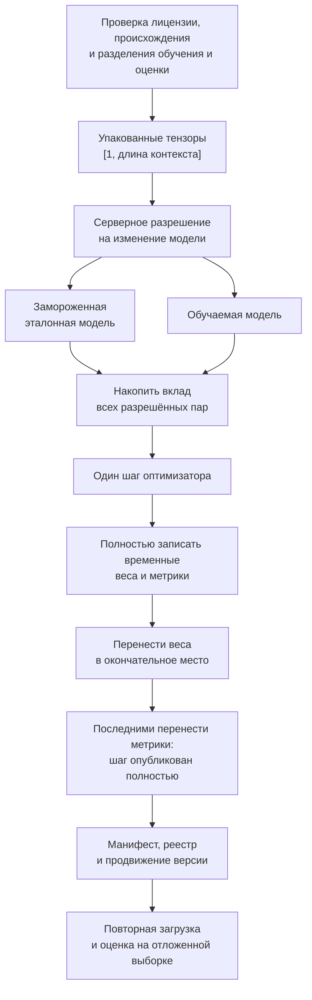
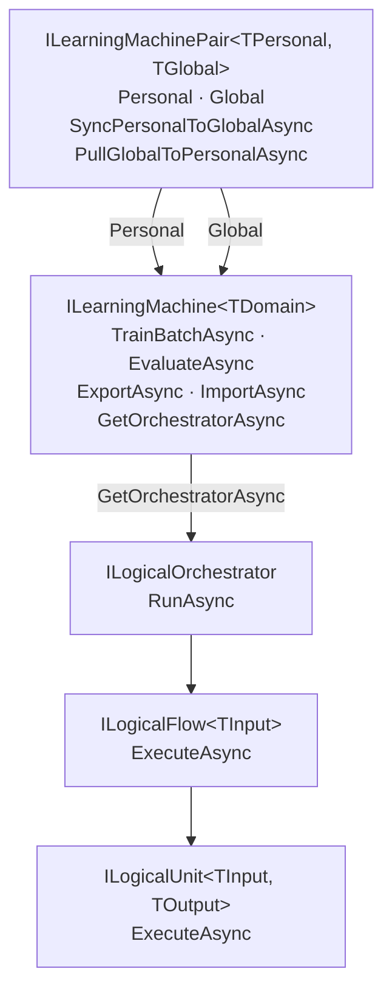

# ARCHITECTURE.md — LlmFromScratch System Architecture

Последнее обновление: 2026-09-08 (repository-owned reference-matching calibration manifest sealer/opener, repository-owned frozen reference corpus disk sealer/opener and canonical address boundary, repository-owned training artifact clone custody preparation for DPO/model strict readers, DesignConversion repository-owned DPO dataset creation/reuse, DesignConversion ModelServer improvement-loop server-owned DPO context wiring, Translation DPO source-row identity reuse guard, Orchestration DPO clean-miss creation/reuse, Translation CLI repository-owned DPO/model entrypoint, CodeDocumentation server-owned DPO training lease broker/executor, CodeDocumentation CLI ModelServer train-and-publish bridge, tracked lease clone-safety and cross-process incremental trainer child checkpoints, shared remote routing transport extracted below ModelServer authority, repository model index manifest/checkpoint hash binding)

## Documentation Navigation

This architecture file is the high-level system map. Detailed, human-readable
implementation documentation for each project is indexed in
[`docs/projects/PROJECT-DOCUMENTATION-INDEX.md`](projects/PROJECT-DOCUMENTATION-INDEX.md).
Use those per-project documents for UML, algorithm steps, code references,
test/QA mapping, and honest status boundaries. This file intentionally does not
duplicate every project-level detail.

### Repository-wide source scanners used by tests

Some architecture tests inspect the repository tree to prove source ownership:
for example, one literal should have exactly one production owner, or one
contract record should have exactly one production definition. Those tests must
scan source files through `RepositorySourceScanner`, not through a raw recursive
`Directory.EnumerateFiles` call.

The reason is practical and architectural: the repository can contain service
folders from previous test runs, evidence capture, build output, or protected
temporary lock probes. Those folders are not product source. A source-ownership
test should skip them and tolerate inaccessible leftovers, while still failing
when the same literal or type is duplicated in real source code.

### Repository model index integrity

`models/index.json` is an inventory of already-materialized repository assets,
not a source of trust by string pointer. A model row is active/preservable only
when it names both a repository-relative `manifest_path` and `checkpoint_path`,
contains lowercase SHA-256 bindings for the manifest and checkpoint, and those
hashes match the current physical files in the checkout. The
`manifest_checkpoint_sha256` field intentionally repeats the physical
checkpoint hash: it binds the manifest row to the same checkpoint bytes that the
loader will open.

`00.Core/RepositoryModelIndexIntegrityGuard.cs` owns this repository-wide
validation. Domain publishers such as Translation remain consumers: before they
update `models/index.json`, they validate all existing rows and fail closed if
an unrelated row is incomplete, points outside the repository, crosses a
reparse point, names a missing file, or has stale hashes. Phase 08 lifecycle
checks also use the guard, so a manifest-only row no longer makes an
orchestration common leg look active.

The `orchestration-v1` registry row now binds the existing
`models/orchestration/orchestration-v1/manifest.json` and
`models/orchestration/orchestration-v1/orchestration-v1-checkpoint.json` bytes
by SHA-256. This was metadata binding only: no checkpoint, manifest payload,
training data, training run, or semantic-quality field changed.

### Cross-platform ownership for test output roots

Tests that create generated evidence outside the repository use
`TestOwnedOutputRoot` instead of writing directly into a developer-selected path.
The helper creates a GUID-named direct child under the operating system temp
directory, rejects repository paths, rejects parent traversal, and refuses to walk
through an existing link or reparse segment.

The platform contract is intentionally asymmetric. Windows keeps the strongest
guarantee: cleanup opens each traversed directory with a native handle that does
not follow reparse points and does not allow delete-sharing, so another process
cannot rename that directory while cleanup is enumerating it. Linux and macOS
cannot provide the same mandatory no-delete-share rule, so their contract is
no-follow ownership rather than rename prevention: cleanup opens the directory
with `O_DIRECTORY`, `O_NOFOLLOW`, and `O_CLOEXEC`, takes an advisory `flock`, and
fails closed if the final path component is a symbolic link. The Unix regression
test proves that a directory link inside the owned root is removed as a link and
does not delete the external target.

### DesignConversion durable storage on Windows and Linux

`44.DesignConversionDomain/DesignConversionHandleBoundDirectory.cs` is the
shared durable-file boundary for post-evaluation state and Design-to-Code DPO
storage. It is not a plain `File.Move` wrapper: callers use it when a JSON or
JSONL authority file must be opened, inventoried, replaced, or deleted without
following links into a different authority tree.

Windows remains the strongest implementation. It opens every root segment and
leaf relative to retained native handles with no-reparse flags, validates the
final handle path and file identity, relies on Windows share modes for the
exclusive mutation lease, and flushes the containing directory after namespace
changes.

Linux/WSL now has a separate production backend instead of failing as an
unsupported platform. The Linux backend pins the root with an opened directory
file descriptor, opens leaves with `openat` plus `O_NOFOLLOW` and `O_CLOEXEC`,
validates regular files by stable `device+inode` identity, uses advisory
`flock` where the store requires an exclusive mutation lease, publishes with
collision-denying `renameat2(RENAME_NOREPLACE)`, deletes with `unlinkat`, and
calls `fsync` on the containing directory after publication or deletion. This
support is intentionally documented as Linux/WSL support, not broad Unix
support: macOS still fails closed until it has its own audited constants,
identity structure, and atomic rename primitive.

Переносимая конкуренция mutation lease — это отдельный sidecar-контракт
`DesignConversionDeterministicMutationLock`, а не переименование Windows
delete-share oracle. Перед записью authority, checkpoint, run/local-promotion
журналов и activation registry код обязан получить общий lease: Windows
классифицирует только share/lock нарушения `32/33`, Linux/WSL считает
конкуренцией только ошибку errno `11`, полученную внутри узкого acquire-пути
этого sidecar-а: либо при открытии файла .NET-слоем, либо при нашем
`flock(LOCK_EX|LOCK_NB)`. Любой другой `IOException`, включая raw errno `11`
за пределами acquire-пути, остаётся обычным storage failure и не ретраится.
Отмена во время ожидания lease завершается до публикационной границы: старые
байты, журналы и кэши остаются как были, а повтор после освобождения lease
выполняет ровно одну мутацию.

The same file is the only low-level POSIX authority for Design-to-Code runtime
checkpoint publication: Linux advisory publication locks, physical directory
identity, symbolic-link path screening, and no-follow regular-file snapshots
are exposed to the checkpoint bridge through this boundary rather than through
duplicate `libc` declarations. That keeps ownership and failure classification
in one audited place; the bridge still performs fresh-load, route validation,
rollback, and Windows-native publication through its existing path.

Служебное хранение материала кандидата использует эту же границу вместо прежней
Linux/WSL-проверки «по имени файла». Защищаемый объект — секретный конверт,
который связывает материал кандидата с локальным журналом полномочий. Если
процесс может подменить корень служебного каталога, заменить подготовленный файл
символической ссылкой, добавить жёсткую ссылку или положить чужой готовый файл
на ожидаемое имя, последующая приёмка прочитает чужое доказательство под
доверенным именем. После переименования или подмены строковый путь уже не
доказывает владение, поэтому Linux удерживает открытыми корень служебного
хранилища, `stage` и `committed`, выполняет операции относительно этих каталогов
с `O_NOFOLLOW`, требует права только для владельца и обычный файл с одной
ссылкой, публикует подготовленный конверт в `committed` через межкаталожное
переименование без перезаписи или, на v9fs-монтаже Windows-диска, через
`linkat` + `unlinkat` между удержанными каталогами. Проба на `/mnt/c` показала:
`renameat2(RENAME_NOREPLACE)` возвращает `EINVAL`, а `linkat` создаёт ссылку
относительно удержанного корня, отдаёт `EEXIST` при занятом имени, после
удаления исходного имени оставляет готовый файл с одной ссылкой, и оба каталога
можно сбросить на диск. Если WSL работает с Windows-диском через v9fs, права и
числовой владелец POSIX не выдаются за доказательство приватности: там остаются
открытие без следования ссылкам, файловая личность и счётчик жёстких ссылок, а
права «только владельцу» применяются только на файловых системах, где они
реально являются Linux-владением. Windows сохраняет прежний маршрут
`SecureLocalFileBoundary` с ACL, запретом `reparse`-переходов и проверкой
личности открытого дескриптора; Linux-маршрут добавляет переносимое
доказательство, а не ослабляет Windows-доказательство. Оставшийся долг явно
ограничен: поддержана нативная раскладка Linux/WSL x64, а macOS, Linux arm64 и
неизвестные платформы падают закрыто, пока для них нет своих констант и правил
файловой личности.

For Design-to-Code DPO checkpoint publication, the step reservation has two
explicit platform contracts. Windows keeps its create-new handle, byte-range
lock, and delete-on-close behavior. Linux/WSL x64 instead uses a persistent,
deterministically named service lock file: the trusted checkpoint parent is
opened with `O_DIRECTORY`, `O_NOFOLLOW`, and `O_CLOEXEC`; the lock leaf is
opened without following links, validated as a regular file, and protected by
an independent `flock(LOCK_EX|LOCK_NB)` through final publication and producer
cleanup. Release only unlocks and closes that fd. An existing sidecar is normal
reuse and is never treated as an active reservation merely because its name
exists. These Linux primitives live in
`DesignConversionHandleBoundDirectory`; duplicate raw POSIX bridge declarations
are not part of the contract.

The evaluated bridge separately retains Linux file descriptors for its owned
temporary and final files. Before `unlinkat`, it reopens the file name through
the retained parent-directory descriptor and compares that directory entry with
the physical identity of the long-held file. A
replacement, symlink, hard link, or moved root is preserved and the operation
fails closed. If a legacy lease has only a path, hash, and prior identity
snapshot, Linux keeps the file as explicit cleanup debt instead of deleting by
metadata after the original handle is gone. The bridge may remove the persistent
service lock file only while removing an independently proven owned scratch
namespace; a normal checkpoint directory keeps it for reuse. These native layouts are verified only on Linux/WSL x64.
Linux arm64, macOS, and unknown operating systems fail closed rather than reuse
the x64 `stat` layout or claim equivalent support.

Checkpoint publication and promoted-parent continuation deliberately keep a
different runtime oracle on Windows and Linux. Windows `FileShare.Read`/
`FileShare.Delete` is mandatory kernel sharing: while the retained handle is
alive, direct write/delete/move attempts are expected to fail. Linux `flock` is
only advisory, so legal readers, replay-safe concurrent publishers, and test
callbacks must still be able to open the artifacts; the Linux guarantee is
instead the retained directory/file identity opened with no-follow semantics,
length plus SHA-256 readback, and already-materialized path-free snapshots for
deferred checkpoint transfer. After prepare, any retained policy/runtime
checkpoint mutation is classified as a write failure. Rollback is allowed only
through the same retained handle, then it must flush, reread the same handle,
and compare length and hash; if identity was lost or the pathname now refers to
a foreign/same-content replacement, cleanup never deletes that pathname and
leaves it as explicit reconciliation debt.

Leaf-name validation also follows the actual platform contract. Every backend
rejects empty names, embedded NUL characters, separators, and dot components.
Linux/WSL additionally enforces the Linux `NAME_MAX` boundary as 255 UTF-8
bytes. Windows keeps its native UTF-16 component rule, so a legal 86-character
Chinese name is not rejected merely because its UTF-8 representation is 258
bytes.

Для post-evaluation state-store на WSL `/mnt/c` важен отдельный same-directory
маршрут публикации. v9fs на Windows-диске может вернуть `EINVAL` на
`renameat2(RENAME_NOREPLACE)`, поэтому Linux backend не объявляет такую среду
unsupported сразу, а использует строгий запасной путь через удержанный directory
fd: `linkat` создаёт canonical имя только если оно свободно, затем код сверяет
`device+inode` и link-count `2`, делает `fsync` каталога назначения, удаляет
temp-имя через `unlinkat`, делает `fsync` исходного каталога и проверяет, что у
canonical файла осталась одна ссылка. Это сохраняет no-overwrite и durability
без заявления Windows-style защиты от любого чужого rename.

Recovery после падения в этом окне не восстанавливает «любой `.tmp`». Оно
принимает только temp-имя, построенное нашим writer'ом, с тем же
`device+inode`, размером и валидным JSON payload, что и canonical state; иначе
store падает закрыто. На `/mnt/c` также не заявляется POSIX owner-only privacy:
v9fs может показывать `0777 uid=0`, поэтому evidence там — удержанные каталоги,
`O_NOFOLLOW`, identity и link-count, а не права владельца. Перед открытием leaf
handles inventory делает name-only preflight: считает только state/backup имена
и проверяет quota до recovery, чтобы превышение лимита не открывало лишний leaf
handle и не запускало cleanup.

Свежая проверка этого slice честно ограничена WSL isolated evidence: точечная
Linux UTF-8 validation прошла 1 из 1, а весь класс
`DesignConversionPostEvaluationStateStoreTests` прошёл 122 из 122 на current
diff. После отдельной правки training-intake DPO pair-store финальный combined
WSL-прогон через live source-isolated after-core harness прошёл 11 из 11:
resolver 7 из 7, host integration 3 из 3 и точный concurrent corpus replay 1
из 1. Full corpus/DPO suite green здесь не заявляется.

Training-intake DPO pair-store deliberately has a narrower WSL relocation than
the generic `FileDpoPairStore`. Generic pair-store storage still fails closed on
v9fs when the filesystem cannot prove the required owner-only lock/state
boundary. Only the DesignConversion training-intake product DB resolves its
pair-store root away from an artifact root on `/mnt/c`: if the artifact root is
on a WSL Windows-drive mount and the legacy in-artifact pair directory is empty,
`DesignConversionTrainingIntakeDpoPairStoreRootResolver` chooses a native Linux
state base, creates
`xiigen/design-conversion/training-intake-dpo-pairs/<fingerprint>`, and writes
`training-intake-dpo-pair-store-root.manifest.json` in the artifact root. The
manifest binds the artifact-root identity/fingerprint to the native pair-store
root, native directory device/inode/effective user, filesystem type, and WSL
machine/distro identity. Missing native root, changed identity, or changed
configured state source fails closed; the manifest is not itself a pair-record
journal. First-start publication writes manifest bytes to a unique temp leaf in
the same handle-bound artifact directory, flushes that file, then uses
no-replace rename plus directory flush for the final manifest name. A concurrent
resolver that loses publication accepts only exact final bytes and cleans only
its own temp leaf.

The native state base is deterministic: explicit
`DesignConversionTrainingIntakeDpoPairStoreOptions.NativeStateRootOverride`
wins, otherwise the resolver uses `XDG_STATE_HOME`, then `$HOME/.local/state`.
Production never defaults this store to `/tmp`; `/tmp` is only acceptable when a
test process explicitly passes it as the native state root. A non-empty legacy
pair directory under the artifact root is treated as split-brain/migration debt
and fails closed before any native store is selected. The native root is rejected
on `9p`, `drvfs`, and `v9fs` mountinfo entries even when they use a nonstandard
mountpoint. During first-start races the resolver reopens the artifact-root
manifest and accepts only exact bytes for the same binding. Windows and normal
Linux artifact roots keep the old in-artifact root, so their storage contract is
unchanged.

### Scoped deterministic initialization for DPO base models

`00.TensorCore/Init/Initializers` keeps the legacy process-wide random generator
for existing unscoped callers, but it also exposes
`Initializers.UseDeterministicSeed(ulong)`. The scope is bound to the current
logical execution context, supports nested `using` blocks, and restores the
previous seed context on dispose. It does not expose a mutable `Random` instance
and does not reset the process-wide fallback generator.

DesignConversion DPO base-provider tests use this scoped seed while constructing
the policy, reference and fresh-load `LlmModel` objects. That makes the initial
base checkpoint a function of the published root seed and model config, not of
which neighbouring test happened to construct a transformer first. The local
promotion gate still uses the real evaluated DPO held-out score; if that score
falls below the configured threshold, readiness remains false.

### DesignConversion DPO pair admission boundary

DesignConversion training rows now carry pair-side author kinds on the live
`DesignConversionDpoTrainingRecord`/stored-example surface and preserve those
fields through content capture. The bridge does not infer legal authorship from
score: independent teacher preference maps generated side to `OpenTeacher` and
incumbent side to `LocalModel`, while an incumbent-preferred receipt reverses
chosen/rejected but keeps the same source identities. Exact
`DeterministicNoExternalTeacher` provenance remains the only way to mint a
`DeterministicGenerator`/`DeterministicGenerator` admission.

`DesignConversionDpoPolicyCheckpointBridge` creates `DpoBatch.Admission` only for
standalone/evaluated training inputs and binds it to raw
`Prompt`/`Chosen`/`Rejected`, not to token ids or post-tokenization tensors.
Candidate-only teacher authoring is still quarantine/no-train-authority until an
independent preference receipt exists. Held-out packing and runtime inference
intentionally keep `DpoBatch.Admission = null`, because they are evaluation or
serving paths, not trainer-entry authorization.

### Local Qwen as an independent DesignConversion judge

`DesignConversionLocalIndependentPreferenceEvaluator` now asks the pinned local
Qwen/Ollama model to compare the rendered HTML and CSS of the generated and
incumbent candidates. The prompt lists the only two allowed labels,
`generated` and `incumbent`, separately from the instruction and tells the model
to choose the better content. It does not contain a copyable pseudo-answer.
The response parser still accepts only the canonical five-field JSON schema,
the exact request and candidate identities, and one of those two labels.
Missing, timed-out, malformed, extra-field or identity-mismatched output creates
neither a preference receipt nor a training pair. A valid receipt is consumed
once; there is no fallback to a deterministic metadata comparison.

The evaluation-only inference profile is intentionally different from teacher
authoring: explicit JSON output, `think=false`, `num_ctx=8192`,
`temperature=0`, `seed=0`, `num_predict=256` and a 120-second request deadline.
Its canonical configuration fingerprint is
`00be8f07e2f5d5d6e4a8c3a389a643dbcd4a1b37af4112432c9872ffd137b1cc`;
the output-affecting options and the separate deadline are bound into that
fingerprint. The authoring profile keeps its previous byte-exact request,
30-second deadline and fingerprint
`b6b088d7fbee1bece702df1448e309b8a88335178a5bc84b2376bd68699453bf`.
`DeterministicDesignConversionComparisonProvider` and other metadata-only
comparators remain useful preflight evidence, but they are not independent
quality judges and cannot mint this receipt.

Capability/Logical DPO now closes the remaining product bridge. The
Capability trainer marks current and sealed replay rows as
`DeterministicGenerator`/`DeterministicGenerator`, while the raw replay-mixer
compatibility overload deliberately remains authorless and cannot enter
training admission. `DesignConversionDpoTrainingHandoff` copies directed
author kinds into the same `LogicalDpoTrainingUnit` bridge without reinference.

Prompt 10 status after capability-pair admission remains human-scoped, not a
full-suite claim: product bridges with pair admission are `5/5`. The low-level
trainer now adds the final fail-closed door on all three mutating entrances:
`Step`, `StepMany`, and `StepVector` require a non-paid
`DpoTrainerPairAdmission` before the server mutation permit, optimizer/RNG
mutation, or artifact publication. `EvaluateMany` stays read-only and does not
require admission.

### DesignConversion DPO checkpoint mutation admission boundary

Promoted-parent continuation now carries a live, internal
`DesignConversionDpoCheckpointMutationAdmission` in memory. The admission is
minted only after the retained parent artifacts have been reread, current
source/policy contracts have passed the existing current-only validators, and
the policy checkpoint bytes match the contract SHA-256, byte length and leaf
file identity. It binds that checkpoint identity, artifact-set identity,
policy-contract schema, training-context schema version, legal-teacher
commitment fingerprint, base checkpoint SHA and current source/training
manifest SHA. The same already-verified checkpoint snapshot bytes are cloned
into two strictly scoped one-shot sources: a hidden bridge-proof source for
expected-state construction, and the existing provider-transfer source for the
built-in checkpoint-backed provider.

The admission is not a second DPO pair authority and is not a persisted sidecar:
read-only import, load, evaluation and export can still inspect legacy or
unattested checkpoints. Mutating continuation cannot. The continuation provider
fails closed before opening tokenizer/checkpoint sources when admission is
missing, legacy/unattested or mismatched. The bridge owns the mutable-base
proof: before provider model-set acquisition it recomputes the checkpoint
SHA/length from the admitted bytes, opens only the hidden bridge-proof source,
loads bridge-owned policy/reference/fresh-load models from that exact
checkpoint, and stores only an internal expected model-set state fingerprint.
Provider acquisition is a non-authoritative load/read of an untrusted
candidate, not a server-owned mutation boundary. After provider model-set
acquisition, the bridge compares the actual returned policy/reference/fresh-load
weights against that fingerprint; only after that comparison succeeds may the
first server-owned mutation permit be acquired (`policy_provider_result`), and
only then may LoRA/trainer step or artifact publication proceed. Providers never
supply checkpoint mutation authority on the returned model set, and the proof is
not a public bearer token that can be copied with a record `with`; a custom
provider that returns public-contract-compatible but foreign weights is
quarantined with the typed mismatch error before any mutation permit is issued.
A hand-written JSON file cannot grant mutation authority.
The typed prepared evaluated overload follows the same ordering: its prepared
capture step is immutable clone/revalidation bookkeeping and never acquires a
server-owned mutation permit before provider actual-state validation.

Re-attestation/rebuild remains a controlled verifier operation. It must bind
the exact checkpoint SHA-256, byte length and file identity to the validated
current source/policy contracts, source/training manifest SHA and legal-teacher
commitment fingerprint. If an older checkpoint has no current source/training
manifest evidence, it remains readable but quarantined from mutation until a
trusted rebuild or re-attestation supplies that input.

Свежая граница доказательств на 2026-08-25 остаётся узкой. WSL Ubuntu 24.04 на
net9 прошёл финальный combined run 11 из 11 с native state root под
`/tmp/pair-store-final-xdg.6PFkPB`; native directories были `0700`, файлы
lock/ledger/consumption — `0600`, а временный state root удалён после проверки.
Windows after-core запуск не был заблокирован App Control: из 11 обнаруженных
строк выполнены 4, прошли 3, упал 1 exact concurrent corpus replay, 7 WSL-only
tests были skipped по платформе. Этот Windows отказ классифицирован как
неразрешённый старый concurrency debt, а не как доказанная поломка WSL
pair-store relocation. Более широкий WSL regression harness по пяти семействам
дал 142 passed из 155 executed; три выбранных отказа воспроизвелись на base
control commit (`4aecdeabc2ab660b3905a03374a72ea68b84b17d`), поэтому здесь нет
полного pair-store-family green claim.

The local-promotion journal has one extra Windows-only custody check: NTFS
alternate data streams. Windows rejects a journal member when the canonical
`::$DATA` stream is not the only stream attached to the file. Linux/WSL does not
call the Windows `kernel32.dll` inspection path, because NTFS alternate streams
are not the Linux filesystem surface being defended there; after the
no-follow regular-file, stable `device+inode`, and link-count checks pass,
the Linux journal continues instead of failing as a Windows DLL load error.

The publication race guarantee is intentionally different per platform. Windows
keeps the old destination open with sharing that blocks external rename/delete
until publication has either moved it to backup or failed. Linux advisory locks
cannot stop an uncooperative `rename`, so Linux preserves the verified old
destination in the canonical `.publication-backup` file before exposing the
race window. If another process then creates or renames a foreign file onto the
destination name, publication fails with a trust-boundary collision error,
keeps the foreign file untouched, removes its own temp, and leaves the old
state in backup for manual reconciliation. A backup that is found only after a
restart is not treated as trustworthy authority by its filename alone: the
store fails closed with a human reconciliation message and preserves every
destination and backup file instead of promoting the backup automatically.
During a normal successful publication, the still-open, identity-checked backup
may be deleted only after the new destination and the containing directory have
been durably flushed.

### Private persistence for dynamic graph composition state

The local dynamic graph composition server writes checkpoints only into a
managed private directory tree. Before `DynamicGraphCompositionSessionPersistence`
opens that tree, `DynamicGraphCompositionFileSystemPolicy` normalizes the path,
keeps the readiness file outside the state directory, creates missing parents,
and then verifies that the final directory is private.

On Windows, the privacy check accepts only the current account, LocalSystem, and
built-in administrators. A directory that inherited broad access for groups such
as Users, Authenticated Users, or Everyone is rejected before any checkpoint is
written. On Unix-like runners, the directory must be owner-only. This fail-closed
rule protects the selected-target evidence handle: the checkpoint may keep the
minimal proof needed to restore a composition session, but it must not be stored
under a location that other local principals can read or rewrite by default.

The production round-trip test for the selected-target evidence handle therefore
creates a private root explicitly before constructing the persistence service.
That fixture setup does not relax production security. It removes dependence on
the developer machine's default profile-directory permissions, then lets the
production policy prove the real invariant: broad inherited access stays
rejected, while an owner-only directory can persist and restore a sanitized
checkpoint without writing the sensitive capture payload back to disk.

---

## 1. Subproject Dependency Graph



---

## 2. Agent Pipeline Data Flow (15.OrchestratorModel)

Accepts a user task string; returns a quality-checked, merged result string.

```mermaid
flowchart LR
    Task["User Task<br/>(string)"]
    SC["StopSignalDetector<br/>29.StopSignalDetector<br/>≤4 words → DONE"]
    EC["EpisodeClassifier<br/>29.RouteClassifier<br/>→ Domain (BUG/PLAN/ARCH/REFACTOR/CODE_Q)"]
    ED["EpisodeDecomposer<br/>22.ComplexTaskDecomposer<br/>→ SubTask[]"]
    DG["DependencyGraph<br/>22.DependencyGraph<br/>→ sorted levels"]
    AL["AgentLauncher<br/>22.AgentOrchestrator<br/>→ string[] results"]
    RM["ResultMerger<br/>ITemplateBeautifier<br/>→ merged string"]
    QO["QualityOrchestrator<br/>16-check pattern<br/>→ pass / RETRY"]
    Out["OperationResult&lt;string&gt;<br/>(final answer)"]

    Task --> SC
    SC -->|"not stop"| EC
    EC --> ED
    ED --> DG
    DG --> AL
    AL --> RM
    RM --> QO
    QO -->|"pass"| Out
    QO -->|"fail → retry ≤3"| AL
```



Key interfaces used at each step:

| Step | Interface | Source project |
|---|---|---|
| StopSignalDetector | `IStopSignalDetector` (Core/Interfaces.cs) | 15.OrchestratorModel |
| EpisodeClassifier | `IRouteClassifier29` | 29.SemanticCompiler |
| EpisodeDecomposer | `ITaskDecomposer` | 22.AgentAlgorithms |
| DependencyGraph | `DependencyGraph` (class, reused) | 22.AgentAlgorithms |
| AgentLauncher | `IAgentMessageBus` | 22.AgentAlgorithms |
| ResultMerger | `ITemplateBeautifier` | 15.OrchestratorModel Fabric |
| QualityOrchestrator | (internal) | 15.OrchestratorModel |

---

## 3. Continuous Learning Pipeline Data Flow (14.ContinuousLearning)

Этот слой отвечает за путь “разрешённые учебные данные → изменённое состояние модели → сохранённый результат”. Важно держать три разные вещи раздельно: DPO-пары сначала живут как сохранённый набор с проверенным паспортом в репозитории; `IncrementalTrainer` уже имеет реальный общий путь LoRA/DPO через `StableDpoTrainingExecutor` и `11.DPO:DpoTrainer`; текущая команда продолжения оркестрации пока обновляет память ближайших примеров и веса выбора маршрута в `OrchestrationPlanMachine`, а не нейросетевые веса общего тренера.



Правила делегирования: этот слой соединяет готовые компоненты, а не переписывает их.

| Забота | Куда делегируется | Правило |
|---|---|---|
| Определение языка и маршрута | `ISemanticCompiler29` из проекта 29 | Принцип делегирования |
| Градиентное обновление LoRA | `LoraApplicator` из 10.LoRA | Правило делегирования обучения |
| Обучение по предпочтениям DPO | `DpoTrainer` из 11.DPO | Правило делегирования обучения |
| Формула максимального веса | `D-09: total/(domains×rare)` | Зафиксированное решение `D-09` |

### Frozen reference corpus foundation

В `14.ContinuousLearning/Core/FrozenReferenceCorpus.cs` живёт фундамент для
замороженных корпусов эталонов и машинной калибровки правил сопоставления
«ответ ученика — эталон». `14.ContinuousLearning/Training/RepositoryOwnedReferenceCorpusManifest.cs`
закрывает следующий storage-срез: caller-supplied `FrozenReferenceCorpus`
запечатывается в repository-owned directory и после restart строго
восстанавливается из тех же Git-visible bytes.

Один `FrozenReferenceEntry` хранит шесть обязательных смыслов: вход владельца
предмета, ответ закрытой платной модели как эталон, отдельный
`PaidReferenceProvenance`, `DomainTag`, `SubjectId`, сторону разреза
train/held-out и fingerprint исходной сущности. `PaidReferenceProvenance`
намеренно не является `TrainingTeacherProvenance`: он доказывает closed paid
reference, UTC-время получения эталона, hash текста эталона и два запрета —
paid reference никогда не становится обучающим примером и никогда не становится
chosen/rejected стороной DPO. Поэтому paid bytes могут быть прибором измерения,
но не источником градиента.

`FrozenReferenceCorpus.Build` принимает имя, версию, caller-supplied UTC-время
заморозки и entries. Version и `FrozenAtUtc` входят в canonical SHA-256, поэтому
следующая заморозка получает новую identity даже при тех же logical entries.
Корпус допускает ровно один `DomainTag` и один `SubjectId`, детерминированно
сортирует entries по id, публикует count/list/hash и fail-closed отклоняет
duplicate entry ids, unsafe identities, noncanonical hashes и source entity,
попавшую одновременно в train и held-out. Разрез проверяется до публикации
hash, чтобы утечка не могла стать «валидным immutable corpus».

`ReferenceMatchingRuleIdentity` хранит машинную identity правила и человеческое
описание прибора. `ReferenceMatchingCalibrationInput` требует два явных набора:
known-positive пары для false miss и known-negative пары для false hit.
Каждая `ReferenceMatchingCalibrationPair` несёт `ReferenceEntryId`; при создании
калибровки этот id ищется в corpus, а hash normalized `ReferenceAnswer`
сравнивается с exact paid-reference hash этого entry. Так нельзя подписать
произвольные пары hash-ем чужого корпуса. Результат калибровки хранит
false-miss count/rate и false-hit count/rate отдельно; canonical `ResultSha256`
v2 связывает числа с `CorpusSha256`, rule identity/version, calibration-set
hash и полным ordered membership списком `known_positive`/`known_negative`
PairId, а не только с denominator counts.

`14.ContinuousLearning/Core/DpoPairReferencePreferenceMatchingRule.cs`
закрывает следующий generic measurement step: given one existing
`ContinuousLearning.DpoPair`, its `DpoTrainerPairAdmission`, one concrete
`FrozenReferenceEntry`, subject id, existing subject matcher identity and
existing `ReferenceMatchingRulePredicate`, it checks whether the DPO chosen side
matches the frozen paid reference while the rejected side does not. It does not
copy subject matchers, invent caller scores, compute distances, call a model, or
write DPO rows. Binding is non-circular: the pair domain, rule identity domain,
frozen entry domain, caller subject id, frozen entry subject id and normalized
owner input must agree, while `FrozenReferenceEntry.EntryId` is only an input
identity for the concrete reference entry and is not stored in either DPO side.
The paid reference answer remains the predicate reference argument; its
normalized hash must not equal either chosen or rejected content, so copying the
paid answer into a DPO side fails closed before the subject predicate runs.
The result records the exact `DpoTrainerPairAdmission.ContentFingerprintSha256`
and includes it as `admission_content_fingerprint_sha256` in the canonical
`ResultSha256`, so two accepted pairs against the same frozen reference and rule
still produce different result hashes when their admitted Prompt/Chosen/Rejected
bytes differ. The raw prompt, chosen answer, rejected answer and paid reference
answer are not stored in the result.

The preference status is intentionally four-way: accepted only for
`chosen=true/rejected=false`; both-match tie, neither-match and rejected-only
all remain rejected with distinct statuses. Authorship is read from the actual
DPO admission and rich pair side authorship: `PaidExternalModel` is rejected on
either side, unsupported/missing authorship is rejected, and the admission
fingerprint must bind to the exact Prompt/Chosen/Rejected bytes. Nonfatal
subject-predicate exceptions return a typed failure like the generic calibration
evaluator; cancellation is not swallowed, matching the existing snapshot
exception policy. This is still a code-level measuring instrument, not a paid
corpus, production DPO generation path, checkpoint, training run, model update,
or quality claim.

`27.TranslationDomain/LanguageTranslateReferenceMatchingRule.cs` — первый
предметный adapter поверх этого generic contract. Он объявляет стабильную
`ReferenceMatchingRuleIdentity` только для domain `language-translate`, включает
в identity scorer `NormalizationProfile`, `MetricProfile` и явно названную
threshold/policy, а наружный predicate сохраняет общий порядок
`candidateAnswer, referenceAnswer`. Внутри boundary adapter вызывает
`LanguageTranslateHeldOutScorer.ScoreOne(referenceAnswer, candidateAnswer)`;
invalid Unicode, oversized input и scorer failure дают fail-closed `false`, а
`EvaluateCalibration` делегирует вычисления в общий
`ReferenceMatchingRuleCalibrationEvaluator` вместо копирования evaluator.
Adapter остаётся прибором frozen-reference calibration, не универсальным
правилом для других domains, не teacher, не training path и не DPO.

`44.DesignConversionDomain/DesignConversionReferenceMatchingRule.cs` добавляет
design-to-code adapter для того же generic contract. Payload остаётся typed
canonical JSON (`domain_tag`, `subject_id`, `pattern_id`, `role`, `visual_axis`,
`markup_axis`), где `PatternId` зафиксирован как `design-to-code`, а роли
асимметричны: `student_candidate` сравнивается с `paid_reference`. Raw JSON
matcher проверяет только полный upstream-admitted payload contract; сам он не
доказывает, что arbitrary JSON был создан сервером. Caller обязан сериализовать
canonicalized output trust-boundary слоя. Match не достаточно получить двумя
независимыми high-score payloads: candidate visual comparison обязан ссылаться
на тот же frozen expected image id и SHA-256, что и paid reference, а
`markup_axis.expected_markup_fingerprint` обязан совпасть с frozen reference.
В этом slice admitted policy намеренно local-PNG-only: evidence refs должны
повторять live `ServerOwnedLocalPngComparisonProvider` field-bound refs
`local-png-comparison:{ComparisonRequestId}`,
`expected-sha256:{ExpectedImageSha256}`,
`rendered-sha256:{ActualImageSha256}` и `diff-sha256:{DiffImageSha256}`, плюс
ProviderKind, Boundary и canonicalized marker. External visual-AI receipt не
допускается этим rule version без отдельной точной receipt-field validation.
Fixture/tests для этого adapter используют только in-memory fake paid
provenance; они не создают production paid corpus, DPO rows, weights,
checkpoint или training authority.

`26.TrainableRouter/Training/OrchestrationReferenceMatchingRule.cs` добавляет
frozen-reference adapter для разложения programming task на orchestration steps.
Это code-level measurement adapter, а не новый authority для runtime planner:
`OrchestrationAcceptanceGateEvaluator` остаётся отдельным self-referential gate
и не promoted, потому что он передаёт `ExpectedSteps` обратно keyword planner и
не сравнивает фактическое decomposition с независимым frozen эталоном. Новый
payload — strict canonical JSON со schema
`xiigen.orchestration-reference-decomposition.v1`, domain
`programming-task-orchestration`, subject
`orchestration-task-decomposition`, pattern `ilearning-orchestrator` и ролями
`student_candidate` → `paid_reference`. Binding намеренно не использует
`FrozenReferenceEntry.EntryId`, потому что entry id хеширует сам answer; вместо
него обе стороны обязаны совпасть по non-circular `reference_case_id`,
`scenario_id` и canonical `source_entity_fingerprint`.

Matcher считает только структуру candidate/reference: exact step-id coverage,
exact ordered step sequence, exact DAG dependency edge set, exact phase-tag set
и exact step-to-phase assignment. Dependency edges и phase tag sets
нормализуются как множества, а ordered step sequence сохраняет ordinal order.
Каждый dependency edge должен идти topologically forward — от меньшего step
order к большему; cycle check выполняется явно и до forward-order check, чтобы
cyclic payload fail closed стабильным cycle-кодом, а одиночный backward edge —
стабильным order-invalid кодом. Step descriptions остаются audit prose и не
являются authority. Malformed/unknown fields, unsafe ids,
duplicate/noncontiguous orders, bad dependency endpoints, self-edges, cycles,
backward edges, role swap, wrong envelope или arbitrary self-score fields fail
closed. Этот slice не создаёт production paid corpus, persisted calibration
numbers, DPO rows, model weights, checkpoints или training-quality claim.

`42.ProjectWikiDomain/ProjectWikiReferenceEvidencePayload.cs` и три отдельных
ProjectWiki adapters закрывают code-documentation subjects внутри общего domain
`project-local-wiki`: C# живёт в
`42.ProjectWikiDomain/ProjectWikiCodeDocumentationReferenceMatchingRule.cs`
с subject `code-documentation-csharp`, Angular живёт в
`42.ProjectWikiDomain/ProjectWikiAngularCodeDocumentationReferenceMatchingRule.cs`
с subject `code-documentation-angular`, SQL живёт в
`42.ProjectWikiDomain/ProjectWikiSqlCodeDocumentationReferenceMatchingRule.cs`
с subject `code-documentation-sql`. Payload имеет typed/versioned JSON-форму
`schema`, `subject_id`, `answer`, `evidence_ids`: subject находится в canonical
payload, а не выводится из prose, расширения файла, SQL-looking `procedure:`
label или префикса evidence id. Это нужно потому, что C#, Angular и SQL живут
под одним generic domain `project-local-wiki`, и один DomainTag не разделяет
предметные reference corpora. Answer нормализуется как bounded frozen-reference
content, evidence ids нормализуются в NFC, сортируются `StringComparer.Ordinal`,
а duplicate/unsafe/oversized ids, unsafe subject и malformed payload дают
fail-closed отказ. Matching rules сравнивают только exact set evidence ids
внутри своего typed subject, не похожесть prose. Поэтому два ответа с разным
текстом, но теми же evidence ids и тем же subject совпадают, а missing/extra id
или C#/Angular/SQL subject mismatch не совпадает.

Важно не смешивать этот instrument с существующим
`ProjectWikiAnswerComposerTrainingRunner.ExactEvidenceAccuracy`: историческая
метрика runner сейчас проверяет subset coverage required ids внутри ответа
ученика, поэтому лишние ids могут пройти тот gate. Новый frozen-reference
adapter строже: он требует exact set equality against paid-reference payload.
Этот срез не создаёт production paid-reference corpus, не публикует calibration
numbers, не вызывает teacher/model и не запускает DPO/training. SQL adapter
остаётся таким же frozen-reference прибором: он принимает только свой typed
subject и exact evidence ids, а не SQL-похожий текст.

`RepositoryOwnedReferenceCorpusManifestSealer` пишет `corpus.json` первым и
`manifest.json` последним в уже существующий адрес
`training-data/reference-corpora/<domain>/<subject>/<version>/`. Manifest
связывает schema/context, domain, subject, corpus version/name, UTC freeze time,
entry count, `CorpusSha256`, repository-relative directory, payload path,
payload byte length, payload SHA-256, manifest path и manifest self-hash.
Повтор с тем же address и теми же bytes идемпотентен; другой корпус под тем же
version возвращает conflict и не перезаписывает уже опубликованные bytes.

Strict opener сначала проверяет canonical repository-owned address и public
clone-custody preparation для `training-data/reference-corpora`, затем читает
bounded stable `manifest.json`, проверяет exact JSON shape, manifest self-hash,
repository-relative payload path, strict descendant relationship, absence of
reparse/symlink-like segments, payload byte length/hash, payload header and
reconstructed `FrozenReferenceCorpus` identity. Подмена payload, manifest
content, payload path, domain/subject/version или отсутствие bytes закрывают
путь отказом: opener не вызывает model/teacher, не регенерирует корпус и не
принимает caller-provided fallback.

При восстановлении paid-reference flags не доверяются JSON-полям: opener
пересоздаёт `PaidReferenceProvenance` и `FrozenReferenceEntry` через публичные
factories, поэтому closed paid reference остаётся только эталоном измерения и не
становится train input или chosen/rejected стороной DPO.

`RepositoryOwnedReferenceMatchingCalibrationManifestSealer` добавляет следующий
durable слой для already-computed calibration numbers. Address строится только
через `RepositoryOwnedTrainingArtifactLayout.CreateReferenceMatchingCalibrationAddress`
и имеет форму
`training-data/reference-corpora/<domain>/<subject>/<corpusVersion>/calibrations/<ruleId>/<ruleIdentitySha256Hex>/<calibrationSetSha256Hex>/manifest.json`.
Перед persist и open sealer заново открывает linked frozen corpus через
`RepositoryOwnedReferenceCorpusManifestSealer.OpenSealed`; caller-provided corpus
hash или наличие файла не являются authority. Manifest хранит только
schema/version/context, canonical repo-relative address, linked corpus manifest
path/hash, domain/subject/corpus version, corpus SHA/count, rule domain/id/version,
human-readable rule identity description and identity SHA, calibration-set SHA,
known positive/negative counts and IDs,
false-miss count/rate/IDs, false-hit count/rate/IDs, evaluator `ResultSha256` и
manifest self-hash. Raw paid reference answers, raw candidate answers, DPO sides,
weights and checkpoints are not serialized. Same exact bytes at the same address
are idempotent; different valid numbers at the same address return conflict; any
missing/tampered linked corpus, self-hash, count/rate/id/result relationship or
unsafe address fails closed. `ResultSha256` uses the membership-bound v2
canonical form, including ordered known-positive and known-negative PairId
arrays before false-miss/false-hit IDs. The stored rule description is also
canonical: open reconstructs `ReferenceMatchingRuleIdentity` from the manifest
fields and exact-compares the normalized description, domain, rule id, version
and identity SHA.

`EvaluatePersistAndSeal` is the live one-call entrypoint for domain workers that
already have a calibration input and a domain rule predicate. It evaluates the
rule, derives the repository-owned calibration address from the sealed corpus
domain/version, the explicit subject slug, the rule id/identity hash and the
calibration-set hash, then persists the manifest through the same strict sealer.
It validates that address and reopens the linked sealed corpus before the
predicate runs, so a wrong repo, wrong subject or missing corpus cannot execute
domain code and cannot create a calibration tree. This keeps future domain
slices from quietly counting calibration numbers in memory and forgetting to
publish the reusable manifest beside the corpus.

Что осталось следующими срезами: внесение настоящих paid-reference answers после
разрешённого получения, production frozen-reference corpora, production
calibration manifests for real domain datasets и остальные domain-specific
matching rules с собственной калибровкой рядом с каждым правилом. Текущий
translation adapter проверен только на маленьких synthetic/fake unit fixtures; он
не создаёт реальный paid corpus, не запускает Qwen/Ollama, teacher или model
inference, не генерирует DPO пары, не обучает модель и не меняет checkpoint
storage. Новая версия корпуса должна добавляться новым `<corpusVersion>`
directory вместо перезаписи старой версии.

### Semantic-compiler cache ownership inside Continuous Learning

The canonical semantic-compiler cache has two deliberately separate ownership
lifetimes:

- The parent owner is `ServerOwnedContinuousLearningFileAccess`. It keeps the
  admitted mutation roots exclusive until the caller disposes that parent owner.
  A second parent owner is rejected while the first one is alive, with the stable
  mutation-domain-owned exception.
- The child cache authority is `ServerOwnedContinuousLearningCacheRootCapability`.
  It is one-shot and owns only the `.semantic-compiler.owner.lock` handle for
  the compiler cache root.
- `CanonicalSemanticCompilerCache.Open` owns the child cache authority during
  recovery. If recovery rejects a corrupt on-disk image, `Open` closes the child
  cache lock immediately and seals the failed cache object, but it does not
  dispose the broader parent owner that the caller acquired.
- Tests prove this boundary by checking both sides: a failed open closes the
  child handle while the parent owner can still validate its retained cache leaf;
  a new parent owner is allowed only after the previous parent owner and cache
  have both ended.

POSIX support for the Continuous Learning child capabilities is intentionally
narrower than the Windows handle contract. Cache, registry, and adapter leaves
are opened relative to retained directory file descriptors with no-follow flags
and are validated by regular-file identity, owner, permissions, size, and link
count. Linux still has no hostile-proof “unlink this opened inode” or “rename
this opened source inode if destination is free” primitive for these leaves:
name-based namespace calls can select a replacement name after validation.
Therefore exact physical delete and source-name replace on POSIX validate the
opened fd and then fail closed with
`CONTINUOUS_LEARNING_POSIX_EXACT_NAMESPACE_MUTATION_UNSUPPORTED` before any
namespace mutation. Adapter publication keeps the portable create-only subset:
it creates the final leaf with no-replace/no-follow open and treats the receipt
as trusted only after serializer completion, file flush, hash/readback,
identity recheck, and root directory fsync. POSIX `ELOOP` from `O_NOFOLLOW` is
an unsafe path-identity failure, not an empty inventory entry.

### Retained incremental-training factory ownership

The retained incremental-training factory uses the same parent/child ownership
shape as the semantic-compiler cache. The parent owner is
`ServerOwnedContinuousLearningFileAccess`: it keeps the admitted mutation roots
exclusive until the caller disposes that parent owner. The factory does not own
that parent lease. It only consumes two one-shot child capabilities from it:
`RegistryRoot` for the retained registry and `AdapterRoot` for exact adapter
artifact reads.

That split is intentional. While a parent lease is alive, a second parent lease
must be rejected before it reaches the factory, because two broad retained
owners would make mutation admission ambiguous. If factory binding fails after
it has acquired `RegistryRoot` but before a complete factory exists, the partial
registry child is disposed in the bind cleanup. If failure happens before
`AdapterRoot` acquisition, that adapter child is not consumed. After successful
binding, factory disposal closes both child capabilities; the parent lease still
belongs to the caller and must be disposed separately before a new parent owner
can be admitted.

### Readiness reason after retained-file trust loss

Continuous Learning treats startup materialization failure and later retained
file trust loss as two different fail-closed reasons. A materialization failure
means the server could not build the inactive model artifacts from the admitted
files. A later retained-file trust loss means the already held filesystem
objects no longer match the retained identity, so the operator must see that
the files themselves are no longer trusted. The server remains not ready in
both cases, but the later trust-loss reason becomes the current readiness
reason because it is more actionable and prevents stale materialization status
from hiding a filesystem identity problem.

---

## 4. Project Wiki Documentation Flow (42.ProjectWikiDomain)

Turns a user request to document a .NET project into an in-memory code trace, documentation graph, negative DPO candidates, evidence index, and project-local wiki answer layer. Persisted `.xiigen/wiki-domain/` files are optional snapshots; the orchestrated flow does not depend on those files for its core path.



Key contracts:

| Concern | Current implementation |
|---|---|
| User entry point | `LogicalOrchestratorAssistant` registers `ProjectDocumentationPipelineFlowAdapter` under `project_documentation_pipeline` |
| Code trace | `ProjectCodeTrace` starts at `INTAKE_ACCEPTED` and records source file, method, call edge, and value-flow counts |
| Documentation fields | meaning, location, parameters, return value, callers, callees, framework version, C# language version |
| Negative DPO | `NegativeDtoDocumentationOrchestrator` produces rejected sides with `[WRONG: ...]` annotations |
| Search | Mode 3 lexical retrieval uses `SearchEngineFacade`; Mode 2 semantic retrieval is optional through `GraphRag.HybridRetriever` |
| Training status | The flow reports `runner_missing` instead of claiming trained local weights |

CodeDocumentation DPO now has its own server-owned mutation lease doorway on
`IServerOwnedDpoTrainingLeaseBroker`:
`AcquireCodeDocumentationTrainingLease(DpoTrainingContentBatch, trainingRunId)`.
The door exists so a documentation trainer can ask the ModelServer authority to
bind one exact bounded DPO content batch to one bounded canonical training run
id in the `code-documentation-dpo` request namespace. The caller does not get a
provenance forge, a second authority, or a reusable mutation token; the
authority derives deterministic content-bound provenance and issues the same
opaque, revocable `ServerOwnedLegalTrainingTeacherAdmissionLease` used by the
existing server-owned DPO mutation boundary. Invalid, blank, overlong, or
non-canonical run ids fail closed with the existing legal training-content
invalid error before a lease is issued.

This doorway itself remains admission-only. The public
`CodeDocumentationServerOwnedDpoTrainingExecutor` is the new training consumer
of that doorway: it accepts rich `ContinuousLearning.DpoPair` rows, policy and
frozen reference models, tokenizer, LoRA config, a sealed
`RepositoryOwnedModelCheckpointAddress`, the server-owned lease broker, bounded
training run id and DPO step count. Before acquiring a lease or creating files it
fails closed on null dependencies, the same object used as both policy and
reference, non-canonical run ids, invalid DPO step counts, or an address that
cannot be rebuilt exactly through
`RepositoryOwnedTrainingArtifactLayout.CreateModelCheckpointAddress(...)`. Pair
input is then captured once through `DpoPairBatchSnapshot.Capture`; the same
immutable snapshot is used for both content projection and the internal training
request, so caller-owned list mutation after lease acquisition cannot swap in a
different or authorless DPO row. An empty captured snapshot fails before broker,
model, or file mutation.

The checkpoint address step and the DPO optimizer step count are intentionally
different contracts. The address step is repository lineage: `000002` means the
saved model is the second checkpoint in the model chain. `DpoStepCount` is the
bounded optimizer work inside this one training run. A continued
CodeDocumentation model may therefore load checkpoint `000001`, write child
checkpoint root `000002`, and still ask `DpoTrainer` for exactly one DPO step.
The executor accepts that shape and validates returned trainer files by the
requested DPO step count (`dpo_policy_step_000001.bin` and
`dpo_step_000001.json` inside the `000002` checkpoint root), while the path
itself remains constrained to the canonical sealed checkpoint root.

After that preflight, the executor projects the exact pair content with
`DpoPairTrainingContentAuthority.Project`, acquires
`AcquireCodeDocumentationTrainingLease(...)`, and calls the existing internal
`StableDpoTrainingExecutor`, which in turn reaches `11.DPO/DpoTrainer`; it does
not copy DPO math or mint a parallel mutation authority. Returned evidence is
typed and accepted only when `DpoTrainer`'s final policy checkpoint and metrics
file names are non-empty and lie exactly in the sealed checkpoint root.

`CodeDocumentationRepositoryOwnedDpoTrainingPublicationCoordinator` closes the
runner/final-weights lifecycle link for CodeDocumentation. It accepts the routing
run that already produced a repository-owned DPO receipt, the exact DPO dataset
address, a repository-owned model START request, tokenizer, LoRA config,
server-owned training lease broker, bounded run id, one DPO step count, UTC
publication time and provenance refs. Before training, it reopens the DPO
dataset from `training-data/dpo` with the request identity stored in the sealed
manifest, compares the reopened manifest, pair count and ordered pair files
against the routing-run receipt, and rejects a detached in-memory pair list that
does not match the repository dataset. Only the reopened repository pairs are
sent to `CodeDocumentationServerOwnedDpoTrainingExecutor`.

The coordinator then starts the policy model through
`CodeDocumentationRepositoryOwnedModelCheckpointStartService`, clones that
started model as a frozen reference before mutation, trains the policy once, and
uses `CodeDocumentationRepositoryOwnedModelCheckpointPublicationService` to
publish the full child model under `training-artifacts/models`. For a resumed
parent checkpoint `000001`, trainer evidence may be
`dpo_policy_step_000001.bin` inside child root `000002`; the full model
publication still writes `weights.bin` and `manifest.json` to that same child
root. START accepts the same LoRA topology used by the DPO run, recreates those
adapter slots before `LoadCheckpoint`, and therefore can reopen the published
child checkpoint on the next run instead of falling back to a fresh model.
Cancellation is passed into the real server-owned DPO executor, so a
cancelled run stops the training operation rather than merely stopping the
caller that was waiting for it. Malformed DPO receipts, including a missing
ordered-pair list, are rejected before model START, training, or child
checkpoint publication. This proves the CodeDocumentation path can reuse
generated DPO rows and save trained model weights in the repository instead of
using a cache, quarantine folder, alternate worktree, or fresh model restart.

The remote routing transport is now physically owned by
`21.AgentInfrastructure/ModelServer/*` while keeping the existing
`ModelServer.Contracts` and `ModelServer.Remote` namespaces. This is an
intentional compatibility shape: `IRemoteUnitLocator`, `RemoteUnitManifest`,
`RemoteModelConfig`, `RemoteLoraConfig`, `InMemoryRemoteUnitLocator`, and
`RemoteLogicalUnitProxy` describe the shared manifest/lookup envelope used by
routers, tests, and the server. They do not decide that a model may mutate, do
not publish weights, and do not create a second training authority.

The generic HTTP JSON POST helper used by feature clients lives beside that
remote transport in `21.AgentInfrastructure/ModelServer/Http`. It knows how to
combine an explicit loopback-only, root-only HTTP(S) base URI, a rooted relative
ModelServer route, JSON serialization, a bounded response body and a bounded
timeout, but it does not know repository roots, model configuration,
tokenizers, LoRA topology, compatibility hashes, lease brokers, step counts or
checkpoint publication policy. Remote hosts, userinfo, query strings,
fragments and non-root base paths are rejected at the shared transport boundary,
so a training payload containing full routing/DPO content cannot be redirected
through a caller-controlled remote URI.

`25.ModelServer` still owns the server-side admission and checkpoint
publication authority. `26.TrainableRouter` now depends only on the lower shared
transport layer for local bootstrap, manifest lookup and the narrow
CodeDocumentation DPO train-and-publish wire client, not on the server
executable. This lets ModelServer call the already published CodeDocumentation
training coordinator and lets the CLI ask ModelServer to publish a child
checkpoint without creating a project cycle.

The internal route
`POST /internal/continuous-learning/code-documentation/repository-owned-dpo/train-and-publish`
is the live ModelServer entrypoint for the full CodeDocumentation
repository-owned DPO lifecycle. It accepts domain slug, design-pattern slug,
dataset version, training run id, the routing-run receipt, and provenance refs.
It deliberately does not accept repository root, model config, tokenizer path,
LoRA config, runtime compatibility hashes, cold-start policy, DPO step count, or
broker identity. The server resolves all of those from the admitted
ContinuousLearning plan and from `ServerOwnedContinuousLearningFileAccess`, then
passes the exact DI `IServerOwnedDpoTrainingLeaseBroker` into
`CodeDocumentationRepositoryOwnedDpoTrainingPublicationCoordinator`.

The endpoint fails closed unless the retained objects are bound, legal evidence
is verified, training activation is active, the DesignConversion teacher
association is provider-bound, and the requested DPO manifest is exactly the
current manifest that startup read from `training-data/dpo`. A caller cannot
choose another dataset version in the same repository, cannot switch to another
checkout, and cannot force cold start from HTTP. Because this route's startup
uses `ColdStartPolicy.Denied`, a successful wire response is discriminated from
failure responses by a positive parent checkpoint and an exact child step of
`parent+1`; impossible null-parent success evidence fails closed instead of
being serialized as a checkpoint claim. Failure response fields may stay
nullable because they carry no publication proof. Successful responses expose
only repository-relative DPO/model paths and hashes; absolute private paths stay
inside the process.

`experiments-v2/CODE-DOC-BATCH-RUNNER/runner/CodeDocBatchRunner` now has the
explicit CLI bridge into that endpoint. Repository-owned DPO mode still first
creates or reopens the sealed DPO manifest under `training-data/dpo`. When
`--model-server-base-uri <http(s)://localhost:port|127.0.0.1:port|[::1]:port>`
is also supplied, the CLI posts exactly once after the successful DPO receipt
to the shared client in `26.TrainableRouter`. The URI is normalized to a local
root and must not contain remote hosts, userinfo, non-root paths, query strings
or fragments. The JSON request carries only domain slug, design-pattern slug,
dataset version, training run id, routing-run evidence and provenance refs; it
never carries repository root, model config, tokenizer, LoRA, runtime
compatibility, cold-start choice, DPO step count, lease/broker identity or
absolute paths. The default synchronous wait is six hours and the maximum
accepted wait is twenty-four hours; the owned `HttpClient` timeout is infinite,
so only the explicit linked token controls the wait. If the caller times out or
is cancelled, ModelServer may already have crossed a durable mutation boundary,
so the CLI honestly treats the run as failed and claims no checkpoint unless a
bounded, validated success contract is received. If the URI is absent, the run
remains DPO-only and the summary/report/stdout explicitly say that no model
checkpoint is claimed. If ModelServer is unavailable, times out, rejects the
request, returns a DPO manifest mismatch, returns overlarge/non-contract JSON,
unsafe evidence refs, null-parent success evidence, or rooted/escaping model
paths, the CLI exits 1, writes a failure report, and does not claim model
publication.

### 4.2 Phase 37 — OrchestrationPlanMachine and PromptFlowGroundingModel

`OrchestrationPlanMachine : ILearningMachine<OrchestrationPlanDomain>` (added Phase 37) is the trained orchestration planning machine housed in `42.ProjectWikiDomain`.

`PromptFlowGroundingModel` — trained subcomponent of OrchestrationPlanMachine with three generation modes:

| Mode | Name | Description |
|---|---|---|
| Mode 1 | `LearnedFlowGrounding` | Learned K-NN (K-Nearest Neighbours) flow grounding from training corpus |
| Mode 2 | `Generalization` | Generates plan for novel prompts via learned generalization |
| Mode 3 | `HumanExplanation` | Generates human-readable explanation of the selected flow |

Key contracts added in Phase 37:

| Contract | Description |
|---|---|
| `FlowGroundingResult` | Record: FlowRef, Confidence, EvidenceFeatures, PredictedPhaseSequence, PredictedArtifactNames, PredictedGateSequence |
| `OrchestrationFlowGroundingWeights` | FlowRefWeights, PhaseWeights, ArtifactWeights, GateWeights, StackWeights |
| `OrchestrationGenerationResult` | PlanText, GenerationRouteMode, BoundarySource, MlGenerated, IntentKind, FlowGrounding, Warnings |

Contracts permanently removed in Phase 37 (must not be re-introduced):

| Removed | Reason |
|---|---|
| `PromptFlowIndex` | Replaced by `PromptFlowGroundingModel` (trained) |
| `GenerationRouteMode.KnownFlowRetrieval` | Removed generation mode |
| `RetrievalSource` | Removed |
| `_flowIndex` field | Removed from OrchestrationPlanMachine |

`FlowReferenceDetector` — build-time corpus labeling and audit tool ONLY. Must never be reachable from `GeneratePlanAsync`, runtime route classifiers, or any production path. Reaching `FlowReferenceDetector` from a runtime route is a D-16 violation.

### 4.1 Project Wiki Plugin Orchestration Path (TD2)

The plugin entrypoint (`xiigen.orchestratePrompt` VS Code command) enters through `ProjectWikiPluginOrchestrationAdapter`. After TD2, the adapter routes through `ILogicalOrchestrator` when one is configured; without an orchestrator it falls back to direct `SubmitUserTaskApi` (BOOTSTRAP_FALLBACK, logged as a warning).

```mermaid
flowchart LR
    Plugin["Plugin host<br/>xiigen.orchestratePrompt"]
    Adapter["ProjectWikiPluginOrchestrationAdapter<br/>OrchestrateAsync"]
    Orch["ILogicalOrchestrator.RunAsync<br/>ScenarioId = project-wiki-orchestration-flow"]
    Flow["ProjectWikiOrchestrationFlow<br/>ILogicalFlow&lt;string&gt;<br/>15.OrchestratorModel"]
    Bootstrap["SubmitUserTaskApi<br/>BOOTSTRAP_FALLBACK<br/>direct six-unit call"]
    Units["6 Bootstrap ILogicalUnit impls<br/>IntentBuilder · ProjectScanner<br/>EvidencePlanner · UnitSelector<br/>RouteComposer · Verifier"]
    Result["ProjectWikiPluginOrchestrationResult<br/>AnswerPreviewOrPlanSummary"]

    Plugin --> Adapter
    Adapter -->|orchestrator present| Orch
    Orch --> Flow
    Flow --> Bootstrap
    Adapter -->|BOOTSTRAP_FALLBACK| Bootstrap
    Bootstrap --> Units
    Units --> Result
```



| Concern | Implementation |
|---|---|
| Flow registration | `LogicalOrchestratorAssistant.CreateDefault()` registers `ProjectWikiOrchestrationFlow` under `project-wiki-orchestration-flow` |
| Bootstrap unit separation | Each of the 6 Bootstrap classes implements `ILogicalUnit<TIn, TOut>` and delegates to the existing static classes — no behaviour change (TD1 separation rule A-LM-03) |
| BOOTSTRAP_FALLBACK | Active when `ILogicalOrchestrator` is null in the adapter; will be removed after a trained unit replaces the Bootstrap default |
| Metadata keys | `active_repo_path`, `linked_repo_paths` (CSV), `user_facing_entrypoint` passed through `LogicalOrchestratorRequest.Metadata` |

---

## 5. Translation Training Domain (27.TranslationDomain)

Active training domain implementing `ILearningMachine<TranslationDomain>` for RU↔EN and HE↔EN translation.



Key facts:

| Concern | Implementation |
|---|---|
| Machine contract | `TranslationMachine : ILearningMachine<TranslationDomain>` in `27.TranslationDomain/` |
| Three trainable units | `SemanticTokenizerUnit` (structural signature), `ExecutorUnit` (word choice/order), `QualityVerifierUnit` (term completeness) |
| Learned required term is matched as whole words | `QualityVerifierUnit.Verify` checks a term learned under a structural signature with `ContainsRequiredTermAsWholeWords`: both the candidate and the term are cut into maximal runs of letters and digits (so space, punctuation and underscore end a word) and the term must appear as adjacent whole words, case-insensitively. A bare substring test previously accepted `already`, `unready` and `readyState` as proof that the required word `ready` was present, so a wrong translation was reported as passing. Scope: only the `_requiredTermsBySignature` branch; the source-marker and concept-rule branches are unchanged and keep their own matching. No stemming, Unicode normalization, fuzzy matching or polarity is applied. |
| KNN cascade | `TranslationKnnStore.FindNearestCascade`: Full → Prefix → Structure → BootstrapFallback |
| Every cascade tier applies the source-overlap floor | `TranslationKnnStore.FindNearestCascade` gives the full-signature tier the same floor the broad tiers already used (`SourceAwareBroadSignatureSimilarity`, 0.35), so the most precise tier can no longer be more permissive than the tiers below it. Previously a detailed signature received a floor of zero, so that tier returned the first stored pair of the matching shape whatever its words were: a query about one subject received another subject's learned translation, and a subject with nothing learned about it received that same translation instead of a refusal. A structural signature proves only that two sentences are built alike, never that they are about the same thing. Unchanged: the prefix floor (0.25), the structure floor (0.35), the overlap measure (share of the query's informative words found in the stored source), the neighbour count, the tier order, and the opt-in English polarity field. The shape-only `IsLowInformationSignature` check that chose between two floors is removed, because only one floor remains. Measured consequences: **no correct answer is lost.** Training writes every learned pair under three addresses (`TranslationTrainedUnits.cs` stores it under the full, the prefix and the structure signature), and an empty tier result falls through to the next tier, so a genuine paraphrase whose overlap is 0.3333 is refused by this tier and then answered correctly by the prefix tier at 0.25. A query that retains no informative word after the low-information filter is now refused instead of receiving the first stored pair of the address unexamined. Still open and deliberately not closed by this change: an unrelated subject that shares the same signature and the same 0.3333 overlap is still answered from the prefix tier, because the 0.25 floor does not separate it from a paraphrase — a paraphrase wins there only by being stored first. A caller that supplies no query source text receives nothing from this tier (no caller in this repository does that). |
| A tier of unusable candidates no longer ends the lookup | `TranslationKnnStore.FindNearestCascade` takes an optional trailing `candidatePredicate`. Each tier's already-ranked and already-capped result is filtered by it, and a tier emptied that way falls through to the next tier instead of ending the search; passing nothing keeps the previous behaviour for every other consumer. `ExecutorUnit` supplies the judgement it already applied afterwards: the target must be non-empty and usable for the direction (for English→Russian, Cyrillic, no Latin letter, not a copy of the source). Previously the cascade returned the first non-empty tier, the executor discarded every candidate in it, and `TrySelectKnnCandidate` reported "nothing learned" although training writes every pair under the full, the prefix and the structure address alike, so a usable answer often sat one tier down. **Admission order corrected 9 November 2026 (assigned remainder of this transfer):** the full admission — the source law, the source-overlap floor and the caller's candidate check — now runs INSIDE each tier BEFORE the neighbour cap, and the tier-stop decision is taken on the admitted result rather than on the capped one. A usable entry standing behind unusable ones in the same tier is therefore reachable: with a cap of five, a sixth usable entry behind five unusable ones is now returned, and with a cap of one the single slot goes to the usable pair. `ExecutorUnit` passes its FULL admission into the cascade, including its own source-overlap floor, which previously stayed after the cascade and reproduced the same disease on a different condition: a tier arrived non-empty, the floor rejected every pair in it, and there was no way back to a broader tier. No threshold value changed (ordinary English→Russian floor 0.60, lawful semantic branch floor 0.0) and no candidate is reordered — the cap simply runs last, over the pairs that already passed admission. **Historical wording (first transfer, until 9 November 2026, kept on purpose):** "the filter runs after the neighbour cap, so a sixth usable entry standing behind five unusable ones in the same tier is still unreachable, and no candidate is reordered or re-admitted; the source-similarity floor stays after the cascade with its threshold unchanged" — that was the real and honestly stated boundary of the first transfer, not an error of reporting; pointer: the work row "каскад ищет следующий пригодный ответ" (row 146 of the work registry `docs/plans/replanning-possible-diffs/fixes-based-on-experiments/01-registry.md`) and its child remainder 124-S10 about the executor's own output. This is a change of the order in which fitness is asked, not new training and not a measured gain in translation quality. **Scope:** the defect needs an address holding only unusable targets, which arises when the signature a lesson declares differs from the one the tokenizer derives for the same source; when the two agree, the usable answer already sits in the answering tier and the previous code found it. **Cost:** up to two extra tier lookups and one list per consulted tier; not measured for time or memory. |
| A human-verified opposite lesson is no longer discarded as a near duplicate | `TranslationStructuredBatchBuilder.FilterByTrainingHistoryUniqueness` gains a second overload that takes the training-history pairs themselves plus a manifest of `VerifiedTranslationContrast` entries; `TranslationBatch029Runner.RunAsync` takes the manifest as a last optional parameter and uses the new overload only when a manifest is actually supplied. The near-duplicate rule measures how many words two source sentences share, so a sentence that reverses the meaning with the single Russian word `не` ("not") shares most of its words with the positive sentence: the measured overlap of such a contrast with its own history row is 0.8333, while a pointless repeat that differs only by an exclamation mark measures 1.0000 — the rule treated both the same way and threw the opposite-meaning lesson away. With the manifest, a candidate the rule rejected is admitted after all when a manifest entry exists for exactly that candidate, names a reference pair that is really in the history passed to the call, carries `Verified`, names the law `polarity`, matches both pairs' content hashes (SHA-256 over the UTF-8 JSON array `[Id, Direction, ASide, Chosen]` computed by one shared helper), carries a full 64-character hexadecimal review receipt, keeps the same direction, and has a source side and a chosen side that both really differ from the reference. Measured consequences on the fixed three-row panel: the unchanged code answered 2 of 3 and refused the negative sentence (3 pairs in memory, 1 exact-source entry); with the admitted contrast the same panel answered 3 of 3 (6 pairs, 2 entries), the old correct answer was kept, the punctuation duplicate stayed rejected in both arms, and neither arm ever answered with the opposite meaning. At the runner boundary this is filtered rows 0 → 1 and `UnitExamplesTrained` 3 → 6. **Not claimed:** nothing here recognises novelty by itself — the person decides and the product only checks the form of that decision; one boolean in a manifest is never read as proof that a translation is correct; an exact correction of the *same* source sentence is deliberately not let through (that stays a separate owner's path); a duplicate without a manifest, a manifest with any missing or mismatched field, a reference outside the passed history, an unverified entry, any law other than `polarity`, an empty or short receipt, and substituted candidate or reference bytes all keep the original rejection, without an exception and without an error. The scope is one manually verified Russian→English polarity contrast, not all languages, all negations or automatic novelty. **Cost:** one extra lesson is trained (three extra unit examples) and the manual verification step is real human work; per rejected candidate that carries a manifest entry the check adds one dictionary lookup, a few string comparisons and up to two SHA-256 computations. Time was not measured for this factor — the experiment's two arms are not comparable on time because the first arm absorbed the one-off cost of the first call. |
| Language rule tags | `RU:SUBJECT:FEM/MASC`, `RU:TENSE:PAST`, `RU:VERB_GENDER:*`, `RU:AGREEMENT:*`, `RU:CASE:DATIVE` — emitted by `TranslationSemanticTokenizer` |
| Training loop | 100 source/target pairs → 300 unit-level DPO examples → train → test 100 never-seen pairs → repeat until accuracy ≥ 0.95 |
| Test status | 44 tests passing as of phase 24, 2026-05-29 (commit `a5e74154`) |
| Governing docs | `docs/plans/TRANSLATION-DOMAIN-TRAINING-GUIDE-v1.md`, `TRANSLATION-CORPUS-SOURCING-PLAN-v1.md`, `TRANSLATION-UNIT-DPO-PAIR-AUTHORING-GUIDE-v1.md` |
| Pending phase 25 | Runner gate threshold in code and three test assertions currently at 0.85 (target 0.95); mojibake test data fix pending |

### Translation DPO audit text is not model text

Translation preference rows may carry audit-only annotations such as
`[WRONG: ...]`, phrase-boundary blocks such as `[PHRASE: source => target]`,
and agreement hints such as `[AGREEMENT: source => target]`.
Those annotations stay in the raw `SourcePair` so the row can still be inspected
later, but `TranslationDpoTextFeaturizer` removes them before tokenization and
fingerprinting. This prevents the trainer from learning the diagnostic label
instead of the natural translation difference.

The model-visible sanitizer removes only closed bracket blocks whose trimmed
content starts with `WRONG:`, or starts with `PHRASE:` / `AGREEMENT:` and
contains `=>`. Ordinary bracket text, `PHRASE:` / `AGREEMENT:` text without the
arrow, and unclosed brackets remain visible as translation content. If the
chosen or rejected side becomes empty after this cleanup, the bridge rejects the
row before tensor creation. The final tensor context starts with
`translation-dpo-final-token-tensors-v2`, marking that tokens and fingerprints
use the cleaned model-visible text while audit records keep the original bytes.

### Translation DPO keeps the ModelServer reproducibility context

Translation DPO training is allowed to start only when the ModelServer-owned
random context is present and valid. `44.DesignConversionDomain` still owns the
server-side seed/config fingerprint and stream-domain names, but the shared
training boundary is now the neutral `11.DPO/DpoTrainingReproducibilityContext`
contract. `27.TranslationDomain.Tools/TranslationDpoModelServerCoordinator`
is the adapter between those two worlds; `27.TranslationDomain` itself depends
only on the DPO contract and does not depend on `44.DesignConversionDomain`.

The runner validates this context before reading the corpus, creating output or
checkpoint directories, constructing policy/reference/fresh-load factories,
requesting the mutation-admission lease, or writing reports. A missing,
tampered, non-canonical, or mismatched context is a fail-closed error before
training side effects.

Every new Translation DPO report carries
`DpoTrainingReproducibilityEvidence`: the typed context, a canonical SHA-256 of
that context, and evidence refs for the root seed, training configuration
fingerprint, derivation scheme, and context hash. Old reports still deserialize
with nullable evidence, but continuation refuses them until a source report has
valid evidence matching the continuation context.

Current limitation: this slice preserves and checks the server context; it does
not yet prove bit-identical checkpoints or wire the context into every
stochastic adapter/topology preparation step. That proof remains the next
Translation DPO reproducibility slice.

### Translation DPO can reuse repository-owned training pairs

`TranslationDpoTrainEvaluateRunner` now has an explicit
`TranslationRepositoryOwnedDpoDatasetContext`. `Disabled` preserves the legacy
seed-corpus plus translation-artifact path. When enabled, the context carries a
typed `RepositoryOwnedDpoDatasetAddress` and
`RepositoryOwnedDpoDatasetRequestIdentity`; both are validated before training
side effects.

The enabled runner is disk-first, but clean-miss reuse is not manifest-only.
When the run has a local Qwen authoring context, it first loads the current
validated translation training artifact, recomputes the request identity from
the same source rows that would be shown to Qwen, and only then asks
`RepositoryOwnedDpoDatasetResolver` for the exact sealed dataset under
`training-data/dpo/<domain>/<pattern>/<version>`. An exact sealed hit still
uses the reopened common `DpoPair` records and does not call Qwen again. If the
manifest describes yesterday's prompt/input/source/direction/weak candidate
while today's paid answer is unchanged, the identity changes and the run fails
closed before old pairs can reach the trainer. Request-identity mismatch,
corrupt manifests, hash-mismatched pair files, partial datasets and other
non-clean store states fail before trainer mutation, report output or checkpoint
output. A caller that supplies an already trusted explicit identity without a
clean-miss authoring context may still use the resolver as an early sealed-open
boundary.

The translation handoff preserves the rich repository passport instead of
reopening the row as anonymous `User/User` text. Each repository-owned
translation training record carries `TranslationRepositoryOwnedDpoPairPassport`
beside the legacy three-field `DPO.Models.DpoPair`: the bound open-teacher
provenance, the governance decision and the chosen/rejected side authorship
that were sealed with the common row. For a clean-miss Translation dataset,
the trainer admission must match that passport exactly: both chosen and
rejected are authored by the admitted local Qwen teacher and carry the same
content-bound passport, issuer fingerprint and raw Prompt/Chosen/Rejected
bytes. The common file store still accepts the older one-teacher-side form,
but rejects two teacher sides unless both point to that one matching, valid
Qwen/Ollama passport. Missing or mutated passport fields,
governance, teacher identity or side authors fail before tokenization, trainer
mutation, report output or checkpoint output. Legacy seed rows stay explicit
`User/User` rows and do not carry a repository-owned passport.

Only a clean miss may read the existing validated translation artifact as paid
reference material. The old path that relabelled those paid rows as external
teacher output has been removed. Instead, the runner computes the typed request
identity from canonical source-row digests plus immutable authoring policy. Each
source-row digest includes the row order, row id, row source, direction, prompt,
input text, paid reference answer and weak candidate. Inside the resolver's
creation reservation it lazily constructs the admitted local Qwen/Ollama client
and makes exactly one call for each pair being created. Qwen returns distinct
chosen and rejected sides; strict JSON, canonical authoring profile, model
provenance and the exact-byte paid-reference ban are checked before anything can
be sealed. The resolver
atomically seals the rich pairs, freshly reopens them, and only those reopened
bytes reach training. A second identical run reuses the sealed rows before the
client factory or legacy artifact can run.

Honest boundary: the common `DpoPair` record does not carry all fields needed to
reconstruct translation held-out evaluation rows, such as the expected target
translation and held-out row identity. This slice therefore reuses only training
pairs from the repository-owned store and still requires an explicit held-out
seed source for evaluation. It does not silently treat teacher output as
held-out truth. Model weight continuation is a separate enabled context on the
same runner. In that enabled route the caller's legacy checkpoint directory is
not used for weights, metrics, locks, or reports; it remains compatible only for
the disabled legacy path.

`TranslationRepositoryOwnedTrainingRunContextFactory` is the small bridge for
callers that know the repository-owned dataset address. It builds the canonical
address and, on a hit, copies the manifest's exact `RequestIdentity` into the
enabled context without constructing a teacher. On a genuine missing manifest,
it can instead carry an explicit clean-miss authoring context whose Qwen model,
generation policy, creator identity and lazy client factory are validated
without invoking that factory. A present but damaged or identity-invalid
manifest is never treated as a clean miss. The matching model checkpoint
context still binds the same repository root, domain and design pattern. Full
pair-byte integrity, checkpoint loading and checkpoint publication remain
runner/resolver/sealer responsibilities.

`27.TranslationDomain.Tools train-translation-dpo` now exposes that bridge as a
CLI entrypoint. The repo-owned mode is intentionally all-or-nothing: the command
accepts repository root, DPO domain, DPO design pattern, DPO dataset version,
model id, model version, five runtime fingerprints and one compatibility key
together. Supplying only a cold-start note or only one repository field fails
before training, because that would let a rerun invent a new identity instead of
opening the saved repository dataset. When all fields are present, the CLI
first opens the sealed
`training-data/dpo/<domain>/<pattern>/<version>/manifest.json`. Only when it is
genuinely absent does the CLI resolve the existing server-owned local Qwen
configuration and attach a lazy authoring client; it never substitutes an echo
or fake teacher. The coordinator passes that context into the asynchronous
runner, and the runner publishes weights only under
`training-artifacts/models/<domain>/<pattern>/<model>/<version>/checkpoints`.
An explicit cold-start reason authorizes the first checkpoint only when no
compatible parent exists; later runs load the latest compatible sealed
checkpoint from disk and continue from it. Coordinator failures keep the stable
public error code but include a safe inner runner code so an executor can tell
whether the stop happened while opening the saved DPO, building the handoff,
loading the parent checkpoint or publishing the new checkpoint without leaking
private absolute paths.

### Orchestration DPO creates and reuses repository-owned training pairs

Команда `continue-orchestration-training` применяет правило “сначала диск” к
строкам оркестрации программистской задачи. Сейчас её доказанная обязанность
узкая: открыть DPO-пары из
`training-data/dpo/programming-task-orchestration/ilearning-orchestrator/<version>`,
не брать обучающую сторону из платного эталона, пропустить экзаменационные и уже
применённые пары, применить новые пары к `OrchestrationPlanMachine`, записать
контрольную точку, открыть её снова, сравнить с намеренным состоянием и только
после этого сообщить успех. Это сохранность памяти ближайших примеров и выбора
маршрута, а не доказанное улучшение качества модели.

При повторном запросе команда сначала проверяет паспорт сохранённого набора:
домен, шаблон, версию, связь с исходной строкой, контрольные суммы платных
эталонов и личность допущенного учителя. Если паспорт подходит, команда читает
прежние пары с диска и не создаёт локальный Qwen-клиент. Только когда набора
действительно нет и каталог чистый, допускается один вызов локального
Qwen/Ollama для создания пары. Учитель пишет обе стороны DPO — `chosen` и
`rejected`; платный план остаётся ориентиром и hash-входом паспорта, но не
становится стороной пары. После записи команда открывает файлы обратно и
продолжение потребляет только этот проверенный сохранённый набор.

Техническая справка: этот порядок держат
`RepositoryOwnedDpoDatasetResolver.OpenExistingOrCreateAndSealAsync`,
`RepositoryOwnedDpoDatasetManifestSealer`,
`OrchestrationRepositoryOwnedDpoDatasetAuthoring.BuildTeacherPrompt` и typed
request identity с hash-полями для исходных строк, платных ответов, учителя,
политики генерации и effective creator configuration.

Целевой независимый цикл качества ещё не объявлен реализованным. В нём
отдельный проверяющий сначала оценивает последние принятые веса или состояние
на закрытых заданиях. Учитель получает только класс слабости, отдельную учебную
задачу и старые сохранённые учебные пары как примеры хорошего/плохого ответа.
Новая пара сохраняется до применения; затем отдельно сохраняется полный снимок
до пары как точка отката. После применения одной новой пары записывается полная
пробная версия после пары, и именно её проверяющий оценивает снова. Доказанное
улучшение публикует новую принятую версию, ухудшение возвращает полный снимок
до пары, равенство или неопределённость не считается улучшением. Если после
сбоя пара уже применена и ждёт оценки, восстановление загружает пробную версию
после пары и не применяет её второй раз; если журнал или пробная версия
повреждены, восстановление возвращает снимок до пары и фиксирует ошибку.



Существующие технические проверки локального среза относятся к инвариантам
хранения, повторного открытия и отказа при ошибке записи с тестовым
исполнителем. Они не являются запуском реального Qwen/Ollama, проверкой
качества модели или доказательством целевого `>=95%`.

### Translation DPO resumes from repository-owned model checkpoints

`TranslationDpoTrainEvaluateRunner` also accepts
`TranslationRepositoryOwnedModelCheckpointContext`. `Disabled` keeps the legacy
path compatible. When enabled, the context carries a typed address for exactly
one model identity under
`training-artifacts/models/<domain>/<design-pattern>/<model>/<version>`, an
exact `RepositoryOwnedModelRuntimeCompatibility`, explicit provenance refs, and
a cold-start policy. The Translation layer never treats an arbitrary output or
checkpoint directory as the model authority on this route.

The enabled path is fail-closed and loader-first. After the mandatory seeded
LoRA triple is prepared for policy/reference/fresh-load, but before the trainer
lease and before the first trainer mutation, the runner calls
`RepositoryOwnedModelCheckpointLoader.LoadLatestCompatible`. A sealed compatible
parent is loaded into the policy model through the loader-owned verified weight
stream and the run records that parent identity. Only a clean missing tree or a
clean tree with no sealed candidate may cold-start, and only when the context
explicitly allows it with a human reason. Corrupt, ambiguous, unavailable, or
incompatible-only checkpoint states stop the run instead of falling back to a
fresh model.

After loader/start evidence is known and before `DpoTrainer` is created, the
runner derives exactly one next-step root under
`training-artifacts/models/<domain>/<design-pattern>/<model>/<version>/checkpoints/<step>`.
Cold start uses step 1; continuation uses the checked parent step plus one.
`DpoTrainer` writes its policy checkpoint, metrics and lock files into that same
repository step root. The sealer then copies the actual trainer-written
`dpo_policy_step_*.bin` bytes into `weights.bin`, writes the manifest beside it,
and immediately reopens the sealed checkpoint before a success report can be
written. Publication or reopen failure is therefore a run failure, not a
successful DPO report with only a legacy local checkpoint.

Перед первой мутацией runner теперь кладёт в этот же step-каталог маленький
журнал намерения публикации:
`translation-repository-owned-model-checkpoint-pending-publication.json`. Это
не новое хранилище и не кэш: журнал живёт рядом с будущими
`weights.bin`/`manifest.json` под существующим
`training-artifacts/models/.../checkpoints/<step>`, остаётся Git-visible, и
описывает ровно текущий запрос — адрес checkpoint-а, DPO manifest, runtime
fingerprints, parent/cold-start reason, trainer step и provenance. После того
как `DpoTrainer` записал policy checkpoint и metrics, runner атомарно дополняет
журнал SHA-256 и размером обоих trainer-файлов. Recovery принимает только такой
bound-журнал: crash до привязки hashes не даёт права повторно обучать или
перезаписывать уже видимые bytes.

При восстановлении runner не делает опасную цепочку «проверил файл, закрыл,
потом снова открыл тот же path». Parent checkpoint, trainer policy и trainer
metrics открываются с удержанным read-handle, их SHA-256 и длина сверяются с
manifest/journal, stream перематывается, и именно эти уже проверенные bytes
передаются в `LlmModel.LoadCheckpoint`, sealer copy или JSON-декодер metrics.
Если файл пытаются заменить между проверкой и потреблением, recovery либо
видит отказ файловой системы, либо продолжает читать старый удержанный handle;
повторное доверие path-у не используется.

Перед strict loader runner сканирует только checkpoints этой модели и ищет
pending-журнал. Один matching journal допускается к восстановлению; несколько
журналов, чужой journal или trainer/sealer bytes без final manifest и без
journal дают fail-closed. Уже sealed step без journal сначала открывается как
нормальный parent, поэтому оборванный step 2 после опубликованного step 1
восстанавливается как продолжение, а не как новый cold start. Совпали все поля и
orphan `weights.bin` имеет те же bytes, что trainer policy, — runner
допечатывает manifest через общий sealer или переоткрывает уже допечатанный
manifest, загружает восстановленную policy и пишет свежий JSON-отчёт после
безопасной held-out оценки. Журнал удаляется только после durable `WriteReport`;
если отчёт упал уже после manifest-а, retry заканчивает тот же step и не
переходит к следующему checkpoint. Не совпали bytes, hashes trainer-файлов,
parent, DPO manifest или runtime — путь fail-closed и ничего не перезаписывает.
Поэтому повтор не создаёт новый DPO и не обучает заново уже опубликованный шаг.

Current proof boundary: focused tests exercise deterministic tiny fixtures in
temporary repo-shaped roots and verify manifests, bytes, parent lineage, DPO
manifest binding, fail-closed negative states, and the rule that
`training-artifacts` remains visible to Git. They do not run a real Chinese
teacher/model, do not create live canonical training data or weights in the
checkout, and do not claim semantic translation quality.

---

## 5b. Smart Skills Domain (43.SmartSkillsDomain — Phase 39/40)

Smart skills domain providing skill selection and AI extension capabilities.

| Component | Description |
|---|---|
| `SkillSelectionMachine` | Implements `ILearningMachine<SkillSelectionDomain>` and `IMachineTraining<SkillSelectionDomain>` (product-facing adapter) |
| `SmartSkillsSemanticUnitCatalog` | 11 trainable semantic units (see §Phase 39 runtime flow below) |
| `XiigenExtensionRequest / XiigenExtensionResponse` | Thin-client API boundary consumed by three external host extension repos |
| `Phase40ExtensionContracts` | Phase40ExtensionHostKind, Phase40EvidenceScope, Phase40CoreDecisionSourceKind |
| `OrchestrationReasoningMachine` | Skeleton only — status: `not_trained_no_learned_guide_state`; NOT trained |
| `PromptToTaskMachine` | Skeleton only — NOT trained |

> Note: `OrchestrationReasoningMachine` and `PromptToTaskMachine` are NOT in the v20 orchestration plan. They are governed by `ORCHESTRATION-AND-PROMPT-TO-TASK-EXTENSIONS-STATE.json` (separate paused plan).

Orchestration reasoning source admission treats host check labels separately from
model identity. The list `HostCheckSets=["claude","cursor","codex"]` is accepted
as human-readable local host surfaces to verify, because it does not authorize a
teacher, source, checkpoint or paid model. The same words remain forbidden in
identity-bearing fields: a scenario/source ref such as
`fixture://scenario/anthropic/claude/source` still fails closed. Host labels also
fail closed when they look like model names, providers, paths, URIs or digests
(`anthropic/claude`, `claude-3-5-sonnet`, `gpt-5`, `openai`, `sha256:...`).

`TrainMachineBatchAsync` on `SkillSelectionMachine` accepts `SkillSelectionMachinePair` DPO (Direct Preference Optimization) rows.

Adaptive state stored at: `<project root>\.xiigen\smart-skills\` (per decision A-LM-10).

### Phase 39 — Skill Selection Runtime Flow

```
XiigenExtensionRequest
  → [43.SmartSkillsDomain] SkillSelectionMachine.SelectSkillsAsync()
    → 11 trainable semantic units (executed in sequence):
        1.  prompt_understanding   — extracts intent and topic from raw prompt
        2.  task_understanding     — identifies task scope and constraints
        3.  task_type              — classifies task domain (code, doc, test, etc.)
        4.  routing                — determines which skill domains are relevant
        5.  skill_candidates       — generates candidate skill list from domain knowledge
        6.  skill_selection        — selects final skills from candidates
                                     (trainable; DeterministicFinalAuthority = false)
        7.  prompt_context         — builds context packet for skill injection
        8.  result_gap             — inspects AI output for missing skills after first response
        9.  output_validation      — validates output quality and completeness
        10. task_completion        — assesses task completion from output
        11. intermediate_checks    — runs domain-specific check sets
    → SkillSelectionDecision → XiigenExtensionResponse

DPO signal: written by DpoSignalWriter after result_gap inspection.
```

### Core/Host Extension Boundary (Phase 40)

`43.SmartSkillsDomain` is the core library. Three thin-client host extension repos exist externally:

| Repo | Path |
|---|---|
| claude-xiigen-smart-skills | `C:\Users\lubao\Documents\xiigen\extensions reasearch\` |
| codex-xiigen-smart-skills | (external repo) |
| cursor-xiigen-smart-skills | (external repo) |

Host repos send `XiigenExtensionRequest` to the xiigen executable and receive `XiigenExtensionResponse`.

| Host repos CONTAIN | Host repos must NOT contain (A-LM-11) |
|---|---|
| Entrypoints · check-set clients · hooks.json packaging | Training logic · corpus · skill library source · semantic selection code |

---

## 6. SemanticCompiler Pipeline (29.SemanticCompiler)

Five-stage pipeline from raw text to predicates + domain classification.



---

## 7. Key Architectural Principles

| Principle | Rule | Where enforced |
|---|---|---|
| No concrete types at boundaries | Fabric First (Rule 2) | All `*/Fabric/Interfaces.cs` |
| No throw for business logic | `OperationResult<T>` (Rule 1) | All public methods |
| No external ML | Rule 10 | TensorCore is only tensor primitive |
| No reimplementation | Principle 4 | 14 injects 29; 15 injects 22 DependencyGraph |
| No fake training claim | Project wiki flow reports `runner_missing` until a trainer publishes weights | 42.ProjectWikiDomain |
| Branch convention | CLAUDE.md — use current branch; do not assume main | Follow branch rule in `CLAUDE.md`; never run `git checkout` as implicit fix |

---

## Как разрешённые пары превращаются в новый контрольный файл

Верхний уровень сначала решает, можно ли использовать пару ответов: проверяет
лицензию и происхождение, а также не допускает пересечения обучающей и отложенной
оценочной выборок. Только после этого токенизатор упаковывает предпочтительный и
отклонённый ответы в тензоры формы `[1, длина контекста]`. Низкоуровневый
`DpoTrainer` не повторяет эти проверки и не может сам выдать себе право на
изменение модели: перед вычислением градиентов он требует действующее серверное
разрешение.

Замороженная эталонная модель оценивает оба ответа без градиентов, а обучаемая
модель строит графы для обоих ответов. Вклады всех разрешённых пар накапливаются
и приводят к одному шагу оптимизатора. Затем тренер полностью записывает два
временных файла, переносит в окончательное место сначала веса
`dpo_policy_step_*.bin`, а последним — метрики `dpo_step_*.json`. Наличие обеих
окончательных частей означает завершённую публикацию шага. Метрики обучающего
набора не доказывают качество на отложенных примерах: вызывающая сторона должна
добавить манифест, зарегистрировать и продвинуть версию, заново загрузить веса и
провести отдельную оценку на отложенной выборке.



---

## Локальное принятие обученной модели и удалённая публикация

Локальное принятие и публикация на сервере — две разные границы доверия. Метод
`RunTrainingIntakeAndPromoteLocalAsync` сначала проверяет обученный результат и
может сохранить локальный контрольный файл модели вместе с квитанцией. Этот
результат разрешает дальнейшую локальную работу, но сам по себе не даёт права
отправлять модель по сети.

Локальное принятие требует подтверждений, что обучение действительно
выполнялось, веса были изменены, контрольный файл заново загружен, а оценочная
выборка отделена от обучающей и прошла заданный порог качества. После этих
проверок `LocalPromotionReady` и `TrainingRun.ModelUploadReady` могут быть
истинными. Последнее поле означает лишь «локальный файл пригоден для возможной
последующей отправки», а не «файл уже отправлен».

Если удалённый загрузчик не настроен, встроенный режим
`BuiltInLocalReceiptOnly` создаёт только локальную квитанцию. В таком результате:

- вид публикации — `LocalOnlyNoRemoteAttempt`, а состояние — `NotUploaded`;
- `UploadAttempted`, `ExternalCloudUploadAttempted` и
  `Manifest.ModelServerUploadAttempted` остаются ложными;
- `Manifest.ModelServerPromotionClaimed` и признак проверки серверной загрузки
  остаются ложными;
- `product_ready` остаётся ложным, а доказательства развёртывания нет.

Удалённая публикация требует отдельной серверной власти: явно настроенного
загрузчика, проверенных ограничений бюджета и целостности, а также привязки к
маршруту и арендатору. Локальная квитанция не может заменить эту власть. Поэтому
локально принятая модель может быть готова как проверенный артефакт, но не как
опубликованная серверная модель и не как готовая к эксплуатации версия продукта.

### Пачечное утверждение runtime-кандидатов перед обучением

Runtime-кандидаты для Design-to-Code сначала попадают в локальный журнал
`44.DesignConversionDomain` как записи, которым ещё нужен человеческий или
серверно-разрешённый review. Публичная граница
`DesignConversionDpoUsefulnessApi.ApproveRuntimeCreatedDpoCandidatesAsync`
передаёт в хранилище неизменяемый список запросов на утверждение. Хранилище
сначала проверяет весь список: запись существует, кандидат найден ровно один
раз, reviewer и причина не пустые, кандидат всё ещё находится в ожидаемом
состоянии, post-evaluation eligibility не запрещает обучение, а один и тот же
кандидат не попал в пачку дважды. До захвата общего lock-а также отклоняются
`null`-элементы, больше 256 запросов и суммарные поля запросов свыше 256 КиБ в
их точном сериализованном UTF-8 виде. Для всей текущей версии журнала политика
пригодности делает один снимок реального post-evaluation state-store, а не
отдельное внешнее чтение для каждого кандидата. Сам authority-журнал имеет
другую честную границу: один начальный scan даёт проверяемый снимок до мутации,
а после состоявшейся замены допускается не более одного согласующего scan для
точного кеша и производного индекса. То есть успешная пачка делает не более
двух полных чтений журнала, но по-прежнему только одну его перепись.

Только после успешной проверки всей пачки журнал меняется в памяти и
переписывается на диск одной crash-safe заменой временного файла. Если любой
запрос невалиден или отмена приходит до финальной замены, старый журнал остаётся
главным, временный файл чистится, а утверждённых наполовину кандидатов не
появляется. Старый одиночный метод утверждения остаётся совместимым: он просто
оборачивает один запрос в пачку из одного элемента и, как прежде, возвращает
структурированный результат `CANCELLED` раньше ошибок входных аргументов, не
выбрасывая исключение. После атомарной замены authority-файла
commit уже состоялся: caller-токен больше не используется для повторного чтения,
индекса или custody-хвоста. Сбой этого восстановимого хвоста возвращает успешный
результат с явной пометкой об отложенном ремонте, а не ложный ответ «ничего не
записано»; подготовленные custody-данные после commit не удаляются по сценарию
отменённого вызова.

Быстрое чтение через durable index теперь возвращает найденные индексом записи
с тем же последующим фильтром, что и полный scan. Это важно для длинного
improvement-loop: 200 утверждений кандидатов больше не заставляют журнал
читать и переписывать себя 200 раз. При этом пачечное утверждение не является
обучением модели, не продвигает checkpoint и не доказывает качество; оно только
подготавливает уже проверенные кандидаты к последующему training intake.

### Публичная идентичность модели не является путём

Публичная идентичность базовой модели описывает модель, а не место её хранения.
Источник `DesignConversionCheckpointBackedDpoPolicyBaseProvider.Create` создаёт
типизированное значение `DesignConversionDpoPolicyBaseIdentity`, после чего
`DesignConversionDpoPolicyBaseMetadata.IsValidIdentity` служит единой границей
проверки и для источника, и для серверной передачи. Метод
`DesignConversionDpoTrainingHandoff.ValidatePolicyBase` вызывает именно эту
общую проверку до создания файлов результата, поэтому сервер не поддерживает
отдельную, постепенно расходящуюся копию правил.

В идентификаторе модели разрешены внутренние прямые слеши, которые отделяют
пространство имён от модели: например, `organization/model@revision`. При этом граница
отклоняет абсолютные Unix-пути, абсолютные и относительные пути с буквой диска
Windows (`C:/private/model` и `C:private/model`), сетевые UNC-пути, обратные
слеши, сегменты обхода `.` и `..`, а также HTML- и JSON-разметку. Запрещать все
прямые слеши нельзя: это уничтожило бы обычное публичное имя
`organization/model@revision`.

После проверки безопасное значение переносится через
`BuildBridgeEvidenceRefs` и `DesignConversionDpoPolicyCheckpointTrainingContext`.
Контракты продвижения в `DesignConversionDpoPromotionArtifactContracts` и
машина выполнения `DesignConversionMachine` повторно вызывают ту же общую
проверку перед использованием контекста. Только после этого мост, контекст,
доказательства и внешние издатели могут показать публичное имя модели. Таким
образом путь данных выглядит так:

`источник → общая проверка идентичности → мост, контекст и доказательства → повторная проверка во время выполнения → внешние издатели`.

---

## 7b. Removed Runtime Contracts (Phase 37)

The following contracts are permanently removed and must not be re-introduced:

| Removed | What replaced it |
|---|---|
| `PromptFlowIndex` | `PromptFlowGroundingModel` (trained; see §4.2) |
| `GenerationRouteMode.KnownFlowRetrieval` | Removed generation mode — no replacement route |
| `RetrievalSource` | Removed |
| `_flowIndex` field | Removed from `OrchestrationPlanMachine` |

`FlowReferenceDetector` — build-time corpus labeling and audit tool ONLY. Must never be reachable from: `GeneratePlanAsync`, runtime route classifiers, or any production path. Reaching `FlowReferenceDetector` from a runtime route is a D-16 violation.

---

## 8. OperationResult\<T\> Namespace Map

Three separate `OperationResult<T>` types exist — never mix them:

| Assembly | Namespace | Used in |
|---|---|---|
| AgentInfrastructure | `AgentInfrastructure.OperationResult<T>` | 21, 14, 15, 42 (external API) |
| SemanticCompiler29 | `SemanticCompiler29.OperationResult<T>` | 29 |
| AgentAlgorithms | `AgentAlgorithms.OperationResult<T>` | 22 internally |

Cross-assembly files that need both must alias: `using SC29 = SemanticCompiler29;`

---

## 9. BaseService Pattern

All services that need session storage inherit `BaseService`:

```csharp
// AgentInfrastructure.BaseService — single constructor parameter, no overloads.
public abstract class BaseService
{
    protected readonly ISessionStorage _storage;
    protected BaseService(ISessionStorage storage) => _storage = storage;
}
```

Subclasses: `ProjectIndexer`, `DomainDatasetCache`, `FeedbackRouter`,
`IncrementalTrainer`, `DomainModelRegistry`, `ContinuousLearningPipeline`.

---

## 10. ILearningMachine\<TDomain\> — Trainable Machine Hierarchy (TD3)

Five abstraction levels from raw tensor ops up to the full learning machine:

```
Level 5: ILearningMachine<TDomain>        — TrainBatchAsync, EvaluateAsync, ExportAsync, ImportAsync, GetOrchestratorAsync
Level 4: ILogicalOrchestrator              — RunAsync(LogicalOrchestratorRequest) → LogicalOrchestratorResult
Level 3: ILogicalFlow<TInput>              — ExecuteAsync(LogicalFlowRequest<TInput>) → LogicalFlowResult
Level 2: ILogicalUnit<TInput, TOutput>     — ExecuteAsync(LogicalUnitRequest<TInput>) → LogicalUnitResult<TOutput>
Level 1: ILearningMachinePair<TP, TG>      — Personal + Global machines + anonymised sync
```

Training path separation rule (A-LM-02 — locked):
- `Train()` lives **only** on `ILearningMachine` — never on `ILogicalUnit` or `ILogicalFlow`.
- `ILogicalUnit` is the smallest executable cell; it does not know about training.
- `ILogicalOrchestrator` routes and executes; it does not know about training.
- A domain learning machine wraps an orchestrator and adds the training loop above it.



Key decisions:

| Decision | Rule |
|---|---|
| A-LM-01 | `ILearningMachine` sits above `ILogicalOrchestrator` in the hierarchy |
| A-LM-02 | `Train()` is **only** on `ILearningMachine` — never on `ILogicalUnit` or `ILogicalFlow` |
| A-LM-03 | Bootstrap implementations keep existing static logic — no regression during TD1 transition |
| A-LM-07 | Global server = `25.ModelServer` + new endpoint in `15.OrchestratorModel` |
| A-LM-08 | `SyncPersonalToGlobalAsync` sends only anonymised learning signals, never raw user data |
| A-LM-10 | Smart skills adaptive state stored at `<project root>\.xiigen\smart-skills\` |
| A-LM-11 | Host extension repos must NOT contain training logic, corpus, skill library source, or semantic selection code |

### Level 5 Implementors (Phase 37–39 additions)

| Machine | Location | Notes |
|---|---|---|
| `OrchestrationPlanMachine : ILearningMachine<OrchestrationPlanDomain>` | 42.ProjectWikiDomain (Phase 37) | `TrainBatchAsync` accepts orchestration DPO pairs; `GetOrchestratorAsync` returns `ILogicalOrchestrator` for wiki orchestration flow |
| `SkillSelectionMachine : ILearningMachine<SkillSelectionDomain>` | 43.SmartSkillsDomain (Phase 39) | Also implements `IMachineTraining<SkillSelectionDomain>`; `TrainMachineBatchAsync` accepts `SkillSelectionMachinePair` DPO rows |

## Translation DPO seeded topology boundary

Translation DPO training now treats the server-published random seed and the LoRA topology as one authority-bound reproducibility context. The neutral contract lives in `11.DPO`: it records rank, alpha, dropout and ordered target projections, hashes that topology into the DPO reproducibility context, and prepares policy, reference and fresh-load models through one atomic seeded LoRA call.

`44.DesignConversionDomain` remains the owner of the canonical Design-to-Code LoRA shape. It exposes only a neutral descriptor to the outer translation coordinator, so `27.TranslationDomain` does not copy DesignConversion constants and does not depend on DesignConversionDomain.

Initial translation training order is:

1. ModelServer publishes the reproducibility context and model set.
2. The coordinator converts the DesignConversion topology into the neutral DPO context.
3. The runner applies the seeded LoRA topology to policy, reference and fresh-load together.
4. Only after that does `DpoTrainer` train and write the first policy checkpoint.

Continuation order is:

1. The source report must carry current reproducibility evidence, seeded topology evidence and the SHA-256 of the first policy checkpoint.
2. The runner validates that the fresh-load model already has the server-owned LoRA slots before `LoadCheckpoint`.
3. The runner validates the reference role provenance separately.
4. Only then is the previous policy checkpoint loaded and continued.

## Canonical training artifacts inside the repository

The work program requires DPO datasets and common model checkpoint bytes to be owned by the canonical repository instead of a cache, TestResults folder, quarantine folder, or stray worktree. The first implemented DPO boundary is the DPO dataset address: production configuration must provide `XIIGEN_CONTINUOUS_LEARNING_REPOSITORY_ROOT`, and `XIIGEN_CONTINUOUS_LEARNING_DPO_PAIR_ROOT` is accepted only in the exact `training-data/dpo/<domain>/<design-pattern>/<version>/pairs` shape inside that same root.

`RepositoryOwnedTrainingArtifactLayout` now names two deterministic repository-owned layouts. DPO rows live at `training-data/dpo/<domain>/<design-pattern>/<version>/pairs` with a sibling `training-data/dpo/<domain>/<design-pattern>/<version>/manifest.json`. Common model checkpoint storage lives at `training-artifacts/models/<domain>/<design-pattern>/<model-id>/<version>/checkpoints/<step>/weights.bin` with a sibling `manifest.json`, where `<step>` is a positive six-digit step. Both layouts return forward-slash repository-relative names for ledgers and reports, while runtime file access stays on absolute canonical paths under the validated repository root.

The common checkpoint storage boundary is deliberately storage-only. `RepositoryOwnedModelCheckpointManifestSealer` seals caller-supplied weight bytes with schema/context, domain, design pattern, model id, version, step, repository-relative paths, weight SHA-256 and byte length, parent checkpoint identity or an explicit first-checkpoint cold-start reason, DPO dataset manifest identity, runtime compatibility fingerprints, UTC creation time, provenance refs and manifest self-hash. The DPO manifest identity must use the exact `training-data/dpo/<domain>/<design-pattern>/<dataset-version>/manifest.json` shape, the domain plus design pattern must match the checkpoint address, and the DPO dataset must reopen through `RepositoryOwnedDpoDatasetManifestSealer.OpenSealed`. A hash-matching JSON file is not accepted as DPO evidence unless the sibling pair files also pass the DPO sealer's integrity checks. A non-first checkpoint parent is not trusted as caller text: the sealer rebuilds the parent address in the same domain, pattern, model and version, opens that parent as sealed, and then checks the parent manifest path, step, weight SHA-256 and byte length.

It writes hidden same-directory staging files, flushes them, publishes `weights.bin` first and `manifest.json` last, and opens a checkpoint as sealed only after the manifest self-hash and weight byte hash/length match. If a crash left the exact `weights.bin` without a manifest, an identical retry may finish by publishing the manifest after a stable hash/length read; different orphan bytes are a conflict and are preserved.

This storage slice deliberately does not shell out to Git at runtime. Project sentinels prove only that the path has the expected repository shape; they do not prove that this checkout is the canonical worktree or that it is on the right branch. Branch choice, conflict checks, tracked-state checks, commit and push remain publication duties. The `.gitattributes` policy routes only `training-artifacts/models/**/weights.bin` through Git LFS and keeps `training-artifacts/models/**/manifest.json` as text. Repository-owned DPO `manifest.json` files and `pairs/*.dpo-pair.json` rows under `training-data/dpo/<domain>/<design-pattern>/<version>/` remain Git-visible text with LF-stable bytes; frozen reference-corpus `manifest.json` files under `training-data/reference-corpora/<domain>/<subject>/<version>/` are also LF-stable Git-visible text. These JSON bytes are not put in Git LFS, and `.gitignore` remains unchanged. This does not claim that real trained weights, a real Chinese teacher/model run, fresh clone/Git LFS materialization, or model-quality evaluation are already complete; the focused tests seal only small deterministic test bytes.

`RepositoryOwnedTrainingArtifactCloneCustodyPreparer` is the production handoff between Git transport and strict repository-owned readers. The required order after a fresh clone is: `git clone` / `git lfs pull`, then custody preparation, then disk-first DPO/model/reference reuse. The public `PrepareForStrictReaders` boundary covers the canonical `training-data/dpo`, `training-artifacts/models` and `training-data/reference-corpora` roots. On Linux it opens those selected roots through no-follow handles and narrows clone-like `0755` directories / `0644` files to owner-only local custody before public strict readers trust any manifest. Symlinks, hardlinked file leaves, reparse-like unexpected shapes, group/other-writable entries, executable files or paths that cannot be rebound to the opened handle fail closed instead of being chmodded by a path-check-then-use shortcut. The hardlink check is handle-based (`fstat` link count) because changing mode through an opened fd would otherwise also change an outside alias to the same inode. The preparer deliberately does not chmod the whole repository, `training-artifacts/.dpo-dataset-creation-leases`, diagnostics, logs, temp folders or future runtime-only artifacts. On Windows it returns a typed no-op result at the existing ACL boundary; Unix mode custody is not pretended there.

Internal DPO-only reads still prepare only `training-data/dpo`; internal model checkpoint reads and latest-compatible discovery still prepare `training-artifacts/models` plus linked DPO data once for that outer disk-first call. Those internal DPO-only and model+DPO contexts intentionally do not touch `training-data/reference-corpora`. Nested candidate, parent-lineage and DPO-manifest opens then receive a stack-local opaque custody context bound to the same canonical repository root, so recursive validation does not rescan the clone tree and no global/static cache can leak authority between calls.

`RepositoryOwnedModelCheckpointLoader` adds the latest-compatible read boundary for common model checkpoints. It searches exactly `training-artifacts/models/<domain>/<design-pattern>/<model-id>/<version>/checkpoints` under the validated repository root supplied by the caller. It does not scan repository siblings, user caches, Ollama storage, other drives, alternate worktrees, or any `latest.bin` shortcut. Discovery enumerates only immediate checkpoint step directories, ignores hidden staging/lock/temp entries, parses the canonical six-digit step name as a number, and rejects unsafe numeric aliases or duplicate step representations instead of choosing arbitrarily.

Every numeric candidate is rebuilt through `RepositoryOwnedTrainingArtifactLayout.CreateModelCheckpointAddress` and then opened with `RepositoryOwnedModelCheckpointManifestSealer.OpenSealed`. That sealed open now rebuilds the linked DPO dataset address from `training-data/dpo/<same-domain>/<same-design-pattern>/<dataset-version>/manifest.json`, opens it through the DPO dataset sealer, verifies the DPO manifest self-hash, verifies the ordered pair files, and only then compares the checkpoint's recorded DPO manifest identity. The checkpoint's own DPO path and hash strings are not treated as proof that the DPO dataset still exists or still has the same training rows. Parent checkpoint lineage continues to be verified recursively through sealed parent opens.

Compatibility is fail-closed and exact: config, topology, tokenizer, trainer, schema and the compatibility key must all match the caller's expected `RepositoryOwnedModelRuntimeCompatibility`. A higher sealed checkpoint with a different compatibility fingerprint is reported and skipped so a lower sealed compatible checkpoint can be loaded. A corrupt, incomplete, tampered, unsafe, or ambiguous numeric candidate fails the whole discovery and does not silently fall back to older weights, because the loader cannot prove whether that invalid candidate should have been the latest usable state.

After the greatest numeric compatible checkpoint is selected, the loader opens `weights.bin` again from the verified canonical path, reads it through the fresh handle with a bounded length, recomputes SHA-256 and byte length, and compares both values with the sealed-open result and manifest. The returned result carries the verified manifest, diagnostics and an owned readable weight stream positioned at the beginning; it is not a path-only or manifest-only load result. This slice proves deterministic latest-compatible discovery and fresh byte loading over repository-owned sealed artifacts. It still does not train, fine-tune, generate DPO, choose a cold-start policy, wire the trainer resume path, or create real trained weights.

`RetainedCheckpointBackedIncrementalTrainingSessionFactory` now has a repository-owned start overload for an explicit `RepositoryOwnedIncrementalTrainingSessionStartRequest`. The request carries the exact repository root, domain, design pattern, model id, model version, expected runtime compatibility and an optional explicit cold-start authorization with a bounded human reason. On this route the factory asks `RepositoryOwnedModelCheckpointLoader` for the latest compatible sealed checkpoint before it builds the incremental session. When the loader succeeds, the builder receives the loader-owned fresh weight stream, the retained base checkpoint is not opened, and the created `IncrementalTrainingSession` exposes the selected `RepositoryOwnedModelCheckpointManifest` as `ResumeParentCheckpoint` for later lineage wiring. Only a missing checkpoint tree or an existing tree with no sealed candidate may cold-start from the retained base, and only when the request explicitly authorizes that cold start with a human reason; invalid requests, incompatible-only candidates, corrupt/tampered candidates, ambiguous numeric candidates and unavailable storage all fail closed without retained-base fallback. Ordinary `Create(string domain)` can now use the same repository-owned start path when the retained factory was bound with an explicit domain-to-start-request resolver; resolver failures, missing mappings and domain mismatches fail closed instead of silently re-entering retained-base legacy. When no resolver is configured, ordinary `Create(string domain)` keeps the retained-base legacy behavior and does not attach repository start metadata. Later published slices wire production server configuration, DPO reuse, and accepted child checkpoint publication onto this start metadata; read the following paragraphs for the live state instead of treating this storage-start slice as the end of the lifecycle.

Production configuration now constructs that repository-owned start request before materialization. The domain and design-pattern slugs come from the already-admitted DPO pair root `training-data/dpo/<domain>/<design-pattern>/<dataset-version>/pairs`; the repository model id, model version, five SHA-256 runtime fingerprints and compatibility key are explicit environment values. Startup validates the corresponding checkpoint address under `training-artifacts/models/<domain>/<design-pattern>/<model-id>/<version>/checkpoints/000001` without creating it, stores the request in the deferred plan, and passes a resolver into the retained factory. The resolver accepts only the exact configured domain and defaults cold start to denied, so a missing saved model does not silently restart training from the legacy base. The materialized trainer still receives the inactive guard until the existing DesignConversion teacher-association capability is finalized; this slice therefore proves configuration and retained-factory wiring, not live training execution, save lineage, or DPO reuse.

`RepositoryOwnedIncrementalTrainingCheckpointPublisher` is the next-save bridge for any session that carries a typed repository-owned start request. For a resumed session, metadata carries the parent manifest and the original repository start request, so the publisher can build only `parent.Step + 1` in the same repository, domain, design pattern, model id and version. For an explicitly authorized repository-owned cold start, metadata carries the same exact start request plus the bounded human reason; the publisher writes the first full-model checkpoint at step `000001`, records `ParentCheckpoint = null`, and stores that exact cold-start reason in the manifest. Invalid cold-start combinations, including denied policy or a policy reason that differs from the metadata reason, fail before the model tree or checkpoint manifest is created. It writes the full model checkpoint directly into the sealer's protected staging file under `training-artifacts/models/.../checkpoints/<step>`; there is no cache/quarantine/TestResults copy and no alternate worktree authority. The new manifest records the parent checkpoint identity or first-checkpoint cold-start reason, the exact sealed DPO dataset manifest identity that was already bound to the session start request and supplied the new training rows, runtime compatibility and provenance refs, then `OpenSealed` and the loader can verify the checkpoint by reopening both the model bytes and the linked DPO pair files.

The publisher also revalidates the direct-call boundary and now requires `CurrentDpoDatasetManifest` on every repository-owned start request before it publishes. Even though `IncrementalTrainer` already reopens the current sealed DPO dataset and compares it with the accepted rows on the normal training path, a direct `PublishNext` caller cannot substitute a different sealed DPO manifest for the same session or supply provenance only as a publication argument. The publisher compares the durable session binding — repository-relative manifest path plus sealed manifest SHA-256 — with the caller-supplied DPO identity before the checkpoint writer can create `weights.bin`, publisher-owned staging files, or `manifest.json`; absence of the session binding, a different path, or a matching path with a different sealed manifest hash all fail closed before writes. `RepositoryCheckpointPublisher_RevalidatesCurrentDpoManifestBindingBeforePublication` deterministically proves two small fixture branches: a mismatched current/caller DPO manifest returns fail-closed and leaves the next checkpoint files absent, while the same bound manifest still publishes and reopens as sealed. The null-binding regression test proves that a resumed session with no current DPO binding fails even when the caller supplies a valid sealed DPO identity, and it leaves weights, manifest and publisher-owned staging leaves absent. These tests prove only this storage/provenance guard over deterministic fixture bytes; they do not prove a real teacher run, DPO corpus quality, training quality, model quality, fresh clone materialization, or Git publication.

Текущий integration slice соединяет этот publisher с production path `IncrementalTrainer`. Если session началась с запечатанного repository-owned parent checkpoint `000001`, trainer сначала проходит обычные границы принятия: DPO/transaction admission, создание durable candidate, supervised update, проверки неизменности base weights, конечности adapter parameters и факта adapter delta. Если repository-owned start был разрешённым cold start из retained base, та же accepted boundary обязана завершиться first-step publication: первая модель становится `training-artifacts/models/.../checkpoints/000001/{weights.bin,manifest.json}` с `ParentCheckpoint = null`, exact human reason и точной запечатанной DPO-привязкой из start request самой session. Это нужно, чтобы следующий процесс вызвал loader, нашёл `000001` и продолжил, а не снова начал с нуля. Публичный путь `TrainAsync` без транзакции останавливает любую repository-owned session с ошибкой до изменения модели и сохранения файлов, потому что только `transaction.CompleteCandidate` подтверждает, что результат принят и надёжно закреплён. Только после успешного принятия trainer вызывает publication bridge и запечатывает first/child checkpoint в той же ветке `training-artifacts/models/.../checkpoints`; отсутствие или несовпадение текущей запечатанной DPO-привязки останавливает путь до публикации child checkpoint. Manifest `000002` для resume открывается как sealed и содержит parent identity на `000001`: repository-relative manifest path, step, parent weights SHA-256 и byte length. Если update отклонён или training step падает до accepted boundary, следующий `weights.bin` и `manifest.json` не публикуются. Если publication bridge не может запечатать checkpoint, trainer возвращает fail-closed result вместо adapter-only success.

If a retry finds an already persisted durable adapter candidate from a repository-owned cold start whose full checkpoint publication failed, `IncrementalTrainer` still cannot report adapter-only success or run DPO/supervised mutation again. The retry reopens the same transaction candidate through `FileDpoPairStore`, repeats the safe-path/reparse, size, SHA-256 and adapter-format checks, recreates the compatible LoRA topology in the fresh session, loads those exact adapter bytes, and then calls `RepositoryOwnedIncrementalTrainingCheckpointPublisher` to seal the missing checkpoint `000001`. Missing, corrupt or hash-mismatched candidates, changed seed/provenance, incompatible base/tokenizer/model/LoRA identity, missing sealed current DPO manifest, or publisher failure all fail closed. The recovery path never invents model weights, never treats `training-artifacts` as disposable, and completes only when the repository owns a sealed `{weights.bin,manifest.json}` pair for the first checkpoint.

DesignConversion использует тот же человеческий смысл правила на своём lifecycle API. Публикация `DesignConversionRepositoryOwnedModelCheckpointLifecycle.PublishNext` больше не является самостоятельным разрешением на первый checkpoint: request обязан нести `DesignConversionRepositoryOwnedModelCheckpointStart`, полученный из `PrepareStartAsync` после disk-first проверки `training-artifacts/models`. Для холодного старта этот start доказывает, что compatible parent действительно отсутствовал и что причина первого шага совпадает с разрешённой причиной. Для продолжения этот start содержит тот же parent manifest, который попадёт в child lineage. Без такого подготовленного старта direct publish возвращает fail-closed result и не создаёт `weights.bin` или `manifest.json`.

Следующий proof slice закрывает fresh-instance continuation внутри того же OS-процесса. Тестовый путь сначала публикует принятый child checkpoint `000002`, затем создаёт новый retained session factory, новый start request с отдельным sealed current DPO dataset `v0003`, и новый durable transaction. Factory вызывает `RepositoryOwnedModelCheckpointLoader.LoadLatestCompatible`, выбирает sealed `000002`, заново открывает и хэширует его weights, не открывает legacy retained base checkpoint, строит новую session из этих bytes и после accepted update публикует sealed `000003`. Для child checkpoints, которые содержат LoRA adapter records, repository-owned session creation теперь сначала пробует обычную base-model загрузку, а повторяет загрузку в adapter-aware модель только при repository-owned старте, явно переданном LoRA config и typed `LLM_CHECKPOINT_PARAMETER_COUNT_MISMATCH` из приватной checkpoint validation exception; malformed, config-mismatch, key/shape, I/O and other nonfatal failures do not trigger adapter retry. The materialized TP1 composition canonicalizes one effective LoRA config (`loraConfig ?? IncrementalTrainer.DefaultConfig`) and passes that same explicit config to both retained Bind and `CreateTp1Trainer`; retained Bind no longer silently substitutes the default when its adapter config parameter is null, so a null config means no adapter retry. Честная граница этого абзаца остаётся узкой: это same-process fresh factory/start-request/transaction proof на маленькой OS-temp fixture, не real trained weights, fresh clone/Git LFS materialization или model-quality evaluation.

Cross-process continuation теперь проверяет, что эта же repository-owned цепочка не держится на managed memory родительского теста. Родительская сторона создаёт только маленький temporary repo-shaped root, запечатывает DPO dataset и публикует LoRA-bearing checkpoint `000002`. Затем отдельный `dotnet vstest` process получает только абсолютные пути и serialized JSON configuration для model/training/LoRA; checkpoint bytes, model instances, delegates, transaction и factory objects через границу процесса не передаются. Child process заново строит production retained factory, `RepositoryOwnedModelCheckpointLoader`, `IncrementalTrainer`, durable DPO transaction и checkpoint publisher, загружает именно sealed `000002`, выполняет accepted tiny continuation и публикует sealed `000003`. После выхода child process родитель снова открывает `000003` через sealer, хэширует weights и проверяет, что parent identity указывает на точный `000002`, а DPO lineage указывает на текущий sealed `training-data/dpo/bug/incremental-trainer-dpo-wiring/v0003/manifest.json`.

Negative branch для LoRA-bearing parent тоже закрыт на этой границе: если child process не получает explicit LoRA config, session creation fails before trainer execution. DPO executor и supervised executor остаются с нулём вызовов, legacy retained base checkpoint не открывается, и `000003/weights.bin` плюс `000003/manifest.json` не появляются.

Граница результата остаётся тестовой и маленькой. Это deterministic fixtures, не настоящий Chinese model/teacher, не production DPO corpus, не реальные обученные веса и не claim о model quality. Test root имеет форму репозитория и пишет свои `training-data`/`training-artifacts` только внутри temporary fixture, а не в canonical checkout. Storage rule не меняется: ничто под `training-artifacts` не должно скрываться `.gitignore`, `.git/info/exclude` или global ignore rule; если будущий runtime-only файл нельзя версионировать, он должен жить вне `training-artifacts`.

The DPO dataset manifest boundary seals already-admitted rich DPO pairs at their address. `RepositoryOwnedDpoDatasetManifestSealer` prepares canonical DPO custody once inside the public manifest-operation boundary after taking the process-local seal lease: an already-existing dataset root is prepared before strict writable-root validation, while a missing dataset root is first created through `EnsureWritableDatasetRoot` and then prepared so newly created intermediate directories are narrowed before the file lease or pair payload writes. The sealer then passes the opaque `PreparedContext` through its internal write, fresh-read and final-open path instead of rewalking `training-data/dpo`. It writes pairs through the existing `FileDpoPairStore`, reopens them through a fresh store reader, hashes the exact `<pairId>.dpo-pair.json` bytes, and publishes a sibling `manifest.json` whose own SHA-256 is computed over the canonical manifest with an empty self-hash field. Standalone repository-address factory entrypoints in `ContinuousLearningDpoPairStores` still prepare canonical DPO custody with `RepositoryOwnedTrainingArtifactCloneCustodyPreparer.PrepareDpoContextForStrictReaders` before handing the `pairs` root to the strict `FileDpoPairStore`; this lets a valid Git-cloned `training-data/dpo/.../pairs` tree be narrowed back to owner-only modes on Linux/WSL without weakening the generic store. Arbitrary string-root factory entrypoints deliberately do not run repository custody preparation, so unsafe caller-supplied roots still fail closed under `FileDpoPairStore` and are not chmod-published into acceptability. Opening a sealed dataset rejects missing, extra, corrupt, reordered, or hash-mismatched pair files before any training code can consume the rows.

Граница раннего повторного использования DPO работает как проверка паспорта
набора перед созданием новых пар. Вызывающий код передаёт точный репозиторный
адрес набора и, при необходимости, функцию создания пар. Сначала система
пытается открыть уже сохранённый манифест и вернуть пары с диска. Если это
получилось, китайскую модель не спрашивают заново. Если манифеста нет, а каталог
чистый, система берёт репозиторную бронь на создание и только тогда разрешает
один вызов создателя. После создания набор запечатывается, открывается обратно
и дальше используется только заново прочитанная версия.

Бронь живёт вне самого DPO-набора, но тоже остаётся видимой для Git под
`training-artifacts/.dpo-dataset-creation-leases/...`. Стабильный однобайтовый
lock-файл остаётся после освобождения, чтобы Linux-процессы не разошлись по
разным inode. Если ожидание занято, отменено, обнаружена подмена пути,
неправильная форма lock-файла, повреждённый манифест, папка пар без манифеста
или данные от другого запроса, создатель пар не вызывается и старый набор не
заменяется. Если сам создатель упал, удаляется только точный ещё не
запечатанный корень набора, чтобы следующий запуск мог попробовать снова без
наследования частичных файлов. Текущие focused-тесты доказывают хранение и
координацию на детерминированных fixtures, включая два отдельных
`dotnet vstest` процесса; они не доказывают качество китайского учителя и не
доказывают настоящее обучение модели.

Техническая справка: этот контракт реализует
`RepositoryOwnedDpoDatasetResolver`; путь брони —
`training-artifacts/.dpo-dataset-creation-leases/<domain>/<design-pattern>/<dataset-version>.lock`;
точное ожидание ограничено десятью секундами; успешный путь открывает
`manifest.json` и `pairs/*.dpo-pair.json`, затем сверяет request identity,
hash-и файлов пар и манифеста.

If a tracked lock file already exists but is empty or otherwise malformed, that is treated as repository damage, not as a newly created lock. The resolver refuses the request before the DPO creator can run and leaves the damaged lock bytes untouched, so a corrupt lease cannot silently trigger another teacher call or overwrite repository-owned DPO data.

`RepositoryOwnedDpoDatasetResolver.OpenExistingOrCreateAndSealAsync` — серверный вход для асинхронного создателя пар. Он сначала пробует открыть уже запечатанный dataset с той же typed request identity и только при доказанно чистом отсутствии берёт repository-owned reservation. Ошибка identity, битый manifest, legacy manifest, видимый partial dataset, busy/cancelled storage или исключение creator-а закрывают путь до teacher: creator не вызывается, partial root убирается только в пределах точного незапечатанного dataset root, стабильный lock-файл остаётся как часть контракта ожидания.

Граф бизнес-потока CrossStack использует тот же механизм как репозиторный шов
для будущего настоящего корпуса. Канонический DPO-адрес строится только как
`training-data/dpo/cross-stack-business-flow-graph/ilearning-unit/<version>/`;
произвольная папка артефактов не считается источником истины. Запуск сначала
открывает или создаёт обучающий и отложенный проверочный наборы, затем строго
открывает их обратно. Если подходящий набор уже есть, даже свежий adapter после
restart не вызывает создателя. Если набора действительно нет, запускается только
переданный и допущенный создатель, затем набор запечатывается и открывается
обратно; метрики, проверка и запуск получают только заново прочитанные данные.
Повреждённое, чужое, неполное состояние или попытка сделать train и held-out
одним и тем же набором останавливают путь до вызова создателя, чтобы плохое
состояние репозитория не стало вторым teacher-call или молчаливой
перегенерацией.

Техническая справка: доменные поля для восстановления
`CrossStackBusinessFlowGraphDpoPair` хранит
`CrossStackBusinessFlowGraphRepositoryOwnedDpoDatasetAuthoring`; публичный вход
`RunRepositoryOwnedBatchAsync` проходит через тот же resolver для train и
held-out split.

CrossStack repository-owned admission is stricter than the common storage sealer: both chosen and rejected trainable sides must be `OpenTeacher` outputs with the same content-bound passport. `DeterministicGenerator`, user/local authorship, paid-model authorship or a copied paid-reference answer on either side is not admitted as CrossStack real corpus.

Для CrossStack train и held-out repository-owned datasets являются двумя разными custody records, not two views of one array. Pipeline rejects same manifest, same split metadata, same request identity hash or identical reopened payload before the existing validation/metric/training path. The deterministic `CrossStackBusinessFlowGraphDpoGenerator` remains baseline/eval-only; repository-owned CrossStack DPO is a storage/reuse boundary for later admitted real rows. This slice does not run Qwen/Ollama, does not create real teacher-authored DPO rows, does not perform real model training and does not publish weights.

`DesignConversionRepositoryOwnedDpoTransactionContext` протаскивает эту власть через model-server request, thin-client runtime, improvement-loop coordinator и teacher-authoring runtime. Контекст намеренно маленький: включён/выключен, канонический `training-data/dpo/<domain>/<design-pattern>/<version>/manifest.json` и hash request identity. Если enabled-контекст отсутствует или неканоничен, coordinator и teacher authoring падают закрыто до inference. Если контекст null или явно disabled, остаётся старый legacy route.

ModelServer improvement-loop route теперь сам собирает этот context из серверной конфигурации. `Program` выбирает trusted root живого checkout, берёт уже валидированную TP1 Qwen/Ollama teacher configuration и передаёт их через `DesignConversionModelServerAspNetHostStartup` и `DesignConversionModelServerEndpointRegistry` в `DesignConversionModelServerImprovementLoopHandler`. Handler использует `InitialPackage` HTML/CSS только как платный reference для канонического hash; raw HTML/CSS не попадает в manifest, пары или публичный response. Клиентский JSON не может задать repository root, teacher identity, generation policy, creator identity или готовый repository-owned context. Если repository-owned режим включён, но server config отсутствует или неканоничен, route возвращает fail-closed error до candidate strategy, teacher call, `training-data/dpo` и `training-artifacts`. Текущий focused-тест доказывает только route composition на temporary repo-shaped fixture и fail-closed отсутствие server teacher; он не запускает настоящий Qwen, не создаёт реальные DPO-строки и не пишет реальные model weights в canonical checkout.

Включённый DesignConversion improvement loop теперь работает disk-first. Перед teacher authoring coordinator открывает точный sealed rich-pair dataset через resolver; при exact sealed hit он завершает loop как `repository_owned_dpo_dataset_existing_reused`, не вызывает teacher и не создаёт локальную DPO-копию в artifact DB. Это правило применяется и к повторному запуску, который уже на первой evaluation может получить `quality_reached`: отсутствие новых teacher-authored pairs не считается поводом строить локальный DPO, потому что authority уже лежит на диске.

Чистое отсутствие dataset — единственный missing-state, который допускает один teacher call. После authoring coordinator принимает только rich passport-bearing records через существующий generator/independent-preference authority, проецирует их через `DesignConversionTrainingIntakeDpoPairAuthority`, подменяет общий teacher request id на детерминированные child request ids для каждой durable pair row, атомарно запечатывает dataset под `training-data/dpo/...`, переоткрывает manifest и ordered pair files, а затем использует только переоткрытые repository bytes. Повторный вызов с той же request identity переиспользует эти байты без teacher. Empty accepted records, projection failure, corrupt/incomplete write, absent artifact DB, mismatch или чужой manifest завершаются fail-closed без частичного DPO.

Repository-owned DPO manifest использует schema v2 и typed request identity. Для Translation clean-miss эта identity строится не по одному paid-answer hash, а по canonical source-row digest: порядок строки, id, source, direction, prompt, input, paid reference и weak candidate. Это нужно, чтобы старый DPO не переиспользовался, если платный эталон остался тем же, но поменялось задание, вход или слабая сторона пары. Raw paid answers в dataset не попадают: в manifest хранится только hash-представление запроса, стабильная open-teacher model artifact identity, generation-policy identity и creator/effective-configuration identity. Sealer дополнительно запрещает exact-byte совпадение chosen/rejected с paid-reference hash set. Это точная байтовая граница безопасности, не semantic-equivalence detector. Этот срез не запускает обучение и не пишет реальные model weights: он только создаёт, запечатывает и переиспользует repository-owned DPO пары, которые следующий training slice должен потребить.
