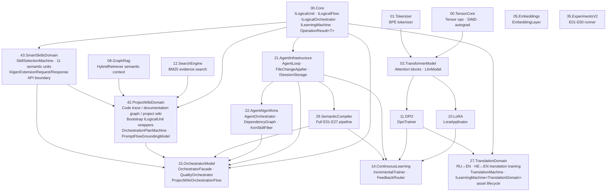
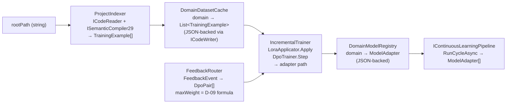
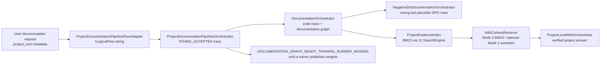
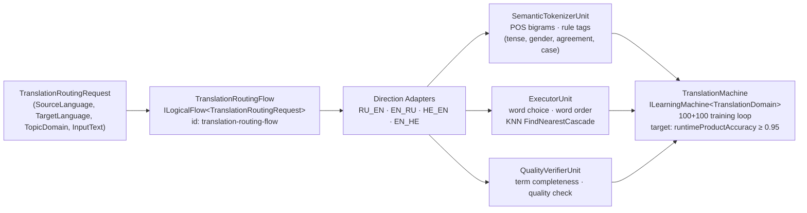
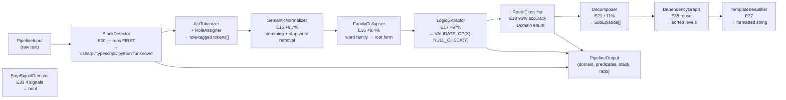
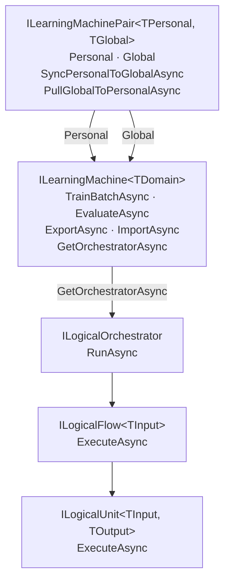

# ARCHITECTURE.md — LlmFromScratch System Architecture

Last updated: 2026-06-04 (Phase 37–40 additions)

## Documentation Navigation

This architecture file is the high-level system map. Detailed, human-readable
implementation documentation for each project is indexed in
[`docs/projects/PROJECT-DOCUMENTATION-INDEX.md`](projects/PROJECT-DOCUMENTATION-INDEX.md).
Use those per-project documents for UML, algorithm steps, code references,
test/QA mapping, and honest status boundaries. This file intentionally does not
duplicate every project-level detail.

---

## 1. Subproject Dependency Graph



---

## 2. Agent Pipeline Data Flow (15.OrchestratorModel)

Accepts a user task string; returns a quality-checked, merged result string.

```mermaid
flowchart LR
    Task["User Task<br/>(string)"]
    SC["StopSignalDetector<br/>29.StopSignalDetector<br/>≤4 words → DONE"]
    EC["EpisodeClassifier<br/>29.RouteClassifier<br/>→ Domain (BUG/PLAN/ARCH/REFACTOR/CODE_Q)"]
    ED["EpisodeDecomposer<br/>22.ComplexTaskDecomposer<br/>→ SubTask[]"]
    DG["DependencyGraph<br/>22.DependencyGraph<br/>→ sorted levels"]
    AL["AgentLauncher<br/>22.AgentOrchestrator<br/>→ string[] results"]
    RM["ResultMerger<br/>ITemplateBeautifier<br/>→ merged string"]
    QO["QualityOrchestrator<br/>16-check pattern<br/>→ pass / RETRY"]
    Out["OperationResult&lt;string&gt;<br/>(final answer)"]

    Task --> SC
    SC -->|"not stop"| EC
    EC --> ED
    ED --> DG
    DG --> AL
    AL --> RM
    RM --> QO
    QO -->|"pass"| Out
    QO -->|"fail → retry ≤3"| AL
```



Key interfaces used at each step:

| Step | Interface | Source project |
|---|---|---|
| StopSignalDetector | `IStopSignalDetector` (Core/Interfaces.cs) | 15.OrchestratorModel |
| EpisodeClassifier | `IRouteClassifier29` | 29.SemanticCompiler |
| EpisodeDecomposer | `ITaskDecomposer` | 22.AgentAlgorithms |
| DependencyGraph | `DependencyGraph` (class, reused) | 22.AgentAlgorithms |
| AgentLauncher | `IAgentMessageBus` | 22.AgentAlgorithms |
| ResultMerger | `ITemplateBeautifier` | 15.OrchestratorModel Fabric |
| QualityOrchestrator | (internal) | 15.OrchestratorModel |

---

## 3. Continuous Learning Pipeline Data Flow (14.ContinuousLearning)

Runs one full learning cycle: codebase scan → LoRA (Low-Rank Adaptation) update → adapter registry.



Key delegation rules (never reimplemented):

| Concern | Delegates to | Rule |
|---|---|---|
| Language detection + routing | `ISemanticCompiler29` from 29 | Principle 4 |
| LoRA gradient updates | `LoraApplicator` from 10.LoRA | Rule 10 |
| DPO preference training | `DpoTrainer` from 11.DPO | Rule 10 |
| Max-weight formula | `D-09: total/(domains×rare)` | DECISIONS-LOCKED D-09 |

---

## 4. Project Wiki Documentation Flow (42.ProjectWikiDomain)

Turns a user request to document a .NET project into an in-memory code trace, documentation graph, negative DPO candidates, evidence index, and project-local wiki answer layer. Persisted `.xiigen/wiki-domain/` files are optional snapshots; the orchestrated flow does not depend on those files for its core path.



Key contracts:

| Concern | Current implementation |
|---|---|
| User entry point | `LogicalOrchestratorAssistant` registers `ProjectDocumentationPipelineFlowAdapter` under `project_documentation_pipeline` |
| Code trace | `ProjectCodeTrace` starts at `INTAKE_ACCEPTED` and records source file, method, call edge, and value-flow counts |
| Documentation fields | meaning, location, parameters, return value, callers, callees, framework version, C# language version |
| Negative DPO | `NegativeDtoDocumentationOrchestrator` produces rejected sides with `[WRONG: ...]` annotations |
| Search | Mode 3 lexical retrieval uses `SearchEngineFacade`; Mode 2 semantic retrieval is optional through `GraphRag.HybridRetriever` |
| Training status | The flow reports `runner_missing` instead of claiming trained local weights |

### 4.2 Phase 37 — OrchestrationPlanMachine and PromptFlowGroundingModel

`OrchestrationPlanMachine : ILearningMachine<OrchestrationPlanDomain>` (added Phase 37) is the trained orchestration planning machine housed in `42.ProjectWikiDomain`.

`PromptFlowGroundingModel` — trained subcomponent of OrchestrationPlanMachine with three generation modes:

| Mode | Name | Description |
|---|---|---|
| Mode 1 | `LearnedFlowGrounding` | Learned K-NN (K-Nearest Neighbours) flow grounding from training corpus |
| Mode 2 | `Generalization` | Generates plan for novel prompts via learned generalization |
| Mode 3 | `HumanExplanation` | Generates human-readable explanation of the selected flow |

Key contracts added in Phase 37:

| Contract | Description |
|---|---|
| `FlowGroundingResult` | Record: FlowRef, Confidence, EvidenceFeatures, PredictedPhaseSequence, PredictedArtifactNames, PredictedGateSequence |
| `OrchestrationFlowGroundingWeights` | FlowRefWeights, PhaseWeights, ArtifactWeights, GateWeights, StackWeights |
| `OrchestrationGenerationResult` | PlanText, GenerationRouteMode, BoundarySource, MlGenerated, IntentKind, FlowGrounding, Warnings |

Contracts permanently removed in Phase 37 (must not be re-introduced):

| Removed | Reason |
|---|---|
| `PromptFlowIndex` | Replaced by `PromptFlowGroundingModel` (trained) |
| `GenerationRouteMode.KnownFlowRetrieval` | Removed generation mode |
| `RetrievalSource` | Removed |
| `_flowIndex` field | Removed from OrchestrationPlanMachine |

`FlowReferenceDetector` — build-time corpus labeling and audit tool ONLY. Must never be reachable from `GeneratePlanAsync`, runtime route classifiers, or any production path. Reaching `FlowReferenceDetector` from a runtime route is a D-16 violation.

### 4.1 Project Wiki Plugin Orchestration Path (TD2)

The plugin entrypoint (`xiigen.orchestratePrompt` VS Code command) enters through `ProjectWikiPluginOrchestrationAdapter`. After TD2, the adapter routes through `ILogicalOrchestrator` when one is configured; without an orchestrator it falls back to direct `SubmitUserTaskApi` (BOOTSTRAP_FALLBACK, logged as a warning).

```mermaid
flowchart LR
    Plugin["Plugin host<br/>xiigen.orchestratePrompt"]
    Adapter["ProjectWikiPluginOrchestrationAdapter<br/>OrchestrateAsync"]
    Orch["ILogicalOrchestrator.RunAsync<br/>ScenarioId = project-wiki-orchestration-flow"]
    Flow["ProjectWikiOrchestrationFlow<br/>ILogicalFlow&lt;string&gt;<br/>15.OrchestratorModel"]
    Bootstrap["SubmitUserTaskApi<br/>BOOTSTRAP_FALLBACK<br/>direct six-unit call"]
    Units["6 Bootstrap ILogicalUnit impls<br/>IntentBuilder · ProjectScanner<br/>EvidencePlanner · UnitSelector<br/>RouteComposer · Verifier"]
    Result["ProjectWikiPluginOrchestrationResult<br/>AnswerPreviewOrPlanSummary"]

    Plugin --> Adapter
    Adapter -->|orchestrator present| Orch
    Orch --> Flow
    Flow --> Bootstrap
    Adapter -->|BOOTSTRAP_FALLBACK| Bootstrap
    Bootstrap --> Units
    Units --> Result
```



| Concern | Implementation |
|---|---|
| Flow registration | `LogicalOrchestratorAssistant.CreateDefault()` registers `ProjectWikiOrchestrationFlow` under `project-wiki-orchestration-flow` |
| Bootstrap unit separation | Each of the 6 Bootstrap classes implements `ILogicalUnit<TIn, TOut>` and delegates to the existing static classes — no behaviour change (TD1 separation rule A-LM-03) |
| BOOTSTRAP_FALLBACK | Active when `ILogicalOrchestrator` is null in the adapter; will be removed after a trained unit replaces the Bootstrap default |
| Metadata keys | `active_repo_path`, `linked_repo_paths` (CSV), `user_facing_entrypoint` passed through `LogicalOrchestratorRequest.Metadata` |

---

## 5. Translation Training Domain (27.TranslationDomain)

Active training domain implementing `ILearningMachine<TranslationDomain>` for RU↔EN and HE↔EN translation.



Key facts:

| Concern | Implementation |
|---|---|
| Machine contract | `TranslationMachine : ILearningMachine<TranslationDomain>` in `27.TranslationDomain/` |
| Three trainable units | `SemanticTokenizerUnit` (structural signature), `ExecutorUnit` (word choice/order), `QualityVerifierUnit` (term completeness) |
| KNN cascade | `TranslationKnnStore.FindNearestCascade`: Full → Prefix → Structure → BootstrapFallback |
| Language rule tags | `RU:SUBJECT:FEM/MASC`, `RU:TENSE:PAST`, `RU:VERB_GENDER:*`, `RU:AGREEMENT:*`, `RU:CASE:DATIVE` — emitted by `TranslationSemanticTokenizer` |
| Training loop | 100 source/target pairs → 300 unit-level DPO examples → train → test 100 never-seen pairs → repeat until accuracy ≥ 0.95 |
| Test status | 44 tests passing as of phase 24, 2026-05-29 (commit `a5e74154`) |
| Governing docs | `docs/plans/TRANSLATION-DOMAIN-TRAINING-GUIDE-v1.md`, `TRANSLATION-CORPUS-SOURCING-PLAN-v1.md`, `TRANSLATION-UNIT-DPO-PAIR-AUTHORING-GUIDE-v1.md` |
| Pending phase 25 | Runner gate threshold in code and three test assertions currently at 0.85 (target 0.95); mojibake test data fix pending |

---

## 5b. Smart Skills Domain (43.SmartSkillsDomain — Phase 39/40)

Smart skills domain providing skill selection and AI extension capabilities.

| Component | Description |
|---|---|
| `SkillSelectionMachine` | Implements `ILearningMachine<SkillSelectionDomain>` and `IMachineTraining<SkillSelectionDomain>` (product-facing adapter) |
| `SmartSkillsSemanticUnitCatalog` | 11 trainable semantic units (see §Phase 39 runtime flow below) |
| `XiigenExtensionRequest / XiigenExtensionResponse` | Thin-client API boundary consumed by three external host extension repos |
| `Phase40ExtensionContracts` | Phase40ExtensionHostKind, Phase40EvidenceScope, Phase40CoreDecisionSourceKind |
| `OrchestrationReasoningMachine` | Skeleton only — status: `not_trained_no_learned_guide_state`; NOT trained |
| `PromptToTaskMachine` | Skeleton only — NOT trained |

> Note: `OrchestrationReasoningMachine` and `PromptToTaskMachine` are NOT in the v20 orchestration plan. They are governed by `ORCHESTRATION-AND-PROMPT-TO-TASK-EXTENSIONS-STATE.json` (separate paused plan).

`TrainMachineBatchAsync` on `SkillSelectionMachine` accepts `SkillSelectionMachinePair` DPO (Direct Preference Optimization) rows.

Adaptive state stored at: `<project root>\.xiigen\smart-skills\` (per decision A-LM-10).

### Phase 39 — Skill Selection Runtime Flow

```
XiigenExtensionRequest
  → [43.SmartSkillsDomain] SkillSelectionMachine.SelectSkillsAsync()
    → 11 trainable semantic units (executed in sequence):
        1.  prompt_understanding   — extracts intent and topic from raw prompt
        2.  task_understanding     — identifies task scope and constraints
        3.  task_type              — classifies task domain (code, doc, test, etc.)
        4.  routing                — determines which skill domains are relevant
        5.  skill_candidates       — generates candidate skill list from domain knowledge
        6.  skill_selection        — selects final skills from candidates
                                     (trainable; DeterministicFinalAuthority = false)
        7.  prompt_context         — builds context packet for skill injection
        8.  result_gap             — inspects AI output for missing skills after first response
        9.  output_validation      — validates output quality and completeness
        10. task_completion        — assesses task completion from output
        11. intermediate_checks    — runs domain-specific check sets
    → SkillSelectionDecision → XiigenExtensionResponse

DPO signal: written by DpoSignalWriter after result_gap inspection.
```

### Core/Host Extension Boundary (Phase 40)

`43.SmartSkillsDomain` is the core library. Three thin-client host extension repos exist externally:

| Repo | Path |
|---|---|
| claude-xiigen-smart-skills | `%USERPROFILE%\Documents\xiigen\extensions reasearch\` |
| codex-xiigen-smart-skills | (external repo) |
| cursor-xiigen-smart-skills | (external repo) |

Host repos send `XiigenExtensionRequest` to the xiigen executable and receive `XiigenExtensionResponse`.

| Host repos CONTAIN | Host repos must NOT contain (A-LM-11) |
|---|---|
| Entrypoints · check-set clients · hooks.json packaging | Training logic · corpus · skill library source · semantic selection code |

---

## 6. SemanticCompiler Pipeline (29.SemanticCompiler)

Five-stage pipeline from raw text to predicates + domain classification.



---

## 7. Key Architectural Principles

| Principle | Rule | Where enforced |
|---|---|---|
| No concrete types at boundaries | Fabric First (Rule 2) | All `*/Fabric/Interfaces.cs` |
| No throw for business logic | `OperationResult<T>` (Rule 1) | All public methods |
| No external ML | Rule 10 | TensorCore is only tensor primitive |
| No reimplementation | Principle 4 | 14 injects 29; 15 injects 22 DependencyGraph |
| No fake training claim | Project wiki flow reports `runner_missing` until a trainer publishes weights | 42.ProjectWikiDomain |
| Branch convention | CLAUDE.md — use current branch; do not assume main | Follow branch rule in `CLAUDE.md`; never run `git checkout` as implicit fix |

---

## 7b. Removed Runtime Contracts (Phase 37)

The following contracts are permanently removed and must not be re-introduced:

| Removed | What replaced it |
|---|---|
| `PromptFlowIndex` | `PromptFlowGroundingModel` (trained; see §4.2) |
| `GenerationRouteMode.KnownFlowRetrieval` | Removed generation mode — no replacement route |
| `RetrievalSource` | Removed |
| `_flowIndex` field | Removed from `OrchestrationPlanMachine` |

`FlowReferenceDetector` — build-time corpus labeling and audit tool ONLY. Must never be reachable from: `GeneratePlanAsync`, runtime route classifiers, or any production path. Reaching `FlowReferenceDetector` from a runtime route is a D-16 violation.

---

## 8. OperationResult\<T\> Namespace Map

Three separate `OperationResult<T>` types exist — never mix them:

| Assembly | Namespace | Used in |
|---|---|---|
| AgentInfrastructure | `AgentInfrastructure.OperationResult<T>` | 21, 14, 15, 42 (external API) |
| SemanticCompiler29 | `SemanticCompiler29.OperationResult<T>` | 29 |
| AgentAlgorithms | `AgentAlgorithms.OperationResult<T>` | 22 internally |

Cross-assembly files that need both must alias: `using SC29 = SemanticCompiler29;`

---

## 9. BaseService Pattern

All services that need session storage inherit `BaseService`:

```csharp
// AgentInfrastructure.BaseService — single constructor parameter, no overloads.
public abstract class BaseService
{
    protected readonly ISessionStorage _storage;
    protected BaseService(ISessionStorage storage) => _storage = storage;
}
```

Subclasses: `ProjectIndexer`, `DomainDatasetCache`, `FeedbackRouter`,
`IncrementalTrainer`, `DomainModelRegistry`, `ContinuousLearningPipeline`.

---

## 10. ILearningMachine\<TDomain\> — Trainable Machine Hierarchy (TD3)

Five abstraction levels from raw tensor ops up to the full learning machine:

```
Level 5: ILearningMachine<TDomain>        — TrainBatchAsync, EvaluateAsync, ExportAsync, ImportAsync, GetOrchestratorAsync
Level 4: ILogicalOrchestrator              — RunAsync(LogicalOrchestratorRequest) → LogicalOrchestratorResult
Level 3: ILogicalFlow<TInput>              — ExecuteAsync(LogicalFlowRequest<TInput>) → LogicalFlowResult
Level 2: ILogicalUnit<TInput, TOutput>     — ExecuteAsync(LogicalUnitRequest<TInput>) → LogicalUnitResult<TOutput>
Level 1: ILearningMachinePair<TP, TG>      — Personal + Global machines + anonymised sync
```

Training path separation rule (A-LM-02 — locked):
- `Train()` lives **only** on `ILearningMachine` — never on `ILogicalUnit` or `ILogicalFlow`.
- `ILogicalUnit` is the smallest executable cell; it does not know about training.
- `ILogicalOrchestrator` routes and executes; it does not know about training.
- A domain learning machine wraps an orchestrator and adds the training loop above it.



Key decisions:

| Decision | Rule |
|---|---|
| A-LM-01 | `ILearningMachine` sits above `ILogicalOrchestrator` in the hierarchy |
| A-LM-02 | `Train()` is **only** on `ILearningMachine` — never on `ILogicalUnit` or `ILogicalFlow` |
| A-LM-03 | Bootstrap implementations keep existing static logic — no regression during TD1 transition |
| A-LM-07 | Global server = `25.ModelServer` + new endpoint in `15.OrchestratorModel` |
| A-LM-08 | `SyncPersonalToGlobalAsync` sends only anonymised learning signals, never raw user data |
| A-LM-10 | Smart skills adaptive state stored at `<project root>\.xiigen\smart-skills\` |
| A-LM-11 | Host extension repos must NOT contain training logic, corpus, skill library source, or semantic selection code |

### Level 5 Implementors (Phase 37–39 additions)

| Machine | Location | Notes |
|---|---|---|
| `OrchestrationPlanMachine : ILearningMachine<OrchestrationPlanDomain>` | 42.ProjectWikiDomain (Phase 37) | `TrainBatchAsync` accepts orchestration DPO pairs; `GetOrchestratorAsync` returns `ILogicalOrchestrator` for wiki orchestration flow |
| `SkillSelectionMachine : ILearningMachine<SkillSelectionDomain>` | 43.SmartSkillsDomain (Phase 39) | Also implements `IMachineTraining<SkillSelectionDomain>`; `TrainMachineBatchAsync` accepts `SkillSelectionMachinePair` DPO rows |
