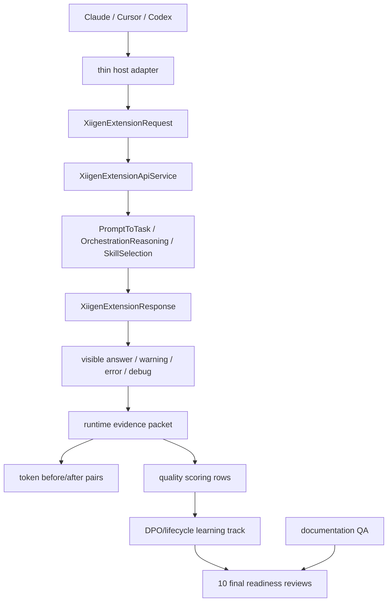

# XIIGen extension runtime/token/quality/learnability HOWTO

This document provides a single human-readable map of the current line of work. This is documentation coverage only: it helps to understand the path but does not prove live runtime, token savings, quality improvement, semantic quality, learnability, target promotion, locator update or final readiness.

## Total / Done / Now / Remaining

| Field | Status |
|---|---|
| Total | 6 large tracks remain: runtime Claude/Cursor/Codex, token before/after for 9 pairs, quality scoring for 9 rows, learnability/DPO/lifecycle for 9 rows, docs/QA and final readiness through 10 independent reviews. |
| Done | The docs update prep packet was committed/pushed; the docs edit applied the prepared documentation coverage; the current docs QA review checks this only as documentation. |
| Now | Full UI/chat readiness is not closed. Token complete pairs 0/9. Quality rows ready for actual scoring 0/9. Trainable DPO rows 0/9. Actual lifecycle rows 0/9. Final readiness reviews 0/10. Claim locks false. |
| Remaining | After the docs QA review, the next safe track is a separate live runtime evidence plan/repair for Claude/Cursor/Codex or another independent missing-evidence packet. The 10 final reviews are possible only after real evidence packets. |

## Target Outcome Matrix summary

| Track | What must be proven later | Current state |
|---|---|---|
| Runtime | Claude, Cursor and Codex must show a live host-visible answer/error/debug/correlation path through thin adapters and `llm_mvp_core`. | Not closed. Dashboard/API/helper/package smoke do not replace live host proof. |
| Token | 9 baseline/adaptive pairs with identical prompts, hashes, host/method/accounting settings and quality guard. | Complete pairs 0/9. |
| Quality | 9 rows with rubric, adjudication refs, source-disjoint held-out, ablation/no-leakage/no-memorization controls. | Rows ready for actual scoring 0/9. |
| Learnability/DPO/lifecycle | User-approved chosen/rejected/provenance refs, trainable rows, lifecycle export/import/restore/load/continue/fresh-load/rollback. | Trainable DPO rows 0/9; lifecycle rows 0/9. |
| Docs/QA | Human docs explain API/dashboard, host boundaries, debug, lifecycle, evidence scopes and the operator's-language status format. | The docs QA review checks documentation coverage only; this is not runtime/product readiness. |
| Final reviews | 10 fresh reviews after actual evidence exists. | 0/10. |

## UML overview



The diagram shows the intended flow. It is not itself runtime proof. Runtime proof appears only in a packet where the named host surface actually accepted the input, called the core boundary and showed output/error/debug with a correlation id and freshness.

## No-code algorithm

1. For the named host, choose a real surface: Claude, Cursor or Codex.
2. The thin adapter builds `XiigenExtensionRequest` and contains no hidden semantic/model logic.
3. Core calls `PromptToTaskMachine`, `OrchestrationReasoningMachine` and `SkillSelectionMachine`.
4. The host shows `XiigenExtensionResponse`: visible answer, warnings, errors, debug trace, raw/redacted evidence.
5. The runtime packet records host, method, input/output refs, correlation id, timestamp, negative/error branch and evidence scope.
6. The token packet compares baseline/adaptive only after pair integrity.
7. Quality packet scores only after adjudication/source-disjoint/ablation controls.
8. Learnability packet uses approved DPO candidates and proves lifecycle with backup/export/import/restore/load-without-retrain/continue-training/fresh-load/rollback.
9. Final reviews start only after the evidence exists. Documentation alone cannot move this line to final readiness.

## Claim locks and next bounded work order

All claim locks remain false now:

- token savings claimed: false;
- quality improvement claimed: false;
- full semantic quality claimed: false;
- full learnability claimed: false;
- full runtime readiness claimed: false;
- common model readiness claimed: false;
- target promotion claimed: false;
- locator update claimed: false;
- final readiness claimed: false.

## Short code anchors

`43.SmartSkillsDomain/XiigenExtensionApiContracts.cs`:

```csharp
public const string PromptToTaskMethod = "prompt-to-task";
public const string OrchestrationPlanMethod = "orchestration-plan";
public const string SkillSelectionMethod = "skill-selection";
```

`43.SmartSkillsDomain/XiigenExtensionApiService.cs`:

```csharp
public OperationResult<XiigenExtensionResponse> ProcessHostExtensionRequest(
```

These anchors show the core API boundary. They do not prove host runtime, quality or learning.

## Where to read next

- `docs/CLAUDE-XIIGEN-HOWTO-ru.md`
- `docs/CURSOR-XIIGEN-HOWTO-ru.md`
- `docs/CODEX-XIIGEN-HOWTO-ru.md`
- `docs/API-DASHBOARD-QA-HOWTO-ru.md`
- `docs/XIIGEN-DEBUG-TRACE-HOWTO-ru.md`
- `docs/LOCAL-MODEL-LIFECYCLE-HOWTO-ru.md`
- `docs/EVIDENCE-SCOPES-HOWTO-ru.md`
- `docs/RUSSIAN-STATUS-AND-EXECUTION-LOG-TEMPLATE.md`

## Next bounded work order

After `DOCS-QA-DOCUMENTATION-UPDATE-REVIEW-01_NO_FINAL_READINESS` passes, the next bounded work order should move to a separate missing-evidence track, recommended as `RUNTIME-CLAUDE-CURSOR-CODEX-LIVE-EVIDENCE-PLAN-OR-REPAIR-01` unless the state names a more precise runtime/token/quality/learnability gap. That next work order still must not claim token savings, quality improvement, learnability, target promotion, locator update or final readiness without packet-backed evidence.
