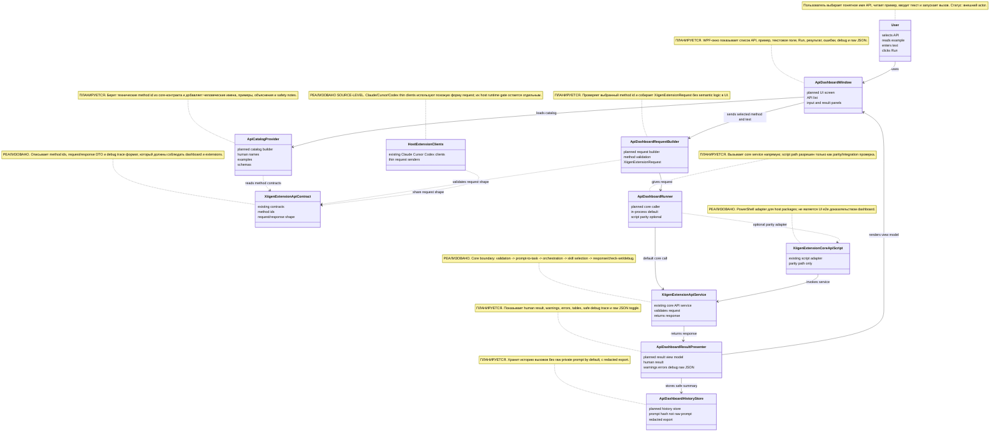
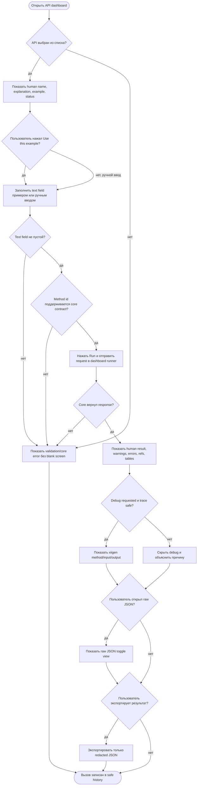
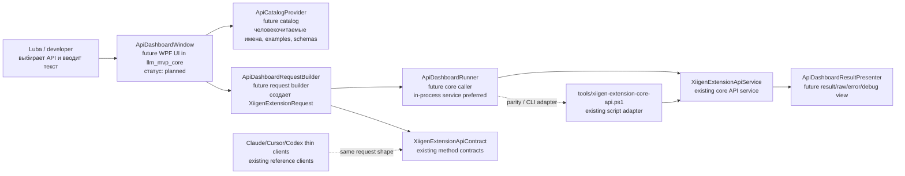

# API Dashboard Plan v1

Статус: plan был создан как executor-ready документ. После отдельного разрешения Luba этот план исполняется через bounded sub-agents. Commit/push после каждого accepted slice является внутренним continuation checkpoint, а не stop gate; после такого commit/push исполнитель продолжает следующий plan-derived work order.

## Authority Requirements Ledger

| ID | Источник | Обязательное требование | Где покрыто | Gate / артефакт |
|---|---|---|---|---|
| AR-01 | Текущий запрос Luba | Нужен план dashboard, где пользователь тестирует API, используемые extensions и другими клиентами | Part A, Work orders | `docs/plans/API-DASHBOARD-PLAN-v1.md` |
| AR-02 | Текущий запрос Luba | Dashboard является частью `C:\Projects\llm_mvp_core` | Core placement, work orders | Будущий проект/страница внутри core repo |
| AR-03 | Текущий запрос Luba | Показывать API names human language | API catalog model | Unit tests на человекочитаемые имена |
| AR-04 | Текущий запрос Luba | Показывать usage examples с человеческими объяснениями | API catalog model, UI behavior | Unit/e2e tests на examples panel |
| AR-05 | Текущий запрос Luba | Пользователь вводит параметр в text field, вызывает API, видит результат | UI behavior, algorithms | E2E tests на input/run/result |
| AR-06 | Текущий запрос Luba | План строится после прохода по существующим extension implementations и фактическому API/code reality | Existing code reality, quotes | Точные code refs из Claude/Cursor/Codex/core |
| AR-07 | Текущий запрос Luba | Первая часть для Luba: UML, no-code algorithms, детальное объяснение с точными цитатами | Part A | Human-readable Russian |
| AR-08 | Текущий запрос Luba | План включает unit tests, e2e tests, QA automation | Testing strategy | Gate B каждого work order-а |
| AR-09 | Текущий запрос Luba | Plan-only; implementation не авторизована | Status, work orders | Нет production edits |
| AR-10 | AGENTS OP-21 | Static catalog/API invocation не является доказательством host/runtime/model readiness | Anti-false-done | Runtime evidence boundary |

## User Prompt Source Ledger

| entry_id | entry_type | source_quote | assistant_answer_or_resolution | requirements_created_or_changed | plan_sections_updated | status |
|---|---|---|---|---|---|---|
| UPSL-001 | user_request | “Need a plan for a dashboard where user can test APIs used by extensions and others.” | Создан план dashboard без реализации, основанный на текущем коде extension entrypoints и `XiigenExtensionApiService`. | AR-01..AR-10 | Весь документ | open_for_parent_review |

| UPSL-002 | review_feedback | "Review API-DASHBOARD-PLAN-v1.md against OP-52/OP-55, CLAUDE Part A Completeness, FC-14..FC-19, FC-26, dashboard specifics" | Parent review returned FAIL: missing real classDiagram with notes/legend, missing separate user-journey flowchart, incomplete section 2 depth, missing Part A <-> Part B parity matrix, incomplete per-branch test strategy, missing OP-3 work-order packet fields. | AR-07, AR-08, AR-09, AR-11..AR-17 | Part A sections 0-3, parity matrix, test matrix, work-order packet table | repaired_in_this_revision |
| UPSL-003 | current_user_repair_request | "repair the plan until it passes the user request and hard gates ... do not edit code ... do not run build/tests/runtime ... do not commit/push" | This revision edits only this plan, preserves plan-only status, and adds the required gates without authorizing implementation. | AR-11..AR-17 | Ledgers, Part A, Part B work-order controls, final matrices | repaired_in_this_revision |
| UPSL-004 | current_user_governance_repair_request | "find and close loopholes that allowed API Dashboard execution to stop twice and cut Luba requirements: state completed goal with residual full interactive WPF automation gap; plan allowed keep UI e2e open; review cycles rounded to one; completed sub-agent pool full could justify parent local execution" | This governance repair updates the plan and skills only, does not edit state, branch, code, commit, or push, and adds hard gates for UI automation completion, fallback evidence scope, review-cycle count, and sub-agent pool saturation. | AR-18..AR-21 | Authority ledger, delta ledger, UI automation firewall, review-cycle gate, work-order table, final completion gate | repaired_in_this_revision |
| UPSL-005 | post_completion_challenge | "QA UI UX automation!!!" | Reopened the dashboard completion claim because full WPF control automation and QA script evidence did not separately prove UX automation. This revision adds a UX automation gate for human clarity, accessibility names/help text, discoverability, safe debug/raw visibility, layout stability, and primary-path wording. | AR-22 | Authority ledger, delta ledger, test matrix, WO-API-DASH-7, final completion gate | repaired_in_this_revision |

## Conversation Delta Ledger

| Delta ID | Source | What changed | Required plan effect | Covered by |
|---|---|---|---|---|
| D-001 | Parent review | Current Part A flowchart was not a valid section 0 UML class diagram. | Add draw.io-importable Mermaid `classDiagram`, `note for` every class/component, legend table, and per-edge simulation table. | Part A section 0 |
| D-002 | Parent review | Main user journey was prose, not a separate section 1 human flowchart. | Add human-language flowchart for choose API -> read example -> enter text -> run -> result -> error/debug/raw JSON, with per-branch simulations. | Part A section 1 |
| D-003 | Parent review | Algorithm descriptions were useful but not full section 2 depth. | Add analogy, exact method/signature, parameter examples, step-by-step algorithm, branches, non-goals, and status for every planned dashboard algorithm. | Part A section 2 |
| D-004 | Parent review | Code quotes had refs and "why it matters" but lacked consistent WHY/HOW matrix. | Add section 3 quote explanation matrix for every current code quote. | Part A section 3 |
| D-005 | Parent review | Part A branches and Part B work orders were not mapped bidirectionally. | Add branch-level parity matrix mapping classes, edges, algorithms, UI branches to work orders/Gate B and work orders back to Part A. | Part B parity matrix |
| D-006 | Parent review | Test strategy was grouped, not per branch across OP-55 layers. | Add per-branch test matrix: unit, integration, e2e/UI or host, QA automation, negative, honest partial behavior, trained N/A, regression. | Testing strategy matrix |
| D-007 | Parent review | Individual work orders lacked OP-3 packet fields. | Add a work-order packet control table with artifact type, scope, time, implementation authorization, approval quote, quarantine, answer-first, skills, exact verification, commit/push boundary. | Work-order packet table |
| D-008 | Previous repair request | Earlier repair slice allowed plan-only edits and did not update skills. | Superseded by UPSL-004 for this governance repair; skill files in the allowed scope may now be patched. | Historical note only |
| D-009 | Current governance repair request | Plan allowed UI e2e to remain open while later state could close the whole goal. | Add full-interactive UI automation completion firewall and WO-API-DASH-6. | UI automation firewall, work orders, final completion gate |
| D-010 | Current governance repair request | Review cycles could be rounded to a single final review. | Define "several" as at least two independent post-implementation review passes with fixed or zero-findings evidence. | Review-cycle gate |
| D-011 | Current governance repair request | Completed sub-agent pool saturation could be misread as permission for parent local production execution. | Require completed-agent cleanup/reuse/wait; parent architect local production edits remain forbidden. | Sub-agent execution protocol |
| D-012 | Luba challenge | UI automation was accepted without a separate UX automation layer. | Add WO-API-DASH-7 and require automated checks for accessible names/help text, human explanations, example/result clarity, safe raw/debug visibility, stable layout, and non-internal primary wording. | UX automation gate, WPF tests, QA script, skills |

## Additional Authority Requirements From Review

| ID | Requirement | Plan section | Gate / artifact |
|---|---|---|---|
| AR-11 | Part A section 0 must be a real Mermaid `classDiagram`, not only a flowchart. | Part A section 0 | FC-14 / API_DASHBOARD_GATE |
| AR-12 | Every section 0 class/component must have `note for`, legend, and per-edge simulation. | Part A section 0 | FC-14 |
| AR-13 | Part A section 1 must include main user-journey flowchart and per-decision simulations. | Part A section 1 | FC-14 / API_DASHBOARD_GATE |
| AR-14 | Every algorithm must satisfy full section 2 depth. | Part A section 2 | FC-15 |
| AR-15 | Every current code quote must have WHY/HOW explanation. | Part A section 3 | FC-16 |
| AR-16 | Every Part A class/edge/algorithm/UI branch must map to Part B work order and Gate B, and every work order must map back. | Part B parity matrix | FC-19 |
| AR-17 | Every branch must have OP-55 test strategy and every work order must have OP-3 packet fields. | Testing strategy matrix, work-order packet table | FC-26 / OP-3 |
| AR-18 | For UI/dashboard tasks where Luba asked for e2e or QA automation, final completion cannot coexist with an open full-interactive UI automation gap. Handler, view-model, component, adapter, or static tests are narrow evidence only. | Final completion firewall, WO-API-DASH-6, anti-false-done boundary | Full completion matrix row must show full interactive WPF automation PASS or `goal_reached=false`. |
| AR-19 | If real UI automation is not feasible in a slice, create an honest test-only adapter or handler-level QA artifact as intermediate evidence, move product-decision/runtime-only tasks to the end queue, continue independent plan work, and do not overclaim. | UI automation fallback protocol, execution state rules | State/report must label adapter scope and keep full UI automation open. |
| AR-20 | "Several code review/fix cycles" means at least two independent review passes after implementation, with findings fixed or explicit zero-findings evidence. One final summary review is insufficient. | Review-cycle gate | `review_cycle_1` and `review_cycle_2` records required before final completion. |
| AR-21 | Completed sub-agent pool saturation is infrastructure cleanup. The parent must close/reuse completed agents or wait for capacity; saturation is not permission for parent architect local production execution. | Sub-agent execution protocol | Work-order packet and parent review must record no parent local production edits. |
| AR-22 | QA UI/UX automation is a separate final gate from functional UI automation. The running WPF dashboard must expose human-readable labels, examples, accessible names/help text, safe debug/raw affordances, visible errors, stable layout constraints, and non-internal primary wording. | WO-API-DASH-7, OP-55 test matrix, final completion gate | WPF UX automation tests and dashboard QA script must pass before final completion. |

## Part A — Карта для Luba

Этот dashboard должен быть “лабораторной панелью” внутри `llm_mvp_core`: человек видит понятное имя API, читает пример, вводит один текстовый параметр или prompt, нажимает Run и получает ответ core API. Dashboard не переносит умную логику в UI. Он только собирает request, вызывает существующий core boundary и показывает ответ, ошибки, debug trace и raw JSON.

Важно: если dashboard успешно вызвал API, это доказывает только работу dashboard-to-core пути. Это не доказывает, что Claude/Cursor/Codex extension реально сработали внутри своих host UI. Host runtime evidence остается отдельным gate.

### WO-API-DASH-0 placement discovery note

Discovery result from `WO-API-DASH-0`: existing `llm_mvp_core` UI/app convention is Windows desktop, not web frontend.

Discovered stacks:

| Evidence | What exists | Dashboard meaning |
|---|---|---|
| `21.AgentInfrastructure.Desktop/AgentInfrastructure.Desktop.csproj` | `net9.0-windows`, `UseWindowsForms=true`, `MainForm` demo explorer. | Existing simple demo-host pattern for algorithm samples. Useful reference for a plain list/run/output shell, but too demo-specific for a richer API dashboard. |
| `22.AgentAlgorithms.Desktop/AgentAlgorithms.Desktop.csproj` | `net9.0-windows`, `UseWindowsForms=true`, list of algorithm demos. | Confirms WinForms explorer pattern repeats across subprojects. |
| `23.OssEquivalents.Desktop/OssEquivalents.Desktop.csproj` | `net9.0-windows`, `UseWindowsForms=true`, list/run/output desktop host. | Confirms no web framework is needed for small desktop surfaces. |
| `LlmInspector/LlmInspector.csproj` | `net9.0-windows`, `UseWPF=true`, styled WPF shell over `LlmInspector.Core`. | Best existing dashboard-like UI convention: panels, view models, styles, bounded run status. |
| Repository discovery | No `package.json`, Vite config, Playwright config, Cypress config, React/Vue/Svelte app, ASP.NET web host, Razor/Blazor app, or `wwwroot` frontend convention was found. | Do not invent npm, Vite, Playwright, browser, or web e2e commands for this dashboard until a future work order creates that stack. |

Placement decision:

- Proposed production location: new WPF desktop project `43.SmartSkillsDomain.Dashboard`.
- Proposed UI-neutral support location: keep dashboard DTO/view-model/catalog/runner contracts inside the new dashboard project unless a future implementation slice proves they must be shared; do not move core logic out of `43.SmartSkillsDomain`.
- Core dependency: the dashboard calls `SmartSkillsDomain.XiigenExtensionApiService.ProcessHostExtensionRequest(...)` through a thin runner.
- Why not `LlmInspector`: `LlmInspector` is an inspector for logical topology traces. The API dashboard is a user API lab for SmartSkills / extension API methods; extending `LlmInspector` would mix two products and make evidence scope muddy.
- Why WPF over WinForms: WinForms is the repeated demo explorer pattern, but the dashboard needs API catalog, example panel, result/warnings/errors/debug/raw JSON/history areas. Existing WPF `LlmInspector` already has multi-panel layout, styles, view models, bounded run status, and documented UI/core split.

Discovered command names:

| Purpose | Command status after discovery |
|---|---|
| .NET unit/integration tests | `dotnet test Tests/LlmFromScratch.Tests.csproj --filter "ApiDashboard|XiigenExtensionApi" --nologo` |
| WPF/frontend unit tests | No separate frontend command exists. Use the .NET test command above for view-model/catalog/runner tests until a WPF UI harness is added. |
| WPF/UI e2e | No existing WPF UI automation command was found during discovery. Because Luba asked for e2e/QA automation, the dashboard cannot reach final completion until a real full-interactive WPF automation command/harness is added and passes. Until then, view-model/handler/test-only-adapter evidence is only an intermediate gate and must keep `goal_reached=false`. |
| Web frontend / browser e2e | Not applicable to current repo discovery; no web frontend stack was found. |

Plan updates caused by this note:

- Replace generic page wording with `ApiDashboardWindow` / `ApiDashboardViewModel` in implementation slices.
- Future UI work uses WPF conventions from `LlmInspector`, not npm/Vite/Playwright placeholders.
- Dashboard pass remains dashboard-to-core evidence only; it is not Claude/Cursor/Codex host runtime evidence.

### §0 Class diagram for draw.io

Import into draw.io with Mermaid support. This is the required section 0 class diagram; the older data-flow diagram below is only a supplemental flow view.



Legend:

| Class | What it does | Status |
|---|---|---|
| `User` | Chooses the API, reads the example, enters text, runs the call, inspects result/debug/raw JSON. | External actor |
| `ApiDashboardWindow` | User-facing WPF dashboard window inside `llm_mvp_core`. | Planned |
| `ApiCatalogProvider` | Builds human API catalog from real core method contracts plus dashboard-owned explanations. | Planned |
| `ApiDashboardRequestBuilder` | Converts selected API row and text field into `XiigenExtensionRequest`. | Planned |
| `XiigenExtensionApiContract` | Existing request/response/method contract. | Implemented |
| `ApiDashboardRunner` | Calls core API directly, with optional script parity path. | Planned |
| `XiigenExtensionApiService` | Existing core execution boundary. | Implemented |
| `XiigenExtensionCoreApiScript` | Existing script adapter used only for compatibility checks. | Implemented |
| `ApiDashboardResultPresenter` | Builds visible result/error/debug/raw JSON view model. | Planned |
| `ApiDashboardHistoryStore` | Stores safe call history and redacted exports. | Planned |
| `HostExtensionClients` | Existing Claude/Cursor/Codex thin clients used as request-shape references. | Implemented source; host runtime proof separate |

Relationship types:

| Relationship | Meaning in this plan |
|---|---|
| `-->` | Runtime or UI data moves through this path in the dashboard design. |
| `..>` | Dependency/reference only; this does not prove runtime execution by itself. |

### §0 Per-connection simulations

| Class diagram edge | Concrete input | Expected result | Gate |
|---|---|---|---|
| User --> ApiDashboardWindow | User opens dashboard and selects "Разобрать задачу" | Window stores selected row and shows matching example/input/result areas. | WO-API-DASH-4 Gate B |
| ApiDashboardWindow --> ApiCatalogProvider | Window loads with empty filter | Catalog returns rows for `prompt-to-task`, `orchestration-plan`, `skill-selection`, `feedback`, `debug-trace`. | WO-API-DASH-1 Gate B |
| ApiDashboardWindow --> ApiDashboardRequestBuilder | method=`prompt-to-task`, text=`Сделай план API dashboard` | Builder receives selected method and text without adding semantic decisions. | WO-API-DASH-2 Gate B |
| ApiCatalogProvider ..> XiigenExtensionApiContract | Core contract lists `debug-trace` | Catalog row has human name, example, output fields, safety note, status. | WO-API-DASH-1 Gate B |
| ApiDashboardRequestBuilder ..> XiigenExtensionApiContract | method=`unknown`, text=`abc` | Builder rejects unsupported method before core call. | WO-API-DASH-2 Gate B |
| ApiDashboardRequestBuilder --> ApiDashboardRunner | valid `XiigenExtensionRequest` | Runner receives contract-shaped request with HostName=`ApiDashboard`. | WO-API-DASH-3 Gate B |
| ApiDashboardRunner --> XiigenExtensionApiService | valid request, mode=`InProcessCore` | Service returns `XiigenExtensionResponse`; dashboard does not claim host runtime. | WO-API-DASH-3 Gate B |
| ApiDashboardRunner ..> XiigenExtensionCoreApiScript | parity mode explicitly selected | Script writes/reads request/response/trace files; failure is integration error, not UI pass. | WO-API-DASH-3 Gate B |
| XiigenExtensionCoreApiScript --> XiigenExtensionApiService | request JSON deserializes | Script calls service and returns response JSON or error code. | WO-API-DASH-3 Gate B |
| XiigenExtensionApiService --> ApiDashboardResultPresenter | response has warnings and `runtime_extension_claimed=false` | Presenter shows warnings and boundary flags visibly. | WO-API-DASH-2 Gate B |
| ApiDashboardResultPresenter --> ApiDashboardWindow | view model contains human result and raw JSON toggle state | Window renders human result first and raw JSON hidden by default. | WO-API-DASH-4 Gate B |
| ApiDashboardResultPresenter --> ApiDashboardHistoryStore | completed call with prompt text | History stores timestamp, method, status, prompt hash, not raw prompt. | WO-API-DASH-5 Gate B |
| HostExtensionClients ..> XiigenExtensionApiContract | Claude/Cursor/Codex source builds same request shape | Dashboard copies contract discipline only; dashboard pass cannot replace host runtime proof. | WO-API-DASH-0 and WO-API-DASH-5 Gate B |

### §1 Human journey flowchart



### §1 Branch simulations

| Decision branch | Simulation input | Expected result |
|---|---|---|
| API chosen = yes | User selects `prompt-to-task`. | Example panel and input field become active. |
| API chosen = no | Page opens with no selected row and user presses Run. | Validation error asks user to choose API; no core call. |
| Use example = yes | User clicks "Use this example" on `orchestration-plan`. | Text field is filled with the row example. |
| Use example = manual input | User types "Проверь API dashboard flow". | Text field keeps user text and provenance says manual input. |
| Text valid = no | Text field contains spaces only. | Run disabled or validation error; no core call. |
| Text valid = yes | Text field contains "Сделай план API dashboard". | Builder may create request. |
| Method valid = no | Catalog metadata accidentally uses `bad-method`. | Builder returns config validation error before service call. |
| Method valid = yes | method=`skill-selection`. | Runner receives valid request. |
| Core response = no | Service returns failed `OperationResult`. | Error viewer shows code/message; page is not blank. |
| Core response = yes | Service returns response with `ChatDisplayText`. | Result viewer shows human result first. |
| Debug safe = yes | `DebugEnabled=true`, trace has no private/secrets flags. | Debug panel shows `xiigen <method>`, `input`, `output`. |
| Debug safe = no | Trace has `ContainsSecrets=true`. | Debug panel hidden or explains suppression. |
| Raw JSON wanted = yes | User opens raw toggle. | Raw JSON appears below human result, not first. |
| Raw JSON wanted = no | User leaves toggle closed. | Human result remains primary. |
| Export wanted = yes | User clicks export. | Only redacted JSON is exported. |
| Export wanted = no | User finishes. | Safe history row stores method/status/prompt hash only. |

### Supplemental human data flow

The diagram below is kept only as a readable flow view. It is not the section 0 UML admission artifact.

### UML / data flow



### Responsibility / status notes

| Component | Responsibility in plain language | Current status |
|---|---|---|
| `ApiDashboardWindow` | WPF-окно со списком API, example panel, text field, Run button, result viewer | planned |
| `ApiCatalogProvider` | строит каталог API из `XiigenExtensionApiContract.GetMethodContracts()` и human metadata | planned |
| `ApiDashboardRequestBuilder` | превращает выбранный method + введенный текст в `XiigenExtensionRequest` | planned |
| `ApiDashboardRunner` | вызывает core service, а не принимает semantic decisions в UI | planned |
| `XiigenExtensionApiService.ProcessHostExtensionRequest` | существующий core API: validation -> prompt-to-task -> orchestration -> skill selection -> response | implemented |
| `tools/xiigen-extension-core-api.ps1` | существующий script adapter для host packages; генерирует временный .NET invoker | implemented, runtime-heavy |
| Claude/Cursor/Codex clients | thin clients; показывают, как внешние hosts формируют request | implemented source, host-runtime proof separate |

### Simulations for UML connections

| Connection | Example input | What happens | Expected result | Forbidden interpretation |
|---|---|---|---|---|
| User -> Dashboard | “Сделай план документации для проекта 42” | пользователь выбирает “Разобрать задачу” и вводит prompt | dashboard stores selected method + text in local view state | Не значит, что API уже выполнен |
| Dashboard -> Catalog | page opens | catalog returns human names, examples, schemas, safety notes | list shows “Разобрать задачу”, “План orchestration”, “Выбрать skills” | Static catalog is not API behavior proof |
| Dashboard -> Builder | method=`prompt-to-task`, text=`...` | builder creates `XiigenExtensionRequest` with HostName=`ApiDashboard`, DebugEnabled flag, provenance | request matches existing core contract fields | UI must not invent hidden semantic decisions |
| Builder -> Contracts | method selected | builder validates method against `XiigenExtensionApiContract.MethodNames` | unknown method becomes validation error before call | Do not silently route unknown methods to another API |
| Runner -> Service | valid request | runner calls `XiigenExtensionApiService.ProcessHostExtensionRequest(request)` | response contains status, display text, refs, warnings, errors | Core response is not host extension runtime evidence |
| Runner -> Script | parity mode selected | runner writes request JSON and calls script adapter only in an explicit integration path | response/trace files are read back | Script success is not dashboard UI e2e proof unless UI path ran |
| Service -> Result | response has `DebugTrace` and warnings | presenter shows human summary, raw JSON toggle, debug text if safe | user sees output and boundary warnings | Debug trace must not show raw private prompt/secrets |
| Extensions -> Contracts | Claude/Cursor/Codex source builds same request shape | dashboard copies field discipline from existing clients | dashboard remains a core-side tester, not a new host plugin | Dashboard pass cannot replace Claude/Cursor/Codex host QA |

## Existing API/code reality found

The current API surface is centered on `43.SmartSkillsDomain` and a script adapter:

- `43.SmartSkillsDomain/XiigenExtensionApiContracts.cs`
  - request: `XiigenExtensionRequest`
  - response: `XiigenExtensionResponse`
  - method ids: `prompt-to-task`, `orchestration-plan`, `skill-selection`, `feedback`, `debug-trace`
  - debug format: `xiigen <method> :`, `input:`, `output:`
- `43.SmartSkillsDomain/XiigenExtensionApiService.cs`
  - main method: `ProcessHostExtensionRequest(XiigenExtensionRequest request)`
  - internal path: validate request, build prompt-to-task request, build orchestration request, decide skills, build check-set results and trace.
- `tools/xiigen-extension-core-api.ps1`
  - external host adapter: reads request JSON, creates temporary .NET invoker, calls `XiigenExtensionApiService`, writes response and optional trace.
- `claude-xiigen-smart-skills/src/claude-entrypoint.js`
  - builds a thin request; host flags say semantic ranking/training/corpus parsing/external AI are false.
- `cursor-xiigen-smart-skills/src/extension.ts`
  - command/chat/panel source builds the same request shape and normalizes method ids.
- `codex-xiigen-smart-skills/src/codex-entrypoint.js`
  - JS source entrypoint builds request and core invocation args.

## API catalog model planned for dashboard

Future DTO: `ApiDashboardCatalogItem`.

Fields:

- `HumanName`: Russian/plain name, for example “Разобрать задачу из prompt”.
- `TechnicalMethodId`: exact method id, for example `prompt-to-task`.
- `ExampleParameter`: one ready-to-run prompt.
- `HumanExplanation`: what the API does and what it does not prove.
- `InputSchema`: fields used by dashboard; initially `text`, `debugEnabled`, optional `availableSkills`.
- `OutputSchemaPreview`: `Success`, `Status`, `ChatDisplayText`, `SelectedSkills`, `StructuredTaskRefs`, `ScenarioRefs`, `Warnings`, `Errors`, `DebugTrace`.
- `SafetyAndRedaction`: whether raw prompt is redacted in trace, whether secrets suppress debug.
- `CurrentImplementationStatus`: implemented, contract-only, scaffold, partial-boundary, host-runtime-not-proven.

Initial catalog rows:

| Human name | Technical method id | Example parameter | Explanation | Status |
|---|---|---|---|---|
| Разобрать задачу из prompt | `prompt-to-task` | “Составь план документации для 42.ProjectWikiDomain” | Core converts prompt into structured task refs and status fields | Implemented through service path, semantic quality gated |
| Построить orchestration plan | `orchestration-plan` | “Нужен flow: request -> evidence -> answer” | Core produces scenario refs after prompt-to-task stage | Implemented through service path, not host runtime proof |
| Выбрать smart skills | `skill-selection` | prompt + available skills list | Core uses available skills and trained/common state when loaded | Implemented with boundary warnings if no trained state |
| Принять feedback signal | `feedback` | refs to chosen/rejected/correction | Contract exists; dashboard must show as refs-only unless service supports mutation path | Contract present; no UI should claim model mutation |
| Показать debug trace | `debug-trace` | debug enabled request | Shows safe `xiigen <method>` input/output trace when allowed | Debug support present; raw private/secrets must suppress |

Small Luba-facing API map for the first dashboard screen. Each user-visible API row must keep all dashboard-gate fields in the same row so review can verify that the UI name, core method, text-box wiring, visible output, safety rule, and implementation honesty stay together.

| Human API row | Technical method id | Text box request field | Visible response fields | Concrete example | Expected output shape | Safety/redaction note | Current implementation status |
|---|---|---|---|---|---|---|---|
| Разобрать задачу | `prompt-to-task` | `XiigenExtensionRequest.UserPromptOrTaskText` | `ChatDisplayText`, `StructuredTaskRefs`, `Warnings`, `Errors`, `CheckSetResults.prompt_to_task_status` | Text box: “Сделай план документации для API dashboard” | Human summary first; structured task refs/check-set table; warnings/errors visible; raw JSON behind toggle. | Raw prompt must not be stored in history by default; debug trace is shown only if core says it is safe. | Implemented through core service path; semantic quality remains gated by core evidence. |
| Построить orchestration plan | `orchestration-plan` | `XiigenExtensionRequest.UserPromptOrTaskText`; dashboard still sends the same prompt text and core derives structured task first | `ChatDisplayText`, `ScenarioRefs`, `Warnings`, `Errors`, `CheckSetResults.orchestration_reasoning_status` | Text box: “Спланируй flow: user input -> core API -> result viewer” | Human orchestration summary; scenario refs/check-set table; warnings/errors visible; raw JSON optional. | Same redaction/history rule as prompt-to-task; dashboard must not expose private prompt in debug/export. | Implemented through core service path; not proof of Claude/Cursor/Codex host runtime. |
| Выбрать smart skills | `skill-selection` | `XiigenExtensionRequest.UserPromptOrTaskText`; advanced UI may also fill `AvailableSkills` later | `ChatDisplayText`, `SelectedSkills`, `Warnings`, `Errors`, `CheckSetResults.skill_selection_*` | Text box: “Нужно выбрать skills для документации проекта” | Human result plus selected-skills table; check-set flags; warnings/errors; raw JSON optional. | Available skills and prompt text are request inputs; history stores prompt hash/safe metadata, not raw private text. | Implemented with boundary warnings when trained/common state is absent or partial. |
| Feedback signal | `feedback` | Text box alone is not enough for full feedback; first UI must mark required refs as missing unless advanced fields are present | `Warnings`, `Errors`, `CheckSetResults`, no model mutation claim | Text box: “Пользователь исправил ответ”, plus future refs-only advanced inputs | Validation/error-oriented result until required chosen/rejected/correction refs exist; no success wording that implies training or mutation. | Feedback may contain private correction text; export must be redacted and no adaptive/common mutation may be claimed from textbox-only input. | Contract present; dashboard must show refs-only/needs-advanced-input status unless service mutation path is separately proven. |
| Debug trace | `debug-trace` | `XiigenExtensionRequest.UserPromptOrTaskText` plus `DebugEnabled=true` | Safe `DebugTrace`, `ChatDisplayText`, `Warnings`; no raw private content | Text box: “Покажи безопасный trace для этого prompt” | Safe trace panel with `xiigen <method>`, `input`, `output` when allowed; suppression explanation when unsafe; raw JSON optional. | If raw private content or secrets are flagged, debug trace is suppressed; exported history is redacted. | Debug support present in core contract/service; safe trace only, not runtime readiness proof. |

## No-code algorithms planned

### 1. `ApiCatalogProvider.BuildCatalog()`

- Future file: `ApiDashboard/ApiCatalogProvider.cs`
- Existing API it reads: `XiigenExtensionApiContract.GetMethodContracts()`
- Parameters: none, optional localization later.
- Input: existing method contracts and dashboard-owned human metadata file.
- Output: `IReadOnlyList<ApiDashboardCatalogItem>`.
- Steps:
  1. Read method contracts from `XiigenExtensionApiContract.GetMethodContracts()`.
  2. Merge each technical `Method` with a dashboard-owned Russian `HumanName`, examples, and explanation.
  3. Mark `feedback` and `debug-trace` honestly as contract/debug/ref flows unless implementation evidence is added.
  4. Return catalog sorted for humans, not by source file order.
- Branches:
  - Unknown method in metadata -> fail dashboard startup unit test.
  - Missing human explanation -> fail catalog completeness test.
- Does NOT do: it does not call API, train models, or prove runtime behavior.

### 2. `ApiDashboardRequestBuilder.BuildRequest(methodId, text, debugEnabled, availableSkills)`

- Future file: `ApiDashboard/ApiDashboardRequestBuilder.cs`
- Existing contracts it creates: `XiigenExtensionRequest`.
- Parameters:
  - `string methodId`
  - `string text`
  - `bool debugEnabled`
  - `IReadOnlyList<string> availableSkills`
- Input DTO: future `DashboardApiCallInput`.
- Output DTO: `XiigenExtensionRequest`.
- Steps:
  1. Validate `methodId` against `XiigenExtensionApiContract.MethodNames`.
  2. Trim `text`; if empty, return validation error for UI.
  3. Create request with HostName=`ApiDashboard`, HostType=`llm_mvp_core_dashboard`, Method=`methodId`, UserPromptOrTaskText=`text`.
  4. Set HostFacts flags: `host_semantic_ranking=false`, `host_training=false`, `host_corpus_parsing=false`, `external_ai=false`.
  5. Fill provenance with dashboard source and correlation id.
- Branches:
  - Empty text -> show error without core call.
  - Unsupported method -> show catalog/config error.
  - Debug enabled -> request allows safe debug trace, but core still suppresses unsafe trace.
- Does NOT do: no semantic ranking, DPO generation, model training, private corpus parsing, or final semantic decision in UI.

### 3. `ApiDashboardRunner.RunAsync(request, mode)`

- Future file: `ApiDashboard/ApiDashboardRunner.cs`
- Existing API it calls: preferred `XiigenExtensionApiService.ProcessHostExtensionRequest(XiigenExtensionRequest request)`.
- Optional parity adapter: `tools/xiigen-extension-core-api.ps1` only for script boundary integration test.
- Parameters:
  - `XiigenExtensionRequest request`
  - `DashboardApiRunMode mode` where `InProcessCore` is default.
- Output DTO: future `DashboardApiCallResult`.
- Steps:
  1. In default mode, instantiate/inject `XiigenExtensionApiService`.
  2. Call `ProcessHostExtensionRequest(request)`.
  3. If OperationResult failed or value is null, return dashboard error.
  4. Map response to view model: human summary, selected skills, refs, warnings, errors, raw JSON, debug trace.
  5. Save call history with redacted text hash and non-secret result metadata.
- Branches:
  - Invalid request -> service returns `invalid_request`; UI displays error.
  - Core partial boundary -> UI displays “semantic quality is not claimed”.
  - Script parity mode -> write request/response temp files, then call script; failures are integration errors.
- Does NOT do: it does not treat `runtime_extension_claimed=false` as pass for host runtime.

### 4. `ApiDashboardResultPresenter.BuildViewModel(response, showRawJson)`

- Future file: `ApiDashboard/ApiDashboardResultPresenter.cs`
- Existing DTO it reads: `XiigenExtensionResponse`.
- Parameters:
  - `XiigenExtensionResponse response`
  - `bool showRawJson`
- Output DTO: future `DashboardResultViewModel`.
- Steps:
  1. Show `ChatDisplayText` as human result.
  2. Show `Warnings` near the result, not hidden below raw JSON.
  3. Show `Errors` in a visible error block.
  4. Show `CheckSetResults` as a table of evidence keys.
  5. Show raw JSON only behind toggle.
  6. Show debug trace only when present and safe.
- Branches:
  - `Success=false` -> result panel still shows response and errors.
  - `DebugTrace=null` -> debug panel explains why not available.
- Does NOT do: it does not sanitize core bugs into a false success.

### 5. `ApiDashboardHistoryStore.SaveCallAsync(result)`

- Future file: `ApiDashboard/ApiDashboardHistoryStore.cs`
- Parameters: `DashboardApiCallResult result`.
- Output: stored history row or in-memory history for first version.
- Steps:
  1. Store timestamp, method id, status, correlation id, warnings, and prompt hash.
  2. Do not store raw private prompt by default.
  3. Allow export of redacted JSON for QA.
- Branches:
  - Export requested -> write redacted file only.
  - Debug contains unsafe flags -> refuse export of debug payload.
- Does NOT do: history is evidence for dashboard use, not model readiness.

## Part A §2 Full algorithm depth

| Algorithm | Human analogy | Exact class/method and parameters | Concrete example values | Step-by-step algorithm | Branches | What it does NOT do | Status |
|---|---|---|---|---|---|---|---|
| Catalog build | Like a receptionist who takes a technical phone directory and writes a plain-language menu for visitors. | Future `ApiCatalogProvider.BuildCatalog()`; parameters: none for first version, optional `culture` later. Reads `XiigenExtensionApiContract.GetMethodContracts()` and dashboard metadata. | Method contract `prompt-to-task`; human name `Разобрать задачу`; example prompt `Составь план документации для 42.ProjectWikiDomain`; status `implemented-through-service-path`. | 1. Read all core method contracts. 2. For each method id, find dashboard metadata. 3. Add human name, explanation, example, input/output preview, safety note, status. 4. Fail startup if metadata is missing or unknown. 5. Sort rows for humans. | Unknown metadata method -> config error. Missing explanation -> catalog completeness failure. Known method -> row appears. | Does not call the API, train models, prove runtime behavior, or hide contract-only methods as full runtime features. | Planned; current source is not implemented yet. |
| Request build | Like filling a government form: the dashboard copies the user's selected row and text into the exact fields the core accepts, without inventing decisions. | Future `ApiDashboardRequestBuilder.BuildRequest(string methodId, string text, bool debugEnabled, IReadOnlyList<string> availableSkills)`. | `methodId="prompt-to-task"`, `text="Сделай план API dashboard"`, `debugEnabled=true`, `availableSkills=["planning","review"]`. | 1. Validate `methodId` against core method names. 2. Trim text. 3. If text is empty, return UI validation error. 4. Create `XiigenExtensionRequest` with HostName=`ApiDashboard`, HostType=`llm_mvp_core_dashboard`, Method=`methodId`, UserPromptOrTaskText=`text`. 5. Set HostFacts flags for no host semantic ranking/training/corpus/external AI. 6. Add provenance and correlation id. | Empty text -> no core call. Unsupported method -> config error. Debug enabled -> request asks for safe trace but core may suppress it. | Does not perform semantic ranking, Direct Preference Optimization generation, model training, private corpus parsing, or final semantic decisions in UI. | Planned; must return `OperationResult` according to project rule when implemented. |
| Core run | Like a lab technician who sends the prepared sample to the real lab machine and records exactly what came back. | Future `ApiDashboardRunner.RunAsync(XiigenExtensionRequest request, DashboardApiRunMode mode)`. Default mode `InProcessCore`; optional `ScriptParity`. | Request HostName=`ApiDashboard`, Method=`skill-selection`, text=`Нужно выбрать skills для документации`. Mode=`InProcessCore`. | 1. Receive validated request. 2. In default mode call injected `XiigenExtensionApiService.ProcessHostExtensionRequest(request)`. 3. If result failed or value is null, produce dashboard error. 4. If response exists, pass it to presenter. 5. Save safe history metadata. 6. In script parity mode, write temp JSON and call script adapter only for integration compatibility. | Invalid request -> visible error. Core partial boundary -> visible `semantic_quality_claimed=false`. Script parity failure -> integration error, not UI e2e pass. | Does not call external AI, does not prove Claude/Cursor/Codex host runtime, and does not treat script success as dashboard UI proof. | Planned. |
| Result presentation | Like a translator who puts the lab result on the first page in plain language, with raw paperwork behind a tab. | Future `ApiDashboardResultPresenter.BuildViewModel(XiigenExtensionResponse response, bool showRawJson)`. | Response has `ChatDisplayText="..."`, `Warnings=["semantic quality not claimed"]`, `DebugTrace=null`, `CheckSetResults.runtime_extension_claimed=false`. | 1. Put `ChatDisplayText` first. 2. Put warnings and errors near result. 3. Render selected skills, structured task refs, scenario refs, and check-set results as tables. 4. Hide raw JSON unless requested. 5. Show debug trace only when core returned safe trace. 6. Always show boundary flags. | `Success=false` -> still show error details. `DebugTrace=null` -> explain unavailable/suppressed. `showRawJson=true` -> render raw JSON below human result. | Does not sanitize failures into success, does not expose raw private prompts/secrets, and does not hide boundary flags. | Planned. |
| Safe history/export | Like a notebook that stores a receipt number and summary, not the private conversation itself. | Future `ApiDashboardHistoryStore.SaveCallAsync(DashboardApiCallResult result)` and `ExportRedactedAsync(historyId)`. | Method=`debug-trace`, status=`safe_trace_suppressed`, prompt hash=`sha256:abc`, raw text omitted. | 1. Store timestamp, method id, status, correlation id, warnings, prompt hash. 2. Do not store raw prompt by default. 3. On export, serialize redacted response/history only. 4. If debug payload is unsafe, refuse debug export. | Export requested -> redacted JSON only. Unsafe debug -> no debug payload export. Normal finish -> safe history row. | Does not persist raw private prompt by default, does not export secrets, and does not serve as model or host runtime evidence. | Planned. |

## Existing code quotations and what they prove

### Method catalog exists in core contracts

`43.SmartSkillsDomain/XiigenExtensionApiContracts.cs:51-64`

```csharp
    public const string PromptToTaskMethod = "prompt-to-task";
    public const string OrchestrationPlanMethod = "orchestration-plan";
    public const string SkillSelectionMethod = "skill-selection";
    public const string FeedbackMethod = "feedback";
    public const string DebugTraceMethod = "debug-trace";

    public static readonly IReadOnlyList<string> MethodNames =
    [
        PromptToTaskMethod,
        OrchestrationPlanMethod,
        SkillSelectionMethod,
        FeedbackMethod,
        DebugTraceMethod
    ];
```

Why it matters: dashboard catalog must start from these exact method ids, then add human names and examples. It must not invent invisible API names.

### Core service validates request before semantic path

`43.SmartSkillsDomain/XiigenExtensionApiService.cs:54-69`

```csharp
    public OperationResult<XiigenExtensionResponse> ProcessHostExtensionRequest(
        XiigenExtensionRequest request)
    {
        if (request is null)
        {
            var nullRequestResponse = BuildValidationResponse(
                request: null,
                errors: ["request_required"]);
            return OperationResult<XiigenExtensionResponse>.Ok(nullRequestResponse);
        }

        var validation = XiigenExtensionApiContract.ValidateRequest(request);
        if (!validation.IsValid)
        {
            var invalidResponse = BuildValidationResponse(request, validation.Errors);
            return OperationResult<XiigenExtensionResponse>.Ok(invalidResponse);
```

Why it matters: dashboard validation should catch empty UI inputs early, but core still remains the authority for contract validation.

### Core path is prompt-to-task then orchestration

`43.SmartSkillsDomain/XiigenExtensionApiService.cs:73-96`

```csharp
        var promptToTaskRequest = BuildPromptToTaskRequest(request, promptSha256);
        var promptToTaskResult = _promptToTaskMachine.Translate(promptToTaskRequest);
        if (!promptToTaskResult.IsSuccess)
        {
            var promptToTaskErrorResponse = BuildErrorResponse(
                request,
                promptSha256,
                "prompt_to_task_failed",
                promptToTaskResult.ErrorCode);
            return OperationResult<XiigenExtensionResponse>.Ok(promptToTaskErrorResponse);
        }

        var promptToTask = promptToTaskResult.Value!;
        var orchestrationRequest = BuildOrchestrationRequest(request, promptToTask.StructuredTask);
        var orchestrationResult = _orchestrationReasoningMachine.Plan(orchestrationRequest);
        if (!orchestrationResult.IsSuccess)
        {
            var orchestrationErrorResponse = BuildErrorResponse(
                request,
                promptSha256,
                "orchestration_reasoning_failed",
                orchestrationResult.ErrorCode);
            return OperationResult<XiigenExtensionResponse>.Ok(orchestrationErrorResponse);
        }
```

Why it matters: dashboard can explain the visible pipeline, but it must not pretend method selection bypasses the actual service path.

### Core response carries boundary flags

`43.SmartSkillsDomain/XiigenExtensionApiService.cs:302-324`

```csharp
    private IReadOnlyDictionary<string, string> BuildCheckSetResults(
        PromptToTaskResponse promptToTask,
        OrchestrationReasoningResponse orchestration,
        SkillSelectionDecision skillDecision,
        bool semanticQualityClaimed)
    {
        var results = new Dictionary<string, string>
        {
            ["core_boundary_executed"] = "true",
            ["semantic_quality_claimed"] = semanticQualityClaimed.ToString().ToLowerInvariant(),
            ["runtime_extension_claimed"] = "false",
            ["prompt_to_task_status"] = promptToTask.ContractStatus,
            ["orchestration_reasoning_status"] = orchestration.ContractStatus,
            ["skill_selection_requires_second_pass"] = skillDecision.RequiresSecondPass.ToString().ToLowerInvariant(),
            ["skill_selection_confidence"] = skillDecision.Confidence.ToString("0.###", System.Globalization.CultureInfo.InvariantCulture),
            ["skill_selection_evidence"] = string.Join(",", skillDecision.EvidenceFeatures)
        };

        foreach (var entry in _commonAssetLoadState.CheckSetRefs)
            results[entry.Key] = entry.Value;

        return results;
    }
```

Why it matters: dashboard result view must show `semantic_quality_claimed` and `runtime_extension_claimed`, because they are the anti-false-done boundary.

### Debug trace format is explicit and suppressible

`43.SmartSkillsDomain/XiigenExtensionApiContracts.cs:267-285`

```csharp
    public static string FormatDebugTraceForChat(
        bool debugEnabled,
        XiigenDebugTrace? debugTrace)
    {
        if (!debugEnabled || debugTrace is null)
        {
            return string.Empty;
        }

        if (debugTrace.ContainsRawPrivateContent || debugTrace.ContainsSecrets)
        {
            return string.Empty;
        }

        return string.Join(
            Environment.NewLine,
            $"xiigen {debugTrace.Method} :",
            $"input: {debugTrace.InputPayloadText}",
            $"output: {debugTrace.OutputPayloadText}");
```

Why it matters: dashboard debug panel can reuse the same display shape, but must respect suppression when raw/private/secret flags exist.

### Script adapter calls the core service

`tools/xiigen-extension-core-api.ps1:157-166`

```csharp
var request = JsonSerializer.Deserialize<XiigenExtensionRequest>(requestJson, jsonOptions);
if (request is null)
{
    Console.Error.WriteLine("XiigenExtensionRequest deserialized null.");
    return 3;
}

var service = new XiigenExtensionApiService(coreRoot);
var result = service.ProcessHostExtensionRequest(request);
if (!result.IsSuccess || result.Value is null)
```

Why it matters: host extensions already have a script boundary. Dashboard should prefer in-process service calls, then add script parity tests for compatibility.

### Claude extension is a thin request sender

`C:/Projects/claude-xiigen-smart-skills/src/claude-entrypoint.js:145-181`

```javascript
function buildRequest(options, refs) {
  const promptOrTaskText = options.Prompt && options.Prompt.trim().length > 0
    ? options.Prompt
    : options.ConcreteTask;

  return {
    HostName: "Claude",
    HostType: "claude-code",
    Method: options.Method,
    UserPromptOrTaskText: promptOrTaskText,
    HostFacts: {
      host_repo: "claude-xiigen-smart-skills",
      host_entrypoint: "src/claude-entrypoint.js",
      host_launcher: "src/claude-entrypoint.ps1",
      host_boundary: "thin_request_sender_only",
      core_request_ref: refs.coreRequestRef,
      core_response_ref: refs.coreResponseRef,
      core_trace_ref: refs.coreTraceRef,
      host_semantic_ranking: "false",
      host_training: "false",
      host_corpus_parsing: "false",
      external_ai: "false"
    },
    DebugEnabled: Boolean(options.DebugEnabled),
    RequestedSkills: options.RequestedSkills,
    AvailableSkills: options.AvailableSkills,
    CheckSetInputs: readCheckSetInputs(options),
    Provenance: {
      source: "claude-host-source-entrypoint",
      concrete_task_ref: "present",
      prompt_payload_location: "request_file_only",
      raw_prompt_trace_policy: "redacted_in_trace",
      implementation_source: "src/claude-entrypoint.js"
    },
    CorrelationId: correlationId(options.Method)
  };
}
```

Why it matters: dashboard should copy the thin-client boundary, not copy host-specific runtime claims.

### Cursor extension normalizes only three runtime methods

`C:/Projects/cursor-xiigen-smart-skills/src/extension.ts:212-220`

```typescript
function normalizeMethod(method: string | undefined): string {
  const normalized = typeof method === "string" && method.trim().length > 0
    ? method.trim()
    : "prompt-to-task";
  if (normalized === "prompt-to-task" || normalized === "orchestration-plan" || normalized === "skill-selection") {
    return normalized;
  }
  return "prompt-to-task";
}
```

Why it matters: the dashboard can expose all contract methods, but it must mark `feedback` and `debug-trace` separately if current host implementations do not route them as primary runtime methods.

### Codex extension builds the same request shape

`C:/Projects/codex-xiigen-smart-skills/src/codex-entrypoint.js:64-86`

```javascript
export function createXiigenExtensionRequest(options = {}) {
  const method = options.method ?? 'prompt-to-task';
  const provenance = {
    host: 'codex',
    entrypoint: 'xiigen.smartSkills.select',
    package: 'codex-xiigen-smart-skills',
    ...asObject(options.provenance)
  };

  return {
    HostName: 'Codex',
    HostType: 'codex',
    Method: method,
    UserPromptOrTaskText: options.userPromptOrTaskText ?? '',
    HostFacts: asObject(options.hostFacts),
    DebugEnabled: Boolean(options.debugEnabled),
    RequestedSkills: asArray(options.requestedSkills),
    AvailableSkills: asArray(options.availableSkills),
    CheckSetInputs: asStringRecord(options.checkSetInputs),
    Provenance: provenance,
    CorrelationId: options.correlationId ?? createCorrelationId()
  };
}
```

Why it matters: dashboard request builder should produce the same contract shape with HostName=`ApiDashboard`, not a separate incompatible DTO.

## Part A §3 WHY/HOW coverage for code quotations

| Code quote | WHY this quote matters | HOW the called/current code behaves | Dashboard rule derived from it |
|---|---|---|---|
| `43.SmartSkillsDomain/XiigenExtensionApiContracts.cs:39-58` method catalog | The dashboard must start from real core method ids so the UI cannot invent API names that do not exist. | `GetMethodContracts()` returns concrete method rows with method id, display name, summary, input schema, output schema, and debug support. | `ApiCatalogProvider.BuildCatalog()` must fail if any core method lacks dashboard human metadata. |
| `43.SmartSkillsDomain/XiigenExtensionApiService.cs:28-45` request validation | Empty/missing method or text is a dashboard validation problem, not a semantic model problem. | `ProcessHostExtensionRequest` validates HostName, Method, and UserPromptOrTaskText before the prompt-to-task path. Failures become error responses. | `ApiDashboardRequestBuilder` should block empty text/unknown method before calling core where possible and presenter must show validation errors. |
| `43.SmartSkillsDomain/XiigenExtensionApiService.cs:56-74` core path | The dashboard must explain that even method-specific calls pass through the existing prompt-to-task/orchestration boundary. | Service builds prompt-to-task request, translates it, builds orchestration request, and handles failure at each stage with an error response. | Dashboard must not imply a shortcut API path or hidden deterministic routing in the UI. |
| `43.SmartSkillsDomain/XiigenExtensionApiService.cs:302-324` boundary flags | These flags prevent false completion claims by separating dashboard-to-core success from semantic/runtime readiness. | `BuildCheckSetResults` writes `core_boundary_executed=true`, `semantic_quality_claimed`, `runtime_extension_claimed=false`, status fields, confidence, evidence, and common asset refs. | Result presenter must show `semantic_quality_claimed` and `runtime_extension_claimed`, not bury them in raw JSON. |
| `43.SmartSkillsDomain/XiigenExtensionApiContracts.cs:267-285` debug trace format | Debug display must match the extension-facing trace shape while suppressing unsafe content. | `FormatDebugTraceForChat` returns empty when debug is disabled, trace is null, raw private content exists, or secrets exist; otherwise it prints `xiigen <method> :`, `input:`, `output:`. | Dashboard debug panel must reuse this safe shape and explain suppression. |
| `tools/xiigen-extension-core-api.ps1:157-166` script adapter | Existing host packages have a script boundary, but it is slower and not the normal dashboard path. | Generated invoker deserializes `XiigenExtensionRequest`, creates `XiigenExtensionApiService`, calls `ProcessHostExtensionRequest`, then writes response/trace or error code. | Dashboard runner should prefer direct service injection and reserve script mode for parity/integration tests. |
| `C:/Projects/claude-xiigen-smart-skills/src/claude-entrypoint.js:145-181` Claude request | Claude source proves the thin-host request shape and anti-kitchen HostFacts discipline. | `buildRequest` selects prompt text, sets HostName/HostType/Method/UserPromptOrTaskText, false host semantic/training/corpus/external AI flags, debug flag, skills, provenance, and correlation id. | Dashboard builder must use HostName=`ApiDashboard` but keep the same "thin sender" boundary. |
| `C:/Projects/cursor-xiigen-smart-skills/src/extension.ts:212-220` Cursor method normalization | Cursor currently routes only three primary runtime methods, so dashboard must not overstate feedback/debug host support. | `normalizeMethod` accepts `prompt-to-task`, `orchestration-plan`, `skill-selection`; other values fall back to `prompt-to-task`. | Catalog may list `feedback` and `debug-trace` from core contract, but status must say contract/debug/ref flow until runtime routing is proven. |
| `C:/Projects/codex-xiigen-smart-skills/src/codex-entrypoint.js:64-86` Codex request | Codex source is another concrete example of the same request DTO shape. | `createXiigenExtensionRequest` fills HostName, HostType, Method, UserPromptOrTaskText, HostFacts, DebugEnabled, skills, check-set inputs, provenance, and correlation id. | Dashboard request DTO must stay compatible with `XiigenExtensionRequest`, not create an incompatible dashboard-only API. |

## Part A §4 Status table

This status table covers every component from the §0 class diagram. Status meanings: `DONE` means existing source or actor already exists; `PLANNED` means this dashboard plan will add the component after approval; `SKELETON/N/A` means the component is not a dashboard implementation target or is only a reference boundary.

| Component from §0 | Status symbol | What works now | What is planned / stub / skeleton |
|---|---|---|---|
| `User` | DONE external actor | A human can already provide prompts/tasks and read outputs through existing hosts or future dashboard UI. | No code component is implemented for `User`; dashboard UI must support the user journey in WO-API-DASH-4. |
| `ApiDashboardWindow` | PLANNED | No dashboard window is implemented by this plan-only document. | Future WPF UI screen with API list, example panel, text field, Run button, result viewer, errors, debug/raw JSON, copy/export, and history. |
| `ApiCatalogProvider` | PLANNED | Existing core contracts expose method metadata for dashboard catalog input. | Future catalog builder adds human names, examples, safety notes, schemas, status, and fails if metadata is missing. |
| `ApiDashboardRequestBuilder` | PLANNED | Existing DTO `XiigenExtensionRequest` defines the request shape. | Future builder validates method/text and fills `XiigenExtensionRequest` without semantic logic in UI. |
| `XiigenExtensionApiContract` | DONE existing contract | Current core contract defines method ids, request/response fields, schemas, and debug support. | Dashboard may read it; this plan does not change contract semantics unless a future approved slice says so. |
| `ApiDashboardRunner` | PLANNED | Existing `XiigenExtensionApiService` can be called by a future runner. | Future runner calls the core service in process by default and optional script parity only when explicitly authorized. |
| `XiigenExtensionApiService` | DONE existing core boundary | Existing service validates request, runs prompt-to-task/orchestration/skill-selection boundary, and returns response/check-set/debug fields. | Dashboard does not alter this service hierarchy or claim semantic/host runtime readiness from dashboard calls alone. |
| `XiigenExtensionCoreApiScript` | DONE existing adapter | Existing PowerShell script can call the core service through a generated invoker for host/package parity. | Dashboard uses this only as optional integration parity; script success is not UI e2e proof. |
| `ApiDashboardResultPresenter` | PLANNED | Existing response DTO has fields the presenter will read. | Future presenter shows human result, warnings/errors, boundary flags, safe debug trace, and raw JSON toggle. |
| `ApiDashboardHistoryStore` | PLANNED | No dashboard history store exists in this plan-only state. | Future store saves method/status/correlation/warnings/prompt hash and redacted exports, not raw private prompt by default. |
| `HostExtensionClients` | DONE source-level reference | Claude/Cursor/Codex sources already show thin request sender patterns. | They remain reference clients only; dashboard pass cannot replace separate host runtime proof. |

## Part A §5 Hierarchy / applicability

`§5` hierarchy is **N/A for new dashboard implementation in this plan**. The dashboard does not implement, replace, or reorganize `ILearningMachine`, `ILogicalOrchestrator`, `ILogicalFlow`, `ILogicalUnit`, checkpoint, manifest, or trained-state hierarchy. It is a user-facing API explorer that builds a request, calls the existing `XiigenExtensionApiService` boundary, and displays the response honestly.

The existing `XiigenExtensionApiService` may call core machines behind that boundary, including prompt-to-task, orchestration, and skill-selection paths. This dashboard plan does not alter those machine hierarchies, does not add trainable units, and does not claim trained capability. Any future change to learning-machine hierarchy, machine inputs/outputs, checkpoints, manifests, export/import, fresh-load, or continue-training evidence requires a separate plan section and its own hierarchy gate.

## UI behavior plan

First screen should be the usable dashboard, not a landing page.

Required UI pieces:

1. API list:
   - Shows `HumanName`, `TechnicalMethodId`, status badge, safety badge.
   - Search/filter by human name and method id.
2. Example panel:
   - Shows example prompt/parameter and explanation.
   - Button “Use this example” copies example into input text field.
3. Input text field:
   - Multiline text area for prompt/task.
   - Optional advanced panel for available skills and check-set inputs.
4. Run button:
   - Disabled for empty input or unsupported method.
   - Shows spinner while core call runs.
5. Result viewer:
   - Human result first.
   - Warnings visible.
   - Errors visible.
   - Selected skills, structured task refs, scenario refs as tables.
6. Debug/raw JSON toggle:
   - Raw JSON hidden by default.
   - Debug trace shown only if core returns safe trace.
7. Copy/export:
   - Copy human result.
   - Export redacted JSON.
8. History:
   - Last calls with method, timestamp, status, prompt hash, not raw private text by default.

## Core placement and architecture boundary

- The dashboard belongs in `llm_mvp_core` because it tests core APIs and should not live inside a host extension package.
- Placement after `WO-API-DASH-0` discovery: create a new WPF desktop project `43.SmartSkillsDomain.Dashboard` rather than adding the API lab to the existing `LlmInspector` topology inspector or to a host extension repository.
- UI stack after discovery: `net9.0-windows` with `UseWPF=true`, following the existing `LlmInspector` desktop shell conventions. No web frontend stack was found.
- The dashboard should call `XiigenExtensionApiService` directly for normal use.
- A script parity mode may call `tools/xiigen-extension-core-api.ps1`, but this is integration verification and can be slower because it runs a temporary .NET invoker.
- Claude/Cursor/Codex remain thin clients. Dashboard must not move semantic ranking, DPO generation, model training, private corpus handling, or final semantic decisions into UI.
- No external AI/tool use is allowed in dashboard implementation unless Luba explicitly approves it in a later work order.

## UI automation completion firewall

This plan is a UI/dashboard plan and Luba required e2e tests and QA automation. Therefore a final dashboard completion claim is forbidden while full-interactive WPF automation is open.

Allowed narrow evidence:

- view-model command-path tests;
- handler-level or component tests;
- WPF build;
- dashboard-scoped static QA;
- test-only adapter/harness that calls the same production runner or view-model boundary.

These artifacts may close only an intermediate evidence row. They do not close full-interactive UI automation and cannot support `TASK_FULLY_COMPLETE`, `goal_reached=true`, `ready`, `accepted`, or `promoted`.

If full-interactive WPF automation is not feasible in a slice:

1. Add the narrowest honest test-only adapter or handler-level QA artifact that moves coverage forward.
2. Label the artifact as `test_only_adapter`, `handler_level`, `view_model`, `component`, or `static`.
3. Move product-decision-only or runtime-environment-only work to an end queue.
4. Continue independent plan-derived work that remains safe.
5. Keep `goal_reached=false`, `stop_allowed=false`, and `next_action` pointed at the first remaining full-interactive UI automation or independent work item.

Final completion requires all of:

- full-interactive WPF automation launches or drives the actual dashboard window/control path;
- the automation selects an API, loads an example, enters text, runs, observes result/warnings/raw JSON/copy or export behavior, and records negative cases;
- at least two independent post-implementation review passes are recorded after the final implementation/fix, with findings fixed or explicit zero-findings evidence;
- the final state/report contains no open residual gap named `full interactive WPF automation`, `UI e2e`, `WPF UI automation`, or equivalent.

## Sub-agent execution protocol

Every future implementation work order from this plan must be executed by exactly one bounded sub-agent. The parent session stays architect/reviewer: it issues the bounded work order, reviews Gate B evidence, and then authorizes the next slice. The parent architect must not make production-code edits directly.

Completed sub-agent pool saturation is an infrastructure cleanup task, not a role transition. If the pool is full of completed agents, the parent must close, archive, reuse, or wait for completed agents according to the available thread/sub-agent tools. Pool saturation does not authorize parent architect local production-code edits, production tests, runtime probes, or implementation work. If no sub-agent slot can be safely made available, record an infrastructure issue and continue only governance/review work inside the allowed scope.

Required packet for every implementation sub-agent:

- Read first: `AGENTS.md`, `CLAUDE.md`, this plan, `docs/plans/API-DASHBOARD-STATE.json`, and every source/test/doc file it will edit.
- Load relevant guides: implementation/doc rules from `AGENTS.md` and `CLAUDE.md`; for UI work also load the frontend/testing conventions discovered in `WO-API-DASH-0`.
- Read code reality before changing code: `43.SmartSkillsDomain/XiigenExtensionApiContracts.cs`, `43.SmartSkillsDomain/XiigenExtensionApiService.cs`, `tools/xiigen-extension-core-api.ps1`, and the dashboard files created by earlier slices.
- No external AI/tool service: use no external AI or external tool service unless Luba gives explicit approval in that current work order.
- Do not treat old state, quoted transcripts, or prior “continue” wording as implementation approval.
- Return Gate B evidence to parent; parent review decides whether the slice is accepted.

### OP-3 work-order packet control table

Implementation is not authorized by this plan document alone. `implementation_authorized_now=false` remains binding until Luba gives a fresh post-plan approval quote such as "plan accepted, begin implementation". The parent architect must copy the row fields below into each bounded sub-agent packet and replace `NONE` only with an exact current-turn Luba approval quote.

| Work order | Requested artifact type | Allowed write scope | Max active time | implementation_authorized_now | Luba approval quote | Quoted material quarantine | Answer-first interrupt | Loaded skills/guides/injection blocks | Exact verification commands | Commit/push boundary |
|---|---|---|---|---|---|---|---|---|---|---|
| WO-API-DASH-0 | documentation/discovery | `docs/plans/API-DASHBOARD-PLAN-v1.md` or future placement note only | 15 min | false until post-plan approval | NONE | Quoted transcripts/state/old plans are evidence only and cannot authorize implementation. | Direct Luba questions interrupt and must be answered before continuing. | `plan-review-SKILL.md`; implementation doc skills if Part A is updated; no code skills. | `git diff --check -- docs/plans/API-DASHBOARD-PLAN-v1.md`; JSON parse only if state file exists and is authorized. | Commit/push only after parent accepts Gate B and only if this doc slice changed repo files. |
| WO-API-DASH-1 | code + tests + docs | Future dashboard catalog files, catalog tests, related docs | 15 min | false until post-plan approval | NONE | Evidence only; no old approval reuse. | Answer first; stop work if Luba interrupts. | `implementation-doc-uml-SKILL.md`; `implementation-doc-algorithms-SKILL.md`; `implementation-doc-code-refs-SKILL.md`; project coding rules; SK-QA for code/test slice; no external AI. | `dotnet test Tests/LlmFromScratch.Tests.csproj --filter "ApiDashboard|XiigenExtensionApi" --nologo`; `git diff --check -- <changed dashboard/test/doc files>`. | Commit/push exactly this accepted slice after parent review. |
| WO-API-DASH-2 | code + tests + docs | Dashboard request/result classes and tests | 15 min | false until post-plan approval | NONE | Evidence only; no old approval reuse. | Answer first; stop work if Luba interrupts. | Project coding rules; API contracts; SK-QA; implementation-integrity review on returned packet. | `dotnet test Tests/LlmFromScratch.Tests.csproj --filter "ApiDashboard|XiigenExtensionApi" --nologo`; `git diff --check -- <changed dashboard/test/doc files>`. | Commit/push exactly this accepted slice after parent review. |
| WO-API-DASH-3 | code + integration tests | Dashboard runner, integration tests, optional parity adapter files if needed | 15 min | false until post-plan approval | NONE | Evidence only; no old approval reuse. | Answer first; stop work if Luba interrupts. | Project coding rules; integration-testing guide if present; SK-QA; anti-false-done check. | `dotnet test Tests/LlmFromScratch.Tests.csproj --filter "ApiDashboard|XiigenExtensionApi" --nologo`; optional script parity command only if explicitly authorized in this slice; `git diff --check -- <changed dashboard/test/doc files>`. | Commit/push exactly this accepted slice after parent review. |
| WO-API-DASH-4 | UI code + UI tests | Dashboard UI files, styles, UI tests | 15 min | false until post-plan approval | NONE | Evidence only; no old approval reuse. | Answer first; stop work if Luba interrupts. | WPF conventions from `LlmInspector`; SK-QA; `ui-testing-SKILL.md` if WPF/desktop UI is changed; design/frontend instructions. | `dotnet test Tests/LlmFromScratch.Tests.csproj --filter "ApiDashboard|XiigenExtensionApi" --nologo`; view-model/handler tests are intermediate evidence only; full-interactive WPF automation remains for WO-API-DASH-6 unless this slice truly drives the running WPF window/control path; `git diff --check -- <changed dashboard/test/doc files>`. | Commit/push exactly this accepted slice after parent review; not a final completion gate while full-interactive WPF automation is open. |
| WO-API-DASH-5 | QA automation + docs | QA scripts/reports/docs only | 15 min | false until post-plan approval | NONE | Evidence only; no old approval reuse. | Answer first; stop work if Luba interrupts. | QA/testing guides; phase-completion-packager if a phase claim is produced; anti-false-done review. | `dotnet test Tests/LlmFromScratch.Tests.csproj --filter "ApiDashboard|XiigenExtensionApi" --nologo`; dashboard-scoped QA command must label view-model/handler/static evidence narrowly and must fail any final-completion claim with open full-interactive UI automation; `git diff --check -- <changed dashboard/test/doc files>`. | Commit/push exactly this accepted slice after parent review; not a final completion gate while full-interactive WPF automation is open. |
| WO-API-DASH-6 | full-interactive WPF automation + review/fix cycles | WPF UI automation harness/tests, minimal dashboard test hooks if needed, automation docs/reports | 15 min per bounded slice | false until post-plan approval | NONE | Evidence only; no old approval reuse. | Answer first; stop work if Luba interrupts. | `ui-testing-SKILL.md`; `test-integrity-SKILL.md`; `implementation-integrity-SKILL.md`; `code-examination-SKILL.md`; phase-completion-packager for final claim; SK-QA. | Full-interactive WPF automation command added by this slice and run successfully; `dotnet test Tests/LlmFromScratch.Tests.csproj --filter "ApiDashboard|XiigenExtensionApi" --nologo` only if Gate B requires it; `git diff --check -- <changed dashboard/test/doc files>`. | Commit/push accepted slice after parent review; final completion still requires two independent review passes after the final implementation/fix. |
| WO-API-DASH-7 | QA UI/UX automation | WPF UX metadata/tests, QA script, docs, skills, state | 15 min per bounded slice | true after Luba reopened this gap with "QA UI UX automation!!!" | `QA UI UX automation!!!` | Current message is active authority; old transcripts remain evidence only. | Answer first; stop work if Luba interrupts. | `ui-testing-SKILL.md`; `test-integrity-SKILL.md`; `output-readability-gate-SKILL.md`; `implementation-integrity-SKILL.md`; phase-completion-packager; SK-QA. | WPF UX automation command and QA script pass; tests prove accessible names/help text, examples, safe raw/debug wording, visible errors, bounds/focus evidence, and no primary-path jargon. | Commit/push accepted UX repair slice after review; not a stop gate before commit/push. |

## Execution state file

Implementation execution must maintain `docs/plans/API-DASHBOARD-STATE.json`.

Required updates:

- before each work order starts;
- after each work order completes;
- after parent review;
- after commit/push attempt;
- before any pause or repair.

Minimum fields:

- `current_work_order`
- `role_state`
- `files_changed`
- `verification_commands`
- `gate_b_status`
- `parent_review_status`
- `commit_push_status`
- `next_action`
- `anti_false_done_notes`
- `residual_evidence_gaps`
- `ui_automation_evidence_scope`
- `end_queue`
- `review_cycle_1`
- `review_cycle_2`

State invariant:

- If `residual_evidence_gaps` contains full-interactive WPF automation, UI e2e, WPF UI automation, or equivalent, then `goal_reached=false`, `stop_allowed=false`, and `next_action` must point to WO-API-DASH-6 or another plan-derived independent work item.
- If only view-model, handler-level, static QA, or test-only adapter evidence exists, `ui_automation_evidence_scope` must name that narrow scope and must not be upgraded to full UI automation.
- A final completion state must include `review_cycle_1.status` and `review_cycle_2.status` as PASS or ZERO_FINDINGS after the final implementation/fix. A single final summary review is not enough.

This plan creation work order remains plan-only and does not create the execution state file. The state file starts when Luba accepts this plan and authorizes implementation.

## Testing strategy

### Unit tests

- `ApiCatalogProviderTests`:
  - Every `XiigenExtensionApiContract.MethodNames` entry has a human name, explanation, example, input schema, output preview, status.
  - Unknown metadata method fails.
  - `feedback` and `debug-trace` are not mislabeled as primary host runtime methods.
- `ApiDashboardRequestBuilderTests`:
  - Empty text returns UI validation error.
  - Unsupported method rejected.
  - Valid method builds `XiigenExtensionRequest`.
  - Host flags are false for semantic ranking/training/corpus parsing/external AI.
- `ApiDashboardResultPresenterTests`:
  - Warnings and errors are visible.
  - Raw JSON hidden by default.
  - Debug trace suppressed if unsafe flags exist.
  - `runtime_extension_claimed=false` shown as boundary.

### Integration tests

- `ApiDashboardRunnerTests`:
  - Calls injected `XiigenExtensionApiService`.
  - Invalid request maps to visible dashboard error.
  - Successful service response maps to result view.
  - Script parity mode writes request/response/trace temp files and reads result.
- Contract integration:
  - Dashboard request is deserializable as `XiigenExtensionRequest`.
  - Response is serializable as `XiigenExtensionResponse`.

### E2E tests

- Full-interactive WPF automation:
  - Launch or drive the real `ApiDashboardWindow` / running WPF control path.
  - Select “Разобрать задачу из prompt”.
  - Click example.
  - Enter or confirm text in the bound input control.
  - Run through the UI command surface.
  - Assert human result, warnings, raw JSON toggle, prepared copy/export text behavior, and keyboard focus traversal from observed UI state.
- Negative e2e:
  - Empty input blocks run.
  - Unknown method route shows error.
  - Core failure shows error viewer, not blank screen.
- Fallback scope:
  - View-model, handler-level, static QA, or test-only adapter tests may run before full WPF automation exists.
  - They must be labelled as intermediate evidence and cannot close the final UI e2e row.

### QA automation

- Static QA:
  - No catalog row missing human language.
  - No mojibake in Russian dashboard labels/docs.
  - No raw private prompt in exported history by default.
- Runtime QA:
  - Dashboard-to-core invocation report with `core_boundary_executed`.
  - Separate note that this report is not Claude/Cursor/Codex host runtime proof.
- Regression:
  - When `XiigenExtensionApiContract.MethodNames` changes, catalog completeness test fails until updated.

## Branch-level Part A <-> Part B parity matrix

| Part A item | Type | Part B work order | Gate B evidence | Reverse parity note |
|---|---|---|---|---|
| `ApiDashboardWindow` class | UI component | WO-API-DASH-4, WO-API-DASH-6 | User can select API, load example, type text, run, see result; desktop layout checked for WPF UI; final completion additionally requires full-interactive WPF automation. | WO-API-DASH-4 maps back to §0 class, §1 journey, UI behavior plan; WO-API-DASH-6 closes the final interactive UI evidence row. |
| `ApiCatalogProvider` class | Catalog algorithm | WO-API-DASH-1 | Catalog tests pass; no method id lacks human name/example. | WO-API-DASH-1 maps back to §0 class, §2 catalog algorithm, API catalog rows. |
| `ApiDashboardRequestBuilder` class | Request algorithm | WO-API-DASH-2 | Empty/unknown method branches covered; valid method builds request. | WO-API-DASH-2 maps back to §0 class, §2 request algorithm, API map rows. |
| `XiigenExtensionApiContract` class | Existing contract dependency | WO-API-DASH-1, WO-API-DASH-2 | Contract method rows and request/response DTO compatibility checked. | Work orders may read the contract but must not change contract semantics unless a future plan says so. |
| `ApiDashboardRunner` class | Core invocation algorithm | WO-API-DASH-3 | Runner does not call external AI and does not claim host runtime. | WO-API-DASH-3 maps back to §0 runner, §2 core run, script parity branch. |
| `XiigenExtensionApiService` class | Existing core service | WO-API-DASH-3 | Integration tests call injected service and map success/error responses. | Work order validates the dashboard-to-core boundary only. |
| `XiigenExtensionCoreApiScript` class | Optional parity adapter | WO-API-DASH-3 | Optional script parity command only if explicitly authorized in that slice. | It remains optional integration evidence, not UI or host-runtime proof. |
| `ApiDashboardResultPresenter` class | Result algorithm | WO-API-DASH-2, WO-API-DASH-4 | Boundary flags visible in presenter tests; UI shows human result/warnings/errors/raw/debug. | Maps to §2 result presentation and §1 result/debug/raw branches. |
| `ApiDashboardHistoryStore` class | Safe history/export | WO-API-DASH-5 | QA proves no raw prompt in history/export by default. | Maps to §2 safe history/export and §1 export branch. |
| `HostExtensionClients` class | Reference clients | WO-API-DASH-0, WO-API-DASH-5 | Placement note and QA report state dashboard pass is not Claude/Cursor/Codex host runtime proof. | Host source refs are evidence only; no host implementation is in this plan. |
| User journey: choose API | UI branch | WO-API-DASH-4, WO-API-DASH-6 | View-model/handler evidence may select a row as intermediate evidence; final E2E must select a human API row through the running WPF window/control path. | Covered by §1 branch simulations; full UI closure belongs to WO-API-DASH-6. |
| User journey: read/use example | UI branch | WO-API-DASH-4, WO-API-DASH-6 | View-model/handler evidence may load an example as intermediate evidence; final E2E must click/use the example through the WPF UI path. | Covered by §1 and catalog rows; full UI closure belongs to WO-API-DASH-6. |
| User journey: enter text | UI branch | WO-API-DASH-2, WO-API-DASH-4 | Empty input negative test; valid text request builder test. | Covered by §1 branches and §2 request builder. |
| User journey: run and call core | Runtime branch | WO-API-DASH-3, WO-API-DASH-4, WO-API-DASH-6 | Runner integration test and view-model path are intermediate; final UI e2e must run through the WPF window/control path. | Dashboard-to-core only; not extension host runtime. |
| User journey: result/error/debug/raw/export/history | UI branch | WO-API-DASH-2, WO-API-DASH-4, WO-API-DASH-5, WO-API-DASH-6 | Presenter tests, QA export/history checks, and full-interactive WPF UI assertions. | Covered by §1, §2 presenter/history, UI behavior plan; full UI closure belongs to WO-API-DASH-6. |
| WO-API-DASH-0 | Discovery work order | Part A architecture boundary | Placement note updates Part A refs if location/stack changes. | No production code; maps to dashboard placement and extension/core reality. |
| WO-API-DASH-1 | Catalog implementation | §0 catalog, §2 catalog, API rows | Catalog completeness unit tests. | No hidden UI/runtime claim. |
| WO-API-DASH-2 | Builder/presenter implementation | §0 builder/presenter, §2 builder/presenter, §3 boundary flags | Negative/unit presenter tests. | No semantic decision in UI. |
| WO-API-DASH-3 | Runner implementation | §0 runner/service/script, §2 core run, §3 service/script refs | Integration tests and optional script parity. | No host runtime claim. |
| WO-API-DASH-4 | UI implementation | §1 journey, UI behavior plan | WPF UI implementation, WPF build, and view-model/handler command-path tests; not final full UI automation unless it truly drives the running WPF controls. | First screen is dashboard, not landing page. |
| WO-API-DASH-5 | QA/docs | §2 history/export, anti-false-done boundary | QA report and docs state evidence scope and must fail overclaims. | Preserves anti-false-done and external-tool ban. |
| WO-API-DASH-6 | Full-interactive WPF automation | UI automation completion firewall | Automation drives the real WPF window/control path and two review cycles pass after final fixes. | Required before final dashboard completion because Luba asked for e2e/QA automation. |
| WO-API-DASH-7 | QA UI/UX automation | UX automation gate | Automation proves user-readable labels, examples, accessible names/help text, safe raw/debug affordances, visible errors, stable layout, and docs/QA coverage. | Required because Luba challenged the previous completion as missing QA UI/UX automation. |

## Per-branch OP-55 test strategy matrix

| Branch / behavior | Unit | Integration | E2E/UI or host | QA automation | UX automation | Negative | Honest untrained/partial behavior | Trained acceptance | Regression |
|---|---|---|---|---|---|---|---|---|---|
| Catalog has human API names/examples/status | `ApiCatalogProviderTests` check every core method has human metadata. | Contract integration reads `XiigenExtensionApiContract.GetMethodContracts()`. | UI list shows human names and examples. | Static QA checks no missing human language. | WPF UX test checks list accessible name/help and primary rows show human names, not only method ids. | Unknown metadata method fails startup. | Contract-only rows such as `feedback` are labeled honestly. | N/A: dashboard catalog is not a trained unit. | MethodNames change breaks catalog completeness test. |
| Example copied into text field | UI component/unit test if stack supports it. | Catalog row -> page state integration. | Full-interactive WPF automation clicks "Use this example"; view-model evidence is intermediate only. | QA checks examples are present and not mojibake. | UX test checks example input, input description, output preview, and safety note are visible and human-readable. | Missing example disables copy or shows config error. | N/A: example copy is deterministic UI behavior. | N/A. | E2E keeps example flow stable. |
| Text field invocation builds request | `ApiDashboardRequestBuilderTests`. | Request deserializes as `XiigenExtensionRequest`. | Full-interactive WPF automation types text and runs; view-model evidence is intermediate only. | QA checks no raw prompt in history by default. | UX test checks input label/help text, tooltip, keyboard focus traversal, and human empty-input error. | Empty text blocks run; unsupported method errors. | If core reports not-ready/partial, dashboard shows boundary warning. | N/A. | Builder tests run when contract fields change. |
| Runner calls core service | Runner unit/integration with injected service. | `ApiDashboardRunnerTests` calls `XiigenExtensionApiService`. | Full-interactive WPF automation proves dashboard-to-core path through the UI after the WPF harness exists; view-model evidence is intermediate only. | Runtime QA report includes `core_boundary_executed`. | UX test checks Run button help text explains dashboard-to-core boundary. | Core failure maps to error viewer. | `semantic_quality_claimed=false` remains visible. | N/A unless future trained core feature is separately proven. | Runner test guards service boundary. |
| Optional script parity path | Unit wrapper test for mode selection. | Script parity integration only when explicitly authorized. | Not accepted as UI e2e by itself. | QA labels script evidence scope. | UX docs must not expose script parity as a primary user path. | Script nonzero exit becomes integration error. | Script success does not upgrade host/runtime readiness. | N/A. | Script parity test protects adapter compatibility. |
| Result viewer displays human result/warnings/errors | `ApiDashboardResultPresenterTests`. | Service response -> presenter mapping. | Full-interactive WPF automation asserts human result, warnings, raw JSON toggle, copy. | QA checks boundary flags visible. | UX test checks result/warnings/errors/boundary accessible names and human wording. | `Success=false` still renders error details. | Partial/not-ready statuses displayed honestly. | N/A. | Presenter tests protect output fields. |
| UX clarity and accessibility surface | WPF UX test checks `AutomationProperties.Name`, `AutomationProperties.HelpText`, tooltips, text wrapping, stable minimum dimensions, and keyboard focus traversal. | Catalog/docs integration proves each API has a human name, explanation, example input, expected output, and evidence boundary. | Running WPF window exposes readable names and help text for API list, example, input, Run, raw/debug, prepared copy/export text, result, warnings, errors, boundary, and history controls. | QA script fails if UX automation evidence is absent or docs omit UX evidence boundaries. | This is the dedicated UX row; it must pass before final completion. | Missing accessible name/help text, clipped layout, hidden error text, broken keyboard focus traversal, or raw/debug controls without safety wording fails the gate. | UX gate remains dashboard-scoped; it does not prove trained semantic quality or host runtime. | N/A: UX surface is not a trained unit. | UX automation test protects against silent regression to click-only UI tests. |
| Debug/raw JSON/export/history safety | Presenter/history/export unit tests. | Response with unsafe debug flags maps to suppressed debug. | Full-interactive WPF automation toggles raw JSON and prepares copy/export text without claiming clipboard or file export automation. | Static QA checks no raw private prompt in prepared history text. | UX test checks raw/debug/copy/export labels explain safety and what is not exported. | Unsafe debug refuses export; raw JSON hidden by default. | Not-ready debug trace does not imply readiness. | N/A. | QA command protects redaction rules. |
| Dashboard is not extension host runtime proof | Unit assertion on report wording if report is generated. | Runtime QA report states scope. | Host e2e is explicitly out-of-scope for dashboard pass. | QA must fail if report claims Claude/Cursor/Codex runtime proof. | UX test/docs show evidence boundary in human wording. | Any wording claiming host runtime from dashboard call fails. | Partial host proof remains separate. | N/A. | Anti-false-done report wording regression. |
| No external AI/tool service | Builder/runner tests assert HostFacts `external_ai=false`. | Runner test checks no external AI adapter. | UI path does not call external AI. | Tool evidence report says no external AI unless Luba approves. | UX copy says raw/debug is dashboard evidence and not external AI/host proof. | Any external AI call without approval fails work order. | N/A. | N/A. | QA checks work-order evidence. |

## Executor work orders

Each work order is capped at 15 minutes active work, must read files before editing, and must use the verification named in that work order. The plan creation/review work order is plan-only and must not commit/push. Future implementation slices are different: after each Gate B pass and parent acceptance, the accepted implementation slice must be committed and pushed as one phase/slice commit. No partial commits. No bundling unrelated slices. One commit per implementation phase/slice.

### WO-API-DASH-0 — Discovery and placement note

- Artifact type: documentation/discovery only; no production code.
- Allowed files: `docs/plans/API-DASHBOARD-PLAN-v1.md` or a future dashboard placement note under docs if parent assigns it.
- Reads: this plan, `AGENTS.md`, `CLAUDE.md`, existing solution/project layout, any UI/app host conventions in `llm_mvp_core`, existing test project conventions, and extension/core API files named above.
- Work:
  1. Discover whether `llm_mvp_core` already has an app/UI host convention suitable for the dashboard.
  2. Decide proposed dashboard location from actual code reality, not preference.
  3. Record a short dashboard placement note and update Part A refs if location or UI stack changes.
  4. Record frontend/e2e command names based on discovered stack; do not invent stack-specific commands before discovery.
- Allowed verification:
  - `git diff --check -- docs/plans/API-DASHBOARD-PLAN-v1.md`
  - JSON parse only if a state file already exists and this work order is explicitly authorized to update it.
- Gate B:
  - Placement note exists.
  - It says which UI stack/host is discovered or says no existing stack was found.
  - No production code changed.
- Commit boundary: after parent accepts Gate B, commit and push the accepted discovery/doc slice if it changed repository files.

### WO-API-DASH-1 — Catalog and plan scaffolding

- Artifact type: code + docs after plan acceptance only.
- Allowed files: future dashboard project files, tests for catalog, related docs.
- Reads: this plan, `XiigenExtensionApiContracts.cs`, `XiigenExtensionApiService.cs`.
- Work:
  1. Add dashboard catalog DTOs.
  2. Implement `ApiCatalogProvider.BuildCatalog()`.
  3. Add unit tests.
- Gate B:
  - Unit tests for catalog pass when run by authorized executor.
  - No method id without human name/example.
- Allowed verification:
  - `dotnet test Tests/LlmFromScratch.Tests.csproj --filter "ApiDashboard|XiigenExtensionApi" --nologo`
  - `git diff --check -- <changed dashboard/test/doc files>`
- Commit boundary: after parent accepts Gate B, commit and push exactly this implementation slice.

### WO-API-DASH-2 — Request builder and result presenter

- Allowed files: dashboard request/result classes and tests.
- Reads: extension entrypoints and core contracts.
- Work:
  1. Implement `ApiDashboardRequestBuilder`.
  2. Implement `ApiDashboardResultPresenter`.
  3. Add negative tests.
- Gate B:
  - Empty/unknown method branches covered.
  - Boundary flags visible in presenter tests.
- Allowed verification:
  - `dotnet test Tests/LlmFromScratch.Tests.csproj --filter "ApiDashboard|XiigenExtensionApi" --nologo`
  - `git diff --check -- <changed dashboard/test/doc files>`
- Commit boundary: after parent accepts Gate B, commit and push exactly this implementation slice.

### WO-API-DASH-3 — Core runner

- Allowed files: dashboard runner and integration tests.
- Reads: `XiigenExtensionApiService.cs`, `tools/xiigen-extension-core-api.ps1`.
- Work:
  1. Implement in-process `ApiDashboardRunner`.
  2. Add optional script parity adapter only if needed.
  3. Add integration tests with injected service.
- Gate B:
  - Runner does not call external AI.
  - Runner does not claim host runtime.
- Allowed verification:
  - `dotnet test Tests/LlmFromScratch.Tests.csproj --filter "ApiDashboard|XiigenExtensionApi" --nologo`
  - Optional script parity command only if explicitly authorized in this slice and scoped to dashboard/core API parity; do not run broad runtime smoke.
  - `git diff --check -- <changed dashboard/test/doc files>`
- Commit boundary: after parent accepts Gate B, commit and push exactly this implementation slice.

### WO-API-DASH-4 — UI implementation

- Allowed files: dashboard UI files, styles, UI tests.
- Reads: dashboard placement note from WO-API-DASH-0 and existing frontend/app conventions in repo.
- Work:
  1. Build API list, example panel, text input, Run button, result viewer, raw JSON/debug toggle, error viewer, copy/export, history.
  2. Add e2e tests.
- Gate B:
  - User can select API, load example, type text, run, see result.
  - Mobile/desktop layout checked if web UI.
- Allowed verification:
  - `dotnet test Tests/LlmFromScratch.Tests.csproj --filter "ApiDashboard|XiigenExtensionApi" --nologo`
  - No separate frontend unit command was discovered; use .NET tests for dashboard view-model/catalog/runner tests until a WPF UI harness exists.
  - View-model/handler evidence is allowed only as intermediate evidence. If no full-interactive WPF automation command exists yet, state/report must keep full UI automation open and set `next_action=WO-API-DASH-6`.
  - `git diff --check -- <changed dashboard/test/doc files>`
- Commit boundary: after parent accepts Gate B, commit and push exactly this implementation slice. This does not close final completion while full-interactive WPF automation remains open.

### WO-API-DASH-5 — QA automation and docs

- Allowed files: QA scripts/reports/docs.
- Work:
  1. Add catalog drift check.
  2. Add runtime evidence report for dashboard-to-core only.
  3. Update user docs.
- Gate B:
  - Report explicitly says dashboard API invocation is not extension host runtime evidence.
- Allowed verification:
  - `dotnet test Tests/LlmFromScratch.Tests.csproj --filter "ApiDashboard|XiigenExtensionApi" --nologo`
  - Dashboard-scoped QA command added by this slice, scoped to dashboard only.
  - QA must fail any final completion claim if full-interactive WPF automation remains open.
  - `git diff --check -- <changed dashboard/test/doc files>`
- Commit boundary: after parent accepts Gate B, commit and push exactly this implementation slice. This does not close final completion while full-interactive WPF automation remains open.

### WO-API-DASH-6 — Full-interactive WPF automation and review cycles

- Allowed files: WPF UI automation harness/tests, minimal dashboard test hooks if needed, automation docs/reports, and related dashboard test files.
- Reads: this plan, `docs/plans/API-DASHBOARD-STATE.json`, `docs/skills/ui-testing-SKILL.md`, `docs/skills/test-integrity-SKILL.md`, `docs/skills/implementation-integrity-SKILL.md`, `docs/skills/code-examination-SKILL.md`, `docs/skills/phase-completion-packager-SKILL.md`, and every dashboard/test file it will edit.
- Work:
  1. Add or use a full-interactive WPF automation harness that drives the running dashboard window/control path.
  2. Automate select API -> load example -> enter/confirm text -> Run -> observe human result/warnings/raw JSON/copy or export.
  3. Automate negative cases: empty input, unknown method, and core failure viewer.
  4. If full UI automation is technically unavailable in the slice, add only an honest test-only adapter or handler-level artifact, record it as intermediate evidence, move runtime-environment work to the end queue, and continue any independent plan-derived work; do not claim final completion.
  5. After the final implementation/fix, run two independent review passes. Each pass must record findings fixed or explicit zero-findings evidence.
- Gate B:
  - Full-interactive WPF automation command exists and passes, or the state remains `goal_reached=false` with a labelled intermediate adapter and a concrete next action.
  - The automation evidence scope is not view-model-only, handler-only, static-only, or build-only when final completion is claimed.
  - `review_cycle_1` and `review_cycle_2` are present after the final implementation/fix.
- Allowed verification:
  - The full-interactive WPF automation command added by this slice.
  - `dotnet test Tests/LlmFromScratch.Tests.csproj --filter "ApiDashboard|XiigenExtensionApi" --nologo` only when the work order or Gate B requires focused .NET regression.
  - `git diff --check -- <changed dashboard/test/doc files>`
- Commit boundary: after parent accepts Gate B, commit and push exactly this implementation slice. Final response remains forbidden until the final completion firewall has zero gaps.

### WO-API-DASH-7 — QA UI/UX automation gate

- Allowed files: WPF XAML/accessibility metadata, WPF automation tests, dashboard QA script, dashboard docs, plan/state, and the UI/testing/readability skills that govern this gap.
- Reads: this plan, `docs/plans/API-DASHBOARD-STATE.json`, `43.SmartSkillsDomain.Dashboard/ApiDashboardWindow.xaml`, `Tests.ApiDashboardWpf/ApiDashboardWindowInteractiveTests.cs`, `tools/api-dashboard-qa.ps1`, `docs/projects/43-smart-skills-domain-dashboard.md`, `docs/skills/ui-testing-SKILL.md`, `docs/skills/test-integrity-SKILL.md`, `docs/skills/output-readability-gate-SKILL.md`, `docs/skills/implementation-integrity-SKILL.md`, `docs/skills/phase-completion-packager-SKILL.md`, `AGENTS.md`, and `CLAUDE.md`.
- Work:
  1. Add explicit WPF accessibility and UX metadata for the dashboard controls: human-readable automation names, help text, tooltips where the control is not self-explanatory, wrapping for user text, and stable minimum layout constraints.
  2. Extend the WPF automation tests to prove UX clarity, not only clickability: API names are human-readable, examples explain the expected output, input/result/error/raw/debug/history controls expose clear names/help, warnings and boundaries are visible, and no primary path relies only on internal method ids.
  3. Extend dashboard QA to fail if UX automation evidence or documentation is absent.
  4. Update project docs and governing skills so future UI/dashboard tasks cannot merge functional UI automation with UX automation.
  5. Run two review/fix passes after the final UX fix and record findings or zero-findings evidence.
- Gate B:
  - `Tests.ApiDashboardWpf` includes and passes a UX automation test over the real `ApiDashboardWindow`.
  - `tools/api-dashboard-qa.ps1` has an explicit UX automation check and passes.
  - Documentation states the UX automation scope and separates it from host runtime, external AI, semantic quality, and trained-model readiness.
  - State records this post-completion challenge as repaired, with final completion blocked until focused verification and review cycles pass.
- Allowed verification:
  - `powershell.exe -NoProfile -ExecutionPolicy Bypass -File C:\Projects\llm_mvp_core\tools\api-dashboard-qa.ps1`
  - `dotnet test Tests/LlmFromScratch.Tests.csproj --filter "ApiDashboard|XiigenExtensionApi" --nologo`
  - `dotnet test Tests.ApiDashboardWpf/Tests.ApiDashboardWpf.csproj --nologo`
  - `dotnet build 43.SmartSkillsDomain.Dashboard/43.SmartSkillsDomain.Dashboard.csproj -f net9.0-windows --nologo`
  - `git diff --check`
  - JSON parse for `docs/plans/API-DASHBOARD-STATE.json`
- Commit boundary: commit and push this accepted UX repair as its own phase slice after Gate B and review cycles pass. Do not stop before commit/push when the slice is green.

## Anti-false-done and runtime evidence boundary

- Static catalog is not API behavior proof.
- Dashboard-to-core success is not Claude/Cursor/Codex host runtime proof.
- Script adapter success is not UI e2e proof.
- View-model, handler-level, component, static QA, WPF build, or test-only adapter evidence is not full-interactive WPF automation proof.
- Functional UI automation is not UX automation proof. A click-path test must not close the UX row unless it also checks user-readable labels, accessible names/help text, examples, errors, raw/debug safety wording, layout stability, and primary-path clarity.
- A final completion claim cannot coexist with an open full-interactive WPF automation gap for this dashboard because Luba asked for e2e/QA automation.
- A final completion claim cannot coexist with an open QA UI/UX automation gap for this dashboard because Luba explicitly challenged the missing UX layer.
- If full-interactive WPF automation is not feasible, the honest state is `IN_PROGRESS_NEXT_STEP_KNOWN` with intermediate evidence and an end queue, not `TASK_FULLY_COMPLETE`.
- "Several review/fix cycles" means at least two independent review passes after the final implementation/fix; one final summary review is not enough.
- Completed sub-agent pool saturation must be fixed by closing/reusing completed agents or waiting for capacity; it is not permission for parent architect production-code execution.
- `semantic_quality_claimed=false` means no semantic-quality/trained-runtime completion claim.
- `runtime_extension_claimed=false` means no host runtime completion claim.
- JSON/report/debug trace is evidence only, not product readiness by itself.
- No hidden deterministic shortcut may be presented as trainable/API behavior.
- No external AI/tool use without explicit Luba approval.

## Final completion gate

Before any final response, state update, report, or package can say the API Dashboard goal is complete, all rows below must pass:

| Gate row | Required evidence | Forbidden substitute |
|---|---|---|
| Full-interactive WPF automation | Running WPF window/control path is driven and observed for positive and negative dashboard journeys. | View-model test, handler test, WPF build, static QA, script adapter, or dashboard-to-core runner test. |
| QA UI/UX automation | Running WPF window/control path proves human-readable names, accessible names/help text, examples, input/result/error clarity, safe raw/debug affordances, stable layout, and docs/QA UX evidence. | A click-only UI test, catalog metadata alone, static docs, or a QA script that only checks file presence. |
| UI e2e residual gaps | No residual gap named full-interactive WPF automation, UI e2e, WPF UI automation, or equivalent remains in state/report. | `goal_reached=true` with the gap listed as not claimed. |
| Review/fix cycles | At least two independent review passes after the final implementation/fix, with findings fixed or explicit zero-findings evidence. | One final summary review. |
| Sub-agent boundary | Implementation was done through bounded sub-agents; parent architect did not write production code because a completed-agent pool was full. | Parent local production execution justified by infrastructure saturation. |
| Evidence scope | Every report says exactly what it proves and does not prove. | Upgrading fallback evidence into full UI/runtime/host proof. |

If any row fails, the only valid status is `IN_PROGRESS_NEXT_STEP_KNOWN`, and the next action is the first failed row or another independent plan-derived work item.

## Honest gaps recorded

- Existing Cursor source normalizes only `prompt-to-task`, `orchestration-plan`, and `skill-selection` as direct method choices. Dashboard may list `feedback` and `debug-trace` from the contract, but must mark them carefully until implementation routing is confirmed.
- `tools/xiigen-extension-core-api.ps1` uses `dotnet run` through a generated temporary invoker. That is useful for host parity, but dashboard implementation should prefer direct service injection for responsiveness.
- Full-interactive WPF automation was not discovered in the repository during initial dashboard discovery. Because Luba asked for e2e/QA automation, this is not a deferrable final gap; it must be closed by WO-API-DASH-6 or the dashboard remains in progress with intermediate evidence only.
- This plan did not run tests, build, runtime, host probes, or training.
