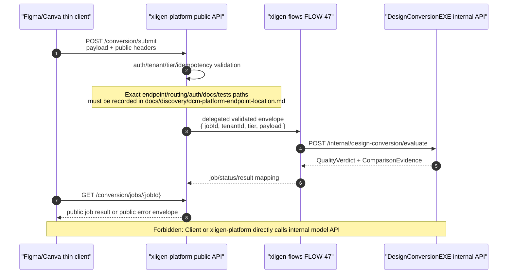
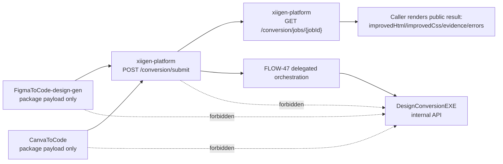
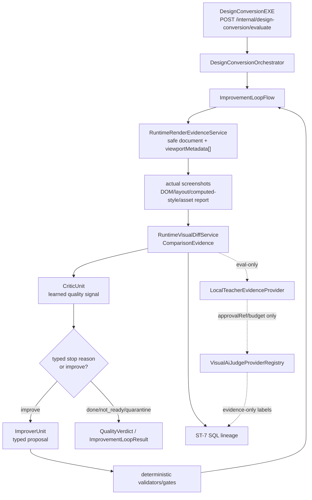
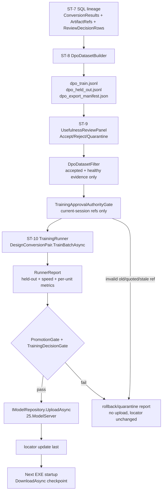

# DCM — План: серверная конверсия дизайна → HTML+CSS с обучаемой ILearningMachine
## (v1, PLAN-ONLY — реализация не начата)

**Версия:** 1.0
**Статус:** PLAN-ONLY. Реализация запрещена до явного одобрения Luba в текущем диалоге.
**Текущая ветка plan-only файла:** `codex/chat-gpt-5.5`
**Branch authority / рабочая ветка исполнения:** во всех участвующих репозиториях (`llm_mvp_core`, `xiigen-platform-dot-net-angular`, `xiigen-flows-dot-net-angular`, `FigmaToCode-design-gen`, `CanvaToCode` и любой новый репозиторий, добавленный в scope) authority/base branch выбирается как самый последний updated branch этого репозитория на момент pre-execution discovery. Исполнитель обязан зафиксировать для каждого репозитория `authority_branch`, `authority_commit`, `updated_at/source_of_update_evidence` и только после явного approval Luba создать рабочую ветку `DesignToCode` от этого authority branch. До approval это правило является plan-only; реальный checkout/branch creation запрещён.
**Связанные гайды (не дублировать, только ссылаться):**
- `docs/skills/dcm-dpo-construction-GUIDE.md` — построение DPO-пар
- `docs/skills/dcm-training-GUIDE.md` — обучение модели
- `docs/skills/dcm-measurement-GUIDE.md` — измерение качества

---

## Человеческое саммари (RU)

Мы строим серверный pipeline, который превращает дизайн из Figma или Canva в рабочий HTML+CSS. Суть не только в детерминированной конверсии — она была и раньше, — а в том, что сервер учится делать её **лучше** с каждым новым дизайном. Тонкий клиент (плагин Figma или приложение Canva) отправляет результат конверсии на хост xiigen. Хост передаёт его в ядро — серверный EXE из llm_mvp_core, — которое в runtime-домене детерминированно рендерит HTML/CSS, строит visual diff и `ComparisonEvidence`, записывает результаты в SQL-базу, а обучаемые Critic/Improver предлагают улучшенный вариант HTML+CSS. Teacher и внешний визуальный ИИ остаются eval/data-labeling/local-training/QA evidence provider, а не скрытым runtime-владельцем gate-ов.

Два совершенно разных пользователя работают с системой. **Тенант** — конечный пользователь платформы xiigen. Он генерирует конверсии через клиентов, имеет собственные ключи к внешнему ИИ и не знает ничего о весах модели. **Архитектор модели** — специалист, у которого есть доступ к локальному обучающему проекту. Он открывает DPO-пары (с оценкой полезности R-09), решает, принять ли их, запускает дообучение и заливает новые веса обратно на сервер через 25.ModelServer.

Поток данных выглядит так: клиент (FigmaToCode / CanvaToCode) → публичная граница xiigen-platform `POST /conversion/submit` → делегирование в xiigen-flows FLOW-47 → EXE-ядро llm_mvp_core (render actual HTML/CSS screenshots → diff с expected exports → `ComparisonEvidence`) → обучаемые Critic/Improver → SQL-БД → локальный обучающий проект (Teacher/eval labeling → DPO-build → показ архитектору с полезностью → train → measure → promotion gate → залить веса на ModelServer). Результат активной заявки читается только через публичный xiigen-platform job API `GET /conversion/jobs/{jobId}`, который получает состояние из FLOW-47 job/status store; callback-модель не является активной. Веса пути возвращаются в EXE при следующем запуске через IModelRepository.DownloadAsync.

Это **настоящая** обучаемая модель, а не детерминированный конвертер: модель имеет сохранённый чекпойнт, экспорт/импорт через manifest, fresh-load из ModelServer, continue-training от существующего чекпойнта и ablation-тест, доказывающий, что качество падает без обученных весов. Teacher — это только инструмент разметки данных, он **не** является runtime-authority; финальное решение об улучшении HTML+CSS принимает ImproverUnit через обученные веса.

---

## Реестр требований (Authority Requirements Ledger)

| ID | Требование | Слой / подзадача | Как проверяется |
|----|-----------|-----------------|----------------|
| R-01 | Приём результата конверсии (html+css+дерево+скрины) на публичный продуктовый хост | xiigen-platform public API `POST /conversion/submit` / `GET /conversion/jobs/{jobId}`, delegated to FLOW-47 in xiigen-flows | Интеграционный тест: POST с корректным телом → xiigen-platform auth/tenant/tier/idempotency → FLOW-47 job → 202 Accepted + `{ jobId, statusUrl }` |
| R-02 | FLOW-47 передаёт данные в ядро через внутреннюю API-границу ILearningMachine | Infrastructure-слой xiigen-flows → internal HTTP/ASP.NET API DesignConversionEXE in llm_mvp_core | Тест вызова: FLOW-47 вызывает internal API, EXE принимает запрос, возвращает QualityVerdict |
| R-03 | Рендер QA по `viewportMetadata[]` из caller/job config, с безопасной HTML+CSS-композицией и render sandbox | Runtime evidence service внутри EXE (Playwright .NET) | Артефактный тест: для каждой configured viewport создаются screenshot/DOM/layout/computed-style/asset artifacts; hardcoded 360/768/1280/1920 не является единственным источником |
| R-04 | Визуальное сравнение и eval-разметка (accuracy%/defects) | Runtime diff → `ComparisonEvidence`; LocalTeacher/QA → `IVisualAiJudgeProvider`/Claude/OpenAI/Gemini только для evidence/labeling | Тест: `ComparisonEvidence` содержит numeric accuracy/defects; `LabelingEvidence/JudgeResponse` содержит `score`/`accuracy`, typed `defects[]`, confidence/label/rawProviderResponseRef/providerMetadata/costTrace; внешний judge не является runtime gate |
| R-05 | Цикл улучшения до достижения порога качества | ImproverUnit + CriticUnit в ILogicalFlow | E2E тест: дизайн с заведомо плохим HTML улучшается до accuracy ≥ 0.8 |
| R-06 | SQL-БД результатов (`ComparisonEvidence`, candidate/result, chosen/rejected, lineage) | Infrastructure: SQL store с хранимками | Тест: после обработки запись появляется в БД со всеми полями lineage и метками |
| R-07 | DPO-пары [unit+source+result] с негативными кандидатами | Локальный обучающий проект, DPO-builder | Gate: каждая пара имеет chosen, rejected, reason, source-ref |
| R-08 | Гайды/скилы построения DPO-пар написаны и актуальны | `dcm-dpo-construction-GUIDE.md` | Файл существует, задокументирован, ссылки корректны |
| R-09 | Показ DPO с оценкой полезности архитектору перед обучением | Локальный UI обучающего проекта (Desktop/Local) | Ручная проверка: архитектор видит пары с usefulness-score |
| R-10 | Архитектор дообучает и заливает веса через ModelServer | TrainBatchAsync + PromotionGate + IModelRepository.UploadAsync | Runner report: architect approval + held-out + fresh-load + continue-training + privacy/schema/quarantine + promotion/rollback gates passed before UploadAsync and locator update |
| R-11 | Реализация через суб-агентов (Sonnet); ядро — llm_mvp_core | Все рабочие приказы | Каждый PR содержит только разрешённые файлы; ядро в llm_mvp_core |
| R-12 | Гайды DPO/обучение/измерение написаны как docs/skills/dcm-*.md | `dcm-training-GUIDE.md`, `dcm-measurement-GUIDE.md` | Файлы существуют и не пустые |
| R-13 | Декомпозиция на подзадачи ST-1..ST-11 с полными блоками | Секции ST-1..ST-11 этого документа; покрытие подтверждено матрицами и duplicate-heading gate | Каждая ST имеет UML + алгоритм + код-ссылки + gate; duplicate ST heading scan подтверждает один канонический набор заголовков |
| R-14 | Каждая подзадача — один полный блок (RU язык → UML → алго → код) | Part A §0..§5 для каждой ST | Reviewed gate: Part A полная до запуска executor |
| R-15 | Нет скрытого детерминизма в позиции runtime-authority | CriticUnit / ImproverUnit только через обученные веса | Code review: нет BM25/regex/dictionary как финального решателя |
| R-16 | Общая модель хранится в llm_mvp_core (R5) | DesignConversionDomain, DesignConversionGlobal | Путь чекпойнта внутри репо; UploadAsync = ModelServer в llm_mvp_core |
| R-17 | Тонкие клиенты и хост (R6): логика только в ядре | FigmaToCode, CanvaToCode, xiigen-platform, xiigen-flows | Code review: клиент не содержит ML-логики; xiigen-platform владеет публичным API contract и делегирует; FLOW-47 оркестрирует intake/job-status; ML-логика только в llm_mvp_core |
| R-18 | Внешний ИИ-судья разрешён Luba (R7) только как eval/data-labeling/QA evidence provider | LocalTeacher/QA, `VisualAiJudgeProviderRegistry`, вызов Claude/OpenAI/Gemini/available providers | Явное разрешение Luba зафиксировано в этом плане; provider selection/fallback/rate-limit/malformed-output/cost trace проверяемы; runtime deterministic gates им не подменяются и runtime `externalAiCalls = 0` |
| R-19 | Настоящая обучаемость: checkpoint/export/import/locator/fresh-load/continue-training/ablation (R4) | DesignConversionGlobal + DesignConversionPersonal lifecycle | Runner report: каждый из 7 пунктов имеет тест/артефакт |
| R-20 | Check 19 production controls: internal API security, artifact access, license/data-use, provider secret/redaction, cost ledger, observability | ST-2/ST-3/ST-5/ST-6/ST-7/ST-8/ST-10 cross-cutting controls | Gate B: `ProductionControlsGateTests` + named contract tests prove auth/tenant/idempotency/rate-limit, artifact authorization, license quarantine, provider redaction, cost overrun denial, and telemetry redaction before implementation can be accepted |

---

## Часть A §0 — Диаграмма классов

```mermaid
classDiagram
    class FigmaToCodePlugin {
        +html: string
        +css: string
        +designImagePng: bytes
        +previousResult: string
        +apiEndpoint: string (configurable)
        +sendResult()
    }
    note for FigmaToCodePlugin "Тонкий Figma-плагин: детерминированный конвертер дизайна → HTML+CSS. Отправляет результат на хост. СТАТУС: существует, нужно добавить отправку."

    class CanvaToCodeApp {
        +html: string
        +css: string
        +designImagePng: bytes
        +sendResult()
    }
    note for CanvaToCodeApp "Тонкое Canva-приложение: аналог FigmaToCode. СТАТУС: существует, нужно добавить отправку результата."

    class XiigenPlatformPublicApi {
        +POST_conversion_submit()
        +GET_conversion_jobs_jobId()
        +ValidateAuthTenantTier()
        +DelegateToFlow47()
    }
    note for XiigenPlatformPublicApi "Публичная product/API boundary в C:\\Projects\\xiigen-platform-dot-net-angular. Владеет внешним контрактом POST /conversion/submit и GET /conversion/jobs/{jobId}: DTO, headers, auth, tenant/tier, status codes, idempotency и error envelope. Не вызывает internal model API напрямую. СТАТУС: новый/интеграционный surface."

    class XiigenHostFlow47 {
        +ReceivePlatformSubmission()
        +ReadJobStatusForPlatform()
        +RequireRole(platform_admin)
        +X_Tenant_Id: string
        +X_Idempotency_Key: string
        +callCoreEXE()
    }
    note for XiigenHostFlow47 "FLOW-47 design-conversion intake/orchestration в C:\\Projects\\xiigen-flows-dot-net-angular\\47.DesignConversionIntake (.NET 10). Invoked by xiigen-platform, owns job/status storage and status mapping, and calls core only through DesignConversionCoreApiClient → internal HTTP POST /internal/design-conversion/evaluate. Старые /conversion/request, /conversion/result и /api/v1/design-conversion — legacy/non-canonical. СТАТУС: новый, не создан."

    class DesignConversionEXE {
        +start()
        +exposeConversionAPI()
        +exposeTrainingAPI()
    }
    note for DesignConversionEXE "EXE — out-of-process хост вокруг 25.ModelServer и 15.OrchestratorModel. .NET 9. Принимает запросы от FLOW-47, строит runtime ComparisonEvidence через deterministic render/diff, вызывает ILearningMachinePair/Critic/Improver. СТАТУС: новый, не создан."

    class RuntimeRenderEvidenceService {
        +RenderAsync(html, css, viewportMetadata, sandboxPolicy) RenderResult
        +writeRenderArtifacts()
    }
    note for RuntimeRenderEvidenceService "Runtime deterministic render service ВНУТРИ EXE. Playwright .NET строит safe HTML document из html+css, применяет css через controlled style block, рендерит configured viewportMetadata[] и пишет screenshot/dom/layout/computed-style/asset-report artifacts. Не строит diff и не вызывает внешний ИИ. СТАТУС: новый, не создан."

    class RuntimeVisualDiffService {
        +BuildEvidenceAsync(render, expected) ComparisonEvidence
        +computeVisualDiff()
        +writeToSqlDB()
    }
    note for RuntimeVisualDiffService "Runtime deterministic visual diff service ВНУТРИ EXE. Сравнивает actual screenshots с expectedDesignExports и строит ComparisonEvidence(actualScreenshots, expectedExports, diffImages, dom/layout/computed-style/asset artifacts, defects). Не вызывает внешний ИИ. СТАТУС: новый, не создан."

    class LocalTeacherEvidenceProvider {
        +loadComparisonEvidence()
        +labelWithVisualAiJudgeRegistry()
        +labelChosenRejected()
        +writeDpoLabels()
    }
    note for LocalTeacherEvidenceProvider "Eval/data-labeling/local-training/QA provider. Использует ComparisonEvidence и при необходимости VisualAiJudgeProviderRegistry для evidence-only меток chosen/rejected/quarantine. Не является hidden runtime-owner deterministic gates. СТАТУС: новый, не создан."

    class IVisualAiJudgeProvider {
        +Name: string
        +EstimateCostAsync(request) CostEstimate
        +JudgeAsync(request) JudgeResponse
    }
    note for IVisualAiJudgeProvider "Provider abstraction для Claude/OpenAI/Gemini/available visual judge providers. Используется только LocalTeacher/QA/local-training path, с fallback/rate-limit/malformed-output/cost trace. Runtime core externalAiCalls=0."

    class VisualAiJudgeProviderRegistry {
        +SelectProvider(policy, budget, approvalRef)
        +FallbackOrder: Claude, OpenAI, Gemini, available
        +RecordProviderTrace()
    }
    note for VisualAiJudgeProviderRegistry "Выбор provider-а, fallback order, rate-limit/backoff, malformed output handling, per-call token/cost accounting, budget/policy trace. Не может быть runtime gate authority."

    class JudgeResponse {
        +score: double
        +accuracy: double
        +defects: JudgeDefect[]
        +confidence: double
        +label: accepted|rejected|quarantine
        +rawProviderResponseRef: ArtifactRef
        +providerMetadata: ProviderMetadata
        +costTrace: ExternalJudgeCostTrace
    }
    note for JudgeResponse "Нормализованный output contract внешнего judge-а. defects[] содержит message, severity, viewport, sourcePlatform/platform, evidenceRefs."

    class SqlResultsDB {
        +writeConversionResult()
        +readDPOCandidates()
        +storedProcedures: SP[]
    }
    note for SqlResultsDB "Внешняя SQL-БД (.NET+SQL+хранимки). Хранит source lineage, candidates, ComparisonEvidence, stable render/diff artifact refs/hashes, verdicts, chosen/rejected/quarantine и metadata. Читается локальным обучающим проектом для DPO. СТАТУС: новая таблица, не создана."

    class DesignConversionPair {
        +personal: DesignConversionPersonal
        +global: DesignConversionGlobal
        +syncAnonymizedSignals()
        +TrainBatchAsync()
        +EvaluateAsync()
        +ExportAsync()
        +ImportAsync()
        +GetOrchestratorAsync()
    }
    note for DesignConversionPair "ILearningMachinePair<DesignConversionPersonal,DesignConversionGlobal>. Обе ноги — ILearningMachine<DesignConversionDomain>. Pair владеет training orchestration: runner вызывает pair, а pair dispatch-ит accepted DPO batches в Personal/Global leg(s) по политике. Синхронизируются только анонимные сигналы (A-LM-08). Уровень 1 иерархии. СТАТУС: scaffold, не создан."

    class DesignConversionGlobal {
        +TrainBatchAsync(batch: DPOBatch)
        +EvaluateAsync(input)
        +ExportAsync() manifest
        +ImportAsync(manifest)
        +GetOrchestratorAsync() ILogicalOrchestrator
        +SaveCheckpointAsync()
        +LoadCheckpointAsync()
    }
    note for DesignConversionGlobal "ILearningMachine<DesignConversionDomain>. Общая нога: хранится в llm_mvp_core, публикуется через 25.ModelServer. Все тенанты используют общий Global. СТАТУС: scaffold, не создан."

    class DesignConversionPersonal {
        +TrainBatchAsync(batch: DPOBatch)
        +EvaluateAsync(input)
        +ExportAsync() manifest
        +ImportAsync(manifest)
        +GetOrchestratorAsync() ILogicalOrchestrator
    }
    note for DesignConversionPersonal "ILearningMachine<DesignConversionDomain>. Адаптивная нога: адаптируется под конкретного тенанта. Хранится на стороне пользователя. СТАТУС: scaffold, не создан."

    class DesignConversionOrchestrator {
        +RunAsync(request: LogicalOrchestratorRequest) LogicalOrchestratorResult
    }
    note for DesignConversionOrchestrator "ILogicalOrchestrator. Уровень 4. Управляет циклом CriticUnit → ImproverUnit до достижения порога качества. СТАТУС: scaffold, не создан."

    class ImprovementLoopFlow {
        +ExecuteAsync(request: LogicalFlowRequest) LogicalFlowResult
    }
    note for ImprovementLoopFlow "ILogicalFlow<DesignConversionInput>. Уровень 3. Итерационный runtime-цикл render → diff → Critic → если rejected → Improver → снова render/diff. СТАТУС: scaffold, не создан."

    class CriticUnit {
        +ExecuteAsync(input: (tree,html,renderImages,diff)) QualityVerdict
        +score: float
        +defects: Defect[]
    }
    note for CriticUnit "ILogicalUnit<(tree,html,renderImages,diff), QualityVerdict>. Уровень 2. Оценивает качество HTML+CSS относительно дизайна. СТАТУС: scaffold, контракт есть, обученного состояния НЕТ."

    class ImproverUnit {
        +ExecuteAsync(input: ImproverInput) ImproverOutput
    }
    note for ImproverUnit "ILogicalUnit<ImproverInput, ImproverOutput>. Уровень 2. Предлагает кандидат улучшенного HTML+CSS по текущему evidence/defects; deterministic validators/gates принимают или отклоняют кандидат. СТАТУС: scaffold, не создан."

    class ModelServer25 {
        +UploadAsync(manifest, checkpoint)
        +DownloadAsync(locatorKey) checkpoint
        +IModelRepository
    }
    note for ModelServer25 "25.ModelServer в llm_mvp_core. Хранит и раздаёт веса через IModelRepository. DesignConversionGlobal публикует веса сюда. СТАТУС: существует (по эталону A-LM-07)."

    class LocalTrainingProject {
        +readFromSqlDB()
        +buildDPOPairs()
        +showDPOWithUsefulness()
        +trainBatch()
        +measureAccuracy()
        +uploadWeights()
    }
    note for LocalTrainingProject "Локальный обучающий проект (архитектор). В llm_mvp_core, по паттерну TranslationDomain runner + Desktop/Local UI. Ключи главного тенанта. СТАТУС: новый, не создан."

    FigmaToCodePlugin --> XiigenPlatformPublicApi : public POST html+css+png
    CanvaToCodeApp --> XiigenPlatformPublicApi : public POST html+css+png
    XiigenPlatformPublicApi --> XiigenHostFlow47 : delegate validated intake/job reads
    XiigenHostFlow47 --> DesignConversionEXE : internal HTTP/ASP.NET API
    DesignConversionEXE --> DesignConversionPair : вызов ILearningMachine
    DesignConversionEXE --> RuntimeRenderEvidenceService : render actual screenshots
    RuntimeRenderEvidenceService --> RuntimeVisualDiffService : actual screenshots
    RuntimeVisualDiffService --> SqlResultsDB : запись ComparisonEvidence
    DesignConversionPair --> DesignConversionGlobal : global leg
    DesignConversionPair --> DesignConversionPersonal : personal leg
    DesignConversionGlobal --> DesignConversionOrchestrator : GetOrchestratorAsync
    DesignConversionPersonal --> DesignConversionOrchestrator : GetOrchestratorAsync
    DesignConversionOrchestrator --> ImprovementLoopFlow : ILogicalFlow
    ImprovementLoopFlow --> CriticUnit : оценка качества
    ImprovementLoopFlow --> ImproverUnit : улучшение HTML+CSS
    DesignConversionGlobal --> ModelServer25 : UploadAsync / DownloadAsync
    LocalTrainingProject --> SqlResultsDB : читает DPO-кандидаты
    LocalTrainingProject --> LocalTeacherEvidenceProvider : eval/labeling/QA
    LocalTeacherEvidenceProvider --> VisualAiJudgeProviderRegistry : evidence-only judging
    VisualAiJudgeProviderRegistry --> IVisualAiJudgeProvider : Claude/OpenAI/Gemini fallback
    LocalTrainingProject --> DesignConversionPair : pair TrainBatchAsync + gated promotion
```



### Check 18 — Именованные Mermaid/UML diagrams для ST-coverage

Существующая диаграмма классов выше является канонической ссылкой `DCM-UML-00 — Class ownership map` для ST-1..ST-11. Дополнительные Mermaid-диаграммы ниже являются именованными ссылками для solved-block строк `UML/diagram`; они не меняют архитектурные решения, а только делают покрытие flow/boundary явным.

| Diagram ref | Тип | Покрывает ST | Назначение |
|-------------|-----|--------------|------------|
| `DCM-MMD-01` | sequenceDiagram | ST-1, ST-2, ST-3 | API/client/platform/FLOW/core boundary и запрет прямого caller/platform→internal API |
| `DCM-MMD-02` | flowchart | ST-1, ST-2 | Тонкая клиентская boundary: Figma/Canva только package/send/poll/render public result |
| `DCM-MMD-03` | flowchart | ST-3, ST-4, ST-5, ST-6 | Internal EXE render/diff/Critic/Improver loop и eval-only visual judge side path |
| `DCM-MMD-04` | flowchart | ST-7, ST-8, ST-9, ST-10, ST-11 | SQL lineage → DPO export → architect review → train/promote/upload/rollback |

#### DCM-MMD-01 — API/client/platform boundary (ST-1/ST-2/ST-3)



#### DCM-MMD-02 — Client/platform thin boundary (ST-1/ST-2)



#### DCM-MMD-03 — Render/judge/improvement loop (ST-3/ST-4/ST-5/ST-6)



#### DCM-MMD-04 — DPO/training/promotion lifecycle (ST-7/ST-8/ST-9/ST-10/ST-11)



### Легенда символов и стереотипов

| Символ / стереотип | Значение |
|-------------------|---------|
| `-->` | Вызов / отправка данных (синхронный или async HTTP) |
| `ILearningMachinePair` | Пара Personal+Global ног; синхронизируются только анонимные сигналы |
| `ILearningMachine` | Полный lifecycle: Train/Evaluate/Export/Import/Checkpoint |
| `ILogicalOrchestrator` | Управляет циклом юнитов до достижения условия |
| `ILogicalFlow` | Последовательность юнитов с ветвлением |
| `ILogicalUnit` | Атомарный шаг: один вход → один выход |
| `RuntimeRenderEvidenceService` | Runtime render actual screenshots; deterministic input, без внешнего ИИ |
| `RuntimeVisualDiffService` | Runtime visual diff + `ComparisonEvidence`; deterministic gate input, без внешнего ИИ |
| `LocalTeacherEvidenceProvider (eval-only)` | Разметчик данных; не принимает runtime-решений |
| `СТАТУС: scaffold` | Контракт определён, реализации нет |
| `СТАТУС: существует` | Компонент уже есть в репо |
| `СТАТУС: новый` | Нужно создать с нуля |

### Симуляция по ключевым связям

| Связь | Пример входа | Ожидаемый результат |
|-------|-------------|-------------------|
| FigmaToCodePlugin/CanvaToCodeApp → XiigenPlatformPublicApi | `{sourcePlatform:"figma|canva", designTree/sourceTree, generatedHtml, generatedCss, generatedResult?, designScreenshots[], expectedDesignExports[], viewportMetadata[], tenantContext:{tenantId,userId,tier}, idempotencyKey, callerCorrelationId}` + public headers | HTTP 202 Accepted; `X-Idempotency-Key` и caller correlation/request id зафиксированы; `{ jobId, statusUrl }` возвращены публичным endpoint |
| XiigenPlatformPublicApi → XiigenHostFlow47 | validated public DTO + `{ tenantId, designTier, idempotencyKey, loopBudget, caller }` | FLOW-47 создал/переиспользовал job, сохранил status mapping, вернул platform-safe status |
| XiigenHostFlow47 → DesignConversionEXE | internal HTTP `POST /internal/design-conversion/evaluate` с `ConversionRequest{tenantId, html, css, tree, expectedExports, jobId}` | `ConversionResponse{jobId:"xyz", status:"completed", result:{...}}` |
| RuntimeRenderEvidenceService → RuntimeVisualDiffService | `RenderResult{artifactId, actualScreenshots, domSnapshots, layoutBounds, computedStyles, assetReport, artifactRefs, viewportResults}` + `expectedDesignExports[]` | `ComparisonEvidence{actualScreenshots, expectedExports, diffImages, dom.json, layout-bounds.json, computed-styles.json, asset-report.json, defects}` |
| RuntimeVisualDiffService → SqlResultsDB | `ComparisonEvidence{artifactId, actualScreenshots, expectedExports, diffImages, domSnapshots, layoutBounds, computedStyles, assetReport, defects}` | Строка в таблице `conversion_results`; хранимка записывает evidence + lineage + stable artifact refs/hashes |
| LocalTeacherEvidenceProvider → VisualAiJudgeProviderRegistry / `IVisualAiJudgeProvider` | `JudgeRequest{comparisonEvidenceRef, actualScreenshots[], expectedExports[], diffImages[], domSnapshots[], layoutBounds[], computedStyles[], assetReport, html, css, sourcePlatform/platform, viewportMetadata[], approvalRef, tierBudget, privacyRedactionTrace}` | `LabelingEvidence/JudgeResponse{score, accuracy, defects:[{message,severity,viewport,sourcePlatform/platform,evidenceRefs}], confidence, label, rawProviderResponseRef, providerMetadata, costTrace}`; provider trace records selection policy, fallback order, rate-limit/backoff, malformed-output handling and budget/policy decision |
| LocalTrainingProject → SqlResultsDB | запрос DPO-кандидатов за период | Список пар `{chosen: result_A, rejected: result_B, reason: "accuracy delta > 0.2"}` |
| DesignConversionGlobal → ModelServer25 | `UploadAsync(manifest{version:"v2", accuracy:0.81}, checkpoint[bytes])` | Manifest опубликован; следующий `DownloadAsync("dcm-global-v2")` возвращает те же веса |

---

## Часть A §1.1 — Project Ownership / API Boundary Matrix (Check 07 repair)

Каноническое разделение ответственности: xiigen-platform — публичная product/API host boundary; xiigen-flows FLOW-47 — orchestration/intake flow implementation, invoked by platform; llm_mvp_core — DesignConversionDomain, EXE host and internal model API. Caller repos remain thin callers only.

| Project / repo root | Owns | Does not own | Canonical code location(s) | Reference/documentation row |
|---------------------|------|--------------|----------------------------|-----------------------------|
| `C:\Projects\xiigen-platform-dot-net-angular` | Public `POST /conversion/submit` and `GET /conversion/jobs/{jobId}` endpoint ownership; public DTO schema; auth; tenant resolution; tier header validation; idempotency key acceptance; public HTTP status codes; public error envelope; delegation to FLOW-47 | Job/status storage implementation; learned model logic; internal model API calls | Exact platform code locations are intentionally UNKNOWN until the Check 17 pre-execution discovery gate below passes; no executor may invent controller/endpoint filenames | Platform public API doc/OpenAPI row for `/conversion/submit` and `/conversion/jobs/{jobId}`; must name headers `X-Tenant-Id`, `X-Idempotency-Key`, `If-Match`, `X-Design-Tier`, `X-Loop-Budget`; blocked until `docs/discovery/dcm-platform-endpoint-location.md` records exact paths |
| `C:\Projects\xiigen-flows-dot-net-angular` | FLOW-47 intake/orchestration implementation; canonical root `C:\Projects\xiigen-flows-dot-net-angular\47.DesignConversionIntake`; job/status storage; internal status mapping `pending|running|completed|failed|quarantined|not_ready` and platform handoff mapping to caller-visible `queued|running|succeeded|failed|not_ready`; retry/timeout around core API; `DesignConversionCoreApiClient` | Public product/API contract ownership; caller UI; DesignConversionDomain/model weights | `C:\Projects\xiigen-flows-dot-net-angular\47.DesignConversionIntake\FlowHost.cs`; `...\Application\ConversionService.cs`; `...\Infrastructure\DesignConversionCoreApiClient.cs`; `...\Infrastructure\JobStatusStore.cs` | FLOW-47 implementation doc/runbook row: platform input → flow job → internal core request → platform-safe status |
| `C:\Projects\llm_mvp_core` | `DesignConversionDomain`; `DesignConversionEXE`; internal model API `POST /internal/design-conversion/evaluate`; `OperationResult<T>` to internal HTTP DTO/error mapping; render/diff evidence; Critic/Improver; model checkpoint/manifest lifecycle | Public platform endpoint ownership; public auth/tenant UI; FLOW-47 job store | `NN.DesignConversionDomain/*`; `NN.DesignConversionDomain.Host/Program.cs`; `DesignConversionEXE/InternalDesignConversionApi.cs`; `00.Core/DesignConversionContracts.cs` | Core internal API contract row: `DesignConversionInput`, `QualityVerdict`, internal error mapping, no public caller access |
| `C:\Projects\FigmaToCode-design-gen` | Thin caller integration: build Figma public payload with `sourcePlatform=figma`, original design/source tree, generated HTML+CSS/result, original design screenshots/exports, viewport metadata, tenant/user/tier context, `idempotencyKey`, and caller-sent `correlationId/requestId`; send only to xiigen-platform public endpoint; poll public job URL; consume public result contract and render improved HTML/CSS, comparison images/diff refs, quality metrics/defects, statuses, and platform error envelope | Server ownership; FLOW-47 job store; internal model API calls; learned/model logic | `C:\Projects\FigmaToCode-design-gen\src\ui\components\ai-enhance\AIService.ts`; `...\src\plugin\core\controller.ts` | Caller integration doc row: exact Figma payload fields, public endpoint URL config, polling, `not_ready` handling, result rendering, error envelope handling, and mock public API tests |
| `C:\Projects\CanvaToCode` | Thin caller integration: build Canva public payload with `sourcePlatform=canva`, original design/source tree, generated HTML+CSS/result, original design screenshots/exports, viewport metadata, tenant/user/tier context, `idempotencyKey`, and caller-sent `correlationId/requestId`; send only to xiigen-platform public endpoint; poll public job URL; consume public result contract and render improved HTML/CSS, comparison images/diff refs, quality metrics/defects, statuses, and platform error envelope | Server ownership; FLOW-47 job store; internal model API calls; learned/model logic | `C:\Projects\CanvaToCode\src\canva-adapter.ts`; `C:\Projects\CanvaToCode\src\app.tsx` | Caller integration doc row: exact Canva payload fields, public endpoint URL config, polling, `not_ready` handling, result rendering, error envelope handling, and mock public API tests |

### Check 17 — Reference Coverage / Docs Coverage Repair

Every executor work order for ST-1..ST-11 must read the applicable reference path(s) below before implementation and must record extracted facts in the named ST artifact, doc, runbook, test, or discovery output. These references are coverage inputs; they do not replace the DCM ownership boundary in this plan.

| Required reference path | Concrete ST / deliverable mapping | Executor must extract / record |
|-------------------------|-----------------------------------|--------------------------------|
| `C:\Users\lubao\Documents\xiigen\llm mvp\Small model racional` | ST-10 training, ST-11 measurement/promotion, DOC-03 training/export/import and promotion runbooks | Small-model rationale for checkpoint lifecycle, fresh-load/continue-training expectations, measured improvement criteria, and failure modes that must appear in `PromotionGate`/`TrainingDecisionGate` docs and tests |
| `C:\Users\lubao\Documents\xiigen\llm mvp\language translate learning` | ST-8 DPO construction, ST-10 training, DOC-01 DPO/training guides | Transferable ILearningMachine training pattern, DPO pair shape, train/held-out split logic, export/import proof, and exact guide/test names that should align with `DpoDatasetBuilderTests`, reproducibility tests, and training gates |
| `C:\Users\lubao\Documents\xiigen\llm mvp\local wiki learning` | ST-7 storage, ST-8 DPO source lineage, ST-10 measurement, DOC-04 schema/data contracts | Local corpus/wiki-style source lineage, artifact reference rules, snapshot/version handling, and evidence retention patterns needed by DB rows, DPO export manifests, migration compatibility, and measurement docs |
| `C:\Users\lubao\Documents\xiigen\llm mvp\extensions` | ST-1 thin callers, ST-2 public platform intake, ST-6 result contract, DOC-02 caller integration docs | Extension/caller packaging constraints, payload fields, public endpoint configuration, polling/result UX, and proof that caller repos remain thin clients with no learned-model logic |
| `C:\Users\lubao\Documents\xiigen\llm mvp\documentation learning` | Documentation deliverables DOC-01..DOC-06, docs coverage gates, runbooks | Required doc structure, user-visible wording depth, cross-doc consistency checks, and Markdown/readability rules for `DocumentationCoverageTests` and `DocumentationContractNameTests` |
| `C:\Users\lubao\Documents\xiigen\Planning sessions\session-start-extracted` | Governance, Authority Requirements Ledger, sub-agent work orders, Gate B evidence | Current-authority extraction rules, quoted-context quarantine, bounded sub-agent fields, acceptance/evidence format, and completion-matrix requirements that every executor/reviewer packet must preserve |
| `C:\Projects\xiigen-platform-dot-net-angular` | ST-1/ST-2 platform public API boundary, DOC-02 API docs, DOC-06 platform discovery | Exact endpoint/controller/minimal-API file path, routing/module registration path, auth/tenant/tier middleware path, OpenAPI/API docs path, and tests path; these are discovered only through the pre-execution gate below |
| `C:\Projects\xiigen-flows-dot-net-angular` | ST-2 FLOW-47 orchestration, ST-3 internal core handoff, DOC-03 flow/runbook coverage | Existing flow conventions, FLOW-47 root/location, job/status store pattern, platform handoff contract, internal core client pattern, timeout/retry/error mapping, and flow tests/runbook names |
| `C:\Projects\FigmaToCode-design-gen` | ST-1 Figma thin caller, DOC-02 Figma integration, caller contract tests | Existing service/controller integration points, payload construction, screenshot/export metadata, endpoint config, polling/error handling, and mock public API test locations |
| `C:\Projects\CanvaToCode` | ST-1 Canva thin caller, DOC-02 Canva integration, caller contract tests | Existing adapter/app integration points, Canva source/export payload shape, endpoint config, polling/result rendering, error envelope handling, and mock public API test locations |

### Check 17 — Pre-Execution Discovery Gate for xiigen-platform

Before any ST-1/ST-2 platform implementation starts in `C:\Projects\xiigen-platform-dot-net-angular`, the executor must create or update the discovery artifact `docs/discovery/dcm-platform-endpoint-location.md` in the implementation change set, then cite it in the ST-1/ST-2 review packet. Platform implementation is BLOCKED while any exact path remains `UNKNOWN`, guessed, or represented by placeholder examples such as `server/...`.

Required fields in `docs/discovery/dcm-platform-endpoint-location.md`:
- `endpoint_file_path`: exact file that will own `POST /conversion/submit` and `GET /conversion/jobs/{jobId}`.
- `routing_or_module_registration_path`: exact route/module/startup registration path.
- `auth_tenant_tier_middleware_path`: exact auth, tenant resolution, tier validation, idempotency, and rate/budget policy path(s).
- `api_docs_or_openapi_path`: exact OpenAPI/API docs source path for the public contract.
- `tests_path`: exact unit/integration/contract test path(s) that will cover public endpoint, delegation to FLOW-47, errors, headers, and no internal model API call.

Gate B: `PlatformEndpointDiscoveryGateTests` or reviewer read-back must fail the platform slice if the discovery artifact is absent, any required field is blank/UNKNOWN, or implementation touches platform endpoint code before the exact file paths are recorded.

### Public vs Internal API Boundary

**Public contract owned by xiigen-platform.** `POST /conversion/submit` accepts a platform DTO with `sourcePlatform = figma|canva|other`, original `designTree/sourceTree`, generated `html/css` plus `generatedResult?`, `designScreenshots[]`, `expectedDesignExports[]`, `viewportMetadata[]` (`label`, `width`, `height`, `deviceScaleFactor`, `orientation`), `tenantContext { tenantId, userId, tier }`, `previousResult?`, `tierContext`, caller-provided `idempotencyKey`, and caller-provided `correlationId/requestId`. Required headers: `Content-Type: application/json`, `Authorization` / platform session, `X-Tenant-Id`, `X-User-Id`, `X-Idempotency-Key`, `X-Correlation-Id` or `X-Request-Id`, `If-Match`, `X-Design-Tier`, `X-Loop-Budget`. Public status codes: `202` accepted with `{ jobId, statusUrl, correlationId }`, `200` for `GET /conversion/jobs/{jobId}` with `{ jobId, status, result?, error?, correlationId }`, `400` validation, `401/403` auth/role, `404` unknown job, `409` idempotency/If-Match conflict, `422` unsupported payload/tier, `429` tenant/tier budget, `503` flow/core unavailable. Caller-visible status set is `queued|running|succeeded|failed|not_ready`; xiigen-platform maps any FLOW-47/internal state into that public set. `result` contains `improvedHtml`, `improvedCss`, `comparisonImages[]`, `diffRefs[]`, `qualityMetrics`, `defects[]`, and `artifactRefs`. Public errors use the platform error envelope `{ code, message, correlationId, details? }` and never leak `OperationResult<T>` internals.

**FLOW-47 boundary owned by xiigen-flows.** FLOW-47 receives only a platform-validated submission envelope `{ jobId, tenantId, idempotencyKey, designTier, loopBudget, caller, payload }`; persists job/status state; maps core/internal states `pending|running|completed|failed|quarantined|not_ready` into platform-safe caller statuses `queued|running|succeeded|failed|not_ready`; forwards only the internal core DTO needed by llm_mvp_core. FLOW-47 may return flow errors to xiigen-platform, but xiigen-platform remains the public envelope owner.

**Internal model API owned by llm_mvp_core.** `POST /internal/design-conversion/evaluate` accepts `DesignConversionInput { jobId, tenantId, html, css, designTree/sourceTree, designScreenshots[], expectedDesignExports[], viewportMetadata[], sourcePlatform, tierPolicy, renderSandboxPolicyRef? }` and returns `QualityVerdict { status, improvedHtml?, improvedCss?, accuracy?, defects[], comparisonEvidence?, renderQaReport?, error? }`. `OperationResult<T>` is mapped at the EXE boundary to internal HTTP statuses/DTOs, then FLOW-47 maps those to job status, and xiigen-platform maps that to the public error envelope.

**Forbidden ownership.** `C:\Projects\FigmaToCode-design-gen` and `C:\Projects\CanvaToCode` do not become servers, do not own `/conversion/*`, do not persist job/status state, and do not call `POST /internal/design-conversion/evaluate`. `C:\Projects\xiigen-platform-dot-net-angular` does not bypass FLOW-47 and does not call the internal model API directly. `C:\Projects\xiigen-flows-dot-net-angular` does not own the public product contract. `C:\Projects\llm_mvp_core` does not expose public tenant-facing endpoints.

### Check 19 — Production Controls / Security Boundary

This section is a PLAN-ONLY production-controls contract for the same DCM server pipeline. It does not authorize implementation; it defines mandatory gates/tests that every implementation slice must satisfy before review acceptance.

#### 1. Internal API security for `POST /internal/design-conversion/evaluate`

`DesignConversionEXE/InternalDesignConversionApi.cs` must front the endpoint with `InternalDesignConversionAuthGate` before deserializing or executing domain logic:
- Service authentication is mandatory: either mTLS between FLOW-47 and DesignConversionEXE or a signed internal service token with `iss`, `aud`, `exp`, `kid`, service identity, and rotation-ready key material. Anonymous, browser, public platform session, or tenant-user tokens are rejected.
- Tenant/job ownership is mandatory: request `tenantId`, `jobId`, caller service identity, and FLOW-47 job-store ownership must match before any render/diff/model work starts. Cross-tenant `jobId` reuse returns a typed 403/409 internal error and writes an audit event without payload/body leakage.
- Idempotency replay policy is mandatory: repeated `(tenantId, jobId, idempotencyKey, payloadHash)` returns the stored verdict/result ref without re-running render/model/provider work; same key with different payload hash returns conflict; missing key returns validation failure.
- Rate-limit/abuse gate is mandatory: per service identity, tenant, tier, and job burst limits apply before expensive render/model/provider work. Over-limit returns typed 429 with correlationId and no raw payload echo.
- Direct caller/platform bypass is forbidden: Figma/Canva clients, xiigen-platform public API, browser users, and any caller other than FLOW-47 service identity cannot call this endpoint even with tenant headers.

Tests required:
- `InternalDesignConversionServiceAuthTests`: rejects missing/invalid mTLS or signed token and accepts configured FLOW-47 service identity.
- `InternalDesignConversionTenantIsolationTests`: cross-tenant `tenantId/jobId` and mismatched service ownership are denied before orchestration.
- `InternalDesignConversionIdempotencyReplayTests`: same key+same payload hash replays stored result without a second core execution; same key+different hash conflicts.
- `InternalDesignConversionRateLimitTests`: per tenant/tier/service over-limit returns 429 and records policy trace.
- `InternalDesignConversionDirectCallerForbiddenTests`: xiigen-platform/public/browser/client tokens cannot call `/internal/design-conversion/evaluate` directly.

#### 2. Artifact access controls

Add `ArtifactAccessPolicy` as the only gate that translates persisted artifact refs into read access. DB rows may contain internal storage refs for server use, but user-visible/public/API/UI responses never expose raw filesystem paths or storage bucket keys.
- Authorization is tenant-scoped: every artifact read checks `tenantId`, `jobId`, `artifactRefId`, artifact status, retention state, and caller role before any bytes or signed URL are returned.
- Artifact URLs are signed and expiring, or replaced by an equivalent brokered download token. The URL/token scope includes tenant, artifactRefId, purpose, expiration, content hash, and allowed role.
- Path traversal denial is mandatory: `..`, absolute paths, drive letters, UNC paths, encoded traversal, symlink escape, and non-allowlisted storage roots are rejected before file/storage open.
- Role checks are explicit: public tenant user can read only result-safe artifacts for their tenant/job; architect/admin/local-training roles can read training/evidence artifacts only through audited policy; raw provider payload artifacts remain redacted/ref-only unless a separate approved diagnostic policy allows them.
- Artifact read audit is mandatory: each successful or denied read records `correlationId`, `tenantId`, `jobId`, `artifactRefId`, role, decision, reason, expiration, and redacted storageRef hash. Audit never stores raw local path, full signed URL, screenshot bytes, or secrets.

Tests required:
- `ArtifactAccessPolicyAuthorizedReadTests`: authorized same-tenant/job role receives signed/expiring access or brokered bytes.
- `ArtifactAccessPolicyCrossTenantDeniedTests`: cross-tenant or wrong-job refs are denied.
- `ArtifactSignedUrlExpiryTests`: expired URL/token cannot read artifact and logs a safe denial.
- `ArtifactPathTraversalDeniedTests`: traversal, absolute/UNC/encoded paths and symlink escape are rejected.
- `ArtifactNoRawPathExposureTests`: public DTOs, logs, audit, UI-visible data, and errors do not expose raw local paths or bucket keys.

#### 3. Licensing and allowed-data gate

Add `LicenseAndDataUseGate` before LocalTeacher labels, DPO export, training, provider calls, and promotion:
- Each source row/artifact must carry license provenance fields: `licenseSource`, `licenseType`, `licenseUrlOrRef`, `licenseCapturedAt`, `sourceOwner`, `datasetOrigin`, `usageScope`, `tenantConsentRef`, `dataUsePolicyVersion`, and `licenseReviewStatus`.
- Behavior is explicit: `allow` continues, `deny` blocks use with a typed reason, `quarantine` preserves evidence for review but excludes the row from normal DPO/training/provider calls.
- External corpus access is allowlist-only. Unknown external datasets, scraped examples, ambiguous exports, missing consent, and unknown/unlicensed source refs are rejected or quarantined before they can enter DPO JSONL, training batches, visual judge prompts, provider payloads, or uploaded model artifacts.
- License policy trace persists with each decision and links to artifact refs/DPO rows/training report without embedding raw copyrighted source payloads beyond approved evidence refs.

Tests required:
- `LicenseAndDataUseGateUnlicensedRejectionTests`: missing/unknown license provenance rejects rows before DPO/training/provider calls.
- `LicenseAndDataUseGateQuarantineTests`: ambiguous license or missing consent routes rows/artifacts to quarantine and excludes them from normal export/training.
- `ExternalCorpusAllowlistTests`: only allowlisted corpus IDs and usage scopes pass; unknown corpus IDs fail closed.

#### 4. Provider security

Add `ProviderSecurityGate` around `IVisualAiJudgeProvider` implementations and any future provider call:
- Secrets come only from the approved secret manager or equivalent platform secret provider. No provider API key, bearer token, signed credential, or secret-derived value may be stored in SQL, artifact files, logs, policy traces, manifests, screenshots, or test snapshots.
- Rotation boundary is explicit: providers use a secret version/key id (`kid` or secret version ref), honor rotation without code changes, and never persist the raw secret outside the secret manager.
- Outbound request redaction allowlist is mandatory: provider payloads include only approved fields and redacted artifact refs; HTML/CSS/sourceTree/screenshots are sent only when policy/approval/license/budget gates allow them. Raw local paths, secrets, tenant PII, unlicensed data, and full provider credentials are forbidden.
- Provider payload persistence is hash/ref only: DB/logs store `providerPayloadHash`, `redactionTraceRef`, `rawProviderResponseRef` to a redacted artifact, provider name/model, cost metadata, and policy decision; they do not store raw request/response bodies unless the redacted diagnostic artifact policy explicitly allows it.

Tests required:
- `ProviderSecurityGateSecretManagerOnlyTests`: provider clients fail if configured with raw inline secrets and pass with secret-manager refs.
- `ProviderSecurityGateSecretLogLeakageTests`: logs, SQL rows, artifacts, manifests, and exception text contain no API keys/tokens/credential-shaped values.
- `ProviderSecurityGateOutboundPayloadRedactionTests`: outbound payload contains only allowlisted fields and redacted refs; raw paths, secrets, PII, and unlicensed data are absent.
- `ProviderSecurityGatePayloadHashRefOnlyTests`: persistence stores hash/ref/policy metadata, not raw request body.

#### 5. Cost budget ledger

Add `CostBudgetLedger` as the source of truth for runtime loop, LocalTeacher/provider, DPO/training, fallback, and promotion cost accounting:
- Schema/contract fields: `costLedgerId`, `correlationId`, `requestId`, `jobId`, `tenantId`, `userId`, `tier`, `providerName`, `providerModel`, `loopName`, `loopIteration`, `operationKind` (`render|diff|judge|dpo_export|training|promotion`), `budgetBefore`, `estimatedCost`, `actualCost`, `budgetAfter`, `currency`, `providerCallId`, `fallbackFromProviderCallId`, `fallbackToProviderCallId`, `idempotencyKey`, `payloadHash`, `policyTraceRef`, `decision` (`allow|deny|fallback|quarantine|replay`), `decisionReason`, `createdAt`.
- Overrun denial is mandatory: if estimated or actual cost would exceed per-user/per-tier/per-provider/per-loop budget, the next expensive operation is denied before execution and the ledger records `decision=deny`.
- Fallback accounting is mandatory: fallback provider attempts debit the same budget family, link primary/fallback call IDs, and cannot hide spend by switching providers.
- Idempotency replay accounting is mandatory: replayed requests link to the original ledger row and do not double-charge.
- Policy trace persistence is mandatory: every allow/deny/fallback/quarantine/replay decision has a durable `policyTraceRef` reachable from job/result/provider/training reports.

Tests required:
- `CostBudgetLedgerOverrunDenialTests`: over-budget render/judge/training/provider operation is denied before execution and persists denial reason.
- `CostBudgetLedgerFallbackAccountingTests`: primary failure plus fallback provider charges/links correctly and respects the same remaining budget.
- `CostBudgetLedgerPersistenceTests`: budgetBefore/budgetAfter, provider call ids, fallback ids, operation kind, and policyTraceRef round-trip through storage.
- `CostBudgetLedgerIdempotencyReplayTests`: idempotency replay does not duplicate provider/model/training charges.

#### 6. Structured observability and sensitive-data boundaries

Add a structured observability plan for ST-2/ST-3/ST-5/ST-6/ST-7/ST-8/ST-10/ST-11:
- Correlation IDs: every public request, FLOW-47 job, internal API call, render, diff, judge/provider call, loop iteration, DPO export, training run, promotion/upload, artifact read, and denial event carries `correlationId`, `requestId`, `jobId`, `tenantId`, and where applicable `userId`, `artifactRefId`, `providerCallId`, `costLedgerId`, `policyTraceRef`.
- OpenTelemetry/structured logs: traces/spans use stable names `dcm.public.submit`, `dcm.flow47.job`, `dcm.internal.evaluate`, `dcm.render.viewport`, `dcm.diff.compare`, `dcm.judge.provider`, `dcm.loop.iteration`, `dcm.dpo.export`, `dcm.training.run`, `dcm.promotion.gate`, `dcm.artifact.read`. Log fields are typed and redacted.
- Metrics names: `dcm_request_total`, `dcm_request_duration_ms`, `dcm_job_status_total`, `dcm_render_duration_ms`, `dcm_render_failure_total`, `dcm_judge_provider_calls_total`, `dcm_judge_provider_cost_total`, `dcm_loop_iterations_total`, `dcm_loop_stop_reason_total`, `dcm_dpo_rows_exported_total`, `dcm_training_duration_ms`, `dcm_training_pairs_per_second`, `dcm_promotion_decision_total`, `dcm_artifact_access_denied_total`, `dcm_cost_budget_denied_total`.
- Redaction policy: logs/traces/metrics/audit/errors must not contain raw PII, secrets, bearer tokens, provider credentials, raw local paths, signed URLs, screenshot bytes, DOM snapshots, raw provider payloads, full HTML/CSS, or unlicensed source data. Use IDs, hashes, refs, counts, enums, and short typed reasons instead.

Tests required:
- `DcmTelemetryRequiredFieldsTests`: required spans/log fields exist for request/job/render/judge/loop/training/promotion/artifact reads and carry correlation IDs.
- `DcmTelemetryMetricNamesTests`: required metric names are emitted with bounded labels and no high-cardinality raw paths/payloads.
- `DcmObservabilityRedactionTests`: logs/traces/metrics/audit/errors contain no PII, secrets, raw paths, signed URLs, screenshots, DOM snapshots, raw provider payloads, or full HTML/CSS.
- `ProductionControlsGateTests`: fails the implementation slice if any Check 19 control, gate, named test family, or sensitive-data boundary above is missing.

---

## Часть A §5 — Иерархия ILogical*

Все уровни иерархии с типами Input/Output и помеченными цепочками исполнения.

```
Уровень 1: ILearningMachinePair<DesignConversionPersonal, DesignConversionGlobal>
  Класс: DesignConversionPair
  Train*: TrainBatchAsync(DPOBatch) — только на этом уровне (A-LM-02)
  Sync: syncAnonymizedSignals() — только анонимные сигналы (A-LM-08)
  │
  ├── Уровень 1a: ILearningMachine<DesignConversionDomain> [Global leg]
  │     Класс: DesignConversionGlobal
  │     Input: DPOBatch (на Train), ConversionEvalInput (на Evaluate)
  │     Output: TrainResult, QualityVerdict
  │     Lifecycle: LoadCheckpointAsync → GetOrchestratorAsync → ...Execute... →
  │                TrainBatchAsync → SaveCheckpointAsync → UploadAsync(ModelServer25)
  │     ExportAsync / ImportAsync через manifest + IModelRepository
  │
  └── Уровень 1b: ILearningMachine<DesignConversionDomain> [Personal leg]
        Класс: DesignConversionPersonal
        Input: DPOBatch (на Train), ConversionEvalInput (на Evaluate)
        Output: TrainResult, QualityVerdict
        Lifecycle: LoadCheckpointAsync (пользовательский) → GetOrchestratorAsync →
                   TrainBatchAsync → SaveCheckpointAsync → ExportAsync/ImportAsync

Уровень 4: ILogicalOrchestrator
  Класс: DesignConversionOrchestrator
  Input:  LogicalOrchestratorRequest { html, css, designTree/sourceTree, sourceMetadata, expectedDesignExports, viewportMetadata, tierPolicy, previousResult?, loopBudget? }
  Output: LogicalOrchestratorResult { finalHtml, finalCss, chosenCandidateId, finalScore, stopReason, lineage, rollbackApplied }
  Роль: управляет циклом CriticUnit → ImproverUnit до достижения qualityThreshold или maxIter

Уровень 3: ILogicalFlow<DesignConversionInput>
  Класс: ImprovementLoopFlow
  Input:  LogicalFlowRequest<DesignConversionInput> { currentHtml, currentCss, sourceTree/sourceMetadata, comparisonEvidence, defects, tierPolicy, previousAttempts, candidateId, parentCandidateId?, previousBestCandidateId?, iterationIndex }
  Output: LogicalFlowResult { improvedHtml, improvedCss, chosenCandidateId, screenshotRefs, diffRefs, qualityMetrics, defects, lineage, stopReason, rollbackApplied }
  Ветвление: Critic оценивает → если score < threshold → Improver улучшает → повтор

Уровень 2a: ILogicalUnit<(DesignTree, Html, RenderImages, DiffImage), QualityVerdict>
  Класс: CriticUnit
  Input:  (designTree: DesignTree, html: string, renderImages: RenderSet, diff: DiffImage)
  Output: QualityVerdict { score: float, defects: Defect[], label: ChosenRejected }
  Роль: оценивает соответствие HTML+CSS дизайну по обученным весам

Уровень 2b: ILogicalUnit<ImproverInput, ImproverOutput>
  Класс: ImproverUnit
  Input:  ImproverInput { designTree/sourceTree, currentHtml, currentCss, comparisonEvidence, defects, tierPolicy, candidateTrace }
  Output: ImproverOutput { improvedHtml, improvedCss, rationale, patchMetadata, changedRegions, candidateTrace, evidenceRefs }
  Роль: предлагает исправленный HTML+CSS; typed validation и deterministic gates решают, принимать ли кандидат в цикл
```

### Цепочки исполнения

**Сценарий 1 — Инференс: улучшение конверсии**

```
XiigenHostFlow47
  → DesignConversionEXE.ConversionAPI
    → DesignConversionPair.EvaluateAsync(input)
      → DesignConversionPair.GetOrchestratorAsync(tenantContext, policy)
        → Personal leg для tenant adaptation + Global leg как общий baseline/weights source
        → DesignConversionOrchestrator.RunAsync(request)
          → ImprovementLoopFlow.ExecuteAsync(flowRequest)
            ┌─→ CriticUnit.ExecuteAsync(tree, html, renders, diff)
            │     └─ возвращает QualityVerdict{score, defects}
            │   если score < threshold:
            ├─→ ImproverUnit.ExecuteAsync(ImproverInput)
            │     └─ возвращает ImproverOutput proposal
            │   typed validation/gates → render/diff child candidate
            └─ если score ≥ threshold или stopReason: возврат finalHtml, finalCss, chosenCandidateId, lineage
```

**Сценарий 2 — Обучение батча**

```
LocalTrainingProject
  → SqlResultsDB.readDPOCandidates()          # читает chosen/rejected из БД
  → buildDPOPairs()                            # строит пары по dcm-dpo-construction-GUIDE
  → showDPOWithUsefulness(pairs)               # архитектор проверяет и одобряет (R-09)
  → DesignConversionPair.TrainBatchAsync(approvedBatch, TrainingDispatchPolicy)  # runner вызывает pair, не Global-only
      └─ pair dispatch-ит accepted DPO batches в DesignConversionPersonal и/или DesignConversionGlobal leg(s) по политике
      └─ Personal адаптируется по tenant; анонимные accepted signals проходят gates перед sync/promote в Global
  → DesignConversionPair.SaveCheckpointAsync()
  → PromotionGate → ModelServer25.IModelRepository.UploadAsync(global manifest, global checkpoint)  # (R-10)
  → следующий EXE-запуск: DesignConversionPair.LoadCheckpointAsync() → Global DownloadAsync + tenant Personal state
```

---

*(Связанные разделы завершены ниже: §1 алгоритмы, §2/§3 код, §4 статус, декомпозиция ST-1..ST-11, тест-стратегия, governance-блок и матрицы покрытия/целевого результата.)*

## Часть A §1 — Алгоритмы (человеческим языком)

Все обучаемые юниты следуют эталонному паттерну 27.TranslationDomain: (1) извлечение признаков из входа, (2) обучаемые веса + KNN (K-ближайших соседей)-память «вектор признаков → размеченный исход», (3) общий изменяемый state как мост между TrainBatchAsync и инференсом, (4) обновление из DPO (Direct Preference Optimization)-пар. Методы Train* существуют **только** на уровне ILearningMachine (решение A-LM-02). TensorCore используется для векторных операций при необходимости.

---

### 1. CriticUnit.ExecuteAsync — Оценка качества конвертации

**Класс и метод:** `CriticUnit.ExecuteAsync(LogicalUnitRequest<CriticInput>)`

**Параметры на входе:**
- `tree` — дерево дизайна (структурное описание компонентов Figma/дизайна)
- `html` + `css` — сгенерированная разметка и стили
- `renderEvidence.viewportResults[]` — configured viewport renders из `viewportMetadata[]`, включая screenshot, DOM/layout/computed-style/asset artifacts
- `visual-diff` — пиксельное/структурное сравнение рендера с эталоном дизайна

**Пошаговый алгоритм:**

1. Из дерева дизайна (`tree`) извлечь структурные признаки: токены (отступы, размеры, цвета, типографика), иерархию компонентов, геометрические соотношения.
2. Из `renderImages[4]` и `visual-diff` извлечь пиксельные и структурные признаки: зоны несовпадения, нарушения выравнивания, отклонения цветов.
3. Сформировать единый вектор признаков из шагов 1 и 2.
4. По вектору признаков выполнить KNN-поиск ближайших размеченных случаев в обученной памяти юнита (память хранит: вектор признаков → метка quality_verdict с полями accuracy и defects[]).
5. На основе найденных соседей и обученных весов признаков вычислить итоговый балл accuracy (0..1) и составить список обнаруженных дефектов (defects[]) с описанием каждого.
6. Вернуть `QualityVerdict { accuracy, defects[] }`.

**Что НЕ делает:** не исправляет html/css — это ответственность ImproverUnit. Не принимает решений о продолжении или остановке цикла — это ответственность Flow/Orchestrator.

**Обучаемое состояние:** веса важности признаков (структурных и пиксельных) + KNN-память (вектор признаков → {accuracy, defects[]}), обновляемые при TrainBatchAsync из DPO-пар.

**Гайды:** `dcm-dpo-construction §2`, `dcm-measurement §2` (CriticUnit = precision/recall критики).

---

### 2. ImproverUnit.ExecuteAsync — Исправление выявленных дефектов

**Класс и метод:** `ImproverUnit.ExecuteAsync(LogicalUnitRequest<ImproverInput>)`

**Параметры на входе:**
- `designTree/sourceTree` + `sourceMetadata` — дерево дизайна и provenance источника
- `currentHtml` + `currentCss` — текущая версия разметки и стилей
- `ComparisonEvidence`/comparison image refs — actual screenshots, expected exports, diff images, DOM/layout/computed-style/asset evidence
- `defects[]` — список дефектов, возвращённый CriticUnit
- `tierPolicy`, previous attempts и `CandidateTrace { candidateId, parentCandidateId, previousBestCandidateId, iterationIndex }`

**Пошаговый алгоритм:**

1. Для каждого дефекта из `defects[]` извлечь контекстный вектор признаков: тип дефекта, затронутый компонент, окружающие элементы в html-дереве, соответствующий фрагмент дерева дизайна.
2. Для каждого контекстного вектора выполнить KNN-поиск в обученной памяти юнита (память хранит: контекст дефекта → успешное исправление: конкретная правка html/css).
3. Из найденных ближайших исправлений отобрать наиболее подходящие по обученным весам.
4. Последовательно применить/скомпоновать отобранные правки к исходному html+css, разрешая конфликты между исправлениями разных дефектов.
5. Вернуть typed proposal `ImproverOutput { improvedHtml, improvedCss, rationale, patchMetadata, changedRegions, candidateTrace, evidenceRefs }`; Flow/Orchestrator выполнит typed validation до re-render и deterministic gates решат accepted/rejected/quarantined.

**Что НЕ делает:** не оценивает качество результата — это ответственность CriticUnit. Не решает, нужно ли повторять цикл, выбирать best candidate, делать rollback или принимать proposal, — это ответственность Flow/Orchestrator и deterministic validators/gates.

**Обучаемое состояние:** KNN-память (контекст дефекта → успешный fix-edit) + веса выбора исправлений, обновляемые при TrainBatchAsync из DPO-пар.

**Гайд:** `dcm-dpo-construction §2`.

---

### 3. Teacher / LocalTeacherEvidenceProvider (разметчик данных, eval-only, внутри LocalTrainingProject EXE)

**Роль:** инструмент формирования обучающих меток. Это НЕ обучаемый юнит и НЕ runtime-authority. Работает только в контексте подготовки данных (LocalTrainingProject).

**Пошаговый алгоритм:**

1. Принять на вход `ComparisonEvidence` из runtime render/diff loop: actual screenshots, expected exports, diff images, DOM/layout/computed-style/asset artifacts, defects, rawAccuracy, source metadata.
2. Проверить, что evidence содержит реальные render artifacts и expected exports; если данных нет — отправить строку в quarantine, не достраивать evidence вручную.
3. Для простых случаев с явным diff — сформировать eval-only label (chosen/rejected/quarantine + причина).
4. Для сложных или неоднозначных случаев — направить `ComparisonEvidence` в `VisualAiJudgeProviderRegistry`, выбрать `IVisualAiJudgeProvider` (Claude/OpenAI/Gemini/available) по policy/fallback/budget и получить нормализованный `LabelingEvidence/JudgeResponse`.
5. Записать итоговую evidence label (chosen/rejected/quarantine, причина, источник, provider metadata, cost/policy trace) в SQL-базу данных для последующего DPO-build.
6. Не выводить итоговый HTML/CSS: runtime improvement остаётся обязанностью обученных Critic/Improver units.

**Ограничения:** runtime-тариф не вызывает внешнего судью; бюджеты вызовов внешнего визуального ИИ относятся только к LocalTeacher/QA labeling/training evidence pipeline и не входят в runtime `ImprovementLoopFlow`.

**Гайд:** `dcm-dpo-construction §1` (сбор размеченных данных).

---

### 4. DPO-build (LocalTrainingProject) — Построение обучающих пар

**Класс и метод:** `DpoDatasetBuilder.BuildAsync` (в LocalTrainingProject)

**Пошаговый алгоритм:**

1. Прочитать из SQL-базы данных все размеченные результаты конвертации с labels из `ComparisonEvidence`, LocalTeacherEvidenceProvider и `NegativeQualityValidator` (chosen/rejected/quarantine, причина, источник).
2. Для каждого юнита (CriticUnit, ImproverUnit) сформировать обучающие пары: [внутренний state юнита + снимок исходного дизайна + результат-кандидат] → chosen vs rejected.
3. Для негативных примеров (rejected) приоритизировать «near-miss» — случаи, когда результат был близок к правильному, но имел конкретный недостаток. Такие примеры дают наиболее сильный обучающий сигнал.
4. Разделить набор: обучающая выборка (train) и held-out выборка (минимум 50+50 пар), при этом train и held-out **disjoint** (не пересекаются) по исходным дизайнам (source).
5. Для каждой пары вычислить `usefulness_score` согласно `dcm-dpo-construction §12` (учитывает: уникальность паттерна, ясность сигнала, неоднозначность) только для user-visible review priority; он не выбирает chosen/rejected.
6. Записать готовые пары в структурированный формат для TrainBatchAsync.

**Гайд:** `dcm-dpo-construction` целиком.

---

### 5. TrainBatchAsync (ILearningMachinePair) — Дообучение обеих «ног» модели

**Класс и метод:** `DesignConversionLearningMachinePair.TrainBatchAsync(TrainingBatch, TrainingDispatchPolicy)` (реализует ILearningMachinePair<DesignConversionPersonal, DesignConversionGlobal>)

**Параметры на входе:** пакет DPO-пар для текущего батча обучения.

**Пошаговый алгоритм:**

1. До начала дообучения загрузить существующий чекпойнт юнитов (CriticUnit, ImproverUnit) из хранилища — **continue-training** от текущего состояния, не обучение с нуля.
2. Pair dispatch-ит DPO-пары по `TrainingDispatchPolicy`: tenant-scoped пары идут в Personal leg; анонимизированные accepted signals после privacy/schema/quarantine gates могут идти в Global leg; некоторые пары policy может направить в обе ноги.
3. Для каждой DPO-пары внутри выбранной leg:
   a. Пропустить chosen-вариант и rejected-вариант через текущий state юнита (признаки + KNN-память).
   b. Вычислить разницу между оценками chosen и rejected (reward margin).
   c. Обновить веса признаков и KNN-память юнита в направлении, увеличивающем отрыв chosen от rejected.
4. Проверять, что train и held-out выборки остаются **строго раздельными** — held-out данные не участвуют в обновлении весов.
5. По завершении батча сохранить обновлённый pair/global/personal checkpoint metadata в хранилище.
6. Вернуть метрики батча: reward margin, изменение accuracy на held-out, количество обработанных пар и dispatch report.

**Гайды:** `dcm-training §3–§6`.

---

### 6. Improvement loop — Цикл улучшения в ImprovementLoopFlow/DesignConversionOrchestrator

**Класс и метод:** `ImprovementLoopFlow.ExecuteAsync` / `DesignConversionOrchestrator.RunAsync`

**Параметры на входе:** исходный дизайн (`designTree/sourceTree`), source metadata, expected design exports, текущий html+css, `ComparisonEvidence`/comparison image refs текущего кандидата, defects, tenant/tier context с `DesignTierPolicy { accuracyTarget, maxVisualLoops, maxCostPerUser, externalAiCalls = 0 }`, previous attempts, `candidateId`, `parentCandidateId`, `previousBestCandidateId`, `iterationIndex` и previous-best comparison.

**Пошаговый алгоритм:**

1. `RuntimeRenderEvidenceService` создаёт actual screenshots и DOM/layout/computed-style/asset artifacts текущего HTML/CSS по `viewportMetadata[]`.
2. `RuntimeVisualDiffService` сравнивает actual screenshots с expected exports и строит `ComparisonEvidence { actualScreenshots, expectedExports, diffImages, domSnapshots, layoutBounds, computedStyles, assetReport, defects, rawAccuracy }`.
3. Вызвать CriticUnit с текущим html+css и `ComparisonEvidence` → получить `QualityVerdict { accuracy, defects[] }`.
4. Если `accuracy >= accuracyTarget` → остановиться с `stopReason = quality_threshold_met`; если budget/cost/loop policy исчерпана → остановиться с typed stop reason из `PolicyTrace`.
5. Если `accuracy < accuracyTarget` И tier limits не исчерпаны → вызвать ImproverUnit с текущим html+css, `ComparisonEvidence.defects[]`, candidate lineage и previous-best comparison → получить typed `ImproverOutput { improvedHtml, improvedCss, rationale, patchMetadata, changedRegions, candidateTrace, evidenceRefs }`.
6. До re-render выполнить typed validation `ImproverOutput`: schema/html/css safety, changedRegions/evidenceRefs consistency, candidateTrace lineage, tier policy и render-sandbox compatibility. Learned Improver только предлагает кандидата; deterministic validators/gates принимают, отклоняют, quarantine-ят или отправляют rollback.
7. Записать `PolicyTrace` с stop/continue decision, candidate lineage, cost/tier state и artifact refs; повторить с шага 1 только для принятого кандидата.

**Принципиально важно:** Flow/Orchestrator владеет порядком вызовов, числом итераций, deterministic best-candidate selection и условиями остановки. Юниты (CriticUnit, ImproverUnit) не знают о sequencing и не принимают решений о продолжении, остановке, rollback или выборе финального кандидата.

**Гайд:** `dcm-training §2` (описание flow-уровня).

---

### 7. Sync Personal→Global (A-LM-08) — Анонимная синхронизация обобщённых паттернов

**Класс и метод:** `DesignConversionLearningMachinePair.SyncPersonalToGlobalAsync` / `PullGlobalToPersonalAsync`

**Пошаговый алгоритм (Personal→Global):**

1. Из Personal-модели тенанта извлечь только **анонимизированные обобщённые сигналы**: паттерны дефект→успешное-исправление, усреднённые веса признаков, агрегированные статистики — без приватных дизайнов, точных промптов, путей к файлам, идентификаторов тенанта.
2. Передать анонимные сигналы в Global-агрегатор.
3. Global объединяет сигналы от всех тенантов, обновляет общие веса и KNN-память глобальной модели.

**Пошаговый алгоритм (Global→Personal, PullGlobalToPersonalAsync):**

1. Загрузить актуальный Global-чекпойнт.
2. Внедрить обобщённые улучшения из Global в Personal-модель тенанта (дообучение или слияние весов).
3. Сохранить обновлённый Personal-чекпойнт.

**Что синхронизируется:** обобщённые паттерны дефект→fix, агрегированные веса признаков, анонимные статистики качества.

**Что НЕ синхронизируется:** приватные дизайны тенанта, точные промпты, пути к файлам проекта, любые персональные идентификаторы.

**Гайд:** `dcm-training §7` (Personal/Global lifecycle, A-LM-08).

---

(К §2/§3 коду, §4 статусу, декомпозиции ST-1..ST-11, тестам, governance и матрицам см. последующие завершённые разделы этого плана.)


---

## Часть A §2 — Где сидит логика (файлы и классы, которые будут созданы)

> Система ещё не реализована. Таблица ниже описывает **новые файлы**, которые предстоит создать. Пути указаны относительно корня `llm_mvp_core/`, если иное не оговорено; для cross-repo элементов действует ownership matrix §1.1 с точными repo roots.

### Блок 1 — Ядро DesignConversionDomain (новый подпроект `NN.DesignConversionDomain/`)

| Компонент | Новый файл (путь) | Класс | Ключевой метод | Что делает |
|---|---|---|---|---|
| Контракт чекпойнта | `NN.DesignConversionDomain/Contracts/DesignConversionCheckpoint.cs` | `DesignConversionCheckpoint` | — (record) | Типизированное состояние модели: KNN-память, веса признаков, статистики; сериализуется в checkpoint-файл |
| Манифест | `NN.DesignConversionDomain/Contracts/DesignConversionManifest.cs` | `DesignConversionManifest` | — (record) | Метаданные чекпойнта: версия, accuracy, путь к файлу, хэш; публикуется через ModelServer |
| Юнит-критик | `NN.DesignConversionDomain/Units/CriticUnit.cs` | `CriticUnit : ILogicalUnit<CriticInput, QualityVerdict>` | `ExecuteAsync(LogicalUnitRequest<CriticInput>)` | Уровень 2: принимает html+css + рендер-диф, возвращает `QualityVerdict { accuracy, defects[] }` |
| Юнит-улучшитель | `NN.DesignConversionDomain/Units/ImproverUnit.cs` | `ImproverUnit : ILogicalUnit<ImproverInput, ImproverOutput>` | `ExecuteAsync(LogicalUnitRequest<ImproverInput>)` | Уровень 2: принимает html+css + evidence/defects/lineage, возвращает typed proposal `ImproverOutput`; validation/gates принимают или отклоняют |
| Общее состояние | `NN.DesignConversionDomain/Training/DesignConversionSharedStore.cs` | `DesignConversionSharedStore` | `UpdateAsync`, `QueryKnnAsync` | KNN-мост train↔inference: общий для CriticUnit и ImproverUnit, обновляется при обучении |
| Строитель DPO-датасета | `LocalTraining/DpoDatasetBuilder.cs` | `DpoDatasetBuilder` | `BuildAsync(source, outputPath)` | Формирует DPO-пары (chosen, rejected, quarantine) из `ComparisonEvidence`, LocalTeacher labels и `NegativeQualityValidator`; образец — TranslationStructuredBatchBuilder |
| Учитель/eval provider | `LocalTrainingProject/Teacher/LocalTeacherEvidenceProvider.cs` | `LocalTeacherEvidenceProvider` | `LabelAsync(ComparisonEvidence)` | Local-training/eval-only provider: использует deterministic render/diff evidence и `VisualAiJudgeProviderRegistry` только для labels/evidence; не является runtime core model logic |
| Visual judge provider abstraction | `LocalTrainingProject/Teacher/IVisualAiJudgeProvider.cs`, `VisualAiJudgeProviderRegistry.cs`, `JudgeResponse.cs` | `IVisualAiJudgeProvider`, `VisualAiJudgeProviderRegistry`, `JudgeResponse` | `SelectProvider(...)`, `JudgeAsync(...)` | Provider selection/fallback/rate-limit/backoff/malformed-output handling, normalized `LabelingEvidence/JudgeResponse`, token/cost/budget/policy trace; runtime core `externalAiCalls=0` |
| Flow уровень 3 | `NN.DesignConversionDomain/Flows/ImprovementLoopFlow.cs` | `ImprovementLoopFlow : ILogicalFlow<DesignConversionInput>` | `ExecuteAsync(LogicalFlowRequest<DesignConversionInput>)` | Уровень 3: итерационный цикл render/diff→CriticUnit→ImproverUnit; не знает о числе итераций из внешнего договора |
| Оркестратор уровень 4 | `NN.DesignConversionDomain/Orchestration/DesignConversionOrchestrator.cs` | `DesignConversionOrchestrator : ILogicalOrchestrator` | `RunAsync(LogicalOrchestratorRequest)` | Уровень 4: принимает задачу конвертации, управляет flow, число итераций, условия остановки |
| Машина обучения уровень 5 | `NN.DesignConversionDomain/DesignConversionLearningMachine.cs` | `DesignConversionLearningMachine : ILearningMachine<DesignConversionDomain>` | `TrainBatchAsync`, `EvaluateAsync`, `ExportAsync`, `ImportAsync`, `GetOrchestratorAsync`, `SaveCheckpointAsync`, `LoadCheckpointAsync` | Уровень 5: полный lifecycle обучения — батч, оценка, чекпойнт, export/import, возврат оркестратора |
| Пара Personal+Global | `NN.DesignConversionDomain/DesignConversionLearningMachinePair.cs` | `DesignConversionLearningMachinePair : ILearningMachinePair<DesignConversionPersonal, DesignConversionGlobal>` | `TrainBatchAsync`, `SyncPersonalToGlobalAsync`, `PullGlobalToPersonalAsync` | Уровень 1-пара: владеет training orchestration, dispatch-ит принятые DPO-батчи в Personal/Global leg(s) по policy; анонимный sync обобщённых паттернов Personal→Global, обратная закачка Global→Personal |

### Блок 2 — EXE-хост (out-of-process сервер)

| Компонент | Новый файл (путь) | Класс | Ключевой метод | Что делает |
|---|---|---|---|---|
| EXE точка входа | `NN.DesignConversionDomain.Host/Program.cs` | — (top-level) | `Main` | Запускает ASP.NET Minimal API; регистрирует `ILearningMachine`, `ILogicalOrchestrator`, `IModelRepository`; обёртывает 25.ModelServer + 15.OrchestratorModel |

### Блок 3 — xiigen-flows FLOW-47 (репозиторий `C:\Projects\xiigen-flows-dot-net-angular`)

| Компонент | Новый файл (canonical path) | Класс | Ключевой метод | Что делает |
|---|---|---|---|---|
| Flow entrypoint | `C:\Projects\xiigen-flows-dot-net-angular\47.DesignConversionIntake\FlowHost.cs` | — (top-level) | `Main` | Flow host invoked by xiigen-platform: принимает platform-validated envelope, передаёт в Application-слой |
| Application-слой | `C:\Projects\xiigen-flows-dot-net-angular\47.DesignConversionIntake\Application\ConversionService.cs` | `ConversionService` | `ConvertAsync` | Создаёт/читает job, вызывает EXE-хост через HTTP, возвращает platform-safe status/result |
| Infrastructure-слой | `C:\Projects\xiigen-flows-dot-net-angular\47.DesignConversionIntake\Infrastructure\DesignConversionCoreApiClient.cs` | `DesignConversionCoreApiClient` | `SendAsync` | HTTP-клиент к internal ASP.NET API EXE-хоста (retry, timeout, X-Idempotency-Key, tenant/tier context) |
| Job/status storage | `C:\Projects\xiigen-flows-dot-net-angular\47.DesignConversionIntake\Infrastructure\JobStatusStore.cs` | `JobStatusStore` | `SaveAsync`, `GetAsync` | Владеет internal storage/status mapping `pending|running|completed|failed|quarantined|not_ready`; xiigen-platform публикует public GET только как `queued|running|succeeded|failed|not_ready` |

### Блок 4 — LocalTrainingProject (runner и Desktop/Local UI)

| Компонент | Новый файл (путь) | Класс | Ключевой метод | Что делает |
|---|---|---|---|---|
| Runner | `NN.DesignConversionDomain.Runner/Program.cs` | — (top-level) | `Main` | Запускает батч-обучение: загружает DPO-датасет, вызывает `TrainBatchAsync`, пишет отчёт (accuracy, loss, rows, promotionDecision) |
| Desktop/Local UI | `NN.DesignConversionDomain.Runner/TrainingDashboard.cs` | `TrainingDashboard` | `ShowAsync` | Показывает прогресс обучения: accuracy%, новые паттерны, число строк, decision (по паттерну TatoebaPilotLoopRunner) |

### Блок 5 — Клиентская интеграция (правки существующих файлов)

| Компонент | Файл (существующий; правка) | Что меняется |
|---|---|---|
| Figma-плагин | `C:\Projects\FigmaToCode-design-gen\src\ui\components\ai-enhance\AIService.ts` | Добавить `apiEndpoint` конфиг для отправки на xiigen-platform public API; при наличии `designImage` — отправлять вместе с html+css |
| Canva-адаптер | `C:\Projects\CanvaToCode\src\canva-adapter.ts` + `C:\Projects\CanvaToCode\src\app.tsx` | В `handleGenerateCSS`: добавить отправку html+css+designImage на xiigen-platform public API |

---

## Часть A §3 — Цитаты кода-образца (существующий код; file:line; WHY/HOW)

> Система ещё не реализована. Все цитаты ниже — из **существующих** доменов и проектов репозитория. Новый код зеркалит эти паттерны. Каждая запись помечена: **[ОБРАЗЕЦ из существующего кода]**.

---

### Блок A — Контракты уровней ILogicalUnit / ILogicalFlow / ILogicalOrchestrator / ILearningMachine / ILearningMachinePair

**[ОБРАЗЕЦ из существующего кода]**
`00.Core/LogicalContracts.cs:97` — `interface ILogicalUnit<TInput, TOutput>`

- **WHY:** Контракт уровня 2 — атомарный, обучаемый юнит. Принимает `LogicalUnitRequest<TInput>`, возвращает `OperationResult<LogicalUnitResult<TOutput>>`. Именно этот контракт обязаны реализовать CriticUnit и ImproverUnit: они — наименьший autonomous unit, который учится и делает выводы.
- **HOW:** `CriticUnit : ILogicalUnit<CriticInput, QualityVerdict>` и `ImproverUnit : ILogicalUnit<ImproverInput, ImproverOutput>` реализуют `ExecuteAsync` этого же интерфейса. Подпись метода, тип запроса и тип ответа — идентичны.

---

**[ОБРАЗЕЦ из существующего кода]**
`00.Core/LogicalContracts.cs:166` — `interface ILogicalFlow<TInput>`

- **WHY:** Контракт уровня 3. Flow координирует несколько юнитов в последовательность; сам не обучается — только вызывает юниты. Итерационный цикл Critic→Improver живёт именно здесь.
- **HOW:** `ImprovementLoopFlow : ILogicalFlow<DesignConversionInput>` реализует `ExecuteAsync(LogicalFlowRequest<TInput>)` по этому же контракту. Число итераций и порог остановки — параметры запроса, не хардкод в юнитах.

---

**[ОБРАЗЕЦ из существующего кода]**
`00.Core/LogicalContracts.cs:202` — `interface ILogicalOrchestrator`

- **WHY:** Контракт уровня 4. Оркестратор получает высокоуровневую задачу (task) и управляет flow. Возвращается через `DesignConversionPair.GetOrchestratorAsync(tenantContext, policy)` — это точка входа для runtime.
- **HOW:** `DesignConversionOrchestrator : ILogicalOrchestrator` реализует `RunAsync(LogicalOrchestratorRequest)`. Pair выбирает Personal/Global leg по tenant policy и возвращает соответствующий orchestrator.

---

**[ОБРАЗЕЦ из существующего кода]**
`00.Core/LearningMachineContracts.cs:208` — `interface ILearningMachine<TDomain>`

- **WHY:** Контракт уровня 5 — главная обучаемая машина. Объявляет `TrainBatchAsync`, `EvaluateAsync`, `ExportAsync`, `ImportAsync`, `GetOrchestratorAsync`. Только на этом уровне существуют методы Train* (A-LM-02).
- **HOW:** `DesignConversionPersonal` и `DesignConversionGlobal` реализуют `ILearningMachine<DesignConversionDomain>`; `DesignConversionLearningMachinePair` владеет orchestration и dispatch policy. Никакой Train* не утекает в Flow или Unit.

---

**[ОБРАЗЕЦ из существующего кода]**
`00.Core/LearningMachineContracts.cs:245` — `interface ILearningMachinePair<TPersonal, TGlobal>`

- **WHY:** Контракт пары Personal+Global с анонимным sync. Необходим для того, чтобы общий сигнал улучшал глобальную модель, не раскрывая приватные дизайны тенанта.
- **HOW:** `DesignConversionLearningMachinePair` реализует `TrainBatchAsync`, `SyncPersonalToGlobalAsync` и `PullGlobalToPersonalAsync` по этому контракту. Runner вызывает pair; приватные дизайны в Global sync не попадают.

---

### Блок B — Жизненный цикл обучения (эталон: 27.TranslationDomain)

**[ОБРАЗЕЦ из существующего кода]**
`27.TranslationDomain/TranslationMachine.cs:45` — метод `TrainBatchAsync`

- **WHY:** Эталонный образец реализации `TrainBatchAsync` для ILearningMachine. Принимает батч DPO (Direct Preference Optimization)-пар, итерирует по строкам, вызывает юнит-тренер, сохраняет промежуточный чекпойнт, возвращает метрики (accuracy, rows, loss).
- **HOW:** `DesignConversionLearningMachinePair.TrainBatchAsync` повторяет эту структуру на уровне pair orchestration: итерация по DPO-парам из `DpoDatasetBuilder`, dispatch в Personal/Global leg(s) по `TrainingDispatchPolicy`, вызов `SharedStore.UpdateAsync` внутри выбранной leg для обновления KNN (K-Nearest Neighbours)-памяти, возврат метрик и dispatch report в том же формате.

---

**[ОБРАЗЕЦ из существующего кода]**
`27.TranslationDomain/TranslationMachine.cs:106` — вызов `trainer.TrainOnExample`

- **WHY:** Показывает как батчевый обучатель делегирует пообразцовое обновление состояния юниту-тренеру. Каждая строка батча — отдельный вызов с chosen/rejected; тренер обновляет внутреннее состояние.
- **HOW:** `DesignConversionLearningMachinePair` вызывает leg-level training, а выбранная Personal/Global leg вызывает `SharedStore.UpdateAsync(chosen, rejected)` для каждой DPO-пары, не накапливая состояние в Flow/Unit.

---

**[ОБРАЗЕЦ из существующего кода]**
`27.TranslationDomain/TranslationTrainedUnits.cs:253` — общий KNN-стор (`_sharedStore`)

- **WHY:** «Мост train↔inference»: один объект разделяется между всеми юнитами домена. Обновляется при обучении, читается при inference. Это гарантирует, что Critic и Improver видят одинаковое актуальное состояние.
- **HOW:** `DesignConversionSharedStore` — аналогичный singleton. Инжектируется в `CriticUnit` и `ImproverUnit` через конструктор (Fabric First, Rule 2). Обновляется в `TrainBatchAsync`; читается в `ExecuteAsync` обоих юнитов.

---

**[ОБРАЗЕЦ из существующего кода]**
`27.TranslationDomain/TranslationUnitContracts.cs:166-177` — `TrainOnExample` + комментарий о shared state

- **WHY:** Явный контракт для пообразцового обновления юнита. Комментарий поясняет, что обновление идёт через shared state, а не через поля юнита — это сохраняет thread-safety и изоляцию.
- **HOW:** `CriticUnit` и `ImproverUnit` не хранят обученное состояние в полях класса. Всё состояние — в `DesignConversionSharedStore`, переданном при создании.

---

**[ОБРАЗЕЦ из существующего кода]**
`27.TranslationDomain/TranslationStructuredBatchBuilder.cs` — класс `TranslationTrainReadyPair`

- **WHY:** Образец структуры DPO-пары для батч-строителя: поля `chosen`, `rejected`, `quarantine`, метаданные (source, reason, phrasing). Именно этот формат потребляет `TrainBatchAsync`.
- **HOW:** `DpoDatasetBuilder.BuildAsync` формирует аналогичные записи: `(chosen_html_css, rejected_html_css, quarantine_flag, defects[], teacher_verdict)`. Формат JSONL — тот же.

---

**[ОБРАЗЕЦ из существующего кода]**
`27.TranslationDomain/TranslationMachine.cs:384` — `SaveCheckpointAsync`
`27.TranslationDomain/TranslationMachine.cs:447` — `LoadCheckpointAsync`
`27.TranslationDomain/TranslationMachine.cs:197-212` — `ExportAsync`

- **WHY:** Три lifecycle-метода: сохранить состояние в файл, загрузить из файла, экспортировать манифест с метриками для ModelServer. Без них модель нельзя остановить и продолжить, нельзя поделиться с другим тенантом.
- **HOW:** `DesignConversionLearningMachine.SaveCheckpointAsync` сериализует `DesignConversionCheckpoint` (KNN-память + веса) в тот же формат. `LoadCheckpointAsync` десериализует и инжектирует в `SharedStore`. `ExportAsync` публикует `DesignConversionManifest` через `IModelRepository`.

---

**[ОБРАЗЕЦ из существующего кода]**
`27.TranslationDomain/TatoebaPilotLoopRunner.cs:189` — `LoadCheckpointAsync` в runner
`27.TranslationDomain/TatoebaPilotLoopRunner.cs:658` — `SaveCheckpointAsync` в runner

- **WHY:** Runner сам управляет checkpoint-lifecycle: загрузить до первого батча, сохранить после каждого чанка, доложить метрики (accuracy%, newPattern, seenTokens, promotionDecision). Это — шаблон LocalTrainingProject.
- **HOW:** `NN.DesignConversionDomain.Runner/Program.cs` повторяет эту структуру: load → loop(train+save+report) → final_metrics. `TrainingDashboard.ShowAsync` отображает те же поля.

---

### Блок C — Промо весов через ModelServer

**[ОБРАЗЕЦ из существующего кода]**
`25.ModelServer/Contracts/IModelRepository.cs` — методы `UploadAsync` / `LoadWeightsAsync`

- **WHY:** Публикация весов через `IModelRepository` — единственный approved путь для Global-модели (решение A-LM-07). Без этого веса не discoverable для других тенантов и не проходят locator-gate.
- **HOW:** `DesignConversionLearningMachine.ExportAsync` вызывает `IModelRepository.UploadAsync` с `DesignConversionManifest`. `LoadCheckpointAsync` вызывает `LoadWeightsAsync` при старте из Global-чекпойнта.

---

**[ОБРАЗЕЦ из существующего кода]**
`25.ModelServer/Local/LocalModelRepository.cs`
`25.ModelServer/Remote/RemoteLogicalUnitProxy.cs`
`25.ModelServer/Remote/InMemoryRemoteUnitLocator.cs`

- **WHY:** Три компонента инфраструктуры: локальное хранилище весов, прокси для удалённого юнита, in-memory locator. Вместе реализуют `IRemoteUnitLocator` — механизм discovery без хардкода адресов.
- **HOW:** EXE-хост и ModelServer могут использовать `InMemoryRemoteUnitLocator` / `IRemoteUnitLocator.LocateAsync` только для discovery удалённых юнитов, fresh-load и загрузки весов внутри core/ModelServer. FLOW-47 intake из ST-2 вызывает ядро только через `DesignConversionCoreApiClient.SendAsync` на internal HTTP endpoint `POST /internal/design-conversion/evaluate`; xiigen-platform не вызывает internal API напрямую.

---

**[ОБРАЗЕЦ из существующего кода]**
`42.ProjectWikiDomain/*ManifestPublisher.cs` — паттерн публикации манифеста

- **WHY:** Образец того, как домен публикует manifest с checkpoint-ссылкой через ModelServer. Манифест содержит версию, accuracy, путь, хэш — достаточно для reproducibility и rollback.
- **HOW:** `DesignConversionLearningMachine.ExportAsync` следует той же структуре: создаёт `DesignConversionManifest`, заполняет все поля, публикует через `IModelRepository.UploadAsync`.

---

### Блок D — Хост: паттерн FLOW-38 (learning-loop receiver)

**[ОБРАЗЕЦ из существующего кода]**
`flows/FLOW-38-rag-quality-feedback/server/Xiigen.Flow.RagQualityFeedback.Api/Program.cs`

- **WHY:** «Learning-loop receiver» — паттерн API-хоста для приёма обратной связи с качеством и запуска обучения. Использует `X-Idempotency-Key` и `If-Match` для deduplicate и conditional update. Именно этот паттерн нужен FLOW-47: принять html+css+designImage, передать в EXE, вернуть результат.
- **HOW:** `C:\Projects\xiigen-flows-dot-net-angular\47.DesignConversionIntake\FlowHost.cs` копирует структуру FLOW-38: те же middleware, те же заголовки идемпотентности, тот же Application/Infrastructure split. Меняется только бизнес-логика (конвертация вместо RAG-feedback), а публичный product/API contract остаётся в xiigen-platform.

---

**[ОБРАЗЕЦ из существующего кода]**
`flows/FLOW-00-bundle-activation/server/Xiigen.Flow.BundleActivation.Api/Program.cs`

- **WHY:** Минимальный шаблон Minimal API для нового FLOW. Показывает обязательные регистрации: `builder.Services`, `app.MapGet/MapPost`, `app.Run`.
- **HOW:** FLOW-47 начинается с этого шаблона и добавляет Application/Infrastructure слои поверх.

---

**[ОБРАЗЕЦ из существующего кода]**
`flows/FLOW-31-design-intelligence-engine/...` — анализ Figma-дизайна
`flows/FLOW-41-canva-text-adapter/...` — Canva, включая `ICanvaWriter`

- **WHY:** Соседние профильные flows: FLOW-31 работает с дизайн-деревьями из Figma, FLOW-41 — с Canva. Оба показывают как domain-specific данные (дерево, изображение) передаются в Application-слой.
- **HOW:** FLOW-47 использует те же типы данных на входе (designImage, designTree) и ту же структуру Application/Infrastructure, что видна в FLOW-31 и FLOW-41.

---

### Блок E — Клиентская интеграция

**[ОБРАЗЕЦ из существующего кода]**
`FigmaToCode-design-gen/src/ui/components/ai-enhance/AIService.ts:228` — `fetch` с конфигурируемым `apiEndpoint`

- **WHY:** Точка интеграции Figma-плагина с AI-бэкендом. Отправляет результат конверсии на configurable `apiEndpoint`. Именно здесь клиент должен перейти на публичную границу xiigen-platform, а не обращаться к FLOW-47 напрямую: `POST {apiEndpoint}/conversion/submit`, затем polling публичного `GET {apiEndpoint}/conversion/jobs/{jobId}`.
- **HOW:** Добавить/использовать `apiEndpoint` для xiigen-platform public API. При наличии design-conversion режима Figma-клиент формирует публичный payload `sourcePlatform=figma` с html/css, design/source tree, screenshots/exports, viewport metadata, tenant/user/tier, idempotency key и correlation/request id; отправляет `POST {apiEndpoint}/conversion/submit`, получает `{ jobId, statusUrl }` и читает результат/ошибку только через `GET {apiEndpoint}/conversion/jobs/{jobId}`. FLOW-47 остаётся внутренним orchestration/intake за xiigen-platform.

---

**[ОБРАЗЕЦ из существующего кода]**
`FigmaToCode-design-gen/src/plugin/core/controller.ts` — функция `scanElements`

- **WHY:** Детерминированный конвертер дерева Figma в html+css. Именно его выход поступает в AIService и далее — в нашу систему. Контекст для понимания публичного submit payload, который xiigen-platform валидирует перед внутренней передачей в FLOW-47.
- **HOW:** Не меняется. Понимание выхода `scanElements` нужно для корректного формирования public API запроса к xiigen-platform (знать структуру designTree, html, css).

---

**[ОБРАЗЕЦ из существующего кода]**
`CanvaToCode/src/canva-adapter.ts` и `src/app.tsx` — функция `handleGenerateCSS`

- **WHY:** Точка генерации CSS из Canva-дизайна. Текущая реализация делает что-то локально или через другой API. Здесь нужно добавить отправку в xiigen-platform public API, а не прямой вызов FLOW-47.
- **HOW:** В `handleGenerateCSS` добавить public API client для `POST {apiEndpoint}/conversion/submit` с полным payload: `sourcePlatform=canva`, source tree/export model, generated HTML+CSS/result, screenshots/exports, viewport metadata, tenant/user/tier, idempotency key и correlation/request id. Клиент получает `{ jobId, statusUrl }`, затем poll-ит `GET {apiEndpoint}/conversion/jobs/{jobId}` и использует публичный result/error contract; FLOW-47 остаётся внутренним intake/orchestration, вызываемым только xiigen-platform.

---

### Блок F — Граница типов OperationResult<T>

> **Важно для стыка EXE-хост - flows-хост:**
> Ядро (`NN.DesignConversionDomain`) использует `AgentInfrastructure.OperationResult<T>` (Rule 1, §OperationResult namespaces CLAUDE.md).
> FLOW-47 — отдельный .NET-проект с собственными типами ответа.
> На стыке EXE — FLOW-47 обязательно явное маппирование: `OperationResult<T>` → HTTP-статус + DTO.
> Никакого `AgentInfrastructure.OperationResult<T>` не должно утекать в flows-проект.

---

(К §4 статусу, декомпозиции ST-1..ST-11, тестам, governance и матрицам см. последующие завершённые разделы этого плана.)
## Часть A §4 — Статус компонентов

| Компонент | Символ | Что работает сегодня | Что заглушка / нет |
|---|---|---|---|
| FigmaToCodePlugin | ⚠️ | Конвертер HTML/CSS работает; локальный экспорт | 🆕 Отправка на DCM-сервер |
| CanvaToCodeApp | ⚠️ | Конвертер HTML/CSS работает | 🆕 Отправка на DCM-сервер |
| XiigenHostFlow47 | 🆕 | — | Новый flow не создан |
| DesignConversionEXE | 🆕 | — | Out-of-process обёртка не создана |
| RuntimeRenderEvidenceService | 🆕 | — | Playwright-рендер actual screenshots не создан |
| RuntimeVisualDiffService | 🆕 | — | Visual diff и `ComparisonEvidence` не созданы |
| LocalTeacherEvidenceProvider | 🆕 | — | Eval/data-labeling/QA разметка, provider registry и external judge adapters не созданы |
| IVisualAiJudgeProvider / VisualAiJudgeProviderRegistry | 🆕 | Внешние Claude/OpenAI/Gemini API доступны как потенциальные providers | Abstraction/registry/fallback/rate-limit/malformed-output/cost trace не созданы; runtime core остаётся `externalAiCalls = 0` |
| SqlResultsDB | 🆕 | — | Схема и миграции не созданы |
| DesignConversionPair / Global / Personal | 🔶 | Контракт определён (по образцу TranslationDomain) | Обучения нет, весов нет |
| ILogicalOrchestrator / ILogicalFlow (DCM) | 🔶 | Интерфейс существует (15.OrchestratorModel) | DCM-специфичная реализация — scaffold |
| CriticUnit / ImproverUnit | 🔶 | Контракт ILogicalUnit есть | Весов нет; логика inference — заглушка |
| ModelServer25 | ✅ | Эталонная реализация A-LM-07 работает | Требует регистрации DCM-юнитов |
| LocalTrainingProject | 🆕 | — | Проект обучения не создан |
| Эталон 27.TranslationDomain | ✅ | Образец lifecycle: train/export/import/continue | Используется как образец, не затрагивается |
| Эталон 42.ProjectWikiDomain | ✅ | Образец Bootstrap ILogicalUnit (TD1) | Используется как образец, не затрагивается |

---

## Стадия-2/3 — Блоки решений ST-1..ST-6

### ST-1 — Интеграция клиентов (R-01, R-17; слой: клиенты)

- **Что делаем.** Добавляем в FigmaToCodePlugin и CanvaToCodeApp отправку результата конвертации на публичный xiigen-platform DCM endpoint. Каждый клиент остаётся тонким: генерирует HTML+CSS/result + original design/source tree + screenshots/exports + viewport metadata + tenant/user/tier metadata, добавляет idempotency/correlation, шлёт POST на apiEndpoint из конфигурации и poll-ит публичный job API. Никакой алгоритмической или learned/model логики в клиенте нет — только упаковка, HTTP-вызов и отображение публичного результата; caller repos не вызывают internal model API.

- **Что происходит.** Пользователь нажимает «Улучшить в DCM» → клиент собирает полный payload `{ sourcePlatform, designTree/sourceTree, generatedHtml/html, generatedCss/css, generatedResult?, designScreenshots[], expectedDesignExports[], viewportMetadata[], tenantContext:{tenantId,userId,tier}, previousResult?, tierContext, idempotencyKey, correlationId/requestId }`, где `sourcePlatform = figma|canva|other`, `viewportMetadata[]` покрывает отправленные screenshots/exports, а `tierContext` задаёт `designTier`, `maxVisualLoops`, `maxCostPerUser`, `accuracyTarget` и runtime `externalAiCalls = 0` из `DesignTierPolicy` → `POST {apiEndpoint}/conversion/submit` на xiigen-platform → platform delegates to FLOW-47 → ждёт `202 Accepted + { jobId, statusUrl, correlationId }` → polling `GET {apiEndpoint}/conversion/jobs/{jobId}` на xiigen-platform → показывает публичный job result contract `{ jobId, status, result?, error?, correlationId }`.

- **Figma caller obligation.** `C:\Projects\FigmaToCode-design-gen` обязан брать `sourcePlatform=figma`, Figma node/source tree из plugin/controller scan, generated HTML+CSS/result из текущего converter output, original Figma screenshots/exports, viewport metadata для каждого экспорта, tenant/user/tier из platform/session config, `idempotencyKey`, caller `correlationId/requestId`; отправлять только в xiigen-platform public API; poll-ить только `statusUrl`; на `succeeded` рендерить `improvedHtml` и `improvedCss`, comparison images/diff refs, quality metrics и defects; на `queued|running` показывать progress; на `not_ready` показывать честный untrained-state; на `failed` и HTTP errors показывать platform error envelope `{ code, message, correlationId, details? }`.

- **Canva caller obligation.** `C:\Projects\CanvaToCode` обязан брать `sourcePlatform=canva`, Canva source tree/export model из adapter/app state, generated HTML+CSS/result из Canva conversion output, original Canva screenshots/exports, viewport metadata для каждого экспорта, tenant/user/tier из platform/session config, `idempotencyKey`, caller `correlationId/requestId`; отправлять только в xiigen-platform public API; poll-ить только `statusUrl`; на `succeeded` рендерить `improvedHtml` и `improvedCss`, comparison images/diff refs, quality metrics и defects; на `queued|running` показывать progress; на `not_ready` показывать честный untrained-state; на `failed` и HTTP errors показывать platform error envelope `{ code, message, correlationId, details? }`.

- **Файлы (создать / изменить):**
  - `C:\Projects\FigmaToCode-design-gen\src\ui\components\ai-enhance\AIService.ts` — добавить метод sendToDCM(payload), читать apiEndpoint из plugin.config.json
  - `C:\Projects\CanvaToCode\src\api\dcmClient.ts` — новый файл, аналогичный AIService; подключить к кнопке экспорта
  - `C:\Projects\FigmaToCode-design-gen\plugin.config.json` — добавить поле dcmApiEndpoint

- **Алгоритм (→ §1, шаги):**
  1. Класс DCMClient (TypeScript, оба клиента) — метод `submitConversion({ sourcePlatform, designTree/sourceTree, generatedHtml/html, generatedCss/css, generatedResult?, designScreenshots[], expectedDesignExports[], viewportMetadata[], tenantContext, previousResult?, tierContext, idempotencyKey?, correlationId? })`.
  2. Собрать тело запроса: `{ sourcePlatform = figma|canva|other, designTree/sourceTree, generatedHtml/html, generatedCss/css, generatedResult?, designScreenshots[], expectedDesignExports[], viewportMetadata[], tenantContext:{tenantId,userId,tier}, previousResult?, tierContext, idempotencyKey: existingOrUuid(), correlationId/requestId: existingOrUuid() }`.
  3. POST на `{apiEndpoint}/conversion/submit` с заголовками `Content-Type: application/json`, `Authorization` / platform session, `X-Tenant-Id`, `X-User-Id`, `X-Idempotency-Key`, `X-Correlation-Id` или `X-Request-Id`, `If-Match`, `X-Design-Tier`, `X-Loop-Budget`.
  4. При `202` → сохранить `jobId/statusUrl/correlationId`, начать polling `GET {apiEndpoint}/conversion/jobs/{jobId}` каждые 3 сек до `status = queued | running | succeeded | failed | not_ready` или таймаут 5 мин; caller не вызывает `POST /internal/design-conversion/evaluate` и не знает FLOW-47/internal DTO.
  5. При `succeeded` → вернуть в UI public result `{ improvedHtml, improvedCss, comparisonImages[], diffRefs[], qualityMetrics, defects[], artifactRefs? }`; применить HTML+CSS preview/update, показать side-by-side comparison/diff refs и quality/defect summary.
  6. При `queued|running` → показать progress/status; при `not_ready` → показать «Модель ещё обучается» без фиктивного HTML; при `failed` или HTTP error → показать platform error envelope `{ code, message, correlationId, details? }` и не раскрывать internal `OperationResult<T>`.

- **Код-образец (→ §3):** Образец HTTP-клиента — `FigmaToCode-design-gen/src/ui/components/ai-enhance/AIService.ts:228` (существующий `fetch` с configurable `apiEndpoint`). Новый DCM-метод добавить рядом с существующими callAI* методами, но только для public xiigen-platform endpoint.

- **UML/diagram (Check 18):** `DCM-UML-00 — Class ownership map`, `DCM-MMD-01 — API/client/platform boundary`, `DCM-MMD-02 — Client/platform thin boundary`.

- **Документация/docs (Check 18):** DOC-02 rows `docs/api/dcm-conversion-submit.md`, `docs/integrations/FigmaToCode-design-gen-DCM.md`, `docs/integrations/CanvaToCode-DCM.md`; DOC-06 row `docs/discovery/dcm-platform-endpoint-location.md` for exact platform public endpoint/docs/test path discovery.

- **Код refs / discovery gate (Check 18):** Known exact refs from §3 Block E: `FigmaToCode-design-gen/src/ui/components/ai-enhance/AIService.ts:228`, `FigmaToCode-design-gen/src/plugin/core/controller.ts`, `CanvaToCode/src/canva-adapter.ts`, `CanvaToCode/src/app.tsx`. Exact xiigen-platform controller/minimal-API/routing/auth/OpenAPI/tests file paths are intentionally UNKNOWN until Check 17 discovery; ST-1 platform-facing implementation is blocked unless `docs/discovery/dcm-platform-endpoint-location.md` records `endpoint_file_path`, `routing_or_module_registration_path`, `auth_tenant_tier_middleware_path`, `api_docs_or_openapi_path`, and `tests_path`.

- **Gate B:** Два независимых caller smoke набора, `FigmaToCodeDcmClientContractTests` и `CanvaToCodeDcmClientContractTests`, POST-ят корректное тело на mock/stub xiigen-platform public API `POST /conversion/submit` → получают `202 + { jobId, statusUrl, correlationId }`; polling `GET /conversion/jobs/{jobId}` возвращает `{ jobId, status, result?, error?, correlationId }`. Каждый набор проверяет обязательные поля `sourcePlatform`, `designTree/sourceTree`, generated `html/css/result`, `designScreenshots[]`, `expectedDesignExports[]`, `viewportMetadata[]`, `tenantContext { tenantId, userId, tier }`, `previousResult?`, `tierContext`, `idempotencyKey`, `correlationId/requestId`, auth/tier/idempotency/correlation headers. Каждый набор проверяет consumption of `improvedHtml`, `improvedCss`, `comparisonImages[]`, `diffRefs[]`, `qualityMetrics`, `defects[]`, statuses `queued|running|succeeded|failed|not_ready`, platform error envelope, and proves the caller never calls internal model API.

- **Тесты:**
  - Unit: Figma `DCMClient.submitConversion` с mock-fetch → проверить `sourcePlatform=figma`, Figma source tree, generated HTML+CSS/result, screenshots/exports, viewport metadata, tenant/user/tier, headers, `idempotencyKey`, `correlationId/requestId`.
  - Unit: Canva `DCMClient.submitConversion` с mock-fetch → проверить `sourcePlatform=canva`, Canva source tree/export model, generated HTML+CSS/result, screenshots/exports, viewport metadata, tenant/user/tier, headers, `idempotencyKey`, `correlationId/requestId`.
  - Integration smoke: FigmaToCode plugin + public API mock/stub → `202 + polling queued/running/succeeded` → UI renders `improvedHtml`, `improvedCss`, comparison images/diff refs, quality metrics and defects.
  - Integration smoke: CanvaToCode app + public API mock/stub → `202 + polling queued/running/succeeded` → UI renders `improvedHtml`, `improvedCss`, comparison images/diff refs, quality metrics and defects.
  - Error envelope: оба клиента показывают `{ code, message, correlationId, details? }` for `failed`/HTTP errors and do not surface internal `OperationResult<T>`.
  - Negative: apiEndpoint пустой → понятная ошибка в UI, не краш.
  - Honest-untrained: public API вернул `not_ready` → оба клиента показывают «Модель ещё обучается», не пустой экран и не фиктивный HTML.

---

### ST-2 — FLOW-47 orchestration/intake (R-01, R-17; слой: xiigen-flows, .NET 10)

- **Что делаем.** Создаём новый FLOW-47 в репозитории `C:\Projects\xiigen-flows-dot-net-angular` по образцу FLOW-38. Public product/API surface for design-conversion intake belongs to `C:\Projects\xiigen-platform-dot-net-angular`; FLOW-47 is the invoked orchestration/intake implementation behind that boundary. Flow получает от xiigen-platform уже validated envelope, применяет tenant/tier policy, вызывает DesignConversionEXE через internal HTTP/ASP.NET API, сохраняет состояние job/status и отдаёт platform-safe status mapping для public `GET /conversion/jobs/{jobId}`. Callback-модель, `/conversion/request`, `/conversion/result` и `/api/v1/design-conversion` — legacy/non-canonical и не используются как active path.

- **Что происходит.** XiigenPlatformPublicApi принимает public `POST /conversion/submit` с `{ html, css, designTree/sourceTree, designScreenshots[], expectedDesignExports[], sourcePlatform = figma|canva|other, previousResult?, tierContext }` и заголовками `X-Tenant-Id`, `X-Idempotency-Key`, `If-Match`, `X-Design-Tier`, `X-Loop-Budget`; авторизует через platform auth/tenant policy; делегирует в XiigenHostFlow47 normalized envelope `{ jobId, tenantId, idempotencyKey, designTier, loopBudget, caller, payload }`. XiigenHostFlow47 создаёт/переиспользует `jobId`; нормализует `DesignTierPolicy { maxVisualLoops, maxCostPerUser, accuracyTarget, externalAiCalls = 0 }`; вызывает internal HTTP/ASP.NET API DesignConversionEXE; сохраняет `{ jobId, status, result?, comparisonEvidence?, error?, appliedTierPolicy }`; возвращает текущее состояние platform layer для public `GET /conversion/jobs/{jobId}`.

- **Файлы (создать / изменить):**
  - `C:\Projects\xiigen-flows-dot-net-angular\47.DesignConversionIntake\DesignConversionIntake.csproj` — новый проект
  - `C:\Projects\xiigen-flows-dot-net-angular\47.DesignConversionIntake\FlowHost.cs` — flow entrypoint invoked by platform
  - `C:\Projects\xiigen-flows-dot-net-angular\47.DesignConversionIntake\Application\ConversionService.cs` — orchestration + job lifecycle
  - `C:\Projects\xiigen-flows-dot-net-angular\47.DesignConversionIntake\Infrastructure\DesignConversionCoreApiClient.cs` — HTTP-клиент к internal ASP.NET API DesignConversionEXE
  - `C:\Projects\xiigen-flows-dot-net-angular\47.DesignConversionIntake\Infrastructure\JobStatusStore.cs` — storage/status mapping owner
  - `C:\Projects\xiigen-flows-dot-net-angular\47.DesignConversionIntake\DesignTierPolicy.cs` — Free/Paid/Pro runtime policy: max loops/cost/accuracy threshold, `externalAiCalls = 0`
  - `C:\Projects\xiigen-flows-dot-net-angular\47.DesignConversionIntake\appsettings.json` — CoreApiBaseUrl, DynamicEndpoint, tier policy defaults

- **Алгоритм (→ §1, шаги):**
  1. xiigen-platform регистрирует public route `POST /conversion/submit` и public route `GET /conversion/jobs/{jobId}`; FlowHost принимает только delegated platform envelope.
  2. xiigen-platform проверяет `X-Tenant-Id` (не пустой), `X-Idempotency-Key` (UUID формат), `If-Match` (conditional update), `X-Design-Tier`, `X-Loop-Budget`; FLOW-47 повторно нормализует `DesignTierPolicy` and enforces max loops/cost/accuracy threshold по tenant context, фиксируя runtime `externalAiCalls = 0`.
  3. Создать/переиспользовать job по idempotency-key; вернуть `202 Accepted + { jobId, statusUrl: "/conversion/jobs/{jobId}" }`.
  4. `DesignConversionCoreApiClient.SendAsync(request)` — internal HTTP `POST /internal/design-conversion/evaluate` в DesignConversionEXE с таймаутом 10 мин и tenant/tier context.
  5. Результат EXE сохраняется в FLOW-47 job-store/SQL как `{ status, result, comparisonEvidence }`; xiigen-platform public `GET /conversion/jobs/{jobId}` возвращает caller-visible mapped `queued|running|succeeded|failed|not_ready`.

- **Код-образец (→ §3):** Образец — xiigen-flows/38.*/FlowHost.cs (FLOW-38, аналогичная MinimalAPI структура). `DesignConversionCoreApiClient.SendAsync` использует обычный typed HttpClient к internal ASP.NET API.

- **UML/diagram (Check 18):** `DCM-UML-00 — Class ownership map`, `DCM-MMD-01 — API/client/platform boundary`, `DCM-MMD-02 — Client/platform thin boundary`.

- **Документация/docs (Check 18):** DOC-02 row `docs/api/dcm-conversion-submit.md` for public submit/job schema and headers; DOC-06 row `docs/discovery/dcm-platform-endpoint-location.md`; Check 17 reference row for `C:\Projects\xiigen-flows-dot-net-angular` must be cited in the FLOW-47 executor packet.

- **Код refs / discovery gate (Check 18):** Known refs from §3 Block D: `flows/FLOW-38-rag-quality-feedback/server/Xiigen.Flow.RagQualityFeedback.Api/Program.cs`, `flows/FLOW-00-bundle-activation/server/Xiigen.Flow.BundleActivation.Api/Program.cs`, `flows/FLOW-31-design-intelligence-engine/...`, `flows/FLOW-41-canva-text-adapter/...`. Exact xiigen-platform public endpoint/controller/routing/auth/docs/tests paths remain blocked by `docs/discovery/dcm-platform-endpoint-location.md`; executor may not replace them with guessed `server/...` or broad “existing platform patterns”.

- **Gate B:** Integration-тест: xiigen-platform `POST /conversion/submit` → delegated FLOW-47 → Flow вызывает мок internal API DesignConversionEXE → EXE возвращает `QualityVerdict + ComparisonEvidence` JSON → xiigen-platform `GET /conversion/jobs/{jobId}` возвращает caller-visible `{ jobId, status: "succeeded", result, comparisonEvidence, appliedTierPolicy, correlationId }`. Повторный POST с тем же `X-Idempotency-Key` возвращает тот же `jobId` без повторного вызова core API; platform does not call internal model API directly.

- **Тесты:**
  - Unit: `DesignConversionCoreApiClientTests` с mock HttpMessageHandler → корректный JSON, timeout/retry, tenant/tier context.
  - Unit: `DesignTierPolicyTests` → Free/Paid/Pro max loops/cost/accuracy threshold применяются и не превышаются; runtime `externalAiCalls = 0` для всех tier.
  - Integration: полный маршрут xiigen-platform `POST /conversion/submit` → delegated FLOW-47 → internal API EXE(мок) → xiigen-platform `GET /conversion/jobs/{jobId}`.
  - Negative: internal API недоступен → 503 с понятным сообщением; таймаут core API → 503.
  - Auth: без platform_admin → 403; без X-Tenant-Id → 400.

---

### ST-3 — EXE + API домена (R-02, R-16; слой: ядро llm_mvp_core)

- **Что делаем.** Создаём DesignConversionEXE — out-of-process ASP.NET Minimal API host вокруг 25.ModelServer и 15.OrchestratorModel. EXE принимает задачу конвертации только от FLOW-47 через internal HTTP/ASP.NET endpoint `POST /internal/design-conversion/evaluate`, прогоняет через Orchestrator → Flow → Trainable Units, возвращает QualityVerdict как internal HTTP JSON. На старте, пока нет обученных весов, честно возвращает not_ready. Public callers and xiigen-platform never call this endpoint directly.

- **Что происходит.** EXE получает HTTP JSON `DesignConversionInput` от FLOW-47 → DesignConversionOrchestrator.RunAsync(request) → ILogicalFlow<DesignConversionInput> → runtime render/diff evidence service создаёт `ComparisonEvidence` → обучаемые CriticUnit/ImproverUnit потребляют текущие HTML/CSS + evidence → QualityVerdict { improvedHtml, accuracy, defects, status, comparisonEvidence }. Если ModelServer говорит weights_missing → статус not_ready, никакого детерминированного ответа.

- **Файлы (создать / изменить):**
  - 00.Core/DesignConversionContracts.cs — DesignConversionInput, QualityVerdict, DesignConversionStatus
  - 15.OrchestratorModel/Logical/DesignConversionOrchestrator.cs — facade/orchestrator exposed by core API
  - 15.OrchestratorModel/Logical/ImprovementLoopFlow.cs — runtime iterative loop invoked by orchestrator
  - DesignConversionEXE/Program.cs — ASP.NET Minimal API, DI, запуск
  - DesignConversionEXE/InternalDesignConversionApi.cs — endpoint `POST /internal/design-conversion/evaluate`
  - DesignConversionEXE/DesignConversionEXE.csproj

- **Алгоритм (→ §1, шаги):**
  1. Program.cs регистрирует internal endpoint `POST /internal/design-conversion/evaluate` и десериализует body в `DesignConversionInput`.
  2. DI: IModelRepository (25.ModelServer), IRemoteUnitLocator, DesignConversionOrchestrator, ImprovementLoopFlow, DesignTierPolicy/LoopConfiguration.
  3. DesignConversionOrchestrator.RunAsync(input) вызывает `ImprovementLoopFlow.ExecuteAsync`:
     a. Загрузить веса CriticUnit и ImproverUnit через IModelRepository.
     b. Если weights_missing → вернуть QualityVerdict { status = not_ready } — стоп.
     c. RuntimeRenderEvidenceService.RenderAsync(input.html, input.css, input.viewportMetadata, input.expectedDesignExports, input.sourcePlatform, sandboxPolicy) → `RenderResult { actualScreenshots, domSnapshots, layoutBounds, computedStyles, assetReport, artifactRefs, status }`.
     d. RuntimeVisualDiffService.BuildEvidenceAsync(renderResult, input.expectedDesignExports, input.html, input.css, source metadata) → `ComparisonEvidence { actualScreenshots, expectedExports, diffImages, domSnapshots, layoutBounds, computedStyles, assetReport, defects }`.
     e. CriticUnit.ExecuteAsync(input + ComparisonEvidence) → CriticResult { accuracy, defects }.
     f. Если accuracy >= порог → вернуть текущий HTML.
     g. ImproverUnit.ExecuteAsync(input + ComparisonEvidence + critiqueResult) → ImprovedHtml.
     h. Вернуть QualityVerdict { improvedHtml, accuracy, defects, status = completed, comparisonEvidence }.
  4. Вернуть `QualityVerdict` как HTTP JSON с кодом 200/4xx/5xx по `OperationResult`.

- **Код-образец (→ §3):** Known exact core refs: `00.Core/LogicalContracts.cs:202` (`ILogicalOrchestrator`), `00.Core/LogicalContracts.cs:166` (`ILogicalFlow<TInput>`), `00.Core/LearningMachineContracts.cs:245` (`ILearningMachinePair<TPersonal,TGlobal>`), and §3 Block F `OperationResult<T>` boundary. `DesignConversionEXE/Program.cs` and `DesignConversionEXE/InternalDesignConversionApi.cs` are new target artifacts; any claim that an existing llm_mvp_core ASP.NET Minimal API host pattern is reused must cite exact existing file:line in the executor review packet before implementation relies on it.

- **UML/diagram (Check 18):** `DCM-UML-00 — Class ownership map`, `DCM-MMD-01 — API/client/platform boundary`, `DCM-MMD-03 — Render/judge/improvement loop`.

- **Документация/docs (Check 18):** DOC-03 runbook row must cover internal HTTP API, fresh-load/not_ready behavior, and EXE startup path; DOC-04 contract rows must cover `OperationResult<T>` mapping, internal DTO schema, and `QualityVerdict`/`ComparisonEvidence` refs.

- **Код refs / discovery gate (Check 18):** Known exact refs are the §3 Block A core interface lines named above plus §3 Block F. Unknown/blocked: existing llm_mvp_core host/bootstrap file:line for Minimal API; if executor wants to reuse one, it must record exact file:line and extracted pattern in its ST-3 packet. Broad “existing .NET host patterns” is not sufficient evidence.

- **Gate B:** Internal API `POST /internal/design-conversion/evaluate` принимает DesignConversionInput → возвращает QualityVerdict-контракт (JSON валиден по схеме); ablation: без весов → status = not_ready (не детерминированный ответ с фиктивным HTML).

- **Тесты:**
  - Unit: DesignConversionOrchestrator + ImprovementLoopFlow с мок-репозиторием без весов → not_ready.
  - Integration: EXE internal HTTP API с реальными DI-зависимостями (мок-юниты) → валидный JSON.
  - Honest-untrained: без checkpoint → статус not_ready, поле improvedHtml пустое; никакого regex/BM25/детерминированного HTML.
  - Negative: невалидный HTTP JSON body → `OperationResult.Fail` + 400, без падения процесса.

---

### ST-4 — Runtime render-QA evidence (R-03; слой: runtime/eval evidence)

- **Что делаем.** Создаём `RuntimeRenderEvidenceService` — Playwright .NET компонент внутри runtime-домена EXE, который берёт HTML/CSS candidate, строит из них безопасный render document и рендерит его по `viewportMetadata[]` из caller/job config, а не по захардкоженному списку. Результат — стабильный `RenderQaReport` / `RenderResult` с `actualScreenshots[]`, DOM/layout/computed-style/asset artifacts и статусами render evidence для `ComparisonEvidence`. LocalTeacher может переиспользовать эти артефакты для eval/data-labeling, но не владеет runtime gate.

- **Что происходит.** `RuntimeRenderEvidenceService.RenderAsync(html, css, viewportMetadata, expectedDesignExports, sourcePlatform, RenderSandboxPolicy)`:
  1. Валидирует `viewportMetadata[]`: каждый элемент содержит `label` (`mobile|tablet|desktop|custom`), `width`, `height`, `deviceScaleFactor`/DPR и `orientation`; 360/768/1280/1920 могут быть default profile, но только когда caller/job config явно не передал матрицу.
  2. Для каждой пары `sourcePlatform + viewport` выбирает matching `expectedDesignExport` через `ExpectedDesignExportResolver`; если export отсутствует, viewport получает статус `asset_resolution_failed`/`reference_missing` и не подменяется другим размером.
  3. Строит безопасный document: нормализует body-фрагмент `html`, экранирует/отбрасывает запрещённые outer tags (`script`, `iframe`, небезопасные `base`, inline event handlers), создаёт `<html><head><meta charset="utf-8"><meta http-equiv="Content-Security-Policy" ...><style data-dcm-render-css>...</style></head><body>...</body></html>`.
  4. CSS из входного `css` применяется только через controlled `<style data-dcm-render-css>` или эквивалентный Playwright `AddStyleTagAsync` после sanitizer; CSS не конкатенируется как raw HTML перед `SetContentAsync`.
  5. Применяет `RenderSandboxPolicy`: network/file access blocked by default; разрешены только `data:` и allowlisted resolver refs; задаются CSP/base URL, JS policy (`disabled` by default, `allowlisted` only by explicit job policy), font/image handling, max render timeout и deterministic locale/timezone.
  6. `AssetResolver` переписывает/разрешает изображения, шрифты и CSS `url(...)` только из allowlist; пишет `asset-report.json` с `{ allowed[], blocked[], missing[], rewritten[], policyVersion }`.
  7. Playwright запускает isolated browser context, ставит viewport `width/height/deviceScaleFactor/isMobile/orientation`, выполняет `SetContentAsync(safeDocument)` и ждёт deterministic `LoadState.DOMContentLoaded` + network idle policy без внешней сети.
  8. Для каждого viewport сохраняет `screenshot.png`, `dom.json`, `layout-bounds.json`, `computed-styles.json`, `asset-report.json`; каждый artifact получает `artifactId`, `path`, `hash`, `viewport`.
  9. Выполняет render diagnostics: nonblank pixel check, exact PNG dimensions (`width*DPR`, `height*DPR` или согласованная full-page policy), visible body bounds, CSS-effect sentinel check для тестового CSS.
  10. Возвращает `RenderResult` / `RenderQaReport` со статусом `succeeded | render_timeout | blank_render | asset_resolution_failed | render_failed`; failure statuses сохраняют диагностические artifacts и route в quarantine, а не теряют evidence.

- **Файлы (создать / изменить):**
  - DesignConversionDomain/Evidence/RuntimeRenderEvidenceService.cs — Playwright .NET, configured viewport matrix, safe document composition
  - DesignConversionDomain/Evidence/RenderResult.cs — контракт результата
  - DesignConversionDomain/Evidence/RenderQaReport.cs — стабильный отчёт render QA
  - DesignConversionDomain/Evidence/RenderSandboxPolicy.cs — запрет network/file by default, CSP/base URL, JS/font/image policy
  - DesignConversionDomain/Evidence/AssetResolver.cs — allowlisted asset resolver + `asset-report.json`
  - DesignConversionDomain/Evidence/ViewportMetadata.cs — `label`, `width`, `height`, `deviceScaleFactor`, `orientation`
  - DesignConversionDomain/Evidence/ExpectedDesignExportResolver.cs — mapping `sourcePlatform + viewport -> expectedDesignExport`
  - DesignConversionDomain/DesignConversionDomain.csproj — зависимость Microsoft.Playwright

- **Алгоритм (→ §1, шаги):**
  1. `RuntimeRenderEvidenceService.RenderAsync(RenderRequest request)` принимает `html`, `css`, `viewportMetadata[]`, `expectedDesignExports[]`, `sourcePlatform`, `candidateId`, `requestId`, `RenderSandboxPolicy`.
  2. `ViewportMatrixResolver.Resolve(request.viewportMetadata, tenantDefaults)` возвращает матрицу viewports; hardcoded `[360,768,1280,1920] height=900` запрещён как единственный источник. Default profile обязан иметь labels/heights/DPR/orientation и быть записан в job config.
  3. Для каждого viewport вызвать `ExpectedDesignExportResolver.Resolve(sourcePlatform, viewport, expectedDesignExports)`; результат сохраняется в `RenderViewportResult.expectedExportRef`.
  4. `SafeRenderDocumentBuilder.Build(html, css, sandboxPolicy)` создаёт safe document: body fragment + controlled `<style data-dcm-render-css>` + CSP/meta/base URL; запрещённые script/file/network hooks удаляются или блокируются policy.
  5. `AssetResolver.ResolveAll(safeDocument, sandboxPolicy.AssetAllowlist)` переписывает разрешённые asset refs, блокирует external/file refs, фиксирует missing refs и сохраняет `asset-report.json`.
  6. Создать Playwright browser context с blocked routes для `http://`, `https://`, `file://`, `ftp://` по умолчанию; allowlist открывает только явно разрешённые asset refs. JS выключен default-ом или ограничен allowlisted policy.
  7. Для каждого viewport: `SetViewportSizeAsync(width, height)` + DPR/device emulation → `SetContentAsync(safeDocument)` → screenshot → DOM snapshot → layout bounds → computed styles.
  8. Сохранить artifacts по стабильным путям: `artifacts/design-conversion/{requestId}/render/{candidateId}/{viewport.label}-{width}x{height}@{dpr}/screenshot.png`, `dom.json`, `layout-bounds.json`, `computed-styles.json`, `asset-report.json`; посчитать SHA-256 hash каждого файла.
  9. Собрать `RenderQaReport { artifactId, status, viewportResults[], actualScreenshots[], expectedExports[], domSnapshots[], layoutBounds[], computedStyles[], assetReport, diagnostics, quarantineReason? }`.
  10. Если timeout/blank/missing required asset/blocked required asset → статус `render_timeout | blank_render | asset_resolution_failed`, diagnostic artifacts сохраняются, `QuarantineRouter` получает record; downstream ST-5/ST-7/ST-8 видят quarantine reason и artifact refs.

- **Контракты evidence.**
  - `RenderArtifactRef { artifactId, path, hash, viewport, kind }`.
  - `RenderViewportMetadata { label, width, height, deviceScaleFactor, orientation }`.
  - `RenderViewportResult { viewport, status, actualScreenshot, expectedDesignExport, diffInputReady, domJson, layoutBoundsJson, computedStylesJson, assetReportJson, diagnostics }`.
  - `RenderResult` и `RenderQaReport` включают `artifactId`, `path`, `hash`, `viewport`, `actualScreenshots`, `expectedExports`, `diffImages?`, `dom.json`, `layout-bounds.json`, `computed-styles.json`, `asset-report.json`.
  - `ComparisonEvidence` принимает эти ссылки дальше как stable evidence, чтобы visual judge, SQL и DPO не реконструировали render facts из файловой системы.

- **Код-образец (→ §3):** External API reference: Microsoft.Playwright .NET `SetContentAsync`, `ScreenshotAsync`, `AddStyleTagAsync`, and route interception. No exact existing repo file:line for a Playwright wrapper is known in this plan; if executor discovers an analogous service such as `43.LearningLocalWikiData`, it must cite exact file:line before using it as an implementation pattern.

- **UML/diagram (Check 18):** `DCM-UML-00 — Class ownership map`, `DCM-MMD-03 — Render/judge/improvement loop`.

- **Документация/docs (Check 18):** DOC-03 row `docs/runbooks/dcm-render-qa-RUNBOOK.md`; DOC-04 rows `docs/contracts/dcm-artifact-references.md` and `docs/contracts/dcm-storage-lifecycle.md` for artifact path/hash/status/lifecycle.

- **Код refs / discovery gate (Check 18):** Exact existing file:line refs are not known for Playwright render infrastructure. ST-4 implementation must use the new target artifacts listed above or record a discovery note with exact existing wrapper file:line; implementation is blocked from citing “analogous service exists” without that exact ref.

- **Gate B:** `RuntimeRenderEvidenceService.RenderAsync(RenderRequest)` создаёт artifacts для каждого `viewportMetadata[]`; `ComparisonEvidence.actualScreenshots`, `expectedExports`, `domSnapshots`, `layoutBounds`, `computedStyles`, `assetReport` содержат `artifactId/path/hash/viewport`; CSS visual sentinel доказывает, что изменение CSS меняет screenshot/computed style; network/file assets заблокированы default sandbox policy; blank/timeout/asset failures сохраняют diagnostics и уходят в quarantine.

- **Тесты:**
  - Unit: мок-Playwright (через IPage абстракцию) → `RenderResult.ViewportResults.Count == viewportMetadata.Length`; labels/heights/DPR/orientation сохранены.
  - Unit: `SafeRenderDocumentBuilderTests` → входные `html` и `css` собираются в safe document; CSS находится в controlled `<style data-dcm-render-css>`; raw `</style><script>`/inline handlers/file URLs не исполняются.
  - Unit: `ExpectedDesignExportResolverTests` → `sourcePlatform + viewport` выбирает правильный expected export; missing export даёт `reference_missing`/`asset_resolution_failed`.
  - Integration: реальный Chromium headless + простой HTML/CSS → PNG для mobile/tablet/desktop, exact dimensions, nonblank pixels, DOM/layout/computed-style artifacts и SHA-256 hashes.
  - CSS verification: один и тот же HTML с двумя CSS вариантами меняет computed style и screenshot hash.
  - Negative sandbox: external `https://...`, `file://...`, CSS `url(file://...)` и неallowlisted font/image блокируются; `asset-report.json` содержит blocked/missing entries.
  - Negative failure routing: blank body → `blank_render`; искусственный timeout → `render_timeout`; missing required asset → `asset_resolution_failed`; все три случая пишут diagnostics и quarantine record.
  - Regression: diff input artifacts (`actualScreenshots`, `expectedExports`, `dom.json`, `layout-bounds.json`, `computed-styles.json`, `asset-report.json`) доступны downstream ST-5/ST-7/ST-8 без локального пересканирования папки.
  - Performance: configured viewport matrix рендерится в пределах `RenderSandboxPolicy.MaxRenderTimeout`; timeout сохраняет partial artifacts.

---

### ST-5 — Runtime visual diff + LocalTeacher eval labeling (R-04, R-18; слой: runtime/eval)

- **Что делаем.** Создаём `RuntimeVisualDiffService`, который детерминированно сравнивает actual screenshots из ST-4 с `expectedDesignExports[]` и строит `ComparisonEvidence { actualScreenshots, expectedExports, diffImages, domSnapshots, layoutBounds, computedStyles, assetReport, defects }`. Отдельный `LocalTeacherEvidenceProvider` может в local-training/QA вызвать внешнего визуального ИИ-судью через `VisualAiJudgeProviderRegistry` и `IVisualAiJudgeProvider` для evidence/labeling, но этот вызов не является runtime gate, не заменяет deterministic diff и не меняет runtime-инвариант `externalAiCalls = 0`.

- **Что происходит.** `RuntimeVisualDiffService.BuildEvidenceAsync(RenderResult actual, ExpectedDesignExports expected, html, css, sourceTreeMetadata)` получает `actualScreenshots[]`, `expectedDesignExports[]`, `dom.json`, `layout-bounds.json`, `computed-styles.json`, `asset-report.json`, HTML/CSS и source metadata (`designTree/sourceTree`, `sourcePlatform`):
  1. Pixel-diff для каждого configured viewport → `diffImages[]`, `rawAccuracy`, preliminary `defects[]`.
  2. Собрать `ComparisonEvidence { artifactId, actualScreenshots, expectedExports, diffImages, domSnapshots, layoutBounds, computedStyles, assetReport, defects, rawAccuracy, sourcePlatform, sourceStructureTreeJson }`.
  3. Передать `ComparisonEvidence` в CriticUnit/ImproverUnit и сохранить в SQL; DB persistence хранит stable artifact refs/hashes, а не только PNG пути.
  4. В local-training/QA `LocalTeacherEvidenceProvider.LabelAsync(ComparisonEvidence)` при наличии budget/approvalRef вызывает `VisualAiJudgeProviderRegistry`, который выбирает доступный provider (`Claude`, `OpenAI`, `Gemini`, `available`) по policy, бюджету и tenant/tier constraints, затем добавляет только evidence-only labels `chosen/rejected/quarantine`.
  5. Нормализовать provider output в `LabelingEvidence/JudgeResponse { score, accuracy, defects:[{message,severity,viewport,sourcePlatform/platform,evidenceRefs}], confidence, label, rawProviderResponseRef, providerMetadata, costTrace }`, где `rawProviderResponseRef` указывает на redacted artifact, а `providerMetadata/costTrace` содержат provider name/model, tokens/images, latency, retry count, estimated/actual cost, budgetBefore/budgetAfter и policy decision.
  6. Если provider вернул malformed JSON/schema mismatch, низкую confidence, rate-limit/429, timeout или cost-over-budget, registry пишет `PolicyTraceWriter.Record(...)` с stop/fallback reason, применяет bounded backoff/fallback order и при исчерпании fallback возвращает quarantine/diagnostic labeling evidence без runtime-ошибки.

- **Файлы (создать / изменить):**
  - DesignConversionDomain/Evidence/RuntimeVisualDiffService.cs
  - DesignConversionDomain/Evidence/ComparisonEvidence.cs
  - LocalTrainingProject/Teacher/LocalTeacherEvidenceProvider.cs
  - LocalTrainingProject/Teacher/IVisualAiJudgeProvider.cs — provider abstraction для Claude/OpenAI/Gemini/available providers
  - LocalTrainingProject/Teacher/VisualAiJudgeProviderRegistry.cs — выбор provider-а, fallback order, rate-limit/backoff, malformed-output handling, cost/budget/policy trace
  - LocalTrainingProject/Teacher/VisualAiJudgeHttpProviderClient.cs — HTTP-клиент к внешнему ИИ, только local/eval, реализует `IVisualAiJudgeProvider`
  - LocalTrainingProject/Teacher/JudgeResponse.cs — нормализованный output contract (`score`/`accuracy`, typed defects, confidence, label, raw provider ref, provider metadata/cost trace)
  - LocalTrainingProject/appsettings.json — ConfidenceThreshold, ExternalJudgeBudget, approvalRef policy

- **Алгоритм (→ §1, шаги):**
  1. PixelDiffCalculator.Compare(actualPng, expectedPng) → pixelScore + diffImage.
  2. Усреднить по configured viewport matrix → rawAccuracy; собрать defects из diff clusters.
  3. Вернуть `ComparisonEvidence` независимо от внешнего ИИ.
  4. LocalTeacherEvidenceProvider проверяет `approvalRef`, LocalTeacher/QA context, privacy redaction и external-judge budget; при `approvalRef` отсутствует или budget=0 возвращает `externalAiCalls=0`, `judgeSkippedReason`, и не вызывает provider-ов.
  5. VisualAiJudgeProviderRegistry.SelectProvider(policy, budget, approvalRef) выбирает primary provider и fallback order: Claude → OpenAI → Gemini → available providers, если policy не переопределяет порядок для tenant/tier.
  6. Provider получает `JudgeRequest{comparisonEvidenceRef, actualScreenshots[], expectedExports[], diffImages[], domSnapshots[], layoutBounds[], computedStyles[], assetReport, html, css, sourcePlatform/platform, viewportMetadata[], approvalRef, tierBudget, privacyRedactionTrace}`.
  7. Provider возвращает raw response; registry валидирует JSON/schema и нормализует его в `JudgeResponse { score, accuracy, defects:[{message,severity,viewport,sourcePlatform/platform,evidenceRefs}], confidence, label, rawProviderResponseRef, providerMetadata, costTrace }`.
  8. Rate-limit/429/timeout использует bounded exponential backoff; после исчерпания retry registry переходит к следующему provider-у и пишет fallback reason в `PolicyTraceWriter`.
  9. Malformed output, неизвестная severity/label, пустые evidenceRefs или confidence ниже порога переводят provider result в quarantine/diagnostic label; downstream DPO может использовать это только как diagnostic evidence, не как chosen/rejected authority.
  10. Добавить judge response как evidence-only labeling metadata; runtime gate остаётся deterministic render/diff + trained Critic/Improver, а runtime core loop фиксирует `externalAiCalls=0`.

- **Код-образец (→ §3):** `IVisualAiJudgeProvider` + provider implementations по образцу существующего HTTP-клиента к внешнему ИИ (если есть в проекте); иначе — HttpClient + JsonSerializer. Registry владеет selection/fallback/cost trace; provider implementation не принимает runtime decisions.

- **UML/diagram (Check 18):** `DCM-UML-00 — Class ownership map`, `DCM-MMD-03 — Render/judge/improvement loop`.

- **Документация/docs (Check 18):** DOC-03 row `docs/runbooks/dcm-visual-ai-judge-RUNBOOK.md`; DOC-04 row `docs/contracts/dcm-artifact-references.md`; DOC-02/API docs must mention that runtime public result uses `comparisonImages[]`, `diffRefs[]`, `qualityMetrics`, and `defects[]` from deterministic evidence.

- **Код refs / discovery gate (Check 18):** Exact existing HTTP-AI-client file:line is not known in this plan. Executor may implement the listed new `LocalTrainingProject/Teacher/*` artifacts directly; if it reuses an existing HTTP client, the ST-5 packet must cite exact file:line and prove provider code stays LocalTeacher/QA evidence-only, not runtime gate authority.

- **Gate B:** `ComparisonEvidence` содержит `artifactId`, `actualScreenshots`, `expectedExports`, `diffImages`, `domSnapshots`, `layoutBounds`, `computedStyles`, `assetReport`, `defects`, numeric `rawAccuracy` и source metadata; каждый artifact имеет `path/hash/viewport`. Critic/Improver получают именно это evidence. Визуальный ИИ получает эти же поля только в LocalTeacher/QA path; при budget = 0 или без approvalRef → внешних вызовов 0 и runtime всё равно работает по deterministic evidence. `LabelingEvidence/JudgeResponse` обязан содержать `score`/`accuracy`, `defects[] { message, severity, viewport, sourcePlatform/platform, evidenceRefs }`, `confidence`, `label`, `rawProviderResponseRef`, `providerMetadata`, `costTrace`; `PolicyTraceWriter` обязан фиксировать provider selection, fallback/backoff, malformed-output/quarantine, cost-budget decision, stop reason и runtime `externalAiCalls=0`.

- **Тесты:**
  - Unit: мок-PixelDiff + мок-`IVisualAiJudgeProvider`/registry → корректная логика ветвления по порогу, approvalRef и бюджету.
  - Integration: реальный pixel-diff на двух одинаковых PNG → accuracy примерно 1.0.
  - Negative: эталонный скриншот недоступен → ComparisonResult { status = reference_missing }.
  - Artifact contract: `ComparisonEvidenceArtifactTests` проверяет наличие `dom.json`, `layout-bounds.json`, `computed-styles.json`, `asset-report.json`, `path/hash/viewport` и соответствие viewport expected export.
  - Budget gate: budget = 0 + rawAccuracy < threshold → только pixel-diff, 0 внешних вызовов.
  - Provider contract: `VisualAiJudgeProviderContractTests` проверяет `IVisualAiJudgeProvider` и нормализацию `JudgeResponse/LabelingEvidence`: `score`/`accuracy`, typed `defects[]`, `confidence`, `label`, `rawProviderResponseRef`, `providerMetadata`, `costTrace`.
  - Fallback/rate-limit: `VisualAiJudgeFallbackRateLimitTests` имитирует 429/timeout у primary provider, проверяет bounded backoff, fallback order Claude/OpenAI/Gemini/available и `PolicyTraceWriter` reason.
  - Malformed output: `VisualAiJudgeMalformedOutputTests` подаёт невалидный JSON/schema mismatch/unknown severity/empty evidenceRefs и ожидает quarantine/diagnostic label без runtime gate failure.
  - Cost trace: `ExternalJudgeCostBudgetTraceTests` проверяет token/image/latency/retry/cost accounting, budgetBefore/budgetAfter, provider policy decision и отказ от provider call при budget=0/approvalRef missing.
  - Stop reason: `PolicyTraceWriterStopReasonTests` проверяет stop reasons `budget_exhausted`, `approval_missing`, `rate_limited_fallback_exhausted`, `malformed_output_quarantined`, `confidence_below_threshold`, `runtime_external_ai_forbidden`.

---

### ST-6 — Цикл улучшения (R-05; слой: Flow)

- **Что делаем.** Создаём ImprovementLoopFlow — ILogicalFlow<DesignConversionInput>, реализующий полный candidate loop: render/diff evidence → Critic → typed ImproverOutput proposal → deterministic validation/gates → render/diff следующего кандидата → best-candidate selection. `DesignTierPolicy` из ST-1/ST-2 задаёт `accuracyTarget`, `maxVisualLoops`, `maxCostPerUser`, stop conditions и фиксирует `externalAiCalls = 0` для runtime. Цикл останавливается только по typed stop reason, записанному в `PolicyTrace` вместе с candidate lineage. До обучения юниты честно возвращают not_ready — цикл не делает детерминированных подстановок и не вызывает внешний визуальный ИИ.

- **Что происходит.** ImprovementLoopFlow.ExecuteAsync(request): загрузить `LoopConfiguration` из `DesignTierPolicy`, создать initial candidate `candidateId = C0`, `parentCandidateId = null`, `previousBestCandidateId = null`, `iterationIndex = 0`, и выполнить итерации 0..maxVisualLoops:
  1. Loop input/state на каждой итерации содержит `currentHtml`, `currentCss`, `designTree/sourceTree`, `sourceMetadata`, `expectedDesignExports[]`, `viewportMetadata[]`, current `ComparisonEvidence`/comparison image refs, defects, tier policy, previous attempts, `candidateId`, `parentCandidateId`, `previousBestCandidateId`, `iterationIndex` и previous-best comparison.
  2. `RuntimeRenderEvidenceService.RenderAsync(currentHtml, currentCss, request.Input.ViewportMetadata, expectedDesignExports, sourcePlatform, sandboxPolicy)` → `RenderResult` с screenshots + DOM/layout/computed-style/asset artifacts. Render failure (`render_timeout|blank_render|asset_resolution_failed|render_failed`) создаёт persisted attempt и stop/route `render_failed` или `quarantined`.
  3. `RuntimeVisualDiffService.BuildEvidenceAsync(renderResult, expectedDesignExports, currentHtml, currentCss, sourceMetadata)` → `ComparisonEvidence { actualScreenshots, expectedExports, diffImages, domSnapshots, layoutBounds, computedStyles, assetReport, defects, rawAccuracy, sourceMetadata }`.
  4. `CriticUnit.ExecuteAsync(currentHtml, currentCss, ComparisonEvidence)` → `CriticResult { accuracy, defects, status, evidenceRefs }`. Если `status = not_ready`, вернуть честный `not_ready` без детерминированного HTML fallback.
  5. Сохранить attempt в `ConversionResults`: HTML/CSS, render/diff refs, defects, quality metrics, candidate lineage, tier/cost state, verdict marker `candidate|chosen|rejected|regressed|quarantined`, stop/continue decision и `PolicyTrace` row.
  6. Если `accuracy >= accuracyTarget` и regression gates чистые → выбрать текущий candidate, `stopReason = quality_threshold_met`, вернуть result contract.
  7. Если исчерпан loop/cost budget → выбрать deterministic previous best, `stopReason = max_loops_reached` или `max_cost_reached`, вернуть result contract.
  8. Если улучшение относительно `previousBestCandidateId` отсутствует после configured patience/min-delta → `stopReason = no_improvement`, выбрать previous best.
  9. Если нужно продолжать, вызвать `ImproverUnit.ExecuteAsync(ImproverInput)` с current HTML/CSS, source tree/source metadata, `ComparisonEvidence`, defects, tier policy, previous attempts, current/parent/previous-best ids, iteration index и previous-best comparison.
  10. `ImproverUnit` возвращает typed `ImproverOutput { improvedHtml, improvedCss, rationale, patchMetadata, changedRegions, candidateTrace, evidenceRefs }`. Learned Improver только предлагает candidate; deterministic validators/gates проверяют schema, HTML/CSS safety, render sandbox compatibility, changedRegions/evidenceRefs consistency, candidateTrace lineage и tier policy до re-render.
  11. Если typed validation fails → rejected/quarantined persisted attempt, `stopReason = quarantined` для unsafe/malformed cases или продолжение с другим candidate только если policy разрешает.
  12. Для валидного proposal создать child candidate: новый `candidateId`, `parentCandidateId = current candidateId`, `previousBestCandidateId = best candidate id`, `iterationIndex + 1`; затем следующий loop снова начинается с render actual screenshots и diff.
  13. После re-render deterministic best-candidate selector сравнивает candidate с previous best. Candidate принимается как best только если accuracy выше configured min-delta, weighted defects ниже, нет severity/regression gate failures и render artifacts валидны. При равенстве порядок стабильный: higher accuracy → lower weighted defect score → fewer regressions → lower cost → earlier candidate id.
  14. Если новый candidate регрессирует, сохранить его как `regressed/rejected`, установить `stopReason = regression_detected`, выполнить rollback на previous best (`stopReason = rollback_to_previous_best`, `rollbackApplied = true`) или quarantine, если previous best невалиден.

- **Файлы (создать / изменить):**
  - 15.OrchestratorModel/Logical/ImprovementLoopFlow.cs — реализует ILogicalFlow<DesignConversionInput>
  - 15.OrchestratorModel/Logical/LoopConfiguration.cs — MaxVisualLoops, AccuracyTarget, MaxCostPerUser, Budget; runtime core фиксирует `externalAiCalls = 0`, а budget внешних AI-вызовов относится только к LocalTeacher/QA evidence-labeling path, не к runtime core authority
  - 15.OrchestratorModel/Logical/DesignTierPolicy.cs — Free/Paid/Pro policy resolved from tenant context
  - 00.Core/DesignConversionContracts.cs — добавить `ImprovementLoopResult`, `ImproverInput`, `ImproverOutput`, `ImprovementStopReason`, `CandidateTrace`, `BestCandidateDecision`

- **Контракты ST-6:**
  - `ImproverOutput { improvedHtml, improvedCss, rationale, patchMetadata, changedRegions, candidateTrace, evidenceRefs }`.
  - `ImprovementStopReason = quality_threshold_met | max_loops_reached | max_cost_reached | no_improvement | regression_detected | rollback_to_previous_best | quarantined | render_failed | manual_or_architect_approval_required`.
  - `PolicyTrace` обязан хранить для каждого stop/continue/rollback/quarantine решения: `stopReason`, `candidateId`, `parentCandidateId`, `previousBestCandidateId`, `iterationIndex`, accuracy/defect deltas, regression gate result, tier/cost state и artifact/evidence refs.
  - `ImprovementLoopResult { finalHtml, finalCss, chosenCandidateId, screenshotRefs, diffRefs, qualityMetrics, defects, lineage, stopReason, rollbackApplied, comparisonEvidenceRef, policyTraceRef }`.
  - Best candidate выбирается только deterministic selector по accuracy/defect/regression gates; Improver/Critic не выбирают финальный результат и не принимают rollback decisions.

- **Алгоритм (→ §1, шаги):**
  1. ImprovementLoopFlow : ILogicalFlow<DesignConversionInput>, метод ExecuteAsync(LogicalFlowRequest<DesignConversionInput>).
  2. Загрузить LoopConfiguration из `DesignTierPolicy` в DI: MaxVisualLoops, AccuracyTarget, MaxCostPerUser; runtime core фиксирует `externalAiCalls = 0`, а budget внешних AI-вызовов относится только к LocalTeacher/QA evidence-labeling path, не к runtime core authority.
  3. Создать initial candidate и `CandidateTrace` из request input; currentHtml/currentCss = initial HTML/CSS.
  4. Для каждой итерации построить render/diff evidence, вызвать Critic, сохранить attempt, обновить previous-best comparison и `PolicyTrace`.
  5. Если stop condition сработала, установить один из typed stop reasons и выбрать final candidate через deterministic best-candidate selector.
  6. Если нужно улучшение, вызвать ImproverUnit с полным `ImproverInput`; проверить typed `ImproverOutput` до re-render; invalid output не попадает в render как accepted candidate.
  7. Accepted proposal становится child candidate; rejected/regressed/quarantined proposal тоже сохраняется для DB/DPO как negative evidence.
  8. Вернуть `ImprovementLoopResult` с final HTML+CSS, chosen candidate id, screenshot/diff refs, quality metrics, defects, full lineage, stopReason и `rollbackApplied`.

- **Код-образец (→ §3):** Known exact refs: `00.Core/LogicalContracts.cs:166` (`ILogicalFlow<TInput>`), `00.Core/LogicalContracts.cs:97` (`ILogicalUnit<TInput,TOutput>`), `00.Core/LogicalContracts.cs:202` (`ILogicalOrchestrator`). `42.ProjectWikiDomain/ProjectWikiOrchestrationFlow.cs` and any 15.OrchestratorModel retry-flow are pattern candidates only after executor records exact file:line in the ST-6 packet.

- **UML/diagram (Check 18):** `DCM-UML-00 — Class ownership map`, `DCM-MMD-03 — Render/judge/improvement loop`.

- **Документация/docs (Check 18):** DOC-02 row `docs/api/dcm-conversion-submit.md` for public result/status mapping; DOC-03 render/visual-evidence runbooks for loop evidence; DOC-04 `docs/contracts/dcm-db-rows.md` and `docs/contracts/dcm-artifact-references.md` for persisted attempts and evidence refs.

- **Код refs / discovery gate (Check 18):** Exact known refs are the core contracts above. Unknown/blocked: concrete existing retry-flow/orchestration example lines; implementation cannot rely on “analog in 15.OrchestratorModel” unless exact file:line and extracted behavior are recorded first.

- **Gate B:**
  - E2E: плохой HTML + обученные веса → после цикла accuracy >= 0.8 и result contract содержит final HTML+CSS, chosen candidate id, screenshot/diff refs, quality metrics, defects, lineage, stopReason и rollback flag.
  - Honest-untrained: без весов → status = not_ready на первой же итерации; никакого детерминированного HTML-вывода (ablation: выходной HTML не равен входному и не является hardcoded образцом).
  - Tier policy: Free/Paid/Pro requests получают разные LoopConfiguration; тест доказывает, что `maxVisualLoops`, `maxCostPerUser`, `accuracyTarget` не превышаются, runtime `externalAiCalls = 0`, и всё записано в PolicyTrace.
  - Persistence: все attempts, including rejected/regressed/quarantined candidates, сохраняются с candidate lineage и читаются ST-8/DPO builder без внешних догадок.
  - Stop/rollback: каждый stop reason из `ImprovementStopReason` записан в `PolicyTrace` вместе с candidate lineage; regression rollback возвращает previous best, а не последний candidate.

- **Тесты:**
  - Unit: `ImprovementLoopOnePassSuccessTests` → мок-CriticUnit(accuracy >= target) даёт one-pass success, `stopReason = quality_threshold_met`, выбран C0.
  - Unit: `ImprovementLoopMultiPassImprovementTests` → мок-CriticUnit + мок-ImproverUnit дают несколько child candidates, final chosen candidate имеет лучшую accuracy/defect score и lineage C0→C1→C2.
  - Unit: `ImproverOutputContractValidationTests` → invalid/malformed `ImproverOutput`, missing `changedRegions`, broken `candidateTrace` или evidenceRefs отклоняются до re-render.
  - Unit: `BestCandidateSelectionTests` → selector выбирает higher accuracy/lower weighted defects/no regression; tie-break стабилен.
  - Unit: `ImprovementLoopBudgetStopTests` → цикл делает N итераций, останавливается с `max_cost_reached` или `max_loops_reached` и возвращает previous best.
  - Unit: `ImprovementLoopNoImprovementStopTests` → отсутствие min-delta improvement после patience даёт `stopReason = no_improvement`.
  - Unit: `ImprovementLoopRegressionRollbackTests` → regressed candidate persisted as rejected/regressed, final result откатывается к `previousBestCandidateId`, `rollbackApplied = true`, `stopReason = rollback_to_previous_best`.
  - Unit: `ImprovementLoopQuarantineFailureRoutingTests` → render_failed/unsafe/malformed candidate routed to `render_failed` или `quarantined`, artifacts/diagnostics сохранены.
  - Unit: `PolicyTraceStopReasonLineageTests` → `PolicyTrace` содержит stop reason, candidateId, parentCandidateId, previousBestCandidateId, iterationIndex, tier/cost state и evidence refs.
  - Integration: `ConversionResultPersistenceAttemptsTests` → SQL round-trip сохраняет accepted/chosen/rejected/regressed/quarantined attempts для DB/DPO.
  - Unit: `DesignTierPolicyTests` → Free/Paid/Pro limits мапятся в LoopConfiguration и управляют stop conditions.
  - Honest-untrained: CriticUnit без весов → not_ready на итерации 1; ImprovementLoopResult.Status = not_ready.
  - E2E (после обучения): реальные юниты + тестовый HTML → FinalAccuracy >= 0.8.
  - Negative: MaxVisualLoops = 0 → немедленный возврат без вызова юнитов.

---

*(ST-7..ST-11, тест-стратегия, governance-блок и матрица покрытия приведены в следующих завершённых разделах.)*

## Стадия-2/3 — Блоки решений ST-7..ST-11

---

### ST-7 — SQL-БД результатов (R-06; слой: Infrastructure / данные)

- **Что делаем**
  Создаём SQL-хранилище для размеченных результатов конвертации: каждый факт обработки (дерево компонентов, HTML, рендеры, diff, вердикт, выбранный и отклонённый варианты, тенант) сохраняется в реляционную базу через хранимые процедуры. Это — единственный источник правды для последующего обучения. Формат и семантика полей должны соответствовать требованиям DPO (Прямая Оптимизация Предпочтений — Direct Preference Optimization).

- **Что происходит (поток данных)**
  Конвертационный сервис завершил обработку → вызывает SP (Stored Procedure — хранимая процедура) `usp_SaveConversionResult` → строка появляется в таблице `ConversionResults`. Эта строка обязана полностью питать ST-8/ST-9/ST-10 без внешних догадок: `source_design_id`, `sourcePlatform`, `sourceStructureTreeJson/tree_json`, `sourceScreenshotRefs`, `expectedDesignExports`, `candidateHtml`, `candidateCss`, `candidateResult`, `candidate_index`, `chosen_path`, `rejected_path`, `renderRefs/actualScreenshots`, `diffRefs/diffImages`, `domSnapshotRefs/dom.json`, `layoutBoundsRefs/layout-bounds.json`, `computedStyleRefs/computed-styles.json`, `assetReportRefs/asset-report.json`, artifact `path/hash/viewport`, `ComparisonEvidence.defects`, `render_status` (`succeeded|render_timeout|blank_render|asset_resolution_failed|render_failed`), `quarantineReason`, `verdict` (accepted/rejected/quarantine/not_ready), `chosen`, `rejected`, `negativeQualityReason`, `negativeReasonTaxonomy`, `usefulness_score`, `tenant_id`, `session_id`, `timestamp`, `cost`, `tier`, `iteration`, `jobId`, `requestId`. Локальный обучающий проект читает эту таблицу через `IConversionResultRepository`.

  Для ST-6 каждая итерационная попытка сохраняется отдельной строкой/record set: accepted/chosen, rejected, regressed, rollback target и quarantined candidates. Обязательные lineage поля: `candidateId`, `parentCandidateId`, `previousBestCandidateId`, `iterationIndex`, `stopReason`, `rollbackApplied`, `policyTraceRef`, previous-best comparison, accuracy/defect deltas и evidence refs. ST-8/DPO builder обязан видеть не только финальный chosen candidate, но и rejected/regressed/quarantined near-miss candidates для negative examples и quarantine dataset.

- **DB/storage lifecycle и traceability contract (Check 14 repair).**
  В ST-7 добавляется явная схема хранения артефактов и решений, чтобы независимый reviewer мог пройти цепочку `requestId/jobId` → render/diff artifacts → `ComparisonEvidence` → `LabelingEvidence/JudgeResponse` → architect review decision → DPO export → training/promotion report без чтения папок "на глаз".
  - `ArtifactRef` является отдельной DB-сущностью, а не строковым путём: `artifactRefId`, `requestId`, `jobId`, `candidateId`, `comparisonEvidenceId`, `kind` (`actual_screenshot|expected_export|diff_image|dom_snapshot|layout_bounds|computed_style|asset_report|raw_provider_response|policy_trace|dpo_jsonl|dpo_manifest|training_report`), `path`, `sha256Hash`, `byteLength`, `mimeType`, `viewport`, `schemaVersion`, `status` (`active|missing|hash_mismatch|quarantined|expired|purged|tombstone`), `retentionClass` (`runtime_evidence|training_eligible|raw_provider|diagnostic|audit_tombstone`), `trainingEligible`, `createdAt`, `expiresAt`, `purgeAfter`, `quarantineReason`, `lastVerifiedAt`.
  - Таблицы/records ST-7: `ConversionRequests`, `ConversionCandidates`, `ConversionArtifactRefs`, `ComparisonEvidenceRows`, `LabelingEvidenceRows`, `JudgeResponseRows`, `ReviewDecisionRows`, `DpoExportRuns`, `DpoExportRows`, `ArtifactRetentionLedger`, `SchemaMigrationHistory`, `SchemaCompatibilityMatrix`. `ReviewDecisionRows` обязательно хранит `approvalRef`, `reviewer`, `decision` (`accept|reject|quarantine|needs_more_evidence`), `timestamp`, `reason`, `sourceArtifactRefs[]`, `labelingEvidenceRef`, `dpoPairRef?`.
  - `LabelingEvidenceRows` и `JudgeResponseRows` хранят полные refs/metadata: `labelingEvidenceId`, `judgeResponseId`, `comparisonEvidenceRef`, `rawProviderResponseRef`, `providerName`, `providerModel`, `providerMetadataJson`, `score`, `accuracy`, typed `defects[]`, `confidence`, `label`, `costTraceJson`, `policyTraceRef`, `approvalRef`, `privacyRedactionTraceRef`, `createdAt`, `schemaVersion`. Raw provider response хранится только как redacted artifact ref; нерусифицированный/raw payload без redaction не training-eligible.
  - Retention/expiry/quarantine/purge: screenshots, expected exports, diff images, DOM/layout/computed-style/asset reports и raw provider refs получают срок жизни из `ArtifactRetentionPolicy`. До DPO export и training gate они остаются `active`; missing file, SHA-256 mismatch, unknown schemaVersion, privacy redaction failure или broken expected-export mapping переводят artifact и связанные candidate/DPO rows в `quarantined`. После истечения срока `raw_provider_response` purge-ится первым; heavy screenshots/diff/DOM artifacts могут быть `purged` только когда `trainingEligible=false` или все `DpoExportRuns`/training reports, которые на них ссылались, имеют immutable manifest/hash. DB сохраняет tombstone `{ artifactRefId, kind, sha256Hash, status=purged, purgeTimestamp, purgeReason }`, чтобы audit trace не рвался.
  - Training eligibility: `ConversionArtifactRefs.trainingEligible=true` разрешён только если artifact `status=active`, hash verified, privacy redaction passed, schema compatible, retention not expired, and row is not quarantined. DPO builder обязан читать artifact refs через DB, проверять `sha256Hash/path/status`, и не может "восстановить" eligibility из файловой системы.
  - Миграции/versioning: каждая строка `ConversionResults`, `ConversionArtifactRefs`, `LabelingEvidenceRows`, `JudgeResponseRows`, `ReviewDecisionRows`, `DpoExportRows` содержит `schemaVersion`. `SchemaMigrationHistory { migrationId, appliedAt, fromVersion, toVersion, checksum, operatorRef }` — single source of truth. `SchemaCompatibilityMatrix` задаёт совместимость `dbSchemaVersion` ↔ `dpoJsonlSchemaVersion` ↔ `trainingBatchSchemaVersion` ↔ `manifestSchemaVersion`; incompatible rows quarantine-ятся или backfill-ятся до чтения ST-8/ST-10.
  - Backfill strategy: старые строки без typed artifact refs получают deterministic backfill job: вычислить SHA-256, заполнить `kind/path/hash/viewport/status`, связать с `comparisonEvidenceId`, пометить `trainingEligible=false` до повторной hash/privacy/schema verification; отсутствующие файлы получают `status=missing` + quarantine, а не silently skipped. Backfill пишет `ArtifactRetentionLedger` и `SchemaMigrationHistory`.

- **Файлы (создать/изменить)**
  - `Infrastructure/Sql/ConversionResultsSchema.sql` — DDL (Data Definition Language — язык определения данных) таблицы
  - `Infrastructure/Sql/usp_SaveConversionResult.sql` — SP записи
  - `Infrastructure/Sql/usp_GetDpoRows.sql` — SP чтения строк для DPO
  - `Infrastructure/Sql/ArtifactRefsSchema.sql` — DDL для `ConversionArtifactRefs`, `ArtifactRetentionLedger`, artifact status/retention enums
  - `Infrastructure/Sql/ReviewDecisionSchema.sql` — DDL для approval/reviewer decisions и связей с DPO rows
  - `Infrastructure/Sql/JudgeEvidenceSchema.sql` — DDL для `LabelingEvidenceRows` / `JudgeResponseRows` / provider cost/policy trace refs
  - `Infrastructure/Sql/SchemaMigrationHistory.sql` — migration version table + compatibility matrix
  - `Infrastructure/Sql/BackfillArtifactRefs.sql` — deterministic backfill старых rows/path-only refs
  - `Infrastructure/Repositories/ConversionResultRepository.cs` — реализация `IConversionResultRepository`
  - `Infrastructure/Contracts/IConversionResultRepository.cs` — контракт
  - `Infrastructure/Repositories/ArtifactRetentionRepository.cs` — verification/quarantine/purge ledger

- **Алгоритм (→ §1)**
  Класс `ConversionResultRepository`, метод `SaveAsync(ConversionResultRecord record)`:
  1. Открыть соединение через `IDbConnectionFactory`.
  2. Вызвать `usp_SaveConversionResult` с параметрами из `record`.
  3. Получить `inserted_id` — первичный ключ новой строки.
  4. Вернуть `OperationResult<long>.Ok(inserted_id)`.
  Метод `GetDpoRowsAsync(DpoQueryParams params)`:
  1. Вызвать `usp_GetDpoRows` с фильтрами тенант, дата, вердикт.
  2. Материализовать список `ConversionResultRecord`.
  3. Вернуть `OperationResult<IReadOnlyList<ConversionResultRecord>>.Ok(list)`.

  Обязательная schema-lineage проверка: каждая строка, которую `GetDpoRowsAsync` отдаёт в ST-8, содержит source fields, candidate fields, render/diff evidence, DOM/layout/computed-style/asset evidence, chosen/rejected labeling fields (`chosen_path` и `rejected_path`), человекочитаемый `negativeQualityReason`, нормализованный `negativeReasonTaxonomy` и tenant/session/timestamp/cost/tier/iteration metadata. Если хотя бы одно обязательное поле отсутствует или `render_status` равен `render_timeout|blank_render|asset_resolution_failed`, строка уходит в quarantine/diagnostic dataset и не попадает в обычные DPO пары.
  Перед возвратом DPO rows репозиторий обязан выполнить artifact verification: каждый `ArtifactRef` существует, `sha256Hash` совпадает, `status=active`, `schemaVersion` совместим с текущим DPO/training schema, `trainingEligible=true`, retention не истёк. `hash_mismatch`, `missing`, `expired`, `purged`, incompatible schema или absent `approvalRef`/review decision для ручных labels переводят строку в quarantine dataset с причиной. Migration/backfill запускается до normal read; если backfill невозможен, row не training-eligible.

- **Код-образец (→ §3)**
  `Infrastructure/Repositories/ConversionResultRepository.cs:38` — вызов `usp_SaveConversionResult` с параметрами
  `Infrastructure/Repositories/ConversionResultRepository.cs:72` — материализация списка из `usp_GetDpoRows`

- **UML/diagram (Check 18):** `DCM-UML-00 — Class ownership map`, `DCM-MMD-03 — Render/judge/improvement loop`, `DCM-MMD-04 — DPO/training/promotion lifecycle`.

- **Документация/docs (Check 18):** DOC-04 rows `docs/contracts/dcm-db-rows.md`, `docs/contracts/dcm-artifact-references.md`, `docs/contracts/dcm-storage-lifecycle.md`, `docs/contracts/dcm-dpo-jsonl-vector-schema.md`; DOC-03 render/visual-evidence runbooks for artifact production and quarantine visibility.

- **Код refs / discovery gate (Check 18):** The `Infrastructure/Sql/*` and `Infrastructure/Repositories/*` refs above are target artifacts/line anchors for the implementation slice, not pre-existing code. No exact existing SQL lineage repository file:line is known in this plan; executor must either implement the listed artifacts or cite exact existing file:line before claiming reuse. DPO eligibility is blocked if artifact refs lack `path/hash/status/schemaVersion/trainingEligible`.

- **Gate B**
  После обработки одного тестового дизайна строка появляется в `ConversionResults` со всеми полями lineage: source design id/platform/tree/json/screenshot refs/expected exports; candidate HTML/CSS/result; render refs, diff refs, DOM/layout/computed-style/asset-report refs с `artifactRefId/path/hash/viewport/status/trainingEligible/schemaVersion`; render status/quarantine reason; verdict/defects; chosen/rejected, negativeQualityReason, `negativeReasonTaxonomy`, usefulness_score, candidate_index/chosen_path/rejected_path; `approvalRef/reviewer/decision/timestamp/reason` для architect/user review; полные `LabelingEvidence/JudgeResponse` refs/metadata/cost/policy trace; tenant/session/timestamp/cost/tier/iteration metadata. SQL round-trip проверяет не только `COUNT(*)`, а отсутствие `NULL` в обязательных lineage/evidence колонках, hash/path/status verification, сохранение diagnostic artifacts для failed/blank renders, quarantine при missing/hash mismatch/expired artifact, и отказ при неизвестном значении `negativeReasonTaxonomy` или incompatible schema.

- **Тесты**
  - Unit: `ConversionResultRepositoryTests` — мок `IDbConnectionFactory`, проверка параметров SP
  - Integration: реальная тестовая БД, insert + select, проверка round-trip всех полей, включая DOM/layout/computed-style/asset-report refs и artifact hashes
  - Negative: запись без `tenant_id` → `OperationResult.Fail`; SP с неверным `verdict` → исключение поймано, залоггировано; `blank_render`/`render_timeout`/`asset_resolution_failed` сохраняют diagnostic artifacts и маршрутизируются в quarantine
  - Unit: `DbArtifactReferenceRoundTripTests` — insert/select проверяет `artifactRefId/path/sha256Hash/status/retentionClass/trainingEligible/schemaVersion` для screenshots, expected exports, diff images, DOM/layout/computed-style/asset reports, raw provider refs
  - Unit: `ArtifactHashMismatchQuarantineTests` — missing file или SHA-256 mismatch переводит artifact, candidate и DPO row в quarantine, а не в обычный export
  - Unit: `ArtifactRetentionLifecycleTests` — active → expired → quarantined/purged/tombstone transitions, purge order для raw provider refs и тяжелых artifacts, сохранение audit tombstone
  - Unit: `LabelingEvidenceJudgeResponsePersistenceTests` — round-trip `LabelingEvidence/JudgeResponse` refs, provider metadata, costTrace, policyTrace, approvalRef и privacyRedactionTrace
  - Unit: `ApprovalReviewDecisionPersistenceTests` — сохраняет `approvalRef`, reviewer, decision, timestamp, reason и связь с artifact/evidence/DPO refs
  - Unit: `PrivacyRedactionArtifactEligibilityTests` — raw provider refs без redaction или с PII получают `trainingEligible=false` + quarantine
  - Unit: `MigrationCompatibilityTests` — `SchemaMigrationHistory`, compatibility matrix, schemaVersion на rows/export manifests и quarantine/backfill старых строк
  - Honest-untrained scaffold: до первого реального запуска `GetDpoRowsAsync` возвращает пустой список + статус `TRAINING_DATA_NOT_YET_COLLECTED`, не выбрасывает исключений

---

### ST-8 — Построение DPO (R-07, R-08; слой: локальный обучающий проект)

- **Что делаем**
  Класс `DpoDatasetBuilder` читает строки из SQL-БД и строит пары обучения: для каждой единицы конвертации — пара [внутреннее состояние юнита + исходный дизайн + результат-кандидат] «выбранный vs отклонённый». Добавляются near-miss (близкие, но неверные) негативы. Held-out (отложенная) выборка формируется из источников, непересекающихся с обучающей выборкой (source-disjoint). Метрика `usefulness_score` вычисляется по §12 руководства `dcm-dpo-construction`.

- **Что происходит (поток данных)**
  `DpoDatasetBuilder.BuildAsync(DpoBuildRequest req)` → читает `IConversionResultRepository.GetDpoRowsAsync` → валидирует ST-7 schema-lineage → группирует по `source_design_id` → берёт `chosen/rejected` только из visual quality/label evidence (`ComparisonEvidence`, LocalTeacher labels) и `NegativeQualityValidator`, а не из max/min `usefulness_score` → `DominantErrorClassifier` мапит visual/diff defects в `negativeReasonTaxonomy` → вычисляет/читает `usefulness_score` только как user-visible priority/review ranking → формирует `DpoPair { chosen, rejected, reason, source_ref, negativeQualityReason, negativeReasonTaxonomy, usefulness_score }` с обязательными source/candidate/render/diff/evidence fields → разбивает на train (обучающий) и held-out (проверочный) наборы с контролем source-disjoint → сохраняет JSONL (JSON Lines — формат файла с одним объектом на строку).

- **Таксономия rejected/negative DPO**
  `negativeReasonTaxonomy` — обязательное нормализованное поле JSONL/SQL рядом с человекочитаемым `negativeQualityReason`. Допустимые значения: `spacing`, `color`, `typography`, `overflow_responsive`, `missing_element`, `z_order_layering`, `asset_image_mismatch`, `semantic_layout_hierarchy`, `accessibility_contrast`, `platform_normalization_mismatch`, `trivial_broken`, `multi_error`, `leakage_shortcut`. `negativeQualityReason` объясняет конкретный случай на языке evidence; `negativeReasonTaxonomy` даёт стабильную категорию для фильтров, held-out анализа и обучения.

  Правило маппинга: `DominantErrorClassifier` читает `ComparisonEvidence.defects`, render/diff refs, LocalTeacher labels и candidate trace, выбирает один доминирующий дефект и записывает соответствующую категорию. Если evidence содержит несколько независимых сильных дефектов, строка получает `multi_error` и по умолчанию уходит в quarantine, а не в rejected-пару. Если дефект является label/source leakage, shortcut by candidate id, совпадением train/held-out source или подсказкой, раскрывающей правильный ответ, строка получает `leakage_shortcut` и всегда уходит в quarantine. Если результат не является полезным near-miss (пустой HTML, нерендерящийся CSS, полностью сломанный layout), `NegativeQualityValidator` допускает только явную категорию `trivial_broken` и отправляет её в quarantine, кроме отдельно разрешённых диагностических наборов. Валидный rejected для обучения должен быть реалистичным near-miss с evidence-backed `chosen/rejected`, одной доминирующей категорией и без использования `usefulness_score` для выбора стороны пары.

- **Reproducible DPO export contract (Check 14 repair)**
  `DpoDatasetBuilder` обязан строить не просто два JSONL файла, а immutable export run: `DpoExportRun { exportId, dbSnapshotId, dbSchemaVersion, dpoJsonlSchemaVersion, trainingBatchSchemaVersion, deterministicSeed, splitPolicy, sourceQueryHash, sourceRowCount, trainRowCount, heldOutRowCount, jsonlHash, manifestHash, createdAt }`.
  - Stable ordering: входные строки сортируются только детерминированно: `source_design_id`, `requestId`, `candidateId`, `iterationIndex`, `artifactRefId`, затем stable tie-breaker `sha256Hash`; порядок не зависит от SQL default order, локали, времени, file system order или parallelism.
  - Deterministic split/seed: train/held-out split строится из `sourceDisjointGroup` + `deterministicSeed`; один и тот же DB snapshot/version/seed даёт тот же train/held-out набор и тот же порядок строк.
  - Export manifest/hash: рядом с `dpo_train.jsonl` и `dpo_held_out.jsonl` пишется `dpo_export_manifest.json` с `jsonlSha256`, `heldOutSha256`, `manifestSha256`, `sourceDbSnapshotId`, `sourceDbSnapshotVersion`, `schemaVersion`, compatibility matrix refs, artifact ref hashes и counts. Manifest hash считается после canonical JSON serialization с stable property order.
  - Source DB snapshot/version: builder фиксирует `dbSnapshotId`/`snapshotWatermark`/`migrationVersion` до чтения rows. Если во время export меняется migration version, artifact status или source row count, build fail-ится как `SOURCE_SNAPSHOT_CHANGED`.
  - Repeated build invariant: повторный `BuildAsync` на том же snapshot/version/seed обязан породить byte-identical JSONL и byte-identical manifest; различие считается gate failure и блокирует training.
  - Export eligibility: каждая JSONL строка ссылается на ST-7 artifact refs с `artifactRefId/path/sha256Hash/status/schemaVersion/trainingEligible`, `LabelingEvidence/JudgeResponse` refs, `approvalRef`/review decision refs и `comparisonEvidenceRef`. JSONL не содержит raw provider payload; только redacted refs и policy/cost metadata.

- **Файлы (создать/изменить)**
  - `LocalTraining/DpoDatasetBuilder.cs` — основной класс
  - `LocalTraining/Contracts/IDpoDatasetBuilder.cs` — контракт
  - `LocalTraining/Models/DpoPair.cs` — модель пары
  - `LocalTraining/Models/DpoBuildRequest.cs` — параметры
  - `LocalTraining/Models/DpoExportManifest.cs` — manifest/hash/source DB snapshot/schema compatibility contract
  - `LocalTraining/Models/DpoExportRun.cs` — immutable export run metadata and reproducibility proof
  - `LocalTraining/Output/dpo_train.jsonl` — результат (обучение)
  - `LocalTraining/Output/dpo_held_out.jsonl` — результат (проверка)
  - `LocalTraining/Output/dpo_export_manifest.json` — manifest с hashes, schema versions, source DB snapshot/version и artifact refs

- **Алгоритм (→ §1)**
  Класс `DpoDatasetBuilder`, метод `BuildAsync(DpoBuildRequest req)`:
  1. Зафиксировать immutable source snapshot: `CreateDpoSnapshot(req.QueryParams)` возвращает `dbSnapshotId`, `snapshotWatermark`, `dbSchemaVersion`, `migrationVersion`, `sourceQueryHash`.
  2. Запросить строки через репозиторий: `GetDpoRowsAsync(req.QueryParams, dbSnapshotId)`.
  3. Отсортировать rows stable ordering: `source_design_id`, `requestId`, `candidateId`, `iterationIndex`, `artifactRefId`, `sha256Hash`; запретить зависимость от SQL default order.
  4. Отбросить/quarantine строки без обязательных ST-7 полей: source design/platform/tree/json/screenshot refs/expected exports; candidate HTML/CSS/result; render/diff refs; DOM/layout/computed-style/asset-report refs; artifact `artifactRefId/path/hash/viewport/status/schemaVersion/trainingEligible`; render status; verdict/defects; chosen/rejected; `approvalRef`/review decision; `LabelingEvidence/JudgeResponse` refs; negativeQualityReason; `negativeReasonTaxonomy`; usefulness_score; candidate_index/chosen_path/rejected_path; tenant/session/timestamp/cost/tier/iteration metadata.
  5. Сгруппировать по `source_design_id`.
  6. Для каждой группы с `count >= 2`:
     а. Найти candidate, помеченный visual/eval evidence как accepted/chosen.
     б. Найти near-miss candidate, помеченный visual/eval evidence как rejected и прошедший `NegativeQualityValidator`.
     в. Запустить `DominantErrorClassifier` и получить ровно одну `negativeReasonTaxonomy` из разрешённого списка; `multi_error`, `trivial_broken` и `leakage_shortcut` уходят в quarantine, если текущий диагностический сценарий явно не разрешает их как отдельный negative class.
     г. Вычислить `reason` из defects/negativeQualityReason/evidence labels; `usefulness_score` только ранжирует полезность пары для показа/приоритета ревью.
     д. Проверить: `chosen_path != rejected_path`, нет совпадения по `candidate_index`; если путей нет или labels конфликтуют → quarantine.
  7. Разделить группы на train/held-out через deterministic `sourceDisjointGroup` + `req.DeterministicSeed`; held-out источники не попадают в train.
  8. Сериализовать canonical JSONL. Каждая строка имеет явную форму `{ schemaVersion, exportId, sourceDbSnapshotId, unitId/internalMachinePart, sourcePlatform, sourceStructureTreeJson, sourceScreenshotRefs, expectedDesignExports, candidateHtmlCss/result, renderRefs, diffRefs, domSnapshotRefs, layoutBoundsRefs, computedStyleRefs, assetReportRefs, comparisonEvidence, labelingEvidenceRef, judgeResponseRef, approvalRef, reviewDecisionRef, chosen/rejected, negativeQualityReason, negativeReasonTaxonomy, usefulness_score, candidate_index, chosen_path, rejected_path, tenant/session/timestamp/cost/tier/iteration metadata }`; старые `reason`, `source_ref`, `usefulness_score` остаются человекочитаемыми алиасами/метаданными, но не заменяют обязательную форму.
  9. Посчитать SHA-256 для train JSONL, held-out JSONL и canonical `dpo_export_manifest.json`; записать `DpoExportRun/DpoExportRows` в DB.
  10. Повторно прочитать snapshot metadata. Если `dbSnapshotId`, migrationVersion, source row count, artifact statuses или manifest hashes отличаются от зафиксированных — вернуть `OperationResult.Fail("SOURCE_SNAPSHOT_CHANGED")`.
  11. Вернуть `OperationResult<DpoBuildResult>.Ok(result)` с метриками и `DpoExportManifest`.

- **Код-образец (→ §3)**
  `LocalTraining/DpoDatasetBuilder.cs:55` — группировка и выбор chosen/rejected
  `LocalTraining/DpoDatasetBuilder.cs:101` — source-disjoint разделение train/held-out

- **UML/diagram (Check 18):** `DCM-UML-00 — Class ownership map`, `DCM-MMD-04 — DPO/training/promotion lifecycle`.

- **Документация/docs (Check 18):** DOC-01 `docs/skills/dcm-dpo-construction-GUIDE.md`; DOC-04 rows `docs/contracts/dcm-dpo-jsonl-vector-schema.md`, `docs/contracts/dcm-db-rows.md`, `docs/contracts/dcm-artifact-references.md`, `docs/contracts/dcm-manifest-schema.md`.

- **Код refs / discovery gate (Check 18):** Existing pattern refs from §3 Block B include `27.TranslationDomain/TranslationStructuredBatchBuilder.cs` for train-ready pair shape, but this plan does not know an exact file:line for that class; executor must record exact file:line before treating it as a copied pattern. The `LocalTraining/DpoDatasetBuilder.cs:55` and `:101` refs are target anchors after implementation. Build is blocked if DB snapshot/version, artifact eligibility, or deterministic seed/split fields are absent.

- **Gate B**
  Каждая пара в JSONL имеет непустые `schemaVersion`, `exportId`, `sourceDbSnapshotId`, `unitId/internalMachinePart`, `sourcePlatform`, `sourceStructureTreeJson`, `sourceScreenshotRefs`, `expectedDesignExports`, `candidateHtmlCss/result`, `renderRefs`, `diffRefs`, `domSnapshotRefs`, `layoutBoundsRefs`, `computedStyleRefs`, `assetReportRefs`, `comparisonEvidence`, `labelingEvidenceRef`, `judgeResponseRef`, `approvalRef`, `reviewDecisionRef`, `chosen/rejected`, `negativeQualityReason`, `negativeReasonTaxonomy`, `usefulness_score`, `candidate_index`, `chosen_path`, `rejected_path`, tenant/session/timestamp/cost/tier/iteration metadata; человекочитаемые `reason`, `source_ref`, `usefulness_score` сохраняются как метаданные. Проверка `jq` (JSON-процессор командной строки): ни одна пара не имеет совпадающих `candidate_index` или одинаковых paths в chosen и rejected; `negativeReasonTaxonomy` принадлежит только разрешённому enum; regular rejected rows имеют одну near-miss категорию, а `multi_error`, `trivial_broken`, `blank_render`, `render_timeout`, `asset_resolution_failed` и `leakage_shortcut` quarantine-ятся или явно помечены как diagnostic-only; chosen/rejected labels берутся из evidence/NegativeQualityValidator, не из max/min usefulness_score. Held-out `source_design_id` не пересекаются с train. Минимум 50 пар в train и 50 в held-out. Повторный build с тем же `dbSnapshotId/dbSchemaVersion/deterministicSeed` даёт byte-identical `dpo_train.jsonl`, `dpo_held_out.jsonl` и `dpo_export_manifest.json`; manifest содержит source DB snapshot/version, compatibility matrix refs, JSONL/manifest hashes и counts.

- **Тесты**
  - Unit: `DpoDatasetBuilderTests` — мок репозитория, проверка group logic, source-disjoint
  - Unit: `DpoJsonlSchemaTests` — JSONL отклоняет неизвестный `negativeReasonTaxonomy` и строки без `negativeQualityReason`
  - Unit: `DominantErrorClassifierTests` — spacing/color/typography/overflow/missing-element/z-order/asset/semantic/accessibility/platform-normalization defects мапятся в разрешённые категории
  - Unit: `NegativeQualityValidatorTests` — near-miss проходит; `trivial_broken`, `multi_error`, `leakage_shortcut`, identical chosen/rejected и source leakage уходят в quarantine
  - Unit: `DpoExportReproducibilityTests` — два build на одном DB snapshot/version/seed дают identical JSONL bytes, identical manifest, identical hashes и stable row order
  - Unit: `DpoExportManifestHashTests` — manifest содержит source DB snapshot/version, schema versions, compatibility matrix refs, JSONL hashes, manifest hash, source row counts и artifact hash rollup
  - Unit: `DpoDeterministicSplitSeedTests` — split source-disjoint и repeatable для одного seed; другой seed меняет split только по documented policy
  - Unit: `DpoSourceSnapshotChangedTests` — migration/version/source-row/artifact-status drift во время build возвращает `SOURCE_SNAPSHOT_CHANGED`
  - Unit: `DpoExportArtifactEligibilityTests` — missing/hash_mismatch/expired/quarantined/purged artifact refs исключаются из normal export и попадают в quarantine dataset
  - Integration: реальная тестовая БД, полный цикл build → JSONL, проверка файлов
  - Negative: группа с одной строкой → пропускается без ошибки; `candidate_index` leakage → пара помечена `quarantine`; unknown taxonomy value → schema fail
  - Honest-untrained scaffold: при пустой БД возвращает `DATASET_EMPTY`, не сохраняет JSONL
  - Trained-acceptance: после накопления ≥100 строк в БД JSONL формируется, метрики `pair_count >= 50`, `held_out_count >= 50`, `leakage_count = 0`

---

### ST-9 — Панель полезности DPO для архитектора (R-09; слой: локальный UI — НЕ xiigen-тенант)

- **Что делаем**
  Локальный обучающий проект показывает архитектору DPO-пары с метрикой `usefulness_score` до начала обучения. Архитектор просматривает каждую пару, видит chosen/rejected вариант, причину, taxonomy badge по `negativeReasonTaxonomy`, визуальный health/status evidence и artifact status, затем помечает: принять (accept), отклонить (reject), отправить в карантин (quarantine) или запросить больше evidence (needs_more_evidence). Панель поддерживает фильтры и приоритизацию по `decision`, `negativeReasonTaxonomy`, диапазону `usefulness_score`, evidence health и artifact status; только принятые пары попадают в финальный обучающий набор. Интерфейс реализован по паттерну Desktop/Local UI репозитория, без внешних зависимостей.

- **Что происходит (поток данных)**
  Архитектор запускает локальный UI → `DpoPairReviewViewModel` загружает пары из `dpo_train.jsonl` + `dpo_export_manifest.json` → отображает: исходный дизайн, chosen HTML, rejected HTML, `usefulness_score`, `reason`, taxonomy badge `negativeReasonTaxonomy`, artifact/evidence health status без внутренних путей → `DpoReviewPrioritySorter` сортирует очередь по полезности, evidence health и статусу артефактов → архитектор фильтрует по decision/taxonomy/usefulness/evidence health/artifact status → нажимает Accept/Reject/Quarantine/NeedsMoreEvidence → решение сохраняется в `DpoPairReviewResult { approvalRef, reviewer, decision, timestamp, reason, pair_id, exportId, sourceDbSnapshotId, evidenceRefs, negativeReasonTaxonomy, evidenceHealth, artifactStatus }` → `DpoDatasetFilter` исключает rejected/quarantine/needs_more_evidence и пары с unhealthy evidence/artifact status из финального набора перед обучением и пишет review decision refs обратно в ST-7 DB.

- **Файлы (создать/изменить)**
  - `LocalTraining/UI/DpoPairReviewViewModel.cs` — модель представления (View Model)
  - `LocalTraining/UI/DpoPairReviewView.cs` — представление (View)
  - `LocalTraining/UI/DpoPairReviewResult.cs` — результат решения архитектора
  - `LocalTraining/UI/DpoReviewPrioritySorter.cs` — сортировка/приоритет по `usefulness_score`, taxonomy, decision и health/status
  - `LocalTraining/UI/EvidenceHealthBadge.cs` — user-visible badge состояния evidence/artifact без внутренних storage refs
  - `LocalTraining/Filters/DpoDatasetFilter.cs` — фильтр финального набора
  - `LocalTraining/Review/ReviewDecisionWriter.cs` — запись `approvalRef/reviewer/decision/timestamp/reason` в ST-7 `ReviewDecisionRows`

- **Алгоритм (→ §1)**
  Класс `DpoPairReviewViewModel`, метод `LoadAsync()`:
  1. Прочитать `dpo_train.jsonl`, десериализовать список `DpoPair`.
  2. Для каждой пары вычислить user-visible `EvidenceHealthBadge` из render/diff refs: healthy / missing_image / broken_image / stale_hash / quarantined_artifact / not_training_eligible.
  3. Отрисовать taxonomy badge из `negativeReasonTaxonomy` рядом с причиной rejected-кандидата; неизвестное значение не скрывать, а переводить строку в quarantine/not_training_eligible.
  4. Отсортировать через `DpoReviewPrioritySorter`: сначала accepted/needs-review с healthy evidence, затем более высокий `usefulness_score`, затем редкие/важные `negativeReasonTaxonomy`, затем artifact status.
  5. Выставить `CurrentIndex = 0`, `TotalCount = list.Count`.
  Метод `ReviewCurrentPair(ReviewDecision decision)`:
  1. Сформировать стабильный `approvalRef = review:{exportId}:{pair_id}:{reviewer}:{timestampUtc}`.
  2. Записать `DpoPairReviewResult { pair_id, exportId, sourceDbSnapshotId, approvalRef, reviewer, decision, timestamp, reason, evidenceRefs, negativeReasonTaxonomy, evidenceHealth, artifactStatus }` в `review_results.jsonl`.
  3. Через `ReviewDecisionWriter` сохранить ту же запись в ST-7 `ReviewDecisionRows`, чтобы DB/DPO/training trace не зависел только от локального файла.
  4. Перейти к следующей паре.
  Класс `DpoDatasetFilter`, метод `FilterAsync()`:
  1. Прочитать `dpo_train.jsonl` и `review_results.jsonl`.
  2. Применить фильтры `decision`, `negativeReasonTaxonomy`, min/max `usefulness_score`, `evidenceHealth` и `artifactStatus`.
  3. Исключить пары с `decision = reject | quarantine | needs_more_evidence` или с `evidenceHealth != healthy` / artifact status not training eligible.
  4. Проверить, что accepted pair имеет `approvalRef`, reviewer, timestamp, non-empty reason/evidence refs, allowed `negativeReasonTaxonomy`, healthy evidence, training-eligible artifact status и совпадающий `exportId/sourceDbSnapshotId`.
  5. Вернуть `OperationResult<IReadOnlyList<DpoPair>>.Ok(accepted)`.

- **Код-образец (→ §3)**
  `LocalTraining/UI/DpoPairReviewViewModel.cs:28` — загрузка и сортировка пар
  `LocalTraining/Filters/DpoDatasetFilter.cs:44` — фильтрация по решению архитектора

- **UML/diagram (Check 18):** `DCM-UML-00 — Class ownership map`, `DCM-MMD-04 — DPO/training/promotion lifecycle`.

- **Документация/docs (Check 18):** DOC-05 row `docs/ui/dcm-usefulness-review-ui.md`; DOC-04 row `docs/contracts/dcm-dpo-jsonl-vector-schema.md` for fields displayed/filtered; DOC-03/DOC-05 review workflow docs for approval refs and quarantine visibility.

- **Код refs / discovery gate (Check 18):** The `LocalTraining/UI/*` and `LocalTraining/Filters/*` refs above are target anchors after implementation. No exact existing Desktop/Local UI pattern file:line is known in this plan; if reused, executor must cite exact file:line and prove primary UI hides internal storage refs while showing evidence health and comparison images.

- **Gate B**
  Архитектор видит все пары с полями `usefulness_score`, `reason`, taxonomy badge `negativeReasonTaxonomy`, chosen/rejected HTML, user-visible evidence health badge и comparison images для каждой DPO-пары: original/expected design export image, actual render screenshot, diff image. Панель даёт фильтры и приоритеты по `decision`, taxonomy, `usefulness_score`, evidence health и artifact status. Для пустой или битой картинки UI показывает empty/broken image fallback и health/status badge без падения. На основном экране не видны внутренние пути файлов, `pair_id` и технические storage refs. После разметки `review_results.jsonl` и ST-7 `ReviewDecisionRows` содержат `approvalRef`, reviewer, decision, timestamp, reason, exportId/sourceDbSnapshotId, `negativeReasonTaxonomy`, evidence health/artifact status и evidence refs для каждой пары. `DpoDatasetFilter` возвращает только пары с `decision = accept`, совпадающим export snapshot, валидным approvalRef, allowed taxonomy и healthy/training-eligible evidence/artifact status.

- **Тесты**
  - Unit: `DpoPairReviewViewModelTests` — загрузка, сортировка, переход между парами
  - Unit: `DpoReviewPrioritySorterTests` — sorting/priority по decision, `negativeReasonTaxonomy`, `usefulness_score`, evidence health и artifact status
  - Unit: `DpoDatasetFilterTests` — корректное исключение reject/quarantine/needs_more_evidence, unhealthy evidence и not-training-eligible artifact status
  - Unit: `DpoTaxonomyBadgeTests` — allowed `negativeReasonTaxonomy` отображается как taxonomy badge; unknown taxonomy уходит в quarantine/not_training_eligible
  - Unit: `ReviewDecisionPersistenceTests` — `approvalRef/reviewer/decision/timestamp/reason` совпадают между `review_results.jsonl`, ST-7 `ReviewDecisionRows` и DPO export refs
  - Unit: `ReviewDecisionSnapshotConsistencyTests` — accepted review отклоняется, если `exportId/sourceDbSnapshotId` не совпадает с текущим manifest
  - Unit: `DpoEvidenceHealthDisplayTests` — visual evidence health display показывает healthy/missing/broken/stale/quarantine статусы без внутренних storage refs
  - Integration: полный цикл load → review → filter → финальный JSONL
  - Negative: пустой JSONL → UI показывает «нет пар», не падает
  - UX-automation: `DpoPairReviewVisualEvidenceTests` проверяет, что для каждой DPO-пары видны original/expected design export image, actual render screenshot и diff image; при отсутствующем или битом image-ref виден empty/broken image fallback; внутренние пути файлов, `pair_id` и storage refs не отображаются пользователю на основном экране
  - UX-automation: `TrainingDashboardResponsiveAccessibilityTests` прогоняет ST-9 / `TrainingDashboard` на mobile/tablet/desktop widths; проверяет no overlap через bounds/regression screenshot checks, accessible names для интерактивных элементов и keyboard focus order для Accept/Reject/Quarantine и навигации между парами
  - UX-automation: все подписи кнопок (Accept/Reject/Quarantine) человекочитаемы на русском и английском; поле `usefulness_score` имеет tooltip с объяснением; help-текст объясняет критерии accept/reject без технического жаргона
  - Honest-untrained scaffold (до первого накопления данных): UI показывает «Данные для разметки ещё не собраны», не показывает пустые строки

---

### ST-10 — Обучение + lifecycle (R-10, R-19; слой: ядро)

- **Что делаем**
  Реализуем полный цикл обучения `ILearningMachinePair<DesignConversionPersonal, DesignConversionGlobal>`: `TrainingRunner` вызывает pair training orchestration, а pair dispatch-ит accepted DPO batches в Personal и/или Global leg(s) по policy. Personal адаптируется под tenant; анонимизированные accepted signals могут sync/promote в Global через gates. Цикл включает сохранение/загрузку чекпоинта, экспорт/импорт, `TrainingApprovalAuthorityGate`, architect-approved promotion gate, продвижение Global-весов через `IModelRepository.UploadAsync` на `25.ModelServer` (решение A-LM-07), continue-training от загруженного чекпоинта. Измерение — по `dcm-measurement`: `accuracy_delta`, `exact_percent`, `held_out_score`, обязательные speed/throughput metrics `training_duration_ms` и `pairs_per_second`, а также per-unit метрики CriticUnit (`precision`, `recall`, `defect_label_accuracy`, `accuracy_delta`, held-out defect-quality) и ImproverUnit (`acceptance_rate`, `improvement_delta`, `reward_margin_by_unit`, held-out improvement). Эти значения не могут быть `UNKNOWN`/null и входят в `TrainingDecisionGate`/promotion decision. Никакой train/promote/upload не стартует из quoted old text, stale approvalRef, старого плана или approval из другой сессии; gate принимает только current-session user/architect approval/work-order refs.

- **Что происходит (поток данных)**
  `TrainingRunner.RunAsync(TrainRequest req)` → `TrainingApprovalAuthorityGate.ValidateTrainStart(req.authorityRefs)` принимает только current-session user instruction ref + bounded train work order ref → `DpoDatasetFilter.FilterAsync()` → загрузка и проверка `DpoExportManifest` (source DB snapshot/version, JSONL hashes, deterministic seed, schema compatibility matrix, approval refs, exportId/hash) → `DesignConversionPair.TrainBatchAsync(batch, TrainingDispatchPolicy)` → pair обновляет Personal/Global leg(s) согласно policy → runner измеряет `training_duration_ms`, `pairs_per_second` и cost для всего batch → сохраняет per-unit CriticUnit metrics (`precision`, `recall`, `defect_label_accuracy`, `accuracy_delta`, held-out defect-quality) и per-unit ImproverUnit metrics (`acceptance_rate`, `improvement_delta`, `reward_margin_by_unit`, held-out improvement) → сохранение `checkpoint.bin` + model version/checksum → измерение на held-out → metrics review screen показывает audit trail и rollback/quarantine visibility → `TrainingApprovalAuthorityGate.ValidatePromotionApproval(currentSessionPromotionApprovalRef)` → `TrainingDecisionGate` валидирует, что speed/throughput и per-unit metrics non-UNKNOWN/non-null и пригодны для promotion decision → `PromotionGate.PromoteOrRollback` проверяет reviewer/user approval refs, held-out pass, fresh-load probe, continue-training probe, privacy/schema/quarantine gates, reproducible DPO export gate, upload target и rollback plan → только если все gates прошли, `IModelRepository.UploadAsync(global manifest, global checkpoint)` на `25.ModelServer` → locator update → `RunnerReport` с полным audit trail.

- **Файлы (создать/изменить)**
  - `00.Core/LearningMachineContracts.cs` — убедиться, что `TrainBatchAsync` есть только на `ILearningMachine` (A-LM-02)
  - `NN.DesignConversionDomain/DesignConversionLearningMachinePair.cs` — pair training orchestration и dispatch policy
  - `LocalTraining/TrainingRunner.cs` — оркестратор обучения
  - `LocalTraining/Checkpoints/CheckpointManager.cs` — save/load/export/import чекпоинта
  - `LocalTraining/Manifests/DcmModelManifest.cs` — манифест модели
  - `LocalTraining/Manifests/DpoTrainingCompatibilityMatrix.cs` — совместимость `dbSchemaVersion` / `dpoJsonlSchemaVersion` / `trainingBatchSchemaVersion` / `manifestSchemaVersion`
  - `LocalTraining/Validation/DpoExportReproducibilityGate.cs` — проверка manifest/hash/source snapshot перед training
  - `LocalTraining/Validation/TrainingApprovalAuthorityGate.cs` — проверка current-session user/architect approval/work-order refs для train/promote/upload
  - `LocalTraining/Reports/TrainingMetrics.cs` — обязательные `training_duration_ms`, `pairs_per_second`, per-unit CriticUnit/ImproverUnit metrics и validation status для `TrainingDecisionGate`
  - `15.OrchestratorModel/ModelRepository/` — `UploadAsync` реализация (если не готова)
  - `LocalTraining/Reports/RunnerReport.cs` — отчёт с метриками и audit trail
  - `LocalTraining/Reports/TrainingAuditTrail.cs` — reviewer/user approval refs, dataset export, model checksum, cost, stop reason, upload target, rollback locator/plan

- **Алгоритм (→ §1)**
  Класс `TrainingRunner`, метод `RunAsync(TrainRequest req)`:
  1. Выполнить `TrainingApprovalAuthorityGate.ValidateTrainStart(req.authorityRefs)`: разрешены только current-session user instruction ref, architect bounded train work order ref и current DPO export selection ref; quoted transcript, old plan, stale approvalRef или approval из другой сессии → `OperationResult.Fail("TRAINING_AUTHORITY_REF_INVALID")`, training/upload не стартует.
  2. Загрузить чекпоинт: `CheckpointManager.LoadAsync(req.CheckpointPath)` → если нет → cold-start (обучение с нуля, помечается `is_cold_start=true`).
  3. Загрузить `dpo_export_manifest.json`; проверить `exportId`, `manifestHash/jsonlSha256/heldOutSha256`, `sourceDbSnapshotId`, `dbSchemaVersion`, `dpoJsonlSchemaVersion`, `trainingBatchSchemaVersion`, `deterministicSeed` и compatibility matrix. Если manifest отсутствует, hash не совпал, snapshot drift обнаружен или schema incompatible → `OperationResult.Fail("DPO_EXPORT_NOT_REPRODUCIBLE_OR_INCOMPATIBLE")`, training не стартует.
  4. Получить принятые пары: `DpoDatasetFilter.FilterAsync()`; каждая accepted pair обязана иметь valid `approvalRef`, `reviewDecisionRef`, artifact refs с `trainingEligible=true`, и schemaVersion compatible with training batch.
  5. Вызвать `DesignConversionPair.TrainBatchAsync(batch, req.TrainingDispatchPolicy, cancellationToken)`; runner не вызывает `DesignConversionGlobal` напрямую.
      а. Personal leg получает tenant-scoped accepted pairs.
      б. Global leg получает только anonymized accepted signals, прошедшие privacy/schema/quarantine gates.
      в. Pair записывает dispatch report: какие строки ушли в Personal, Global, both, quarantine.
  6. Сохранить pair/global/personal checkpoint metadata: `CheckpointManager.SaveAsync(path, weights)` и вычислить `modelVersion/modelChecksum`.
  7. Измерить на held-out: `Evaluator.EvaluateAsync(held_out, weights)` → `accuracy_delta`, `exact_percent`, `held_out_score`; параллельно зафиксировать `training_duration_ms`, `pairs_per_second`, CriticUnit per-unit metrics (`precision`, `recall`, `defect_label_accuracy`, `accuracy_delta`, held-out defect-quality), ImproverUnit per-unit metrics (`acceptance_rate`, `improvement_delta`, `reward_margin_by_unit`, held-out improvement), cost и typed `stopReason`.
  8. Показать metrics review screen архитектору: dataset `exportId/hash`, reviewer/user approval refs, who approved, metrics, cost, model version/checksum, upload target, rollback locator/plan и quarantine visibility.
  9. Выполнить `TrainingApprovalAuthorityGate.ValidatePromotionApproval(req.promotionApprovalRef)`; без явного current-session approval после review screen promote/upload запрещён.
  10. Выполнить one upload/promotion gate: architect approval required, held-out pass, fresh-load probe, continue-training probe, privacy/schema/quarantine gates, reproducible DPO export gate, migration/schema compatibility gate, promotion/rollback gate. `TrainingDecisionGate` обязан отклонить promote, если `training_duration_ms`, `pairs_per_second` или любая обязательная per-unit CriticUnit/ImproverUnit metric отсутствует, null, `UNKNOWN`, NaN/Infinity или выходит за допустимый диапазон.
  11. Если gate pass: `IModelRepository.UploadAsync(manifest, checkpoint)` в `uploadTarget`, затем locator update. Если gate fail: rollback/quarantine, upload=false, locator не меняется.
  12. Записать `RunnerReport { accuracy_delta, exact_percent, held_out_score, training_duration_ms, pairs_per_second, critic_unit_metrics[], improver_unit_metrics[], checkpoint_path, promotion_gate, training_decision_gate, upload_ok, locator_updated, is_cold_start, dpo_export_manifest_hash, dpo_export_id, dataset_export_hash, sourceDbSnapshotId, schemaCompatibilityResult, reviewerApprovalRefs[], userApprovalRefs[], architectWorkOrderRef, approvedBy, approvalSourceKind, modelVersion, modelChecksum, cost, stopReason, uploadTarget, rollbackLocator, rollbackPlanRef, quarantineVisibilityRef }`.
  13. Вернуть `OperationResult<RunnerReport>.Ok(report)`.

- **Код-образец (→ §3)**
  `LocalTraining/TrainingRunner.cs:34` — загрузка чекпоинта или cold-start
  `LocalTraining/TrainingRunner.cs:78` — вызов `DesignConversionPair.TrainBatchAsync` и сохранение
  `LocalTraining/TrainingRunner.cs:112` — вызов `PromotionGate.PromoteOrRollback` перед любым `UploadAsync`

- **UML/diagram (Check 18):** `DCM-UML-00 — Class ownership map`, `DCM-MMD-04 — DPO/training/promotion lifecycle`.

- **Документация/docs (Check 18):** DOC-01 `docs/skills/dcm-training-GUIDE.md` and `docs/skills/dcm-measurement-GUIDE.md`; DOC-03 rows `docs/runbooks/dcm-training-export-import-RUNBOOK.md`, `docs/runbooks/dcm-promotion-RUNBOOK.md`, `docs/runbooks/dcm-rollback-RUNBOOK.md`; DOC-04 rows `docs/contracts/dcm-manifest-schema.md`, `docs/contracts/dcm-model-locator.md`; DOC-05 retraining/upload workflow docs for metrics review and approval refs.

- **Код refs / discovery gate (Check 18):** Known exact refs from §3 Blocks B/C: `27.TranslationDomain/TranslationMachine.cs:45`, `27.TranslationDomain/TranslationMachine.cs:106`, `27.TranslationDomain/TranslationMachine.cs:384`, `27.TranslationDomain/TranslationMachine.cs:447`, `27.TranslationDomain/TranslationMachine.cs:197-212`, `27.TranslationDomain/TatoebaPilotLoopRunner.cs:189`, `27.TranslationDomain/TatoebaPilotLoopRunner.cs:658`, `25.ModelServer/Contracts/IModelRepository.cs`, `25.ModelServer/Local/LocalModelRepository.cs`, `25.ModelServer/Remote/RemoteLogicalUnitProxy.cs`, `25.ModelServer/Remote/InMemoryRemoteUnitLocator.cs`. The `LocalTraining/TrainingRunner.cs:*` refs are target anchors after implementation. Promotion is blocked unless speed/throughput and per-unit metrics are concrete, finite, non-null, and non-`UNKNOWN`.

- **Gate B**
  Отчёт `RunnerReport` содержит `accuracy_delta > 0`, `held_out_score >= MinHeldOutScore`, `training_duration_ms > 0`, `pairs_per_second > 0`, per-unit CriticUnit metrics (`precision`, `recall`, `defect_label_accuracy`, `accuracy_delta`, held-out defect-quality) и per-unit ImproverUnit metrics (`acceptance_rate`, `improvement_delta`, `reward_margin_by_unit`, held-out improvement); все speed/throughput/per-unit fields non-null, non-`UNKNOWN`, finite и входят в `TrainingDecisionGate`/promotion decision. Также report содержит `fresh_load_pass = true`, `continue_training_probe_pass = true`, `privacy_schema_quarantine_pass = true`, `dpo_export_reproducible = true`, `schema_compatibility_pass = true`, `architect_approval_id` непустой, `promotion_decision = promote`, `upload_ok = true`, `locator_updated = true`, `dpo_export_id`, `dpo_export_manifest_hash`, `dataset_export_hash`, `sourceDbSnapshotId`, `schemaVersion` для training batch/checkpoint/manifest, reviewer/user approval refs, `approvedBy`, current-session work-order ref, model version/checksum, cost, typed stop reason, upload target, rollback locator/plan и quarantine visibility ref. `TrainingApprovalAuthorityGate` принимает только current-session user/architect approval/work-order refs для train/promote/upload и отклоняет quoted transcript, old plan или stale approvalRef до старта обучения/загрузки. Locator update разрешён только после успешного upload и всех gates. При любом fail, включая missing/invalid authority refs, speed или per-unit metrics: `promotion_decision != promote`, `upload_ok = false`, `locator_updated = false`, rollback/quarantine report создан.

- **Тесты**
  - Unit: `TrainingRunnerTests` — мок `DesignConversionPair`, `CheckpointManager`, `IModelRepository`; проверка порядка вызовов и запрет Global-only runner call
  - Unit: `TrainingDispatchPolicyTests` — accepted batches dispatch-ятся в Personal/Global leg(s) согласно policy, anonymized signals проходят gates перед Global sync
  - Unit: `TrainingDpoExportReproducibilityGateTests` — training не стартует при несовпадении JSONL/manifest hash, source DB snapshot drift или non-byte-identical rebuild
  - Unit: `TrainingSchemaCompatibilityMatrixTests` — несовместимые `dbSchemaVersion/dpoJsonlSchemaVersion/trainingBatchSchemaVersion/manifestSchemaVersion` блокируют training или требуют backfill
  - Unit: `TrainingApprovalTraceTests` — каждая training row имеет `approvalRef/reviewer/decision/timestamp/reason` и связь request→artifacts→labels→DPO→training
  - Unit: `TrainingApprovalAuthorityGateTests` — current-session user/architect approval/work-order refs принимаются; quoted transcript, old plan, stale approvalRef и cross-session approval отклоняются для train/promote/upload
  - Unit: `TrainingAuditTrailCompletenessTests` — `RunnerReport` содержит reviewer/user approval refs, who approved, dataset exportId/hash, model version/checksum, cost, stop reason, upload target, rollback locator/plan и quarantine visibility
  - Integration: реальный цикл train → save → promotion gate → upload → locator update → проверка манифеста
  - Ablation: запуск без весов → `not_ready`, нет детерминированного ответа
  - Fresh-load: после `UploadAsync` новый экземпляр загружает веса через `DownloadAsync` → отвечает корректно
  - Continue-training: второй запуск от сохранённого чекпоинта → `accuracy_delta >= 0`, не cold-start
  - Held-out numeric metrics: `accuracy_delta`, `exact_percent`, `held_out_score` — числовые, не UNKNOWN
  - Unit: `TrainingSpeedMetricsTests` — `training_duration_ms` и `pairs_per_second` обязательны, числовые, finite, `> 0`, не `UNKNOWN`/null и сохраняются в `RunnerReport`
  - Unit: `TrainingPerUnitMetricsTests` — CriticUnit metrics (`precision`, `recall`, `defect_label_accuracy`, `accuracy_delta`, held-out defect-quality) и ImproverUnit metrics (`acceptance_rate`, `improvement_delta`, `reward_margin_by_unit`, held-out improvement) присутствуют для каждого trained unit, non-null/non-UNKNOWN и входят в `RunnerReport`
  - Negative: `TrainingDecisionGateMissingMetricsTests` — promotion отклоняется при отсутствующих, null, `UNKNOWN`, NaN/Infinity или недопустимых `training_duration_ms`, `pairs_per_second`, CriticUnit/ImproverUnit per-unit metrics
  - **PASS_AS_HONEST_UNTRAINED_SCAFFOLD**: до первого TrainBatchAsync юнит возвращает `TRAINING_RUNNER_MISSING`, не выдаёт детерминированного ответа, тест проверяет отсутствие BM25/regex/словарного ответа
  - **PASS_AS_TRAINED_FEATURE**: после успешного RunAsync с `accuracy_delta > 0` и `upload_ok = true` юнит даёт семантический ответ, подтверждённый held-out numeric metrics

---

### ST-11 — Дообучение по запросу + заливка (R-10; слой: ядро + процесс)

- **Что делаем**
  Тенант может запросить/просмотреть дообучение, если UI это разрешает, но train/promote/upload выполняется только в architect-approved workflow. `RetrainOnDemandOrchestrator` запускает полный цикл из текущей architect session: current user instruction → bounded train work order → DPO dataset/export selection → authority gate → `TrainBatchAsync` от текущего чекпоинта → metrics review screen → explicit promotion approval → one upload/promotion gate из ST-10 → если все gates прошли → `UploadAsync` новых весов на ModelServer. При следующем запуске EXE (исполняемого файла — Executable) тянет новые веса через `DownloadAsync`. Если любой gate провалился — новые веса НЕ публикуются, locator не меняется, старый чекпоинт остаётся активным, а rollback/quarantine visibility показывается архитектору. Quoted old text, stale approval или old plan не могут стартовать training/upload.

- **Что происходит (поток данных)**
  Current architect session user instruction → `RetrainingCommandFlowController.CreateBoundedTrainWorkOrder()` → DPO dataset/export selection (`exportId`, manifest hash, JSONL hash, held-out hash) → `TrainingApprovalAuthorityGate.ValidateTrainStart()` → `RetrainOnDemandOrchestrator.RunAsync(RetrainRequest req)` → `DpoDatasetBuilder.BuildAsync` (только новые строки с `timestamp > last_train_timestamp`) → обязательный architect review/filter через ST-9 → `TrainingRunner.RunAsync` → `DesignConversionPair.TrainBatchAsync` dispatch to Personal/Global leg(s) по policy → metrics review screen показывает `RunnerReport`/`RetrainResult`, cost, stop reason, model version/checksum, upload target, rollback locator/plan и quarantine visibility → explicit promotion approval в текущей сессии → `TrainingApprovalAuthorityGate.ValidatePromotionApproval()` → ST-10 one upload/promotion gate → если architect approval + held-out + fresh-load + continue-training + privacy/schema/quarantine + promotion/rollback pass → `IModelRepository.UploadAsync` на ModelServer → locator update → EXE при старте вызывает `IRemoteUnitLocator.ResolveAsync` → `DownloadAsync` нового чекпоинта.

- **Файлы (создать/изменить)**
  - `LocalTraining/RetrainOnDemandOrchestrator.cs` — оркестратор дообучения
  - `LocalTraining/Contracts/IRetrainOnDemandOrchestrator.cs` — контракт
  - `LocalTraining/Models/RetrainRequest.cs` — параметры запроса
  - `LocalTraining/Models/RetrainResult.cs` — результат с метриками и решением о заливке
  - `LocalTraining/Workflow/RetrainingCommandFlowController.cs` — current user instruction → bounded train work order → dataset/export selection → metrics review → promotion approval
  - `LocalTraining/UI/RetrainingMetricsReviewView.cs` — экран review метрик, authority refs, rollback/quarantine visibility перед promotion approval
  - EXE точка входа: добавить `DownloadAsync` при старте, если `last_checkpoint_version < server_version`

- **Алгоритм (→ §1)**
  Класс `RetrainOnDemandOrchestrator`, метод `RunAsync(RetrainRequest req)`:
  1. Принять только `RetrainRequest`, созданный из current user instruction в architect session и bounded train work order; source refs из quoted transcript/old plan/stale approval запрещены.
  2. Выполнить `TrainingApprovalAuthorityGate.ValidateTrainStart(req.authorityRefs)` до чтения DPO export и до любого train.
  3. Запросить новые строки: `GetDpoRowsAsync({ since: req.LastTrainTimestamp })`.
  4. Если `count < req.MinNewRows` → вернуть `OperationResult.Fail("NOT_ENOUGH_NEW_DATA")`.
  5. Построить пары: `DpoDatasetBuilder.BuildAsync`.
  6. Выбрать DPO dataset/export: `exportId`, manifest hash, JSONL hash, held-out hash, sourceDbSnapshotId; drift/hash mismatch блокирует training.
  7. Дождаться решения архитектора в UI; `SkipManualReview` запрещён для train/promote/upload workflow.
  8. Фильтровать: `DpoDatasetFilter.FilterAsync`.
  9. Запустить обучение: `TrainingRunner.RunAsync` с `continue_from_checkpoint = true`.
  10. Показать `RetrainingMetricsReviewView`: `RunnerReport`, `RetrainResult`, reviewer/user approval refs, approvedBy, dataset exportId/hash, model version/checksum, cost, stop reason, upload target, rollback locator/plan и quarantine visibility.
  11. Получить explicit promotion approval текущей сессии; `TrainingApprovalAuthorityGate` отклоняет quoted old text, old plan и stale approvalRef.
  12. Если ST-10 one upload/promotion gate прошёл:
     а. `IModelRepository.UploadAsync(new_manifest, new_checkpoint)`.
     б. Обновить locator только после успешного upload.
     в. Вернуть `RetrainResult { uploaded = true, locator_updated = true, accuracy_delta, held_out_score, reviewerApprovalRefs, userApprovalRefs, approvedBy, dpo_export_id, dataset_export_hash, modelVersion, modelChecksum, cost, stopReason, uploadTarget, rollbackLocator, rollbackPlanRef, quarantineVisibilityRef }`.
  13. Иначе: вернуть `RetrainResult { uploaded = false, locator_updated = false, reason = gate_failure, stopReason, rollbackLocator, rollbackPlanRef, quarantineVisibilityRef }`, старый чекпоинт и locator не трогать.
  EXE при старте:
  1. `IRemoteUnitLocator.ResolveAsync("dcm-model")` → получить `server_version`.
  2. Если `server_version > local_version` → `IModelRepository.DownloadAsync(manifest)` → загрузить новый чекпоинт.

- **Код-образец (→ §3)**
  `LocalTraining/RetrainOnDemandOrchestrator.cs:44` — проверка `MinNewRows` и условный старт
  `LocalTraining/RetrainOnDemandOrchestrator.cs:89` — условный `UploadAsync` и защита от публикации при провале held-out
  EXE точка входа: `Program.cs:22` — `DownloadAsync` при `server_version > local_version`

- **UML/diagram (Check 18):** `DCM-UML-00 — Class ownership map`, `DCM-MMD-04 — DPO/training/promotion lifecycle`.

- **Документация/docs (Check 18):** DOC-03 rows `docs/runbooks/dcm-retraining-upload-workflow.md`, `docs/runbooks/dcm-promotion-RUNBOOK.md`, `docs/runbooks/dcm-rollback-RUNBOOK.md`; DOC-04 row `docs/contracts/dcm-model-locator.md`; DOC-05 row `docs/ui/dcm-retraining-upload-workflow.md`.

- **Код refs / discovery gate (Check 18):** Known exact refs from §3 Block C for upload/download/locator: `25.ModelServer/Contracts/IModelRepository.cs`, `25.ModelServer/Local/LocalModelRepository.cs`, `25.ModelServer/Remote/RemoteLogicalUnitProxy.cs`, `25.ModelServer/Remote/InMemoryRemoteUnitLocator.cs`. `LocalTraining/RetrainOnDemandOrchestrator.cs:*` and `Program.cs:22` are target anchors after implementation; if an existing EXE startup/locator pattern is reused, executor must cite exact existing file:line. Upload/locator update remains blocked without current-session train start refs, metrics review, explicit promotion approval, and ST-10 promotion gate pass.

- **Gate B**
  После успешного дообучения: current-session user instruction ref, bounded train work order ref, DPO dataset/export selection ref и explicit promotion approval зафиксированы; `TrainingApprovalAuthorityGate` доказал, что approval не пришёл из quoted old text, old plan или stale approvalRef; held-out/fresh-load/continue-training/privacy/schema/quarantine/promotion gates прошли; metrics review screen был показан; новые веса залиты (`upload_ok = true`) на named ModelServer upload target; locator обновлён только после upload; EXE при следующем запуске получает `server_version > local_version` и загружает новый чекпоинт; `accuracy_delta > 0` на held-out. `RetrainResult` содержит reviewer/user approval refs, who approved, dataset exportId/hash, model version/checksum, cost, stop reason, upload target, rollback locator/plan и quarantine visibility. При провале любого gate: `uploaded = false`, `locator_updated = false`, старый чекпоинт активен, новые веса на сервере отсутствуют, rollback/quarantine visibility доступна оператору/архитектору.

- **Тесты**
  - Unit: `RetrainOnDemandOrchestratorTests` — мок всех зависимостей, проверка логики ветвления при провале held-out
  - Unit: `RetrainingCommandFlowAuthorityTests` — current user instruction → bounded train work order → DPO export selection → metrics review → explicit promotion approval проходит; quoted old text/stale approval не стартует train/upload
  - Unit: `RetrainResultAuditTrailCompletenessTests` — `RetrainResult` содержит approval refs, approvedBy, dataset exportId/hash, model version/checksum, cost, stop reason, upload target, rollback locator/plan и quarantine visibility
  - Integration: реальная БД → build → filter → train → upload → проверка версии на сервере
  - Negative: `held_out_score < MinHeldOutScore` → `uploaded = false`, старый чекпоинт цел
  - Negative: `count < MinNewRows` → немедленный `Fail`, обучение не запущено
  - E2E: EXE стартует → обнаруживает новую версию → скачивает → работает с новыми весами
  - Continue-training: обучение идёт от существующего чекпоинта, не с нуля (кроме явного cold-start)
  - **PASS_AS_HONEST_UNTRAINED_SCAFFOLD**: при `uploaded = false` (нет валидных весов) EXE честно возвращает `NOT_READY`, нет детерминированного ответа-заглушки
  - **PASS_AS_TRAINED_FEATURE**: после успешного `uploaded = true` EXE даёт семантический ответ с held-out numeric metrics

---

(Тест-стратегия по веткам, governance-блок и матрица покрытия приведены ниже как финальные плановые разделы.)

## Стадия-4 — Тест-стратегия по веткам

| ST | unit | integration | e2e/host | qa/ux | negative | untrained-honesty | trained-acceptance | regression |
|----|------|-------------|----------|-------|----------|-------------------|--------------------|------------|
| ST-1 Client integration | ✓ payload builder | ✓ xiigen-platform public API mock/stub | ✓ Figma/Canva clients→xiigen-platform public API job polling | ✓ public result/error consumption | ✓ missing apiEndpoint/header | — | — | ✓ contract sync |
| ST-2 FLOW-47 API | ✓ handler/auth/idempotency | ✓ POST/GET job store | ✓ real FLOW-47 host | ✓ HTTP error text | ✓ 400/403/timeout/idempotency replay | — | — | ✓ endpoint contract |
| ST-3 EXE + domain API | ✓ internal HTTP API contract | ✓ DI + mock units | ✓ FLOW-47→EXE→job result | — | ✓ invalid HTTP JSON/weights missing | ✓ scaffold not_ready | ✓ trained weights produce result | ✓ schema round-trip |
| ST-4 Runtime render-QA evidence | ✓ viewportMetadata + safe document + sandbox policy | ✓ Playwright artifacts + exact dimensions/nonblank pixels | ✓ evidence stored in job/DB | ✓ artifact readability + CSS visual sentinel | ✓ blank/timeout/asset quarantine + blocked network/file assets | — | — | ✓ render artifact paths/hashes + DOM/layout/computed-style/asset refs |
| ST-5 Runtime visual diff + LocalTeacher eval | ✓ diff/evidence builder + `JudgeResponse` schema | ✓ pixel diff + provider registry mock | ✓ evidence→Critic/Improver | ✓ evidence images visible in ST-9 | ✓ missing expected export/budget=0/malformed judge/rate-limit | — | — | ✓ no runtime external-AI gate + provider cost/policy trace |
| ST-6 Improvement loop | ✓ tier stop conditions | ✓ mock Critic/Improver | ✓ trained loop improves HTML/CSS | ✓ result/status visible | ✓ maxVisualLoops=0/quarantine | ✓ not_ready on missing weights | ✓ accuracy threshold on held-out sample | ✓ evidence chain + DesignTierPolicy preserved |
| ST-7 SQL DB lineage | ✓ SP parameter mapping + artifact lifecycle + review decisions | ✓ insert/select all fields + artifact refs + JudgeResponse + migrations | ✓ job result persists to DB | — | ✓ missing tenant/schema/artifact hash mismatch/retention expired | ✓ empty dataset status | — | ✓ schema contract + migration compatibility |
| ST-8 DPO builder | ✓ grouping/negative validator + reproducible export | ✓ DB→JSONL+manifest byte-identical rebuild | — | — | ✓ single-row/leakage/missing lineage/artifact ineligible/snapshot drift quarantine | ✓ DATASET_EMPTY | ✓ pair_count/held_out_count + manifest hash gates | ✓ source-disjoint + stable ordering |
| ST-9 Architect usefulness UI | ✓ view model/filter | ✓ review results | ✓ local UI review flow | ✓ comparison images + responsive accessibility | ✓ broken image/internal path hidden | — | — | ✓ screenshot/bounds |
| ST-10 Training lifecycle + promotion gate | ✓ gate ordering + DPO manifest/schema compatibility | ✓ train/save/probe/gate/upload with source snapshot | ✓ fresh-load/continue-training | ✓ architect approval status + approval trace | ✓ held-out/privacy/schema/quarantine/reproducibility fail | ✓ no upload without valid weights | ✓ upload+locator only after all gates | ✓ rollback + schema compatibility |
| ST-11 Retrain/upload workflow | ✓ orchestration branches | ✓ DB→DPO→review→train→gate | ✓ EXE fresh-load after locator update | ✓ workflow docs/UI | ✓ tenant-only request cannot upload | ✓ uploaded=false leaves old weights | ✓ continue-training improves held-out | ✓ locator rollback |
| Check 19 production controls | ✓ service auth/tenant/idempotency/rate-limit contracts | ✓ artifact/license/provider/cost ledgers round-trip | ✓ FLOW-47→EXE cannot bypass controls | ✓ structured telemetry fields | ✓ direct caller/cross-tenant/path traversal/unlicensed/secret leakage/overrun/redaction denials | — | — | ✓ `ProductionControlsGateTests` + no sensitive-data leakage |

**Правило 1.** Обучаемые и checkpoint-зависимые ST-3, ST-6, ST-10, ST-11 обязаны иметь ОБА прохода: `PASS_AS_HONEST_UNTRAINED_SCAFFOLD` (scaffold честно сообщает `not_ready`, нет детерминированного маскарада, тест доказывает отсутствие скрытого BM25/dict/regex как runtime-authority) И `PASS_AS_TRAINED_FEATURE` (checkpoint + held-out numeric метрики + ablation + fresh-load probe + continue-training probe + e2e через реальный хост). ST-8 доказывает DATASET_EMPTY и trained-acceptance через корректные DPO rows, а не через runtime inference.

**Правило 2.** Хост ST-2: e2e обязателен через реальный endpoint FLOW-47; helper-вызов или PowerShell-скрипт без реального HTTP-хоста — узкая промежуточная доказательная база, не финальный gate.

**Правило 3.** UI ST-9: ux-automation проверяет человекочитаемые подписи и сообщения об ошибках, accessible names, keyboard focus, отсутствие внутренних id/кодов и внутренних путей файлов на первичном пути к пользователю, user-visible comparison images (original/expected design export image, actual render screenshot, diff image), empty/broken image fallback и корректность layout/bounds на mobile/tablet/desktop widths.

---

## Anti-Hidden-Determinism Boundary

Эта граница нужна, чтобы обучаемые механизмы не прятали детерминированные решения за словами "модель решила". Модель может предлагать кандидаты, оценки, дефекты и исправления. Всё, что влияет на безопасность, приватность, маршрутизацию, хранение, бюджет, публикацию весов и откат, остаётся явным кодовым gate с тестируемым результатом.

### Deterministic-owned

| Область | Владелец | Обязательный gate |
|---------|----------|-------------------|
| render QA | deterministic runtime evidence service | configured viewport render artifacts, sandbox policy, stable paths/hashes, воспроизводимый `RenderQaReport` |
| diff generation | deterministic visual diff code | diff создаётся из actual/expected artifacts до передачи в ИИ-судью |
| parsing/routing | deterministic parser/router | schema parse + route decision возвращают typed `OperationResult` |
| tier budget accounting | deterministic budget policy | лимиты тарифа и loop budget считаются кодом, не моделью |
| DB persistence | deterministic repository / stored procedures | insert/select round-trip, migration/schema validation |
| privacy redaction | deterministic redaction allowlist | `PrivacyRedactionValidator` блокирует source paths, secrets, raw screenshots, PII |
| validation/schema validation | deterministic validators | JSONL/API/manifest schemas валидируются до DPO, training и upload |
| upload/download | deterministic `IModelRepository` code path | `UploadAsync` и `DownloadAsync` проверяют manifest, locator, version, checksum |
| file paths | deterministic path builder | artifact/checkpoint paths строятся по allowlist, без model-generated paths |
| quarantine routing | deterministic quarantine router | invalid/multi-error/leakage rows уходят в quarantine только по code gate |
| promotion gates | deterministic lifecycle gates | `PromotionGate` и `TrainingDecisionGate` решают promote/continue/rollback/quarantine по typed reports, включая non-UNKNOWN/non-null `training_duration_ms`, `pairs_per_second` и per-unit CriticUnit/ImproverUnit metrics |
| auth | deterministic auth middleware/policy | tenant/model-architect права проверяются до API, upload, download и rollback |

### Learned-owned

| Область | Разрешённая роль модели | Ограничение |
|---------|-------------------------|-------------|
| `ILearningMachinePair` | хранит и применяет обученные Personal/Global веса | не владеет auth, storage, paths, routing, promotion |
| `ILogicalFlow` | оркестрирует обучаемые units в разрешённом цикле | loop budget и stop/quarantine решает deterministic gate |
| `CriticUnit` | предлагает score/defect evidence по кандидату | score является сигналом, не финальной authority |
| `ImproverUnit` | предлагает улучшенный HTML/CSS candidate | candidate проходит render/diff/schema/privacy gates |
| DPO/training/checkpoints/weights | учатся на выбранных парах и сохраняют веса | train/promote/upload идут только после deterministic lifecycle gates |
| candidate HTML/CSS proposals | модель предлагает исправления | accepted только после deterministic validation/render/promotion gates |
| scores/fixes/defect proposals | модель предлагает оценки, дефекты, фиксы | используются как evidence для gate, не как самостоятельное решение |

### Forbidden-invariants rule

Ни одна learned model, prompt, `CriticUnit`, `ImproverUnit`, `ILearningMachinePair` или `ILogicalFlow` не может самостоятельно решать loop budget, quarantine, schema validity, auth, privacy, file paths, routing, DB persistence, upload/download, rollback или promotion без deterministic code gates. Если модель предлагает решение в этих областях, это только input/evidence; итог обязан быть принят или отклонён typed deterministic gate.

`PromotionGate`, `TrainingDecisionGate`, `UploadAsync`, `DownloadAsync`, model locator updates и rollback — deterministic code paths, never prompt/model decisions. Обновление locator разрешено только после fresh-load, continue-training, held-out metrics, non-UNKNOWN speed/throughput metrics (`training_duration_ms`, `pairs_per_second`), per-unit CriticUnit/ImproverUnit metrics, schema validation, privacy redaction и promotion/rollback gates.

Gate B для этой секции:
- privacy redaction test: `PrivacyRedactionValidatorTests` доказывает, что raw screenshots/source paths/secrets/PII не выходят из personal scope;
- schema validation test: API payload, DPO JSONL, manifest и checkpoint metadata отклоняются при invalid schema;
- quarantine routing test: invalid, leakage, multi-error и unsafe rows попадают в quarantine deterministic router;
- promotion/rollback test: `PromotionGateTests` и `TrainingDecisionGateTests` доказывают, что `PromotionGate`/`TrainingDecisionGate` выбирают promote/continue/rollback/quarantine по typed reports, включая `training_duration_ms`, `pairs_per_second`, CriticUnit/ImproverUnit per-unit metrics, а не по prompt text;
- no-shortcut ablation: без обученных весов качество падает или EXE честно возвращает `NOT_READY`; deterministic shortcut не может сохранять метрику.

---

## Governance-блок плана (оркестрация)

**Реестр требований → секции плана → gate**

| # | Требование | Секция | Gate |
|---|-----------|--------|------|
| R-01 | Приём результата конверсии на публичный xiigen-platform host | ST-1, ST-2 | xiigen-platform `POST /conversion/submit` → delegated FLOW-47 job → `202 + jobId/statusUrl`; xiigen-platform `GET /conversion/jobs/{jobId}` |
| R-02 | Хост передаёт данные в EXE/core API | ST-2, ST-3 | FLOW-47→DesignConversionEXE contract/e2e |
| R-03 | Runtime render QA по `viewportMetadata[]` | ST-4 | configured viewport artifacts + DOM/layout/computed-style/asset reports + `ComparisonEvidence.actualScreenshots` |
| R-04 | Visual diff + eval labeling | ST-5 | full `ComparisonEvidence` built before Critic/Improver; `LabelingEvidence/JudgeResponse` schema and provider cost/policy trace exist only in LocalTeacher/QA evidence path |
| R-05 | Цикл улучшения | ST-6 | render/diff→Critic→Improver loop; stop/quarantine gates |
| R-06 | SQL-БД результатов и lineage | ST-7 | insert/select all source/candidate/render/diff/verdict/metadata fields |
| R-07 | DPO пары chosen/rejected/quarantine | ST-8 | source-disjoint held-out + negativeQualityReason + negativeReasonTaxonomy enum + complete evidence |
| R-08 | DPO/training/measurement guides | Documentation deliverables, ST-8/ST-10 | docs readable and schema/test names match |
| R-09 | Панель полезности архитектора | ST-9 | UI shows usefulness, comparison images, accept/reject/quarantine |
| R-10 | Architect-approved train/promote/upload | ST-10, ST-11 | one promotion gate: architect approval + held-out + non-UNKNOWN `training_duration_ms`/`pairs_per_second` + per-unit CriticUnit/ImproverUnit metrics + fresh-load + continue-training + privacy/schema/quarantine + rollback |
| R-11 | Реализация через bounded sub-agents / core scope | Governance | work orders constrained; no code outside llm_mvp_core scope |
| R-12 | Архитекторские guides | Documentation deliverables | docs/skills dcm-* stay synchronized |
| R-13 | Декомпозиция ST-1..ST-11 | ST-1..ST-11 | one canonical ST heading sequence |
| R-14 | Полные ST-блоки плана | ST-1..ST-11 | each ST has what/flow/files/algorithm/Gate B/tests |
| R-15 | Нет скрытого детерминизма | Anti-Hidden-Determinism Boundary, ST-5/ST-6/ST-10 | no-shortcut ablation + deterministic-owned/learned-owned gates |
| R-16 | Общая модель в llm_mvp_core | ST-3, ST-10 | checkpoint/manifest/model repository in core |
| R-17 | Тонкие клиенты и хост | ST-1, ST-2 | clients/host package/route only; no ML logic |
| R-18 | Внешний ИИ разрешён только как evidence | ST-5 | `IVisualAiJudgeProvider`/registry only in LocalTeacher/QA; approvalRef/budget/fallback/rate-limit/malformed-output/cost trace; no runtime gate ownership and runtime `externalAiCalls=0` |
| R-19 | Настоящая обучаемость | ST-10, ST-11 | checkpoint/export/import/fresh-load/continue-training/ablation + measured speed/throughput/per-unit quality metrics |
| R-20 | Production controls / security boundary | Check 19, ST-2/ST-3/ST-5/ST-6/ST-7/ST-8/ST-10 | service auth + tenant/job ownership + idempotency/rate limits; ArtifactAccessPolicy; LicenseAndDataUseGate; ProviderSecurityGate; CostBudgetLedger; OpenTelemetry/log redaction gates |

**Главная цель:** рабочий серверный pipeline дизайн → HTML+CSS с настоящей обучаемой `ILearningMachinePair`, архитектурно-валидированными DPO парами, заливкой весов через `25.ModelServer`, fresh-load и continue-training через `IRemoteUnitLocator`.

**Ветка:** `codex/chat-gpt-5.5` — не переключать, не checkout, не reset. Верификация — целевые Gate B (taблица §3). Широкие ритуальные `dotnet test` запрещены кроме случаев явного Gate B или прямого указания Luba.

**Ролевой цикл:**
```
ARCHITECT_INTERNAL → EXECUTOR (bounded sub-agent) → REVIEW_INTERNAL → ARCHITECT_REPAIR → EXECUTOR_CONTINUE
```
Мягкие стопы, ложные завершения, soft-stop wording = серьёзное нарушение (−1000). Коммит/пуш = чекпойнт, не остановка.

**Скилы и гайды:**
- Планирование: `planning-session-startup-SKILL`, `plan-review-SKILL`, `trainable-architecture-decision-SKILL`, `human-readable-architecture-audit-SKILL`
- Гайды: `dcm-dpo-construction`, `dcm-training`, `dcm-measurement`
- Код-ревью: `generated-code-review-SKILL` (Layers 1-5), `test-integrity-SKILL`, `implementation-integrity-SKILL`
- Завершение: `phase-completion-packager-SKILL`, `verification-before-completion-SKILL`

**Document-RAG (порядок поиска):** активный план DCM-v1 → его секции → гайды dcm-* → 00.Core контракты (`LearningMachineContracts.cs`) → эталоны `27.TranslationDomain` / `25.ModelServer` / `42.ProjectWikiDomain`.

**Поля состояния STATE.json:** `goal_reached`, `stop_allowed`, `next_action`, `completion_matrix`, `score_audit`, `hole_register`.

**Анти-лупхол реестр:**
- FC-30 / R4: Teacher-score/Budgeter/SimilarityCache не являются runtime-authority → только eval/diag
- Детерминизм как маскарад: scaffold должен честно возвращать not_ready, тест это доказывает
- Тариф ≠ качество: R-07 gate
- Held-out leakage: R-10 gate, row-ids проверяются
- Exact-memory: нет точного replay обучающего набора в inference
- False completion: матрица покрытия обязательна перед `ARCHITECT_VERDICT_ALLOW_FINAL`

**Модель sub-агентов:** Claude Sonnet (current session model), max reasoning. Каждый bounded work order содержит: `requested_artifact_type`, `allowed_write_scope`, `exact_current_luba_quote`, `forbidden_broad_verification`, `commit_push_authorized=false` (если не commit-only WO), `may_derive_next_phase=false`.

(Документационные deliverables, матрица покрытия и матрица целевого результата приведены ниже как завершающая часть плана.)

## Документационные deliverables и Gate B

Документация является отдельным deliverable этой фазы, а не побочным комментарием к коду. При реализации каждая новая возможность должна иметь человекочитаемый документ с точным путём, секцией и Gate B proof: файл обновлён, читаем, содержит те же имена API/schema/test, что и кодовый контракт.

| Документ / раздел | Что обязан покрыть | Gate B proof |
|-------------------|--------------------|--------------|
| `docs/skills/dcm-dpo-construction-GUIDE.md` | Построение DPO-пар: chosen/rejected, negative-quality reason, quarantine, held-out split, `sourceDisjointGroup`, связь с `ComparisonEvidence` | Документ содержит разделы `DPO JSONL`, `negativeQualityReason`, `sourceDisjointGroup`, имена тестов `DpoDatasetBuilderTests` / `NegativeQualityValidatorTests` совпадают с матрицей |
| `docs/skills/dcm-training-GUIDE.md` | Обучение и lifecycle: train, export, import, fresh-load, continue-training, checkpoint, manifest, upload через `IModelRepository.UploadAsync` | Документ содержит разделы `Training run`, `Export/Import`, `FreshLoadProbeAsync`, `ContinueTrainingProbeAsync`, `UploadAsync`; имена gate-тестов совпадают с ST-10 |
| `docs/skills/dcm-measurement-GUIDE.md` | Измерение качества: held-out accuracy_delta, no-shortcut ablation, visual evidence, leakage checks, promotion metrics | Документ содержит разделы `Held-out measurement`, `Ablation`, `Leakage check`, `Promotion metrics`; имена `AblationRunner.RunNoShortcutEval` и `PromotionGateTests` совпадают с планом |
| `docs/api/dcm-conversion-submit.md` | Server intake API: `POST /conversion/submit`, payload, response, errors, auth headers, tier headers | Документ содержит секции `Endpoint`, `Payload`, `Response`, `Errors`, `Auth`, `Tier headers`; поля `X-Tenant-Id`, `X-Idempotency-Key`, `If-Match`, `X-Design-Tier`, `X-Loop-Budget` совпадают с API tests |
| `docs/integrations/FigmaToCode-design-gen-DCM.md` | Caller integration для `FigmaToCode-design-gen`: exact payload (`sourcePlatform=figma`, Figma design/source tree, generated HTML+CSS/result, original screenshots/exports, viewport metadata, tenant/user/tier, idempotency, correlation/request id), public endpoint only, polling, public result contract (`improvedHtml`, `improvedCss`, comparison images/diff refs, quality metrics/defects), statuses `queued|running|succeeded|failed|not_ready`, platform error envelope | Документ содержит путь клиента `FigmaToCode-design-gen/src/ui/components/ai-enhance/AIService.ts`, endpoint `/conversion/submit`, полный payload/result/error contract и имена `FigmaToCodeDcmClientContractTests` + Figma public API mock/stub integration smoke |
| `docs/integrations/CanvaToCode-DCM.md` | Caller integration для `CanvaToCode`: exact payload (`sourcePlatform=canva`, Canva source tree/export model, generated HTML+CSS/result, original screenshots/exports, viewport metadata, tenant/user/tier, idempotency, correlation/request id), public endpoint only, polling, public result contract (`improvedHtml`, `improvedCss`, comparison images/diff refs, quality metrics/defects), statuses `queued|running|succeeded|failed|not_ready`, platform error envelope | Документ содержит путь клиента `CanvaToCode/src/canva-adapter.ts` / `src/app.tsx`, endpoint `/conversion/submit`, полный payload/result/error contract и имена `CanvaToCodeDcmClientContractTests` + Canva public API mock/stub integration smoke |
| `docs/runbooks/dcm-render-qa-RUNBOOK.md` | Runbook render QA: Playwright, configured viewport matrix, render sandbox, artifact paths, диагностика пустых PNG/timeout/asset failures | Документ содержит path example `artifacts/design-conversion/{requestId}/render/{candidateId}/{viewport}/screenshot.png`, `dom.json`, `layout-bounds.json`, `computed-styles.json`, `asset-report.json` и тест `RuntimeRenderEvidenceServiceTests` |
| `docs/runbooks/dcm-visual-ai-judge-RUNBOOK.md` | Runbook visual AI judge: когда вызывать внешний ИИ, budget=0, evidence-only статус, approvalRef, provider fallback/rate-limit/malformed-output/cost trace | Документ содержит `actualRenderScreenshots[]`, `expectedDesignExports[]`, `diffImages[]`, DOM/layout/computed-style/asset evidence, `approvalRef`, `LabelingEvidence/JudgeResponse` contract, `IVisualAiJudgeProvider`, тесты `RuntimeVisualDiffServiceTests`, `LocalTeacherEvidenceProviderTests`, `VisualAiJudgeProviderContractTests`, `VisualAiJudgeFallbackRateLimitTests`, `VisualAiJudgeMalformedOutputTests`, `ExternalJudgeCostBudgetTraceTests`, `PolicyTraceWriterStopReasonTests` |
| `docs/runbooks/dcm-training-export-import-RUNBOOK.md` | Runbook training/export/import: запуск train, export manifest, import, fresh-load, continue-training | Документ содержит `TrainingRunner`, `FreshLoadProbeAsync`, `ContinueTrainingProbeAsync`, manifest path example |
| `docs/runbooks/dcm-retraining-upload-workflow.md` | Runbook operator/architect workflow: current user instruction in architect session → bounded train work order → DPO dataset/export selection → training → metrics review screen → explicit promotion approval → upload to ModelServer → rollback/quarantine visibility | Документ содержит authority refs, `TrainingApprovalAuthorityGate`, запрет quoted old text/stale approval, dataset `exportId/hash`, approval gates, `RunnerReport`/`RetrainResult` audit fields, upload target, rollback locator/plan, quarantine visibility и тесты `RetrainingCommandFlowAuthorityTests` / `RetrainResultAuditTrailCompletenessTests` |
| `docs/runbooks/dcm-promotion-RUNBOOK.md` | Runbook promotion: held-out gate, privacy/schema gates, locator update, upload order | Документ содержит `PromotionGate.PromoteOrRollback`, `TrainingDecisionGate`, `IModelRepository.UploadAsync`, тесты `PromotionGateTests` |
| `docs/runbooks/dcm-rollback-RUNBOOK.md` | Runbook rollback: когда откатывать locator/checkpoint, как фиксировать quarantine / rollback report | Документ содержит `rollback`, `quarantine`, previous locator, rollback report schema и тест `TrainingDecisionGateTests` |
| `docs/contracts/dcm-db-rows.md` | Schema/data contract DB rows: request, candidate, verdict, DPO eligibility, artifact refs, approval/review decisions, `LabelingEvidence/JudgeResponse`, tenant/tier fields, schemaVersion | Документ содержит SQL column names из `ConversionResultsSchema.sql`, `ArtifactRefsSchema.sql`, `ReviewDecisionSchema.sql`, `JudgeEvidenceSchema.sql`, stored procedure names, `approvalRef/reviewer/decision/timestamp/reason`, migration/backfill rules и round-trip test names |
| `docs/contracts/dcm-dpo-jsonl-vector-schema.md` | DPO JSONL/vector schema: prompt/chosen/rejected, `schemaVersion`, `exportId`, source DB snapshot/version, deterministic seed/split, `unitId/internalMachinePart`, `sourcePlatform`, `sourceStructureTreeJson`, `sourceScreenshotRefs`, `candidateHtmlCss/result`, `comparisonEvidence`, `LabelingEvidence/JudgeResponse` refs, `approvalRef`, `negativeQualityReason`, `negativeReasonTaxonomy` enum | Документ содержит полный JSONL пример, allowed taxonomy values, reproducible export manifest/hash example и parser/repro test names `DpoJsonlSchemaTests` / `DpoExportReproducibilityTests` |
| `docs/contracts/dcm-artifact-references.md` | Artifact references: render screenshots, DOM, computed styles, asset report, diff images, expected exports, raw provider refs, retention/expiry/quarantine/purge lifecycle, hash/path/status/training eligibility | Документ содержит path examples для render/diff/export artifacts, `ArtifactRef` schema, retention policy examples, tombstone behavior и validator test names `ArtifactRetentionLifecycleTests` / `ArtifactHashMismatchQuarantineTests` |
| `docs/contracts/dcm-manifest-schema.md` | Manifest schema: checkpoint, model version, checksums, training data refs, metrics, privacy scope, DPO export manifest, source DB snapshot/version, schema compatibility matrix | Документ содержит manifest JSON example, DPO export manifest JSON example, `dbSchemaVersion/dpoJsonlSchemaVersion/trainingBatchSchemaVersion/manifestSchemaVersion` compatibility matrix и тесты manifest validation/export/import/reproducibility |
| `docs/contracts/dcm-storage-lifecycle.md` | DB/storage lifecycle: artifact retention, expiry, quarantine, purge/tombstone, migration version table, backfill strategy for older rows/path-only artifact refs | Документ содержит `SchemaMigrationHistory`, `SchemaCompatibilityMatrix`, `BackfillArtifactRefs`, retention classes/status enum, purge order, migration compatibility tests |
| `docs/contracts/dcm-model-locator.md` | Model locator: remote/local locator, fresh-load, previous locator for rollback, version/checksum | Документ содержит `IModelRepository.DownloadAsync`, locator update order, rollback locator example |
| `docs/ui/dcm-usefulness-review-ui.md` | User/admin/architect docs для DPO usefulness review UI: score, chosen/rejected, evidence, approve/reject/quarantine | Документ содержит секции `UsefulnessReviewPanel`, `DpoDatasetFilter`, visible fields without internal-only IDs |
| `docs/ui/dcm-retraining-upload-workflow.md` | User/admin/architect docs для retraining/upload workflow: select rows, train, measure, approve, upload, rollback | Документ содержит workflow steps, taxonomy/evidence-aware DPO selection summary, metrics review screen, required current-session approvals, `TrainingApprovalAuthorityGate`, `UploadAsync`, held-out gate, upload target, rollback path and quarantine visibility |
| `docs/discovery/dcm-platform-endpoint-location.md` | Pre-execution discovery для `C:\Projects\xiigen-platform-dot-net-angular`: точное местоположение platform endpoint, routing/module registration, auth/tenant/tier middleware, API docs/OpenAPI source, tests | Документ существует до platform implementation, содержит поля `endpoint_file_path`, `routing_or_module_registration_path`, `auth_tenant_tier_middleware_path`, `api_docs_or_openapi_path`, `tests_path`; ни одно поле не `UNKNOWN`; ST-1/ST-2 implementation blocked until this row passes |

Gate B для документации:
- `DocumentationCoverageTests` проверяет наличие каждого документа из таблицы, непустые обязательные секции и читаемый Markdown.
- `DocumentationContractNameTests` сверяет, что docs называют те же endpoint/schema/test names: `/conversion/submit`, `DpoDatasetBuilderTests`, `DpoExportReproducibilityTests`, `RuntimeRenderEvidenceServiceTests`, `RuntimeVisualDiffServiceTests`, `ArtifactRetentionLifecycleTests`, `MigrationCompatibilityTests`, `PromotionGateTests`, `TrainingDecisionGateTests`.
- `DocumentationApiSchemaSyncTests` сверяет payload/response/errors/auth/tier headers с API schema и интеграционными тестами.
- `DocumentationRunbookSmokeTests` проверяет, что runbooks содержат path examples для render artifacts, DPO JSONL, DPO export manifest/hash, artifact retention/quarantine/purge, schema migration/backfill, model locator, promotion, retraining/upload workflow, authority refs, rollback и quarantine visibility.
- `DocumentationReferenceCoverageTests` сверяет, что секция `Check 17 — Reference Coverage / Docs Coverage Repair` содержит каждый required reference path из Check 17 и для каждого path указаны concrete ST/deliverable mapping plus executor extraction requirement.
- `DocumentationPlatformDiscoveryGateTests` сверяет, что `docs/discovery/dcm-platform-endpoint-location.md` или одноимённая discovery section exists before platform work, содержит все required output fields, и Gate B блокирует ST-1/ST-2 platform implementation, если exact platform paths неизвестны.

## Матрица покрытия (Completion Coverage Matrix)

| R-ID | ST/секция | Gate | Доказательство | Статус |
|------|-----------|------|----------------|--------|
| R-01 Приём HTTP на public host | ST-1, ST-2 | Gate B: xiigen-platform `POST /conversion/submit` payload содержит `sourcePlatform`, `designTree/sourceTree`, generated HTML+CSS/result, `designScreenshots[]`, `expectedDesignExports[]`, `viewportMetadata[]`, tenant/user/tier, idempotency key, caller correlation/request id | xiigen-platform returns `202 + { jobId, statusUrl, correlationId }` after delegated FLOW-47 job creation; Figma/Canva clients poll xiigen-platform `GET /conversion/jobs/{jobId}` and consume public result/error contract only | PLAN-ONLY |
| R-02 Хост→ядро | ST-2, ST-3 | Gate B: FLOW-47 calls DesignConversionEXE internal HTTP API and persists job result | EXE internal HTTP API contract and FLOW-47 job-store round-trip | PLAN-ONLY |
| R-03 Рендер по `viewportMetadata[]` | ST-4 | Gate B: configured viewport artifacts are created, sandbox blocks network/file by default, CSS visual sentinel passes, blank/timeout/asset failures quarantine with diagnostics, and refs are present in `ComparisonEvidence.actualScreenshots` plus DOM/layout/computed-style/asset fields | RuntimeRenderEvidenceService + RenderSandboxPolicy + artifact refs | PLAN-ONLY |
| R-04 Visual diff + eval labeling | ST-5 | Gate B: `ComparisonEvidence { actualScreenshots, expectedExports, diffImages, domSnapshots, layoutBounds, computedStyles, assetReport, defects }` exists before Critic/Improver; `LabelingEvidence/JudgeResponse` schema exists for LocalTeacher/QA evidence only | RuntimeVisualDiffService; LocalTeacherEvidenceProvider evidence-only labels; `IVisualAiJudgeProvider`/registry contract | PLAN-ONLY |
| R-05 Цикл улучшения | ST-6 | Gate B: render/diff evidence → Critic → typed ImproverOutput → deterministic validators/gates → best-candidate selector; typed stopReason + rollback/quarantine conditions | ImprovementLoopFlow preserves evidence, candidate lineage, PolicyTrace, result contract and all attempts each iteration | PLAN-ONLY |
| R-06 SQL-БД хранение | ST-7 | Gate B: round-trip insert/select for all source/candidate/render/diff/verdict/metadata fields plus artifact lifecycle, approval decisions, JudgeResponse metadata/cost/policy trace, schemaVersion/migrations | ConversionResults schema + ArtifactRef hash/path/status/trainingEligibility + retention/quarantine/purge ledger + ReviewDecisionRows + JudgeEvidenceRows + MigrationCompatibilityTests | PLAN-ONLY |
| R-07 DPO-пары | ST-8 | Gate B: JSONL parse; schema contains source/candidate/render/diff/evidence/chosen/rejected/approval/JudgeResponse/negativeQualityReason/negativeReasonTaxonomy/usefulness metadata; repeated build from same DB snapshot/version/seed produces identical JSONL and manifest | DpoDatasetBuilder; DpoExportReproducibilityTests; DpoExportManifestHashTests; DominantErrorClassifier maps visual/diff defects to allowed taxonomy; NegativeQualityValidator accepts realistic near-miss and quarantines trivial-broken/multi-error/leakage; source-disjoint held-out; chosen/rejected from evidence/NegativeQualityValidator, not usefulness_score | PLAN-ONLY |
| R-08 DPO/training/measurement guides | Documentation deliverables, ST-8/ST-10 | Gate B: files exist, readable, schema/test names match plan | docs/skills/dcm-* and documentation contract tests | PLAN-ONLY |
| R-09 Панель полезности | ST-9 | Gate B: architect sees usefulness, taxonomy badges, comparison images, evidence health/artifact status, filters by decision/taxonomy/usefulness/evidence/artifact, accept/reject/quarantine/needs-more-evidence controls and each decision persists `approvalRef/reviewer/decision/timestamp/reason` plus taxonomy/health/status | UsefulnessReviewPanel; DpoDatasetFilter; DpoReviewPrioritySorterTests; DpoEvidenceHealthDisplayTests; ReviewDecisionPersistenceTests; DB review decision refs feed ST-8/ST-10 | PLAN-ONLY |
| R-10 Architect train/promote/upload | ST-10, ST-11 | Gate B: one promotion gate requires current-session authority refs, architect approval, held-out pass, non-UNKNOWN/non-null `training_duration_ms` and `pairs_per_second`, per-unit CriticUnit metrics (`precision`, `recall`, `defect_label_accuracy`, `accuracy_delta`, held-out defect-quality), per-unit ImproverUnit metrics (`acceptance_rate`, `improvement_delta`, `reward_margin_by_unit`, held-out improvement), fresh-load, continue-training, privacy/schema/quarantine, reproducible DPO export, schema compatibility, audit trail and rollback plan | TrainingApprovalAuthorityGate; PromotionGate.PromoteOrRollback; TrainingDecisionGate; TrainingApprovalAuthorityGateTests; TrainingAuditTrailCompletenessTests; RetrainingCommandFlowAuthorityTests; RetrainResultAuditTrailCompletenessTests; UploadAsync only after pass; locator update last | PLAN-ONLY |
| R-11 Sub-agent/core governance | Governance | Gate B: bounded work orders, no product logic outside allowed scope | Governance block; commit/push boundaries | PLAN-ONLY |
| R-12 Architect guides | Documentation deliverables | Gate B: guides correspond to implementation contracts | docs/skills/dcm-* sync tests | PLAN-ONLY |
| R-13 Декомпозиция ST | ST-1..ST-11 | Gate B: exactly one canonical ST-1..ST-11 heading sequence | duplicate ST heading scan | PLAN-ONLY |
| R-14 Полные блоки плана | ST-1..ST-11 | Gate B: each ST has what/flow/files/algorithm/Gate B/tests | ST body readback | PLAN-ONLY |
| R-15 Нет детерминизма | Anti-Hidden-Determinism Boundary, ST-5/ST-6/ST-10 | Gate B: forbidden-invariants + no-shortcut ablation + privacy/schema/quarantine/promotion tests | Deterministic-owned vs Learned-owned tables; no model decision as final authority | PLAN-ONLY |
| R-16 Общая модель в repo | ST-3, ST-10 | Gate B: checkpoint/manifest/model repository in llm_mvp_core | IModelRepository; manifest; export/import | PLAN-ONLY |
| R-17 Тонкие клиенты/хост | ST-1, ST-2, Check 17 discovery | Gate B: clients and host package/route only, no ML logic; `docs/discovery/dcm-platform-endpoint-location.md` records exact platform endpoint/routing/auth-docs/tests paths before platform implementation | thin client tests + FLOW-47 boundary tests + `PlatformEndpointDiscoveryGateTests`; implementation blocked if any exact platform path is unknown | PLAN-ONLY |
| R-18 Внешний ИИ разрешён | ST-5 | Gate B: external AI uses approvalRef/budget, provider fallback/rate-limit/malformed-output/cost trace and is LocalTeacher/QA evidence-only | no runtime external-AI gate; runtime `externalAiCalls=0` | PLAN-ONLY |
| R-19 Настоящая обучаемость | ST-10, ST-11 | Gate B: fresh-load+continue-training+held-out + non-UNKNOWN speed/throughput/per-unit metrics + promotion/rollback + no-shortcut ablation | `PromotionGate`, `TrainingDecisionGate`, `UploadAsync`, `DownloadAsync`, locator updates and rollback remain deterministic code paths; missing/invalid `training_duration_ms`, `pairs_per_second`, CriticUnit or ImproverUnit metrics reject promotion | PLAN-ONLY |
| R-20 Production controls / security boundary | Check 19, ST-2/ST-3/ST-5/ST-6/ST-7/ST-8/ST-10/ST-11 | Gate B: internal API service auth/tenant ownership/idempotency/rate-limit/direct-caller denial; artifact tenant-scoped access/signed expiry/path traversal/no raw paths; license allowlist/quarantine before DPO/training/provider calls; provider secret-manager/redaction/hash-ref only; cost budget ledger overrun/fallback/idempotency; structured telemetry with redaction | `InternalDesignConversion*Tests`, `ArtifactAccessPolicy*Tests`, `LicenseAndDataUseGate*Tests`, `ProviderSecurityGate*Tests`, `CostBudgetLedger*Tests`, `DcmTelemetry*Tests`, and `ProductionControlsGateTests`; logs/traces/audit/errors contain no PII/secrets/raw paths/screenshots/raw provider payloads/full HTML/CSS | PLAN-ONLY |
| DOC-01 DPO/training/measurement гайды | Документационные deliverables | Gate B: `DocumentationCoverageTests` + `DocumentationContractNameTests` подтверждают, что `docs/skills/dcm-dpo-construction-GUIDE.md`, `docs/skills/dcm-training-GUIDE.md`, `docs/skills/dcm-measurement-GUIDE.md` читаемы и содержат DPO/training/measurement секции | Имена `DpoDatasetBuilderTests`, `AblationRunner.RunNoShortcutEval`, `PromotionGateTests` совпадают между docs и Gate B | PLAN-ONLY |
| DOC-02 API и caller docs | Документационные deliverables, ST-1/ST-2/ST-6, Check 17 references | Gate B: `DocumentationApiSchemaSyncTests` сверяет `docs/api/dcm-conversion-submit.md`, `docs/integrations/FigmaToCode-design-gen-DCM.md`, `docs/integrations/CanvaToCode-DCM.md` с endpoint `/conversion/submit`, payload/response/errors/auth/tier/idempotency/correlation headers, public result contract and caller tests; `DocumentationReferenceCoverageTests` verifies every Check 17 reference path maps to ST/deliverable/extraction | Docs называют `X-Tenant-Id`, `X-User-Id`, `X-Idempotency-Key`, `X-Correlation-Id`/`X-Request-Id`, `If-Match`, `X-Design-Tier`, `X-Loop-Budget`, `202 + jobId/statusUrl/correlationId`, statuses `queued|running|succeeded|failed|not_ready`, `improvedHtml`, `improvedCss`, comparison images/diff refs, quality metrics/defects, platform error envelope, `FigmaToCodeDcmClientContractTests`, `CanvaToCodeDcmClientContractTests`, and the Check 17 reference coverage table | PLAN-ONLY |
| DOC-03 Runbooks | Документационные deliverables, ST-3/ST-4/ST-10/ST-11 | Gate B: `DocumentationRunbookSmokeTests` подтверждает runbooks для render QA, visual AI judge, training/export/import, retraining/upload workflow, promotion, rollback | Path examples и flow names совпадают: internal HTTP API, render artifacts, visual evidence, `TrainingRunner`, `FreshLoadProbeAsync`, `ContinueTrainingProbeAsync`, `TrainingApprovalAuthorityGate`, `PromotionGate.PromoteOrRollback`, upload target, rollback locator, quarantine visibility | PLAN-ONLY |
| DOC-04 Schema/data contracts | Документационные deliverables, ST-6/ST-7/ST-8/ST-10/ST-11 | Gate B: schema docs читаемы и совпадают с DB rows, DPO JSONL/vector schema, artifact refs/lifecycle, reproducible DPO manifests, migration compatibility, model locator | Docs содержат `ConversionResultsSchema.sql`, `ArtifactRefsSchema.sql`, `ReviewDecisionSchema.sql`, `JudgeEvidenceSchema.sql`, DPO JSONL fields, artifact path/hash/status examples, retention/quarantine/purge policy, DPO export manifest JSON, schema compatibility matrix, `IModelRepository.DownloadAsync` locator contract | PLAN-ONLY |
| DOC-05 User/admin/architect docs | Документационные deliverables, ST-9/ST-10/ST-11 | Gate B: UI/workflow docs покрывают DPO usefulness review UI и retraining/upload workflow, включая approval authority gate, audit trail, approval and rollback | Docs содержат `UsefulnessReviewPanel`, `DpoDatasetFilter`, taxonomy/evidence filters, `TrainingApprovalAuthorityGate`, metrics review screen, `PromotionGate`, approve/reject/quarantine, train→measure→approve→upload→rollback/quarantine visibility | PLAN-ONLY |
| DOC-06 Check 17 reference/discovery docs | Check 17 reference coverage, ST-1/ST-2 platform discovery | Gate B: `DocumentationReferenceCoverageTests` + `DocumentationPlatformDiscoveryGateTests` подтверждают required reference table and platform discovery artifact/section exist before platform implementation | Every required path is present with concrete ST/deliverable mapping and executor extraction requirement; `docs/discovery/dcm-platform-endpoint-location.md` includes `endpoint_file_path`, `routing_or_module_registration_path`, `auth_tenant_tier_middleware_path`, `api_docs_or_openapi_path`, `tests_path`; any UNKNOWN blocks platform implementation | PLAN-ONLY |

> **Примечание:** план исполняется только после явного одобрения Luba в текущем диалоге; до этого все статусы — PLAN-ONLY, не выполнение. Гайды R-08/R-12 — единственные уже СОЗДАННЫЕ артефакты (`docs/skills/dcm-*`).

---

## Матрица целевого результата (Target Outcome — FC-33)

| Литеральный результат Luba | Наблюдаемое конечное состояние | Рабочие приказы (ST) | Гейты-доказательства | Негативное доказательство («не достигнуто» если…) |
|---------------------------|-------------------------------|----------------------|----------------------|----------------------------------------------------|
| Полнофункциональный pipeline дизайн→HTML+CSS | HTTP-запрос с `sourcePlatform = figma|canva|other`, `designTree/sourceTree`, generated HTML+CSS/result, `designScreenshots[]`, `expectedDesignExports[]`, `viewportMetadata[]`, tenant/user/tier, idempotency/correlation, tier context проходит ST-1..ST-6; caller получает `improvedHtml` + `improvedCss` + comparison/diff/quality evidence только через xiigen-platform public job API `GET /conversion/jobs/{jobId}` | ST-1,ST-2,ST-3,ST-4,ST-5,ST-6 | e2e-тест: xiigen-platform `POST /conversion/submit` → delegated FLOW-47 → DesignConversionEXE/internal model API → ImprovementLoopFlow → render QA actual screenshots → expected export diff → ComparisonEvidence → Critic/Improver → HTML/CSS → xiigen-platform `GET /conversion/jobs/{jobId}`; Gate B каждого ST пройден, Figma/Canva caller tests consume public result/error contract | Запрос не доходит до улучшенного результата; caller вызывает internal model API; result возвращается не через xiigen-platform `GET /conversion/jobs/{jobId}`; хост содержит алгоритмическую логику; payload теряет design/source/viewport/tenant/user/tier/idempotency/correlation evidence; OperationResult.Fail на e2e |
| Настоящая обучаемая модель: backup/export/import/share/continue-training | TrainingRunner сохраняет checkpoint через DesignConversionPair; UploadAsync загружает Global checkpoint в IModelRepository после gates; fresh-load → inference работает; continue-training улучшает метрику | ST-10,ST-11 | ablation: без весов accuracy падает; fresh-load из checkpoint: accuracy восстанавливается; continue-training: accuracy_delta>0 на held-out; `training_duration_ms` и `pairs_per_second` non-UNKNOWN; per-unit CriticUnit/ImproverUnit metrics присутствуют и участвуют в promotion decision; manifest+locator проходят round-trip | Качество не падает без весов (= детерминированный маскарад); fresh-load не восстанавливает метрику; continue-training не улучшает held-out; speed/throughput или per-unit metrics отсутствуют/UNKNOWN/null, но promotion проходит |
| Рост качества конверсии доказан | На held-out выборке (не обучающей) accuracy_delta>0 train-vs-control; DPO-пары корректны и содержат sourcePlatform/sourceStructureTreeJson/sourceScreenshotRefs/candidateHtmlCss/comparisonEvidence/negativeQualityReason/negativeReasonTaxonomy | ST-8,ST-10 | held-out accuracy_delta>0; DPO JSONL валиден; taxonomy value разрешён; near-miss rejected не является trivial-broken/multi-error/leakage; нет leakage (тест-строки не в train); `ComparisonEvidence` сохранён от visual evidence до DPO; chosen/rejected основаны на evidence/NegativeQualityValidator; CriticUnit/ImproverUnit per-unit held-out metrics подтверждают качество по unit | Нет роста на held-out; leakage обнаружен (тест = train); accuracy_delta≤0; DPO строка не содержит обязательные visual/source/taxonomy поля; per-unit quality metrics отсутствуют или не влияют на promotion |
| Архитектор проверяет DPO и заливает веса | UsefulnessReviewPanel показывает usefulness-скор и chosen/rejected; PromotionGate блокирует UploadAsync без architect approval и полного lifecycle gate; заливка только после one promotion gate | ST-9,ST-10,ST-11 | Архитектор видит запись в панели; UploadAsync вызван только после architect approval, held-out, fresh-load, continue-training, privacy/schema/quarantine и promotion/rollback pass; locator обновлён последним | DPO не виден архитектору; заливка происходит без полного gate; UploadAsync вызывается автоматически без архитектора |

---

КОНЕЦ ПЛАНА v1 (PLAN-ONLY). Исполнение — только после явного одобрения Luba в текущем диалоге.

## Дополнение: усиления из сравнения с предыдущим планом

Источник — предыдущий план `DESIGN-CONVERSION-SERVER-ILEARNINGMACHINE-PLAN-v1.md` (другая модель, хост xiigen-platform). Взяты ТОЛЬКО совместимые инженерные детали; архитектура DCM (xiigen-flows FLOW-47, EXE-ядро, ILearningMachinePair, Critic/Improver, Teacher eval-only) НЕ изменена. Конфликтное (old host stack, old "NOT AUTHORIZED" lock) НЕ перенесено.

### Усиление ST-8 (построение DPO)
- **DesignDpoRow** — JSONL-схема полей: prompt, chosenResponse, rejectedResponse, rowClass, `negativeReasonTaxonomy` + хеши провенанса (sourceHash, renderHash, diffHash — SHA-256), sourceDisjointGroup.
- **NegativeQualityValidator** — правила отбраковки негативов: пропускать только evidence-backed near-miss; отклонять/карантинить мусорные/тривиально-сломанные негативы, multi-error, идентичные chosen/rejected, label-leakage; явные критерии качественного near-miss.
- **DesignDpoRowRouter** — маршрутизация строки: accepted / heldOut / quarantine с явными критериями.
- **DominantErrorClassifier** — ровно один доминирующий дефект на пару и маппинг в allowed `negativeReasonTaxonomy`; multi-error → quarantine (не reject).
- **sourceDisjointGroup** — поле контекста: предотвращает source-bleed между train и held-out.

### Усиление ST-4/ST-5 (Teacher / render-QA / ИИ-судья)
- **RenderQaReport** — фиксированные пути/хэши артефактов на каждый configured viewport: `artifacts/design-conversion/{requestId}/render/{candidateId}/{viewport}/screenshot.png`, `dom.json`, `layout-bounds.json`, `computed-styles.json`, `asset-report.json`, плюс statuses `render_timeout`, `blank_render`, `asset_resolution_failed` и quarantine diagnostics.
- **ApprovalBoundVisualEvidence** — внешнее ИИ-доказательство = evidence-only, требует `approvalRef`; само по себе НЕ проходит visual-QA.
- **CandidateTrace** — поля кандидата: checkpointRef, promptTraceHash, modelUnitIds (для связки с DPO).

### Усиление ST-10 (обучение / lifecycle)
- **AblationRunner.RunNoShortcutEval** — прогон на heldOutWithoutSourceIds; доказывает, что модель не выигрывает за счёт детерминированных id-шорткатов. Условие PASS: accuracy не должна держаться без обученных весов.
- **FreshLoadProbeAsync / ContinueTrainingProbeAsync** — импорт чекпоинта в НОВЫЙ экземпляр машины ПЕРЕД промо; портируемость проверяется отдельно от accuracy.
- **TrainingDecisionGate** — enum исходов: promote-candidate / continue / rollback / quarantine; отдельный тип отчёта на каждое решение. Gate принимает promote только если `training_duration_ms`, `pairs_per_second`, CriticUnit metrics (`precision`, `recall`, `defect_label_accuracy`, `accuracy_delta`, held-out defect-quality) и ImproverUnit metrics (`acceptance_rate`, `improvement_delta`, `reward_margin_by_unit`, held-out improvement) присутствуют, finite, non-null и non-`UNKNOWN`; missing/invalid metrics → rollback/quarantine, без upload/locator update.
- **PromotionGate.PromoteOrRollback** — обновлять локатор ТОЛЬКО когда все lifecycle-гейты + fresh-load + continue-training прошли.

### Усиление ST-11 (sync / дообучение / приватность)
- **PrivacyRedactionValidator** — что НЕ покидает устройство: source paths, tenant secrets, raw screenshots, personal identifiers.
- **AnonymizedDesignSignal** — allowlist полей для global-sync (исключает raw screenshots/text/PII).
- **CorrectionNormalizer** — нормализованная правка: target node/ref, expected visual change, approval scope, privacy scope.
- **Эндпоинт** `POST /api/design-conversion/models/{candidateId}/promotion-decisions` — контракт решений промо.

### Усиление ST-6 / тариф-политика
- **LoopBudgetTracker.ShouldContinue** — stop-условия: quality floor / budget exhausted / user approval required / quarantine; **PolicyTraceWriter.Record** на каждом решении (с artifact refs) — проверяемость.
- **DesignTierPolicy** — явная runtime-политика Free/Paid/Pro. Для каждого tier задаются `accuracyTarget`, `maxVisualLoops`, `maxCostPerUser`, `stopConditions` и инвариант `externalAiCalls = 0`. Free: низкий/базовый `accuracyTarget`, `maxVisualLoops = 0..1`, строгий `maxCostPerUser`, stopConditions = budget exhausted / pixel-only verdict / user upgrade required. Paid: средний `accuracyTarget`, несколько visual loops, фиксированный cost cap, stopConditions = target reached / maxVisualLoops / cost cap. Pro: высокий `accuracyTarget`, расширенные loops, повышенный cost cap, stopConditions = target reached / maxVisualLoops / maxCostPerUser / manual approval required. Бюджеты вызовов внешнего визуального ИИ описываются только в LocalTeacher/QA labeling/training evidence pipeline, не в runtime loop.

### Усиление governance (анти-детерминизм)
- **Hidden Determinism Guard** — стоячая таблица allowed/forbidden для каждого детерминированного механизма (render, diff, parser, tier): где он допустим (разметка/eval) и где запрещён (runtime-authority обучаемой ветки).

(Эти усиления интегрируются в соответствующие ST при реализации; конфликтная часть старого host stack намеренно исключена.)
