# Design Conversion Server ILearningMachine Plan v1

Статус: PARTIALLY MERGED IN CODE AS HONEST UNTRAINED SCAFFOLD; PLAN-ONLY LOCK REMAINS; NOT AUTHORIZED AS TRAINED FEATURE.

Этот документ остается плановым артефактом: Stage 4 проверил Stage Breakdown, Stage 3 solution blocks, покрытие требований, отсутствие скрытых подзадач, скрытый детерминизм, human-readable shape, plan-only lock and external visual AI boundary. План готов только к просмотру Лубой; продуктовая реализация, обучение, сервер, тесты, model upload/promotion and implementation work orders still require fresh Luba approval after this plan delivery.

## Операционная рамка Stage 4

- Язык документа: русский, с сохранением обязательных английских заголовков из work order.
- Точный артефакт: `C:\Projects\llm_mvp_core\docs\plans\DESIGN-CONVERSION-SERVER-ILEARNINGMACHINE-PLAN-v1.md`.
- Разрешенная работа: создать или обновить только этот плановый файл.
- Запрещенная работа: product code, tests, build, server start, browser automation, training, external visual AI/API calls, любые git-команды.
- Модель/усилие по work order: requested_model `gpt-5.5`, requested_reasoning_effort `xhigh`; runtime metadata недоступны, конкретного видимого mismatch нет, packet считается от work order.
- Область: Stage 4 final coverage review and bounded plan repair only. Product implementation, execution readiness for implementation, tests, server, training and model promotion не выполняются.

## Authority Requirements Ledger

| Требование | Источник | Нормализованное требование | Куда мапится в будущем плане | Gate или проверка позже | Артефакт |
|---|---|---|---|---|---|
| Требование 1 | Луба: "Этапы построения плана - !!!всё через суб агентов!!! ... 2. Разбить каждый этап на под задачи и дать референсы..." | Stage 2 должен быть выполнен как bounded sub-agent и дать подзадачи плюс reference map. | Stage Breakdown, Reference Map, Stage 3 handoff | Текстовая проверка наличия всех обязательных секций Stage 2 | Этот плановый файл |
| Требование 2 | Work order Stage 2 / Stage 4 status repair | Писать на русском, не открывать implementation без свежего approval. | Статус документа, Plan-only lock | Заголовок содержит `PARTIALLY MERGED IN CODE AS HONEST UNTRAINED SCAFFOLD; PLAN-ONLY LOCK REMAINS; NOT AUTHORIZED AS TRAINED FEATURE` | Этот плановый файл |
| Требование 3 | Work order Stage 2 | Создать или обновить ровно один файл в `docs\plans`. | Операционная рамка Stage 2 | Parent review сверяет changed file list | Этот плановый файл |
| Требование 4 | Work order Stage 2 | Включить Authority Requirements Ledger. | Эта секция | Exact textual check | Этот плановый файл |
| Требование 5 | Work order Stage 2 | Включить User Prompt Source Ledger с текущим prompt как source. | User Prompt Source Ledger | Exact textual check | Этот плановый файл |
| Требование 6 | Work order Stage 2 | Сохранить literal outcome: server workflow for Figma/Canva-like design -> HTML/CSS improvement through ILearningMachine, QA render, visual diff, DPO, training, model upload/promotion. | Target Outcome Matrix | Target outcome sufficiency review в Stage 3/4 | Plan sections and future gates |
| Требование 7 | Stage 1a evidence | Целевой домен: `30.DesignConversionDomain`; server/API: `xiigen-platform-dot-net-angular`; clients: `FigmaToCode-design-gen` и `CanvaToCode`. | Reference Map, Stage Breakdown | Stage 3 code/doc reference verification | Plan references |
| Требование 8 | Stage 1a evidence | Обязательно покрыть `ILearningMachine` и `ILearningMachinePair` lifecycle, render QA, visual diff, DPO, promotion workflow. | Target Outcome Matrix, Stage Breakdown, Детали 8а | Lifecycle gates, render/eval gates, DPO gates | Future implementation plan sections |
| Требование 9 | Stage 1b guides | Использовать 10 design-conversion guide/skill files as governing inputs. | Детали 8а | Stage 3 must name guide impact per subtask | Guide-to-plan mapping |
| Требование 10 | Locked decisions | `30.DesignConversionDomain` не должен конфликтовать с `29.SemanticCompiler`; trainable authority разрешена только через `ILearningMachine`, `ILogicalOrchestrator`, `ILogicalFlow`, `ILogicalUnit`, `ILearningMachinePair`. | Hidden Determinism Guard, Stage Breakdown | Architectural decision review | Future architecture sections |
| Требование 11 | Design source and provenance guides | Figma/Canva source, screenshots, render artifacts, corrections and hashes must be provenance-complete before DPO/training. | Stage Breakdown rows 1, 2, 8 | Provenance completeness gate | Intake/provenance artifacts |
| Требование 12 | Render QA and visual diff guides | Render/diff/parsing/tier policy are QA/eval/internal unless wrapped in allowed trainable level with lifecycle evidence. | Hidden Determinism Guard | Ablation/no-hidden-determinism gate | Render and visual reports |
| Требование 13 | Client API guide | FigmaToCode and CanvaToCode must be thin client surfaces with no training and no core model logic in clients. | Stage Breakdown rows 2 and 3 | Thin-client boundary gate | Client request/response contracts |
| Требование 14 | Model lifecycle guide | Trained readiness requires checkpoint, manifest, export/import, fresh-load, continue-training, locator/server upload, promotion, rollback. | Stage Breakdown rows 10 and 11 | Lifecycle and promotion gates | Model asset lifecycle artifacts |
| Требование 15 | Training runbook guide | Training plan must define speed, accuracy, visual quality, held-out eval, ablation, fresh-load, continue-training, regression and promotion metrics. | Stage Breakdown rows 9 and 10 | Training/evaluation gates | Training run reports |
| Требование 16 | Work order verification | Проверить exact plan file contains required headers/phrases. | Verification expectation | Exact textual check only | Return packet evidence |
| Требование 17 | Work order Stage 3 | Добавить `Stage 3 Solution Blocks`; для каждой строки Stage Breakdown дать Human solution, UML, Algorithm, Code/doc references, Concrete changes, DPO/training impact, Gates/tests и Hidden determinism check. | Stage 3 Solution Blocks | Exact textual check plus parent review | Этот плановый файл |
| Требование 18 | Authority quote Stage 3 | "После каждого этапа под задачу и как её выполнять ... проверять что присутствует UML, опицанно полное решение задачи а не промпты для исполнителя..." | Stage 3 Solution Blocks | Human-readable architecture audit in Stage 4 | Этот плановый файл |

## User Prompt Source Ledger

| Entry | Type | Timestamp or turn | Source quote | Assistant resolution | Requirements created or changed | Plan sections updated | Gates or artifacts updated | Status |
|---|---|---|---|---|---|---|---|---|
| Source 1 | user_prompt | Current turn, 2026-06-22 | "Ты bounded sub-agent Stage 2 для C:\Projects\llm_mvp_core. Работай на русском. Не один в кодовой базе: не откатывай чужие изменения и не трогай файлы вне scope." | Документ создан как Stage 2 plan artifact only, без git, без product code, без tests/build/server. | Scope, language, safety, exact write file | Операционная рамка, Authority Requirements Ledger | Textual verification only | Mapped |
| Source 2 | authority_quote | Current turn, 2026-06-22 | "Этапы построения плана - !!!всё через суб агентов!!! ... 2. Разбить каждый  этап на под задачи и дать референсы  на материалы для планирования задачи - проекты которые затрагивает каждый этап и их документация" | Stage 2 разбивает будущий план на подзадачи и reference map. | Stage 2 artifact shape | Reference Map, Stage Breakdown, Stage 3 handoff | Parent review after return | Mapped |
| Source 3 | work_order_requirement | Current turn, 2026-06-22 | "Plan document Stage 2 requirements: ... Target Outcome Matrix ... Reference Map ... Stage breakdown with subtask rows ... Детали 8а ... Hidden Determinism Guard ... Plan-only lock ... Stage 3 handoff checklist" | Все обязательные секции включены в этот документ. | Mandatory sections | All listed required sections | Exact textual checks | Mapped |
| Source 4 | work_order_constraint | Current turn, 2026-06-22 | "git_authority=forbidden ... allowed_git_commands=NONE ... Forbidden broad verification: no dotnet test, no build, no training, no server start..." | Git, tests, build, server and external API не используются; verification is exact-file textual check. | Execution boundary | Операционная рамка, Plan-only lock | Return packet confirms no forbidden commands | Mapped |
| Source 5 | user_prompt | Current turn, 2026-06-22 | "Ты bounded sub-agent Stage 3 для C:\Projects\llm_mvp_core. Работай на русском... Requested artifact type: Stage 3 plan expansion only." | Документ расширяется только как Stage 3 plan artifact, ровно один файл, без product code/tests/server/git. | Stage 3 scope, language, one-file write scope | Операционная рамка Stage 3, Stage 3 Solution Blocks | Exact textual checks only | Mapped |
| Source 6 | authority_quote | Current turn, 2026-06-22 | "После каждого этапа под задачу и как её выполнять ... Каждая подзадача должна быть полностью решена в одном блоке и решение должно быть на человеческом языке" | Каждая строка Stage Breakdown получила отдельный solution block с человеческим решением, UML, алгоритмом, refs, concrete changes and gates. | Human-readable solution block shape | Stage 3 Solution Blocks | Stage 4 coverage review remains open | Mapped |

## Target Outcome Matrix

Literal Luba outcome preserved for the future final plan:

`server workflow for Figma/Canva-like design -> HTML/CSS improvement through ILearningMachine, QA render, visual diff, DPO, training, model upload/promotion`

| Outcome part | Observable end state after full future execution | Work orders that must exist later | Gates that must prove it later | Negative proof |
|---|---|---|---|---|
| Figma/Canva-like design source enters server workflow | Client sends typed source payload, screenshots, viewport/state, privacy, tier and approval metadata to server/API boundary. | Client payload contract, server intake endpoint, provenance normalization | Payload schema, provenance completeness, privacy gate | Client owns model logic or payload lacks source tree/screenshots/hashes |
| HTML/CSS improvement through ILearningMachine | `DesignConversionMachine : ILearningMachine<DesignConversionDomain>` owns training/evaluation/export/import; orchestrator/flows execute inference only. | Domain project, machine, orchestrator, flows, units | Allowed trainable level gate, no training on `ILogicalFlow` or `ILogicalUnit` | Visual diff or deterministic parser is treated as final trained authority |
| QA render | Server-side controlled render emits multi-resolution screenshots, DOM (Document Object Model) snapshot, computed styles, asset report, timing and stability status. | Render QA flow and artifact storage | Multi-resolution render, stability, asset, timing gates | Manual screenshot or single desktop screenshot is used as eval/training proof |
| Visual diff | Taxonomy-based local visual verdict covers layout, typography, color, spacing, responsiveness, image/crop, asset missing and interaction/state. | Visual diff evaluation flow | Metric traceability, dominant-error, held-out, ablation gates | Pixel similarity or external visual AI response is treated as model quality |
| DPO | DPO (Direct Preference Optimization) rows include source tree, screenshots, candidate, rendered output, verdict, correction, chosen/rejected/quarantine and hashes. | DPO authoring flow, row validator, negative quality gate | Context vector, near-miss, dominant-error, no-leakage, source-disjoint gates | Random garbage negatives or path/source-id leakage enter training |
| Training | Training run reports before/after preference accuracy, held-out visual quality, speed/cost, ablation, fresh-load and continue-training. | Training runner, eval runner, held-out set | Speed, accuracy, visual quality, held-out, ablation, regression gates | Training loss alone or synthetic fixture pass becomes readiness proof |
| Model upload/promotion | Checkpoint, manifest, export/import package, locator/server upload, promotion report and rollback exist. | Lifecycle and promotion work orders | Checkpoint, manifest, export/import, fresh-load, continue-training, locator, promote/rollback gates | Saved checkpoint without manifest/import/fresh-load/continue-training is called usable |

Scope exclusions: none approved for the literal target. Any narrower final claim requires fresh Luba approval.

## Reference Map

| Source root or project | Relevant documentation read or inspected | What it contributes to future planning | Affected future plan area |
|---|---|---|---|
| `C:\Projects\llm_mvp_core` | `AGENTS.md`, `CLAUDE.md`, `docs\DECISIONS-LOCKED.md`, `docs\SUBPROJECT-MAP.md`, required planning/review/trainable skills, 10 design-conversion guides | Core rules, locked decisions, allowed trainable hierarchy, existing model asset lifecycle patterns, DPO and training primitives, planned `30.DesignConversionDomain` | All plan gates and architecture boundaries |
| `C:\Projects\llm_mvp_core\docs\skills\design-conversion-ilearningmachine-architecture-GUIDE.md` | Stage 1b guide | Required component names and ownership split: `DesignConversionMachine`, orchestrator, flows, units, optional pair | Architecture and hidden determinism guard |
| `C:\Projects\llm_mvp_core\docs\skills\design-source-intake-and-provenance-GUIDE.md` | Stage 1b guide | Source artifact schema, privacy scope, source-disjoint grouping, hashes, quarantine | Intake and provenance subtasks |
| `C:\Projects\llm_mvp_core\docs\skills\figma-canva-client-api-integration-GUIDE.md` | Stage 1b guide | Thin-client request/response contract and no client-owned training/core model logic | Figma/Canva client boundary |
| `C:\Projects\llm_mvp_core\docs\skills\html-css-render-qa-automation-GUIDE.md` | Stage 1b guide | Server-side render artifact contract, viewport matrix, stability, timing and asset reports | Render QA subtasks |
| `C:\Projects\llm_mvp_core\docs\skills\visual-diff-taxonomy-and-metrics-GUIDE.md` | Stage 1b guide | Visual taxonomy and metric proof boundary; external visual AI permission boundary | Visual diff and quality metrics |
| `C:\Projects\llm_mvp_core\docs\skills\design-conversion-dpo-authoring-SKILL.md` | Stage 1b skill | DPO context vector, chosen/rejected/quarantine/held-out row classes | DPO authoring subtasks |
| `C:\Projects\llm_mvp_core\docs\skills\design-conversion-negative-dpo-quality-GUIDE.md` | Stage 1b guide | Near-miss negative quality, dominant-error and leakage rules | Negative DPO construction |
| `C:\Projects\llm_mvp_core\docs\skills\design-conversion-training-runbook-GUIDE.md` | Stage 1b guide | Training/eval metrics, held-out, ablation, speed/cost, regression, fresh-load, continue-training | Training and evaluation |
| `C:\Projects\llm_mvp_core\docs\skills\design-conversion-model-lifecycle-and-promotion-GUIDE.md` | Stage 1b guide | Checkpoint, manifest, export/import, locator, promotion, rollback, common/adaptive split | Model lifecycle and promotion |
| `C:\Projects\llm_mvp_core\docs\skills\design-conversion-tier-budget-policy-GUIDE.md` | Stage 1b guide | Free/paid/pro tier policy, loop/cost budgets, external provider approval | Tier policy and stop conditions |
| `C:\Projects\xiigen-platform-dot-net-angular` | `README.md`, docs index inspected | Shared .NET/Angular platform, local marketplace, API/evidence endpoint style, tenant/correlation primitives. It is server/API reference, not the model owner. | Server/API integration and platform-facing endpoints |
| `C:\Projects\FigmaToCode-design-gen` | `README.md`, `docs\API.md`, `docs\ARCHITECTURE.md` | Existing Figma plugin scans Figma selection, extracts CSS through 18-step pipeline, exports frame image, has AI Enhance and Design Generator. Future plan must thin this into payload/artifact client and remove silent external AI dependency from core workflow. | Figma client contract, source tree payload, current external AI boundary |
| `C:\Projects\CanvaToCode` | `README.md`, `docs\ARCHITECTURE.md`, `docs\FIGMA-CANVA-TEXT-API-MAP.md`, `docs\DECISIONS.md` | Canva adapter reference: host API adapter maps Canva text elements to Figma-shaped pipeline; shared CSS pipeline remains unmodified; project currently text-branch focused and should not be mistaken for full design conversion readiness. | Canva client contract, adapter boundary, property map |
| `C:\Users\lubao\Documents\xiigen\llm mvp\Small model racional` | `TRANSLATION-SMALL-MODEL-RATIONALE-v1.md` | Small model principle: narrow routed batches, measured held-out evaluation, adapterized learning, no broad unmeasured training. | Training strategy framing |
| `C:\Users\lubao\Documents\xiigen\llm mvp\language translate learning` | Translation runbook, DPO guidance, source registry | Batch discipline, source registry, plausible rejected sides, held-out split, license/source gates, run report pattern. | DPO/training source quality |
| `C:\Users\lubao\Documents\xiigen\llm mvp\local wiki learning` | `ORCHESTRATION-PROTOCOL-REFERENCE-v1.md` | Ledger is not training data; one source document per round; per-node runtime pairs; simulation check. | DPO row and simulation discipline |
| `C:\Users\lubao\Documents\xiigen\llm mvp\extensions` | `XIIGEN-PRODUCT-DESCRIPTION-v1.md`, `PLAN-XIIGEN-SMART-CODE-WIKI-PHASE-1-v1.md` | Local/on-premise product boundary, thin IDE integrations, no source leakage, readiness states must not overclaim. | Client UX/status and no false readiness claims |
| `C:\Users\lubao\Documents\xiigen\llm mvp\documentation learning` | `README.md`, source registry, DPO authoring guidance | Bottom-up learning, source authority, license proof, plausible wrong rejected side, pairset-ready vs trained-ready distinction. | Training material quality and source proof |
| `C:\Users\lubao\Documents\xiigen\Planning sessions\session-start-extracted` | Session start prompt and HOW-TO-USE-SKILLS inspected; key files not read | Governance reference: human override, plan-only discipline, human-readable output, current prompts as authority. | Planning protocol and handoff hygiene |

## Stage Breakdown

| Stage id | Human goal | Touched projects | Docs/references | Expected artifact | Needed UML/algorithm/code quote in Stage 3 | Gates/tests to define later | Deterministic-helper risk | DPO/training relevance | External AI permission boundary |
|---|---|---|---|---|---|---|---|---|---|
| Stage 0 - Authority and final-plan skeleton | Make the future plan self-contained and executable only after approval. | `llm_mvp_core` | `AGENTS.md`, `CLAUDE.md`, planning-session-startup, phase-planning, plan-review | Final plan shell with ledgers, target outcome, gate map, approval lock | UML scope map, no-code explanation of plan-to-work-order flow, exact code/doc references for existing interfaces | Plan self-validation, target outcome sufficiency, plan-only approval gate | Process shortcuts can masquerade as permission to execute | Ensures training/lifecycle requirements are not dropped | No external AI |
| Stage 1 - Source intake and provenance | Turn Figma/Canva-like source into typed, hashable, privacy-scoped design evidence. | `30.DesignConversionDomain`, Figma client, Canva client | `design-source-intake-and-provenance-GUIDE.md`, Figma API docs, Canva API map | `DesignSourceIntakeRequest`, normalized tree artifact, screenshot refs, provenance bundle | Class diagram for intake flow; human algorithm for source normalization; code quotes from Figma `scanElements` and Canva adapter docs/code; concrete source schema | Provenance completeness, license/approval, source-disjoint, privacy, reproducibility, quarantine | Parser or source id could become hidden training signal | Creates valid DPO/eval rows and held-out split basis | No external visual AI; client payload only |
| Stage 2 - Thin Figma/Canva client API | Keep clients as surfaces that send payload and receive artifacts/status. | `FigmaToCode-design-gen`, `CanvaToCode`, platform API, `llm_mvp_core` | `figma-canva-client-api-integration-GUIDE.md`, Figma README/API, Canva architecture | Request/response contract with artifact refs, tier, privacy, approvals, status | UML for client-to-server boundary; algorithm for request construction; code quotes from current client message/storage/API surfaces | Thin-client gate, payload schema, privacy/debug/status gates | Client retry or AI panel could bypass core policy | Client provides source and feedback, not training | Existing Figma AI Enhance/OpenAI/Claude paths require explicit approval and must be outside core default |
| Stage 3 - Server/API orchestration boundary | Define how server accepts conversion request and routes to core machine without owning training logic. | `xiigen-platform-dot-net-angular`, `15.OrchestratorModel`, `25.ModelServer`, `30.DesignConversionDomain` | Platform README, `DECISIONS-LOCKED.md`, `SUBPROJECT-MAP.md`, ILearningMachine architecture guide | Server/API endpoint contract and orchestrator handoff | UML for API -> orchestrator -> machine; algorithm for accept/run/status; code quotes from platform API style and llm core contracts | OperationResult/DataProcessResult mapping, auth/privacy, status artifact, no server-owned model mutation | API status logic could become hidden final authority | Server records artifacts and approvals for DPO/training | No external AI unless request carries explicit approval ref |
| Stage 4 - `DesignConversionMachine` hierarchy | Put trainable authority in allowed architecture levels only. | `00.Core`, `30.DesignConversionDomain`, `15.OrchestratorModel`, `25.ModelServer` | `design-conversion-ilearningmachine-architecture-GUIDE.md`, `trainable-architecture-decision-SKILL.md`, locked decisions | Machine, orchestrator, flows, units and optional machine pair architecture | Mermaid classDiagram; no-code algorithm for machine lifecycle; exact code quotes for existing `ILearningMachine`, `ILogicalOrchestrator`, `ILogicalFlow`, `ILogicalUnit`, `ILearningMachinePair` contracts | Allowed trainable level, training-location, runtime separation, pair gate | Visual diff, renderer or selector could be mislabeled as model | Defines where training/eval/export/import happen | No external AI |
| Stage 5 - Candidate HTML/CSS generation path | Produce candidate HTML/CSS from normalized design without claiming trained quality prematurely. | `30.DesignConversionDomain`, Figma client pipeline, Canva adapter | Figma architecture/API, Canva adapter docs, ILearningMachine guide | Candidate generation flow and artifact contract | UML for normalized tree -> candidate bundle; algorithm for candidate generation; code quotes from existing HTML/CSS generation helpers | Candidate artifact schema, deterministic baseline labeling, untrained honesty | Existing CSS pipeline is deterministic; must be baseline/helper unless wrapped and lifecycle-proven | Candidate outputs become chosen/rejected sides after QA/verdict | External provider generation forbidden by default |
| Stage 6 - Render QA automation | Re-render candidate in controlled server environment for evidence. | `30.DesignConversionDomain`, server/API, render runner future project | `html-css-render-qa-automation-GUIDE.md`, visual diff guide | Render run report with screenshots, DOM, styles, asset and timing reports | UML for render runner; human algorithm for viewport matrix and stability; code quotes from any existing render/test harness if present | Multi-resolution, server-side, artifact completeness, stability, timeout/cost, isolation | Render success can be mistaken for model quality | Render artifacts feed visual verdict and DPO context | External network/assets blocked or recorded; visual AI not allowed |
| Stage 7 - Visual diff taxonomy and metrics | Measure source-vs-rendered differences as evidence, not as semantic model. | `30.DesignConversionDomain`, render QA artifacts | `visual-diff-taxonomy-and-metrics-GUIDE.md`, negative DPO guide | Taxonomy verdict and metric report | UML for visual evaluation flow; algorithm for taxonomy scoring; code quotes for any existing metric helpers if discovered | Taxonomy coverage, metric traceability, dominant-error, held-out, ablation | Pixel/diff threshold could become hidden final authority | Dominant errors drive negative DPO and held-out eval | External visual AI evidence requires explicit Luba approval and is never proof alone |
| Stage 8 - DPO row authoring | Convert source, candidate, rendered output, verdict and correction into trainable rows or quarantine. | `30.DesignConversionDomain`, `11.DPO`, training-data paths | `design-conversion-dpo-authoring-SKILL.md`, `design-conversion-negative-dpo-quality-GUIDE.md`, translation/documentation DPO guides | DPO context vector, chosen/rejected/quarantine/held-out row schemas | UML for row authoring flow; no-code row construction algorithm; code quotes from DPO primitives and training data formats | Context-vector completeness, chosen/rejected clarity, near-miss, dominant-error, no-leakage, source-disjoint | Candidate order/path/reviewer/source id could leak label | Primary training data construction | External AI output cannot become chosen/rejected authority without approval and provenance |
| Stage 9 - Training and evaluation runbook | Define measured training loop with speed, accuracy and visual quality evidence. | `30.DesignConversionDomain`, `11.DPO`, `04.TrainingLoop`, `models`, `training-data` | `design-conversion-training-runbook-GUIDE.md`, translation runbook, small model rationale | Training runner, eval runner, run report, held-out set, ablation report | UML for training/eval flow; algorithm for batch -> update -> metrics; code quotes for DPO/training interfaces | Speed, preference accuracy, visual quality, held-out, ablation, fresh-load, continue-training, regression | Training can pass by memorizing deterministic/source shortcuts | Converts accepted rows into model evidence | No external AI |
| Stage 10 - Model lifecycle and promotion | Make the trained model a reusable project asset, not only a saved file. | `25.ModelServer`, `15.OrchestratorModel`, `30.DesignConversionDomain`, `models`, `training-data` | `design-conversion-model-lifecycle-and-promotion-GUIDE.md`, `SUBPROJECT-MAP.md` model directory notes | Checkpoint, manifest, export package, import/fresh-load/continue-training reports, locator update, promotion/rollback | UML for asset lifecycle; algorithm for export/import/promotion; code quotes from model repository/remote locator interfaces | Checkpoint, manifest, export/import, fresh-load, continue-training, locator/server upload, rollback | Locator status could overclaim readiness | Stores trained state and supports future training | Upload of private/adaptive state requires approval |
| Stage 11 - Common/adaptive machine pair and privacy | Separate common/global model learning from personal adaptive learning. | `30.DesignConversionDomain`, `25.ModelServer`, future user state path | ILearningMachine architecture guide, lifecycle guide, locked decisions A-LM-08/A-LM-12 | Optional `ILearningMachinePair<DesignConversionPersonalDomain, DesignConversionGlobalDomain>` design | UML for pair; algorithm for sync; code quotes from existing pair contracts and privacy decisions | Common/adaptive split, anonymized sync, user/cache first, repo/common fallback | Private source paths/screenshots could leak into common model | Personal corrections train adaptive leg; approved/redacted rows may train common leg | External upload/retrain approval required for private data |
| Stage 12 - Tier policy and visual loop budgets | Make quality/cost/tier stops explicit policy, not hidden model logic. | `30.DesignConversionDomain`, clients, server/API | `design-conversion-tier-budget-policy-GUIDE.md`, product extension pricing/status references | Tier policy contract and report fields | UML for policy input to orchestration; algorithm for loop stop/continue; code quotes for any existing policy/config style | Free/paid/pro tier, policy-as-input, quality floor, cost visibility, user approval | Tier branches can become hidden deterministic behavior | Tier controls eval loops but not training truth | External visual AI requires explicit per-run approval |
| Stage 13 - User review, correction and promotion workflow | Close the loop from failed quality to human correction, DPO candidate and promotion decision. | Clients, server/API, `30.DesignConversionDomain`, model lifecycle | DPO authoring, visual diff, lifecycle, client API guides | Review UI/API status, correction artifact, approval refs, promotion decision | UML for correction flow; algorithm for correction -> DPO/quarantine -> retrain approval; code quotes from current Figma/Canva feedback/history surfaces | Human correction, approval, quarantine, promotion, rollback gates | Human note without artifact hashes could become unverifiable training signal | Corrections become DPO rows and adaptive learning | Any external review/AI suggestion needs explicit approval and must be tagged evidence-only unless approved |

## Детали 8а

Детали 8а

Stage 2 версия Деталей 8а является подробным outline, а не полным Stage 3 solution. Следующий агент должен расширить каждую строку ниже в UML, алгоритмы, code references и concrete modifications.

- `design-conversion-ilearningmachine-architecture-GUIDE.md` заставляет финальный план назвать `DesignConversionDomain`, `DesignConversionMachine : ILearningMachine<DesignConversionDomain>`, orchestrator, flows, candidate units and optional `ILearningMachinePair`. Он также запрещает называть renderer, visual diff или client API финальной обучаемой властью.
- `design-source-intake-and-provenance-GUIDE.md` заставляет финальный план начинать с source artifact schema: source kind, license or user approval, source-disjoint group, original tree, screenshots, candidate/render refs, verdict, correction, privacy scope and hashes.
- `figma-canva-client-api-integration-GUIDE.md` заставляет финальный план держать FigmaToCode and CanvaToCode тонкими клиентами: send payload and receive result/artifacts. Training, DPO, lifecycle, visual QA and promotion remain in `llm_mvp_core`.
- `html-css-render-qa-automation-GUIDE.md` заставляет финальный план определить controlled server-side render path, viewport matrix, screenshot artifact contract, DOM/computed-style refs, asset report, timing and stability.
- `visual-diff-taxonomy-and-metrics-GUIDE.md` заставляет финальный план задать визуальную taxonomy: layout, typography, color, spacing, responsiveness, image/crop, asset missing, interaction/state. It also forces external visual AI evidence to remain approval-bound and not proof of trained model quality.
- `design-conversion-dpo-authoring-SKILL.md` заставляет финальный план описать DPO context vector: source, original tree/screenshots, candidate HTML/CSS, rendered screenshots, visual verdict, correction, chosen/rejected/quarantine, held-out and provenance hashes.
- `design-conversion-negative-dpo-quality-GUIDE.md` заставляет финальный план определить near-miss negative policy: one dominant error, plausible wrong result, no garbage negatives, no multi-error row as single teaching signal, no shortcut leakage.
- `design-conversion-training-runbook-GUIDE.md` заставляет финальный план назвать metrics for speed, accuracy and visual quality: render time, review time, training time, inference time, chosen-vs-rejected accuracy, held-out source-disjoint accuracy, visual quality scores, ablation, fresh-load, continue-training and regression.
- `design-conversion-model-lifecycle-and-promotion-GUIDE.md` заставляет финальный план не считать "saved checkpoint" готовностью. Required lifecycle: checkpoint, manifest, export/import, fresh-load, continue-training, locator/server upload, promotion, rollback, common/adaptive split, approval refs.
- `design-conversion-tier-budget-policy-GUIDE.md` заставляет финальный план держать free/paid/pro thresholds, loop limits, cost/time budgets and external provider policy as explicit policy input, not model behavior and not hidden deterministic shortcut.

Обязательная shape для будущей Детали 8а:

1. В начале финального раздела должна быть русская human summary: что делает серверный workflow и где проходит граница ответственности.
2. Затем должен быть draw.io-importable UML class diagram, preferably Mermaid classDiagram, со всеми основными компонентами и data-flow simulation examples.
3. Затем должен быть no-code algorithm section for every subtask: what happens, where, in what order, which classes/functions are involved.
4. Затем должны быть exact code quotes from current repositories, with file and line, and directly adjacent solution text: сейчас, почему плохо/ок, должно стать, affected files/classes/records/methods/data rows, how it trains/works, sets/checkpoints/manifests, tests/e2e/QA and lifecycle.
5. После code quotes must come concrete solution block per subtask. Generic phrases such as "wrap in ILogicalUnit", "add DPO", "add tests", "create schema" are not enough unless exact classes, records, methods, tests, data rows, assets and lifecycle paths are named.

## Hidden Determinism Guard

render/diff/parsing/tier policy are QA/eval/internal unless wrapped in allowed trainable level with lifecycle evidence.

Для этого плана это означает:

- HTML/CSS parsing, source-tree normalization, CSS pipeline, DOM checks, screenshot capture, pixel diff, taxonomy scoring, color distance, bounding boxes, breakpoints, viewport loops, tier budgets, file hashes, source ids, export ids, candidate order and reviewer ids are not trainable authority.
- They may be feature extraction, QA evidence, eval evidence, quarantine guard, bootstrap helper, policy input or promotion blocker only when the plan labels that role plainly.
- Any semantic or learned claim must be owned by exactly one allowed level: `ILearningMachine<TDomain>`, `ILogicalOrchestrator`, `ILogicalFlow<TInput>`, `ILogicalUnit<TInput,TOutput>` or `ILearningMachinePair<TPersonal,TGlobal>`.
- If a deterministic helper remains in the runtime path, Stage 3 must define an ablation/no-shortcut gate proving the model is not winning because of source id, path, export id, template id, candidate order or fixed threshold.
- If a helper is the final decision today, Stage 3 must either downgrade the claim to baseline/internal/eval-only or design a real trainable owner with checkpoint, manifest, export/import, fresh-load and continue-training evidence.

## Stage 3 Solution Blocks

### Global UML overview

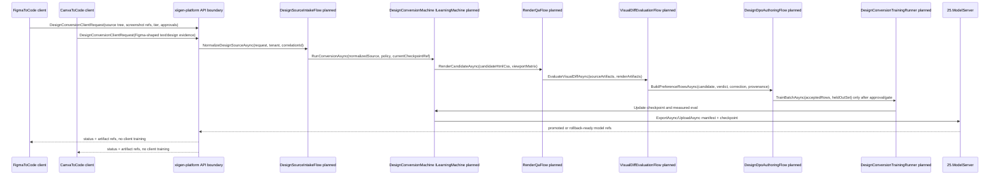

Глобальная форма решения: клиенты остаются тонкими сборщиками evidence, server/API принимает запрос и пишет проверяемые артефакты, `DesignConversionMachine : ILearningMachine<DesignConversionDomain>` владеет обучаемой частью, render QA и visual diff дают доказательства качества, DPO flow превращает только проверенные source/candidate/render/verdict/correction в rows, training runner меряет held-out качество, а promotion возможен только через checkpoint/manifest/export/import/fresh-load/continue-training/locator. External visual AI может быть только approval-bound evidence с явным approval ref; это не default path и не proof trained model quality.

### Stage 0 - Authority and final-plan skeleton

#### Human solution
План должен сам объяснять, кто разрешил работу, где она останавливается и почему она еще не execution-ready. Решение Stage 0 - держать authority ledger, source ledger, target outcome, stage gates and plan-only lock в одном документе, чтобы будущий Stage 4 мог проверить полноту без чтения старых диалогов. Это не кодовая работа: она защищает от случайного старта реализации и от подмены человеческого требования старым state.

#### UML

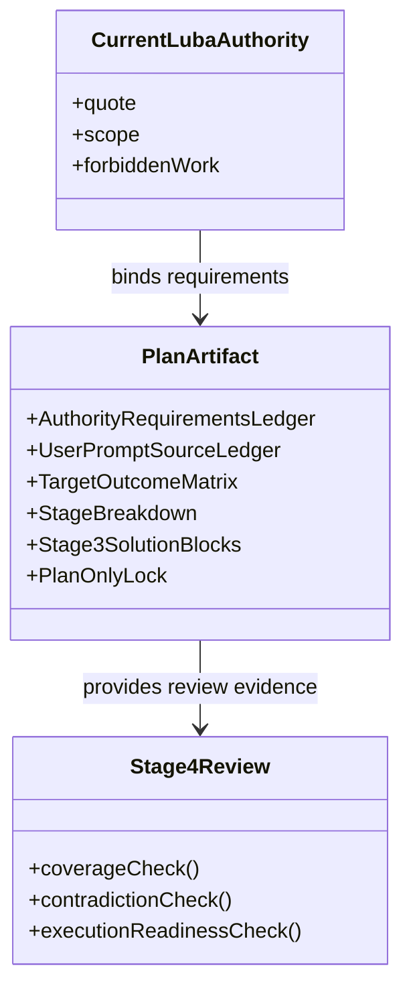

#### Algorithm
1. `PlanAuthorityExtractor.Extract(currentQuote, workOrder)` собирает binding requirements: exact artifact path, one-file write scope, Russian primary language, no git, no code/tests/server/training, status `PARTIALLY MERGED IN CODE AS HONEST UNTRAINED SCAFFOLD; PLAN-ONLY LOCK REMAINS; NOT AUTHORIZED AS TRAINED FEATURE`.
2. `PlanLedgerUpdater.UpsertRequirement(requirementId, sourceQuote, normalizedRequirement, mappedSection, gate, artifact)` добавляет строки только в этот план.
3. `PlanShapeValidator.ValidatePlanOnlyLock(planText)` проверяет, что план не содержит implementation authorization after plan-only artifact without fresh Luba approval.
4. `Stage4CoverageReview.Prepare(planText)` позже проверит, что все 14 Stage Breakdown rows have matching solution blocks, но Stage 3 не выполняет Stage 4.

#### Code/doc references
- Current plan authority/status shape: `C:\Projects\llm_mvp_core\docs\plans\DESIGN-CONVERSION-SERVER-ILEARNINGMACHINE-PLAN-v1.md:16-35`, `:37-44`, `:145-149`.
- Plan review target-artifact and readable-plan gates: `C:\Projects\llm_mvp_core\docs\skills\plan-review-SKILL.md:654-685`, `:999-1022`, `:1417-1457`.
- Locked trainable boundaries: `C:\Projects\llm_mvp_core\docs\DECISIONS-LOCKED.md:24-35`.

#### Concrete changes
- Planned only: Stage 4 should keep this file as the user-visible artifact and add a review section, not start implementation.
- Future executable work orders must name exact files, phase, gates, and commit boundary; no generated work order may cite Stage 3 as approval to code.

#### DPO/training impact
No DPO row is created at Stage 0. The impact is negative control: governance text, branch names, source ids, and plan rows must never be used as model training labels.

#### Gates/tests
Textual gate: exact plan file contains plan-only lock, authority ledger, user prompt source ledger, target outcome, Stage Breakdown, Stage 3 blocks and `PARTIALLY MERGED IN CODE AS HONEST UNTRAINED SCAFFOLD; PLAN-ONLY LOCK REMAINS; NOT AUTHORIZED AS TRAINED FEATURE`. A fresh Luba approval is still required before any implementation gate.

#### Hidden determinism check
Deterministic helpers: ledger ids, section names, textual phrase checks and artifact path checks. Allowed role: plan completeness evidence only. Forbidden role: permission to execute or model-quality proof.

### Stage 1 - Source intake and provenance

#### Human solution
Сервер не должен "угадывать" дизайн из голого HTML/CSS или скриншота. Он должен получать полный source evidence пакет: source kind, original tree, screenshots, frame/export refs, privacy scope, tier, license/user approval, hashes and source-disjoint group. Figma and Canva evidence are normalized into the same `DesignSourceArtifact`, but raw client-specific details stay traceable.

#### UML

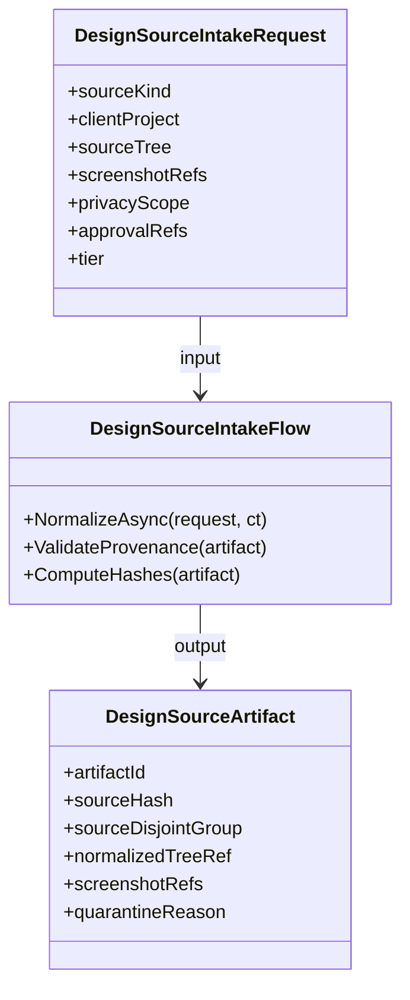

#### Algorithm
1. `DesignSourceIntakeFlow.NormalizeAsync(DesignSourceIntakeRequest request, CancellationToken ct)` branches by `request.SourceKind` = `figma`, `canva`, `generic`.
2. For Figma, `FigmaSourceMapper.MapElementTree(elementTree, frameImageRef, pluginVersion)` copies current `Element` tree fields into `NormalizedDesignNode[]` and records original Figma node ids as evidence, not labels.
3. For Canva, `CanvaSourceMapper.MapFigmaShapedTextElements(elements, canvaSelectionVersion)` accepts only already adapted `Element[]` or `CanvaTextElement[]` plus adapter metadata.
4. `DesignSourceHasher.ComputeSourceHash(normalizedTree, screenshots, approvalRefs)` computes stable hashes for reproducibility and source-disjoint grouping.
5. `DesignSourcePrivacyGate.Validate(privacyScope, screenshotRefs, rawTextPolicy)` returns accepted or quarantine; quarantined source is stored but cannot feed DPO/training.

#### Code/doc references
- Figma current scan builds an `Element` tree from selected nodes: `C:\Projects\FigmaToCode-design-gen\src\plugin\core\controller.ts:19-89`; internal API documents `scanElements(...)`: `C:\Projects\FigmaToCode-design-gen\docs\API.md:7-18`.
- Figma current frame image export posts bytes to UI: `C:\Projects\FigmaToCode-design-gen\docs\API.md:19-25`.
- Canva current adapter maps `CanvaTextElement[]` into Figma-shaped `Element[]`: `C:\Projects\CanvaToCode\src\canva-adapter.ts:1-12`, `:28-59`, `:96-187`, `:230-238`; architecture docs explain adapter-only host boundary: `C:\Projects\CanvaToCode\docs\ARCHITECTURE.md:54-65`, `:69-85`.
- Source intake guide requires source artifacts, privacy, hashes and quarantine: `C:\Projects\llm_mvp_core\docs\skills\design-source-intake-and-provenance-GUIDE.md:33-71`.

#### Concrete changes
- Planned: create `C:\Projects\llm_mvp_core\30.DesignConversionDomain\DesignSourceIntakeContracts.cs` with records `DesignSourceIntakeRequest`, `DesignSourceArtifact`, `NormalizedDesignNode`, `DesignScreenshotRef`, `DesignApprovalRef`, `DesignSourcePrivacyScope`.
- Planned: create `DesignSourceIntakeFlow : ILogicalFlow<DesignSourceIntakeRequest>` with `NormalizeAsync`, `ValidateProvenance`, `ComputeHashes`, `Quarantine`.
- Planned tests: `DesignSourceIntakeFlowTests.NormalizesFigmaPayloadWithHashes`, `DesignSourceIntakeFlowTests.NormalizesCanvaPayloadWithoutCanvaEnumsInCore`, `DesignSourceIntakeFlowTests.QuarantinesMissingLicenseOrApproval`.

#### DPO/training impact
Stage 1 creates the source side for future DPO rows and held-out splits. Accepted example: Figma frame with source tree hash + screenshot hash + approval ref. Rejected/quarantine example: Canva text payload without source-disjoint group or screenshot ref. No training runs here.

#### Gates/tests
Unit gates: required fields, stable hash reproducibility, source-disjoint grouping, privacy scope. Integration gate: Figma/Canva sample payloads normalize to the same `DesignSourceArtifact` shape. DPO gate: only accepted artifacts may be referenced by `DesignDpoRow`.

#### Hidden determinism check
Deterministic helpers: source hashes, source ids, node ids, screenshot refs, adapter version. Allowed role: provenance, grouping and reproducibility. Forbidden role: model label, quality score, or shortcut feature during DPO/eval.

### Stage 2 - Thin Figma/Canva client API

#### Human solution
FigmaToCode and CanvaToCode should stop being the place where final conversion intelligence lives. They gather source evidence, optionally show local preview/status, and send a typed request to server/API. They receive artifact refs, status, rendered previews and correction prompts back. Training, DPO, lifecycle, promotion and default visual evaluation stay outside the clients.

#### UML

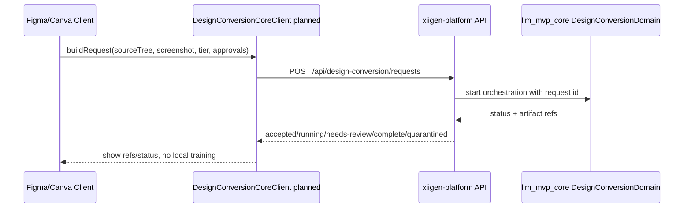

#### Algorithm
1. `DesignConversionClientRequestBuilder.FromFigma(scenes, frameImageBase64, approvalState, tier)` builds request with source tree and screenshot refs; it does not call external AI.
2. `DesignConversionClientRequestBuilder.FromCanva(elements, canvaDocumentRef, approvalState, tier)` builds the same server contract from Canva adapter output.
3. `DesignConversionCoreClient.SubmitAsync(request, endpoint, authToken)` sends request and stores returned `requestId` plus artifact refs.
4. `DesignConversionCoreClient.PollStatusAsync(requestId)` updates UI states only; no retry loop may mutate model state.
5. `ClientBoundaryGuard.AssertNoTrainingImports(bundle)` later prevents `11.DPO`, `04.TrainingLoop`, `25.ModelServer` or `ILearningMachine` code from being bundled into client projects.

#### Code/doc references
- Figma current UI message handler handles `frame-image-bytes`, `api-key-loaded`, `scenes`: `C:\Projects\FigmaToCode-design-gen\docs\API.md:108-119`.
- Figma current plugin stores API keys and posts UI messages: `C:\Projects\FigmaToCode-design-gen\src\plugin\core\controller.ts:91-116`, `:118-134`.
- Figma current external AI enhance API is documented and must be approval-bound, not default: `C:\Projects\FigmaToCode-design-gen\docs\API.md:136-165`.
- Canva current architecture has one JS context and no `postMessage`: `C:\Projects\CanvaToCode\docs\ARCHITECTURE.md:7-50`; storage boundary is `@canva/app-storage`: `:107-122`.
- Thin client guide request/response shape: `C:\Projects\llm_mvp_core\docs\skills\figma-canva-client-api-integration-GUIDE.md:25-67`.

#### Concrete changes
- Planned Figma file: `C:\Projects\FigmaToCode-design-gen\src\ui\services\DesignConversionCoreClient.ts` with `submitConversionRequest`, `getConversionStatus`, `submitCorrection`.
- Planned Figma edits: `src\plugin\core\controller.ts` adds payload collection message only; `src\ui\components\App.tsx` adds server status/artifact refs.
- Planned Canva file: `C:\Projects\CanvaToCode\src\design-conversion-client.ts`; `src\app.tsx` sends adapted payload and shows status.
- Planned core contract: `DesignConversionClientRequest`, `DesignConversionClientStatusResponse`, `DesignConversionArtifactRefs`.
- Planned tests: `ThinClientApiContractTests.ClientPayloadContainsNoModelLogic`, `FigmaClientBoundaryTests.ExternalAiEnhanceRequiresApprovalRef`, `CanvaClientBoundaryTests.AdapterOutputOnly`.

#### DPO/training impact
Clients can submit review corrections and approval refs that later become DPO evidence. They do not generate chosen/rejected rows, run training, upload checkpoints, or promote models.

#### Gates/tests
Schema gate, privacy gate, no-training-import gate, external AI approval gate, status polling idempotency gate, debug logging redaction gate. E2E later: submit sample Figma/Canva payload and receive artifact refs from a test server.

#### Hidden determinism check
Deterministic helpers: client retry count, status labels, UI preview, local CSS preview, external API panel state. Allowed role: UX and transport evidence. Forbidden role: final quality decision, DPO label, training trigger or model readiness.

### Stage 3 - Server/API orchestration boundary

#### Human solution
The platform API accepts design conversion requests and exposes status, but it must not own the model or secretly mutate training state. It translates HTTP/tenant/correlation/auth concerns into a core request, stores audit/evidence refs, and routes work to `DesignConversionMachine` or its orchestrator. Training and promotion are separate approved flows.

#### UML

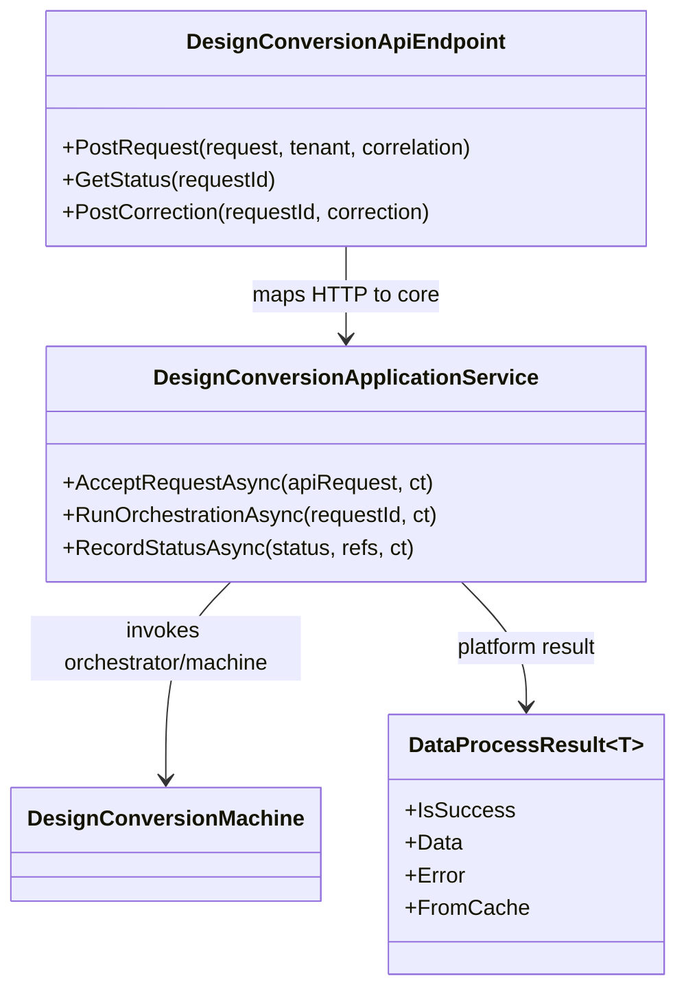

#### Algorithm
1. `MapPost("/api/design-conversion/requests", ...)` accepts `DesignConversionApiRequest` and calls `DesignConversionApplicationService.AcceptRequestAsync`.
2. `AcceptRequestAsync(request, tenantContext, correlationId, ct)` validates auth, tier, approval refs and privacy scope, then stores `DesignConversionRequestRecord`.
3. `RunOrchestrationAsync(requestId, ct)` loads `DesignSourceArtifact`, calls `DesignConversionMachine.GetOrchestratorAsync(ct)`, and invokes a planned runtime request.
4. `ToDataProcessResult(coreResult)` maps `OperationResult<T>` to platform `DataProcessResult<T>` without hiding model errors.
5. `GetStatus(requestId)` returns status and artifact refs only; it does not infer trained readiness from status text.

#### Code/doc references
- Platform endpoint style maps marketplace routes with `app.MapPost` and service call: `C:\Projects\xiigen-platform-dot-net-angular\src\Xiigen.Platform.Api\Program.cs:71-105`.
- Platform result wrapper exposes success/failure/data/error: `C:\Projects\xiigen-platform-dot-net-angular\src\Xiigen.Kernel\DataProcessResult.cs:5-23`, `:26-50`.
- Platform service base supplies tenant/correlation context: `C:\Projects\xiigen-platform-dot-net-angular\src\Xiigen.Kernel\MicroserviceBase.cs:7-39`.
- `ILearningMachine<TDomain>` exposes runtime orchestrator separately from training/export/import: `C:\Projects\llm_mvp_core\00.Core\LearningMachineContracts.cs:193-234`.
- Locked decision A-LM-07 requires ModelServer + OrchestratorModel, no new top-level server: `C:\Projects\llm_mvp_core\docs\DECISIONS-LOCKED.md:30-30`.

#### Concrete changes
- Planned platform files: add `DesignConversionEndpoints` or Program.cs route group for `POST /api/design-conversion/requests`, `GET /api/design-conversion/requests/{requestId}`, `POST /api/design-conversion/requests/{requestId}/corrections`.
- Planned platform service: `DesignConversionApplicationService : MicroserviceBase<DesignConversionApplicationService>`.
- Planned core boundary: `DesignConversionApiRequest`, `DesignConversionStatusRecord`, `DesignConversionArtifactRefs`, `DesignConversionOperationMapper`.
- Planned tests: `DesignConversionApiTests.AcceptsRequestAndReturnsArtifactRefs`, `DesignConversionApiTests.DoesNotTrainOnSubmit`, `DesignConversionApiTests.MapsCoreFailureToDataProcessFailure`.

#### DPO/training impact
Server acceptance records future training evidence but does not train. A correction posted to the API can become a DPO candidate only after source/render/diff/provenance gates.

#### Gates/tests
Integration gate for endpoint mapping, tenant/correlation propagation, auth/privacy, artifact status, OperationResult/DataProcessResult mapping, no server-owned model mutation. Server e2e gate later uses fake machine and asserts no training calls on submit/status.

#### Hidden determinism check
Deterministic helpers: HTTP status, request id, tenant id, correlation id, stored status transitions. Allowed role: audit and routing. Forbidden role: quality score, DPO winner, trained readiness or promotion authority.

### Stage 4 - `DesignConversionMachine` hierarchy

#### Human solution
The trainable owner must be a domain machine, not the renderer, not the visual diff, not the client and not a platform endpoint. `DesignConversionMachine : ILearningMachine<DesignConversionDomain>` owns training/evaluation/export/import and returns an `ILogicalOrchestrator` for runtime conversion. Flows and units may be learned components only under the allowed hierarchy and with lifecycle evidence.

#### UML

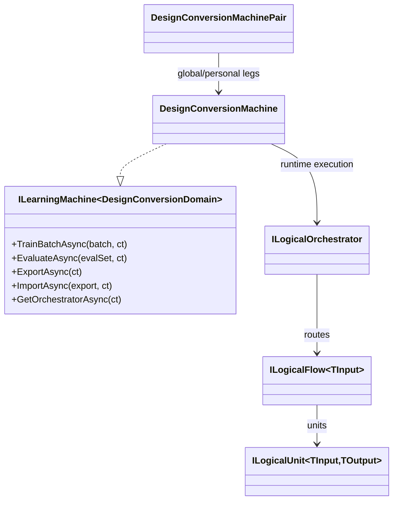

#### Algorithm
1. `DesignConversionMachine.TrainBatchAsync(LearningBatch<DesignConversionDomain> batch, CancellationToken ct)` validates DPO row schema, calls design DPO runner and returns measured `LearningBatchResult`.
2. `EvaluateAsync(LearningEvaluationSet<DesignConversionDomain> evalSet, ct)` runs held-out conversion requests through current orchestrator and compares expected visual verdict/preferences.
3. `GetOrchestratorAsync(ct)` constructs `DesignConversionOrchestrator` from current checkpoint refs and allowed deterministic helper services.
4. `DesignConversionOrchestrator.ExecuteAsync(DesignConversionRuntimeRequest request, ct)` calls intake, candidate generation, render QA, visual diff and result assembly in runtime mode.
5. `ExportAsync/ImportAsync` use ModelServer refs; no checkpoint is considered reusable without manifest and fresh-load evidence.

#### Code/doc references
- Core `ILearningMachine<TDomain>` contract and hierarchy are explicit: `C:\Projects\llm_mvp_core\00.Core\LearningMachineContracts.cs:193-234`.
- Learning batch and DPO row shape: `C:\Projects\llm_mvp_core\00.Core\LearningMachineContracts.cs:16-39`.
- Learning result requires before/after accuracy, reward margin, CPU/RAM/elapsed and promoted ids: `C:\Projects\llm_mvp_core\00.Core\LearningMachineContracts.cs:41-62`.
- Pair contract protects personal/global sync: `C:\Projects\llm_mvp_core\00.Core\LearningMachineContracts.cs:240-260`.
- Subproject map marks `30.DesignConversionDomain` as planned: `C:\Projects\llm_mvp_core\docs\SUBPROJECT-MAP.md:46-46`, `:96-99`.
- ILearningMachine architecture guide proposes machine/orchestrator/flows/units and gates: `C:\Projects\llm_mvp_core\docs\skills\design-conversion-ilearningmachine-architecture-GUIDE.md:41-95`.

#### Concrete changes
- Planned: `C:\Projects\llm_mvp_core\30.DesignConversionDomain\DesignConversionDomain.cs`, `DesignConversionMachine.cs`, `DesignConversionOrchestrator.cs`, `DesignConversionRuntimeRequest.cs`, `DesignConversionRuntimeResult.cs`.
- Planned: `DesignSourceIntakeFlow`, `HtmlCssCandidateGenerationFlow`, `RenderQaFlow`, `VisualDiffEvaluationFlow`, `DesignDpoAuthoringFlow`, `DesignConversionTrainingRunner`.
- Planned tests: `DesignConversionMachineHierarchyTests.TrainingMethodsOnlyOnMachine`, `DesignConversionMachineHierarchyTests.RendererDiffAndTierPolicyAreNotTrainableOwners`.

#### DPO/training impact
This stage defines where DPO/training is allowed. `LearningTrainingItem` rows are accepted only by `TrainBatchAsync`; runtime flows cannot silently train from user prompts or visual diffs.

#### Gates/tests
Allowed trainable level gate, runtime/training separation gate, lifecycle method presence gate, pair privacy gate, no hidden training in API/client/render/diff gate. Untrained honesty test must show machine can return baseline/artifact status without claiming trained readiness.

#### Hidden determinism check
Deterministic helpers: render QA, visual diff, source hash, tier policy, HTML/CSS deterministic baseline. Allowed role: evidence/helper/eval/policy. Forbidden role: trainable owner or final semantic quality claim unless wrapped by allowed machine lifecycle and proved by ablation.

### Stage 5 - Candidate HTML/CSS generation path

#### Human solution
Candidate generation turns normalized design evidence into an HTML/CSS bundle. Today Figma and Canva already have deterministic extraction/generation helpers; the server plan should reuse their proven shape as baseline evidence, but must label baseline output honestly. If a learned model improves HTML/CSS, the learned part belongs under `DesignConversionMachine`, with render/diff/DPO evidence.

#### UML

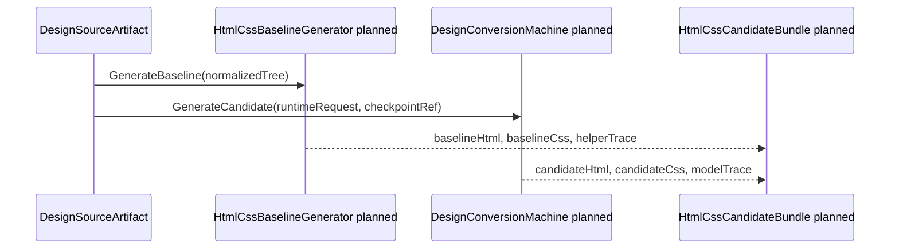

#### Algorithm
1. `HtmlCssCandidateGenerationFlow.GenerateAsync(DesignSourceArtifact source, CandidateGenerationPolicy policy, CancellationToken ct)` always creates a baseline candidate first.
2. `HtmlCssBaselineGenerator.Generate(source.NormalizedTree)` maps `NormalizedDesignNode` to HTML/CSS using deterministic class naming and style settings; it records `generationMode = baseline`.
3. If `policy.AllowModelCandidate` and a current checkpoint exists, `DesignConversionMachine` produces model candidate with `checkpointRef`, `promptTraceHash`, and `modelUnitIds`.
4. `CandidateBundleValidator.Validate(candidate)` checks no remote asset leaks, responsive constraints present, and source refs/hashes attached.
5. The result stores both candidate and provenance so visual diff can compare baseline vs model candidate honestly.

#### Code/doc references
- Figma current CSS extraction helper is documented as fixed-order style conversion: `C:\Projects\FigmaToCode-design-gen\docs\API.md:41-68`.
- Figma current HTML/CSS generation helpers are documented: `C:\Projects\FigmaToCode-design-gen\docs\API.md:71-92`.
- Figma current `Element` and `Style` model fields show generated HTML/CSS/codeCss/classNames: `C:\Projects\FigmaToCode-design-gen\docs\API.md:187-230`.
- Canva architecture reuses copied Figma pipeline unchanged: `C:\Projects\CanvaToCode\docs\ARCHITECTURE.md:25-33`, `:54-65`.
- Hidden guard in this plan labels CSS pipeline deterministic: `C:\Projects\llm_mvp_core\docs\plans\DESIGN-CONVERSION-SERVER-ILEARNINGMACHINE-PLAN-v1.md:133-143`.

#### Concrete changes
- Planned: `HtmlCssCandidateGenerationFlow.cs`, `HtmlCssBaselineGenerator.cs`, `HtmlCssCandidateBundle.cs`, `CandidateGenerationPolicy.cs`, `CandidateTrace.cs`.
- Planned tests: `HtmlCssCandidateGenerationFlowTests.UntrainedReturnsHonestScaffold`, `HtmlCssCandidateGenerationFlowTests.BaselineTraceCannotBeClaimedAsModelOutput`, `HtmlCssCandidateGenerationFlowTests.ModelCandidateCarriesCheckpointRef`.

#### DPO/training impact
Candidate outputs become possible chosen/rejected sides only after render QA and visual verdict. Baseline helper output may be used as rejected, chosen, or comparison artifact only with provenance and no shortcut leakage.

#### Gates/tests
Candidate schema gate, baseline-label gate, no external provider gate, asset leak gate, responsive constraints gate, untrained honesty gate, model checkpoint trace gate.

#### Hidden determinism check
Deterministic helpers: class-name sanitizer, style extraction, baseline HTML/CSS generation, candidate order. Allowed role: baseline and comparison evidence. Forbidden role: proof of model learning or automatic chosen side.

### Stage 6 - Render QA automation

#### Human solution
HTML/CSS must be rendered in a controlled server environment before quality is judged. A candidate is not good because the generator returned text; it is good only if render artifacts exist: screenshots for viewport matrix, DOM snapshot, computed styles, asset report, timing, stability and errors. Render QA blocks bad candidates from training and produces evidence for visual diff.

#### UML

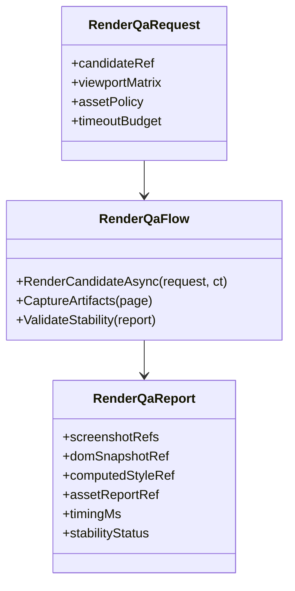

#### Algorithm
1. `RenderQaFlow.RenderCandidateAsync(RenderQaRequest request, CancellationToken ct)` loads candidate HTML/CSS into an isolated renderer with external network disabled unless explicit asset policy allows it.
2. For each viewport in `request.ViewportMatrix`, `RenderViewportAsync(candidateRef, viewport, ct)` captures screenshot, DOM and computed styles after stability wait.
3. `AssetReportBuilder.Build(pageResources, request.AssetPolicy)` records missing fonts/images/CORS/network attempts.
4. `RenderStabilityChecker.Check(firstScreenshot, secondScreenshot, layoutShift)` marks stable/unstable and records reason.
5. `RenderQaReportValidator` rejects incomplete reports before visual diff or DPO.

#### Code/doc references
- Render QA guide requires screenshots, DOM/computed styles, asset/timing/stability reports and gates: `C:\Projects\llm_mvp_core\docs\skills\html-css-render-qa-automation-GUIDE.md:29-63`.
- Visual diff guide depends on render artifacts as evidence: `C:\Projects\llm_mvp_core\docs\skills\visual-diff-taxonomy-and-metrics-GUIDE.md:28-38`.
- Client API guide keeps render QA server/core-side, not client-side: `C:\Projects\llm_mvp_core\docs\skills\figma-canva-client-api-integration-GUIDE.md:49-67`.
- Current platform Program has HTML/status endpoint style but no design render runner yet: `C:\Projects\xiigen-platform-dot-net-angular\src\Xiigen.Platform.Api\Program.cs:650-668` is reference style only, not render implementation.

#### Concrete changes
- Planned: `RenderQaFlow.cs`, `RenderQaRequest.cs`, `RenderQaReport.cs`, `ViewportSpec.cs`, `RenderAssetReport.cs`, `RenderStabilityChecker.cs`.
- Planned artifact paths under future run output: `artifacts/design-conversion/{requestId}/render/{candidateId}/{viewport}/screenshot.png`, `dom.json`, `computed-styles.json`, `asset-report.json`, `render-report.json`.
- Planned tests: `RenderQaFlowTests.EmitsViewportArtifactsAndQuarantinesMissingAssets`, `RenderQaFlowTests.BlocksUnstableLayout`, `RenderQaFlowTests.ExternalNetworkDeniedUnlessPolicyAllows`.

#### DPO/training impact
Render artifacts become context for DPO rows and held-out visual quality. A missing or unstable render creates quarantine, not a rejected side, unless the row explicitly teaches a single render-related failure.

#### Gates/tests
Server/render QA gate, multi-resolution gate, artifact completeness gate, asset policy gate, stability gate, timeout/cost gate, isolation gate. Later e2e: render a candidate and verify all refs exist before visual diff.

#### Hidden determinism check
Deterministic helpers: renderer engine, viewport loop, stability threshold, asset checker, DOM/computed-style extraction. Allowed role: QA evidence and promotion blocker. Forbidden role: trained model quality or semantic verdict.

### Stage 7 - Visual diff taxonomy and metrics

#### Human solution
Visual diff must explain what is wrong, not just produce a pixel number. It compares source screenshots/tree evidence against render artifacts and returns taxonomy: layout, typography, color, spacing, responsiveness, image/crop, missing assets, interaction/state. It is an evaluator and DPO row authoring input, not the trained model.

#### UML

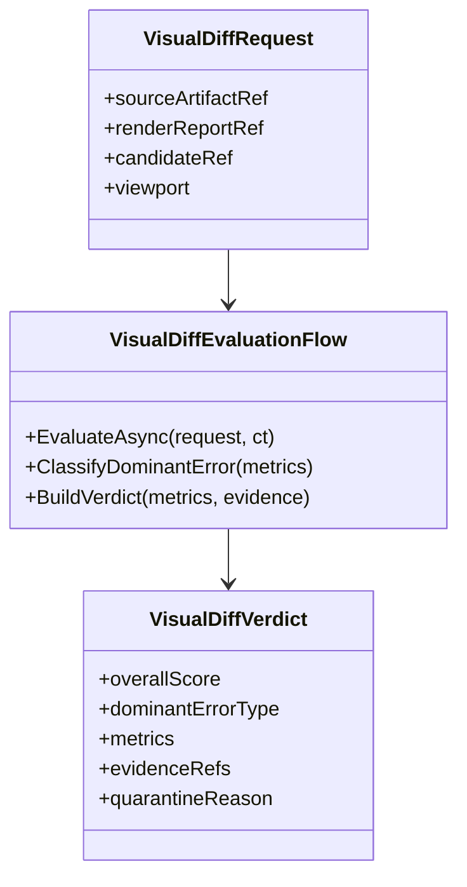

#### Algorithm
1. `VisualDiffEvaluationFlow.EvaluateAsync(VisualDiffRequest request, CancellationToken ct)` loads source screenshot/tree and rendered screenshots.
2. `VisualMetricCollector.CollectLayoutTypographyColorSpacing(source, render)` computes local metrics with traceable evidence refs.
3. `DominantErrorClassifier.Classify(metrics, taxonomyPolicy)` chooses exactly one dominant error for DPO teaching unless the case must be quarantined as multi-error.
4. `VisualDiffVerdictBuilder.Build(metrics, dominantError, evidenceRefs)` emits score and reasons.
5. If external visual AI evidence was separately approved, `ApprovalBoundVisualEvidence.Attach(aiEvidenceRef, approvalRef)` records it as secondary evidence only.

#### Code/doc references
- Visual diff guide defines report outputs, gates, taxonomy and metric proof boundaries: `C:\Projects\llm_mvp_core\docs\skills\visual-diff-taxonomy-and-metrics-GUIDE.md:28-58`, `:60-90`, `:92-99`.
- Negative DPO guide requires one dominant error and plausible wrong result: `C:\Projects\llm_mvp_core\docs\skills\design-conversion-negative-dpo-quality-GUIDE.md:57-70`.
- Render QA guide makes render artifacts the input to evaluation: `C:\Projects\llm_mvp_core\docs\skills\html-css-render-qa-automation-GUIDE.md:29-45`.

#### Concrete changes
- Planned: `VisualDiffEvaluationFlow.cs`, `VisualDiffRequest.cs`, `VisualDiffVerdict.cs`, `VisualDiffMetricTrace.cs`, `DominantErrorClassifier.cs`, `ApprovalBoundVisualEvidence.cs`.
- Planned tests: `VisualDiffEvaluationFlowTests.ClassifiesDominantErrorAndRejectsPixelOnlyProof`, `VisualDiffEvaluationFlowTests.ExternalAiEvidenceRequiresApprovalAndCannotPassAlone`, `VisualDiffEvaluationFlowTests.MultiErrorCaseQuarantined`.

#### DPO/training impact
Dominant error drives rejected side construction. Example chosen: corrected candidate whose render aligns typography/spacing. Example rejected: same source with one dominant spacing error. Quarantine: pixel score bad but no traceable dominant error.

#### Gates/tests
Taxonomy coverage gate, metric traceability gate, dominant-error gate, held-out visual eval gate, ablation gate proving model is not using source id/candidate order, external AI approval-bound gate.

#### Hidden determinism check
Deterministic helpers: pixel diff, bounding boxes, color distance, typography metric, dominant-error classifier. Allowed role: evaluator/evidence. Forbidden role: final learned authority or proof of trained readiness.

### Stage 8 - DPO row authoring

#### Human solution
DPO rows must teach a precise preference boundary. A row is valid only when it has source artifact, candidate HTML/CSS, render artifacts, visual verdict, correction or accepted target, chosen side, rejected side, quarantine status, source-disjoint group and hashes. Bad rows are quarantined instead of being trained.

#### UML

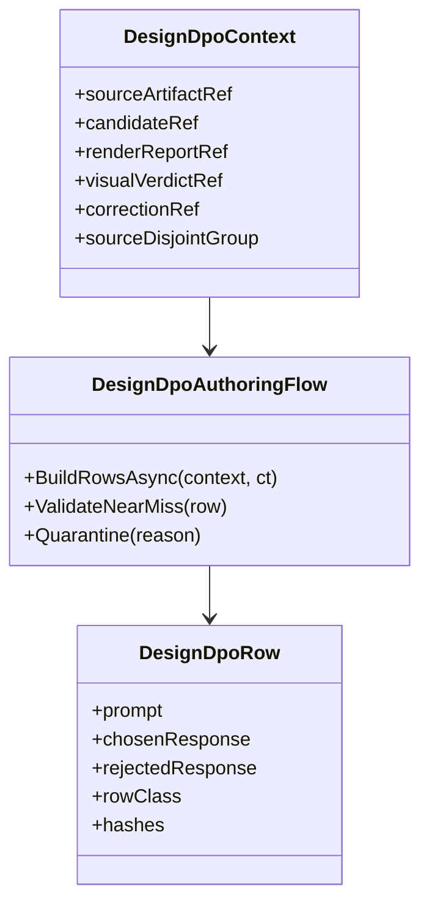

#### Algorithm
1. `DesignDpoAuthoringFlow.BuildRowsAsync(DesignDpoContext context, CancellationToken ct)` verifies all refs and hashes.
2. `DesignDpoPromptBuilder.Build(context)` creates prompt with source summary, relevant tree refs, candidate refs and objective, without source path/row order leakage.
3. `ChosenRejectedBuilder.FromCorrection(context, correction)` sets chosen to corrected HTML/CSS or accepted candidate and rejected to the plausible near-miss candidate.
4. `NegativeQualityValidator.Validate(row, dominantError, leakageScan)` rejects garbage negatives, multi-error rows, identical chosen/rejected and leaked labels.
5. `DesignDpoRowRouter.Route(row)` returns `accepted`, `heldOut`, or `quarantine`.

#### Code/doc references
- Core `LearningTrainingItem` is prompt/chosen/rejected: `C:\Projects\llm_mvp_core\00.Core\LearningMachineContracts.cs:29-39`.
- Existing simple DPO pair model: `C:\Projects\llm_mvp_core\11.DPO\Models\DpoPair.cs:3-7`; DPO batch carries chosen/rejected ids and masks: `C:\Projects\llm_mvp_core\11.DPO\Models\DpoBatch.cs:5-13`.
- DPO trainer computes chosen/rejected margins and metrics: `C:\Projects\llm_mvp_core\11.DPO\DpoTrainer.cs:31-70`, `:127-167`, `:322-328`.
- Design DPO guide defines context vector, row classes and gates: `C:\Projects\llm_mvp_core\docs\skills\design-conversion-dpo-authoring-SKILL.md:33-79`.
- Negative DPO quality guide defines accepted negatives and gates: `C:\Projects\llm_mvp_core\docs\skills\design-conversion-negative-dpo-quality-GUIDE.md:26-55`, `:57-70`.
- Translation DPO guidance warns rejected side must be plausible, specifically wrong, and not generic: `C:\Users\lubao\Documents\xiigen\llm mvp\language translate learning\DPO-PAIR-AUTHORING-GUIDANCE-TRANSLATION-v1.md:7-13`, `:31-49`.

#### Concrete changes
- Planned: `DesignDpoContext.cs`, `DesignDpoRow.cs`, `DesignDpoAuthoringFlow.cs`, `DesignDpoPromptBuilder.cs`, `ChosenRejectedBuilder.cs`, `NegativeQualityValidator.cs`, `DesignDpoRowRouter.cs`.
- Planned data artifacts: `training-data/design-conversion/dpo-candidates/*.jsonl`, `heldout/*.jsonl`, `quarantine/*.jsonl`, each with source/render/diff hashes.
- Planned tests: `DesignDpoAuthoringFlowTests.BuildsChosenRejectedAndQuarantineRows`, `DesignDpoAuthoringFlowTests.RejectsGarbageOrMultiErrorNegatives`, `DesignDpoAuthoringFlowTests.BlocksSourcePathAndCandidateOrderLeakage`.

#### DPO/training impact
Chosen example: corrected responsive card grid with stable render and improved spacing. Rejected example: same source with plausible one-error overlap or wrong font weight. Quarantine example: external AI suggestion without approval ref, missing render report, identical chosen/rejected, or multi-error candidate.

#### Gates/tests
DPO validation gate, context-vector completeness gate, chosen/rejected clarity gate, near-miss gate, source-disjoint gate, no-leakage gate, held-out split gate, quarantine audit gate.

#### Hidden determinism check
Deterministic helpers: source hash, candidate id, verdict id, reviewer id, row order, prompt template, dominant-error label. Allowed role: provenance and grouping. Forbidden role: label leakage or train/test shortcut.

### Stage 9 - Training and evaluation runbook

#### Human solution
Training is a measured loop, not "we saved a model". Each batch starts with accepted DPO rows and a source-disjoint held-out set, measures before/after preference accuracy and visual quality, records CPU/RAM/time, runs ablation against deterministic shortcuts, then decides continue/quarantine/regress. A small model is acceptable only because the task is routed, batch-sized and measured.

#### UML

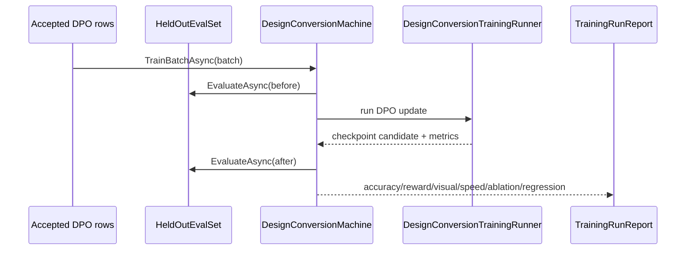

#### Algorithm
1. `DesignConversionTrainingRunner.RunBatchAsync(DesignTrainingBatch batch, DesignHeldOutSet heldOut, TrainingBudget budget, CancellationToken ct)` first calls `EvaluateAsync(heldOut)` for baseline metrics.
2. `DesignDpoBatchBuilder.Build(batch.AcceptedRows)` converts design rows into `DpoBatch` tensors and validates masks.
3. `DpoTrainer.StepMany(batch, stepStart)` runs DPO optimization and records reward margin/loss.
4. `DesignConversionEvaluationRunner.EvaluateVisualQuality(machine, heldOut)` runs held-out requests through render/diff and computes visual quality metrics.
5. `AblationRunner.RunNoShortcutEval(machine, heldOutWithoutSourceIds)` proves the model is not winning from deterministic ids.
6. `TrainingDecisionGate.Decide(report)` returns promote-candidate, continue, rollback or quarantine.

#### Code/doc references
- Existing training loop saves checkpoints during training: `C:\Projects\llm_mvp_core\04.TrainingLoop\Trainer.cs:10-18`, `:31-77`.
- DPO trainer step/evaluate methods: `C:\Projects\llm_mvp_core\11.DPO\DpoTrainer.cs:31-70`, `:72-125`, `:127-167`.
- `LearningBatchResult` requires rows, before/after accuracy, reward margin and CPU/RAM/elapsed: `C:\Projects\llm_mvp_core\00.Core\LearningMachineContracts.cs:41-62`.
- Training runbook guide requires speed, accuracy, visual quality, held-out, ablation, fresh-load, continue-training and regression: `C:\Projects\llm_mvp_core\docs\skills\design-conversion-training-runbook-GUIDE.md:26-70`.
- Small model rationale requires small measured batches and held-out evaluation after every batch: `C:\Users\lubao\Documents\xiigen\llm mvp\Small model racional\TRANSLATION-SMALL-MODEL-RATIONALE-v1.md:10-25`, `:80-98`, `:181-184`.
- Documentation learning runner rule says no batch may be called trained if flow/runner is missing and metrics must be real: `C:\Users\lubao\Documents\xiigen\llm mvp\documentation learning\CODE-DOC-ACTIVE-GOAL-2026-05-13.md:40-50`, `:71-90`, `:101-105`.

#### Concrete changes
- Planned: `DesignConversionTrainingRunner.cs`, `DesignConversionEvaluationRunner.cs`, `DesignTrainingBatch.cs`, `DesignHeldOutSet.cs`, `TrainingRunReport.cs`, `AblationRunner.cs`, `TrainingDecisionGate.cs`.
- Planned artifacts: `models/design-conversion/{runId}/checkpoint`, `TRAINING-METRICS.json`, `VISUAL-EVAL-REPORT.json`, `ABLATION-REPORT.json`, `REGRESSION-REPORT.json`.
- Planned tests: `DesignConversionTrainingRunnerTests.ReportsSpeedAccuracyQualityAndAblation`, `DesignConversionTrainingRunnerTests.RefusesMissingHeldOutSet`, `DesignConversionEvaluationRunnerTests.HeldOutRunsThroughRenderAndDiff`.

#### DPO/training impact
Accepted rows train; held-out rows never train; quarantine rows never train. Chosen/rejected examples from Stage 8 feed DPO. Regression example: a batch improves reward margin but worsens visual held-out score, so it is rollback/quarantine, not promotion.

#### Gates/tests
Speed gate, preference accuracy gate, visual quality gate, held-out source-disjoint gate, ablation/no-shortcut gate, fresh-load gate, continue-training gate, regression gate, resource budget gate.

#### Hidden determinism check
Deterministic helpers: held-out split, batch id, source-disjoint group, metrics calculators, ablation transforms. Allowed role: evaluation and regression detection. Forbidden role: training answer key or shortcut feature.

### Stage 10 - Model lifecycle and promotion

#### Human solution
A model is usable only when it is a project asset: checkpoint, manifest, export/import package, locator registration, fresh-load proof, continue-training proof, promotion decision and rollback path all exist. Promotion is not a local file save; it is a measured lifecycle transition.

#### UML

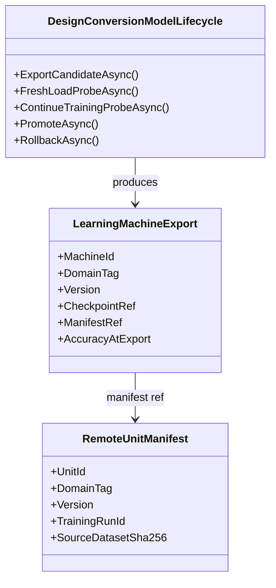

#### Algorithm
1. `DesignConversionModelLifecycle.ExportCandidateAsync(machine, runReport, ct)` calls `machine.ExportAsync(ct)` and validates `CheckpointRef`, `ManifestRef`, `AccuracyAtExport`.
2. `ModelRepository.UploadAsync(manifest, serverBaseUrl, ct)` stores checkpoint/manifest and returns `RemoteUnitManifest`.
3. `FreshLoadProbeAsync(export, heldOut)` imports export into a new machine instance, runs held-out eval and records metrics.
4. `ContinueTrainingProbeAsync(export, smallBatch)` imports, trains one approved mini-batch, and proves training can resume.
5. `PromotionGate.PromoteOrRollback(candidate, currentStable, reports)` updates locator only when gates pass; otherwise rollback keeps previous stable.

#### Code/doc references
- `LearningMachineExport` points to 25.ModelServer refs and requires measured accuracy: `C:\Projects\llm_mvp_core\00.Core\LearningMachineContracts.cs:109-127`.
- `IModelRepository` loads/uploads weights/manifests: `C:\Projects\llm_mvp_core\25.ModelServer\Contracts\IModelRepository.cs:6-18`.
- `RemoteUnitManifest` includes UnitId, DomainTag, Version, TrainingRunId, SourceDatasetSha256, ModelConfig, LoraConfig and TokenizerPath: `C:\Projects\llm_mvp_core\25.ModelServer\Remote\RemoteUnitManifest.cs:3-17`, `:19-32`.
- Lifecycle guide requires checkpoint, manifest, export/import, fresh-load, continue-training, locator, promotion and rollback: `C:\Projects\llm_mvp_core\docs\skills\design-conversion-model-lifecycle-and-promotion-GUIDE.md:25-61`.
- Subproject map names model server and future design conversion assets: `C:\Projects\llm_mvp_core\docs\SUBPROJECT-MAP.md:41-46`, `:96-99`.

#### Concrete changes
- Planned: `DesignConversionModelLifecycle.cs`, `DesignConversionPromotionReport.cs`, `DesignConversionRollbackRecord.cs`, `DesignConversionFreshLoadProbe.cs`, `DesignConversionContinueTrainingProbe.cs`.
- Planned locator integration with `25.ModelServer` contracts and future `RemoteUnitLocator` usage.
- Planned tests: `DesignConversionLifecycleTests.ExportImportFreshLoadContinueTraining`, `DesignConversionLifecycleTests.RefusesCheckpointWithoutManifest`, `DesignConversionLifecycleTests.RollbackKeepsPreviousStable`.

#### DPO/training impact
Promotion accepts only trained candidates with DPO/eval evidence. Chosen promotion example: checkpoint with held-out visual improvement and passing fresh-load/continue-training. Rejected promotion example: checkpoint has training loss only. Quarantine example: manifest missing source dataset hash or private/adaptive data approval.

#### Gates/tests
Checkpoint gate, manifest gate, export/import gate, fresh-load gate, continue-training gate, locator upload/readback gate, promotion gate, rollback gate, private-data approval gate.

#### Hidden determinism check
Deterministic helpers: manifest hash, checkpoint ref, version, training run id, locator status. Allowed role: asset identity and reproducibility. Forbidden role: quality proof without eval reports.

### Stage 11 - Common/adaptive machine pair and privacy

#### Human solution
Design conversion can have a common/global model and a personal/adaptive leg. Personal corrections, private screenshots and tenant-specific design patterns stay local/adaptive unless explicitly approved and anonymized. The global leg may learn only from redacted signals or approved common rows.

#### UML

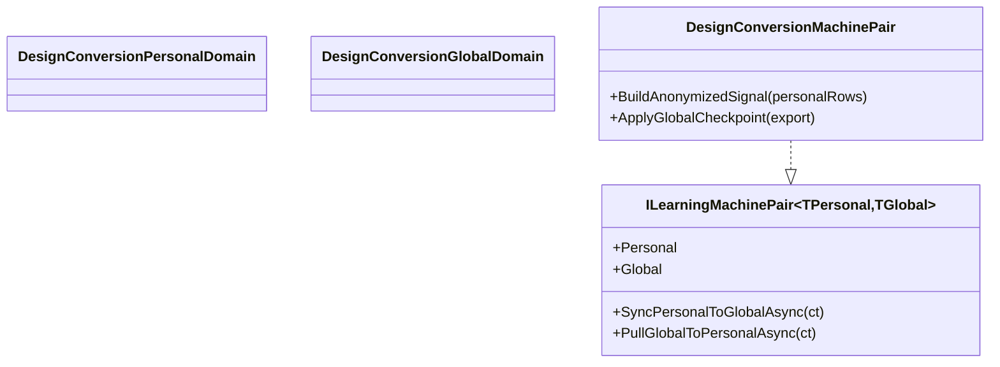

#### Algorithm
1. `DesignConversionMachinePair.SyncPersonalToGlobalAsync(ct)` scans personal accepted rows and builds `AnonymizedDesignSignal[]`; raw screenshots, raw text and PII are excluded.
2. `PrivacyRedactionValidator.Validate(signal)` verifies no source paths, tenant secrets, raw screenshots or personal identifiers leave device/tenant.
3. `GlobalSignalAggregator.Aggregate(signals)` creates common DPO candidates only when enough signals share a non-private pattern.
4. `PullGlobalToPersonalAsync(ct)` loads latest approved global checkpoint and applies it to personal machine without overwriting local private adapter state.
5. `AdaptiveTrainingPolicy.Route(row)` sends private corrections to personal leg, approved/redacted rows to common/global leg.

#### Code/doc references
- `ILearningMachinePair<TPersonal,TGlobal>` contract says sync sends anonymized signals only and pull applies global checkpoint: `C:\Projects\llm_mvp_core\00.Core\LearningMachineContracts.cs:240-260`.
- Locked decision A-LM-08 requires anonymized sync; A-LM-12 allows trainable levels and machine pair: `C:\Projects\llm_mvp_core\docs\DECISIONS-LOCKED.md:31-35`.
- Lifecycle guide covers common/adaptive split and approval refs: `C:\Projects\llm_mvp_core\docs\skills\design-conversion-model-lifecycle-and-promotion-GUIDE.md:25-38`, `:40-61`.
- Product docs emphasize local/on-prem and no source leaving network: `C:\Users\lubao\Documents\xiigen\llm mvp\extensions\XIIGEN-PRODUCT-DESCRIPTION-v1.md:3-18`, `:79-95`.

#### Concrete changes
- Planned: `DesignConversionPersonalDomain.cs`, `DesignConversionGlobalDomain.cs`, `DesignConversionMachinePair.cs`, `AnonymizedDesignSignal.cs`, `PrivacyRedactionValidator.cs`, `AdaptiveTrainingPolicy.cs`.
- Planned tests: `DesignConversionMachinePairTests.SyncSendsOnlyAnonymisedSignals`, `DesignConversionMachinePairTests.PrivateScreenshotNeverLeavesPersonalLeg`, `AdaptiveTrainingPolicyTests.RoutesApprovedRowsToGlobalOnly`.

#### DPO/training impact
Chosen personal example: user correction for a private brand layout trains personal leg only. Rejected global example: raw screenshot from tenant project is blocked from global training. Quarantine example: anonymized signal still contains source path or client name.

#### Gates/tests
Privacy/redaction gate, common/adaptive split gate, local-first gate, global pull gate, approval ref gate, no raw content sync gate, import/export compatibility gate.

#### Hidden determinism check
Deterministic helpers: tenant id, local cache key, redaction hash, source-disjoint group. Allowed role: privacy and routing. Forbidden role: training label, global quality proof or leakage channel.

### Stage 12 - Tier policy and visual loop budgets

#### Human solution
Tier policy controls how many attempts, render viewports, visual loops, external-provider calls and cost/time budget are allowed. It is explicit policy input, not hidden model behavior. The model should receive policy constraints as context, but pass/fail quality comes from render/diff/eval gates.

#### UML

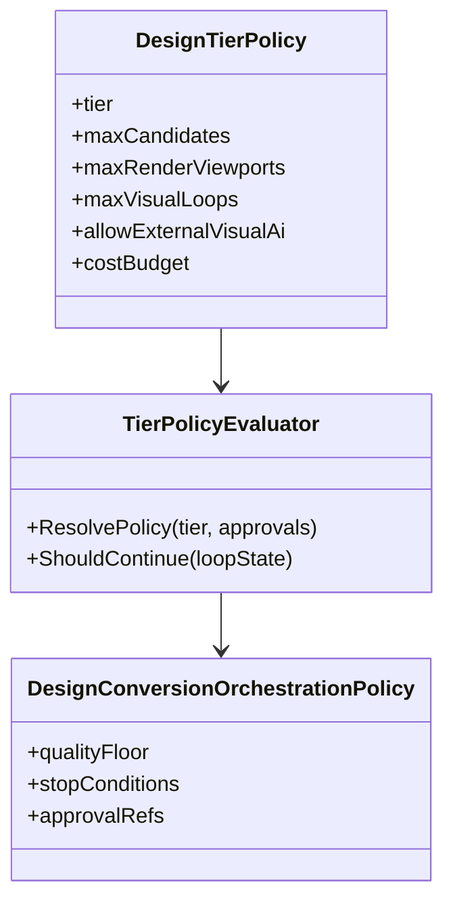

#### Algorithm
1. `TierPolicyEvaluator.ResolvePolicy(ClientTier tier, ApprovalRefs approvals)` returns budget values and external AI permission.
2. `LoopBudgetTracker.Start(policy, requestId)` initializes counts for candidates, render runs, diff runs, external calls and elapsed time.
3. `ShouldContinue(loopState, latestVerdict)` stops on quality floor reached, budget exhausted, user approval required, or quarantine.
4. `PolicyTraceWriter.Record(policy, loopState, decision)` stores explicit policy decisions with artifact refs.
5. Training/eval rows include policy as context only when it affects expected output format; policy is never the answer key.

#### Code/doc references
- Tier policy guide requires free/paid/pro thresholds, loop limits, cost/time budgets and external provider policy as explicit input: `C:\Projects\llm_mvp_core\docs\skills\design-conversion-tier-budget-policy-GUIDE.md:26-56`, `:58-66`.
- Client API guide requires tier/privacy/approval fields in request/response: `C:\Projects\llm_mvp_core\docs\skills\figma-canva-client-api-integration-GUIDE.md:25-47`.
- Product docs list free/starter/pro/team/enterprise tier framing: `C:\Users\lubao\Documents\xiigen\llm mvp\extensions\XIIGEN-PRODUCT-DESCRIPTION-v1.md:106-120`.

#### Concrete changes
- Planned: `DesignTierPolicy.cs`, `DesignConversionOrchestrationPolicy.cs`, `TierPolicyEvaluator.cs`, `LoopBudgetTracker.cs`, `PolicyTraceWriter.cs`.
- Planned client/server fields: `tier`, `budgetPolicyRef`, `externalVisualAiApprovalRef`, `loopBudgetStatus`.
- Planned tests: `DesignTierPolicyTests.FreePaidProBudgetsArePolicyInputs`, `DesignTierPolicyTests.ExternalAiDeniedWithoutApproval`, `LoopBudgetTrackerTests.StopsBeforeHiddenExtraRender`.

#### DPO/training impact
Tier may influence allowed attempts and context, but not chosen/rejected correctness. Quarantine example: row says chosen is better only because paid tier allowed another retry; that is policy leakage and must not train quality.

#### Gates/tests
Tier policy gate, budget exhaustion gate, external provider approval gate, cost visibility gate, stop-condition gate, policy-as-input-not-model-logic gate.

#### Hidden determinism check
Deterministic helpers: tier thresholds, loop counters, cost budget, viewport budget. Allowed role: policy and stopping. Forbidden role: visual quality answer key or model success shortcut.

### Stage 13 - User review, correction and promotion workflow

#### Human solution
The workflow closes the loop: user sees source/candidate/render/diff evidence, corrects what is wrong, approves or rejects DPO/training use, and later approves promotion if lifecycle gates pass. A human note alone is not trainable; it must be attached to artifact hashes and a precise correction.

#### UML

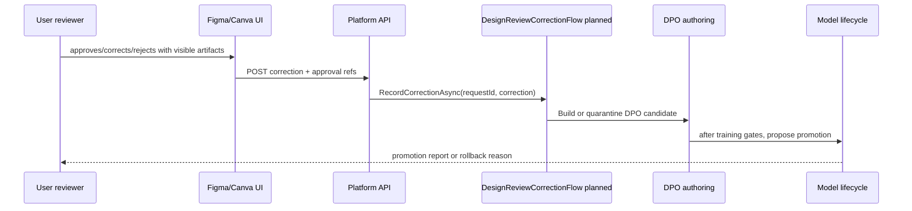

#### Algorithm
1. `DesignReviewCorrectionFlow.RecordCorrectionAsync(requestId, DesignCorrectionRequest correction, CancellationToken ct)` loads source/candidate/render/diff refs and verifies hashes still match.
2. `CorrectionNormalizer.Normalize(correction)` converts natural language/user edits into structured fields: target node/ref, expected visual change, approval scope, privacy scope.
3. `CorrectionToDpoCandidateBuilder.Build(normalizedCorrection, context)` creates accepted, rejected or quarantine candidate rows.
4. `PromotionApprovalFlow.RequestApproval(report)` presents checkpoint/manifest/eval/fresh-load/rollback evidence before promotion.
5. `PromotionApprovalFlow.ApplyDecision(approval)` promotes only if lifecycle gates and user approval pass; otherwise records rollback/quarantine.

#### Code/doc references
- Figma current design-gen flow can execute ops and re-export updated frame, useful as correction evidence but not core authority: `C:\Projects\FigmaToCode-design-gen\src\plugin\core\controller.ts:226-270`.
- Platform marketplace service records readback, forks and adaptation history with tenant/correlation evidence: `C:\Projects\xiigen-platform-dot-net-angular\src\Xiigen.Platform.Marketplace\MarketplaceService.cs:110-142`, `:144-190`, `:192-215`.
- DPO authoring guide requires correction, chosen/rejected/quarantine and hashes in context: `C:\Projects\llm_mvp_core\docs\skills\design-conversion-dpo-authoring-SKILL.md:33-79`.
- Lifecycle guide requires promotion and rollback evidence: `C:\Projects\llm_mvp_core\docs\skills\design-conversion-model-lifecycle-and-promotion-GUIDE.md:40-61`.

#### Concrete changes
- Planned: `DesignReviewCorrectionFlow.cs`, `DesignCorrectionRequest.cs`, `NormalizedDesignCorrection.cs`, `CorrectionToDpoCandidateBuilder.cs`, `PromotionApprovalFlow.cs`, `DesignPromotionDecision.cs`.
- Planned API endpoints: `POST /api/design-conversion/requests/{requestId}/corrections`, `POST /api/design-conversion/models/{candidateId}/promotion-decisions`.
- Planned client updates: Figma/Canva show source/candidate/render/diff refs and let user mark correction/approval scope.
- Planned tests: `DesignReviewCorrectionFlowTests.CorrectionBecomesHashLinkedDpoCandidate`, `DesignReviewCorrectionFlowTests.QuarantinesNoteWithoutArtifactRefs`, `PromotionApprovalFlowTests.RequiresLifecycleEvidenceBeforePromotion`.

#### DPO/training impact
Chosen example: user-approved corrected CSS fixes overflow and matches render evidence. Rejected example: previous candidate with one dominant overflow error. Quarantine example: "make it nicer" without artifact refs, or external AI suggestion without approval. Promotion example: trained candidate passes held-out/fresh-load/continue-training and user approves.

#### Gates/tests
Human correction gate, approval scope gate, artifact hash gate, DPO candidate/quarantine gate, promotion evidence gate, rollback gate, client/server e2e review gate.

#### Hidden determinism check
Deterministic helpers: reviewer id, correction timestamp, artifact hash, approval id, promotion status. Allowed role: audit and consent. Forbidden role: direct model label or promotion proof without render/eval/lifecycle evidence.

## Plan-only lock

This is a plan-only artifact. Implementation requires fresh Luba approval after final plan delivery.

PARTIALLY MERGED IN CODE AS HONEST UNTRAINED SCAFFOLD does not mean ready for implementation. PLAN-ONLY LOCK REMAINS, and NOT AUTHORIZED AS TRAINED FEATURE remains the controlling state.

No code, tests, build, server, browser automation, training, model upload, external AI call, git stage, git commit or git push is authorized by this Stage 4 review document. A future implementation may begin only after Luba sees and accepts the final plan with a fresh approval that explicitly starts implementation.

## Stage 4 Authority and Source Ledger Addendum

| Entry | Type | Timestamp or turn | Source quote | Assistant resolution | Requirements created or changed | Plan sections updated | Gates or artifacts updated | Status |
|---|---|---|---|---|---|---|---|---|
| Source 7 | authority_quote | Current turn, 2026-06-22 | "4. Проверка что все требования учтены, никаких скрытых под задач, обучение не должно скрывать детерминистические решения." | Stage 4 reviewed coverage, hidden subtasks, hidden determinism, human-readable shape, plan-only lock, external visual AI boundary and Stage 3 references; repair stayed in the exact plan file only. | Final coverage review, no-hidden-subtasks review, hidden-determinism review, ready-for-Luba-review status without implementation authorization | Final Coverage Matrix; No hidden subtasks review; Hidden Determinism Review; External visual AI boundary; Plan-only lock | Exact textual checks only; no tests/build/server/training/browser/git/external API | Mapped |

## Final Coverage Matrix

| Luba/work-order requirement | Covered by plan section/block | Gate or artifact that proves coverage | Stage 4 verdict |
|---|---|---|---|
| Build everything through sub-agents and keep current work plan-only. | Операционная рамка Stage 4; Plan-only lock; Stage 4 Authority and Source Ledger Addendum | Exact scope says one plan file only, no code/tests/server/training/git; implementation needs fresh Luba approval | PASS |
| Preserve literal target: Figma/Canva-like design enters server workflow, HTML/CSS improves through `ILearningMachine`, render QA, visual diff, DPO, training, model upload/promotion. | Target Outcome Matrix; Stage Breakdown rows 1-13; Stage 3 Solution Blocks | Each target part maps to observable end state and later gate; no scope exclusion approved | PASS |
| Target domain and architecture: `30.DesignConversionDomain`, platform/API boundary, Figma/Canva clients, `25.ModelServer`, allowed `ILearningMachine` hierarchy. | Reference Map; Stage Breakdown rows 2-4, 10-11; Solution Blocks Stage 3, Stage 4, Stage 10, Stage 11 | Locked decisions A-LM-05, A-LM-08, A-LM-12; Stage 4 hierarchy gates; lifecycle/pair gates | PASS |
| Use all 10 Stage 1 design-conversion guides/skills. | Reference Map rows for all 10 guides; Детали 8а | Each guide contributes a named plan area and later gate | PASS |
| Source/provenance must be typed, hashable, privacy-scoped and valid before DPO/training. | Stage Breakdown row 1; Stage 1 solution block; Target Outcome Matrix source/DPO rows | Provenance completeness, source-disjoint, privacy, license/approval, quarantine gates | PASS |
| Figma and Canva clients must be thin surfaces, not owners of training/core model logic. | Stage Breakdown row 2; Stage 2 solution block; Reference Map client rows | Thin-client gate, payload schema, status/debug boundary, no client-owned model mutation | PASS |
| Server/API orchestrates and records artifacts, but does not own training logic. | Stage Breakdown row 3; Stage 3 solution block | API-to-machine handoff, status artifact, OperationResult/DataProcessResult mapping, no server-owned model mutation | PASS |
| Trainable authority belongs only to allowed levels. | Hidden Determinism Guard; Stage Breakdown row 4; Stage 4 solution block | Allowed trainable level gate; training-location/runtime-separation gate; pair gate | PASS |
| Candidate HTML/CSS generation must not masquerade as trained quality. | Stage Breakdown row 5; Stage 5 solution block | Candidate artifact schema; deterministic baseline labeling; untrained honesty; no external provider default | PASS |
| Render QA and visual diff are evidence/eval, not model authority. | Stage Breakdown rows 6-7; Stage 6 and Stage 7 solution blocks; Hidden Determinism Guard | Render artifact completeness; taxonomy coverage; metric traceability; ablation/no-shortcut gate | PASS |
| DPO rows and negative examples must be source-complete, plausible, near-miss and leakage-safe. | Stage Breakdown row 8; Stage 8 solution block | Context-vector, chosen/rejected/quarantine/held-out, near-miss, dominant-error, no-leakage, source-disjoint gates | PASS |
| Training must include measured speed, accuracy, visual quality, held-out, ablation, fresh-load, continue-training and regression. | Stage Breakdown row 9; Stage 9 solution block; Target Outcome Matrix training row | Training/eval run report; before/after preference accuracy; held-out visual quality; ablation; fresh-load; continue-training | PASS |
| Model lifecycle and promotion must include checkpoint, manifest, export/import, locator/server upload, promotion and rollback. | Stage Breakdown row 10; Stage 10 solution block; Target Outcome Matrix model upload/promotion row | Lifecycle package, manifest, fresh-load, continue-training, locator update, promotion/rollback gates | PASS |
| Common/adaptive split and privacy must protect private source, screenshots, paths and user data. | Stage Breakdown row 11; Stage 11 solution block | `ILearningMachinePair` design, anonymized sync, user/cache-first, repo/common fallback, approval refs | PASS |
| Tier/budget/policy and external provider use must be explicit policy, not hidden model logic. | Stage Breakdown row 12; Stage 12 solution block | Tier policy-as-input, loop budget, cost visibility, external provider approval gate | PASS |
| User correction and promotion workflow must close the loop into DPO/quarantine/retraining approval. | Stage Breakdown row 13; Stage 13 solution block | Human correction, approval scope, artifact hash, DPO candidate/quarantine, promotion evidence and rollback gates | PASS |
| Human-readable plan shape must include Russian summary, UML, algorithms, code/doc refs, concrete changes, DPO/training examples and gates/tests. | Stage 3 Solution Blocks; Global UML overview; each Stage 0-13 block | Every Stage 0-13 block has Human solution, UML, Algorithm, Code/doc references, Concrete changes, DPO/training impact, Gates/tests and Hidden determinism check | PASS |
| Stage 3 references must not be placeholder-only. | Code/doc references sections in Stage 0-13 | References include file paths and line spans; planned work appears under Concrete changes, not as current code; any future implementation must revalidate refs before code work | PASS |
| External visual AI must be approval-bound evidence only, never default path or trained model proof. | Target Outcome Matrix visual diff row; Reference Map visual guide; Stage Breakdown rows 2, 7, 12-13; External visual AI boundary | Explicit approval ref required; evidence-only classification; no trained proof from external answer | PASS |
| Plan-only lock must remain active after Stage 4. | Status line; Plan-only lock | `PARTIALLY MERGED IN CODE AS HONEST UNTRAINED SCAFFOLD; PLAN-ONLY LOCK REMAINS; NOT AUTHORIZED AS TRAINED FEATURE`; fresh Luba approval required before implementation/trained-feature claims | PASS |

## No hidden subtasks review

| Required piece | Where it appears as Stage Breakdown row or explicit solution subtask | Verdict |
|---|---|---|
| Product workflow / user-visible outcome | Target Outcome Matrix; Stage 13 correction/promotion workflow | PASS |
| Architecture ownership | Stage 3 server/API boundary; Stage 4 `DesignConversionMachine` hierarchy | PASS |
| Data/source/provenance | Stage 1 source intake and provenance; Stage 8 DPO row authoring | PASS |
| Model/trainable owner | Stage 4 hierarchy; Stage 9 training; Stage 10 lifecycle; Stage 11 pair/privacy | PASS |
| API/server | Stage 3 server/API orchestration boundary; Stage 10 locator/model server | PASS |
| Client surfaces | Stage 2 thin Figma/Canva client API; Stage 13 review UI/API status | PASS |
| Render QA | Stage 6 render QA automation | PASS |
| Visual evaluation | Stage 7 visual diff taxonomy and metrics | PASS |
| DPO and negative quality | Stage 8 DPO row authoring; Stage 7 dominant-error taxonomy; Stage 13 correction to DPO | PASS |
| Training/evaluation | Stage 9 training and evaluation runbook | PASS |
| Lifecycle/export/import/promotion | Stage 10 model lifecycle and promotion; Stage 13 promotion decision | PASS |
| Tier/budget policy | Stage 12 tier policy and visual loop budgets | PASS |
| Privacy/common-adaptive split | Stage 1 privacy scope; Stage 11 common/adaptive pair and privacy | PASS |
| External AI boundary | Stage 2, Stage 7, Stage 12 and Stage 13 external AI notes; External visual AI boundary | PASS |

No hidden subtasks review verdict: PASS. The plan does not leave product, architecture, data, model, API, client, render, visual, DPO, training, lifecycle, tier, promotion, privacy or external-AI work as an unnamed hidden task. It still does not authorize implementation; it only names future implementation work areas and gates.

## Hidden Determinism Review

| Deterministic mechanism | Allowed role in this plan | Forbidden role explicitly blocked | Verdict |
|---|---|---|---|
| Source parser, source ids, export ids, file hashes, path refs | Provenance, reproducibility, quarantine and audit evidence | Training label, semantic shortcut, candidate winner or promotion proof | PASS |
| Existing Figma/Canva HTML/CSS pipeline and candidate order | Baseline/helper/candidate artifact generation only | Final trained authority or quality proof | PASS |
| DOM checks, screenshots, render success, timing and asset reports | QA/eval/internal evidence and DPO context | Model readiness proof by themselves | PASS |
| Pixel diff, taxonomy scoring, color/spacing/bounding-box metrics | Eval evidence, dominant-error classifier, ablation input | Semantic model output or trained quality proof without learned owner | PASS |
| Tier policy, loop limits, cost budgets | Explicit policy input and stop condition | Hidden model logic or replacement for quality/training gate | PASS |
| Client AI panels, retry paths, external visual AI | Approval-bound secondary evidence only | Default path, chosen/rejected authority, trained model proof | PASS |
| Reviewer id, timestamp, correction id, approval id | Consent, traceability and audit evidence | Direct label leakage or promotion decision without eval/lifecycle proof | PASS |

Hidden Determinism Review verdict: PASS. Training/model claims cannot be satisfied by render/diff/parsing/tier policy/source ids/candidate order/client AI. Deterministic helpers are labeled QA, eval, internal, baseline, provenance, audit or policy only, and any future learned claim must sit under `ILearningMachine<TDomain>`, `ILogicalOrchestrator`, `ILogicalFlow<TInput>`, `ILogicalUnit<TInput,TOutput>` or `ILearningMachinePair<TPersonal,TGlobal>` with checkpoint, manifest, export/import, fresh-load and continue-training evidence.

## Human-readable plan shape review

| Required shape | Evidence in this plan | Verdict |
|---|---|---|
| Russian human summary | Target Outcome Matrix, Детали 8а, each Human solution block | PASS |
| UML importable to draw.io | Global Mermaid sequence diagram plus Mermaid diagrams in every Stage 0-13 solution block | PASS |
| Algorithms without code prompts | Every Stage 0-13 block has an Algorithm subsection naming planned classes/functions and order of work | PASS |
| Code/doc references | Every Stage 0-13 block has Code/doc references with file paths and line spans; planned future files are separated into Concrete changes | PASS |
| Concrete changes | Every Stage 0-13 block has planned files/classes/methods/tests or endpoint changes | PASS |
| DPO/training examples | DPO/training impact sections include chosen/rejected/quarantine, held-out, ablation, lifecycle or promotion examples where relevant | PASS |
| Gates/tests | Every Stage 0-13 block has Gates/tests; future test commands are not run or authorized by this plan | PASS |

## External visual AI boundary

External visual AI boundary verdict: PASS.

- External visual AI is not the default path for conversion, QA, visual diff, DPO authoring, training, promotion or readiness.
- External visual AI may appear only as approval-bound secondary evidence with an explicit approval ref, provenance, and evidence-only label.
- External visual AI output cannot become chosen/rejected DPO authority, final model quality proof, trained readiness proof, promotion proof or replacement for local render/diff/eval/ablation gates.
- Current Figma external AI enhance paths are explicitly treated as existing client capability that must be outside the core default and approval-bound before use.

## Stage 3 reference quality review

Stage 3 reference quality verdict: PASS.

- Every `Code/doc references` subsection for Stage 0-13 contains concrete file references with line numbers or line spans.
- References to current code/docs are phrased as current evidence; future implementation is separated under `Concrete changes` and marked `Planned`.
- The platform render endpoint reference is explicitly described as reference style only, not render implementation.
- Plan-internal self-references are used only as plan-section evidence, not as proof of product implementation. Any future executor must revalidate referenced line numbers after concurrent changes before code work begins.

## Stage 4 final authorization state

| Field | Value |
|---|---|
| requested_artifact_type | Stage 4 final coverage review and bounded plan repair |
| plan_delivered_to_luba | true after this artifact is returned |
| luba_acceptance_quote | NONE |
| execution_authorized | false |
| status | PARTIALLY MERGED IN CODE AS HONEST UNTRAINED SCAFFOLD; PLAN-ONLY LOCK REMAINS; NOT AUTHORIZED AS TRAINED FEATURE |

Coverage verdict: PASS
Hidden subtasks verdict: PASS
Hidden determinism verdict: PASS

Stage 4 final verdict: coverage PASS; hidden subtasks PASS; hidden determinism PASS; human-readable shape PASS; external visual AI boundary PASS; plan-only lock PASS. The plan is ready for Luba review, not implementation.
