# EXTENSION FULL READINESS DUAL-PATH PLAN v1

Status after plan review/fix pass and mental-simulation coverage review:
`DONE_FOR_EXECUTION_WITH_REVIEW_SCOPE`.
This means the plan has passed the requested plan-review/fix scope and the five
requirement mental-simulation coverage review as a plan artifact. It is ready to
be used by future executors as a plan. It does not prove product readiness, full
extension readiness, full Codex chat UI readiness, token savings, semantic
quality improvement, learnability/training, checkpoint promotion, or locator
update. Those claims remain closed until future execution produces the two-path
evidence required below.

Detailed review evidence is recorded in
`docs/plans/EXTENSION-FULL-READINESS-DUAL-PATH-PLAN-v1.review-ledger.md`.

Документ: PLAN-ONLY. Этот файл не запускает реализацию, не открывает readiness-claims, не
заменяет тесты и не разрешает stage/commit/push.

## 0. Человеческое начало

### 0.1 Цель

Цель этого плана - закрыть сейчас не заявленные как доказанные области готовности:
product readiness, full extension readiness, full Codex chat UI readiness, token savings,
semantic quality improvement, learnability/training, checkpoint mutation/promotion и
locator update.

План задает человечески читаемый порядок работы через двухконтурную проверку:
какие сценарии надо проверить, какие
алгоритмы используют исполнители, какие артефакты собираются, как соединяются два
контура доказательств, когда claim можно повысить, когда он обязан быть понижен, и где
остается работа.

### 0.2 Почему текущих доказательств недостаточно для missing areas

Текущие evidence types не должны автоматически становиться readiness-claim:

- JSON/report/static/adapter-only evidence может доказывать контракт или boundary slice, но не
  доказывает реальную работу в установленном Claude, Cursor или Codex.
- Screenshot/video/log из host UI может доказывать локальный desktop факт, но не доказывает
  adapter/API/core request-response, token accounting, DPO/training, quality scoring,
  checkpoint/locator gates или rollback.
- Единая цепочка `user in host -> extension -> core -> answer in host UI` хрупкая: сбой UI
  блокирует всю оценку и одновременно скрывает, что boundary path мог уже быть доказан.
- Любой claim уровня "ready", "full extension", "token savings", "semantic quality",
  "learnability", "checkpoint promoted" или "locator updated" считается гипотезой, пока
  нет свежей локальной evidence-команды и человекочитаемого join-report.

### 0.3 Что значит done и not-done

`DONE` для сценария значит: у сценария есть две параллельные записи - Automated boundary
path и Local desktop agent path; EvidenceJoiner связал их по `scenario_id` и `marker`;
оба контура имеют принятые артефакты либо один контур честно понижен с точным blocker; отчет
показывает claim, evidence, remaining work и downgraded claim.

`NOT_DONE` значит любое из следующего:

- есть только один контур;
- есть screenshot без boundary proof;
- есть adapter/API/core proof без real installed host evidence;
- есть blocked UI без точного blocker и без продолжения другого контура;
- есть token/quality/training/checkpoint/locator claim без локального воспроизводимого
  evidence artifact;
- ledger/checklist выдан как completed review/fix cycle.

### 0.4 CURRENT TASK anchor

CURRENT TASK: perform Luba's requested mental-simulation coverage review of
`C:\Projects\llm_mvp_core\docs\plans\EXTENSION-FULL-READINESS-DUAL-PATH-PLAN-v1.md`
against the five exact requirements, fix plan/ledger gaps through the authorized
bounded sub-agent editor, and repeat review/fix until the plan artifact fully
covers the requirements. This remains plan coverage only, not implementation or
runtime proof.

NOT THE TASK: implementation code/tests, runtime execution, product evidence
collection, stage, commit, push, checkout, reset, clean, delete, or edits outside
the plan and optional review ledger unless requirement 5 cannot be satisfied
without minimal governance/skill updates.

EVIDENCE-ONLY: quoted transcripts, old state, old plans, sub-agent packets,
foreign/parallel artifacts, prior reports, and previous skeleton rows can inform
review findings but cannot create current scope, git scope, implementation scope,
or readiness claims unless Luba reactivates them in current unquoted text.

active_task_sentence_source: Luba latest unquoted instruction: "Сделан мысленную
симуляцию что план завершен и ответь если он покрывает все требования... Исправь
то что надо через суб агентов если нет. Повтори этот цикл пока план будет
полностью отвечать требованиям"

current_turn_artifact_queue:

| Step | Artifact | Required action | Completion evidence |
|---|---|---|---|
| 1 | `docs/plans/EXTENSION-FULL-READINESS-DUAL-PATH-PLAN-v1.md` | Review/fix the plan against the five mental-simulation requirements | Main plan contains a coverage verdict table, governance propagation phase, and final claim-boundary section |
| 2 | `docs/plans/EXTENSION-FULL-READINESS-DUAL-PATH-PLAN-v1.review-ledger.md` | Ledger for mental-simulation coverage evidence | MS-01/MS-02 verdict records list gaps found, fixes made, and full plan-coverage status |
| forbidden | Any other file or git state | No action | No stage/commit/push/checkout/reset/clean/delete used |

### 0.5 Summary table

| phase.step | Title | What it solves | Plan-review status | Automated boundary path | Local desktop path | Remaining before readiness claim |
|---|---|---|---|---|---|---|
| 00.00 | Load rules/skills/authority ledger | Fixes authority, plan-only scope, and dual-path rule source | READY_FOR_EXECUTION_SCOPE | Rule excerpts and source ledger must be reread by executor | Not a host claim | Future executor must reread exact rules |
| 01.00 | Scenario and claim inventory | Enumerates hosts, claims, scenarios, and downgrade states | READY_FOR_EXECUTION_SCOPE | Scenario matrix with claim ids | Desktop feasibility row per Claude/Cursor/Codex | Fill from current code/runtime discovery |
| 02.00 | Evidence contract/schema | Defines the two-path evidence package and join keys | READY_FOR_EXECUTION_SCOPE | JSON/MD schema for request/response/trace/metrics | Screenshot/video/log/blocker schema with marker | Implement schema generators later |
| 03.00 | Automated boundary proof | Proves adapter/API/core/model/DPO/token/quality/checkpoint/locator before host UI | READY_FOR_EXECUTION_SCOPE | Adapter/API/core traces, token counts, quality scores, training/checkpoint/locator gates | Not a substitute for desktop path | Verify exact code references and run local commands |
| 04.00 | Local desktop agent protocol | Proves same scenarios in installed Claude/Cursor/Codex | READY_FOR_EXECUTION_SCOPE | Boundary scenario ids supplied to desktop work orders | Visible marker, screenshot/video/log, blocker if impossible | Confirm launch/control method per host |
| 05.00 | Product readiness matrix | Connects product claims to evidence and remaining gaps | READY_FOR_EXECUTION_SCOPE | Product workflow traces, quality/token/lifecycle reports | Real host workflow evidence | Prevent product-ready overclaim |
| 06.00 | Full extension readiness matrix | Separates Claude, Cursor, Codex full-extension gates | READY_FOR_EXECUTION_SCOPE | Entrypoint/core/debug/learning/export/import evidence per host | Real host invocation per host | Hosts with handler-only proof stay downgraded |
| 07.00 | Full Codex chat UI readiness | Defines Codex chat UI path and downgrade behavior | READY_FOR_EXECUTION_SCOPE | Codex adapter/API/core and plugin runtime boundary | Real Codex app/chat UI marker evidence or blocker | No full Codex UI claim without local proof |
| 08.00 | Token savings before/after | Measures token savings with reproducible baselines | READY_FOR_EXECUTION_SCOPE | Before/after traces, workload hash, tokenizer metadata, quality guard | Same marked scenario in host log/screenshot/video | Prevent savings claim from changed workload or quality regression |
| 09.00 | Semantic quality improvement eval | Measures semantic quality by held-out cases and rubric | READY_FOR_EXECUTION_SCOPE | Scored baseline/candidate comparison, leakage checks | Desktop-visible answer evidence for same cases | Prevent dashboard-only quality claim |
| 10.00 | Learnability/training/DPO quality | Proves learnability, continue-training, and DPO dataset quality | READY_FOR_EXECUTION_SCOPE | Train/eval/DPO metrics, provenance, leakage gates, checkpoints | Host scenario shows changed behavior after local learning | No closed proprietary teacher training |
| 11.00 | Backup/export/import/share/continue-training/rollback | Proves user asset lifecycle | READY_FOR_EXECUTION_SCOPE | Package manifest, import/export/rollback/load probes | Host-visible restored/rolled-back behavior | No lifecycle claim from metadata only |
| 12.00 | Checkpoint mutation/promotion and locator update | Gates checkpoint candidates and locator updates | READY_FOR_EXECUTION_SCOPE | Checkpoint hash/diff, promotion, fresh-load, locator diff, rollback | Host reload uses promoted checkpoint/locator | Promotion is blocked without rollback |
| 13.00 | No hidden deterministic shortcut review | Finds exact-prompt lookup, regex-only, fixture leakage, hardcoded routing | READY_FOR_EXECUTION_SCOPE | Source/runtime audit reports and held-out variants | Host behavior on held-out marker variants | Deterministic helpers must be labelled as helpers only |
| 14.00 | Documentation/dashboard/user-visible status | Creates readable reports without replacing evidence | READY_FOR_EXECUTION_SCOPE | Report/dashboard data derived from accepted artifacts only | Links to screenshots/videos/logs per host | Dashboard cannot claim readiness by itself |
| 15.00 | 30-cycle review/fix closure | Records the requested plan-review/fix pass | DONE_FOR_EXECUTION_WITH_REVIEW_SCOPE | RC ledger cites inspected plan sections and recheck commands | Host runtime not executed in this plan-only task | Future execution still must produce real evidence |
| 16.00 | Documents, skills, guides, and agent-file propagation | Ensures execution knowledge is adapted beyond this one plan | READY_FOR_EXECUTION_SCOPE | Diffs/readbacks for документы, скилы, гайды, AGENTS, CLAUDE | Local desktop evidence remains separate and cannot be replaced by doc edits | Future executors must update relevant docs/skills/guides/agent files before readiness claims |

## 1. Authority requirements ledger

| Req id | Source quote summary | Binding requirement | Plan sections | Gate/test | Artifact |
|---|---|---|---|---|---|
| R01 | "Cover the missing claims..." | Cover product readiness, full extension readiness, full Codex chat UI readiness, token savings, semantic quality improvement, learnability/training, checkpoint mutation/promotion, locator update | 0, 5-12, 15 | Claim coverage matrix has zero unmapped rows | This plan and later evidence packages |
| R02 | "Testing must be local with active real programs..." | Local evidence must use active real programs on this computer when host behavior is claimed | 4, 6, 7, 14 | Local desktop work order requires launch/marker/screenshot/video/log/blocker | Host evidence folders |
| R03 | "Do NOT use a single fragile chain..." | Single host UI chain cannot be only proof | 2-4, 13 | Every scenario has two paths and EvidenceJoiner | Join reports |
| R04 | "For EVERY scenario, use TWO PARALLEL PATHS..." | Automated boundary and Local desktop paths required per scenario | 2-15 | Scenario matrix rejects one-path records | Evidence schema |
| R05 | "If one path is blocked..." | Blocked path downgrades claim and continues other work; no stop gate | 2, 4, 5-15 | Downgrade status required with blocker | Downgrade ledger |
| R06 | "human-readable..." | Clear Russian numbering, phases, substeps, evidence, remaining work, reports | 0, 3-15 | Human-readable report gate | Plan and reports |
| R07 | "describe algorithms/pathways and real references, not prompts" | Use algorithms with inputs/steps/outputs/acceptance/evidence; no prompt-only plan | 3, 4, 8-13 | Algorithm completeness gate | Algorithm specs |
| R08 | "Do 30 review/fix cycles. Do not fake identical cycles." | Perform and record 30 concrete, non-identical plan review/fix cycles for this plan-only task | 12, ledger | RC-01..RC-30 records include focus, issue/PASS reason, inspected section, fix, post-fix status, risk | Plan plus optional review ledger |
| R09 | "Do not implement code/tests. Do not stage/commit/push." | Keep the deliverable plan-only and forbid git writes | 0, 10, 13 | Final packet and work-order shape keep `implementation_authorized_now=false` and `git_authority=forbidden` | This plan |
| R10 | "Simulate mentally that the plan has been executed phase by phase..." | Review the plan against the five exact requirements, repair gaps, and preserve future-evidence honesty | 0, 12, 14-16, ledger | Coverage verdict table reaches FULL_PLAN_COVERAGE without claiming runtime evidence | Plan plus review ledger |
| R11 | "The plan includes adapting all relevant documents, skills, guides, and agent files..." | Future execution must update relevant документы, скилы, гайды, `AGENTS.md`, `CLAUDE.md`, and affected project guides so project requirements live outside this plan too | 14, 16, 13 | Governance/knowledge propagation gate has readback evidence and no readiness overclaim | Docs/skills/guides/agent-file update packet |

## 2. User prompt source ledger

| entry_id | entry_type | timestamp_or_turn | source_quote | assistant_answer_or_resolution | requirements_created_or_changed | plan_sections_updated | gates_or_artifacts_updated | status |
|---|---|---|---|---|---|---|---|---|
| UPSL-001 | current_user_task | 2026-06-24 current turn | "Create the first complete human-readable plan file... PLAN-ONLY..." plus ACTIVE LUBA REQUIREMENTS and PLAN FORMAT REQUIREMENTS | Resolved by creating this plan-only artifact and not implementing code/tests/git actions | R01-R08 | All sections | Dual-path evidence gate, plan-only gate, 30-cycle skeleton | ACTIVE |
| UPSL-002 | current_user_task | 2026-06-24 current turn | "Perform 30 concrete review/fix cycles on the plan... This is PLAN REVIEW + PLAN FIX only. Do not implement code/tests. Do not stage/commit/push." | Resolved by replacing the old cycle skeleton with RC-01..RC-30 performed plan-review records and updating plan status without opening readiness claims | R01-R09 | 0, 1, 3, 8-13, review ledger | 30-cycle plan-review evidence, dual-path execution-ready status, no-git boundary | ACTIVE |
| UPSL-003 | current_user_task | 2026-06-24 current turn | "Сделан мысленную симуляцию что план завершен... Исправь то что надо через суб агентов если нет. Повтори этот цикл..." | Resolved by adding a five-requirement mental-simulation coverage verdict, repairing current-task traceability, adding Phase 16 for documents/skills/guides/agent-file propagation, and adding a Russian-first final claim-boundary section | R10-R11 plus recheck of R01-R07 | 0, 1, 2, 8, 10, 12, 13, 16, ledger | Mental-simulation verdict, docs/skills/guides/AGENTS/CLAUDE propagation gate, final non-claim gate | ACTIVE |

## 3. Loaded governance and skill references

Verified by direct local reads or targeted read-back in this review/fix turn:

| Reference | Read-back evidence | Planning effect |
|---|---|---|
| `AGENTS.md` OP-64 around line 4388 | Requires Automated boundary path and Local desktop agent path for host scenarios | Every host scenario must join boundary evidence with local desktop evidence or downgrade |
| `CLAUDE.md` dual-path section around line 334 | Repeats dual-path rule and report fields | Reports must show `phase.step`, Automated boundary status, Local desktop status, evidence, remaining work, downgraded claims |
| `CLAUDE.md` full extension gates around lines 418 and 426 | Full extension readiness must list Claude, Cursor, and Codex separately | Phase 06 and final gate require per-host proof with no substitution |
| `docs/skills/plan-review-SKILL.md` full extension/dual-path gate around lines 888-932 | Rejects smoke/API/dashboard/helper-only proof as full extension readiness | Full extension rows require real host entrypoint/runtime plus dual-path evidence |
| `docs/skills/claim-verification-SKILL.md` readiness evidence rules around lines 65 and 70 | Extension/runtime/product claims need joined dual-path proof; ledger-only rows do not prove cycles | This plan uses RC records for plan-review evidence and keeps readiness claims closed until execution evidence exists |
| `docs/skills/plugin-runtime-reality-gate-SKILL.md` lines 30-110 | Defines host-specific full extension rows and rejected substitutes | Claude, Cursor, and Codex must each prove real host entrypoint, settings/debug, locator/core API, learning, lifecycle, QA |

## 4. Draw.io-importable PlantUML

```plantuml
@startuml
title Dual-path readiness verification for Claude / Cursor / Codex
skinparam componentStyle rectangle
skinparam shadowing false

actor "Local desktop agent" as DesktopAgent
actor "Boundary runner" as BoundaryRunner

rectangle "Scenario Inventory" as Inventory {
  component "scenario_id" as SID
  component "marker" as Marker
  component "request" as Request
  component "claim_id" as ClaimId
}

package "Automated boundary path" as Automated {
  component "AutomatedBoundaryVerifier" as ABV
  component "adapter/API/core request-response" as CoreRR
  component "model logic" as ModelLogic
  component "DPO/train set" as DpoTrain
  component "token counts" as TokenCounts
  component "quality score" as QualityScore
  component "checkpoint" as Checkpoint
  component "backup/export/import package" as BackupPackage
  component "promotion candidate" as PromotionCandidate
  component "locator update candidate" as LocatorCandidate
  artifact "response" as BoundaryResponse
  artifact "trace" as BoundaryTrace
}

package "Local desktop path" as Local {
  component "LocalDesktopAgentVerifier" as LDV
  component "Claude installed host" as ClaudeHost
  component "Cursor installed host" as CursorHost
  component "Codex installed host" as CodexHost
  artifact "screenshot/video/log" as DesktopEvidence
  artifact "exact blocker" as DesktopBlocker
}

rectangle "EvidenceJoiner" as Joiner {
  component "join by scenario_id + marker" as JoinKey
  component "downgraded claims" as Downgrade
  artifact "human-readable report" as HumanReport
}

BoundaryRunner --> SID
BoundaryRunner --> Marker
BoundaryRunner --> Request
DesktopAgent --> SID
DesktopAgent --> Marker
DesktopAgent --> Request

SID --> ABV
Marker --> ABV
Request --> ABV
ABV --> CoreRR
ABV --> ModelLogic
ABV --> DpoTrain
ABV --> TokenCounts
ABV --> QualityScore
ABV --> Checkpoint
ABV --> BackupPackage
ABV --> PromotionCandidate
ABV --> LocatorCandidate
ABV --> BoundaryResponse
ABV --> BoundaryTrace

SID --> LDV
Marker --> LDV
Request --> LDV
LDV --> ClaudeHost
LDV --> CursorHost
LDV --> CodexHost
LDV --> DesktopEvidence
LDV --> DesktopBlocker

BoundaryResponse --> Joiner
BoundaryTrace --> Joiner
TokenCounts --> Joiner
QualityScore --> Joiner
DpoTrain --> Joiner
Checkpoint --> Joiner
BackupPackage --> Joiner
PromotionCandidate --> Joiner
LocatorCandidate --> Joiner
DesktopEvidence --> Joiner
DesktopBlocker --> Joiner
ClaimId --> Joiner
Joiner --> HumanReport
@enduml
```



## 5. Evidence contract and artifact schema

### 5.1 Common keys

Every scenario record must contain:

- `scenario_id`: stable id such as `S-CLAUDE-PROMPT-TO-TASK-001`.
- `host`: `Claude`, `Cursor`, or `Codex`.
- `claim_id`: product/full-extension/Codex-chat/token/quality/learning/checkpoint/locator claim.
- `marker`: visible string injected into both paths, for example
  `XIIGEN-DUAL-PATH-<scenario_id>-<timestamp>`.
- `request`: normalized user task payload.
- `expected_behavior`: deterministic acceptance envelope, not a prompt.
- `automated_boundary_path`: status, command, request, response, trace, token counts,
  quality score, DPO/train set, checkpoint, locator, rollback/export/import artifacts.
- `local_desktop_agent_path`: status, host launch method, marker visibility,
  screenshot/video/log path, exact blocker, manual observations.
- `join_status`: `PASS_JOINED`, `PASS_WITH_DOWNGRADE`, `FAIL_MISSING_AUTOMATED`,
  `FAIL_MISSING_LOCAL`, `FAIL_MISMATCH`, or `NOT_RUN`.
- `downgraded_claim`: exact narrower claim if one path is blocked or partial.

### 5.2 Accepted status vocabulary

- `NOT_RUN`: planned but not executed.
- `PASS_AUTOMATED_BOUNDARY`: boundary path accepted only for its scope.
- `PASS_LOCAL_DESKTOP`: local desktop path accepted only for its scope.
- `BLOCKED_LOCAL_UI_CONTROL`: local host exists but cannot be controlled; exact blocker required.
- `BLOCKED_HOST_NOT_INSTALLED`: host not installed or inaccessible; exact local evidence required.
- `PASS_JOINED`: both paths accepted and joined.
- `PASS_WITH_DOWNGRADE`: one path blocked/partial and claim downgraded.
- `FAIL`: artifact contradicts expected behavior or lacks required evidence.

### 5.3 Report fields

Every readable report must show:

```text
phase.step:
host:
scenario_id:
claim_id:
marker:
Automated boundary status:
Automated boundary evidence:
Local desktop status:
Local desktop evidence:
blocker_or_NONE:
joined_result:
downgraded_claim:
remaining_work:
non_claims:
```

## 6. No-code algorithms

### 6.1 DualPathScenarioRunner

Inputs:

- scenario inventory rows for Claude, Cursor, Codex;
- claim inventory rows;
- host availability matrix;
- marker generation policy;
- evidence output root.

Steps:

1. Build a stable `scenario_id` for each host and readiness claim.
2. Attach one unique visible `marker` to the request.
3. Create two work items for the same scenario: Automated boundary and Local desktop agent.
4. Run or delegate AutomatedBoundaryVerifier for everything before/at the host boundary.
5. Run or delegate LocalDesktopAgentVerifier for the real installed host on this computer.
6. Send both packets to EvidenceJoiner.
7. If one path is blocked, require exact blocker, downgrade the claim, and continue other scenarios.

Outputs:

- scenario packet;
- two path packets;
- joined report;
- downgrade ledger.

Acceptance rules:

- PASS only when every scenario has both path records and a join decision.
- PASS_WITH_DOWNGRADE when one path is blocked with exact blocker and the other path is complete.

Fail rules:

- one-path proof is used as full readiness;
- blocked local UI becomes a stop gate;
- ledger row is counted as completed review.

Evidence artifacts:

- `scenario.json`;
- `automated-boundary-report.md/json`;
- `local-desktop-report.md/json`;
- `evidence-join-report.md/json`.

### 6.2 AutomatedBoundaryVerifier

Inputs:

- normalized request;
- adapter/API/core entrypoint;
- expected response schema;
- token measurement configuration;
- semantic quality rubric;
- DPO/training/checkpoint/locator gates.

Steps:

1. Verify the exact adapter/API/core reference before execution.
2. Send the request at the highest testable boundary before host UI.
3. Capture request, response, trace, loaded model/checkpoint/locator, and timing.
4. Run token counting on baseline and candidate paths.
5. Run quality scoring against held-out rubrics.
6. Run DPO/training checks only with allowed teacher provenance and non-leaking data.
7. Run backup/export/import/share/continue-training/rollback and checkpoint/locator gates when the scenario requires them.

Outputs:

- boundary request-response trace;
- token counts;
- quality score;
- training/DPO dataset card;
- checkpoint/locator gate verdict;
- lifecycle package verdict.

Acceptance rules:

- command output is fresh and local;
- response schema matches expected behavior;
- metric names and denominators are explicit;
- no Local desktop proof is claimed from this path.

Fail rules:

- static report, helper-only call, or synthetic UI is claimed as full host runtime;
- metric type is validation-only/static/contract while claim says readiness;
- exact code reference was not verified.

Evidence artifacts:

- request/response JSONL;
- trace log;
- token report;
- quality report;
- DPO/training card;
- checkpoint/locator report.

### 6.3 LocalDesktopAgentVerifier

Inputs:

- host name: Claude, Cursor, or Codex;
- local launch/activation instructions;
- same `scenario_id`, `marker`, and request as boundary path;
- evidence capture requirements.

Steps:

1. Confirm the real installed program is launched or record exact unavailable state.
2. Activate the real host entrypoint, command, panel, chat UI, or extension route.
3. Submit the same marked scenario.
4. Capture screenshot/video/log showing marker, request, response, and host context.
5. Capture exact blocker if UI automation/control is impossible.
6. Label the result as Local desktop evidence only.

Outputs:

- desktop evidence bundle;
- blocker record if needed;
- host-specific observations.

Acceptance rules:

- evidence is from the real installed host on this computer;
- marker is visible in screenshot/video/log;
- response is tied to the same `scenario_id`;
- blocker is exact and reproducible when blocked.

Fail rules:

- process/window-list only is used as runtime proof;
- synthetic helper UI replaces real host;
- screenshot-only tries to prove boundary internals.

Evidence artifacts:

- screenshot PNG;
- optional video;
- host logs;
- blocker note;
- local-desktop report.

### 6.4 EvidenceJoiner

Inputs:

- Automated boundary packet;
- Local desktop packet;
- scenario id;
- marker;
- claim id;
- downgrade rules.

Steps:

1. Match packets by `scenario_id` and `marker`.
2. Confirm both packets target the same host and claim.
3. Compare response content, trace ids, token/quality/training/checkpoint metadata, and desktop-visible output.
4. Assign join status.
5. If one path is blocked, write exact downgraded claim and remaining work.
6. Produce human-readable report before any machine-only dashboard.

Outputs:

- joined evidence report;
- claim status matrix;
- remaining work ledger.

Acceptance rules:

- both path scopes are explicit;
- no unsupported readiness claim survives;
- report has phase.step, statuses, evidence, remaining, downgraded claims.

Fail rules:

- path mismatch hidden by summary prose;
- boundary evidence or screenshot evidence substitutes for the other path.

Evidence artifacts:

- joined report MD/JSON;
- downgraded claim ledger.

### 6.5 TokenSavingsEvaluator

Inputs:

- baseline path request/response/token trace;
- candidate path request/response/token trace;
- same scenario ids and held-out cases;
- tokenizer/version metadata.

Steps:

1. Freeze baseline before candidate changes.
2. Count input, output, hidden/tool, and total tokens with the same tokenizer.
3. Run same scenarios through Automated boundary path.
4. Run representative local desktop scenarios with marker evidence.
5. Compute token savings as absolute delta and percentage delta.
6. Reject savings if quality or correctness falls below acceptance threshold.

Outputs:

- `token savings` report;
- per-scenario token trace;
- quality guard result.

Acceptance rules:

- before/after use same workload and tokenizer;
- token savings are not claimed when semantic quality regresses beyond threshold;
- Local desktop path confirms candidate behavior is accessible in host.

Fail rules:

- single prompt anecdote;
- dashboard-only token number;
- changed workload denominator.

Evidence artifacts:

- token traces JSONL;
- token savings report MD/JSON;
- host evidence links.

### 6.6 SemanticQualityEvaluator

Inputs:

- baseline outputs;
- candidate outputs;
- held-out evaluation set;
- human-readable rubric;
- allowed judge/eval provenance.

Steps:

1. Build held-out cases independent from training rows.
2. Score baseline and candidate against the same rubric.
3. Use pairwise comparison and absolute threshold.
4. Record judge provenance and whether outputs are used only for evaluation.
5. Join representative desktop-visible outputs for Claude/Cursor/Codex.
6. Emit pass/fail/downgrade per claim.

Outputs:

- `semantic quality` improvement report;
- scored examples;
- rubric decisions;
- downgrade ledger.

Acceptance rules:

- candidate beats baseline by predeclared margin without hidden leakage;
- representative local desktop evidence shows the improved behavior reaches host path;
- proprietary model outputs are not used as training labels unless policy allows, and this plan assumes they are evaluation-only.

Fail rules:

- quality claim from one hand-picked example;
- judge prompt is the only specification;
- hidden deterministic lookup produces "quality".

Evidence artifacts:

- rubric file;
- scored JSONL;
- quality report;
- local desktop evidence bundle.

### 6.7 LearnabilityTrainerAndEvaluator

Inputs:

- local training examples;
- baseline checkpoint;
- continue-training command spec;
- held-out evaluation cases;
- rollback checkpoint.

Steps:

1. Record baseline behavior and checkpoint hash.
2. Train or continue-train on authorized local examples.
3. Save candidate checkpoint and manifest.
4. Evaluate trained behavior on held-out cases.
5. Run ablation/leakage checks against exact-prompt memorization.
6. Prove local desktop behavior changes only after loading the candidate.
7. Keep rollback path available.

Outputs:

- learnability training report;
- candidate checkpoint;
- held-out eval report;
- rollback result.

Acceptance rules:

- learnability means measurable behavior change from local training, not a static rule update;
- improvement is visible through both Automated boundary and Local desktop paths;
- checkpoint can be rolled back.

Fail rules:

- deterministic rule patch is called training;
- continue-training is metadata-only;
- no held-out eval.

Evidence artifacts:

- training dataset card;
- checkpoint diff;
- eval report;
- host before/after evidence.

### 6.8 DpoQualityBuilderAndGate

Inputs:

- DPO candidate pairs;
- teacher provenance;
- rejected/accepted output rationale;
- training/eval split;
- legal/policy gate.

Steps:

1. Build DPO pairs only from allowed sources.
2. Record source, license, provider terms, and whether any proprietary model output is evaluation-only.
3. Run pair quality checks for label clarity, non-duplication, non-leakage, and held-out separation.
4. Train/evaluate candidate only after dataset passes.
5. Join with Local desktop behavior evidence for changed scenarios.

Outputs:

- DPO quality card;
- DPO dataset manifest;
- train/eval report;
- blocked/proven provenance ledger.

Acceptance rules:

- no closed proprietary teacher output is used for training/ranking targets;
- DPO pairs improve held-out semantic quality;
- local host path can load/use the resulting model/checkpoint when readiness is claimed.

Fail rules:

- missing teacher provenance;
- reused eval rows as training rows;
- DPO report claims quality without behavior eval.

Evidence artifacts:

- DPO manifest;
- provenance ledger;
- quality report;
- host evidence.

### 6.9 CheckpointPromotionAndRollback

Inputs:

- baseline checkpoint;
- candidate checkpoint;
- manifest;
- compatibility probe;
- rollback probe;
- promotion policy.

Steps:

1. Hash baseline and candidate checkpoints.
2. Run compatibility/load probe.
3. Run behavior eval and token/quality gates.
4. Write promotion candidate only after gates pass.
5. Run rollback/load probe from candidate back to baseline.
6. Join desktop evidence that host uses the promoted checkpoint or records exact blocker.

Outputs:

- checkpoint mutation report;
- promotion candidate report;
- rollback report;
- host reload evidence.

Acceptance rules:

- checkpoint promotion requires compatibility, quality, token, and rollback evidence;
- host locator points to candidate only after promotion gate;
- rollback remains executable.

Fail rules:

- file exists is claimed as promoted;
- locator changes without fresh load proof;
- rollback is not executed.

Evidence artifacts:

- checkpoint hash report;
- promotion report;
- rollback log;
- local desktop reload evidence.

### 6.10 LocatorUpdateGate

Inputs:

- current locator;
- locator update candidate;
- checkpoint promotion result;
- host-specific config paths;
- fresh-load probe.

Steps:

1. Read current locator and candidate locator.
2. Verify candidate points to promoted checkpoint/package only.
3. Run Automated boundary fresh-load probe.
4. Run Local desktop host reload or record exact blocker.
5. Record old locator backup and rollback path.
6. Publish user-readable locator status without claiming host readiness from locator alone.

Outputs:

- locator diff;
- fresh-load result;
- rollback locator;
- host reload evidence.

Acceptance rules:

- locator update is accepted only after promoted candidate and fresh-load pass;
- each host has separate locator evidence;
- failure downgrades only locator/host claim, not unrelated scenarios.

Fail rules:

- stale locator is reused;
- candidate path not checked;
- one host locator substitutes for another.

Evidence artifacts:

- locator report;
- fresh-load log;
- host reload screenshot/video/log;
- rollback locator.

### 6.11 NoHiddenDeterminismReview

Inputs:

- scenario set;
- source/reference map;
- runtime traces;
- held-out variants;
- training/eval split.

Steps:

1. Search exact-prompt lookup, regex-only routing, hardcoded marker behavior, fixture leakage, and direct dictionary retrieval.
2. Label deterministic helpers as audit/fixture/corpus-labeling only unless explicitly allowed.
3. Run held-out marker variants and paraphrases.
4. Compare boundary and host behavior for suspicious exact-match drops.
5. Block quality/learnability claims if hidden determinism explains the improvement.

Outputs:

- hidden determinism report;
- source/runtime findings;
- claim downgrade ledger.

Acceptance rules:

- no production path relies on hidden exact-prompt or fixture lookup for claimed learning/quality;
- deterministic helper role is explicit and non-authoritative;
- held-out variants remain acceptable.

Fail rules:

- exact-prompt lookup masquerades as model learning;
- marker-specific hardcoding;
- train/eval contamination.

Evidence artifacts:

- source audit report;
- held-out eval report;
- boundary/local mismatch report.

### 6.12 KnowledgePropagationUpdater

Inputs:

- accepted joined evidence reports;
- changed implementation behavior and public requirements;
- current `AGENTS.md`, `CLAUDE.md`, relevant `docs/skills/*.md`, guides, and user-facing docs;
- list of claims opened, downgraded, or still closed.

Steps:

1. Build a propagation inventory for документы, скилы, гайды, `AGENTS.md`, `CLAUDE.md`, and any project guide that future executors use.
2. For each accepted behavior or requirement, identify the smallest document/skill/guide/agent-file update needed to prevent future execution drift.
3. Write only text that is backed by accepted evidence or explicitly marked as a future execution requirement.
4. Read back the exact changed sections and map each update to the phase, scenario, and evidence packet that justified it.
5. Reject any update that turns plan coverage into product readiness, full extension readiness, token savings, semantic quality, learnability, checkpoint, or locator claims without evidence.
6. Produce a propagation report listing changed files, unchanged-but-reviewed files, deferred files, and reasons.

Outputs:

- docs/skills/guides/agent-file propagation report;
- exact file/section readback ledger;
- deferred update ledger.

Acceptance rules:

- relevant docs, skills, guides, `AGENTS.md`, and `CLAUDE.md` either receive the smallest required update or have an explicit no-change rationale;
- future executors can learn the full implementation/project requirements without reading only this plan;
- all propagated claims preserve the same evidence boundary as the source report.

Fail rules:

- documentation is updated without evidence mapping;
- a guide or skill says a runtime claim is true because the plan exists;
- AGENTS/CLAUDE/skill changes conflict with Luba's active authority hierarchy.

Evidence artifacts:

- propagation diff/readback packet;
- mapping from source evidence to destination section;
- no-change/deferred ledger.

## 7. Code/reference map

This plan treats code-like entries below as candidate references only. This placeholder repair
verified named local paths for existence where listed, but did not inspect exact classes,
methods, contract bodies, counters, rubrics, promotion code, locator ownership, or installed
host UI control paths. Therefore path-level references below are not readiness evidence.
Future executors must turn each unresolved reference task into exact file/line/class/method
evidence before implementation, claim verification, or readiness reporting.

| Area | Local reference status | Candidate reference | Required execution verification |
|---|---|---|---|
| Governance dual-path rule | Verified by direct local read | `AGENTS.md`, `CLAUDE.md`, named skill files | Re-read exact sections before review/execution |
| Extension API contracts | Path exists verified in this placeholder repair; exact contract coverage not yet verified | `Tests\XiigenExtensionApiContractsTests.cs` | Future execution task: inspect adapter/API/core contract tests plus source entrypoints; record exact file/line/class/method evidence and prove request/response boundary coverage before using this as readiness evidence. |
| Token accounting | Paths exist verified in this placeholder repair; counter semantics not yet verified | `Tests\ExtensionTokenTraceAccountingTests.cs`, `tools\token-quality-runner.ps1`, `tools\token-quality-full-host-scorer.ps1` | Future execution task: inspect token counters, denominators, tokenizer/version metadata, baseline/candidate workload identity, and quality guard; record exact file/line/class/method or script-function evidence before any token-savings claim. |
| Semantic quality scoring | Paths exist verified in this placeholder repair; rubric and held-out separation not yet verified | `Tests\ExtensionQualityScoringTests.cs`, `tools\semantic-quality-fixture-qa.js`, `tools\quality-product-semantic-product-readiness-evidence-repair.js` | Future execution task: inspect scoring rubric, scorer implementation, held-out set construction, leakage controls, and judge/tool provenance; record exact file/line/function evidence before any semantic-quality claim. |
| Learnability/adaptive behavior | Paths exist verified in this placeholder repair; continue-training/checkpoint mutation path not yet verified | `Tests\ExtensionAdaptiveLearnability01Tests.cs`, `Tests\ExtensionAdaptiveEffectGap02Tests.cs`, `14.ContinuousLearning\Training\IncrementalTrainer.cs` | Future execution task: inspect adaptive tests, continue-training flow, checkpoint write/load behavior, rollback behavior, and host-visible behavior-change evidence; record exact file/line/class/method evidence before any learnability claim. |
| Training loop | Paths exist verified in this placeholder repair; training API/output manifests not yet verified | `04.TrainingLoop\Trainer.cs`, `04.TrainingLoop\TrainingConfig.cs` | Future execution task: inspect training API, configuration fields, output artifact manifests, dataset provenance, checkpoint writes, and failure handling; record exact file/line/class/method evidence before training-readiness or continue-training claims. |
| DPO | Paths exist verified in this placeholder repair; provenance/split gates not yet verified | `11.DPO\DpoTrainer.cs`, `11.DPO\DpoDataset.cs`, `Tests\DpoTrainerTests.cs`, `Tests\DpoDatasetTests.cs` | Future execution task: inspect DPO dataset provenance fields, train/eval split gates, closed-proprietary-output rejection, trainer outputs, and tests; record exact file/line/class/method evidence before DPO quality claims. |
| Checkpoints | Paths exist verified in this placeholder repair; promotion/rollback ownership not yet verified | `models\prompt-to-task\prompt-to-task-v1\prompt-to-task-v1-checkpoint.json`, `models\orchestration-reasoning\orchestration-reasoning-v1\checkpoint.json` | Future execution task: inspect checkpoint metadata, hash policy, promotion owner, compatibility/load checks, rollback path, and host reload behavior; record exact file/line or manifest-field evidence before checkpoint promotion claims. |
| Locator update | Named locator artifact exists verified in this placeholder repair; runtime source of truth not yet verified | `artifacts\smart-skills-semantic-quality-completion\p17e-skillselection-lifecycle-import-export\p17e-manifest-locator-map.json` and related locator artifacts | Future execution task: discover and inspect the actual runtime locator source of truth, update path, rollback path, per-host reload behavior, and artifact ownership; record exact file/line/function or manifest-field evidence before locator-update claims. |
| Cursor local host evidence examples | Directory exists verified in this placeholder repair; currency/relevance/join status not yet verified | `artifacts\extension-runtime-token-quality-learnability\phase-10-cursor-full-extension-live-proof\...` | Future execution task: inspect whether artifacts are current, generated from installed Cursor, tied to this plan's scenario ids/markers, redacted, and dual-path joined; record exact artifact paths and join-report evidence before Cursor host claims. |
| Claude host evidence | Not verified beyond governance requirement; real installed-host path unknown at plan time | likely Claude plugin/host runtime area | Future execution task: discover installed Claude host entrypoint, extension activation path, local evidence capture path, marker scenario, screenshot/video/log/blocker artifacts, and boundary join evidence before any Claude full-extension claim. |
| Codex host/chat UI evidence | Not verified beyond governance requirement; real Codex app/chat UI path unknown at plan time | likely Codex plugin/app runtime entrypoint | Future execution task: discover real Codex app/chat UI control path, plugin/runtime entrypoint, marker scenario, screenshot/video/log/blocker artifacts, and boundary join evidence before any full Codex chat UI claim. |

## 8. Phase plan

### Phase 00 - Load rules/skills/authority ledger

What it solves: prevents scope drift before any execution by fixing authority, write scope,
plan-only lock, and dual-path rule.

Inputs:

- current Luba unquoted task;
- AGENTS.md OP-64;
- CLAUDE.md dual-path section;
- phase-planning, planning-session-startup, plan-review, claim-verification,
  plugin-runtime-reality-gate skills.

Algorithms:

- DualPathScenarioRunner for scenario skeleton;
- EvidenceJoiner rules for report fields.

Automated boundary evidence:

- direct local read-back of exact governance/skill sections;
- authority requirements ledger with every active requirement mapped.

Local desktop evidence:

- not applicable for this phase; no host readiness claim is made.

Tests:

- textual check that the plan contains `CURRENT TASK`, `NOT THE TASK`, `EVIDENCE-ONLY`;
- verify no implementation commands are requested in the plan-only phase.

Review gates:

- plan-only acceptance gate;
- quoted transcript authority quarantine;
- current-turn artifact target gate.

Done criteria:

- every Luba requirement is mapped to a phase/gate/artifact;
- git authority remains forbidden.

Non-claims:

- does not claim product readiness;
- does not claim any host runtime evidence.

### Phase 01 - Scenario and claim inventory

What it solves: turns broad missing readiness areas into concrete host/scenario/claim rows.

Inputs:

- hosts: Claude, Cursor, Codex;
- claims: product readiness, full extension readiness, full Codex chat UI readiness,
  token savings, semantic quality, learnability, DPO quality, lifecycle, checkpoint, locator.

Algorithms:

- DualPathScenarioRunner;
- NoHiddenDeterminismReview for scenario anti-leakage design.

Automated boundary evidence:

- scenario matrix generated from verified adapter/API/core, model, training, token, quality,
  checkpoint, locator surfaces.

Local desktop evidence:

- feasibility matrix for installed Claude/Cursor/Codex real programs;
- launch/control plan and marker strategy per host.

Tests:

- scenario count equals `hosts x required claim families x required workflows`;
- every row has two path placeholders.

Review gates:

- no single-chain host UI proof;
- no host can substitute for another host.

Done criteria:

- every missing claim is represented by scenario rows for relevant hosts;
- blocked host availability is a downgrade row, not a stop.

Non-claims:

- scenario inventory is not evidence that scenarios passed.

### Phase 02 - Dual-path evidence contract and artifact schema

What it solves: makes every future executor produce comparable, joinable evidence instead of
unstructured logs.

Inputs:

- common keys from Section 5;
- status vocabulary;
- artifact output root selected by execution agent.

Algorithms:

- EvidenceJoiner;
- DualPathScenarioRunner.

Automated boundary evidence:

- schema validator for boundary packet fields;
- sample empty packet marked `NOT_RUN`.

Local desktop evidence:

- schema validator for screenshot/video/log/blocker packet fields;
- sample empty host packet marked `NOT_RUN`.

Tests:

- schema rejects missing `scenario_id`, `marker`, path status, evidence, or downgraded claim field.

Review gates:

- ledger/checklist cannot be counted as completed cycles;
- screenshot-only cannot replace boundary proof.

Done criteria:

- schema supports request, response, trace, screenshot/video/log, token counts, quality score,
  DPO/train set, checkpoint, backup/export/import package, promotion candidate, locator update candidate.

Non-claims:

- schema existence is not readiness.

### Phase 03 - Automated boundary proof for Claude/Cursor/Codex adapters/API/core

What it solves: proves everything testable before/at host boundary without depending on fragile
UI automation.

Inputs:

- verified adapter/API/core entrypoints;
- host-specific request/response shapes;
- scenario matrix.

Algorithms:

- AutomatedBoundaryVerifier;
- TokenSavingsEvaluator;
- SemanticQualityEvaluator;
- DpoQualityBuilderAndGate;
- CheckpointPromotionAndRollback;
- LocatorUpdateGate.

Automated boundary evidence:

- request-response traces;
- loaded units/model/checkpoint/locator;
- token and quality metrics;
- training/DPO/lifecycle/checkpoint/locator gate reports.

Local desktop evidence:

- none accepted for this phase; desktop evidence is collected in Phase 04.

Tests:

- local command probes for API/core response;
- local token/quality/training/checkpoint/locator probes where applicable.

Review gates:

- adapter-only proof is labelled boundary proof only;
- exact code/class references must be verified before execution.

Done criteria:

- each scenario has an accepted or failed boundary packet with command output.

Non-claims:

- boundary proof alone does not prove full extension readiness.

### Phase 04 - Local desktop agent protocol for Claude/Cursor/Codex real programs

What it solves: proves the same scenarios in active installed local programs or records exact
blockers without stopping all work.

Inputs:

- scenario ids and markers from Phase 01;
- host launch instructions;
- evidence capture location.

Algorithms:

- LocalDesktopAgentVerifier;
- EvidenceJoiner.

Automated boundary evidence:

- boundary packets are used only as join inputs, not as desktop proof.

Local desktop evidence:

- Claude: real Claude plugin/host command or installed runtime entrypoint with marker evidence.
- Cursor: VS Code/Cursor extension host command, chat participant, panel, or command palette entry.
- Codex: Codex plugin/app runtime entrypoint or Codex chat UI, not only helper script.
- For each: screenshot/video/log plus exact blocker if UI control is impossible.
- Security/privacy/redaction: screenshots, videos, and logs must redact secrets, private user
  content, tokens, file paths that should not be shared, and unrelated personal information
  before any user-visible report or external artifact sharing.

Tests:

- local host activation;
- marker visibility;
- response capture;
- blocker reproduction if blocked.

Review gates:

- process/window-list is insufficient;
- synthetic helper UI is insufficient;
- blocked UI downgrades claim and continues other hosts/scenarios.
- unredacted screenshot/log evidence is not accepted for shareable reports.

Done criteria:

- each host/scenario has Local desktop packet or exact blocker.

Non-claims:

- desktop proof alone does not prove token/quality/training/checkpoint internals.

### Phase 05 - Product readiness matrix

What it solves: joins feature-level evidence into a product readiness matrix without overclaiming.

Inputs:

- joined scenario reports;
- product claim definitions;
- user-visible workflows.

Algorithms:

- EvidenceJoiner;
- TokenSavingsEvaluator;
- SemanticQualityEvaluator;
- LearnabilityTrainerAndEvaluator.

Automated boundary evidence:

- product workflow request-response traces;
- error handling;
- token/quality/training/lifecycle metrics.

Local desktop evidence:

- real host workflow evidence for representative product scenarios;
- marker screenshots/videos/logs.

Tests:

- each product claim maps to at least one joined scenario;
- negative/failure scenarios included.

Review gates:

- product readiness cannot be inferred from one host or one path;
- unresolved rows stay `NOT_READY` or `DOWNGRADED`.

Done criteria:

- product readiness matrix shows closed/open/downgraded claims with evidence links.

Non-claims:

- matrix rows are not proof unless linked evidence passes.

### Phase 06 - Full extension readiness matrix

What it solves: makes Claude, Cursor, and Codex pass separately through the full extension
definition.

Inputs:

- host-specific entrypoint inventory;
- settings/debug surface inventory;
- target locator or core API path;
- prompt-to-task, task-to-orchestration, task/plan-to-skills, learning, lifecycle, QA scenarios.

Algorithms:

- DualPathScenarioRunner;
- AutomatedBoundaryVerifier;
- LocalDesktopAgentVerifier;
- EvidenceJoiner.

Automated boundary evidence:

- host adapter/API/core traces;
- debug trace format `input -> xiigen -> output`;
- learning/export/import/checkpoint/locator gates.

Local desktop evidence:

- one real invocation per host and per required full-extension row;
- visible marker in Claude, Cursor, and Codex separately.

Tests:

- full extension row coverage per host;
- host-specific request/response display check.

Review gates:

- one host cannot substitute for another;
- static JSON/PowerShell/manifest/report is narrower than full extension.

Done criteria:

- Claude, Cursor, Codex each have full-extension gate evidence or downgraded claim.

Non-claims:

- handler-only or dashboard-only proof remains a gap.

### Phase 07 - Full Codex chat UI readiness path and downgrade rules

What it solves: isolates the Codex chat UI claim so helper/plugin proof cannot masquerade as
full Codex chat UI readiness.

Inputs:

- Codex app/chat UI entrypoint discovery;
- Codex plugin/app runtime entrypoint;
- scenario ids and markers;
- boundary Codex adapter/API/core proof.

Algorithms:

- LocalDesktopAgentVerifier;
- EvidenceJoiner;
- LocatorUpdateGate where Codex uses locator-loaded assets.

Automated boundary evidence:

- Codex adapter/API/core request-response;
- plugin runtime boundary trace;
- model/checkpoint/locator/token/quality evidence.

Local desktop evidence:

- Codex chat UI marker screenshot/video/log;
- exact blocker if Codex UI cannot be controlled or exposed.

Tests:

- Codex UI launch/activation;
- marker response;
- log trace correlation.

Review gates:

- Codex helper script is not Codex chat UI readiness;
- blocked UI becomes `PASS_WITH_DOWNGRADE` only when boundary evidence is complete.

Done criteria:

- full Codex chat UI claim is either joined and accepted or explicitly downgraded.

Non-claims:

- Codex API/plugin boundary readiness is not full Codex chat UI readiness.

### Phase 08 - Token savings before/after

What it solves: measures token savings honestly and guards against quality regressions.

Inputs:

- baseline build/checkpoint/locator;
- candidate build/checkpoint/locator;
- fixed workload;
- tokenizer metadata.

Algorithms:

- TokenSavingsEvaluator;
- SemanticQualityEvaluator;
- EvidenceJoiner.

Automated boundary evidence:

- before/after token traces;
- workload hash;
- tokenizer/version;
- quality guard score.

Local desktop evidence:

- host-visible behavior for same marked scenarios after candidate path is active.

Tests:

- repeat token counts across at least two runs or explain variance;
- compare equivalent workload only.

Review gates:

- token savings cannot be claimed from changed workload or quality regression;
- host screenshot cannot prove token accounting.

Done criteria:

- token savings report has per-scenario deltas and joined host accessibility evidence.

Non-claims:

- token savings does not imply semantic quality improvement by itself.

### Phase 09 - Semantic quality improvement eval

What it solves: proves semantic quality improvement with held-out evaluation and desktop-visible
behavior.

Inputs:

- held-out eval cases;
- baseline/candidate outputs;
- rubric;
- judge/evaluator provenance;
- external AI/tool use policy for any judge, critic, or teacher signal.

Algorithms:

- SemanticQualityEvaluator;
- NoHiddenDeterminismReview;
- EvidenceJoiner.

Automated boundary evidence:

- scored baseline/candidate outputs;
- confidence intervals or per-case margins;
- leakage checks.

Local desktop evidence:

- representative host-visible answers for improved scenarios;
- marker evidence.

Tests:

- baseline vs candidate pairwise comparison;
- held-out rows not used for training/DPO.

Review gates:

- quality report cannot be dashboard-only;
- exact-prompt lookup invalidates quality claim.
- no hidden external AI/tool evidence may be used; every judge/teacher/tool must be named with
  allowed-use, model/source, license/terms status, and whether the output is eval-only or training-eligible.

Done criteria:

- semantic quality improvement claim is accepted/downgraded per scenario.

Non-claims:

- a better rubric score alone does not prove full extension readiness.

### Phase 10 - Learnability/training/DPO quality

What it solves: proves the system can learn locally, continue training, and use DPO quality gates
without hidden deterministic shortcuts.

Inputs:

- authorized local examples;
- DPO pair candidates;
- teacher provenance;
- baseline/candidate checkpoints;
- held-out eval.

Algorithms:

- LearnabilityTrainerAndEvaluator;
- DpoQualityBuilderAndGate;
- NoHiddenDeterminismReview;
- CheckpointPromotionAndRollback.

Automated boundary evidence:

- training logs;
- DPO quality card;
- held-out eval;
- checkpoint diff;
- rollback/load probe.

Local desktop evidence:

- before/after behavior visible in host after candidate model/checkpoint load;
- exact blocker if host cannot load candidate.

Tests:

- continue-training probe;
- ablation/leakage probe;
- DPO provenance check;
- held-out eval.

Review gates:

- deterministic rule patch is not learnability;
- proprietary model outputs are evaluation-only unless allowed by policy, and not training targets here.
- closed proprietary or unprovenanceable external AI output is never DPO/training target evidence.

Done criteria:

- learnability/training/DPO claim has joined boundary and host evidence or downgraded claim.

Non-claims:

- training command success alone does not prove product quality.

### Phase 11 - Backup/export/import/share/continue-training/rollback

What it solves: proves user-owned model/package lifecycle and recovery paths.

Inputs:

- trained state;
- export package;
- import target;
- share package policy;
- rollback baseline;
- continue-training scenario.

Algorithms:

- LearnabilityTrainerAndEvaluator;
- CheckpointPromotionAndRollback;
- LocatorUpdateGate;
- EvidenceJoiner.

Automated boundary evidence:

- backup package manifest;
- export/import readback;
- continue-training output;
- rollback/load result.

Local desktop evidence:

- host-visible loaded/restored/rolled-back behavior with marker;
- logs showing package/locator/checkpoint used where available.

Tests:

- export then import into clean local state;
- rollback after candidate;
- continue-training from imported package.

Review gates:

- metadata-only package is not lifecycle readiness;
- rollback must be executed, not referenced.

Done criteria:

- lifecycle report proves backup/export/import/share/continue-training/rollback for relevant host paths or downgrades.

Non-claims:

- lifecycle pass does not imply semantic quality pass.

### Phase 12 - Checkpoint mutation/promotion and locator update

What it solves: prevents unsafe checkpoint or locator promotion and proves hosts load the promoted
candidate.

Inputs:

- baseline/candidate checkpoint;
- promotion policy;
- locator candidate;
- rollback locator;
- host reload path.

Algorithms:

- CheckpointPromotionAndRollback;
- LocatorUpdateGate;
- EvidenceJoiner.

Automated boundary evidence:

- checkpoint hashes;
- promotion gate report;
- fresh-load proof;
- locator diff;
- rollback result.

Local desktop evidence:

- Claude/Cursor/Codex host reload evidence for the promoted checkpoint/locator where applicable;
- exact blocker if host reload is impossible.

Tests:

- compatibility/load;
- rollback/load;
- locator fresh-load;
- host reload.

Review gates:

- checkpoint file existence is not promotion;
- locator update cannot precede promotion pass;
- one host locator cannot prove another host.

Done criteria:

- checkpoint and locator claims are accepted/downgraded separately per host.

Non-claims:

- promoted checkpoint does not prove full extension readiness without host rows.

### Phase 13 - No hidden deterministic shortcut review

What it solves: keeps quality, learning, and routing claims from being secretly deterministic
or fixture-bound.

Inputs:

- code/reference map;
- runtime traces;
- train/eval split;
- held-out marker variants;
- scenario outputs.

Algorithms:

- NoHiddenDeterminismReview;
- SemanticQualityEvaluator;
- LearnabilityTrainerAndEvaluator.

Automated boundary evidence:

- source/runtime audit report;
- held-out variants;
- deterministic helper labels.

Local desktop evidence:

- host behavior on paraphrased/variant markers;
- evidence that visible improvement is not exact-marker hardcoding.

Tests:

- search/read exact-prompt lookup and regex-only routing areas;
- run paraphrase/variant scenarios.

Review gates:

- hidden deterministic shortcut blocks quality/learnability claim;
- deterministic helper can remain only as labelled helper/eval/corpus tooling.

Done criteria:

- hidden determinism report is linked to every quality/learning/routing readiness claim.

Non-claims:

- absence of obvious hardcoding in one file is not full shortcut clearance.

### Phase 14 - Documentation/dashboard/user-visible status

What it solves: makes reports readable for Luba while preventing dashboards from replacing evidence.

Inputs:

- joined evidence reports;
- claim matrix;
- downgrade ledger;
- artifact links.

Algorithms:

- EvidenceJoiner report rendering;
- DualPathScenarioRunner status board.

Automated boundary evidence:

- dashboard/report data generated from accepted boundary artifacts only.

Local desktop evidence:

- links to screenshot/video/log bundles per scenario/host.

Tests:

- report row count equals scenario count;
- every readiness claim links to evidence or remaining work;
- no machine-only JSON as sole status.

Review gates:

- human-readable Russian board required;
- dashboard/API explorer evidence cannot claim model semantic quality or host runtime.

Done criteria:

- readable status lists opened/closed/downgraded claims and next work.

Non-claims:

- documentation/dashboard pass is not product readiness.

### Phase 15 - 30-cycle review/fix closure

What it solves: records the requested plan-only review/fix floor for this artifact and makes
clear which evidence still belongs to later execution.

Inputs:

- complete plan;
- current Luba task requiring 30 concrete review/fix cycles;
- required governance/skill sources;
- optional review ledger.

Algorithms:

- EvidenceJoiner review of joined evidence;
- NoHiddenDeterminismReview;
- claim verification checks.

Automated boundary evidence:

- every future execution review cycle must cite exact boundary artifacts and recheck commands;
- this plan-only review cites inspected plan sections and verification commands only.

Local desktop evidence:

- every future host/runtime review cycle must inspect screenshot/video/log/blocker evidence;
- this plan-only review did not run local desktop host scenarios.

Tests:

- RC-01..RC-30 records exist in the review ledger;
- each record has reviewer focus, issue or PASS reason, inspected plan section, fix, status, risk;
- textual verification checks all cycle ids and confirms no old planned review status remains.

Review gates:

- rows without findings/fixes/recheck remain only ledger rows and do not count;
- this turn's RC records are plan-review/fix cycles, not sub-agent reviews and not readiness proof;
- future execution cannot count this plan-only pass as product evidence.

Done criteria:

- all 30 requested plan-review/fix cycles are recorded as RC-01..RC-30;
- concrete plan gaps found during review are repaired in the main plan or linked ledger;
- final status is `DONE_FOR_EXECUTION_WITH_REVIEW_SCOPE`, with readiness claims still closed.

Non-claims:

- this review/fix pass does not prove product readiness, host runtime, token savings, semantic quality,
  learnability, checkpoint promotion, or locator update.
- this review/fix pass was not performed by sub-agents and should not be described as independent
  sub-agent review.

### Phase 16 - Documents, skills, guides, and agent-file propagation

What it solves: ensures the implementation/project requirements do not live only in this
plan. Future execution must adapt relevant документы, скилы, гайды, `AGENTS.md`,
`CLAUDE.md`, and affected user/developer docs when accepted evidence or changed project
requirements require it.

Inputs:

- accepted joined evidence reports from Phases 03-15;
- changed implementation behavior, public requirements, and downgrade decisions;
- current `AGENTS.md`, `CLAUDE.md`, relevant `docs/skills/*.md`, project guides, and
  user-facing documents;
- claim matrix and final report.

Algorithms:

- KnowledgePropagationUpdater;
- EvidenceJoiner claim-boundary readback;
- claim verification checks.

Automated boundary evidence:

- exact diffs and readbacks for each updated document, skill, guide, `AGENTS.md`, and
  `CLAUDE.md`;
- no-change/deferred ledger for relevant files that do not need edits.

Local desktop evidence:

- Local desktop evidence is not replaced by documentation changes;
- host-facing docs may link to screenshot/video/log/blocker bundles only after those
  bundles exist and are redacted.

Tests:

- every opened or downgraded claim has a matching docs/skills/guides/agent-file propagation
  decision;
- every updated destination cites the source phase, scenario, and evidence packet;
- no propagated text claims product readiness, full extension readiness, Codex chat UI,
  token savings, semantic quality, learnability, checkpoint, or locator status without
  future runtime evidence.

Review gates:

- future executors can learn the full implementation/project requirements without reading
  only this plan;
- AGENTS/CLAUDE/skill/guide changes preserve Luba's authority hierarchy and evidence
  boundaries;
- doc propagation cannot be used as substitute evidence for Automated boundary or
  Local desktop paths.

Done criteria:

- propagation report lists changed files, unchanged-but-reviewed files, deferred files,
  exact reasons, and readback evidence;
- all relevant documents, skills, guides, and agent files either contain the required
  execution knowledge or are explicitly deferred with blocker and owner.

Non-claims:

- adapting documents/skills/guides/agent files does not prove runtime behavior;
- a governance or skill edit does not open readiness claims without accepted execution
  evidence.

## 9. Claim readiness matrix skeleton

| Claim family | Required proof | Automated boundary path | Local desktop path | Join/downgrade rule |
|---|---|---|---|---|
| Product readiness | Product workflows, failures, lifecycle, quality, docs | API/core/model/token/quality/lifecycle traces | Real host workflows with markers | Product-ready only after joined pass for required workflows |
| Full extension readiness | Per-host full extension definition rows | adapter/API/core/debug/learning/lifecycle/QA proof | Claude/Cursor/Codex real entrypoint proof | Each host accepted separately |
| Full Codex chat UI readiness | Codex chat UI route, not helper-only | Codex boundary trace and plugin/app runtime data | Real Codex chat UI marker evidence or exact blocker | Helper-only downgrades to boundary readiness |
| token savings | Stable before/after workload and tokenizer | token traces and quality guard | host-visible candidate behavior | Savings claim rejected if quality regresses or workload changes |
| semantic quality improvement | Held-out rubric improvement | scored baseline/candidate outputs | host-visible improved behavior | Quality claim rejected on leakage/hardcoding |
| learnability/training | Local training changes behavior | train/continue-train/eval/checkpoint/rollback | host before/after behavior after load | Deterministic rule patch is not learnability |
| DPO quality | Allowed provenance and held-out improvement | DPO manifest/provenance/eval | host behavior from resulting candidate | Proprietary teacher training blocks claim |
| Backup/export/import/share/continue-training/rollback | User asset lifecycle | package/readback/continue/rollback probes | host restored/rolled-back behavior | Metadata-only downgraded |
| checkpoint mutation/promotion | Candidate passes compatibility/quality/rollback | checkpoint hash/promotion/load/rollback | host reload uses candidate | File existence not promotion |
| locator update | Locator points to promoted candidate and loads | locator diff/fresh-load/rollback | host reload from locator | One host locator does not prove another |

## 10. Work-order shape for future execution agents

Every future execution or review work order must include:

```text
CURRENT TASK:
NOT THE TASK:
EVIDENCE-ONLY:
requested_artifact_type:
allowed_write_scope:
exact_current_luba_quote:
required_rules_and_skills:
maximum_active_time:
implementation_authorized_now:
luba_approval_quote_or_NONE:
quoted_material_is_evidence_only: true
answer_first_interrupt_instruction: true
git_authority:
allowed_git_commands:
forbidden_git_commands:
commit_push_authorized:
allowed_verification:
forbidden_broad_verification:
requested_model:
requested_reasoning_effort:
host:
scenario_id:
marker:
Automated boundary path required:
Local desktop path required:
exact blocker policy:
security_privacy_redaction_required:
docs_skills_guides_agent_propagation_required:
commit_push_boundary_owner:
parent_will_perform_commit_push_after_review:
```

For this plan: `implementation_authorized_now=false`, `luba_approval_quote_or_NONE=NONE`,
`git_authority=forbidden`, `allowed_git_commands=NONE`, `forbidden_git_commands=git add,
git commit, git push, git checkout, git reset, git clean, git branch, git tag, git merge,
git rebase, and every git write/ref command`.

## 11. Human-readable report template

```text
Фаза X из Y: <человеческое название>. Смысл фазы: <что эта фаза решает для продукта>.
Шаг X.Y из X.N: <человеческое название>. Смысл шага: <что этот шаг проверяет/создаёт>.
Rule-file exact verification literals that must remain present:
Фаза N из M: <человеческое название>. Смысл фазы: <что эта фаза решает для проекта/пользователя>.
Шаг N.K из N.T: <человеческое название>. Смысл шага: <что этот шаг доказывает/чинит>.
Actual reports must replace N, M, N.K, and N.T with concrete phase/step numbers; the rule file keeps these literal templates so exact-file verification can catch omissions.
Статус: DONE | IN_PROGRESS | NEEDS_FIX | REVIEWING | BLOCKED_WITH_REASON. <человеческое объяснение статуса одной русской фразой>
Позиция проекта: всего <Y> фаз; сделано <n> фаз; текущая фаза/шаг <X>/<X.Y>; осталось <n> фаз и <n> шагов, если известно.
Сделано: <counts + concrete artifacts>.
В процессе: <current action and who/what is doing it>.
Осталось:
1. <remaining step + human meaning>.
2. <remaining step + human meaning>.
Review нашёл: <что review/status проверка увидела, или "пока не проверялось">
Что исправлено: <что fix изменил, или "пока ничего не менялось">
Что осталось: <оставшаяся работа и boundary простыми словами>
Следующее действие: <следующее bounded sub-agent work order простыми словами, или NONE>
Commit/continuation allowed: <да/нет; что именно разрешено или запрещено>
opaque codes: <technical labels only after the human explanation, or NONE>

Host: <Claude|Cursor|Codex|cross-host>
Scenario: <scenario_id>
Claim: <claim_id>
Marker: <marker>

Automated boundary:
  Status: <status>
  Evidence: <request/response/trace/token/quality/training/checkpoint/locator artifact paths>
  What remains: <remaining automated work>

Local desktop:
  Status: <status>
  Evidence: <screenshot/video/log paths or exact blocker>
  What remains: <remaining local desktop work>

Join result:
  Decision: <PASS_JOINED|PASS_WITH_DOWNGRADE|FAIL|NOT_RUN>
  Downgraded claim: <exact narrower claim or NONE>
  Non-claims: <what this report still does not prove>
  Next action: <next bounded work item>
```

The report is invalid if it only names `Phase 01.01 Scenario And Claim
Inventory`, `phase.step`, `QSG-28`, `07.06/07.07 NEEDS_FIX`,
`packet accepted`, `boundary pass`, JSON paths, STATE flags, or ALL_CAPS status
codes. Those opaque codes can appear only after the human explanation above,
with meaning and counts for done/in-progress/remaining work.

This template is mandatory before every sub-agent wait, review result,
fix-loop result, phase transition, and final or near-final report in this plan.
A plan-review or architecture-review packet must reject any execution report
that omits the template or translates machine labels without the project
position counts.

Reporting-governance repairs are not stop gates. After this reporting repair
is completed and parent review accepts it, execution continues with the next
bounded Phase 04 action allowed by the active plan; the repair itself does not
claim product readiness or run Phase 04 runtime work.

## 12. 30-cycle review/fix closure

This section is the index for the performed plan-review/fix pass. The detailed
records live in
`docs/plans/EXTENSION-FULL-READINESS-DUAL-PATH-PLAN-v1.review-ledger.md` so the
main plan remains readable.

Important claim boundary: these are plan-review/fix cycles performed in this
turn. They are not sub-agent reviews, not product/runtime evidence, and not a
claim that the future implementation has passed. The evidence supports only:
the plan has been reviewed/fixed for the requested plan scope and is ready for
bounded future execution.

### Mental-simulation coverage verdict for Luba's five requirements

Simulation method: read the plan as if Phases 00-16 had been executed in order,
then check whether the completed plan would collect evidence or downgrade every
claim named by Luba. This table is a plan-coverage verdict only; it is not product
or runtime evidence.

| Requirement | Covered by phases | Remaining gap found during simulation | Fix made in this pass | Verdict |
|---|---|---|---|---|
| 1. Continue until covered while explicitly not claiming product readiness, full extension readiness, full Codex chat UI readiness, token savings, semantic quality, learnability/training, checkpoint mutation/promotion, or locator update before evidence | 0, 5-13, 15, 16 | Top status already closed claims, but current-task traceability still referenced older review wording | Refreshed top status and Section 0.4 to the current mental-simulation task and preserved explicit non-claims | FULL_PLAN_COVERAGE |
| 2. Human-readable format with numbering, phases, reports, details, and status model | 0, 5, 8, 11, 12, 13, 16 | The old status model made 30-cycle review too prominent for this current five-requirement review | Added this coverage verdict table and a Phase 16 row in the summary table so humans can see current execution position | FULL_PLAN_COVERAGE |
| 3. Algorithms with proper references, not prompts; unresolved code references become execution evidence tasks | 6, 7, 8, 10, 13, 16 | Core algorithms and Section 7 were present; requirement 5 needed a named propagation algorithm instead of prose | Added `KnowledgePropagationUpdater` with inputs, steps, outputs, acceptance rules, fail rules, and evidence artifacts | FULL_PLAN_COVERAGE |
| 4. Testing verifies all requirements; unreachable host UI uses Local desktop agents with screenshots/logs/markers and downgrade rule | 4, 5, 6, 8, 9, 10, 11, 12, 13 | Dual-path testing was already explicit; this review needed to keep doc propagation from replacing host proof | Phase 16 says document updates cannot replace Automated boundary or Local desktop evidence, and final gate keeps downgrade rules | FULL_PLAN_COVERAGE |
| 5. Relevant documents, skills, guides, and agent files are adapted so future execution knows full project requirements | 14, 16, 10, 13 | Gap found: the plan mentioned docs/reports but did not explicitly require adapting documents, skills, guides, AGENTS, and CLAUDE | Added R11, summary row 16.00, algorithm 6.12, Phase 16, work-order field, and final gate item for документы/скилы/гайды/AGENTS/CLAUDE propagation | FULL_PLAN_COVERAGE |
| Final repeated review after fixes | 0-16, ledger | No remaining plan-coverage gap found after the fixes above | Ledger MS-02 records the final pass; all five rows are FULL_PLAN_COVERAGE | FULL_PLAN_COVERAGE |

| Cycle | Focus | Main fix/result | Status |
|---|---|---|---|
| RC-01 | authority/current task/no quoted old scope | Current task anchor and artifact queue updated from Luba's latest unquoted instruction | DONE_FOR_EXECUTION_WITH_REVIEW_SCOPE |
| RC-02 | human readability/status/counting | Summary table now distinguishes plan-review readiness from product readiness | DONE_FOR_EXECUTION_WITH_REVIEW_SCOPE |
| RC-03 | dual-path consistency per scenario | Phase rows and evidence contract require Automated boundary plus Local desktop path | DONE_FOR_EXECUTION_WITH_REVIEW_SCOPE |
| RC-04 | automated boundary completeness | Boundary path enumerates adapter/API/core/model/DPO/token/quality/lifecycle/checkpoint/locator evidence | DONE_FOR_EXECUTION_WITH_REVIEW_SCOPE |
| RC-05 | local desktop agent feasibility | Local path requires real Claude/Cursor/Codex launch, marker, screenshot/video/log/blocker | DONE_FOR_EXECUTION_WITH_REVIEW_SCOPE |
| RC-06 | no single-chain host UI stop gate | Blocked UI downgrades claim and continues other paths/hosts | DONE_FOR_EXECUTION_WITH_REVIEW_SCOPE |
| RC-07 | product readiness definition | Product readiness remains joined-evidence only, with unresolved rows downgraded | DONE_FOR_EXECUTION_WITH_REVIEW_SCOPE |
| RC-08 | full extension readiness per Claude/Cursor/Codex | Full extension gate is host-specific with no host substitution | DONE_FOR_EXECUTION_WITH_REVIEW_SCOPE |
| RC-09 | full Codex chat UI readiness/downgrade | Codex chat UI is separated from helper/plugin boundary proof | DONE_FOR_EXECUTION_WITH_REVIEW_SCOPE |
| RC-10 | token savings methodology | Token savings requires fixed workload, tokenizer/version, repeat counts, quality guard | DONE_FOR_EXECUTION_WITH_REVIEW_SCOPE |
| RC-11 | semantic quality methodology | Semantic quality requires held-out cases, baseline/candidate scoring, leakage checks | DONE_FOR_EXECUTION_WITH_REVIEW_SCOPE |
| RC-12 | learnability/training and DPO quality | Learnability/DPO require provenance, leakage, ablation, before/after host proof | DONE_FOR_EXECUTION_WITH_REVIEW_SCOPE |
| RC-13 | backup/export/import/share/continue-training/rollback | Lifecycle phase requires package readback, import, continue-training, rollback/load | DONE_FOR_EXECUTION_WITH_REVIEW_SCOPE |
| RC-14 | checkpoint mutation/promotion | Checkpoint promotion requires hash, compatibility, quality, rollback, host reload evidence | DONE_FOR_EXECUTION_WITH_REVIEW_SCOPE |
| RC-15 | locator update gate | Locator update is gated after promoted checkpoint and fresh-load/rollback per host | DONE_FOR_EXECUTION_WITH_REVIEW_SCOPE |
| RC-16 | no hidden deterministic shortcut review | Hidden exact-prompt/regex/fixture leakage blocks quality and learnability claims | DONE_FOR_EXECUTION_WITH_REVIEW_SCOPE |
| RC-17 | source/reference honesty | Loaded-reference table now names only sources actually read in this turn | DONE_FOR_EXECUTION_WITH_REVIEW_SCOPE |
| RC-18 | testing coverage and QA automation | Tests/gates cover schema, boundary, host, negative, leakage, rollback, report counts | DONE_FOR_EXECUTION_WITH_REVIEW_SCOPE |
| RC-19 | local desktop evidence artifact schema | Report template requires marker, screenshot/video/log/blocker, remaining work | DONE_FOR_EXECUTION_WITH_REVIEW_SCOPE |
| RC-20 | evidence joiner/downgrade matrix | EvidenceJoiner requires `scenario_id` + `marker` and downgrade statuses | DONE_FOR_EXECUTION_WITH_REVIEW_SCOPE |
| RC-21 | dashboard/documentation/user-visible reports | Dashboard/report phase is secondary to evidence and must be human-readable | DONE_FOR_EXECUTION_WITH_REVIEW_SCOPE |
| RC-22 | security/privacy/redaction of screenshots/logs | Local desktop records must be redacted before sharing/reporting | DONE_FOR_EXECUTION_WITH_REVIEW_SCOPE |
| RC-23 | no external AI/tool hidden use | DPO/semantic quality teacher/judge use must record provenance and forbidden training sources | DONE_FOR_EXECUTION_WITH_REVIEW_SCOPE |
| RC-24 | sub-agent work order completeness | Future work-order shape includes authority, scope, paths, blocker policy, git boundary | DONE_FOR_EXECUTION_WITH_REVIEW_SCOPE |
| RC-25 | no stop gates; blockers become work items | Blocked local path creates exact blocker and downgraded claim, not a global stop | DONE_FOR_EXECUTION_WITH_REVIEW_SCOPE |
| RC-26 | plan implementability for executors | Phase plan uses inputs, algorithms, evidence, tests, gates, done criteria, non-claims | DONE_FOR_EXECUTION_WITH_REVIEW_SCOPE |
| RC-27 | plan review acceptance criteria | Final gate lists exact conditions before later readiness claims may open | DONE_FOR_EXECUTION_WITH_REVIEW_SCOPE |
| RC-28 | final claim wording/no-overclaim | Top status says plan-ready only; all product/readiness claims stay closed | DONE_FOR_EXECUTION_WITH_REVIEW_SCOPE |
| RC-29 | traceability from each missing claim to phases/tests | Claim matrix maps each missing claim to boundary/local proof and downgrade rule | DONE_FOR_EXECUTION_WITH_REVIEW_SCOPE |
| RC-30 | final holistic architect review | Main plan plus ledger form a readable execution plan with remaining non-claims explicit | DONE_FOR_EXECUTION_WITH_REVIEW_SCOPE |

## 13. Final readiness admission gate for later execution

Later execution may claim readiness only when all of these are true:

1. Every scenario has an Automated boundary packet and Local desktop packet or exact blocker.
2. EvidenceJoiner produced a human-readable joined report for every claim.
3. Product readiness rows have zero unlabelled gaps.
4. Claude, Cursor, and Codex full-extension rows pass separately or are downgraded separately.
5. Full Codex chat UI readiness has real Codex UI evidence or exact blocker and downgraded claim.
6. token savings, semantic quality, learnability, DPO, checkpoint, and locator claims each have
   local command evidence and host evidence where host behavior is claimed.
7. No hidden deterministic shortcut explains the claimed learning/quality/routing behavior.
8. Backup/export/import/share/continue-training/rollback are executed and linked to evidence.
9. All future execution-review cycles required by Luba or governance have inspectable records,
   findings or no-fix rationale, and recheck evidence. This plan's RC-01..RC-30 records are
   plan-review/fix evidence only and cannot be reused as product/runtime evidence.
10. A readable Russian final report names opened/closed/downgraded claims and remaining work.
11. Relevant documents, skills, guides, `AGENTS.md`, and `CLAUDE.md` have propagation decisions:
    updated with exact evidence/readback, explicitly unchanged with rationale, or deferred with
    blocker and owner. This includes документы, скилы, гайды, agent files, and project guides.

Until then, the correct status is not "ready"; it is "plan exists; evidence not yet executed".

## 14. Если этот план выполнен полностью, какие требования будут доказаны

Если будущие исполнители выполнят все фазы 00-16 и соберут требуемые артефакты,
план должен дать доказательства только там, где есть свежий joined evidence:

1. product readiness будет доказана только для workflow-строк, где Automated boundary
   evidence и Local desktop evidence сошлись через EvidenceJoiner без открытых gaps.
2. full extension readiness будет доказана отдельно для Claude, Cursor и Codex; один host
   не доказывает другой host.
3. full Codex chat UI readiness будет доказана только при реальном Codex chat UI marker
   evidence или будет честно понижена до более узкого claim.
4. token savings будет доказан только на той же workload/tokenizer базе, с quality guard
   и host-visible доступностью candidate behavior.
5. semantic quality будет доказана только held-out оценкой, rubric evidence, leakage checks
   и host-visible examples.
6. learnability/training будет доказана только через measurable before/after behavior,
   local training evidence, held-out eval, checkpoint diff и rollback.
7. checkpoint mutation/promotion будет доказана только после hash/compatibility/load/quality/
   rollback gates и host reload evidence.
8. locator update будет доказан только после promoted checkpoint, locator diff, fresh-load,
   rollback locator и per-host reload evidence.
9. документы, скилы, гайды, `AGENTS.md`, `CLAUDE.md`, and relevant project guides will be
   updated or explicitly deferred so future execution knows the full implementation/project
   requirements outside this one plan.

## 15. Какие claims всё равно нельзя заявлять без фактического evidence

Даже после этой plan-only review нельзя заявлять как факты:

1. product readiness.
2. full extension readiness.
3. full Codex chat UI readiness.
4. token savings.
5. semantic quality improvement.
6. learnability/training success.
7. checkpoint mutation, checkpoint promotion, or safe rollback.
8. locator update or host reload from locator.
9. That Claude, Cursor, or Codex real installed host behavior has passed.
10. That documents/skills/guides/agent-file propagation has been completed.

Correct current claim: the plan now contains the phases, algorithms, evidence contracts,
downgrade rules, Local desktop requirements, Automated boundary requirements, and propagation
gates needed for future execution to prove or downgrade those claims. It does not contain the
future runtime evidence itself.
