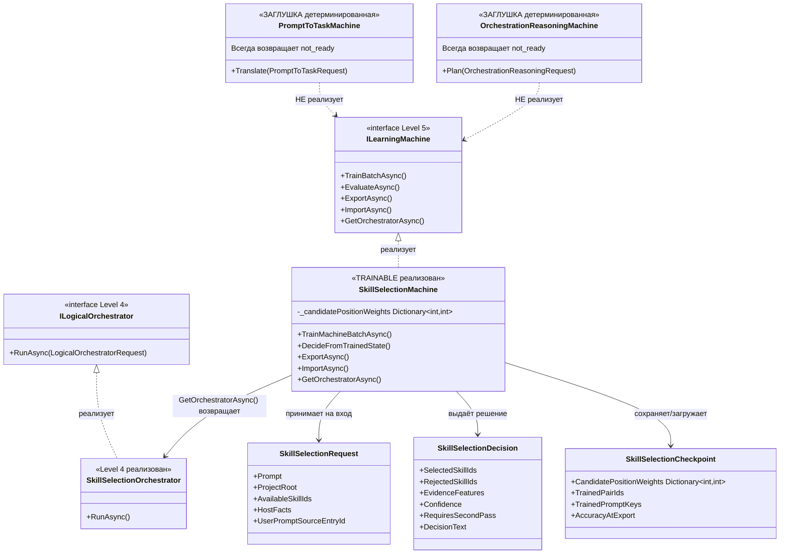

# EXTENSION-IMPLEMENTATION-PLAN-v1.md
# СТАТУС: СУПЕРСЕДЕД — каноничный план теперь `docs/plans/ORCHESTRATION-AND-PROMPT-TO-TASK-FULL-EXTENSIONS-PLAN-v3.md` (полнее и точнее по коду). Этот файл оставлен как короткий companion для чтения; единственный источник authority — v3.
# Часть A — читаемая документация ТЕКУЩЕЙ реализации. Часть B — forward-план (ЦЕЛЕВОЕ состояние, ещё не реализовано).
# Дата: 2026-06-04 | Ветка: codex/chat-gpt-5.5 | Область: 43.SmartSkillsDomain

---

## §0. Диаграмма классов — текущее состояние

**Примечание к диаграмме.** Пунктирные стрелки с подписью "НЕ реализует" означают, что класс намеренно не присоединён к иерархии — это заглушки (stubs). Только `SkillSelectionMachine` является полноправным участником иерархии `ILearningMachine`.

---

## §1. Описание алгоритмов — текущая реализация (русский язык)

### 1.1 PromptToTask — "Превращение промпта в задачу"

**Что делает сегодня:** Принимает пользовательский запрос (промпт) и возвращает структурированный ответ, сообщающий, что вывод (инференс) ещё не реализован. Это сознательная заглушка — класс существует, контракты определены, но алгоритм внутри намеренно пуст.

**Алгоритм (упрощённо):**
1. Получает объект `PromptToTaskRequest` с полями: идентификатор промпта, сам текст промпта, его SHA-256 хэш, источник происхождения, язык пользователя, ограничения и контекстные поля.
2. Возвращает `StructuredTaskContract` с фиксированным значением `TaskType = "not_ready_no_semantic_task"` — то есть всегда говорит "задача не определена, инференс не готов".
3. Если при создании машины был передан загрузчик обученного состояния (`IPromptToTaskLearnedStateLoader`), машина примет его, но всё равно не использует — путь к выводу не реализован даже при наличии состояния.

**Честная оценка:** Это не обученная модель. Это скелет — правильные интерфейсы, правильные типы данных, но нет никакого алгоритма, который бы анализировал промпт и выдавал смысловой результат. DPO-сигнал (для будущего обучения) описан в контрактах, но не пишется ни в какое хранилище.

**Статус:** ЗАГЛУШКА (DETERMINISTIC STUB)

---

### 1.2 OrchestrationReasoning — "Планирование оркестрации"

**Что делает сегодня:** Принимает структурированную задачу (результат PromptToTask) и должен выдавать план того, какие шаги и компоненты нужны для её выполнения. Сегодня — это тоже заглушка.

**Алгоритм (упрощённо):**
1. Получает `OrchestrationReasoningRequest` — включает идентификатор запроса, структурированную задачу из PromptToTask, ссылки на состояние направляющей модели (guide), идентификаторы корпусных пакетов, адаптивный контекст и политики.
2. Возвращает `OrchestrationScenarioPlan` с фиксированным `ScenarioId = "not-ready-no-orchestration-inference"` — всегда говорит "план не готов".
3. В поле рисков (`RiskFlags`) всегда присутствует флаг `"NO_ORCHESTRATION_INFERENCE_IMPLEMENTED"`.
4. Аналогично PromptToTask — может принять загрузчик обученного состояния через конструктор, но не использует его.

**Честная оценка:** Та же ситуация, что у PromptToTask. Правильная структура, правильные типы, но внутри нет алгоритма планирования. Машина не зарегистрирована в основном оркестраторе (`15.OrchestratorModel`), поэтому даже если бы она работала — система её не вызвала бы автоматически.

**Статус:** ЗАГЛУШКА (DETERMINISTIC STUB)

---

### 1.3 SkillSelection — "Выбор нужных навыков"

**Что делает сегодня:** Это единственная из трёх компонент, которая действительно обучается. Машина хранит числовые веса для позиций кандидатов-навыков, обновляет их при обучении на парах "правильный выбор / неправильный выбор" и использует при инференсе.

**Алгоритм обучения (упрощённо):**
1. Принимает список пар `SkillSelectionMachinePair` — каждая пара содержит промпт, "правильное" решение (chosen) и "неправильное" решение (rejected).
2. Для каждой пары вызывает внутренний метод `LearnPair()`, который обновляет словарь `_candidatePositionWeights` — числовые веса для позиций кандидатов.
3. Возвращает результат обучения с `ContractOnly: false` — то есть состояние реально меняется. **Но важно (честно):** `LearnPair()` — это **позиционный частотный счётчик**: он делает `_candidatePositionWeights[index]++` для позиции каждого выбранного навыка. Это статистический эвристик «по позиции кандидата», а **не семантическое обучение**. Это согласуется с тем, что `AccuracyAtExport = 0.0`, а `EvaluateAsync` возвращает `PassesGate=false`.

**Алгоритм инференса (упрощённо):**
1. Получает `SkillSelectionRequest` с промптом, корнем проекта, доступными идентификаторами навыков, данными хоста и идентификатором источника.
2. Если весов нет — возвращает `NO_TRAINED_STATE_AVAILABLE`.
3. Если веса есть — выбирает лучшего кандидата по позиционным весам, формирует список выбранных и отклонённых навыков, указывает уверенность (`Confidence`) и пояснение к решению.

**Алгоритм сохранения/загрузки (ExportAsync/ImportAsync):**
1. `ExportAsync` — проверяет директорию сохранения, вызывает `SaveCheckpointAsync`, который сериализует `SkillSelectionCheckpoint` (включая словарь весов) и манифест `SkillSelectionCheckpointManifest` в файлы.
2. `ImportAsync` — проверяет идентификатор машины и тег домена, читает файлы чекпоинта и манифеста, восстанавливает веса через `LoadCheckpoint`.

**Оркестратор:** `GetOrchestratorAsync()` возвращает `SkillSelectionOrchestrator`, который реализует интерфейс `ILogicalOrchestrator` (уровень 4 иерархии). Это означает, что компонента может быть вызвана через стандартный механизм оркестрации.

**Честная оценка:** SkillSelection — реально работающая обучаемая компонента. Веса обновляются, результат инференса зависит от обученного состояния, ExportAsync/ImportAsync реализованы и сохраняют/восстанавливают состояние на диск. Однако: метод `EvaluateAsync` возвращает нули ("scaffold только"), метод `TrainBatchAsync` (общий интерфейс ILearningMachine) тоже возвращает нули. Тренировочного раннера нет — нельзя запустить обучение автоматически. В `15.OrchestratorModel` НЕ зарегистрирован (подтверждено: поиск по 15.OrchestratorModel не находит SkillSelection, PromptToTask или OrchestrationReasoning).

**Статус:** ЧАСТИЧНО ГОТОВА (TRAINABLE, persistence implemented, runner missing)

---

## §2. Детальные сведения по компонентам

### 2.1 PromptToTask

| Элемент | Факт |
|---------|------|
| Главный класс | `PromptToTaskMachine` в `43.SmartSkillsDomain/PromptToTaskMachine.cs` |
| Интерфейс | Простой `sealed class` — НЕ реализует `ILearningMachine` |
| Ключевой метод | `Translate(PromptToTaskRequest) -> OperationResult<PromptToTaskResponse>` (~строка 37) |
| Возвращает | `TaskType = "not_ready_no_semantic_task"` всегда |
| Константа состояния | `LoadedStateReadyStatus = "loaded_state_ready_no_inference_implemented"` |
| Инексинг | ДЕТЕРМИНИРОВАН — не обучается, не меняется |
| DPO-сигнал | Описан в `PromptToTaskContracts.cs` — только контракт, не пишется |
| Оркестратор | Не зарегистрирован в `15.OrchestratorModel` |
| Training runner | ОТСУТСТВУЕТ |

**Метка:** ⚠️ ЗАГЛУШКА

---

### 2.2 OrchestrationReasoning

| Элемент | Факт |
|---------|------|
| Главный класс | `OrchestrationReasoningMachine` в `43.SmartSkillsDomain/OrchestrationReasoningMachine.cs` |
| Интерфейс | Простой `sealed class` — НЕ реализует `ILearningMachine` |
| Ключевой метод | `Plan(OrchestrationReasoningRequest) -> OperationResult<OrchestrationReasoningResponse>` (~строка 37) |
| Возвращает | `ScenarioId = "not-ready-no-orchestration-inference"` всегда |
| Риски | `RiskFlags` всегда содержит `"NO_ORCHESTRATION_INFERENCE_IMPLEMENTED"` |
| Константы | `NotTrainedStatus = "not_trained_no_learned_guide_state"`, `LoadedGuideStateReadyStatus = "loaded_guide_state_ready_no_inference_implemented"` |
| Инференс | ДЕТЕРМИНИРОВАН — не обучается, не меняется |
| DPO-сигнал | Описан в `OrchestrationReasoningContracts.cs` — только контракт, не пишется |
| Оркестратор | Не зарегистрирован в `15.OrchestratorModel` |
| Training runner | ОТСУТСТВУЕТ |

**Метка:** ⚠️ ЗАГЛУШКА

---

### 2.3 SkillSelection

| Элемент | Факт |
|---------|------|
| Главный класс | `SkillSelectionMachine` в `43.SmartSkillsDomain/SkillSelectionMachine.cs` (строка 10–12) |
| Интерфейс | Реализует `ILearningMachine<SkillSelectionDomain>` + `IMachineTraining<SkillSelectionDomain>` |
| Состояние | `_candidatePositionWeights = new Dictionary<int, int>()` (строка 27) |
| Обучение | `TrainMachineBatchAsync` → `LearnPair()` обновляет веса (строки 41–55), `ContractOnly: false`. **Тип обучения: позиционный частотный счётчик (`_candidatePositionWeights[index]++`), НЕ семантическое обучение** |
| Инференс | `DecideFromTrainedState` — выбирает по весам; без весов — `NO_TRAINED_STATE_AVAILABLE` (строки 57–93) |
| Экспорт | `ExportAsync` — реализован, проверяет папку, вызывает `SaveCheckpointAsync` (строки 158–170, 211–229) |
| Импорт | `ImportAsync` — реализован, читает файлы чекпоинта и манифеста, восстанавливает веса (строки 173–209) |
| `TrainBatchAsync` | Возвращает нули ("contract scaffold only") — общий интерфейс ILearningMachine не готов |
| `EvaluateAsync` | Возвращает нули, `PassesGate: false` (строки 143–156) |
| Оркестратор | `GetOrchestratorAsync()` возвращает `SkillSelectionOrchestrator : ILogicalOrchestrator` (Level 4) |
| Регистрация | НЕ зарегистрирован в `15.OrchestratorModel` (подтверждено поиском: SkillSelection/PromptToTask/OrchestrationReasoning отсутствуют в 15.OrchestratorModel) |
| Training runner | ОТСУТСТВУЕТ |
| DPO-писатель | ОТСУТСТВУЕТ — пары не сохраняются автоматически |

**Метка:** 🔶 ЧАСТИЧНО ГОТОВА

---

## §3. Сводная таблица готовности

| Компонента | Инференс | Обучение (LearnPair) | Персистентность (Export/Import) | DPO-писатель | Training runner | Регистрация в оркестраторе |
|------------|----------|----------------------|---------------------------------|--------------|-----------------|---------------------------|
| PromptToTask | ⚠️ заглушка | ⚠️ нет | ⚠️ нет | ⚠️ только контракт | ⚠️ нет | ⚠️ нет |
| OrchestrationReasoning | ⚠️ заглушка | ⚠️ нет | ⚠️ нет | ⚠️ только контракт | ⚠️ нет | ⚠️ нет |
| SkillSelection | 🔶 работает при наличии весов | 🔶 частотный счётчик по позиции (`ContractOnly: false`), не семантика | ✅ реализовано (файлы на диск) | ⚠️ нет | ⚠️ нет | ⚠️ оркестратор есть, но НЕ зарегистрирован в 15.OrchestratorModel |

**Легенда:**
- ✅ реализовано — код написан и работает
- 🔶 частично — реализована часть функциональности
- ⚠️ заглушка / нет — код отсутствует или возвращает фиксированный "не готов"

---

## §4. Известные пробелы (GAP-list из реконнойссанса)

| GAP | Компонента | Описание |
|-----|------------|----------|
| GAP-1 | PromptToTask | Не в иерархии ILearningMachine. Инференс не реализован. Training runner отсутствует. |
| GAP-2 | OrchestrationReasoning | Не в иерархии ILearningMachine. Инференс не реализован. Training runner отсутствует. |
| GAP-3 | SkillSelection | Training runner отсутствует. Регистрация в 15.OrchestratorModel не подтверждена. |
| GAP-4 | Все три | DPO-сигналы — только контракты. Нет писателя/сохранятеля реальных пар. |
| GAP-5 | PromptToTask, OrchestrationReasoning | Нет обёрток ILogicalUnit/ILogicalFlow — нет точки входа в иерархию ILearningMachine. |

**Примечание:** GAP-6 из исходного реконнойссанса (ExportAsync/ImportAsync NOT_READY для SkillSelection) опровергнут прямым чтением кода. Эти методы **реализованы** в `SkillSelectionMachine.cs` (строки 158–229) с реальным файловым I/O. Реконнойссанс-карта была устаревшей в этом пункте.

---

*Часть A описывает код В ЕГО ТЕКУЩЕМ СОСТОЯНИИ. Ниже — Часть B: forward-план (целевое состояние, ещё не реализовано).*

---

## ЧАСТЬ B — Forward-план (целевое состояние, ещё НЕ реализовано)

> **Всё, что описано ниже, — целевое состояние. Ничего из этого ещё не реализовано. Реализация начнётся только после явного одобрения Luba.**

---

### §B0 — Целевая диаграмма классов (Mermaid classDiagram, импортируется в draw.io)

```mermaid
classDiagram
    direction TB

    class ILearningMachine {
        <<interface>>
        +TrainBatchAsync()
        +EvaluateAsync()
        +ExportAsync()
        +ImportAsync()
        +GetOrchestratorAsync()
    }

    class ILogicalOrchestrator {
        <<interface>>
        +RunAsync(LogicalOrchestratorRequest) LogicalOrchestratorResult
    }

    class ILogicalFlow {
        <<interface>>
        +ExecuteAsync(LogicalFlowRequest) LogicalFlowResult
    }

    class ILogicalUnit {
        <<interface>>
        +ExecuteAsync(LogicalUnitRequest) LogicalUnitResult
    }

    class PromptToTaskMachine {
        CommonModel: checkpoint+manifest
        +TrainBatchAsync()
        +EvaluateAsync()
        +ExportAsync()
        +ImportAsync()
    }

    class OrchestrationReasoningMachine {
        CommonModel: checkpoint+manifest
        +TrainBatchAsync()
        +EvaluateAsync()
        +ExportAsync()
        +ImportAsync()
    }

    class SkillSelectionMachine {
        CommonModel: checkpoint+manifest
        +TrainBatchAsync()
        +EvaluateAsync()
        +ExportAsync()
        +ImportAsync()
    }

    class PromptToTaskUnit {
        <<ILogicalUnit wrapper>>
        +ExecuteAsync(UserPrompt) StructuredTaskContract
    }

    class OrchestrationReasoningUnit {
        <<ILogicalUnit wrapper>>
        +ExecuteAsync(StructuredTaskContract) OrchestrationScenarioPlan
    }

    class SkillSelectionUnit {
        <<ILogicalUnit wrapper>>
        +ExecuteAsync(OrchestrationScenarioPlan) SkillSelectionDecision
    }

    class PromptToTaskFlowAdapter {
        <<зарегистрирован в 15.OrchestratorModel>>
        +ExecuteAsync(LogicalFlowRequest)
    }

    class OrchestrationReasoningFlowAdapter {
        <<зарегистрирован в 15.OrchestratorModel>>
        +ExecuteAsync(LogicalFlowRequest)
    }

    class SkillSelectionFlowAdapter {
        <<зарегистрирован в 15.OrchestratorModel>>
        +ExecuteAsync(LogicalFlowRequest)
    }

    class CommonModel {
        <<базовые веса, llm_mvp_core>>
        checkpoint
        manifest
        +AtomicWrite()
    }

    class AdaptiveModel {
        <<пер-пользовательская дельта, сторона пользователя>>
        adaptiveOverlay
        +IncrementalTrain(DPO-пара)
    }

    class InferenceEngine {
        <<Inference = base + overlay>>
        +Infer(input) output
    }

    class XiigenExtensionApiContract {
        <<граница расширения>>
        +Handle(XiigenExtensionRequest) XiigenExtensionResponse
    }

    class CursorExtension {
        <<хост-расширение>>
    }

    class ClaudeExtension {
        <<хост-расширение>>
    }

    class CodexExtension {
        <<хост-расширение>>
    }

    ILearningMachine <|.. PromptToTaskMachine : реализует
    ILearningMachine <|.. OrchestrationReasoningMachine : реализует
    ILearningMachine <|.. SkillSelectionMachine : реализует

    ILogicalOrchestrator <|.. ILearningMachine : GetOrchestratorAsync()

    ILogicalUnit <|.. PromptToTaskUnit : реализует
    ILogicalUnit <|.. OrchestrationReasoningUnit : реализует
    ILogicalUnit <|.. SkillSelectionUnit : реализует

    ILogicalFlow <|.. PromptToTaskFlowAdapter : реализует
    ILogicalFlow <|.. OrchestrationReasoningFlowAdapter : реализует
    ILogicalFlow <|.. SkillSelectionFlowAdapter : реализует

    PromptToTaskMachine --> PromptToTaskUnit : оборачивается в
    OrchestrationReasoningMachine --> OrchestrationReasoningUnit : оборачивается в
    SkillSelectionMachine --> SkillSelectionUnit : оборачивается в

    PromptToTaskUnit --> PromptToTaskFlowAdapter : адаптируется в
    OrchestrationReasoningUnit --> OrchestrationReasoningFlowAdapter : адаптируется в
    SkillSelectionUnit --> SkillSelectionFlowAdapter : адаптируется в

    PromptToTaskMachine --> CommonModel : "checkpoint+manifest (атомарная запись)"
    OrchestrationReasoningMachine --> CommonModel : "checkpoint+manifest (атомарная запись)"
    SkillSelectionMachine --> CommonModel : "checkpoint+manifest (атомарная запись)"

    AdaptiveModel --> InferenceEngine : "adaptiveOverlay"
    CommonModel --> InferenceEngine : "базовые веса"

    PromptToTaskMachine --> InferenceEngine : использует
    OrchestrationReasoningMachine --> InferenceEngine : использует
    SkillSelectionMachine --> InferenceEngine : использует

    CursorExtension --> XiigenExtensionApiContract : "XiigenExtensionRequest"
    ClaudeExtension --> XiigenExtensionApiContract : "XiigenExtensionRequest"
    CodexExtension --> XiigenExtensionApiContract : "XiigenExtensionRequest"

    XiigenExtensionApiContract --> PromptToTaskUnit : "StructuredTaskContract"
    XiigenExtensionApiContract --> OrchestrationReasoningUnit : "OrchestrationScenarioPlan"
    XiigenExtensionApiContract --> SkillSelectionUnit : "SkillSelectionDecision"

    PromptToTaskUnit ..> AdaptiveModel : "DPO-пара"
    OrchestrationReasoningUnit ..> AdaptiveModel : "DPO-пара"
    SkillSelectionUnit ..> AdaptiveModel : "DPO-пара"
```

*Пунктир = целевое, ещё не реализовано.*

---

### §B1 — Описание целевых алгоритмов (русский, без кода, со ссылками на классы)

#### 1. PromptToTask (цель)

**Целевое состояние.** Класс `PromptToTaskMachine` должен реализовывать интерфейс `ILearningMachine` — стать полноправным обучаемым участником иерархии. Сегодня контракты для этой машины существуют в `43.SmartSkillsDomain/PromptToTaskContracts.cs`, однако реального обучения и инференса нет: любой вызов возвращает заглушку `not_ready`. В целевом состоянии:

- `PromptToTaskMachine` содержит обученные веса и при вызове `ExecuteAsync` через обёртку `PromptToTaskUnit` (реализующую `ILogicalUnit`) возвращает настоящий структурированный результат типа `StructuredTaskContract` на основе этих весов, а не строку-заглушку.
- Персистентность реализована по образцу уже работающего `SkillSelectionMachine`: атомарная запись checkpoint-файла и manifest-файла. Никаких частичных записей — либо оба файла обновились атомарно, либо ни один.
- DPO-писатель формирует пары `(chosen, rejected)` в процессе работы машины и сохраняет их в хранилище для последующей тренировки.
- Training runner читает накопленные DPO-пары, обучает `PromptToTaskMachine`, обновляет checkpoint+manifest.
- `PromptToTaskFlowAdapter` регистрируется в `15.OrchestratorModel` и становится точкой входа через стандартный `ILogicalFlow`.
- На вход юнит принимает пользовательский промпт в сыром виде; на выход — структурированную задачу (`StructuredTaskContract`), пригодную для передачи на следующий шаг конвейера.

#### 2. OrchestrationReasoning (цель)

**Целевое состояние.** Класс `OrchestrationReasoningMachine` повторяет тот же контур: реализует `ILearningMachine`, оборачивается в `OrchestrationReasoningUnit` (реализующий `ILogicalUnit`), регистрирует `OrchestrationReasoningFlowAdapter` в `15.OrchestratorModel`. Контракты для этой машины зафиксированы в `43.SmartSkillsDomain/OrchestrationReasoningContracts.cs`. В целевом состоянии:

- Инференс читает обученные веса и возвращает реальный план сценария оркестрации (`OrchestrationScenarioPlan`), а не заглушку `not-ready`.
- Персистентность — та же атомарная схема checkpoint+manifest.
- DPO-писатель фиксирует выборы оркестрации и формирует пары для тренировки.
- Training runner обучает машину на накопленных парах.
- Вход юнита — структурированная задача (`StructuredTaskContract`) от `PromptToTaskUnit`; выход — план сценария оркестрации (`OrchestrationScenarioPlan`), передаваемый дальше в `SkillSelectionUnit`.

#### 3. SkillSelection (цель)

**Целевое состояние.** `SkillSelectionMachine` уже имеет работающую персистентность (ExportAsync/ImportAsync реализованы). Однако выбор навыка внутри машины опирается на позиционный частотный счётчик (`_candidatePositionWeights[index]++`), а не на обучаемые семантические признаки. В целевом состоянии:

- Счётчик позиций заменяется реальным обучаемым селектором: решение принимается на основе семантических признаков запроса и контекста, обученных через DPO-пары, а не по частоте позиции кандидата.
- Уже реальная персистентность сохраняется и дополняется DPO-писателем для накопления пар тренировки.
- Training runner запускает обучение на этих парах.
- `SkillSelectionFlowAdapter` регистрируется в `15.OrchestratorModel`.
- Критерий готовности: `EvaluateAsync` возвращает `PassesGate=true` с численно измеренной точностью; в пути принятия решения отсутствует выбор исключительно по позиции кандидата.

#### 4. Разделение общая/адаптивная модель (цель)

**Целевое состояние.** Модельный слой делится на два чётко разграниченных уровня:

- **CommonModel (общая модель)** — базовые веса, которые обучаем мы. Живёт в репозитории `llm_mvp_core` (каталог checkpoint+manifest). Мы её создаём, сохраняем, импортируем, экспортируем и апгрейдим. Это та самая тренировка на наших DPO-сетах. Пользователь не пишет в общую модель напрямую.
- **AdaptiveModel (адаптивная модель)** — пер-пользовательская дельта (overlay поверх базовых весов). Живёт на стороне пользователя, не в нашем репозитории. Обучается исключительно на DPO-парах, сформированных из взаимодействий конкретного пользователя.
- **Инференс** = общая база + адаптивный overlay. `InferenceEngine` объединяет оба источника при каждом запросе.
- Апгрейд общей модели выполняем только мы; тренировка пользователя пишет только в адаптивный overlay и не затрагивает общую.

#### 5. Cold-path: «не найдено → спросить AI → DPO → обучить адаптивную» (цель)

**Целевое состояние.** Если запрос прошёл через `PromptToTaskUnit` → `OrchestrationReasoningUnit` → `SkillSelectionUnit` и уверенность результата оказалась ниже порога (или ответ не найден), запускается cold-path:

1. Расширение обращается к сконфигурированному внешнему AI — единственной разрешённой внешней зависимости. Обращение происходит только при явном включении и только при наличии разрешения (gated).
2. Ответ внешнего AI обрабатывается: формируются DPO-пары вида `(chosen = подтверждённый ответ, rejected = неудачная локальная попытка)`.
3. Пары добавляются в адаптивный сет конкретного пользователя.
4. Запускается инкрементальная дообучка `AdaptiveModel` данного пользователя на новых парах.
5. Запрос повторяется локально с обновлённой адаптивной моделью.

Весь cold-path — локальная логика из llm_mvp_core, за исключением единственного явно разрешённого вызова внешнего AI.

#### 6. Online-улучшение: «изменение → улучшить модель пользователя» (цель)

**Целевое состояние.** Когда пользователь исправляет или уточняет результат работы системы, событие исправления автоматически инициирует цикл улучшения:

1. Из пары «исходный результат системы — исправление пользователя» формируется новая DPO-пара: исправление пользователя становится `chosen`, исходный результат — `rejected`.
2. `AdaptiveModel` данного пользователя получает инкрементальный шаг обучения на этой паре.
3. При следующем запросе того же типа адаптивная модель учитывает это исправление.

Абляционный тест должен доказывать, что прирост точности объясняется адаптивной дельтой, а не детерминированным lookup-поиском: при отключении overlay результат должен возвращаться к базовой точности общей модели.

#### 7. Граница Extension API (цель)

**Целевое состояние.** Хост-расширения (`CursorExtension`, `ClaudeExtension`, `CodexExtension`) взаимодействуют с системой исключительно через `XiigenExtensionApiContract`. Контракты `XiigenExtensionRequest`, `XiigenExtensionResponse` и `XiigenDebugTrace` уже зафиксированы в файле `43.SmartSkillsDomain/XiigenExtensionApiContracts.cs` — это готовый фундамент границы. В целевом состоянии:

- Хост передаёт конкретную задачу в `XiigenExtensionRequest` и получает конкретный ответ в `XiigenExtensionResponse`. Никакой внутренней кухни снаружи не видно.
- Хост не имеет прямого доступа к машинам (`PromptToTaskMachine`, `OrchestrationReasoningMachine`, `SkillSelectionMachine`), checkpoint-файлам, manifest-файлам, DPO-хранилищу и `AdaptiveModel`.
- `XiigenExtensionApiContract` сам маршрутизирует вызов через `PromptToTaskUnit` → `OrchestrationReasoningUnit` → `SkillSelectionUnit` и при необходимости активирует cold-path.
- Все недостающие операции, не покрытые текущим контрактом, добавляются в него как forward-расширение, но в рамках той же границы.

#### 8. Запрет внешних тулов (цель/правило)

**Целевое состояние.** Это одновременно архитектурное правило и цель:

- Единственный разрешённый внешний AI-вызов — cold-path «спросить AI» (§B1.5), и он защищён явным включением и разрешением.
- Все остальные шаги конвейера (`PromptToTaskUnit`, `OrchestrationReasoningUnit`, `SkillSelectionUnit`, `InferenceEngine`, DPO-писатель, training runner) — исключительно локальная логика, реализованная from-scratch в `llm_mvp_core`.
- Никакие внешние AI-сервисы, внешние ML-фреймворки или сторонние инструменты не используются без явного разрешения Luba.
- Расширение, нарушающее это правило, не может считаться соответствующим этому плану.

---

*Часть B — целевое состояние. До явного одобрения Luba реализация не начинается.*

---

## §B2 — Дорожная карта фаз (forward)

| Фаза | Что делаем | Класс / файл | Gate B (измеримое условие готовности) | Закрывает |
|------|-----------|--------------|---------------------------------------|-----------|
| F1 | PromptToTask → обучаемый юнит: реализует ILearningMachine + обёртка ILogicalUnit; персистентность checkpoint+manifest (атомарно, образец SkillSelection); DPO-писатель; training runner; регистрация ILogicalFlow в 15.OrchestratorModel | PromptToTaskMachine, PromptToTaskContracts.cs, 15.OrchestratorModel/Logical | Живой вызов перевода промпта возвращает реальную задачу из обученного состояния (НЕ строку not_ready); export→import восстанавливает то же состояние; зарегистрированный flow реально вызывается | GAP-1, GAP-5 |
| F2 | OrchestrationReasoning → обучаемый юнит: тот же контур | OrchestrationReasoningMachine, OrchestrationReasoningContracts.cs, 15.OrchestratorModel/Logical | Живой вызов планирования возвращает реальный сценарий из обученного состояния (НЕ строку not-ready); зарегистрирован; export→import round-trips | GAP-2, GAP-5 |
| F3 | SkillSelection апгрейд: заменить позиционный частотный счётчик на обучаемый семантический селектор; сохранить персистентность; добавить DPO-писатель и runner; регистрация в 15 | SkillSelectionMachine.cs, SkillSelectionContracts.cs, 15.OrchestratorModel/Logical | EvaluateAsync даёт PassesGate=true с реальной точностью; зарегистрирован; в пути решения нет выбора только по позиции | GAP-3, GAP-4 |
| F4 | Разделение общая/адаптивная: каталог общего checkpoint+manifest В РЕПО (мы обучаем/сохраняем/экспортируем/импортируем/апгрейдим); формат адаптивного overlay на стороне пользователя; инференс = база + overlay | новый каталог моделей в репо + manifest; loader база+overlay | Общая модель грузится из репо; адаптивная накладывается поверх; пробы апгрейда (старый→новый), свежей загрузки и продолжения обучения (resume) проходят | check #5 |
| F5 | Cold-path + online петли: вход ответа внешнего AI (gated разрешением), синтез DPO из ответа и из исправлений, инкрементальная дообучка адаптивной модели, повторный локальный прогон | XiigenExtensionApiContract + DPO-писатели + adaptive runner | Запрос «не найдено» после ОДНОГО ответа AI на повторном прогоне даёт правильный локальный ответ из адаптивной модели; абляция доказывает, что это адаптивная дельта, а не детерминированный lookup | capability 4 и 5 |
| F6 | Граница Extension API: единственная поверхность (конкретная задача → конкретный ответ) | XiigenExtensionApiContracts.cs | Хост вызывает только API (XiigenExtensionRequest→XiigenExtensionResponse); внутренние типы (машины/чекпоинты/DPO) наружу не утекают | check #7 |
| F7 | Хосты Cursor/Claude/Codex + проверка: тонкие адаптеры; промпт-сьют через РЕАЛЬНУЮ точку входа хоста; доказательство «исправление → дельта адаптивной модели» | extension-репозитории claude-/codex-/cursor-xiigen-smart-skills | Промпт-сьют каждого хоста проходит через его реальную точку входа (команда / chat participant); исправление пользователя даёт измеримую дельту адаптивной модели | check #9 |

фазы F1–F7 — это план, ещё не реализованный; порядок исполнения через bounded суб-агентов после одобрения Luba.

## §B3 — Референсы источников обучения

Источники обучения делятся на две категории: общие (наши, хранятся в репо) и адаптивные (пользовательские, хранятся на стороне пользователя).

| Сет | Где живёт | Кто обучает | Формат |
|-----|-----------|-------------|--------|
| Общий DPO-сет (наш) | в репо llm_mvp_core | МЫ | формат XIIGEN: Pair[ID]/A/B/Reason/Phrasing-B на файл-узел |
| Адаптивный DPO-сет пользователя | на стороне пользователя | пользователь (рантайм) | пары строятся из ответов внешнего AI (cold-path) и из исправлений пользователя (online) |

Стратегии негативных пар существуют как ВНЕШНИЕ кандидатные источники в папке пользователя `C:\Users\lubao\Documents\xiigen\extensions  - orchestration based on our data\` — файлы `PROMPT-TO-TASK-DPO-NEGATIVE-STRATEGY-v1.md` и `ORCHESTRATION-REASONING-DPO-NEGATIVE-STRATEGY-v1.md` (подтверждено поиском). В репозитории `llm_mvp_core/docs/plans/` их пока НЕТ. По правилу «общие сеты живут в репо» их нужно сначала импортировать в репозиторий как источник обучения и проверить, и только потом использовать; до импорта не утверждать их содержимое. Адаптивные сеты — только у пользователя.

## Матрица покрытия 9 проверок плана

| # | Проверка (дословно) | Где закрыта | Статус |
|---|---------------------|-------------|--------|
| 1 | План включает нужные референсы источников обучения и написан по правилам читаемого формата пользователя | §B3 (источники) + формат §0–§3 (Part A) и §B0–§B1 (Part B): UML, описание без кода по-русски, ссылки на код | ✅ покрыто |
| 2 | Все требования пользователя учтены | capabilities 1–6 разложены на F1–F7; §B1.1–B1.8 | ✅ покрыто |
| 3 | Мысленно если представить, что план реализован — он покрывает все задачи, определённые пользователем | §B2 закрывает GAP-1..5 и capability 4/5; все три машины становятся обучаемыми и зарегистрированными | ✅ покрыто |
| 4 | В плане не спрятан ни на каком этапе детерминистический алгоритм вместо обучающегося юнита | §B1 (инференс читает ОБУЧЕННОЕ состояние); Gate F1/F2 (НЕ строка not_ready); Gate F3 (нет выбора только по позиции); Part A честно помечает текущие заглушки и позиционный счётчик | ✅ покрыто |
| 5 | Модели как и сеты сохраняются в репо, разделены — общая (обучаем мы; save/import/export/upgrade) и адаптивная под пользователя | §B1.4 + F4 + §B3 | ✅ покрыто |
| 6 | Замечания пользователя и образ работы внесены в файлы агентов и скилы (архитектор, планнинг, план-ревью) | ВНЕ этого документа: governance-коммит a9b62903 — OP-50 (R1–R7), plan-review FC-20..24, architect FAIL-25..27, planning-startup gates | ✅ покрыто (в governance) |
| 7 | Логика в репо llm_mvp_core; агент максимально прост — сеты проверок с API (конкретная задача → конкретный ответ), а не внутренняя кухня | §B1.7 + F6 (XiigenExtensionApiContract — единственная граница) | ✅ покрыто |
| 8 | Запрет на внешние AI и тулы, не требуемые задачей; если нужны — запрашивать разрешение | §B1.8 + Gate F5 (единственный внешний AI = cold-path, gated разрешением) | ✅ покрыто |
| 9 | План включает реализацию extensions Cursor, Claude, Codex и их проверку | §B1 (хосты) + F7 (адаптеры + промпт-сьют через реальную точку входа) | ✅ покрыто |

*Конец Части B. Это forward-план (целевое состояние). Реализация — только после одобрения Luba, через bounded суб-агентов.*
