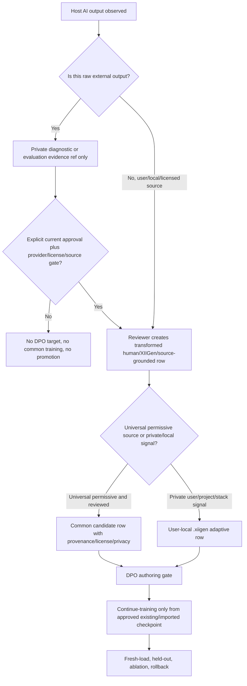
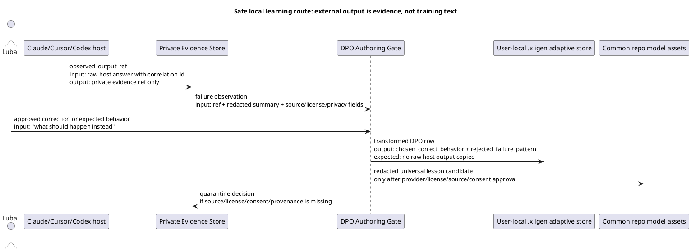
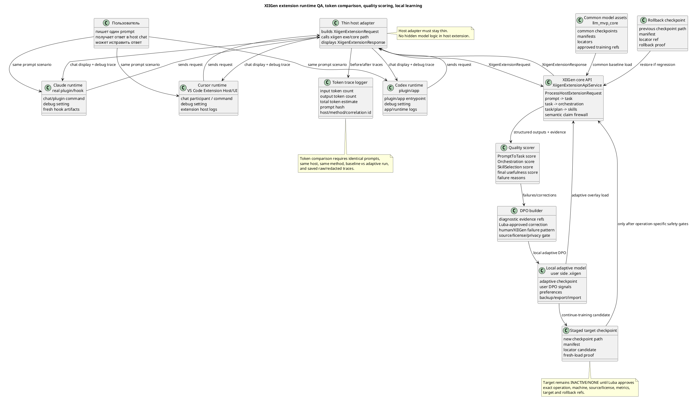
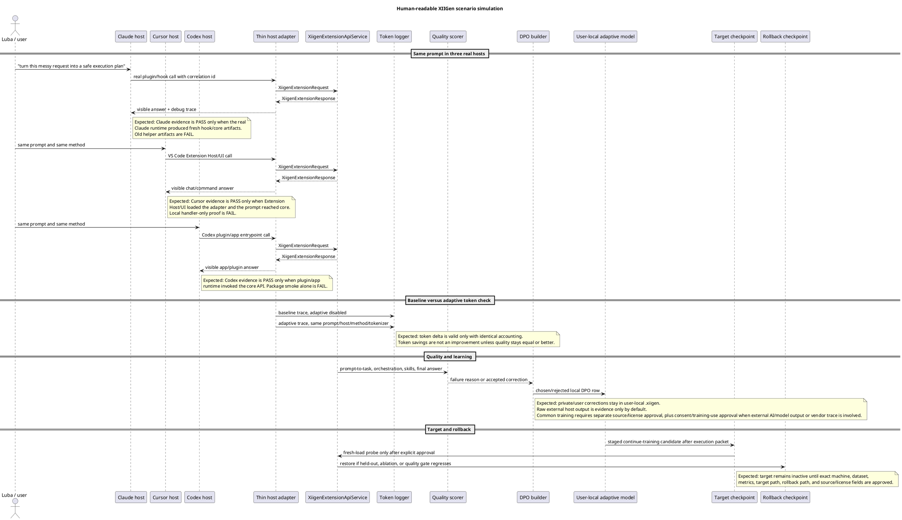

# Extension Runtime Token Quality Learnability Plan v1

## 0. Матрица целевого результата Luba

Этот план не имеет права сужать цель до "честных ограничений". Если после исполнения не доказаны live host runtime, token before/after, quality improvement, learnability, backup/export/import/share, continue-training, DPO, rollback, promotion/locator when applicable и документация, то результат остается `IN_PROGRESS_NEXT_STEP_KNOWN`, а следующий bounded sub-agent получает точный недостающий трек. Dashboard QA, handler-level smoke, package smoke, static JSON или parent self-review могут быть только поддерживающим evidence, но не закрывают целевой результат.

Запрет на преждевременное завершение относится и к финальному отчету, и к `EXTENSION-RUNTIME-TOKEN-QUALITY-LEARNABILITY-EXECUTION-STATE.json`: пока хотя бы одна строка Target Outcome Matrix не доказана пакетами evidence, ни отчет, ни state не имеют права использовать итоговые статусы `DONE`, `READY`, `COMPLETE_WITH_LIMITATIONS`, `PASS_WITH_LIMITATIONS` или смысловой эквивалент готовности. Исторические строки ledger/state с такими словами являются evidence only и не являются активным completion status.

### 0.0.0. Current authority normalization

Текущая authority для этого плана: Luba уже разрешила продолжать выполнение
через bounded sub-agents до полного закрытия цели. Старые строки этого плана,
state или review records про plan-only pause, presentation-before-execution,
post-plan approval wait или ожидание отдельного разрешения на старт исполнения
являются historical/superseded context. Их нельзя использовать как текущий
stop gate.

Дальше действует такой порядок: каждый трек получает bounded sub-agent work
order и operation-specific packet с точными host/machine/source/dataset/
checkpoint/target/rollback границами. Этот packet является safety-binding
artifact внутри уже разрешённого execution flow, а не просьбой остановиться и
ждать Luba перед любой работой.

Source/provider/license/legal gates сохраняются полностью. Но если approval,
source, provider terms или license отсутствуют для конкретного raw external AI
output, common-training row, dataset, checkpoint mutation, target promotion или
rollback track, executor должен quarantine/defer только этот source/track,
записать точный blocker for that track и продолжить независимые approved safe
tracks. Глобальная остановка допустима только когда есть true safety/legal/
provider blocker для exact requested track и больше нет ни одного безопасного
независимого bounded sub-agent work order.

### 0.0.0A. Рабочая метрика: dual-path scenario coverage

Deprecated term: use dual-path scenario coverage instead. В этом плане
`product readiness` больше не является рабочим gate, статусом, счётчиком,
stop reason, execution target или основной метрикой отчёта. Старые строки с
этим термином являются historical/deprecated wording и не управляют
исполнением.

Рабочее правило называется
`product_readiness_term_deprecated_use_scenario_coverage`.

Рабочий gate называется `dual_path_same_scenario_coverage_gate`.

Сценарий принимается только тогда, когда один и тот же сценарий и same prompt
доказаны двумя путями:

| Путь | Что проверяет | Обязательные доказательства |
|---|---|---|
| Path A | API/boundary path | same prompt/scenario, adapter/API/core request, response, trace, RequestedSkills and AvailableSkills when relevant |
| Path B | local-agent UI path | агент выполняет same scenario в реальной локальной host-программе Cursor/Claude/Codex; нужны screenshots до submit и после ответа, window inventory, redaction log, и trace/correlation evidence when available |

Рабочий статус должен называться `scenario coverage`, а не deprecated
`product-ready count`. Каждый отчёт обязан показывать:

If Path B cannot reach an extension/plugin route because of host limitations,
auth, storage, a missing UI route, or an inaccessible app surface, the result is
`blocked Path B` for that scenario. It is not a reason to restore the old
impossible live-host product-readiness gate. The blocker packet must state the
exact screen/state, the human-readable blocker reason, and the next repair,
while Path A can still prove the adapter/API/core boundary for the same prompt.

```text
scenario coverage:
  total scenarios:
  covered by Path A:
  covered by Path B:
  blocked Path B with reason:
  remaining steps:
  total:
  accepted:
  api_only:
  ui_only:
  blocked:
  not_started:

current scenario:
  scenario id/name:
  Path A API/boundary status:
  Path B local-agent UI status:
  accepted/blocker:
  next action:
```

Правило `no_product_ready_count_primary_status`: отчёты, планы и review-пакеты
не имеют права использовать `product-ready count`, `product readiness remains
0`, `Product readiness count remains 0` или смысловой аналог как primary
status. Эти фразы допустимы только как deprecated/forbidden examples рядом с
указанием использовать `scenario coverage`.

Stop/continue управляется активной цепочкой, явной остановкой Luba, safety/legal
blocker или реальным blocker без безопасного следующего bounded action.
Coverage label не является причиной остановки.

Active readiness-evidence definition for this plan:
`Dual-path same-scenario coverage is product readiness evidence`.
`full live host UI path is not the readiness definition unless explicitly re-approved by Luba`.
The accepted unit is `same scenario Path A plus Path B`: Path A is automated
adapter/API/core boundary evidence for the same scenario id and prompt; Path B
is local real host UI evidence by an agent using this computer, with screenshots
or visible evidence, or an exact Path B blocker plus mitigation attempt. A
`NOT READY`, `not proven`, `blocked`, `needs fix`, or old
`product readiness count 0` row is never a final answer by itself:
`NOT READY is a bounded sub-agent work queue, not a stop`. It must name the
next bounded sub-agent action or cite a true external blocker only after an
exact mitigation/discovery attempt.

Before any execution continuation, Luba-facing status must include
`human-readable phase counts before execution continuation`: total phases/steps,
done, in-progress, remaining, what the current phase solves, what the current
step solves, and the exact next bounded sub-agent action before any QSG,
packet, state, or acronym label.

Target Outcome Matrix:

| Literal target from Luba | Observable done evidence required before any DONE/READY claim |
|---|---|
| Extensions fully functional after the plan | Claude, Cursor and Codex thin adapters are installed/loaded in their real host runtime/chat/UI/CLI automation path; each host shows visible answer, debug/error path, raw/redacted input/output, fresh correlation id, and proof that `XiigenExtensionApiService` in `llm_mvp_core` handled the request. |
| Logic remains inside `llm_mvp_core` and extensions stay thin | Architecture review packet proves host adapters only build `XiigenExtensionRequest`, call the core boundary, and display `XiigenExtensionResponse`; no host adapter contains hidden deterministic semantic logic, model logic, prompt-to-task/orchestration/skill-selection shortcuts, or unreviewed fallback claims. |
| Token before/after improvement is proven | Baseline without local model/adaptation and enabled-model/adaptive run use the same prompts, prompt hashes, hosts, methods, tokenizer/accounting version, debug setting, saved traces, token counts, comparison method, repeated-run/variance handling, and pass/fail threshold. Token reduction fails if quality regresses or trace pairing is invalid. |
| Quality improvement is proven | Human-readable rubric, eval prompts, source-disjoint split, held-out prompts, positive/negative examples from real reviewed references where available, scored baseline/adaptive outputs on the same paired scenarios after pairing integrity passes, reviewer notes, regression guard, and layer-by-layer scores for PromptToTask, OrchestrationReasoning, SkillSelection and final usefulness show non-regression or improvement. Ablation, no-leakage and no-memorization controls must pass before any semantic-quality claim. |
| Local model learns from user-approved corrections and source-grounded failure labels | External AI output is diagnostic/evaluation evidence only unless explicit current approval plus provider/license/source gate allows training use. DPO rows are created from Luba-approved local/project-owned evidence, XIIGen/human-authored failure patterns, or licensed permissive/open sources with provenance/license/privacy fields, then approved user-local training, backup/export/import/share, fresh-load, continue-training from existing checkpoint, rollback, held-out eval, source-disjoint checks, ablation/no-memorization controls, and promotion/locator when applicable all pass. |
| At least 10 plan reviews before execution | Ten review/fix passes are recorded as plan-quality evidence in Section 8. Under current authority they are not a reusable mid-stop gate; execution proceeds through bounded sub-agents while any product/evidence row remains incomplete. |
| Execution only through bounded sub-agents | Every implementation slice has a bounded work order, allowed write scope, exact approval quote, no quoted-transcript authority, evidence packet, code review, architecture review, DPO/quality review when learning/eval is touched, and accepted commit/push boundary before the next slice. |
| At least 10 dual-path scenario coverage checks after execution | Ten fresh independent dual-path scenario coverage verification passes after implementation, against Claude/Cursor/Codex Path A + Path B scenario coverage, token before/after, quality improvement, learnability, backup/export/import/share, continue-training, DPO, rollback, docs and no-overclaim. If any pass says a required target or Path B host path is not proven, final status is `IN_PROGRESS_NEXT_STEP_KNOWN`, not complete. |

Target Outcome Matrix execution map:

| Literal target row | Execution phases that must produce packet-backed evidence | Dual-path scenario coverage checks that must re-verify it |
|---|---|---|
| Extensions fully functional after the plan | `RUNTIME-01`, `HOST-IMPL-01`, `HOST-IMPL-02`, `HOST-IMPL-03`, `RUNTIME-02`, `RUNTIME-03`, `RUNTIME-04` | Dual-path scenario coverage passes 1, 2, 3 and 4 |
| Logic remains inside `llm_mvp_core` and extensions stay thin | `HOST-IMPL-01`, `HOST-IMPL-02`, `HOST-IMPL-03`, every code/runtime/training/eval/checkpoint architecture review in Section 6.2 | Dual-path scenario coverage pass 9 |
| Token before/after improvement is proven | `TOKEN-01`, `TOKEN-02`, `TOKEN-03`, `TOKEN-04`, `QUALITY-03` quality-regression gate | Dual-path scenario coverage pass 5, with pass 6 as the quality dependency |
| Quality improvement is proven | `TOKEN-01`, `QUALITY-01`, `QUALITY-02`, `QUALITY-03` | Dual-path scenario coverage pass 6 |
| Local model learns from user-approved corrections and source-grounded failure labels | `LEARN-01`, `LEARN-02`, `LEARN-03`, `LEARN-04`, `LEARN-05`, `LEARN-06`, `LEARN-07` | Dual-path scenario coverage passes 7 and 8 |
| At least 10 plan reviews before execution | Section 8 `PLAN-REVIEW-01` through `PLAN-REVIEW-10` records and any REVIEW.jsonl rows are plan-quality evidence; parent self-review and old rows do not become product proof | Not a dual-path scenario coverage check and not a current stop gate; current execution continues by the next bounded sub-agent work order |
| Execution only through bounded sub-agents | Section 6.1 work-order packet, Section 6.2 slice-control gate, parent review packet, accepted commit/push boundary before next slice | Dual-path scenario coverage pass 9 plus the final scenario coverage matrix |
| At least 10 dual-path scenario coverage checks after execution | `REVIEW-01` after all implementation/evidence phases, producing ten fresh dual-path scenario coverage packets | Dual-path scenario coverage passes 1 through 10; any non-PASS keeps `IN_PROGRESS_NEXT_STEP_KNOWN` |

### 0.0.0B. Governance stop-loophole repair: readable phase sequence and target

This section is binding for every later status, packet, review, work order, and
state update in this plan. It exists because old wording can otherwise revive
the impossible full-live-host-only readiness gate or turn `NOT READY` into a
final pause.

Required target: Cursor, Claude, and Codex are not judged by a single chain
`user in host UI -> extension -> core -> answer in host UI`. That chain is a
bonus/live proof when available. The required readiness evidence is
`Dual-path same-scenario coverage is product readiness evidence`: the same
scenario has Path A automated/API/core/adapter evidence and Path B real local
host UI evidence by an agent on this computer, or an exact Path B blocker with
mitigation attempt and next bounded work order.

The full target remains open until packet-backed evidence proves all of these
rows in plain language:

| Target row | Required proof before any ready/done claim |
|---|---|
| Cursor/Claude/Codex dual-path host proof | For each in-scope host scenario: same prompt/task, Path A status, Path B screenshot/visible evidence or exact blocker, comparison/join, and next fix for any gap. |
| Token comparison evidence | Same workload, baseline tokens, optimized tokens, tokenizer/accounting method, arithmetic delta, variance/repeat handling when needed, and quality non-regression guard. |
| Semantic quality eval | Source-disjoint held-out prompts, rubric, baseline/adaptive paired outputs, scorer/reviewer notes, no-leakage/no-memorization/ablation controls, and honest inconclusive handling. |
| Local learning lifecycle | User-approved/source-grounded DPO or training rows, backup/export/import/share proof, fresh-load proof, continue-training from existing/imported checkpoint, rollback, held-out eval, and privacy/source/license decisions. |
| Checkpoint mutation/promotion/locator update | Only if its own gate is proven: exact candidate, mutation evidence, compatibility/fresh-load, quality/non-regression, rollback, promotion approval, locator diff, locator fresh-load, and rollback locator evidence. |

Readable phase sequence for continuation:

| Phase | What it solves | Completion evidence | If not proven |
|---|---|---|---|
| 1. Governance/readability | Prevents old stop/readiness wording from controlling execution. | Rule/skill/plan packet with textual checks. | Repair the exact rule/skill/plan text through a bounded sub-agent. |
| 2. Scenario selection/prep | Makes the next same-scenario Path A/Path B run exact and human-readable. | Prep packet with exact commands/clicks/typing/expected visible state/no secrets captured. | Prep repair and independent prep review; no product execution. |
| 3. Path A boundary | Proves the adapter/API/core boundary for the same prompt. | Runner/API/core evidence with exact scope. | Next bounded Path A fix; do not claim host readiness. |
| 4. Path B local UI | Proves real local host UI evidence or exact blocker for the same prompt. | Screenshots/visible state/correlation or blocker+mitigation packet. | Next bounded UI/auth/route/tooling repair; do not stop. |
| 5. Join and claim-scope review | Joins Path A and Path B and downgrades overclaims. | Joined packet and review showing same scenario, same prompt, accepted/blocker, next action. | Next bounded join/fix worker. |
| 6. Token/quality/learning/lifecycle gates | Proves token comparison, semantic quality, local learning, backup/import/export/share, continue-training, checkpoint/promotion/locator only at exact scope. | Gate-specific packets and no-overclaim review. | Next bounded gate-specific worker. |

Stop rule: `NOT READY`, blockers, impossible UI surface, failed live host proof,
missing evidence, old product-readiness wording, or a failed review is a next
bounded sub-agent work order, not a final stop, unless a true unsafe action,
missing authority, or external blocker has been proven after mitigation and no
safe bounded discovery/documentation/fix remains.

Human-readable reporting rule: every report must start in Russian with total
phases/steps, done, in progress, remaining, what the current phase solves, what
the current step solves, evidence present, evidence missing, and next bounded
sub-agent action before QSG, state, packet, row, or acronym labels.

Evidence-scope rule: API/dashboard/runner evidence, screenshots, token traces,
semantic eval, training, checkpoint promotion, and locator update may each be
claimed only at the exact scope proven by their own evidence packet. Boundary
evidence is not host readiness; marker-only is not a full local desktop pass;
trace is not savings; schema is not training; checkpoint candidate is not
promotion; locator readback is not locator update.

### 0.0.1. Что меняется в плане: граница distillation, source, provenance и privacy

Короткий вывод из приложенного анализа: план не запрещён целиком и не должен превращаться в обвинение "всё является distillation". Красная зона была уже в формулировке: "local model learns from AI output/correction". Эту формулировку план больше не использует как training policy. Новая граница такая: XIIGen может наблюдать external host AI/model output как diagnostic/evaluation evidence, но не может копировать raw proprietary/vendor/model output в DPO chosen/rejected target, common training data, synthetic corpus или model promotion path без явного текущего approval, provider terms/license review, consent/training-use approval и source/material gate.

Отдельный риск называется teacher-output contamination: когда ответ внешней модели,
vendor trace, reviewer/evaluator prose или host-visible output начинает жить как
учебный текст XIIGen, даже если он попал туда под видом `rejected`, "bad example",
quality note или synthetic corpus seed. Такой материал по умолчанию остаётся
private evidence ref. Учебной строкой становится только заново написанная
human/XIIGen/source-grounded формулировка с provenance, license, privacy,
redaction и quarantine decision.

Простыми словами: Claude/Cursor/Codex/GPT/Gemini answer можно хранить как
частное доказательство того, что пошло не так, но нельзя незаметно превращать
этот ответ в учебный пример. Учебной строкой может стать только проверенная
человеком или XIIGen переписанная формулировка: что должно было произойти
(`chosen_correct_behavior`) и какая абстрактная ошибка или near-miss должна
быть отвергнута (`rejected_failure_pattern`). Для common model такая строка
дополнительно должна быть универсальной, redacted, source-grounded и
license-approved; всё private/user/project/host-stack-specific остаётся
user-local, evidence-only, adaptive-only или quarantine.

Разрешено:

- private diagnostic/evaluation ref на raw external AI output;
- Luba-approved correction как user-owned adaptive signal;
- XIIGen/human-authored failure taxonomy, source-grounded labels and
  permissive-source universal examples;
- redacted share packet only after source/license/material review.

Запрещено без явного provider/license/source approval and consent/training-use approval where external AI/model output is involved:

- raw external AI output как `chosen`, `rejected`, positive/negative example,
  source material, synthetic corpus, common training data или promotion input;
- narrative "XIIGen learned from Claude/Cursor/Codex answers";
- перенос private/project/user/stack-specific behavior в universal/common
  orchestration, prompt-to-task или skill-selection rows;
- deterministic shortcut, exact transcript replay, path/title lookup, fixture
  replay или keyword rule как доказательство learning.

Карантин обязателен, если source/license/privacy/provenance не доказаны, если
row смешивает common и user-local material, если held-out/source-disjoint split
пересекается с training rows, или если future evidence является только smoke,
dashboard/API/helper/static proof без live/runtime/eval/lifecycle подтверждений.

### Что меняется в плане

1. Learning target теперь формулируется как user-approved corrections and source-grounded failure labels, not raw external model output.
2. External AI output, Claude/Cursor/Codex/GPT/Gemini answers, reviewer/evaluator traces and vendor/model traces are evidence refs by default, not training rows.
3. `chosen` and `rejected` training text must be human-authored, XIIGen-authored, Luba-approved/local/project-owned, or licensed permissive/open-source material. Raw external output can be stored only as private diagnostic ref until the DPO-authoring gate approves a transformed row.
4. Common model training accepts only universal orchestration/skill semantics from verified MIT, Apache-2.0, equivalent permissive sources, XIIGen-authored rules, or reviewed redacted common lessons. Vendor/model-specific, host-specific, stack-specific and project-path behavior stays adaptive-only, evidence-only, or quarantined.
5. User-local adaptive training keeps private data on the user side: `.xiigen` or approved user root, with backup/export/import/share, restore, load-without-retrain, continue-training from existing/imported checkpoint, redacted share packets and no silent common mutation.
6. Evaluator/reviewer/adjudicator output is labelled evaluation/adjudication evidence until the DPO-authoring gate converts it into an approved DPO row. It cannot become a training target just because it appears in a review report.
7. No hidden deterministic shortcut, transcript memorization, exact prompt replay, model/vendor trace replay, or static fixture may masquerade as learnability.

### Было -> должно быть

| Было | Должно быть |
|---|---|
| "Local model learns from AI output/correction." | "Local model learns from user-approved corrections and source-grounded failure labels. External AI output is diagnostic evidence only unless explicitly approved by source/license/usage gates." |
| `rejected = raw Claude/Cursor/Codex answer` | `rejected_failure_pattern = human/XIIGen-authored abstracted failure pattern`; raw external output stays `external_ai_output_ref_private`. |
| `chosen = AI/user corrected answer` | `chosen_correct_behavior = user-approved, XIIGen-authored, local/project-owned, or licensed source-grounded behavior with provenance`. |
| External host output can become common DPO text if useful. | External host output must not enter common training as chosen, rejected, positive, negative, source material, synthetic corpus or vendor/model trace unless provider terms expressly allow it and legal/source/consent/training-use approval is recorded. |
| Reviewer/evaluator output can feed learning directly. | Reviewer/evaluator output is evaluation/adjudication evidence until DPO authoring approves a training row with provenance, license, privacy and redaction fields. |
| Local adaptation can be narrated as "learned from Claude/Cursor/Codex output". | Safe category is "AI-assisted user-local adaptation from user corrections and source-grounded failure labels"; not "distillation from external model outputs". |
| A transcript, exact prompt, vendor trace, path or fixture can explain improvement. | Held-out/source-disjoint, ablation/no-memorization and deterministic-boundary gates must prove the gain is not transcript memorization or hidden deterministic replay. |

### Mermaid-friendly flow



### PlantUML / draw.io data-flow with concrete examples



Concrete connection examples:

| Connection | Example input | Expected result |
|---|---|---|
| Host -> Private Evidence Store | Claude returns a wrong answer for scenario `skill-selection-17`; raw text is saved with a private correlation id. | The plan stores only `external_ai_output_ref_private` and a redacted summary in review artifacts; no DPO field receives the raw answer. |
| Evidence + Luba correction -> DPO Authoring Gate | Luba says the correct behavior is "select source/license review before training". | Gate writes `chosen_correct_behavior` from Luba-approved behavior and `rejected_failure_pattern` as a human/XIIGen-authored near miss, not as the raw Claude answer. |
| DPO Authoring Gate -> User-local `.xiigen` store | The correction is project-specific or user-private. | Row is `USER_LOCAL_ONLY` or `ADAPTIVE_ONLY`; common repo checkpoints and common sets remain unchanged. |
| DPO Authoring Gate -> Common repo model assets | A row teaches a universal rule and has verified MIT/Apache-2.0 or equivalent permissive source. | Row may become a common candidate only after source/license/material review, redaction, held-out split, and approval. |
| Any route with missing provenance/source/license/consent | Provider terms are unknown or raw external output is still present as training text. | Row is `EXTERNAL_OUTPUT_EVIDENCE_ONLY` or quarantine; training, promotion, and common mutation are blocked for that row. |

### No-code algorithm: safe DPO after external AI observation

Как было в рискованной формулировке: host output looked like it could become the rejected DPO side, and a correction looked like the chosen side. That is ambiguous because the external model's text could become training material.

В чём риск: even when the external output is "bad" and rejected, copying it into a training pair can still be training from external model output. The risk is stronger for common training, synthetic corpus creation, promotion packets, evaluator prose, and vendor/model traces.

Как должно работать:

1. Capture stores raw host output only as a private diagnostic/evaluation reference.
2. DPO authoring reads the failure observation, Luba correction, source/license/privacy fields, and consent/provenance ledger.
3. The trainable row is rewritten as human/XIIGen/source-grounded material:
   - `chosen_correct_behavior`: approved corrected behavior;
   - `rejected_failure_pattern`: abstract near miss or failure label;
   - `external_ai_output_ref_private`: private evidence ref only;
   - `external_ai_output_used_as_training_target=false`;
   - `external_ai_output_used_verbatim=false`.
4. Common training is allowed only when the row teaches a universal rule from verified permissive/open source or explicitly approved redacted material.
5. User/project/private/host-specific material stays in user-local `.xiigen`, adaptive-only, evidence-only, or quarantine.
6. Training readiness requires material-quality review, held-out/source-disjoint split, ablation/no-memorization, fresh-load, continue-training from an existing/imported checkpoint, and rollback.

Как проверяем:

1. Search changed artifacts for old/risky wording and classify every hit.
2. Verify every DPO row has external-output role fields, source/license/privacy/provenance fields, and a common/user/quarantine route.
3. Reject any row where raw Claude/Cursor/Codex/ChatGPT/Gemini or evaluator text appears as chosen, rejected, positive, negative, source material, synthetic corpus, or promotion input without explicit provider/license/source approval plus consent/training-use approval refs.
4. Reject any learnability claim until user-local lifecycle, fresh-load, continue-training, held-out/ablation, rollback, and no-hidden-determinism checks pass.

### Attachment concern coverage map

| Attachment concern | Plan repair / current section | Files, sets, tests or gates touched |
|---|---|---|
| "Local model learns from AI output/correction" can read as distillation. | Section 0.0.1 replaces the target with "user-approved corrections and source-grounded failure labels"; Target Outcome Matrix uses the safe wording. | `docs/plans/EXTENSION-RUNTIME-TOKEN-QUALITY-LEARNABILITY-PLAN-v1.md`; Target Outcome Matrix; `LEARN-01` through `LEARN-07`; dual-path scenario coverage passes 7 and 8. |
| Raw external host output must not become DPO chosen/rejected text. | Section 0.0.1, Section 4.4.3, and Section 4.4.4 require private evidence refs plus transformed human/XIIGen/source-grounded rows. | `local-dpo-candidates.jsonl`; `dpo-triple-acceptance-matrix.md/json`; material-quality gate; source/license/redaction review. |
| Common training must not absorb Claude/Cursor/Codex/GPT/Gemini outputs. | Section 4.4.4 classifies external AI output/vendor traces as forbidden for common training by default. | `common-training-source-classification.md/json`; `source-license-redaction-review.md/json`; common-training material-quality gate. |
| User-local adaptation is allowed only with privacy/provenance/consent controls. | Section 4.4.2 and Section 4.4.3 keep private data in `.xiigen` or approved user root and require backup/export/import/restore/load-without-retrain/continue-training. | `user-local-adaptive-store-manifest.md/json`; backup/export/import/share reports; user-local lifecycle reports per Claude/Cursor/Codex. |
| Reviewer/evaluator prose must not silently become training data. | Section 0.0.1 and Section 4.4.4 mark reviewer/evaluator/adjudicator text as evidence until DPO authoring transforms it. | DPO authoring gate; material-quality review; failure labels `FAIL_REVIEWER_OUTPUT_AS_TRAINING_TARGET` and `EVAL_OR_ADJUDICATION_EVIDENCE_ONLY`. |
| Need proof this is not hidden deterministic shortcut or transcript replay. | Section 5.3 and Section 11 keep deterministic helpers baseline/internal/eval only; Section 4.4.4 requires source-disjoint held-out and ablation/no-memorization. | `deterministic-boundary-code-review-matrix.md/json`; held-out/ablation reports; dual-path scenario coverage pass 9. |

### Exact gates/tests/checks future sub-agents must run

Every future sub-agent that touches `QUALITY-02`, `QUALITY-03`, runtime evidence, DPO, learning, training, checkpoint, export/import/share, rollback, or dual-path scenario coverage must run these checks before returning PASS:

```text
1. Search the changed plan/report/artifact for forbidden raw-training fields:
   rg -n "ai_output_rejected|human_or_ai_corrected_chosen|learns from AI output|DPO from AI output/correction|host output/correction|rejected output|chosen correction|raw Claude|raw Cursor|raw Codex|raw ChatGPT|raw Gemini" <changed-files>

   Then classify every hit. A hit is allowed only when it is inside an
   explicit "old wording", "forbidden", "bad example", "search pattern",
   "failure label" or "no-overclaim" explanation. A hit is a FAIL when it
   appears in an executable row schema, report PASS claim, dataset row,
   common-training candidate, DPO chosen/rejected/positive/negative/source
   field, synthetic corpus, promotion packet, or host/runtime evidence packet
   without private-evidence-only wording and source/provider approval.

2. Verify required source/provenance/privacy terms exist where DPO rows are authored:
   rg -n "external_ai_output_ref_private|external_ai_output_used_as_training_target|external_ai_role|chosen_authority|rejected_authority|provider_terms_training_use_reviewed|training_use_approval_ref|consent_ref|source_license_ref|privacy_class|redaction_status|provenance_ref|common_training_allowed" <changed-files>

3. Verify that every external AI/model output row stays diagnostic or user-owned
   evidence by default:
   - `external_ai_output_used_as_training_target=false`;
   - `external_ai_output_used_verbatim=false`;
   - `external_ai_role=diagnostic_evidence_only`;
   - `training_use_approval_ref` and `consent_ref` are present only when the
     row explicitly leaves evidence-only/user-local routing;
   - missing approval refs force `EXTERNAL_OUTPUT_EVIDENCE_ONLY` or quarantine.

4. For common training, verify every row has:
   - verified source/license ref;
   - permissive or explicitly approved license;
   - universal orchestration/skill semantics;
   - no vendor/model-specific, host-specific, stack-specific, path/title/branch/locator, private prompt, or raw external output text.

5. For user-local adaptive training, verify:
   - private rows remain under `.xiigen` or approved user root;
   - backup/export/import/share/restore/load-without-retrain are in scope;
   - continue-training loads approved existing or imported checkpoint first;
   - redacted share packet is separate from common training.

6. For evaluator/reviewer/adjudicator material, verify:
   - status is evaluation/adjudication evidence only;
   - no training target is emitted until DPO-authoring gate approves the transformed row.

7. For learnability claims, verify:
   - fresh-load uses the target through the public machine boundary;
   - held-out/source-disjoint split excludes prompt/correction/source/path/title/vendor trace overlap;
   - ablation/no-memorization controls reject exact prompt replay, transcript replay, nearest-source replay, vendor/model trace replay and deterministic shortcut explanations;
   - rollback is tested before promotion.
```

### Где это влияет на phases

| Phase | Required change |
|---|---|
| Runtime capture | Runtime traces may include raw/redacted external output as private evidence refs. They do not become DPO training text, common rows, or vendor/model trace corpus by default. |
| `QUALITY-02` | Scorer/evaluator artifacts must label external AI output, reviewer notes and adjudicator decisions as eval/adjudication evidence. They may produce failure labels and source refs, but not training targets. |
| `QUALITY-03` | Before/after quality report must keep token/quality claims separate from learning. It must reject any quality gain explained by transcript memorization, raw external output replay, exact prompt replay or deterministic shortcut. |
| `LEARN-01` | DPO author creates `external_ai_output_ref_private`, `rejected_failure_pattern`, `chosen_correct_behavior`, provenance/license/privacy fields, `training_use_approval_ref`/`consent_ref` when needed, and `external_ai_output_used_verbatim=false` by default. |
| `LEARN-02` | Local/common boundary reviewer blocks raw external AI output, vendor traces, private rows and stack-specific host details from common training unless explicit approval and license/source gate pass. |
| `LEARN-03` through `LEARN-07` | Approval, continue-training, backup/export/import/share, fresh-load, held-out, ablation and rollback must prove user-local privacy boundaries and no hidden deterministic/transcript memorization. |
| Final readiness passes 7 and 8 | Learnability can pass only after DPO construction, user-local lifecycle, source/license/privacy, fresh-load, held-out, ablation/no-memorization and rollback all pass for the named host/machine scope. |

### Claims that remain closed

- Full semantic quality remains closed until `QUALITY-01` through `QUALITY-03` produce source-disjoint scored evidence and regression guard.
- Learnability remains closed while any DPO row uses raw external output as `chosen` or `rejected` training text, lacks provenance/license/privacy fields, or skips DPO-authoring approval.
- Common readiness remains closed while common rows are derived from raw Claude/Cursor/Codex/GPT/Gemini outputs, vendor/model traces, private/user/project rows, stack-specific behavior, or unknown-license material.
- User-local adaptive readiness remains closed until backup/export/import/share, restore, load-without-retrain, continue-training from existing/imported checkpoint, fresh-load, held-out/ablation and rollback evidence exist.
- Target promotion and locator update remain closed until rollback, source/license, no-memorization, quality non-regression and exact current approval are present.
- Dual-path scenario coverage remains not executed; this section is a plan repair and evidence boundary, not runtime, eval, training, model or extension coverage.

Статус: **EXECUTION AUTHORIZED THROUGH BOUNDED SUB-AGENTS**. Этот документ сам
не запускает Claude, Cursor, Codex, eval, training, checkpoint rewrite,
fresh-load или continue-training, но он больше не является plan-only stop
gate. Он задаёт порядок bounded sub-agent work orders, evidence packets and
operation-specific safety bindings, по которым выполнение продолжается до
полного закрытия цели.

### 0.1. Человекочитаемая доска выполнения

Execution admitted under current Luba authority: 10/10 review/fix cycles
завершены как PLAN-ONLY проверка качества плана, а выполнение runtime/source
code/training/host работ продолжается через bounded sub-agents. Старые
QSG/state/review записи можно читать как историю и диагностику, но они не
открывают full readiness и не создают новый stop gate.

Всего крупных блоков: **10**.
Сделано: **1** plan-readiness блок — свежая видимость плана и review/fix cycle
gate закрыты как **10/10 completed**; **0** product/runtime/token/quality/
learnability блоков доказаны как готовые.
Сейчас выполняется: **bounded execution flow** — следующий bounded sub-agent
берёт первый незакрытый product/evidence трек с полным work-order packet.
Обычный следующий трек: `RUNTIME-01`, если parent review не назначил более
точный bounded repair/order.
Осталось: **9** product/evidence блоков: runtime, thin adapters, live host
proof, token before/after, quality improvement, learnability/DPO/lifecycle,
target/rollback/locator safety, docs/QA deliverables, and dual-path scenario
coverage review.

Внутренние метки ниже не являются главным статусом. Человеческий статус пишется словами: "сейчас выполняется", "не начато", "отложено", "нужны доказательства", "нельзя заявлять готовность". Метки используются только как короткие ссылки на участки плана:

- `QSG` означает "quality semantic gates": серия проверок качества, семантики, learnability и no-overclaim. Это история доказательств и ограничений, а не статус готовности продукта.
- `RUNTIME` означает "проверка реального host runtime": доказать, что Claude, Cursor или Codex действительно загрузили thin adapter и показали ответ/ошибку пользователю.
- `HOST-IMPL` означает "реализация или ремонт тонкого host adapter": host должен только собрать `XiigenExtensionRequest`, вызвать core и показать `XiigenExtensionResponse`.
- `TOKEN` означает "сравнение токенов до/после": baseline и adaptive run должны быть парными и не могут сами доказать качество.
- `QUALITY` означает "человеческая оценка качества": rubric, примеры, source-disjoint split, scored outputs и regression guard.
- `LEARN` означает "локальное обучение и жизненный цикл модели": DPO, user-local store, backup/export/import/share, continue-training, fresh-load, held-out, ablation and rollback.
- `DOC`, `QA` and `REVIEW` означают документацию, матрицу проверок и финальные review passes. Они помогают закрыть доказательства, но сами по себе не заменяют runtime/token/quality/learnability evidence.

| # | Человеческий блок | Статус | Доказательства сейчас | Открытые разрывы | Следующий шаг |
|---:|---|---|---|---|---|
| 1 | Свежая видимость плана и 10 review/fix cycles | Завершено как PLAN-ONLY plan-quality evidence: **Цикл 10/10** подтвердил coverage cycles 1-9, documentation/QA coverage, status board, review visibility and scenario coverage template. | Раздел 0.1, записи циклов 1-10 в разделах 8.2-8.11, Section 4.7 docs matrix, Section 4.1.2 QA automation, Section 8.1 visibility packet, Section 9.2 dual-path scenario coverage template. Это доказательство качества плана, not executed scenario coverage. | Runtime/token/quality/learnability evidence still not executed. | Продолжить execution через следующий bounded sub-agent work order, обычно `RUNTIME-01`. |
| 2 | Карта реальности Claude/Cursor/Codex host runtime | Не начато в новом execution flow. | Старые host artifacts и QSG/state строки существуют только как diagnostic history. | Нет свежей карты runtime paths после завершения 10/10 cycles. | Запустить `RUNTIME-01` через bounded sub-agent. |
| 3 | Тонкие adapters для Claude, Cursor, Codex | Не начато. | В плане названы core contracts `XiigenExtensionRequest`, `XiigenExtensionResponse`, `ProcessHostExtensionRequest`. | Нет свежего доказательства, что все три adapters функциональны и тонкие. | Выполнить `HOST-IMPL-01`, `HOST-IMPL-02`, `HOST-IMPL-03` через sub-agents после runtime map или точного repair order. |
| 4 | Живой host runtime proof | Не начато. | План требует visible answer, debug/error path, raw/redacted input/output, correlation id and freshness. | Нет свежих live Claude/Cursor/Codex packets; dashboard/helper/package evidence не заменяет host runtime. | После adapter/runtime map выполнить `RUNTIME-02`, `RUNTIME-03`, `RUNTIME-04`. |
| 5 | Token before/after | Не начато. | Цикл 5/10 требует per-host token before/after matrix: Claude/Cursor/Codex each need explicit baseline common/no adaptive refs and adaptive/user-local target refs, pair id, raw/private and redacted traces, token accounting report, same host/prompt/method/evidence/locator/tokenizer/redaction pairing, and quality non-regression before any savings claim. | Нет свежих honest paired host runs, token counts, thresholds, variance handling, adaptive model refs, host pair refs and no-quality-regression result. Dashboard/API/helper/handler-only token traces remain scoped evidence only. | Выполнить `TOKEN-01` through `TOKEN-04` once runtime/scenario prerequisites exist; missing one host pair defers that host pair only. |
| 6 | Quality improvement | Не начато как product evidence; plan gate repaired in Цикл 6/10. | План требует human-readable rubric for PromptToTask, OrchestrationReasoning, SkillSelection and final usefulness; same-pair baseline/adaptive scoring after pairing integrity; source-disjoint held-out prompts; positive/negative examples from real references where available; reviewer notes; regression guard; ablation/no-leakage/no-memorization controls; and quality non-regression before token savings. | Нет свежих executed `QUALITY-01..03` scored outputs, reviewer/adjudication packets or quality comparison report. Narrow staged/baseline/deterministic improvements in PromptToTask, OrchestrationReasoning or SkillSelection cannot open full semantic quality, common readiness or target promotion. | Выполнить `QUALITY-01` through `QUALITY-03`; missing source/license blocks only affected eval/source rows. |
| 7 | Learnability, DPO and user-local lifecycle | Не начато для scenario coverage. | Цикл 4/10 требует two-leg matrix, а Цикл 7/10 добавляет DPO/source-quality gate: common training accepts only universal rules from MIT/Apache-2.0 or approved equivalent permissive/open sources; private/project/user/stack-specific implementation details and external AI/vendor traces go to user-local `.xiigen`, adaptive-only, evidence-only or quarantine without mutating common sets/checkpoints. P49/P50 and later QSG records remain narrow or historical evidence. | Нет полного per-host DPO -> user-local training -> backup/export/import/restore -> load-without-retrain -> continue-training -> fresh-load -> held-out/ablation -> rollback chain for all required machines/hosts, and no learning claim may pass until DPO quality/source split plus raw-external-output evidence-only gate pass. Saved checkpoint only is insufficient. | Выполнить `LEARN-01` through `LEARN-07`; missing provider/license/source approval, or missing consent/training-use approval for external output/vendor trace, quarantines that row/source and continues independent user-local or documentation/runtime tracks. |
| 8 | Target, rollback, locator and promotion safety | Не начато для promotion/readiness. | QSG-28 explicitly records no production mutation and surfaced staged test-only limitations. | Target/rollback/locator promotion remains closed until named target, rollback and probes exist in the operation-specific packet. | Build target/rollback packet before mutation; if binding is missing, defer mutation/promotion only and continue safe independent tracks. |
| 9 | Human docs and QA coverage | Не начато as deliverable. | Section 4.7 defines docs matrix; Section 6 includes `DOC-01` and `QA-01`. | Actual docs, documentation QA, coverage matrix and evidence-scope ledger are not produced by this cycle. | Run `DOC-01` and `QA-01` through bounded sub-agents when they are the next safe track. |
| 10 | Dual-path scenario coverage review | Не начато. | Section 9.2 defines 10 dual-path scenario coverage passes after implementation, the concrete scenario coverage review template, and the mandatory human-readable dual-path scenario coverage matrix. | No scenario coverage pass can start before implementation evidence exists; old/historical state rows cannot be counted as final proof; full readiness is not claimed. | Only after all implementation/evidence blocks pass, run dual-path scenario coverage passes 1-10 and repair every non-PASS finding before the next scenario coverage review counts. |

## 1. Зачем нужен этот план

Сейчас у нас есть хороший dashboard/API слой, но он доказывает только путь “dashboard -> core API”. Он не доказывает, что пользователь в реальном Codex/Cursor/Claude чате получает правильный ответ от extension.

Сейчас также есть P49/P50 boundary: текущие checkpoint-файлы найдены, но
target и rollback ещё не активны, source/license gate для common training не
закрыт, а training/eval/checkpoint/fresh-load/continue-training требуют
operation-specific safety packet с exact machine/source/dataset/target/rollback
границами внутри текущего bounded execution flow.

Цель плана: построить такой порядок работ, после которого можно честно сказать:

1. Claude extension работает в реальном Claude runtime.
2. Cursor extension работает в реальном Cursor/VS Code Extension Host/UI path.
3. Codex extension работает в реальном Codex plugin/app runtime.
4. Для каждого host есть одинаковые сценарии до/после.
5. Токены до/после считаются одинаковым способом.
6. Качество ответа оценивается по заранее известной human-readable rubric.
7. Local adaptive model получает DPO из user-approved corrections, local/project-owned evidence или licensed source-grounded failure labels; external AI output остаётся diagnostic evidence ref unless explicitly approved; fresh-load загружает новый state, held-out и ablation показывают, что это не memorization.
8. Common model, user-local model, target checkpoint и rollback checkpoint не смешиваются.

## 2. Что уже известно из текущего проекта

### 2.1. Core API уже существует

Ключевые файлы:

| Файл | Что важно |
|---|---|
| `43.SmartSkillsDomain/XiigenExtensionApiContracts.cs` | Контракт тонких Claude/Cursor/Codex clients: `XiigenExtensionRequest`, `XiigenExtensionResponse`, методы `prompt-to-task`, `orchestration-plan`, `skill-selection`, `feedback`, `debug-trace`. |
| `43.SmartSkillsDomain/XiigenExtensionApiService.cs` | Core boundary: принимает request, вызывает `PromptToTaskMachine`, `OrchestrationReasoningMachine`, `SkillSelectionMachine`, строит response/debug trace, блокирует semantic-quality claim без positive evidence. |
| `43.SmartSkillsDomain.Dashboard/*` | Dashboard/API проверка, human labels, examples, WPF UX automation. Это полезная лаборатория, но не host runtime proof. |

Короткие code anchors:

```csharp
// 43.SmartSkillsDomain/XiigenExtensionApiContracts.cs
public sealed record XiigenExtensionRequest(
    string HostName,
    string HostType,
    string Method,
    ...
    bool DebugEnabled,
```

```csharp
// 43.SmartSkillsDomain/XiigenExtensionApiService.cs
public OperationResult<XiigenExtensionResponse> ProcessHostExtensionRequest(
    XiigenExtensionRequest request)
```

```csharp
// 43.SmartSkillsDomain/XiigenExtensionApiService.cs
var semanticQualityClaimed = ShouldClaimSemanticQuality(promptToTask, orchestration, skillDecision);
```

Человеческий смысл: host extension не должен знать внутреннюю кухню. Он отправляет `XiigenExtensionRequest` и получает `XiigenExtensionResponse`. Вся логика модели и claim firewall остаётся в `llm_mvp_core`.

### 2.2. Dashboard уже не равен host runtime

Dashboard доказал API/core behavior и UI/UX automation. Но это не доказывает:

- что Claude hook/plugin реально сработал в Claude;
- что Cursor chat participant/Extension Host реально вызвал extension;
- что Codex plugin/app реально вызвал extension;
- что токены до/после были измерены в одинаковом host context;
- что local model обучилась.

### 2.3. Старые host artifacts есть, но они не закрывают цель

В repo уже есть `artifacts/host-interactive-runtime-*.json` и `artifacts/host-qa/HOST-*`.

Текущий смысл этих артефактов:

| Host | Что было найдено | Почему это не финальный PASS |
|---|---|---|
| Codex | `artifacts/host-interactive-runtime-codex.json` говорит, что local non-AI runtime passed, но full Codex app/plugin runtime proof не был вызван. | Нет safe non-interactive Codex plugin/app runtime path, package scripts ограничены. |
| Cursor | `artifacts/host-interactive-runtime-cursor.json` говорит, что local helper evidence есть, но full Cursor UI/Extension Host proof не доказан. | Нет safe Cursor Extension Host/UI/CLI proof path. |
| Claude | `artifacts/host-interactive-runtime-claude.json` показывает попытку Claude command, timeout и отсутствие fresh current hook/core artifacts. | Команда была вызвана, но свежего доказательства hook/core artifacts нет. |

Эти файлы использовать как reality map и regression input, но не как proof, что цель уже выполнена.

### 2.4. P49/P50 model boundary

P49 зафиксировал current asset candidates:

| Machine | Current checkpoint | Semantic quality claim |
|---|---|---|
| `PromptToTaskMachine` | `models/prompt-to-task/prompt-to-task-v1/prompt-to-task-v1-checkpoint.json` | `false` |
| `OrchestrationReasoningMachine` | `models/orchestration-reasoning/orchestration-reasoning-v1/orchestration-reasoning-v1-checkpoint.json` | `false` |
| `SkillSelectionMachine` | `models/skill-selection/skill-selection-v1/skill-selection-v1-checkpoint.json` | `false` |

P50 зафиксировал: дальше нужны runtime/eval/training/checkpoint/probe
execution packets с точными полями. Эти packets не останавливают весь план:
они ограничивают конкретный трек и позволяют продолжать независимую безопасную
работу, если source/provider/license/target/rollback binding отсутствует в
другом треке.

Этот новый план делает следующий слой: не “обучать сейчас”, а описать full executable plan, который после принятия даст реальный runtime + metrics + learnability evidence.

## 3. Простая UML-диаграмма для draw.io

Импорт в draw.io: Arrange -> Insert -> Advanced -> PlantUML.



### 3.1. UML-сценарий с ожидаемыми исходами

Эта диаграмма тоже импортируется в draw.io через Arrange -> Insert -> Advanced -> PlantUML. Она не заменяет архитектурную карту выше, а показывает, что именно должно произойти в человеческом сценарии "один prompt проходит через host, core, token/quality checks, DPO и target/rollback".



### 3.2. Человеческие примеры на основных связях UML

Связь `User -> Claude/Cursor/Codex` означает не абстрактный API-вызов, а видимое действие в host: человек пишет один и тот же prompt в Claude, Cursor и Codex. Ожидаемый исход: каждый host создаёт fresh runtime evidence с тем же scenario id. Если есть только dashboard/API или старый artifact, это не закрывает ветку.

Связь `Host -> Thin host adapter -> XiigenExtensionApiService` означает, что host adapter остаётся тонким: он строит request, вызывает core API и показывает response. Ожидаемый исход: в host виден ответ и debug/error path, а model logic не переехала в host adapter.

Связь `Adapter/Core -> Token logger` означает две честные серии: baseline с disabled adaptive layer и adaptive с тем же prompt, host, method и tokenizer. Ожидаемый исход: отчёт показывает token delta, но не называет экономию успехом, если quality score ухудшился.

Связь `Core -> Quality scorer` означает human-readable оценку ответа, а не только JSON. Ожидаемый исход: reviewer видит, почему PromptToTask, OrchestrationReasoning, SkillSelection и final usefulness получили pass/fail, score и failure reason.

Связь `Quality scorer -> DPO builder -> User-local adaptive model` означает обучение только из проверенной пары chosen/rejected, где raw external AI output не является training target. Ожидаемый исход: приватная коррекция Luba или approved source-grounded failure label попадает в user-local `.xiigen`, а common model не меняется без source/license approval и, когда задействован external AI/model output или vendor trace, без consent/training-use approval.

Связь `Local adaptive model -> Target checkpoint -> Rollback checkpoint` означает staged promotion, а не прямую перезапись. Ожидаемый исход: target имеет manifest/fresh-load/held-out/ablation proof, rollback заранее выбран и реально проверен до promotion.

## 4. Алгоритмы без кода

### 4.1. Host runtime QA algorithm

Цель: доказать, что реальный host вызвал extension, а не только локальный helper.

1. Для каждого host выбрать один approved runtime path:
   - Claude: реальный Claude plugin/hook command, который создаёт fresh hook/core artifacts.
   - Cursor: VS Code/Cursor Extension Host/UI/CLI path, который реально загружает extension.
   - Codex: Codex plugin/app runtime path, который реально вызывает plugin/app entrypoint.
2. Для каждого host включить debug setting.
3. Запустить один и тот же scenario prompt через host chat/runtime.
4. Host adapter должен построить `XiigenExtensionRequest`.
5. Core должен вернуть `XiigenExtensionResponse`.
6. Host должен показать в chat/debug формате:
   - `xiigen <method> :`
   - `input: <redacted request sent to xiigen>`
   - `output: <redacted response received from xiigen>`
7. Сохранить artifacts:
   - host stdout/stderr/log;
   - request JSON;
   - response JSON;
   - debug trace;
   - screenshot or chat transcript where possible;
   - host runtime proof card.
8. Parent review проверяет freshness: artifacts должны быть созданы именно этим run, а не взяты из старой папки.

PASS только если host runtime реально invoked и fresh artifacts совпадают с scenario/correlation id.

Full-functionality sufficiency rule: если RUNTIME-01 находит, что у Claude, Cursor или Codex нет установленного/загружаемого thin adapter, нет пользовательского chat/command entrypoint, нет отображения `XiigenExtensionResponse`, нет debug/error path, или adapter обходит `XiigenExtensionApiService`, то runtime proof phase не может идти дальше как proof-only работа. Сначала должна пройти соответствующая HOST-IMPL фаза, которая делает adapter функциональным, тонким и проверяемым. Полностью функциональная extension означает пользовательский путь:

`user prompt -> host chat/command -> thin host adapter -> XiigenExtensionRequest -> XiigenExtensionApiService -> prompt-to-task -> orchestration plan -> skill selection -> XiigenExtensionResponse -> visible host answer + debug trace`.

Artifact presence, helper run, package smoke, local handler call или dashboard/API вызов не закрывают этот путь.

Runtime proof depth gate: каждый `*-runtime-proof.md/json` должен быть свежим proof packet, а не ссылкой на старый artifact, package smoke, local helper, test-only adapter, dashboard/API explorer или прямой handler call. Packet считается fresh только если содержит run timestamp, scenario id, correlation id, host runtime version/build, command/entrypoint identity, artifact creation times from the same run, raw/redacted user input, raw/redacted host-visible output, debug input/output trace, and parent freshness check. Screenshot/chat transcript обязателен, когда host UI доступен; если screenshot невозможен, packet должен объяснить host limitation and provide a full chat/command transcript from the real host runtime.

Dual-Path Same-Scenario UI Proof: visual evidence for host scenarios means the same scenario twice. Path A is the automated pre-host/core/adapter execution. Path B is the real local host UI execution in Cursor, Claude, or Codex. The automated path and real host UI path must use the same user prompt/task, the same expected behavior, the same selected skills/plan or response contract, and a result comparison. The marker or correlation id may join traces only; it is not proof by itself. JSON/log/marker screenshot is not UI proof. Opening a JSON/log/result file in the app, showing only a marker, taking a screenshot of a debug artifact, proving only that Cursor/Claude/Codex opened, or reporting handler-level proof as UI proof must be rejected. The UI path requires screenshot, video, or screen capture of the actual host UI interaction, a human-readable description of what the user did and what appeared, and correlation between the UI result and Path A. If the UI cannot execute the same scenario, the scenario is not proven and must create the next smallest action instead of a readiness claim. Every phase/step update must say in human language which scenario is being repeated through UI and how many paths are complete: zero of two, automated only, UI only, or both joined.

Host Session Auth Preflight and Browser Login Recovery: before a real host UI proof, the packet must show whether Cursor, Claude, Codex, or another signed-in host is using the expected signed-in user session. If Cursor opens anonymously, the host is logged out, the wrong account is visible, or session state is unknown, the UI scenario is not valid yet. The next step is browser login recovery through the host's normal sign-in flow, with user-safe handling: never capture or store passwords, tokens, cookies, or secrets. If the browser requires human credential entry, the packet records `HUMAN_LOGIN_REQUIRED` and resumes only after the user completes login. Required evidence: screenshot or visible proof of signed-in/not-signed-in state, redacted if needed; preflight status `SIGNED_IN_READY`, `LOGIN_RECOVERY_REQUIRED`, `HUMAN_LOGIN_REQUIRED`, or `AUTH_BLOCKED_WITH_EVIDENCE`; no secrets captured; and correlation to the following same scenario twice run.

No-Blind-Spot UI Scenario Script: before any extension UI scenario can execute, the scenario must be fully described. "Then run the extension scenario" is not an executable work order. agent judgment is not a scenario step. Each scenario script must include scenario id and purpose, required qa/testing skills, exact app launch/preflight steps, exact auth/session and browser login recovery branches, exact clicks/typing/expected UI state, exact input prompt/task, exact expected UI text/visual state, exact screenshot/video moments, exact comparison against automated Path A, exact pass/fail/blocked statuses, exact next smallest action for each blocked branch, and forbidden substitutions: JSON/log/marker screenshot, handler-only proof, and debug file display. If exact UI selectors are unknown, discovery must be an explicit scenario step with expected evidence, not free-form executor judgment.

50-Pass Scenario Clarity Review: before execution continues, the scenario script must pass 50 explicit clarity checks or 50 review passes. Each pass/check asks whether an agent could still make a judgment call not described by the scenario. Any gap requires fixing the scenario before execution. Completion requires a human-readable 50-pass ledger, not a sentence saying "reviewed".

Plan-Not-Ready Is Repair Loop, Not Stop: plan not ready is not a stop. If a scenario/plan gap is found, do not execute an unready plan and do not stop as a final answer. Return to architecture/planning repair loop, load the required skills/context, repair the exact active plan/scenario/skills/guides through bounded subagents when required, run the required clarity/review passes, and resume the nearest authorized execution only after plan-ready criteria pass. "Do not stop" cannot be used to execute an unready plan, and protocol/skill repair cannot substitute for repairing the exact active plan/scenario artifact.

Distinct host proof criteria:

| Host | Runtime proof must show | Explicit FAIL examples |
|---|---|---|
| Claude | Claude hook/plugin command loaded by Claude, user-visible Claude chat/command invocation, hook/core artifacts created in this run, `XiigenExtensionRequest` and `XiigenExtensionResponse` with matching correlation id, visible answer text, debug trace, and a negative/error-path invocation where Claude displays the extension error cleanly. | Reusing `artifacts/host-interactive-runtime-claude.json`, only timing out a Claude command, only package/load smoke, or only core API/dashboard output. |
| Cursor | Cursor/VS Code Extension Host loaded the extension, command or chat participant was invoked through Cursor UI/Extension Host, Extension Host log contains the same scenario/correlation id, visible UI/chat answer is captured, debug input/output is captured, and a negative/error-path invocation is visible in Cursor. | Local helper evidence, direct Node/PowerShell adapter run, VS Code package smoke without Extension Host/UI, or dashboard/API explorer substitution. |
| Codex | Codex plugin/app runtime loaded the plugin/app entrypoint, user prompt entered through Codex plugin/app path, app/runtime log contains the same scenario/correlation id, visible Codex answer is captured, debug input/output is captured, and a negative/error-path invocation is visible in Codex. | Package script smoke, local non-AI runtime helper, direct adapter call, test-only adapter, or dashboard/API substitution. |

Negative/error path is mandatory for all hosts: the proof must include one controlled invalid method, missing field, or blocked core response and show that the real host surfaces the error without claiming semantic success. Positive-only traces cannot close runtime proof.

#### 4.1.1. Live runtime proof substitution boundary

This is the hard boundary for Full Extension Definition Gate and
plugin-runtime-reality-gate. A runtime packet may not use a broad word like
"runtime", "host-shaped", "active runtime", "target-bound", "smoke", "helper",
"adapter", "API", or "proof" as the PASS reason until it classifies the exact
evidence level.

Every `claude-runtime-proof.*`, `cursor-runtime-proof.*`,
`codex-runtime-proof.*`, target-bound runtime report, final readiness report,
and QSG continuation report must include these fields:

```text
host:
evidence_classification:
  live_ui_chat_host_runtime |
  live_cli_host_runtime |
  handler_level_core_evidence |
  cli_helper_evidence |
  api_dashboard_evidence |
  report_static_evidence |
  package_smoke_evidence |
  test_only_adapter_evidence
fallback_label:
  NONE |
  HANDLER_LEVEL_ONLY |
  CLI_HELPER_ONLY |
  API_DASHBOARD_ONLY |
  REPORT_STATIC_ONLY |
  PACKAGE_SMOKE_ONLY |
  TEST_ONLY_ADAPTER_ONLY |
  NARROW_FALLBACK_EVIDENCE |
  IN_PROGRESS_MISSING_LIVE_HOST_RUNTIME |
  IN_PROGRESS_MISSING_LIVE_TARGET_BOUND_HOST_RUNTIME
host_user_visible_surface:
host_surface_type: chat | UI | command | hook | app-server | app | plugin | NONE
host_loaded_adapter_or_plugin:
user_prompt_entered_through_host_surface:
visible_host_answer_or_error:
negative_error_path_visible_in_same_host_surface:
raw_redacted_input_output_refs:
same_run_correlation_id:
fresh_artifact_times_same_run:
XiigenExtensionApiService_handled_request:
host_adapter_hidden_logic_found:
runtime_pass_allowed:
runtime_pass_scope:
```

Only `live_ui_chat_host_runtime` or `live_cli_host_runtime` may set
`runtime_pass_allowed=true`, and only when every required host-specific
criterion below is true. All other evidence classes are supporting evidence
only. They must keep `runtime_pass_allowed=false`, keep product/final readiness
false, and use the fallback label instead of `PASS live <host> runtime`.

| Host | PASS acceptance criteria | Allowed fallback labels when criteria are missing |
|---|---|---|
| Claude | Claude chat, official Claude Code hook/plugin command, or another approved Claude host path loads the thin adapter in Claude; the user prompt enters through that Claude path; the same run produces visible Claude answer or hook output, controlled visible error, raw/redacted input/output, correlation id, freshness check, and `XiigenExtensionApiService.ProcessHostExtensionRequest` evidence. | `CLI_HELPER_ONLY`, `PACKAGE_SMOKE_ONLY`, `HANDLER_LEVEL_ONLY`, `API_DASHBOARD_ONLY`, `NARROW_FALLBACK_EVIDENCE`, `IN_PROGRESS_MISSING_LIVE_HOST_RUNTIME`, `IN_PROGRESS_MISSING_LIVE_TARGET_BOUND_HOST_RUNTIME`. |
| Cursor | Cursor/VS Code Extension Host, Cursor UI command, panel, or chat participant loads the extension; the user prompt enters through that host surface; the same run captures visible Cursor command/chat/UI answer or error, Extension Host logs, raw/redacted input/output, correlation id, freshness check, and `XiigenExtensionApiService.ProcessHostExtensionRequest` evidence. | `CLI_HELPER_ONLY`, `TEST_ONLY_ADAPTER_ONLY`, `PACKAGE_SMOKE_ONLY`, `HANDLER_LEVEL_ONLY`, `API_DASHBOARD_ONLY`, `NARROW_FALLBACK_EVIDENCE`, `IN_PROGRESS_MISSING_LIVE_HOST_RUNTIME`, `IN_PROGRESS_MISSING_LIVE_TARGET_BOUND_HOST_RUNTIME`. |
| Codex | Codex plugin/app/chat/app-server surface loads the installed plugin/skill/app and runs the thin adapter from inside a Codex turn or plugin/app runtime; the user prompt enters through that Codex surface; the same run captures visible Codex answer or error, raw/redacted input/output, correlation id, freshness check, installed surface evidence, and `XiigenExtensionApiService.ProcessHostExtensionRequest` evidence. Desktop UI, app-server, installed skill, direct plugin CLI, and package-list evidence must be labelled separately. | `CLI_HELPER_ONLY`, `PACKAGE_SMOKE_ONLY`, `TEST_ONLY_ADAPTER_ONLY`, `HANDLER_LEVEL_ONLY`, `API_DASHBOARD_ONLY`, `REPORT_STATIC_ONLY`, `NARROW_FALLBACK_EVIDENCE`, `IN_PROGRESS_MISSING_LIVE_HOST_RUNTIME`, `IN_PROGRESS_MISSING_LIVE_TARGET_BOUND_HOST_RUNTIME`. |

Concrete substitution rules from QSG-17..19:

1. QSG-17 target-bound product API rows are `handler_level_core_evidence` or
   `api_dashboard_evidence` unless a real Claude/Cursor/Codex host surface
   created the rows in the same run. They may prove target-bound core/API
   behavior only.
2. QSG-18 with `true_live_host_target_bound_invocation_passes=0` is
   `IN_PROGRESS_MISSING_LIVE_TARGET_BOUND_HOST_RUNTIME`; its fallback rows may
   guide repair but cannot close runtime readiness.
3. QSG-19 target-locator plumbing with
   `host_path_evidence_level=handler_or_adapter_test_only_no_live_ui_chat_claim`
   is `HANDLER_LEVEL_ONLY` or `TEST_ONLY_ADAPTER_ONLY`; it may prove locator
   plumbing and rollback-load behavior only, not live UI/chat runtime.
4. A report may contain mixed evidence. The report must list the strongest
   accepted live evidence and every fallback evidence class separately. A
   fallback row cannot inherit the PASS label from another host or another
   surface.
5. If a host has no qualifying live UI/chat/CLI/app/app-server runtime packet,
   that host row remains `IN_PROGRESS_NEXT_STEP_KNOWN` with the exact next
   bounded work order. The plan may continue independent approved tracks, but
   full Claude/Cursor/Codex extension runtime remains unproven.

Output-readability rule: every runtime or target-bound report must contain a
plain block named "Host runtime classification" with: host, evidence class,
fallback label, what passed, what did not pass, claims still closed, and next
bounded work order. Raw JSON without this human block fails output readability
and cannot count toward live runtime proof.

#### 4.1.2. QA automation coverage matrix

Cycle 08 adds a mandatory QA automation coverage gate for the three full
extensions. This gate is part of the Full Extension Definition Gate,
test-integrity FM-10/FM-11, plugin-runtime-reality-gate, output readability and
final readiness. It does not run anything by itself; it defines what later
bounded sub-agents must test and how every test must label its evidence scope.

Every QA artifact must include:

```text
qa_evidence_scope:
  unit_contract | integration_api | dashboard_qa | handler_level |
  live_host_ui_chat | live_host_cli | extension_host | package_smoke |
  token_quality_pairing | local_model_lifecycle | documentation | final_qa
host: Claude | Cursor | Codex | cross_host | none
evidence_claim_label:
  PASS_UNIT_CONTRACT_ONLY |
  PASS_INTEGRATION_API_ONLY |
  PASS_DASHBOARD_QA_ONLY |
  PASS_HANDLER_LEVEL_ONLY |
  PASS_LIVE_HOST_RUNTIME |
  PASS_LIVE_EXTENSION_HOST |
  PASS_TOKEN_QUALITY_PAIR |
  PASS_LOCAL_MODEL_LIFECYCLE |
  PASS_DOCS_ONLY |
  FAIL_SCOPE_OVERCLAIM |
  FAIL_NEGATIVE_PATH_MISSING |
  FAIL_DEBUG_TRACE_MISSING |
  FAIL_TOKEN_QUALITY_PAIRING |
  FAIL_EXPORT_IMPORT_LIFECYCLE |
  IN_PROGRESS_MISSING_LIVE_HOST_RUNTIME |
  IN_PROGRESS_APPROVAL_REQUIRED |
  INCONCLUSIVE_EVIDENCE
claim_allowed:
claim_not_allowed:
required_artifacts:
```

Handler, dashboard, API, package-smoke and static tests may pass only their own
scope. They must not set `PASS_LIVE_HOST_RUNTIME`, `PASS_LIVE_EXTENSION_HOST`,
dual-path scenario coverage acceptance, token-quality improvement, learnability
or final readiness.
If a report cannot prove the live host surface, it must use
`IN_PROGRESS_MISSING_LIVE_HOST_RUNTIME` or the narrow `PASS_*_ONLY` label and
name the next bounded work order.

Per-host QA matrix:

| Host | Unit/integration/API/dashboard/handler layer | Live host or extension-host layer | Negative, regression and debug checks | Required artifacts | Exact pass/fail labels |
|---|---|---|---|---|---|
| Claude | Unit tests verify request/response mapping, debug formatting, redaction and no host-side semantic logic; integration/API and handler tests call `XiigenExtensionApiService` through the Claude adapter boundary only as scoped support. Dashboard QA may exercise the same scenarios as API lab evidence. | A live Claude chat/hook/plugin/command path must load the thin adapter, accept the user prompt through Claude, call core, show visible answer/error and save same-run correlation id. | Controlled invalid method or missing field must surface in Claude; regression pack reruns previous Claude smoke scenarios; debug trace must show redacted `input:` and `output:`. | `claude-unit-test-report.*`, `claude-integration-api-report.*`, `claude-dashboard-qa-report.*` when applicable, `claude-handler-level-report.*`, `claude-live-host-e2e-report.*`, screenshot or chat transcript, raw/private and redacted trace refs. | Unit/API/dashboard/handler rows use `PASS_*_ONLY`; live row uses `PASS_LIVE_HOST_RUNTIME` only when all live criteria pass. Missing live surface is `IN_PROGRESS_MISSING_LIVE_HOST_RUNTIME`; missing error/debug evidence is `FAIL_NEGATIVE_PATH_MISSING` or `FAIL_DEBUG_TRACE_MISSING`. |
| Cursor | Unit tests verify VS Code/Cursor command/chat participant glue stays thin; integration/API and handler tests prove only core-boundary behavior. Dashboard QA is supporting evidence for user-visible labels, not Cursor readiness. | Cursor/VS Code Extension Host/UI/CLI must load the extension and capture visible command/chat/panel answer or error with Extension Host logs and matching core request/response. | Controlled failure must be visible in Cursor UI/Extension Host; regression tests cover package activation, command registration and no direct handler substitution; debug trace must be human-readable. | `cursor-unit-test-report.*`, `cursor-integration-api-report.*`, `cursor-dashboard-qa-report.*` when applicable, `cursor-handler-level-report.*`, `cursor-extension-host-e2e-report.*`, Extension Host logs, screenshot/transcript, trace refs. | Unit/API/dashboard/handler rows use `PASS_*_ONLY`; extension-host live row uses `PASS_LIVE_EXTENSION_HOST` or `PASS_LIVE_HOST_RUNTIME`. Helper/direct adapter substitution is `FAIL_SCOPE_OVERCLAIM`. |
| Codex | Unit tests verify Codex plugin/app request building, response rendering, debug redaction and no hidden selector/scorer logic. Integration/API and handler tests prove only core-boundary behavior. Package smoke proves package shape only. | Codex plugin/app/chat/app-server surface must load the plugin/app entrypoint from inside Codex, accept a user prompt, call core and show visible answer/error with same-run logs. | Controlled error must be visible in Codex; regression tests cover installed plugin/app path, available-skills parsing, target-locator plumbing and no package-smoke substitution; debug trace must be readable. | `codex-unit-test-report.*`, `codex-integration-api-report.*`, `codex-handler-level-report.*`, `codex-package-smoke-report.*`, `codex-live-host-e2e-report.*`, app/plugin logs, screenshot/transcript when possible, trace refs. | Unit/API/handler/package rows use `PASS_*_ONLY`; live Codex row uses `PASS_LIVE_HOST_RUNTIME` only for the actual Codex surface. Package smoke or direct adapter as readiness is `FAIL_SCOPE_OVERCLAIM`. |
| Cross-host | Shared unit and integration tests verify `XiigenExtensionRequest`, `XiigenExtensionResponse`, method names, debug trace schema, redaction and no hidden host-side model logic across all three adapters. | The same scenario pack must run through Claude, Cursor and Codex live surfaces before cross-host e2e can pass. | Regression pack must include positive path, controlled negative path, redaction/privacy check, stale artifact/freshness check and correlation mismatch rejection. | `qa-automation-coverage-matrix.md/json`, `qa-evidence-scope-ledger.jsonl`, `cross-host-regression-report.*`, `cross-host-live-e2e-summary.*`. | Cross-host closure is `PASS_LIVE_HOST_RUNTIME` only when all three host live rows pass; otherwise `INCONCLUSIVE_EVIDENCE` or `IN_PROGRESS_MISSING_LIVE_HOST_RUNTIME` with per-host gaps. |

Evidence-layer QA matrix:

| Evidence layer | Required checks | Required artifacts | Honest scope label | Cannot claim |
|---|---|---|---|---|
| Unit tests | Contract serialization, method routing, debug trace redaction, invalid input handling, no hidden host-side semantic shortcuts, deterministic helper labels. | `unit-test-report.*` plus changed-test list and command output refs. | `PASS_UNIT_CONTRACT_ONLY`. | Live UI/chat, full extension, token improvement, quality improvement or learnability. |
| Integration/API tests | Adapter-to-core request/response path, `XiigenExtensionApiService` handling, correlation id, target-locator mode when approved, API error mapping. | `integration-api-test-report.*`, `core-request-response-fixtures.*`. | `PASS_INTEGRATION_API_ONLY`. | Installed host runtime or visible host answer. |
| Dashboard QA | Dashboard labels/examples, API explorer UX, readable output, no-overclaim text, scenario visibility. | `dashboard-qa-report.*`, screenshot/automation transcript when applicable. | `PASS_DASHBOARD_QA_ONLY`. | Claude/Cursor/Codex runtime readiness. |
| Handler-level tests | Direct handler/core calls, method-specific success/failure, raw/redacted refs, error path. | `handler-level-test-report.*`. | `PASS_HANDLER_LEVEL_ONLY`. | Host adapter load, Extension Host/UI, plugin packaging or live chat. |
| Live host UI/chat/extension-host probes | Real Claude, Cursor and Codex surface loads adapter/plugin, accepts prompt, displays answer/error, records same-run input/output/correlation/freshness, and satisfies Dual-Path Same-Scenario UI Proof when visual proof is requested. | `claude-live-host-e2e-report.*`, `cursor-extension-host-e2e-report.*`, `codex-live-host-e2e-report.*`, screenshots/transcripts/logs/traces plus the Path A/Path B comparison. | `PASS_LIVE_HOST_RUNTIME` or `PASS_LIVE_EXTENSION_HOST`. | Token/quality/learning/promotion unless those gates also pass; JSON/log/marker screenshot is not UI proof. |
| Negative paths | Invalid method, missing field, blocked core response, target-locator mismatch, stale artifact rejection and privacy/redaction failure. | `negative-path-regression-report.*` with per-host rows. | PASS only inside the layer tested; otherwise `FAIL_NEGATIVE_PATH_MISSING`. | Positive-only runtime readiness. |
| Regression tests | Previously accepted scenarios, QSG-17..19 scoped failures, available-skills parser, target-locator plumbing, rollback/load boundaries and no-overclaim wording. | `regression-report.*` and refs to old/new scenario ids. | Layer-specific `PASS_*_ONLY`. | New readiness outside the rerun layer. |
| UX/debug trace checks | Human-readable answer, warning/error text, redacted `input:`/`output:`, correlation id, claims still closed and next bounded work order. | `ux-debug-trace-report.*`, screenshot/transcript/log refs. | Layer-specific PASS; `FAIL_DEBUG_TRACE_MISSING` if absent. | Runtime readiness when the UI/chat surface is not live. |
| Token/quality pairing | Same host, prompt hash, method, evidence class, target-locator mode, tokenizer/accounting, baseline/adaptive/common flags, rubric and redacted trace refs. | `token-quality-pairing-report.*`, `baseline-token-traces.*`, `adaptive-token-traces.*`, `quality-comparison-report.*`. | `PASS_TOKEN_QUALITY_PAIR` only with `pairing_integrity_status=PASS` and no quality regression. | Runtime readiness, learnability, target promotion or rollback safety. |
| Local adaptive lifecycle | DPO from user-approved corrections, local/project-owned evidence or licensed source-grounded failure labels; external AI output is diagnostic evidence ref only unless explicit approval and provider/license/source gate allow training use; then backup, export, import to another root/device, restore, load-without-retrain, continue-training from imported/existing checkpoint, fresh-load, held-out/source-disjoint eval, ablation and rollback. | `local-dpo-candidates.*`, `user-local-adaptive-store-manifest.*`, `backup-export-import-share-report.*`, `user-local-import-restore-report.*`, `user-local-load-without-retrain-report.*`, `continue-training-report.*`, `fresh-load-report.*`, `held-out-ablation-report.*`, `rollback-report.*`. | `PASS_LOCAL_MODEL_LIFECYCLE` only for the named host/machine/checkpoint whose full lifecycle passed. | Common readiness, every host/machine, semantic quality outside the named scope, or any learning claim based on raw external output. |
| Documentation checks | Human docs explain how to run/read unit, API, dashboard, handler, live host, token/quality, local lifecycle, rollback and no-overclaim reports. | `documentation-qa-report.*`, docs diff refs. | `PASS_DOCS_ONLY`. | Dual-path scenario coverage by itself. |
| Final QA aggregation | Confirms every expected layer has a report, every report labels scope honestly, and no report overclaims. | `qa-automation-coverage-matrix.md/json`, `qa-evidence-scope-ledger.jsonl`, `final-qa-coverage-report.*`. | `final_qa` may pass only as coverage accounting; dual-path scenario coverage still needs Section 9.2 passes. | Filling missing runtime/token/quality/learnability evidence. |

The QA coverage gate fails if any report uses `PASS`, `READY`, `DONE`,
`runtime passed`, `quality improved`, `model learned`, or `full extension ready`
without the exact evidence scope and claim label above. FM-10/FM-11 require the
report to distinguish "test executed", "test passed", "artifact exists", and
"product claim allowed"; a passing test cannot silently become a broader product
claim.

#### 4.1.3. Cycle 2 Full Extensions Readiness Review Gate

Цикл 2 добавляет gate для принятия самого плана. Этот gate не доказывает, что
extensions уже готовы; он запрещает принять план, если план всё ещё может
закончиться только smoke/API/dashboard/helper/handler-only результатом.

План проходит этот gate только если он явно ведёт к трём результатам:
**полноценная extension Claude**, **полноценная extension Cursor** и
**полноценная extension Codex**. Для каждой host-ветки отдельно reviewer должен
видеть все строки ниже. Если хотя бы одна строка отсутствует, покрыта только
dashboard/API, helper, smoke, test-only или handler-only evidence, либо не имеет
честного scope label, результат review cycle is FAIL и план надо чинить.

| Required dimension | Claude must require | Cursor must require | Codex must require |
|---|---|---|---|
| Real host entrypoint/runtime path | Real Claude chat/hook/plugin/command path loads the thin adapter inside Claude and accepts a user prompt through Claude, not through a helper. | Real Cursor/VS Code Extension Host, Cursor UI command, panel, chat participant or approved CLI host path loads the extension and accepts a prompt through Cursor. | Real Codex plugin/app/chat/app-server surface loads the installed plugin/app entrypoint and accepts a prompt through Codex. |
| Settings/debug surface | Claude proof shows debug on/off behavior, `xiigen <method> :`, redacted `input:`, redacted `output:`, visible error/warning, correlation id, freshness, and raw private refs split from redacted refs. | Cursor proof shows the same xiigen method/input/output/error/correlation/redaction surface in Cursor UI/Extension Host logs, with the controlled error visible in Cursor. | Codex proof shows the same xiigen method/input/output/error/correlation/redaction surface in Codex UI/app/plugin logs, with the controlled error visible in Codex. |
| Target locator/core API path into `llm_mvp_core` | Claude adapter builds `XiigenExtensionRequest`, carries host/provenance/target-locator fields when approved, calls `XiigenExtensionApiService.ProcessHostExtensionRequest`, and renders `XiigenExtensionResponse`. | Cursor adapter follows the same `XiigenExtensionRequest` -> `XiigenExtensionApiService` -> `XiigenExtensionResponse` path and records Extension Host evidence for the core call. | Codex adapter follows the same core API path and records plugin/app evidence that the request reached `llm_mvp_core`, not only a package script. |
| Prompt-to-task path | Claude scenario proves `prompt-to-task` is executed by `PromptToTaskMachine` inside `llm_mvp_core`; Claude adapter does not parse the prompt into the task itself. | Cursor scenario proves the same `prompt-to-task` core path and rejects any Cursor-side prompt parser as hidden logic. | Codex scenario proves the same `prompt-to-task` core path and rejects any Codex-side prompt parser as hidden logic. |
| Task-to-orchestration path | Claude evidence traces the universal task into `OrchestrationReasoningMachine` inside core and shows phase/gate output in the response/debug trace. | Cursor evidence traces the same task-to-orchestration path through core; local helper orchestration does not count. | Codex evidence traces the same task-to-orchestration path through core; plugin-side orchestration shortcuts do not count. |
| Task/plan-to-skills path | Claude passes available/requested skills into the core request and proves `SkillSelectionMachine` selected skills from task/plan evidence, not host-side order. | Cursor proves skills are selected through core, including AvailableSkills/RequestedSkills binding and no candidate-order/path shortcut. | Codex proves skills are selected through core, including plugin/app skill availability, without package-smoke substitution. |
| Local adaptive learning path | Claude output gap or correction can create private diagnostic evidence and, after DPO-authoring approval, a machine-targeted user-local DPO row whose chosen/rejected fields are not raw Claude output. | Cursor output gap or correction follows the same user-local adaptive path without moving Cursor/private/project/vendor rows into common training. | Codex output gap or correction follows the same user-local adaptive path, including restored/imported user root before any retraining and no raw Codex output as training target by default. |
| Export/import/backup/share/continue-training | Claude path requires backup, export, import to another approved root/device, restore, load-without-retrain, continue-training from imported/existing checkpoint, fresh-load, held-out/ablation and rollback. | Cursor path requires the same lifecycle and proves imported overlay is chosen before repo/common fallback. | Codex path requires the same lifecycle and proves package smoke or file-open cannot replace imported overlay load/continue-training. |
| DPO construction quality and source/license/universal-vs-stack-specific gates | Claude DPO rows must have concrete chosen behavior, human/XIIGen failure pattern, external output evidence refs when observed, machine target, provenance, redaction, source/license class and route private/stack-specific/vendor output material to user-local/adaptive-only/evidence/quarantine. | Cursor DPO rows must pass the same material-quality gate and cannot treat Cursor/project-specific host mechanics or raw Cursor outputs as common universal training. | Codex DPO rows must pass the same material-quality gate and cannot treat Codex/plugin/package mechanics or raw Codex outputs as common universal training. |
| Absence of hidden deterministic mechanisms | Claude adapter and evidence cannot hide dictionary/counter/KNN/regex/BM25/exact replay/static fixture authority; deterministic helpers are labelled baseline/internal/eval/ablation only. | Cursor adapter and evidence use the same deterministic-boundary rule; candidate order, path, title or exact prompt hash cannot be final skill/semantic authority. | Codex adapter and evidence use the same deterministic-boundary rule; package/app helper logic cannot become final semantic authority. |
| Unit/e2e/QA/live host evidence | Claude row needs unit/integration/API/dashboard/handler labels plus a separate live Claude e2e packet with visible answer/error; scoped tests do not close runtime. | Cursor row needs unit/integration/API/dashboard/handler labels plus a separate live Extension Host/UI/CLI e2e packet; local helper does not close runtime. | Codex row needs unit/integration/API/handler/package labels plus a separate live Codex plugin/app e2e packet; package smoke does not close runtime. |
| Documentation evidence | Claude docs explain install/load, prompt-to-core flow, debug/error surface, evidence labels, and how helper/API proof differs from live Claude runtime. | Cursor docs explain Extension Host/UI entrypoints, logs, debug/error surface, evidence labels, and why local helper proof is not Cursor readiness. | Codex docs explain plugin/app entrypoint, debug/error surface, evidence labels, and why package smoke is not Codex readiness. |
| Explicit scope labels for narrow evidence | Claude reports label `HANDLER_LEVEL_ONLY`, `API_DASHBOARD_ONLY`, `CLI_HELPER_ONLY`, `PACKAGE_SMOKE_ONLY`, `TEST_ONLY_ADAPTER_ONLY` or `IN_PROGRESS_MISSING_LIVE_HOST_RUNTIME` when live Claude proof is absent. | Cursor reports label the same narrow scopes when live Cursor proof is absent; dashboard не заменяет Cursor Extension Host/UI. | Codex reports label the same narrow scopes when live Codex proof is absent; package smoke, helper and handler-only evidence не заменяет Codex plugin/app runtime. |

Full Extensions Readiness Review Gate acceptance rule:

1. A cycle reviewer must set `full_extensions_readiness_review_gate=PASS` only
   when every Claude, Cursor and Codex cell above is explicitly covered by
   sections of this plan and by required later artifacts.
2. The gate must set `full_extensions_readiness_review_gate=FAIL` if the plan
   permits any final wording such as `full extension`, `runtime ready`,
   `Claude/Cursor/Codex ready`, `DONE`, or `READY` from smoke/API/dashboard,
   helper, handler-only, test-only adapter, package-smoke or static/report-only
   evidence.
3. The gate must set `full_extensions_readiness_review_gate=IN_PROGRESS` if a
   host path is unavailable but the plan names the exact missing field and next
   bounded work order. `IN_PROGRESS` is honest and may continue independent
   tracks, but it is not plan acceptance for full-extension readiness.
4. Passing this gate is a plan-readiness statement only. It does not claim live
   host runtime, token savings, quality improvement, learnability, target
   promotion, rollback closure or final readiness now.

### 4.2. Token before/after algorithm

Цель: сравнить, экономит ли model/adaptive layer токены без потери качества.

1. Создать фиксированный scenario pack:
   - 3 prompt-to-task prompts;
   - 3 orchestration prompts;
   - 3 skill-selection prompts;
   - 3 mixed prompts.
2. Для каждого host выполнить baseline run:
   - adaptive local model disabled;
   - common baseline loaded;
   - same prompt text;
   - same debug setting;
   - same method.
3. Для каждого host выполнить adaptive run:
   - local adaptive model enabled;
   - same prompt text;
   - same method;
   - same scoring rubric.
4. Token logger пишет:
   - input text hash;
   - redacted input;
   - input token count;
   - output token count;
   - total token estimate;
   - host;
   - method;
   - baseline/adaptive mode;
   - correlation id.
5. Сравнить baseline vs adaptive:
   - token delta;
   - quality delta;
   - latency if available;
   - debug trace completeness.
6. Запрет: нельзя считать токены разными tokenizers в baseline/adaptive.

PASS только если token accounting одинаковый и сохранён воспроизводимый trace.

#### 4.2.1. Token before/after hard methodology gate

Token delta is valid only as a paired measurement. A `token-delta-report.md/json`
must reject the comparison unless every baseline/adaptive pair proves all of
these fields from the same scenario row:

1. Same scenario identity:
   - `scenario_id`;
   - canonical UTF-8 `prompt_text`;
   - `prompt_text_sha256`;
   - `method`;
   - expected answer contract;
   - privacy/redaction class.
2. Same host/runtime boundary:
   - `host_name`;
   - `host_type`;
   - host runtime version/build;
   - adapter version/build;
   - core API version/build;
   - same real host path classification, not baseline through helper and
     adaptive through host UI.
3. Same invocation method and settings:
   - same `XiigenExtensionRequest.Method`;
   - same debug setting;
   - same temperature/options when an external host model is involved;
   - same allowed tool/plugin settings;
   - same timeout policy.
4. Same tokenizer/accounting:
   - tokenizer name;
   - tokenizer version;
   - encoding/model family;
   - exact counted spans: user input, system/adapter prompt if present,
     core request, core response, visible host output, debug trace included or
     excluded by a named rule;
   - no mixing exact tokenizer counts with heuristic estimates unless both
     modes are explicitly labelled `estimate_only=true`.
5. Baseline/adaptive isolation:
   - baseline has adaptive/user-local model disabled and no user checkpoint
     loaded;
   - adaptive has the exact user-local checkpoint/overlay id named;
   - caches are cleared or cache hit/miss is recorded for both modes;
   - baseline trace cannot read adaptive artifacts;
   - adaptive trace cannot mutate training/checkpoint state during token
     measurement.
6. Repeated-run and variance handling:
   - run each scenario/mode at least 3 times when the host output can vary;
   - record per-run input/output/total tokens;
   - report median, min, max, standard deviation, and outlier rule;
   - if only one run is possible, mark `variance_known=false` and forbid a
     strong token improvement claim.
7. Trace schema completeness:
   - `scenario_id`, `pair_id`, `run_id`, `mode`, `host_name`, `host_type`,
     `host_runtime_version`, `adapter_version`, `core_version`, `method`,
     `debug_enabled`, `prompt_text_sha256`, `prompt_redacted`,
     `tokenizer_name`, `tokenizer_version`, `token_count_input`,
     `token_count_output`, `token_count_total`, `quality_score`,
     `quality_delta`, `quality_regression`, `privacy_redaction_status`,
      `failure_reason`, `correlation_id`, `created_utc`, and evidence refs;
    - `raw_input_ref_private`, `raw_output_ref_private`,
      `redacted_input_ref`, and `redacted_output_ref` must point to saved
      trace artifacts, or the row is incomplete.
8. Acceptance method and threshold:
   - every `token-delta-report.md/json` must record
     `token_delta_threshold_total_tokens`,
     `token_delta_threshold_percent`, and the selected acceptance method;
   - default acceptance is adaptive median `token_count_total` lower than
     baseline median by the recorded threshold, with non-overlapping variance
     and quality non-regression for the same `pair_id`;
   - if the threshold is missing, changed after the run, or not tied to the
     same scenario pack/accounting version, result is
     `INCONCLUSIVE_TOKEN_DELTA`, not PASS;
   - token evidence cannot substitute for runtime readiness, quality
     improvement, semantic quality, model readiness, target promotion,
     rollback, or learnability.
9. Privacy/redaction:
   - raw prompt/output may be stored only in the approved private artifact;
   - public/review packet stores redacted text plus hashes;
   - redaction must preserve enough structure for reviewer comparison;
   - private project/user details cannot be copied into common-training or
     public token reports.
10. Failure handling:
   - if prompt hash, host/runtime, method, debug setting, tokenizer, counted
     spans, isolation, or trace schema mismatch, result is `INVALID_PAIR`, not
     PASS;
   - if adaptive quality is worse than baseline, result is
     `FAIL_QUALITY_REGRESSION` even when tokens decrease;
   - if variance overlaps or single-run evidence is used, result is
     `INCONCLUSIVE_TOKEN_DELTA`, not improvement;
   - if privacy/redaction fails, result is `FAIL_PRIVACY_TRACE`.

Tokens cannot prove quality. Token reduction may support an efficiency claim
only after the quality report shows non-regression or improvement for the same
scenario pair. Token delta alone cannot close Claude/Cursor/Codex runtime
readiness, semantic quality, model readiness, target promotion, rollback, or
learnability. Those claims stay gated by host runtime proof, quality scoring,
fresh-load, held-out/ablation, and rollback evidence.

#### 4.2.2. Token/quality/live-runtime pairing integrity matrix

Token savings, quality improvement, and live-runtime comparisons are accepted
only when the compared baseline/adaptive/common rows belong to the same
pairing class. A report must set `pairing_integrity_status=PASS` before it may
set `token_savings_claim_allowed=true`, `quality_improvement_claim_allowed=true`,
or any live-runtime improvement claim.

Every `token-delta-report.*`, `quality-comparison-report.*`, target-bound
runtime report, QSG continuation report, and final readiness report must
contain a `Pairing integrity` block with the fields below. Missing or mismatched
fields produce `INVALID_PAIR`, not PASS.

| Pairing dimension | Required same-pair fields | Invalid comparison |
|---|---|---|
| Host and runtime surface | Same `host_name`, `host_type`, `host_runtime_version`, `adapter_version`, host entrypoint, and `evidence_classification`. | Baseline through dashboard/API/helper/handler/test-only path compared to adaptive through live UI/chat/CLI/app path, or the reverse. |
| Prompt and task | Same `scenario_id`, `pair_id`, canonical `prompt_text_sha256`, `task_id` when present, `method`, expected answer contract, privacy class, and source split. | Reusing a token win from one prompt/task to support quality or runtime on another prompt/task. |
| Evidence class | Same class from Section 4.1.1: `live_ui_chat_host_runtime`, `live_cli_host_runtime`, `handler_level_core_evidence`, `cli_helper_evidence`, `api_dashboard_evidence`, `report_static_evidence`, `package_smoke_evidence`, or `test_only_adapter_evidence`. | Treating dashboard/API/helper/static traces as equivalent to live UI/chat traces. |
| Target locator mode | Same `target_locator_mode`, locator ref, locator candidate id, target checkpoint id, rollback checkpoint id, and locator activation scope. The `model_mode` may differ only as the explicit baseline/adaptive variable. | Comparing a test-only locator run to production locator, common locator, rollback locator, or live target-bound locator evidence as if they were the same target. |
| Baseline/adaptive/common flags | Baseline row has `model_mode=common_baseline`, `adaptive_enabled=false`, `user_local_checkpoint_id=null`, and no adaptive artifact reads. Adaptive row has the exact `user_local_checkpoint_id` or `target_checkpoint_id`, `adaptive_enabled=true`, and `common_model_ref` recorded. | A report hides whether a row is common, user-local adaptive, target-candidate, test-only target, production target, or rollback. |
| Redacted trace refs | Both sides have same-run `raw_input_ref_private`, `raw_output_ref_private`, `redacted_input_ref`, `redacted_output_ref`, `core_request_ref`, `core_response_ref`, `debug_trace_ref`, `correlation_id`, and redaction status. | One side has raw/helper traces and the other has only dashboard summary, static JSON, or missing redaction. |
| Scoring rubric | Same `rubric_id`, `rubric_version`, scorer/adjudication method, score anchors, source-disjoint split, layer list, and failure taxonomy. | Token row uses one rubric or no rubric while quality row uses another, then claims one combined improvement. |

Per-host token before/after pairing matrix:

| Host | Required baseline common/no-adaptive row | Required adaptive/user-local target row | Required pair evidence | Claim remains closed when |
|---|---|---|---|---|
| Claude | `host_name=Claude`, same Claude host runtime/surface, same prompt/scenario/method, `model_mode=common_baseline`, `adaptive_enabled=false`, no user-local checkpoint, same tokenizer/accounting version, same redaction policy and baseline trace refs. | Same Claude host runtime/surface, same prompt/scenario/method/evidence class/live scope/target locator mode except the explicit adaptive variable, `adaptive_enabled=true`, exact `user_local_checkpoint_id` or `target_checkpoint_id`, same tokenizer/accounting version and adaptive trace refs. | `pair_id`, `baseline_trace_ref`, `adaptive_trace_ref`, `baseline_raw_private_trace_ref`, `adaptive_raw_private_trace_ref`, `baseline_redacted_trace_ref`, `adaptive_redacted_trace_ref`, `token_accounting_report_ref`, `quality_comparison_ref`, baseline/adaptive refs and quality non-regression result. | Missing adaptive model, missing Claude host pair, dashboard/API/helper/handler-only token traces, target locator mismatch, tokenizer/accounting mismatch, redaction mismatch, missing raw/private or redacted traces, or quality non-regression not passed. |
| Cursor | Same Cursor/VS Code Extension Host/UI/approved CLI host path, same prompt/scenario/method, `model_mode=common_baseline`, `adaptive_enabled=false`, no user-local checkpoint, same evidence class/live scope, tokenizer/accounting version and redaction policy. | Same Cursor host path, same prompt/scenario/method/evidence class/live scope/target locator mode except adaptive variable, `adaptive_enabled=true`, exact user-local checkpoint/target id and same accounting/redaction refs. | Same required refs as Claude, plus Cursor Extension Host/UI evidence refs when claiming live Cursor token savings. | Missing adaptive model, missing Cursor host pair, local helper/direct adapter/dashboard/API/handler-only traces, no Extension Host/UI pair for live claim, locator/accounting/redaction mismatch, or quality non-regression not passed. |
| Codex | Same Codex plugin/app/chat/app-server or approved Codex runtime surface, same prompt/scenario/method, `model_mode=common_baseline`, `adaptive_enabled=false`, no user-local checkpoint, same evidence class/live scope, tokenizer/accounting version and redaction policy. | Same Codex runtime surface, same prompt/scenario/method/evidence class/live scope/target locator mode except adaptive variable, `adaptive_enabled=true`, exact user-local checkpoint/target id and same accounting/redaction refs. | Same required refs as Claude, plus Codex plugin/app runtime evidence refs when claiming live Codex token savings. | Missing adaptive model, missing Codex host pair, package smoke/helper/handler-only traces, no live Codex runtime pair for live claim, locator/accounting/redaction mismatch, or quality non-regression not passed. |

Failure labels are mandatory:

| Failure label | Use when | Token claim effect |
|---|---|---|
| `MISSING_BASELINE_COMMON_NO_ADAPTIVE_REF` | The baseline row is absent or does not prove common/no-adaptive isolation. | `token_savings_claim_allowed=false`. |
| `MISSING_ADAPTIVE_USER_LOCAL_TARGET_REF` | The adaptive row lacks the exact user-local checkpoint, overlay, target id or adaptive refs. | `token_savings_claim_allowed=false`. |
| `MISSING_ADAPTIVE_MODEL` | The adaptive model/overlay is absent or not loadable for the named host pair. | `token_savings_claim_allowed=false`. |
| `MISSING_HOST_PAIR` | Baseline and adaptive were not run on the same host/runtime surface. | `token_savings_claim_allowed=false`. |
| `INVALID_PAIR_DIFFERENT_PROMPT_OR_METHOD` | Prompt/scenario, prompt hash, task, method, debug setting or invocation options differ. | `token_savings_claim_allowed=false`. |
| `INVALID_PAIR_DIFFERENT_EVIDENCE_CLASS` | Evidence class/live scope differs, including dashboard/API/helper/handler-only versus live UI/chat/runtime. | `token_savings_claim_allowed=false`; scoped trace may remain supporting evidence only. |
| `INVALID_TARGET_LOCATOR_PAIR` | Target locator mode/ref/candidate/activation scope differs except for the explicit baseline/adaptive variable. | `token_savings_claim_allowed=false`. |
| `INVALID_TOKENIZER_ACCOUNTING_PAIR` | Tokenizer, tokenizer version, counted spans, accounting scope or estimate/exact mode differ. | `token_savings_claim_allowed=false`. |
| `FAIL_REDACTION_POLICY_MISMATCH` | Raw/private and redacted traces do not use the same approved redaction policy or required refs are missing. | `token_savings_claim_allowed=false`. |
| `QUALITY_NON_REGRESSION_NOT_PASSED` | Quality report for the same `pair_id` is missing, inconclusive, mixed-class or not PASS. | `token_savings_claim_allowed=false`. |
| `FAIL_QUALITY_REGRESSION` | Adaptive quality is worse than baseline for the same `pair_id`. | `token_savings_claim_allowed=false` even when tokens decrease. |
| `DASHBOARD_API_HELPER_HANDLER_ONLY_TOKEN_TRACE` | Token trace comes from dashboard/API/helper/direct handler/test-only adapter/package smoke and is used to claim live host savings. | `token_savings_claim_allowed=false`; report must say scoped non-live evidence only. |
| `MISSING_TOKEN_ACCOUNTING_REPORT` | No token accounting report records counted spans, tokenizer/accounting version, pair id, baseline/adaptive refs, thresholds and variance. | `token_savings_claim_allowed=false`. |

Dashboard/API/helper/handler-only token traces cannot prove live host token
savings. They can support schema, accounting, or core-boundary diagnostics only
inside their explicit evidence class. A live Claude/Cursor/Codex token savings
claim requires a same host live-runtime pair for that host.

Token comparison order is fixed: first validate pairing, then run the quality
non-regression gate for the same `pair_id`, and only then evaluate token delta.
If quality non-regression is missing or fails, the token improvement claim is
forbidden and the report must keep `token_savings_claim_allowed=false`.

Acceptance criteria:

1. `VALID_PAIRED_TOKEN_QUALITY_LIVE_RUNTIME` is allowed only when all pairing
   dimensions above pass for the same `pair_id`.
2. If `evidence_classification` is not `live_ui_chat_host_runtime` or
   `live_cli_host_runtime`, the report may make only a scoped helper/API/static
   claim for that evidence class. It cannot say live UI/chat readiness,
   live-runtime quality improvement, or full extension readiness.
3. If `target_locator_mode` differs between baseline and adaptive/common rows,
   the result is `INVALID_TARGET_LOCATOR_PAIR`, even when prompt, host, and
   token counts match.
4. If token traces are valid but quality rows are missing, use
   `INCONCLUSIVE_QUALITY_PAIRING`, not token savings PASS.
5. If quality improves on API/dashboard/helper evidence while live UI/chat
   evidence is missing or from another run, use
   `SCOPED_NON_LIVE_QUALITY_EVIDENCE_ONLY`, not live-runtime quality PASS.
6. If QSG-14 bounded token/quality rows are combined with QSG-18/QSG-19
   target-locator or handler/test-only rows, the combined report must preserve
   the narrower class: QSG-14 remains bounded to its paired trace set, QSG-18
   remains missing true live target-bound invocations, and QSG-19 remains
   handler/test-only locator plumbing until a fresh same-pair live host run
   exists.
7. The dual-path scenario coverage matrix must show the pairing decision separately from
   the token delta and quality score. A row with `pairing_integrity_status`
   other than PASS cannot close token savings, quality improvement, live
   runtime readiness, product semantic quality, target promotion, rollback, or
   learnability.

### 4.3. Quality scoring algorithm

Цель: оценить, стало ли выполнение лучше, а не просто короче. Quality scoring
сравнивает baseline и adaptive для одной и той же `scenario_id`/`pair_id` после
того, как token gate уже доказал одинаковые prompt, host, method, tokenizer и
accounting. Если пара token traces невалидна, quality comparison для неё тоже
не может PASS.

Quality eval prompt pack is mandatory before any quality scoring run:

1. The executor must create `quality-eval-prompt-pack.md/jsonl` before
   `quality-scores-baseline.jsonl` or `quality-scores-adaptive.jsonl`.
2. Each eval prompt row must include `scenario_id`, `pair_id`,
   `source_ref`, `source_license_or_privacy_class`, `source_split`,
   `prompt_hash`, `positive_reference_example`,
   `negative_reference_example`, and `expected_layer_risks`.
3. Positive and negative examples must come from real reviewed references:
   approved project docs, approved runtime artifacts, approved scenario-pack
   rows, or user-local correction records that stay user-local. Synthetic
   examples are allowed only as labelled scaffolding and cannot be the sole
   evidence for a PASS.
4. Training, DPO, and eval rows must be source-disjoint whenever learning or
   adaptive quality is being claimed. Disjoint means no shared `source_ref`,
   path, title, prompt hash, correction text, or nearest-neighbour source with
   training/DPO rows.
5. The prompt pack must cover both positive and negative examples for
   PromptToTask, OrchestrationReasoning, SkillSelection, and final usefulness.
   Missing coverage for any layer is `INCONCLUSIVE_REVIEW`, not PASS.
6. The rubric must be human-readable enough that two bounded sub-agents can
   score the same row from the prompt, output, evidence refs, score anchors,
   and failure taxonomy without relying on hidden context.

Обязательные score layers:

| Layer | Что оцениваем | Минимальный PASS | Пример PASS | Пример FAIL |
|---|---|---|---|---|
| PromptToTask | prompt превращён в универсальную задачу без project-specific leakage, незаконного запуска и потери ограничения пользователя | score >= 4 и no critical failure | “plan-only runtime QA; no training until explicit approval; compare same prompt baseline/adaptive” | “сразу запусти training/tests без target/rollback и approval” |
| OrchestrationReasoning | задача превращена в правильные фазы, gates и порядок действий | score >= 4 и phase order preserved | “host runtime first, then paired tokens, quality, DPO, fresh-load, held-out, rollback” | “засчитать dashboard/API или helper как Claude/Cursor/Codex runtime” |
| SkillSelection | выбраны нужные skills/checksets без candidate-position, filename, path или exact-prompt shortcut | score >= 4 и no leakage signal | “host runtime gate, token trace schema, quality rubric, DPO lifecycle, source/license check” | “skill выбран по порядку кандидата, exact filename, path или старому prompt hash” |
| Final output usefulness | host-visible answer помогает пользователю выполнить задачу честно, с понятным result/debug/error state | score >= 4 и no overclaim | “понятный ответ + debug trace + bounded limitations + next safe action” | “сырой JSON без человеческого объяснения, скрытый overclaim или missing error path” |

#### 4.3.1. Cycle 6 quality improvement / semantic quality claim matrix

This matrix is mandatory before any `quality_improvement_claim_allowed=true`,
`semantic_quality_claimed=true`, common readiness claim, target promotion, or
token savings claim. The quality scorer must run only after Section 4.2.2
pairing integrity passes for the same `pair_id`; otherwise the row is
`INCONCLUSIVE_QUALITY_PAIRING`.

| Machine/layer | Inputs that must be scored together | Scoring criteria | Required fail labels | Required artifacts |
|---|---|---|---|---|
| `PromptToTaskMachine` / PromptToTask | Same-pair baseline output, adaptive output, original prompt, canonical prompt hash, source-disjoint held-out prompt, positive real-reference task example and negative near-miss example where available. | Preserves Luba/user constraints, converts prompt to universal task, keeps approval/plan-only/runtime-first boundaries, avoids project-specific leakage and exact prompt replay. | `FAIL_PROMPT_TO_TASK_REGRESSION`, `FAIL_APPROVAL_BOUNDARY`, `FAIL_SOURCE_DISJOINT_SPLIT`, `FAIL_SOURCE_LEAKAGE`, `FAIL_MEMORIZATION_EXACT_PROMPT`, `FAIL_NARROW_STAGED_ONLY`. | `quality-rubric.*`, `quality-eval-prompt-pack.*`, `quality-held-out-source-disjoint-split.*`, `quality-scores-baseline.jsonl`, `quality-scores-adaptive.jsonl`, `quality-ablation-no-leakage-no-memorization-report.*`, `quality-comparison-report.*`. |
| `OrchestrationReasoningMachine` / OrchestrationReasoning | Same-pair baseline/adaptive orchestration outputs, source-disjoint held-out task, positive phase-order example and negative phase-order example from reviewed references where available. | Produces correct phase order, gates, approval sequence, host-runtime-first ordering, quality-before-token-savings dependency, DPO/source/license/fresh-load/held-out/ablation/rollback ordering. | `FAIL_ORCHESTRATION_REGRESSION`, `FAIL_PHASE_ORDER`, `FAIL_RUNTIME_SUBSTITUTION`, `FAIL_HELD_OUT_MISSING`, `FAIL_ABLATION_EXPLAINS_GAIN`, `FAIL_NARROW_STAGED_ONLY`. | Same quality artifacts plus reviewer notes and `quality-regression-guard-report.*`. |
| `SkillSelectionMachine` / SkillSelection | Same-pair baseline/adaptive skill-selection outputs, available/requested skills, source-disjoint held-out task/plan, positive skill-set example and negative leakage/candidate-order example. | Selects skills from semantic task evidence, not candidate order, filename, path, exact prompt hash, source id, old plan id or host package detail. | `FAIL_SKILL_SELECTION_REGRESSION`, `FAIL_LEAKAGE_SIGNAL`, `FAIL_CANDIDATE_ORDER_SHORTCUT`, `FAIL_NO_MEMORIZATION_CONTROL`, `FAIL_DETERMINISTIC_BASELINE_ONLY`, `FAIL_NARROW_STAGED_ONLY`. | Same quality artifacts plus `skill-selection-leakage-controls.*` or the equivalent row inside `quality-ablation-no-leakage-no-memorization-report.*`. |
| Final output usefulness | Same-pair baseline/adaptive host-visible answer or scoped report output, debug/error state, evidence refs, reviewer notes and final limitations text. | Useful, readable, honest, debuggable answer that names what passed, what did not pass, and next bounded action without overclaim. | `FAIL_HUMAN_UNREADABLE`, `FAIL_OVERCLAIM`, `FAIL_QUALITY_REGRESSION`, `INCONCLUSIVE_REVIEW`, `SEMANTIC_CLAIM_BLOCKED_NARROW_LAYER_EVIDENCE`. | `quality-comparison-report.*`, reviewer/adjudication notes, `quality-regression-guard-report.*`, dual-path scenario coverage matrix row when execution has happened. |

Semantic quality claim controls:

1. Baseline and adaptive outputs must be scored on the same paired scenarios
   after pairing integrity passes. A valid token pair is a prerequisite for
   the quality comparison, but it does not prove quality by itself.
2. Source-disjoint eval split is mandatory: train/DPO rows, eval rows and
   held-out prompts must not share `source_ref`, path, title, prompt hash,
   correction text, near-duplicate prompt text, or nearest-neighbour source.
3. Positive and negative examples must come from real reviewed references where
   available. Synthetic examples may prepare the rubric, but a semantic quality
   PASS cannot rely only on synthetic examples.
4. Reviewer notes are mandatory for every scored row, and regression guard must
   record whether adaptive introduced any new failure code, lower score, hidden
   shortcut, weaker human usefulness or less honest limitation text.
5. Ablation, no-leakage and no-memorization controls must run before semantic
   quality is claimed. Required controls include common/no-trained-state
   baseline, exact prompt/path/title/source-id masking, nearest-neighbour check,
   candidate-order shuffle for SkillSelection, and chosen/rejected shuffle when
   DPO-derived rows are involved. If the control explains the improvement, the
   result is `FAIL_ABLATION_EXPLAINS_GAIN`.
6. Quality non-regression is required before token savings. A token delta report
   cannot say savings passed unless the same `pair_id` has quality
   non-regression across PromptToTask, OrchestrationReasoning, SkillSelection
   and final usefulness.
7. Full semantic quality, common readiness, target promotion and locator update
   remain closed when PromptToTask, OrchestrationReasoning or SkillSelection
   only show narrow staged evidence, baseline-only evidence, deterministic
   helper evidence, test-only fixture evidence, or one-machine improvement.
   The report must use
   `SEMANTIC_CLAIM_BLOCKED_NARROW_LAYER_EVIDENCE`, keep
   `semantic_quality_claimed=false`, and name the next bounded work order.

Score anchors for every layer:

| Score | Anchor | Human meaning |
|---:|---|---|
| 0 | catastrophic | Ответ нарушает approval/target/rollback/source boundary, запускает запрещённое действие или делает опасный overclaim. |
| 1 | wrong | Основная задача понята неверно; нужный слой отсутствует или заменён dashboard/helper/static evidence. |
| 2 | incomplete | Есть часть правильного ответа, но пропущен важный gate, phase order, evidence ref или failure reason. |
| 3 | usable with repair | Задача в целом понята, но есть слабая формулировка, неоднозначный reviewer note или неполная taxonomy. |
| 4 | pass | Слой корректен, проверяем, human-readable, с evidence refs и без regression/overclaim. |
| 5 | strong | Слой не только корректен, но и объясняет причину, альтернативу, risk boundary и reviewer decision так, что Luba может проверить без чтения кода. |

Failure taxonomy is mandatory in `quality-scores-baseline.jsonl`,
`quality-scores-adaptive.jsonl`, and `quality-comparison-report.md/json`:

| Failure code | Applies to | Meaning |
|---|---|---|
| `FAIL_APPROVAL_BOUNDARY` | PromptToTask, Orchestration, Final usefulness | Output starts training/runtime/probes/checkpoint mutation without the approval packet. |
| `FAIL_TARGET_ROLLBACK_BOUNDARY` | PromptToTask, Orchestration | Target or rollback is missing, inactive, mixed with common/user checkpoint, or claimed safe without proof. |
| `FAIL_RUNTIME_SUBSTITUTION` | Orchestration, Final usefulness | Dashboard/API/helper/static/package smoke is treated as real Claude/Cursor/Codex runtime. |
| `FAIL_PHASE_ORDER` | Orchestration | Token/quality/learnability work is ordered before host runtime or before required approval. |
| `FAIL_LEAKAGE_SIGNAL` | SkillSelection | Candidate order, filename, path, exact prompt, prompt hash, or source id drives the decision. |
| `FAIL_SKILL_MISSING` | SkillSelection | Required host/runtime/token/quality/DPO/source/license/checkpoint gate is absent. |
| `FAIL_HUMAN_UNREADABLE` | Final usefulness | Output is raw schema/JSON/table-only or lacks human reviewer note. |
| `FAIL_OVERCLAIM` | All layers | Output claims runtime readiness, semantic quality, model readiness, token improvement, target promotion, rollback safety, or learnability beyond evidence. |
| `FAIL_QUALITY_REGRESSION` | Comparison | Adaptive score is lower than baseline in any layer, even if tokens decrease. |
| `INCONCLUSIVE_REVIEW` | Comparison | Reviewers disagree or evidence refs are insufficient; result is not PASS. |
| `FAIL_SOURCE_DISJOINT_SPLIT` | All layers | Eval or held-out prompt shares source, path, title, prompt hash, correction text, near-duplicate text, or nearest-neighbour source with training/DPO rows. |
| `FAIL_HELD_OUT_MISSING` | All layers | Quality claim is attempted without held-out prompts for the affected layer. |
| `FAIL_NO_MEMORIZATION_CONTROL` | PromptToTask, SkillSelection, Orchestration | No exact prompt/path/title/source-id masking, nearest-neighbour, candidate-order shuffle or no-trained-state control exists. |
| `FAIL_ABLATION_EXPLAINS_GAIN` | All layers | Common/no-trained-state baseline, shortcut feature, candidate order, exact replay or nearest-neighbour control explains the adaptive gain. |
| `FAIL_DETERMINISTIC_BASELINE_ONLY` | All layers | The observed improvement comes only from labelled deterministic baseline/internal/eval logic, not from approved adaptive evidence. |
| `FAIL_NARROW_STAGED_ONLY` | All layers | Evidence is staged, test-only, one-machine, one-host, baseline-only or layer-local and cannot support broad semantic quality/common readiness/target promotion. |
| `SEMANTIC_CLAIM_BLOCKED_NARROW_LAYER_EVIDENCE` | Comparison/final readiness | PromptToTask, OrchestrationReasoning or SkillSelection has only narrow staged/baseline/deterministic improvement, so full semantic quality, common readiness and target promotion stay closed. |

Each scored row must include:

- `scenario_id`, `pair_id`, `mode`, `host_name`, `method`, and evidence refs;
- per-layer `score_0_to_5`, `pass_fail`, and `failure_codes`;
- `human_reviewer_note` explaining the decision in plain language;
- `baseline_score`, `adaptive_score`, and `delta` for comparison reports;
- `quality_regression=true/false`;
- `reviewer_id`, `review_timestamp_utc`, and `inter_rater_status`;
- `semantic_quality_claim_allowed=false` unless all runtime/eval/training
  gates required by this plan are separately satisfied.

Inter-rater and human review handling:

1. Every sampled scenario needs at least one human-readable reviewer note.
2. High-risk rows require two independent reviews: any row with score <= 3,
   any failure code, any token saving > 20%, any proposed quality improvement,
   or any semantic-quality/model-readiness wording.
3. If reviewers differ by more than 1 point on any layer, or disagree on PASS
   versus FAIL, the row becomes `INCONCLUSIVE_REVIEW` until a named human
   adjudicator records the accepted score and reason.
4. Adjudication may accept a lower score, a failure taxonomy update, or a
   scenario quarantine. It may not turn missing evidence into PASS.

Baseline/adaptive PASS rule:

- Adaptive must be >= baseline for PromptToTask, OrchestrationReasoning,
  SkillSelection, and Final output usefulness separately.
- Adaptive must have no new failure code versus baseline.
- Overall quality PASS requires all four layers PASS; averaging cannot hide a
  failed layer.
- Token savings cannot compensate for quality regression. If adaptive uses
  fewer tokens but any layer score decreases, any new failure code appears, or
  reviewer status is inconclusive, the outcome is `FAIL_QUALITY_REGRESSION` or
  `INCONCLUSIVE_REVIEW`, never token success.
- Token improvement may be reported only as: `quality_non_regression=true` and
  `token_delta_pass=true` for the same valid pair. It cannot prove runtime
  readiness, semantic quality, model readiness, target promotion, rollback
  safety, or learnability.
- If quality is inconclusive, the phase result is `INCONCLUSIVE_REVIEW` and
  the next action is to fix the prompt pack, rubric, evidence refs, reviewer
  notes, source-disjoint split, or baseline/adaptive outputs, then rerun the
  quality review. It is not a stop/done state and cannot be converted into
  token-saving PASS, runtime PASS, learnability PASS, or semantic-quality PASS.

### 4.4. Correction -> DPO -> local learning algorithm

Цель: проверить обучаемость user-local model без превращения external AI output
в training target.

Красная зона этого раздела была в старой логике "AI output plus correction
creates DPO chosen/rejected rows". После repair правило другое: host AI output
можно наблюдать и ссылаться на него как на private diagnostic/evaluation
evidence, но raw external model output не становится `chosen`, `rejected`,
positive example, negative example, source material, synthetic corpus, common
training text или promotion material без explicit current approval, provider
terms/license review и source/material gate.

1. Захватить host AI output только как private diagnostic/evaluation evidence:
   - `external_ai_output_ref_private`: ссылка на private/redacted evidence;
   - `external_ai_output_observed=true`;
   - `external_ai_output_used_as_training_target=false` by default;
   - `external_ai_output_used_verbatim=false` by default;
   - `external_ai_role=diagnostic_evidence_only`.
2. Если output плохой, неполный или Luba исправила поведение, DPO builder
   создаёт candidate только из approved/local/source-grounded material:
   - `chosen_correct_behavior`: user-approved, XIIGen-authored,
     local/project-owned, or licensed source-grounded corrected behavior;
   - `rejected_failure_pattern`: human/XIIGen-authored abstracted failure
     pattern or structured failure label, not raw vendor/model output;
   - `chosen_authority`: `user_correction`, `XIIGen_rule`,
     `project_owned_local_evidence`, or `permissive_source`;
   - `rejected_authority`: `XIIGen_failure_taxonomy`,
     `human_authored_failure_pattern`, or licensed source-grounded near miss;
   - reason taxonomy;
   - source/provenance/license;
   - privacy/redaction flags.
3. Если source приватный/user-local:
   - row идёт только в `.xiigen` user adaptive store;
   - private raw traces and corrections stay user-owned;
   - redacted share packet is a separate artifact with explicit route;
   - common training запрещён.
4. Если source подходит для common:
   - нужен source/license approval, плюс consent/training-use approval when external AI/model output or vendor trace is involved;
   - MIT/Apache-2.0 или другой verified permissive open-source license;
   - row учит universal orchestration/skill semantics, not stack-specific
     technical execution;
   - row is not copied from proprietary/vendor/model output unless provider
     terms expressly allow that training use and legal/source/consent approval is
     recorded;
   - redaction;
   - source-disjoint split.
5. Evaluator/reviewer/adjudicator output stays evaluation/adjudication evidence
   until the DPO-authoring gate approves a transformed DPO row. Review notes
   may name failure labels, but they are not training targets by themselves.
6. Continue-training запускается только после approval packet:
   - exact machine;
   - dataset sha;
   - held-out sha;
   - target checkpoint;
   - rollback checkpoint;
   - metrics/ablation thresholds.
7. После training:
   - fresh-load target checkpoint;
   - run held-out;
   - run ablations;
   - compare quality/tokens before/after;
   - if regression, rollback.

PASS только если fresh-loaded model демонстрирует улучшение на new scenario и не ломает held-out.

#### 4.4.1. Local learnability hard gate

Local learnability считается доказанной только как полный user-local цикл, а не
как наличие DPO row, checkpoint file или training log:

`external AI diagnostic evidence ref or user correction -> DPO authoring gate -> human/XIIGen/source-grounded chosen/rejected fields -> privacy/source/license decision -> user-local adaptive store -> approval packet -> continue-training from existing checkpoint -> staged target -> fresh-load target -> held-out/source-disjoint eval -> ablation controls -> rollback proof`.

Обязательные границы:

1. DPO candidate создаётся из конкретной пары:
   - `external_ai_output_ref_private`: private/redacted evidence ref showing
     what failed; it is not a training text field;
   - `rejected_failure_pattern`: human/XIIGen-authored abstracted failure
     pattern or structured near-miss label, not raw Claude/Cursor/Codex/GPT/
     Gemini output;
   - `chosen_correct_behavior`: Luba-approved, XIIGen-authored,
     local/project-owned, or licensed source-grounded corrected behavior;
   - `external_ai_output_used_as_training_target`: default `false`; may become
     `true` only with explicit current approval plus provider/license/source
     permission recorded;
   - `external_ai_output_used_verbatim`: default `false`;
   - `external_ai_role`: `diagnostic_evidence_only` until approved otherwise;
   - `chosen_authority`: `user_correction`, `XIIGen_rule`,
     `project_owned_local_evidence`, or `permissive_source`;
   - `rejected_authority`: `XIIGen_failure_taxonomy`,
     `human_authored_failure_pattern`, or `licensed_source_near_miss`;
   - `provider_terms_training_use_reviewed`: true/false;
   - `training_use_approval_ref`: required before any external AI/model output
     can leave evidence-only/user-local routing;
   - `consent_ref`: required when the row depends on user-owned correction,
     private trace, redacted share packet, or provider/model-output use;
   - `correction_reason_code`: например `approval_boundary`, `phase_order`,
     `runtime_substitution`, `skill_leakage`, `missing_debug_path`;
    - `machine_target`: ровно один из `PromptToTaskMachine`,
      `OrchestrationReasoningMachine`, `SkillSelectionMachine`;
    - `source_ref`, `source_sha256`, `license_class`, `privacy_class`,
      `redaction_status`, `common_training_allowed`.
   The row schema is explicit and machine-targeted; a row without these fields
   is `DPO_SCHEMA_INVALID`, not training input:
   - `dpo_row_id`, `scenario_id`, `machine_target`, `method`,
     `external_ai_output_observed`, `external_ai_output_ref_private`,
     `external_ai_output_used_as_training_target`,
     `external_ai_output_used_verbatim`, `external_ai_role`,
     `chosen_correct_behavior`, `rejected_failure_pattern`,
     `chosen_authority`, `rejected_authority`,
     `provider_terms_training_use_reviewed`, `training_use_approval_ref`,
     `consent_ref`, `positive_example_ref`,
     `negative_example_ref`, `correction_reason_code`, `source_ref`,
     `source_sha256`, `source_license_ref`, `license_class`,
     `privacy_class`, `redaction_status`, `provenance_ref`,
     `common_training_allowed`, `approved_for_common_training`,
     `quarantine_status`, `created_utc`, `reviewer_id`;
   - `positive_example_ref` points to the chosen/corrected behavior for the
     same machine target; `negative_example_ref` points to the rejected
     failure pattern or near-miss and must not be raw external model output or
     reused as a generic bad example for another machine;
   - rows whose source, license, redaction, privacy class, machine target,
     positive example, negative example, or chosen/rejected pairing is missing
     are quarantined as `QUARANTINE_INCOMPLETE_DPO`;
   - rows that copy raw external AI output into chosen/rejected fields without
     provider/license/source plus consent/training-use approval are quarantined as
     `QUARANTINE_EXTERNAL_OUTPUT_TRAINING_TARGET`;
   - rows with private source leakage, unknown/GPL-incompatible common-use
     license, near-duplicate held-out leakage, or cross-machine ambiguity are
     quarantined as `USER_LOCAL_ONLY`, `COMMON_REJECTED`, or
     `QUARANTINE_LEAKAGE_RISK`, and cannot be used for common training or
     readiness claims.
2. Privacy/source/license gate решает место хранения до training:
   - private/user/project-specific rows идут только в user-local `.xiigen`
     adaptive store;
   - common repo leg может получить row только если source/license review
     подтверждает MIT/Apache-2.0 или другой verified permissive open-source
     license, redaction passed, и row учит универсальную способность, а не
     приватный execution рецепт;
   - unknown/GPL/private rows для common leg получают `COMMON_REJECTED` или
     `USER_LOCAL_ONLY`, не silently copied.
3. User-local adaptive store должен иметь:
   - manifest with user/store id, machine, base checkpoint ref, dataset sha,
     held-out sha, DPO row count by reason, privacy classes, source roots,
     created/updated timestamps;
   - backup/export/import/share path;
   - share packet that is redacted and license-reviewed before any common use;
   - restore probe proving imported store can be loaded without repo checkpoint
     mutation.
4. Continue-training must load an approved existing checkpoint first, with
   user-local/cache priority before repo/common fallback:
   - first try the approved user-local `.xiigen` checkpoint or overlay for the
     exact user, machine, dataset sha, and base checkpoint sha;
   - if no approved user-local/cache checkpoint exists, fall back to the
     approved repo/common checkpoint for that machine;
   - `PromptToTaskMachine` repo fallback is
     `models/prompt-to-task/prompt-to-task-v1/prompt-to-task-v1-checkpoint.json`;
   - `OrchestrationReasoningMachine` repo fallback is
     `models/orchestration-reasoning/orchestration-reasoning-v1/orchestration-reasoning-v1-checkpoint.json`;
   - `SkillSelectionMachine` repo fallback is
     `models/skill-selection/skill-selection-v1/skill-selection-v1-checkpoint.json`;
   - if a user/cache checkpoint is present but not approved, hash-matched, or
     source/license clean, the training track is `IN_PROGRESS_APPROVAL_REQUIRED`
     and safe independent tracks continue; it does not silently retrain from
     repo/common or from zero;
   - training report must record `loaded_existing_checkpoint=true`,
     `checkpoint_load_order`, `checkpoint_source=user_local_cache|repo_common`,
     `base_checkpoint_sha256`, `user_overlay_id`, `target_checkpoint_path`, and
     `rollback_checkpoint_path`.
5. Retrain-from-zero is forbidden unless the approval packet explicitly says
   `operation=cold-start`, names why continue-training is impossible, and labels
   the result `cold_start_candidate_not_continuation`.
6. Fresh-load target proof must instantiate the machine from the staged target
   and run the scenario pack through the same public machine boundary. Opening
   or parsing the target file is `FILE_LOAD_ONLY`, not PASS.
7. Held-out/source-disjoint eval must use rows whose `source_ref`,
   `source_sha256`, prompt text hash, correction text hash, path/title, and
   nearest-neighbour source are disjoint from training rows. Near duplicates are
   quarantined before metric calculation.
8. Ablation controls must include:
   - exact prompt replay control;
   - path/title/source-id leakage control;
   - nearest-neighbour memorization control;
   - no-trained-state baseline;
   - shuffled rejected/chosen sanity check;
   - user-local disabled versus user-local enabled comparison.
9. No-memorization PASS requires held-out improvement or non-regression,
   memorization controls not explaining the gain, no leakage signals, and no
   quality regression in any machine-specific layer.
10. Rollback must be tested before promotion: the rollback probe loads the
    previous checkpoint/overlay, reruns at least one regression scenario, and
    proves the target can be deactivated without leaving locator or user-store
    drift.

Machine-specific learnability evidence:

| Machine | What the DPO row teaches | Required local/common separation | Continue-training proof | Fresh-load and held-out proof | Ablation/no-memorization proof |
|---|---|---|---|---|---|
| `PromptToTaskMachine` | Convert messy prompt into the correct universal task while preserving approval, plan-only, host-runtime-first, and no-training boundaries. | Private prompt/correction text stays user-local; common rows require redacted universal task examples with verified permissive source/license. | Report loads the current prompt-to-task checkpoint, applies user-local DPO rows, writes a staged target, and records base/target/rollback sha. | Fresh-loaded target handles new prompt-to-task scenarios that are source-disjoint from DPO rows; exact prompt replay alone cannot PASS. | Exact prompt/path/title controls, nearest-neighbour check, and no-trained-state baseline must not explain the improvement. |
| `OrchestrationReasoningMachine` | Choose phase order and gates: host runtime, token pair, quality, DPO, approval, continue-training, fresh-load, held-out/ablation, rollback. | User-specific project execution orders remain user-local; common rows require permissive public planning/workflow sources and no private repo path. | Report loads existing orchestration checkpoint, continues from it, and rejects any run that starts with empty state unless labelled cold-start. | Fresh-loaded target must produce correct phase order on held-out prompts from different sources/projects. | Ablations remove source/path/title and nearest training row; target still must preserve order without memorizing a known plan. |
| `SkillSelectionMachine` | Select host/runtime/token/quality/DPO/source-license/checkpoint skills from task evidence, not candidate order, filename, exact prompt hash, path, or source id. | User-local corrections about Luba/project workflows stay local; common rows need source/license approval, consent/training-use approval when external output is involved, and leakage-free skill labels. | Report loads existing skill-selection checkpoint, continues training user overlay, and records forbidden-signal checks. | Fresh-loaded target selects required skill set on source-disjoint held-out rows and keeps semantic-quality claim blocked until all gates pass. | Candidate-order, filename/path/title, exact prompt hash, nearest-neighbour, and no-trained-state controls must fail to explain the selected skills. |

Per-machine evidence is mandatory. A generic "local model learned" row cannot
close learnability for all three machines.

Deterministic counters, pattern matches, exact prompt replay, candidate-order
rules, path/title/source-id matches, and other shortcuts may be recorded only as
baseline, diagnostic, or ablation evidence. They cannot be labelled semantic
learning, cannot satisfy local learnability, and cannot promote a target.

If learning evidence is inconclusive, source/license approval is missing,
consent/training-use approval is missing for external AI/model output,
privacy/redaction fails, user/cache checkpoint approval is missing, held-out
source-disjoint checks fail, ablation explains the gain, or rollback is not
bound to the same target, the learnability row remains
`IN_PROGRESS_NEXT_STEP_KNOWN`. The plan continues safe independent approved
work such as DPO schema repair, redaction review, scenario/rubric preparation,
documentation, or host/token/quality tracks; it must not report DONE/READY for
learnability.

#### 4.4.2. Cycle 4 two-leg local learnable model matrix

Цикл 4/10 фиксирует главное правило для локальной обучаемой модели: каждая
trainable сфера должна иметь две доказуемые ноги. Первая нога is
`common/repo leg`: общие contracts, schemas, source/license rules, approved
common sets, common manifests, common checkpoints and common model assets live
in `llm_mvp_core`, can be upgraded/imported/exported through repo-approved
packets, and never silently absorb private user rows. Вторая нога is
`user adaptive leg`: user corrections, user preferences, local signals, DPO
rows, adaptive overlays, backup bundles and checkpoints live under user-owned
`.xiigen` or another approved user root.

These two legs are connected by stable ids, manifests and hashes, not by copying
private material into the repo. Observed AI result gaps, missing results, bad
answers and user corrections may create diagnostic evidence refs and failure
labels, but the trainable DPO row updates the `user adaptive` leg only after
the DPO-authoring gate converts the observation into a Luba-approved,
human/XIIGen-authored, local/project-owned, or licensed source-grounded
chosen/rejected pair. It may propose a redacted common lesson only through a
separate source/license/material review. It must not mutate the common library,
common checkpoints, common sets, common manifests, or repo fixtures as a side
effect of local adaptation.

Explicit rejection: "saved checkpoint only" is insufficient. A saved file may
be evidence that bytes exist, but it is not proof of user-local learnability,
backup/export/import, restore, load-without-retrain, continue-training,
fresh-load, held-out/source-disjoint quality, ablation/no-memorization, rollback
or safe sharing. Any report that relies only on checkpoint existence, hash
existence, file parse, file open, or static locator presence must use
`FILE_OR_CHECKPOINT_ONLY` and keep readiness `IN_PROGRESS_NEXT_STEP_KNOWN`.

Two-leg trainable sphere matrix:

| Trainable sphere | Common/repo leg in `llm_mvp_core` | User adaptive leg under `.xiigen` or approved user root | DPO and update rule | Lifecycle proof before readiness |
|---|---|---|---|---|
| `PromptToTaskMachine` | Common prompt-to-task contract, common checkpoint, approved universal task examples, import/export manifest, source/license gate and no-overclaim rules stay in repo. | User-specific prompt corrections, rejected/chosen pairs, adaptive overlay, preferences and private raw traces stay in `.xiigen` or the approved user root. | Observed AI result gap or user correction creates a private evidence ref first; machine-targeted DPO for the user leg is train-ready only after the chosen behavior and rejected failure pattern are human/XIIGen/source-grounded and approved. Common update is allowed only after a separate redacted universal row passes source/license/material review. | Backup, export, import to another approved root/device, restore, load-without-retrain, continue-training from imported/existing checkpoint, fresh-load through public machine boundary, held-out/source-disjoint eval, ablation and rollback all pass. |
| `OrchestrationReasoningMachine` | Common phase-order concepts, approval gates, rollback rules, source/license classifications and common checkpoint remain repo assets that can be upgraded/imported/exported with review. | User-specific workflow preferences, Luba corrections, local plan-order signals and adaptive orchestration overlay remain user-owned. | DPO updates user adaptive phase-order behavior without rewriting common orchestration library or common checkpoint. Redacted common lessons require independent review. | Same lifecycle proof as above, plus proof that imported/restored overlay is selected before repo/common fallback and continue-training records base checkpoint sha and imported overlay id. |
| `SkillSelectionMachine` | Common skill taxonomy, common selection contract, common checkpoint, universal skill semantics and approved skill examples remain in `llm_mvp_core`. | User-specific skill preferences, host availability signals, local corrections and adaptive skill-selection overlay remain in `.xiigen` or approved user root. | DPO from bad/missing skill result updates the user adaptive leg. Candidate order, path/title, filename, exact prompt hash or host package detail cannot become common training. | Same lifecycle proof as above, plus ablation must reject candidate-order/path/title/exact-replay leakage and rollback must restore imported and continued overlays. |
| User feedback loop | Repo owns the schema, redaction policy, provenance fields, quarantine decisions, import/export format and common acceptance rules. | User owns raw corrections, preferences, private traces, consent/provenance ledger, adaptive signals, backup/export bundles and share decisions. | Feedback becomes user-local DPO first. Sharing is allowed only as a redacted share packet with source/license/material review and explicit route: common, user-local, adaptive-only, evidence-only or quarantine. | Feedback loop readiness requires end-to-end capture, backup/export/import/restore, load-without-retrain, continue-training, fresh-load, held-out/ablation and rollback for the named host/machine scope. |

Host-local adaptive matrix:

| Host path | Common/repo leg used by the host | User adaptive leg required for readiness | Final readiness fails if |
|---|---|---|---|
| Claude | Claude thin adapter calls `XiigenExtensionApiService` and common model contracts in `llm_mvp_core`; any common checkpoint/set/model upgrade is repo-reviewed and import/export capable. | Claude result gap or correction writes user-local DPO/signals/preferences to `.xiigen`; backup/export/import/restore to another approved root/device works; imported overlay loads before retrain; continue-training starts from imported/existing checkpoint; rollback restores imported and continued state. | Claude proves only staged core lifecycle, helper/API behavior, saved checkpoint existence, package smoke, or common checkpoint load without the user-local adaptive lifecycle. |
| Cursor | Cursor/VS Code thin adapter uses the same core boundary and common contracts; Cursor/project-specific mechanics are not common training material. | Cursor output gap or correction follows the same user adaptive lifecycle under `.xiigen` or approved root, with Extension Host evidence for capture when runtime is available. Raw Cursor output remains diagnostic evidence unless transformed and approved. | Cursor uses local helper/direct adapter, copies private/project/vendor output rows into common assets, skips import/load-without-retrain, or retrains from zero instead of continuing from imported/existing checkpoint. |
| Codex | Codex plugin/app thin adapter uses repo common contracts and does not hide prompt-to-task, orchestration or skill-selection logic in package/app code. | Codex result gap or correction creates user-local DPO only after the raw Codex output is kept as evidence and the trainable row is transformed into approved chosen behavior plus human/XIIGen failure pattern; restored/imported `.xiigen` root is independent from source root; imported overlay loads before package/app fallback; continue-training and rollback are proven. | Codex has only package smoke, static manifest, saved checkpoint, staged core target, raw output evidence, or file-open proof without user-local backup/export/import/continue-training lifecycle. |

Final readiness rule for cycle 4: passes 7 and 8 in Section 9.2 cannot PASS
until each Claude, Cursor and Codex host path that claims local learnability
proves the user-local adaptive lifecycle for the named machine and checkpoint.
Core staged lifecycle evidence is useful, but it is not enough unless the host
also proves user-owned backup, export, import, restore, load without retrain,
continue-training from existing/imported checkpoint, DPO update isolation,
redacted safe sharing where allowed, held-out/ablation and rollback. The common
repo leg and user adaptive leg must be shown side by side in every learnability
packet.

#### 4.4.3. User-side adaptive portability lifecycle acceptance gate

This lifecycle gate adds a stricter user-side acceptance rule. A local adaptive model is
not accepted as a full-extension capability until the same user-owned adaptive
leg can be backed up, exported, imported under another approved device/root,
restored, loaded instead of retrained, continue-trained from the imported
checkpoint, and rolled back. This gate applies separately to Claude, Cursor and
Codex full-extension paths and separately to `PromptToTaskMachine`,
`OrchestrationReasoningMachine`, and `SkillSelectionMachine`.

Ownership boundary:

- common logic, common sets, common manifests, common checkpoints, model
  contracts, DPO schemas, token/quality logic and orchestration remain in
  `llm_mvp_core`;
- user prompts, private corrections, user-specific DPO rows, user-local
  adaptive checkpoints, imported overlays, backup bundles, raw private traces
  and consent/provenance ledgers remain in a user-owned `.xiigen` root or
  another explicit user-owned root named in the approval packet;
- a common asset may be referenced from the user bundle by stable id, manifest
  path and sha, but private/user-local rows must not be copied into repo/common
  training or committed as common fixtures;
- share/export-for-common is a separate redacted packet with source/license
  review; private backup/export for the user may contain private material only
  when encrypted or access-controlled by the user-owned store policy.

Concrete lifecycle acceptance criteria:

1. Capture and DPO creation:
   - accepted inputs include `host_ai_result_gap`, `missing_result`,
      `bad_ai_answer`, and `user_correction`;
   - each candidate records host, method, scenario id, correlation id,
      machine target, `external_ai_output_ref_private` when an external answer
      was observed, `chosen_correct_behavior`, `rejected_failure_pattern`,
      reason taxonomy, privacy class, redaction status, source/license refs,
      consent setting, provenance ledger row,
      `external_ai_output_used_as_training_target=false` by default, and
      `external_ai_output_used_verbatim=false` by default;
   - a DPO row from an AI result gap without an explicit user correction must
      include the expected behavior source and reviewer approval before it can
      become train-ready.
2. User-local store and backup:
   - `user-local-adaptive-store-manifest.*` records `user_local_root`,
     `store_id`, `machine`, `base_common_checkpoint_ref`,
     `base_common_checkpoint_sha256`, `user_overlay_id`, DPO row counts,
     privacy classes, redaction policy, source roots, created/updated times,
     and `common_assets_mutated=false`;
   - backup report records `backup_bundle_ref`, `backup_bundle_sha256`,
     included private/raw sections, encrypted/access-controlled status,
     redacted share packet ref, restore instructions and rollback ref.
3. Export/import to another device or root:
   - export report records `export_bundle_ref`, `export_bundle_sha256`,
     `source_device_or_root_id`, redaction/provenance manifest refs and all
     common asset references by sha;
   - import report uses a different `target_device_or_root_id` or different
     filesystem root, verifies bundle sha, restores the user-local store,
     records `imported_store_id`, and proves no repo/common checkpoint mutation;
   - imported bundle must load through the public machine boundary with
     `load_source=imported_user_local`, `loaded_existing_checkpoint=true`, and
     `retrained_from_zero=false`.
4. Load instead of retrain:
   - after import/restore, the first adaptive behavior probe must run before
     any training command;
   - the report must show the imported user-local overlay was selected before
     repo/common fallback, using `checkpoint_load_order`,
     `user_local_checkpoint_id`, `base_checkpoint_sha256`, and a behavior
     delta against user-local-disabled baseline;
   - a cold-start run, static file parse, hash comparison, exact prompt replay
     or deterministic lookup is `FILE_OR_SHORTCUT_ONLY`, not local lifecycle
     PASS.
5. Continue-training after restore:
   - continue-training must start from the imported/restored checkpoint or
     overlay and record `continued_from_imported_checkpoint=true`;
   - training writes a new staged user-local target, preserves the imported
     rollback overlay, records before/after behavior, held-out/source-disjoint
     checks, ablation controls and no-memorization evidence;
   - common checkpoints and common datasets remain unchanged unless a separate
     common-training approval and source/license/redaction packet exists.
6. Rollback and recovery:
   - rollback probe must prove both `rollback_to_imported_overlay` and
     `rollback_after_continue_training` before promotion or locator update;
   - rollback must restore behavior and locator/store pointers without drift,
     and must leave the common repo assets unchanged;
   - if rollback cannot restore the imported user-local state, learnability and
     backup/export/import/share remain `IN_PROGRESS_NEXT_STEP_KNOWN`.
7. Safety, redaction and provenance:
   - every artifact has a "private raw refs / redacted refs" split;
   - every row records provenance source, consent setting, license class,
     privacy class, redaction policy/version, reviewer id and quarantine status;
   - redacted share packets cannot be used for common training until
     source/license review passes; private backup packets cannot be used as
     common evidence.

Host coverage matrix for this gate:

| Host path | Required user-side lifecycle proof | PASS requires |
|---|---|---|
| Claude | Claude host output/correction or result gap first creates private diagnostic evidence; only a DPO-authoring-approved transformed row can create machine-targeted user-local DPO. User-local store is backed up/exported; bundle imports into a different approved root/device; imported overlay loads through `XiigenExtensionApiService`; continue-training starts from imported overlay; rollback restores imported and continued states. | `claude-user-local-lifecycle-report.*` with private evidence refs, transformed DPO refs, export/import refs, load-without-retrain probe, continue-training ref, rollback ref, redaction/provenance refs, `external_ai_output_used_as_training_target=false` unless explicitly approved, and `common_assets_mutated=false`. |
| Cursor | Cursor Extension Host/UI output/correction or result gap follows the same evidence-first lifecycle; raw Cursor output stays private/evidence-only unless transformed and approved, and private Cursor/project rows do not move into common repo training. | `cursor-user-local-lifecycle-report.*` with the same fields and proof that the imported user-local overlay is used before repo/common fallback. |
| Codex | Codex plugin/app output/correction or result gap follows the same evidence-first lifecycle, including a restored/imported `.xiigen` root independent from the source root; raw Codex output is not a training target by default. | `codex-user-local-lifecycle-report.*` with the same fields, no package-smoke substitution, no hidden deterministic shortcut, `external_ai_output_used_verbatim=false` by default, and rollback before promotion. |

If only one host proves this lifecycle, only that host path has user-side
lifecycle evidence. The three-full-extension dimension is closed only when
Claude, Cursor and Codex each have passing lifecycle reports that point to the
same common model contracts in `llm_mvp_core` while keeping user-owned data and
adaptive checkpoints outside common repo assets.

#### 4.4.4. Common-training material-quality, license and DPO triple gate

Цикл 7/10 adds a material-quality gate for common training. Common training is
allowed only for universal orchestration/skill semantics that can be reused
outside this repository and host stack. Stack-specific technical execution,
private project instructions, local paths, host install mechanics, user
preferences, and raw Luba corrections are not common material. They are
`adaptive_only`, `user_local_only`, `evidence_only`, or `quarantined`.

Common training accepts only universal rules and permissive/open sources:
MIT, Apache-2.0, or another verified permissive equivalent approved by the
source/license reviewer. A private, project-specific, user-specific or
stack-specific implementation detail is rejected or quarantined for common
training even when it came from a useful analysis. The local user/adaptive leg
may learn private/user/project preferences only under `.xiigen` or another
approved user root, and that adaptive learning must not mutate common sets,
common checkpoints, common fixtures, common manifests or repo-owned training
rows.

Human split rule: a common row may teach the reusable decision principle
("preserve approval order before training", "do not count dashboard smoke as
host runtime", "separate DPO candidate from learning proof"). It may not teach
the project-only execution recipe ("run this exact command", "use this path",
"copy this host package workaround", "prefer this branch/locator/state file").
If a mixed note contains both, the universal principle gets rewritten into a
new source-grounded row and the project-specific execution detail is routed to
user-local/adaptive-only/evidence-only/quarantine. When the split is unclear,
the row is not common-train-ready.

Source classification matrix:

| Source class | Common training route | Adaptive/local route | Required decision |
|---|---|---|---|
| `COMMON_UNIVERSAL_PERMISSIVE` | Allowed only after source/license review proves MIT, Apache-2.0, or another verified permissive open-source license, license file/ref hash, redaction, and universal semantics. | May also be used as common baseline ref. | `COMMON_ACCEPTED` with `source_material_quality=PASS`. |
| `COMMON_OPEN_SOURCE_REVIEW_REQUIRED` | Not train-ready until the exact open-source license is identified, compatible, and recorded. Copyleft/GPL/share-alike rows remain blocked unless a separate legal/product decision says evidence-only use is acceptable. | May be evidence-only while review is pending. | `COMMON_PENDING_LICENSE_REVIEW` or `EVIDENCE_ONLY`. |
| `PRIVATE_USER_CORRECTION` | Forbidden for common training. Redacted universal lesson may be proposed only as a new derived row with its own permissive source and reviewer approval. | User-local `.xiigen` adaptive store only. | `USER_LOCAL_ONLY` or `ADAPTIVE_ONLY`. |
| `EXTERNAL_AI_OUTPUT_OR_VENDOR_TRACE` | Forbidden for common training by default. Raw Claude/Cursor/Codex/ChatGPT/Gemini or other vendor/model output may not be chosen/rejected text, positive/negative example, source material, synthetic corpus, or promotion material unless provider terms expressly permit that use and legal/source/consent/training-use approval is recorded. | Private diagnostic/evaluation evidence ref only by default. A transformed row may become user-local/adaptive only after DPO-authoring approval. | `EXTERNAL_OUTPUT_EVIDENCE_ONLY`, `QUARANTINE_EXTERNAL_OUTPUT_TRAINING_TARGET`, or explicit approved route. |
| `EVALUATOR_REVIEWER_ADJUDICATION_OUTPUT` | Not train-ready by itself. Reviewer/evaluator/adjudicator text is evidence about quality, failure reason, or accepted score, not training target text. | May create labels and refs for DPO authoring. | `EVAL_OR_ADJUDICATION_EVIDENCE_ONLY` until DPO authoring approves a transformed row. |
| `PROJECT_SPECIFIC_RUNTIME_OR_PATH` | Forbidden for common training because it teaches this repo/host stack, exact path, command, branch, file, locator, or private workflow. | Adaptive-only if Luba approves the local use; otherwise evidence-only. | `ADAPTIVE_ONLY`, `EVIDENCE_ONLY`, or `QUARANTINE_STACK_SPECIFIC`. |
| `UNKNOWN_OR_LICENSE_MISSING` | Forbidden for common training. | Evidence-only until source and license are restored. | `COMMON_REJECTED_LICENSE_UNKNOWN`. |
| `HELDOUT_OR_ABLATION_SOURCE` | Never reused as training material for the same target. | Eval/control only. | `EVAL_ONLY_SOURCE_DISJOINT`. |

DPO triple acceptance matrix:

| Machine | Common-positive row must teach | Rejected row must be a plausible near miss | Quarantine/adaptive-only trigger |
|---|---|---|---|
| `PromptToTaskMachine` | Convert a user request into a universal task while preserving approval, plan-only, interrupt, privacy, and no-training boundaries. | Converts the request into a stack-specific command sequence, starts runtime/training without approval, or drops the user's boundary. | Raw Luba prompt/correction, exact repo path, host-specific command, or private project rule. |
| `OrchestrationReasoningMachine` | Order universal phases such as runtime proof, paired token metrics, quality rubric, DPO candidate creation, approval, continue-training, fresh-load, held-out/source-disjoint eval, ablation, and rollback. | Starts training before source/license/approval, counts a DPO candidate as learning, skips held-out/ablation, or promotes a target before rollback. | Exact QSG/private phase history, branch/path/locator recipe, or host-stack workaround that is not a reusable orchestration rule. |
| `SkillSelectionMachine` | Select skills by semantic task evidence: plan-review, material-quality review, DPO triple review, source/license review, output readability, host-runtime proof, token/quality evaluation. | Selects by candidate order, exact filename/path, host stack, keyword, or chooses implementation/build/test skills when the bounded task forbids them. | Raw local skill inventory, private preference, exact path, or project-only workflow signal. |

Each accepted DPO row must be concrete, not schema-only:

- required row schema fields are `dpo_row_id`, `machine_target`, `source_ref`,
  `doc_id`, `source_sha256`, `source_license_ref`, `license_class`,
  `privacy_class`, `external_ai_output_observed`,
  `external_ai_output_ref_private`,
  `external_ai_output_used_as_training_target`,
  `external_ai_output_used_verbatim`, `external_ai_role`,
  `provider_terms_training_use_reviewed`, `training_use_approval_ref`,
  `consent_ref`, `chosen_authority`,
  `rejected_authority`, `universal_candidate_text`, `stack_specific_text`,
  `stack_specific_quarantine_route`, `chosen_ref`, `rejected_ref`,
  `chosen_correct_behavior`, `rejected_failure_pattern`, `rationale`,
  `redaction_ref`, `redaction_status`, `provenance_ref`,
  `common_training_allowed`, `approved_for_common_training`,
  `quarantine_status`, `created_utc` and `reviewer_id`;
- `positive_chosen_ref` and `positive_chosen_summary` name the accepted behavior;
- `rejected_ref` and `rejected_summary` name one plausible wrong behavior;
- `why_chosen_is_correct` and `why_rejected_is_wrong` are human-readable;
- `quarantine_decision` is one of `COMMON_ACCEPTED`, `USER_LOCAL_ONLY`,
  `ADAPTIVE_ONLY`, `EVIDENCE_ONLY`, `COMMON_REJECTED_LICENSE_UNKNOWN`,
  `QUARANTINE_STACK_SPECIFIC`, `QUARANTINE_PRIVATE_LEAKAGE`,
  `QUARANTINE_INCOMPLETE_DPO`, or `EVAL_ONLY_SOURCE_DISJOINT`;
- `source_material_class`, `source_license_ref`, `source_license_hash`,
  `source_sha256`, `redaction_status`, `provenance_ref`, `reviewer_id`,
  `machine_target`, `host_path`, and `common_training_allowed` are recorded.
- a row that merely repeats a prompt, says "do the right thing", stores a
  generic prompt-like instruction, or has no concrete chosen/rejected refs is
  `FAIL_PROMPT_AS_SOLUTION` or `FAIL_GENERIC_PROMPT_LIKE_ROW`, not train-ready
  DPO.

Material-quality authoring failure labels:

| Failure label | Applies when | Required route |
|---|---|---|
| `DPO_SCHEMA_INVALID` | Any required field such as `machine_target`, `source_ref`, `doc_id`, `license_class`, `chosen_ref`, `rejected_ref`, redaction or provenance is missing. | `QUARANTINE_INCOMPLETE_DPO`. |
| `FAIL_PROMPT_AS_SOLUTION` | The chosen text is just a prompt/instruction instead of a concrete corrected behavior for the named machine. | Rewrite with concrete refs or quarantine. |
| `FAIL_GENERIC_PROMPT_LIKE_ROW` | The row is generic enough that it could apply to any machine, host or source and does not name a concrete positive/negative pair. | `QUARANTINE_INCOMPLETE_DPO`. |
| `FAIL_MISSING_POSITIVE_NEGATIVE_REFS` | Positive/chosen and rejected/near-miss refs are absent or not tied to the same machine target. | `QUARANTINE_INCOMPLETE_DPO`. |
| `FAIL_COMMON_LICENSE_NOT_PERMISSIVE` | Common route is requested but license is unknown, GPL/copyleft/share-alike, private, commercial, or not verified as MIT/Apache-2.0/equivalent permissive. | `COMMON_REJECTED_LICENSE_UNKNOWN` or `EVIDENCE_ONLY`. |
| `FAIL_STACK_SPECIFIC_AS_COMMON` | The row teaches a host package path, command, exact file, branch, locator recipe, UI workaround, local skill inventory or project workflow as if it were universal. | `QUARANTINE_STACK_SPECIFIC`, `ADAPTIVE_ONLY` or `EVIDENCE_ONLY`. |
| `FAIL_PRIVATE_OR_USER_PREF_AS_COMMON` | Private/user/project-specific preference or raw Luba correction is proposed for common training. | `USER_LOCAL_ONLY`, `ADAPTIVE_ONLY` or `QUARANTINE_PRIVATE_LEAKAGE`. |
| `FAIL_RAW_EXTERNAL_OUTPUT_AS_TRAINING_TARGET` | Raw Claude/Cursor/Codex/ChatGPT/Gemini or other external model output is copied into chosen/rejected/positive/negative/source/synthetic corpus fields without explicit provider/license/source plus consent/training-use approval. | `EXTERNAL_OUTPUT_EVIDENCE_ONLY` or `QUARANTINE_EXTERNAL_OUTPUT_TRAINING_TARGET`. |
| `FAIL_REVIEWER_OUTPUT_AS_TRAINING_TARGET` | Evaluator, reviewer or adjudicator prose is used as training text before DPO authoring converts it into an approved source-grounded row. | `EVAL_OR_ADJUDICATION_EVIDENCE_ONLY`. |
| `FAIL_VENDOR_TRACE_AS_COMMON_DATA` | Vendor/model trace, raw host output, hidden transcript, or exact external answer is proposed as common training data. | `QUARANTINE_EXTERNAL_OUTPUT_TRAINING_TARGET` or evidence-only. |
| `FAIL_SOURCE_DISJOINT_DOC_OVERLAP` | Held-out/eval row shares `source_ref`, `doc_id`, source root, path/title, correction text, near-duplicate text or nearest-neighbour source with train/DPO rows. | `EVAL_ONLY_SOURCE_DISJOINT` is invalid; create a new split. |

AI-gap and user-correction safety:

- DPO from `host_ai_result_gap`, `missing_result`, or `bad_ai_answer` requires
  an expected-behavior source, reviewer approval, provenance ref, and redacted
  public summary before it can become train-ready.
- The raw external answer that revealed the gap is stored only as
  `external_ai_output_ref_private` unless explicit current approval plus
  provider/license/source permission allows training use. The trainable
  `rejected` side must be a human/XIIGen-authored failure pattern or licensed
  source-grounded near miss, not copied vendor/model output.
- Evaluator, reviewer and adjudicator rows are labelled
  evaluation/adjudication evidence. They may produce failure labels and
  reviewer-approved refs, but they are not DPO training targets until the
  DPO-authoring gate approves a transformed row.
- User corrections containing private project facts, local paths, branch names,
  user preferences, raw prompts, or host install details stay user-local. A
  redacted lesson may be common only if it is rewritten as a universal row and
  passes the common source/license/material-quality gate independently.
- Raw private refs can support user-local adaptive proof, but common artifacts
  must store only redacted refs and source hashes.

Held-out, ablation and fresh-load/continue-training gates:

- Training, held-out, and ablation rows must be source-disjoint by `source_ref`,
  `doc_id`, `source_sha256`, prompt hash, correction hash, path/title,
  nearest-neighbour source, and material class. Prompt hash alone is never
  enough: rows from the same document, source packet, repo path, analysis note,
  correction thread or nearest-neighbour source are not source-disjoint even
  when the prompt text was rewritten.
- Held-out rows must come from a different source root or independently reviewed
  source packet, not from the same correction rewritten with another id.
- Ablations must remove exact path, title, host stack, candidate order, source
  id, private preference, and nearest-neighbour examples; if the gain
  disappears, the row is shortcut/memorization evidence, not learning.
- Fresh-load and continue-training reports must point to the same accepted
  material-quality manifest, training dataset sha, held-out dataset sha,
  target checkpoint, rollback checkpoint, and source-disjoint rule.
- Final readiness passes 7 and 8 cannot claim learning, local adaptivity,
  common readiness, target promotion or learnability while the DPO
  material-quality/source split is missing, generic, prompt-like, license
  blocked, source-overlapping, or still quarantined.

Mixed-source split examples from existing analyses/docs:

| Existing analysis/doc source | Universal candidate text allowed for common review | Stack-specific/private detail that must not become common | Route and failure label |
|---|---|---|---|
| Section 4.1.1 / Section 11 evidence-scope analysis: dashboard/API/helper evidence cannot substitute for live Claude/Cursor/Codex runtime. | "Classify evidence scope before readiness; host runtime PASS requires the named host surface, visible answer/error, raw/redacted input/output, correlation id and freshness." | Exact dashboard helper commands, local API runner paths, package smoke commands or host-specific setup notes. | Universal orchestration row may be `COMMON_ACCEPTED` only with permissive source; implementation detail is `EVIDENCE_ONLY` or `QUARANTINE_STACK_SPECIFIC`. |
| QSG-28 Cursor AvailableSkills binding gap recorded in state and plan board. | "`SkillSelectionMachine` should select from semantic task evidence and explicit available/requested skill signals passed through the core boundary." | Cursor/VS Code Extension Host user-data path, command name, adapter workaround, package-specific binding or exact file recipe. | Universal skill-selection rule may be common after source/license review; Cursor mechanics are `ADAPTIVE_ONLY` or `QUARANTINE_STACK_SPECIFIC`; common misuse is `FAIL_STACK_SPECIFIC_AS_COMMON`. |
| Cycle 6 quality/semantic-claim review in Section 8.7. | "Score PromptToTask, OrchestrationReasoning, SkillSelection and final usefulness on same-pair baseline/adaptive scenarios after pairing integrity, with source-disjoint held-out and ablation." | Exact QSG artifact path, private phase history, old prompt hash, local branch name, or nearest-source replay used to get a staged pass. | Universal quality rule may feed common review; local paths/history are `EVIDENCE_ONLY`; overlap is `FAIL_SOURCE_DISJOINT_DOC_OVERLAP`. |

### 4.5. Target/rollback algorithm

1. До mutation выбрать exact machine.
2. Target всегда новый staged checkpoint path.
3. Current repo checkpoint может быть rollback candidate, но не active rollback
   без operation-specific target/rollback binding packet.
4. OrchestrationReasoning resolver должен явно выбрать:
   - locator-current `orchestration-reasoning-v1-checkpoint.json`; или
   - alternate historical `checkpoint.json` с объяснением.
5. После target creation:
    - manifest;
    - locator candidate;
    - fresh-load proof;
    - continue-training proof;
    - rollback proof.
6. Locator update только после gates.

### 4.5.1. Execution packet, source/license, target and rollback binding

Текущая Luba authority уже разрешает продолжать выполнение через bounded
sub-agents. Перед host runtime, eval, training, fresh-load, checkpoint mutation,
target promotion или rollback probe executor строит отдельный execution/safety
packet для exact track. Это не общий "можно продолжать" и не причина ждать
нового старта исполнения; это маленький контракт на один track. Packet нужен,
чтобы reviewer видел: какой host/machine/source/dataset/checkpoint/target/
rollback scope активен, какой source/license используется, какой checkpoint
можно изменять и как вернуться назад.

Packet делит работу на независимые tracks:

| Track | Что разрешает | Что НЕ разрешает |
|---|---|---|
| `host_runtime_probe` | Запустить реальный Claude/Cursor/Codex host path и сохранить request/response/debug evidence. | Training, checkpoint mutation, target promotion, common training. |
| `token_metrics` | Посчитать baseline/adaptive token traces для уже разрешённых runtime scenarios. | Делать quality или model-readiness claim без quality gate. |
| `quality_eval` | Оценить PromptToTask, OrchestrationReasoning, SkillSelection и final usefulness по rubric. | Менять модель или checkpoint. |
| `local_dpo_creation` | Создать user-local DPO candidates из user-approved corrections, local/project-owned evidence или licensed source-grounded failure labels; raw external AI output is private diagnostic/evaluation evidence ref only unless explicit approval and provider/license/source gate allow training use. | Копировать private rows, raw external AI outputs, reviewer prose or vendor/model traces into common repo training. |
| `local_continue_training` | Продолжить обучение user-local overlay из существующего checkpoint. | Retrain-from-zero, common model mutation, locator update. |
| `common_training` | Использовать только `COMMON_ACCEPTED` universal permissive/open-source rows. | Использовать private/project/user/stack-specific rows как common training. |
| `checkpoint_mutation` | Создать staged target checkpoint. | Активировать target без fresh-load, held-out, ablation and rollback proof. |
| `target_promotion` | Предложить locator/manifest promotion после proof. | Скрыть rollback или пропустить rollback probe. |
| `rollback_probe` | Проверить возврат к rollback checkpoint/overlay. | Считать rollback безопасным только по наличию файла. |

Минимальная структура packet:

```text
execution_packet_id:
current_luba_authority_quote:
quote_source: current_unquoted_message_only
old_transcript_or_state_approval_reused: false
tracks_requested:
  - track:
    authorized: true/false
    hosts: [Claude, Cursor, Codex] or []
    machine: PromptToTaskMachine | OrchestrationReasoningMachine | SkillSelectionMachine | NONE
    operation: host_runtime_probe | token_metrics | quality_eval | local_dpo_creation |
               local_continue_training | common_training | checkpoint_mutation |
               target_promotion | rollback_probe
    allowed_artifacts:
    forbidden_artifacts:
source_license:
  common_training_allowed: true/false
  allowed_common_licenses: [MIT, Apache-2.0, other_verified_permissive_open_source]
  license_file_verified: true/false
  private_or_project_rows_route: user_local_only | adaptive_only | evidence_only | quarantine
  redaction_review_ref:
  approved_source_refs:
datasets:
  training_dataset_sha256:
  held_out_dataset_sha256:
  source_disjoint_rule_ref:
checkpoints:
  base_checkpoint_path:
  base_checkpoint_sha256:
  target_checkpoint_path:
  target_checkpoint_sha256_before_run: NONE
  rollback_checkpoint_path:
  rollback_checkpoint_sha256:
manifests_and_locators:
  manifest_path:
  locator_candidate_path:
  locator_update_authorized: true/false
required_probes:
  fresh_load_required: true/false
  continue_training_required: true/false
  held_out_required: true/false
  ablation_required: true/false
  rollback_probe_required: true/false
deferred_decision_queue:
  - missing_field:
    blocked_track:
    safe_independent_tracks_that_may_continue:
```

Source/license gate:

1. Common training accepts only sources with verified MIT, Apache-2.0, or
   another verified permissive open-source license recorded by
   `source-license-redaction-review.*`.
2. Private project rows, user corrections, local prompts, local paths, and
   user-specific preferences stay user-local/adaptive-only/evidence-only unless
   a newly derived universal row passes the source/license/material-quality gate
   independently.
3. Unknown, GPL/copyleft, commercial, private, or license-missing material is
   `common_training_blocked` and may be evidence-only or user-local, not common
   training data. This blocks only the affected source/common-training route,
   not host runtime proof, docs, QA, token schema, user-local candidate capture,
   or another source row whose packet is complete.
4. Stack-specific technical execution material is not common training even when
   the file itself is readable; it must be marked `ADAPTIVE_ONLY`,
   `EVIDENCE_ONLY`, or `QUARANTINE_STACK_SPECIFIC` unless rewritten and reviewed
   as universal orchestration/skill semantics.

Target/rollback gate:

1. Target path and rollback path must be named before mutation.
2. Training dataset sha, held-out dataset sha, base checkpoint sha, target
   staged path, rollback checkpoint path, manifest path, and locator candidate
   path must be recorded together.
3. Fresh-load, continue-training, held-out, ablation, and rollback probes must
   run against the named target/rollback, not a later guessed file.
4. Locator update is inactive until all probes pass and target promotion is
   explicitly bound in the operation-specific packet.

Missing binding, provider permission, license, source review, dataset sha,
target path or rollback path for one track is not a global stop. The affected
track goes into `deferred_decision_queue` or quarantine with the exact missing
field; the executor continues any independent track whose packet is complete
and whose allowed artifacts do not mutate the blocked source, dataset,
checkpoint, target or rollback.

Final full-extension functionality cannot be claimed from this packet alone.
It requires packet-backed successful evidence for the relevant host runtime,
token metrics, quality eval, local learnability, source/license,
target/rollback, and no-overclaim rows in the final acceptance matrix.

### 4.6. Сквозные no-code примеры для исполнителя и reviewer

Claude branch example: Luba пишет prompt в Claude chat. Claude plugin/hook вызывает thin adapter. Adapter отправляет `XiigenExtensionRequest` в `XiigenExtensionApiService`. Reviewer принимает ветку только если fresh Claude artifacts показывают тот же correlation id, request, response, visible answer и debug trace. Если есть только локальный helper или старый Claude timeout artifact, результат FAIL с точной причиной.

Cursor branch example: тот же prompt запускается через Cursor/VS Code Extension Host/UI. Adapter не должен подменять host runtime локальным handler call. Reviewer принимает ветку только если Extension Host/UI proof показывает, что пользовательский command/chat participant загрузил extension и получил `XiigenExtensionResponse`.

Codex branch example: тот же prompt запускается через Codex plugin/app entrypoint. Reviewer принимает ветку только если Codex runtime log связывает user prompt, plugin/app call, core API request, response и visible answer. Package smoke или manifest-only proof остаётся narrow evidence и не считается full runtime.

Token baseline/adaptive example: scenario `S-PTT-01` выполняется в Claude baseline и Claude adaptive с одинаковыми prompt text, method, tokenizer и debug setting. Ожидаемый report говорит: "baseline 1200 total tokens, adaptive 980 total tokens, quality 4/5 both, PASS token improvement". Если adaptive даёт 700 tokens, но quality падает с 4/5 до 2/5, это FAIL quality regression, а не token success.

Quality scoring example: плохой ответ "сразу запусти training" получает failure reason "target/rollback packet missing". Хороший ответ говорит "host runtime first, then token/quality/DPO gates after the operation-specific execution packet". Reviewer должен видеть human note рядом со score, чтобы Luba могла понять, почему ответ принят или отклонён без чтения кода.

DPO/local learning example: Luba исправляет плохой host answer. DPO builder сохраняет raw host answer as private diagnostic evidence ref, затем создаёт approved chosen behavior, human/XIIGen failure pattern, source/provenance/license/privacy flags и reason taxonomy. Если correction содержит private project details, row остаётся в user-local store; если row предлагается для common training, сначала нужен source/license/redaction/material review and explicit route.

Target/rollback example: before training packet выбирает exact machine, dataset sha, held-out sha, staged target checkpoint и rollback checkpoint. После training fresh-load должен загрузить именно staged target, held-out/ablation должны пройти, rollback probe должен доказать возврат к previous checkpoint. Только после этого locator update может быть предложен отдельно.

### 4.7. Human-readable documentation, debug and dashboard/API docs matrix

Cycle 09 adds a mandatory documentation gate. Documentation is not a cosmetic
appendix: the implementation cannot close `DOC-01`, the documentation row in
Section 9, or dual-path scenario coverage pass 10 until the exact docs below exist, are
Russian-readable where required, and explain what the evidence proves and does
not prove.

Every documentation packet must be Luba-readable, Russian/human-first where the
target reader is Luba or a project reviewer, and must lead with plain language
before tables, schemas or commands. Short important code quotes are required only
as anchors, and every quote must include an exact file/ref such as
`43.SmartSkillsDomain/XiigenExtensionApiContracts.cs` or
`43.SmartSkillsDomain/XiigenExtensionApiService.cs` so the reviewer can verify
the boundary without reading the whole source tree.

Every documentation packet must include:

```text
doc_id:
doc_path_or_repo_path:
target_reader:
luba_readable_russian_human_first_required: true/false
host_or_project: llm_mvp_core | Claude | Cursor | Codex | cross_host
covered_methods:
  - prompt-to-task
  - orchestration-plan
  - skill-selection
  - feedback
  - debug-trace
debug_display_required: method/input/output/error/correlation id/redaction
dashboard_api_walkthrough_required: true/false
local_model_lifecycle_required: backup/export/import/restore/load-without-retrain/continue-training/fresh-load/held-out/ablation/rollback
evidence_scope_words_required: dashboard/API, handler-level, smoke, live host runtime, token-quality pair, local lifecycle, dual-path scenario coverage
uml_required: PlantUML/draw.io reference or embedded diagram
no_code_algorithm_required: human steps before command/code details
important_code_quotes_required:
  - XiigenExtensionRequest
  - XiigenExtensionResponse
  - ProcessHostExtensionRequest
  - xiigen {debugTrace.Method} :
  - input:
  - output:
exact_code_refs_required: true
russian_status_required: true/false
acceptance_criteria:
```

Concrete documentation matrix:

| Doc type | Required location | Must explain | Required UML/no-code/code quotes | Acceptance criteria |
|---|---|---|---|---|
| Core project human doc | `docs/PROJECT-DOC.md` or `docs/EXTENSION-RUNTIME-TOKEN-QUALITY-LEARNABILITY-HOWTO-ru.md` in `llm_mvp_core` | How `llm_mvp_core` owns prompt-to-task, orchestration, skill selection, token accounting, quality scoring, DPO, local model lifecycle, target/rollback, evidence scopes and no-overclaim. | Link or embed Section 3 PlantUML; no-code flow from Section 4; short quotes for `XiigenExtensionRequest`, `XiigenExtensionResponse`, `ProcessHostExtensionRequest`, `ShouldClaimSemanticQuality`. | A Russian reader can explain the full core path without opening source code; docs say dashboard/API is supporting evidence only. |
| Claude extension doc | approved Claude extension repo doc path named by `runtime-map.md/json`, normally `docs/PROJECT-DOC.md` or `docs/CLAUDE-XIIGEN-HOWTO-ru.md` | How the Claude thin adapter is installed/loaded, how a Claude prompt reaches `XiigenExtensionApiService`, how visible answer/debug/error state is displayed, and what is not allowed inside the adapter. | Host-specific UML branch or reference to Section 3; no-code Claude flow; quotes for request/response/debug trace fields. | A user can run the documented Claude path and know whether the result is live host runtime, helper/API, or missing evidence. |
| Cursor extension doc | approved Cursor extension repo doc path named by `runtime-map.md/json`, normally `docs/PROJECT-DOC.md` or `docs/CURSOR-XIIGEN-HOWTO-ru.md` | How Cursor/VS Code Extension Host loads the extension, command/chat entrypoints, debug output, negative/error path and Extension Host log evidence. | Host-specific UML branch or reference to Section 3; no-code Cursor flow; quotes for `XiigenExtensionRequest`, `XiigenExtensionResponse`, `input:` and `output:`. | A user can test Cursor through the documented surface and cannot mistake a local helper for live Extension Host proof. |
| Codex extension doc | approved Codex plugin/app repo doc path named by `runtime-map.md/json`, normally `docs/PROJECT-DOC.md` or `docs/CODEX-XIIGEN-HOWTO-ru.md` | How Codex plugin/app runtime calls the thin adapter, how visible answer/debug/error text appears, and how package smoke differs from Codex runtime evidence. | Host-specific UML branch or reference to Section 3; no-code Codex flow; quotes for `ProcessHostExtensionRequest` and debug trace display. | A user can test Codex through the documented plugin/app path and the doc rejects package-smoke-only readiness. |
| Debug display guide | `docs/XIIGEN-DEBUG-TRACE-HOWTO-ru.md` or a dedicated section in each project doc | How to turn debug on/off; how the UI displays xiigen method, redacted input, redacted output, warnings/errors, correlation id and evidence refs for `prompt-to-task`, `orchestration-plan`, `skill-selection`, `feedback`, and `debug-trace`. | Must quote the display shape `xiigen {debugTrace.Method} :`, `input:`, `output:` and explain redaction. | `documentation-qa-report.*` includes at least one positive and one controlled error example for debug-on and debug-off behavior. |
| API/dashboard QA guide | `docs/API-DASHBOARD-QA-HOWTO-ru.md` in `llm_mvp_core` | How to test the API through dashboard/API explorer, choose scenario/method/debug setting, read request/response/debug/error panels, capture screenshots/transcripts, and label the evidence as dashboard/API only. | Dashboard/API no-code walkthrough, evidence-scope wording, code quote for `XiigenExtensionApiService`. | A dashboard/API pass cannot claim Claude/Cursor/Codex live runtime; the guide includes the exact required wording from Section 11.1. |
| Local model lifecycle guide | `docs/LOCAL-MODEL-LIFECYCLE-HOWTO-ru.md` | How to backup, export, import, restore, load without retrain, continue-train from imported/existing checkpoint, fresh-load, run held-out/ablation, rollback, and keep user-local/private data separate from common material. | No-code lifecycle diagram, manifest field explanation, DPO triple flow and short code/contract anchors where relevant. | A reviewer can verify backup/export/import/continue-training evidence without guessing which checkpoint or user-owned root was used. |
| Evidence scope glossary | `docs/EVIDENCE-SCOPES-HOWTO-ru.md` | What dashboard/API, direct handler, CLI helper, package smoke, test-only adapter, live host runtime, token-quality pair, local lifecycle, fresh-load, rollback and dual-path scenario coverage evidence mean. | No-code examples for each scope; required "what this proves / does not prove" wording. | Reports and user docs use the same scope names as Sections 4.1.1, 4.1.2 and 11.1. |
| Russian status/log template | `docs/RUSSIAN-STATUS-AND-EXECUTION-LOG-TEMPLATE.md` or embedded in visible summary | How to report current stage, opened/closed claims, next bounded work order, remaining gaps, and why dual-path scenario coverage or completion is not claimed. | Human-readable no-code summary; links to UML and docs matrix. | Luba can read the status without JSON, and it explicitly keeps `IN_PROGRESS_NEXT_STEP_KNOWN` while any target row is unproven. |

The documentation QA report must fail with `FAIL_DOCS_MISSING`,
`FAIL_DEBUG_DOCS_MISSING`, `FAIL_DASHBOARD_API_DOCS_OVERCLAIM`,
`FAIL_LIFECYCLE_DOCS_MISSING`, `FAIL_UML_NO_CODE_DOCS_MISSING`, or
`FAIL_CODE_QUOTES_MISSING` when any required doc type is absent or too vague.
`PASS_DOCS_ONLY` means documentation is readable and aligned with evidence
scope. It never proves runtime, token savings, quality improvement, learnability
or dual-path scenario coverage by itself.

Dashboard QA change rule: whenever API/dashboard request/response behavior,
labels, examples, debug/error panels, redaction display, method routing, or
evidence-scope wording changes, the responsible slice must add or update
dashboard QA scenarios and the `dashboard-qa-report.*` before closure. Those
scenarios remain supporting evidence only and must use `PASS_DASHBOARD_QA_ONLY`;
they never substitute for Claude, Cursor or Codex live host/runtime proof.

## 5. No-code -> code reference layer

| Логика | Где сейчас искать | Что должно быть в implementation |
|---|---|---|
| Request/response contract | `43.SmartSkillsDomain/XiigenExtensionApiContracts.cs` | Добавить/проверить поля trace/token/correlation без переноса model logic в host. |
| Core API execution | `43.SmartSkillsDomain/XiigenExtensionApiService.cs` | Использовать `ProcessHostExtensionRequest`, не обходить API напрямую. |
| Semantic claim firewall | `XiigenExtensionApiService.ShouldClaimSemanticQuality` | Не снимать no-claim до runtime/eval/training gates. |
| Dashboard/API baseline | `43.SmartSkillsDomain.Dashboard/*`, `Tests.ApiDashboardWpf/*` | Использовать как API lab, но не как host runtime proof. |
| Host gate scripts | `tools/xiigen-extension-host-gate.ps1`, `artifacts/host-interactive-runtime-*.json` | Перепроверить и расширить до fresh host runtime proof. |
| Token tracing | likely new small logger or trace extension around request/response | Не считать token delta из разных traces/tokenizers. |
| Quality scoring | likely new evaluation artifacts under `artifacts/extension-runtime-token-quality-learnability/*` | Rubric must be stable before runs. |
| Local learning | `PromptToTaskMachine`, `OrchestrationReasoningMachine`, `SkillSelectionMachine` + P49/P50 refs | No mutation until exact approval packet. |

### 5.1. Короткие цитаты для главных границ алгоритма

Эта часть нужна не для программиста, который уже знает код, а для human reviewer: она показывает, где no-code алгоритм реально упирается в существующие границы проекта. Таблица выше остаётся навигацией, а короткая цитата ниже даёт минимальный code anchor, чтобы reviewer мог проверить смысл без чтения всего файла.

1. Тонкий host adapter не решает задачу сам. Он должен собрать request и передать его в core boundary. Короткая цитата из `43.SmartSkillsDomain/XiigenExtensionApiContracts.cs`: `public sealed record XiigenExtensionRequest(`. Смысл: Claude/Cursor/Codex передают `HostName`, `HostType`, `Method`, prompt, debug flag, skills, provenance и `CorrelationId`, а не внутренние model decisions.
2. Ответ host-у тоже идёт через явный contract. Короткая цитата из `43.SmartSkillsDomain/XiigenExtensionApiContracts.cs`: `public sealed record XiigenExtensionResponse(`. Смысл: host показывает `ChatDisplayText`, selected skills, check-set results, warnings/errors и optional debug trace; он не подменяет это своим semantic logic.
3. Core boundary для всех host-ов один. Короткая цитата из `43.SmartSkillsDomain/XiigenExtensionApiService.cs`: `ProcessHostExtensionRequest(XiigenExtensionRequest request)`. Смысл: no-code шаг `host -> adapter -> core` проверяется именно здесь, а не через dashboard/helper как замену runtime.
4. Debug trace должен быть human-readable и redacted. Короткая цитата из `43.SmartSkillsDomain/XiigenExtensionApiContracts.cs`: `xiigen {debugTrace.Method} :`, затем `input:` и `output:`. Смысл: reviewer видит, какой input ушёл в core и какой output вернулся, без raw private content or secrets.
5. Semantic quality claim остаётся закрытым до positive evidence. Короткая цитата из `43.SmartSkillsDomain/XiigenExtensionApiService.cs`: `ShouldClaimSemanticQuality(promptToTask, orchestration, skillDecision)`. Смысл: loaded state, token delta или fresh file load сами по себе не дают claim; нужны доказательства по всем слоям.

### 5.2. Architecture boundary and deterministic shortcut firewall

This section is a hard review gate for pass 7 and every implementation slice.

1. Extension host code may only act as a thin adapter: collect host input, build
   `XiigenExtensionRequest`, call the `llm_mvp_core` boundary, and render
   `XiigenExtensionResponse`, debug trace, warnings, or errors. If Claude,
   Cursor, or Codex adapter code parses prompts into tasks, chooses orchestration
   phases, selects skills, scores semantic quality, routes model behavior, or
   falls back to hidden deterministic answers, the architecture review must FAIL.
2. Model, training, DPO, quality evaluation, token accounting, source/license,
   checkpoint, rollback, and promotion logic must live in `llm_mvp_core` or in
   explicitly approved user-local assets reached through the core boundary.
   Host repositories may contain packaging, UI display, trace capture, and
   host-specific IO only.
3. Trainable algorithms may be described only through approved design levels:
   `ILogicalUnit`, `ILogicalFlow`, `ILogicalOrchestrator`,
   `ILearningMachine`, and `ILearningMachinePair` when the local/common
   two-leg code contract requires a pair. A new scorer, router, counter, dictionary,
   pattern matcher, nearest-neighbour table, or KNN helper is not a new
   architecture pattern and cannot replace those design levels.
4. Deterministic baselines, counters, dictionaries, pattern rules, KNN or
   nearest-neighbour probes, lexical scorers, routers, and support heuristics are
   allowed only as baseline, diagnostic, trace, rubric-support, or ablation
   evidence. They must be labelled with their narrow scope in every packet.
5. No deterministic support object may be final authority for semantic-quality,
   quality improvement, learnability, model readiness, target promotion, or
   rollback safety. Final authority requires packet-backed runtime/eval evidence
   and, for learning claims, an approved trainable unit lifecycle through the
   allowed design levels above.
6. Architecture review must search host adapter code and evidence packets for
   hidden prompt-to-task, orchestration, skill-selection, scoring, routing,
   counter, dictionary, KNN, exact-prompt, path/title/source-id, candidate-order,
   or fallback shortcuts. If evidence is inconclusive, the plan and state remain
    `IN_PROGRESS_NEXT_STEP_KNOWN`; the next work order must repair or inspect the
    boundary instead of reporting DONE/READY.

#### 5.2.1. Cycle 3 core/adapter boundary human review checklist

Cycle 3 makes the boundary human-reviewable: Claude, Cursor and Codex extensions
are thin adapters only. A thin adapter may contain UI, settings, debug display,
redaction display, transport, packaging, host-specific logging and error
surfacing. All orchestration, `PromptToTask`, `SkillSelection`, adaptive/DPO,
quality scoring, token accounting, model routing, checkpoint, rollback and
promotion logic must stay in `llm_mvp_core` or in user-local assets reached
through the `llm_mvp_core` boundary.

What counts as a violation:

- Host-side code parses a prompt into a task, chooses orchestration phases,
  selects skills, scores quality, routes model behavior, decides fallback
  semantic answers, ranks candidate skills by hidden signals, or trains/evals a
  model outside `llm_mvp_core`.
- Host-side tests or reports claim runtime, quality, learnability, token
  improvement, semantic readiness or model readiness from UI/settings/debug,
  local helper, package smoke, static fixture, dashboard/API or transport code.
- Claude/Cursor/Codex docs describe the adapter as owning prompt semantics,
  selectors, scorers, routers, adaptive state, DPO construction, target
  promotion or rollback instead of calling `XiigenExtensionApiService`.

How review must catch it:

- For every host adapter slice, code review must name the host files inspected
  and prove that the only outbound semantic operation is building
  `XiigenExtensionRequest`, calling `XiigenExtensionApiService` in
  `llm_mvp_core`, and rendering `XiigenExtensionResponse`.
- Review must trace each claimed semantic decision back to a core-owned machine,
  service, report or approved user-local asset. If the trace ends in a host file,
  helper script, package smoke, UI label, settings switch or debug renderer, the
  claim fails.
- The review packet must explicitly say whether host-side selectors/scorers/
  routers/training logic were found. `not found` requires searched paths and
  search terms; `found` requires downgrade to UI/debug/transport-only evidence or
  a repair that moves authority into `llm_mvp_core`.

### 5.3. Deterministic-Boundary Code Review Gate and allowed trainable authority

Cycle 06 adds a hard deterministic-boundary review gate. Any future slice that
creates, changes, reviews, or claims a learned, adaptive, semantic, selector,
router, scorer, classifier, retriever, DPO, checkpoint, quality, or model path
must map the actual runtime authority to one allowed architecture level before
the slice can pass.

Allowed trainable authority levels are exactly:

- `ILogicalUnit<TInput,TOutput>`;
- `ILogicalFlow<TInput>`;
- `ILogicalOrchestrator`;
- `ILearningMachine<TDomain>`;
- `ILearningMachinePair<TPersonal,TGlobal>`.

Non-level mechanisms are not trainable architecture patterns. This includes
dictionary state, counter state, maps, KNN, Jaccard, BM25, regex, keyword
matching, pattern matching, exact prompt replay, exact source/path/title lookup,
candidate-order weights, static fixtures, static thresholds, first-candidate
fallbacks, and private decision families such as `TryDecide*`,
`ChooseBestPattern`, `SelectBestPattern`, or `CountMatchingSignals`.

These mechanisms may exist only as baseline, diagnostic, internal detail,
candidate generation, rubric-support, eval-support, trace, or ablation evidence.
They cannot be final trainable authority and cannot close semantic quality,
quality improvement, learnability, model readiness, target promotion, rollback
safety, or full-extension readiness unless the enclosing allowed level owns the
decision and the packet provides lifecycle evidence plus ablation/no-shortcut
evidence.

Required deterministic-boundary review record for every future relevant slice:

```text
deterministic_boundary_review: PASS | FAIL
slice_id:
claimed_learned_or_semantic_path:
actual_runtime_authority:
allowed_trainable_authority_level:
  one of ILogicalUnit | ILogicalFlow | ILogicalOrchestrator |
  ILearningMachine | ILearningMachinePair | NONE
enclosing_allowed_level:
non_level_mechanisms_found:
  dictionary/counter/KNN/Jaccard/BM25/regex/exact-replay/static-fixture/
  candidate-order/source-path/private-method/static-threshold/other
non_level_mechanism_label:
  baseline | internal_detail | diagnostic | candidate_generation |
  eval_support | rubric_support | ablation | forbidden_final_authority
runtime_authority_owned_by_allowed_level: true/false
claim_matches_mechanism: true/false
lifecycle_evidence_refs:
  training_data | DPO | checkpoint | manifest | locator | export/import |
  backup | fresh-load | continue-training | held-out | ablation | rollback
ablation_no_shortcut_refs:
forbidden_final_authority_found: true/false
required_fix:
```

If `allowed_trainable_authority_level=NONE`,
`runtime_authority_owned_by_allowed_level=false`,
`non_level_mechanism_label=forbidden_final_authority`,
`forbidden_final_authority_found=true`, or `claim_matches_mechanism=false`, the
slice review is FAIL. The repair must either downgrade the claim to
baseline/internal/eval-only evidence or move final authority into one of the
allowed levels with the required lifecycle evidence.

Deterministic-boundary acceptance matrix:

| Future slice family | Mechanisms to search | Required PASS condition | Automatic FAIL |
|---|---|---|---|
| `HOST-IMPL-*` and `RUNTIME-*` | Host-side scorer/router/classifier, prompt parser, skill selector, fallback answer, dictionary/counter/KNN/regex/BM25/static fixture. | Host code is thin IO only; any semantic decision is delegated to `XiigenExtensionApiService` and owned by the core allowed level. | Host adapter uses deterministic semantic logic as final answer or hides model behavior behind fallback wording. |
| `TOKEN-*` | Token counters, trace maps, exact scenario replay, static fixture pairs. | Token logic is measurement only and labelled cost/trace evidence; it has no semantic, quality, or learnability authority. | Token counter or static paired fixture is used to claim quality, learning, runtime readiness, or model readiness. |
| `QUALITY-*` | Rubric scorer, classifier, evaluator thresholds, exact prompt/source replay, static examples. | Deterministic rubric is eval-only unless an adaptive quality model is explicitly owned by an allowed level and has lifecycle evidence. | A scorer/classifier becomes final semantic authority without allowed-level ownership and held-out/ablation/no-shortcut proof. |
| `LEARN-01` DPO creation | DPO row filter, train-ready classifier, dictionary/counter gap labels, static fixture positives/negatives. | DPO builder records candidates; any train-ready semantic classifier is owned by an allowed level or labelled reviewer/baseline gate. | Static fixture, exact replay, or dictionary/counter label decides train-ready authority without lifecycle and no-shortcut evidence. |
| `LEARN-02..LEARN-07` training, fresh-load, held-out, rollback | Checkpoint sections, learned dictionaries, counters, KNN/BM25 stores, nearest examples, regex guards, exact replay, static fixtures. | Runtime authority is owned by `ILearningMachine` or `ILearningMachinePair` and/or contained `ILogicalUnit`/`ILogicalFlow`/`ILogicalOrchestrator`; lifecycle evidence covers DPO, checkpoint, manifest, export/import, backup, fresh-load, continue-training, held-out, ablation and rollback. | Dictionary/counter/KNN/regex/BM25/exact replay/static fixture is accepted as the final trained model, or ablation/no-shortcut gates are missing. |
| `DOC-*`, `REVIEW-*`, dual-path scenario coverage | Report wording, scenario coverage matrices, evidence classifications. | Reports name the actual authority and label deterministic helpers as baseline/internal/eval-only; dual-path scenario coverage pass 9 rechecks this matrix. | Report says learned/adaptive/semantic readiness when evidence is deterministic helper, static JSON, fixture replay, or report-only proof. |

For concrete code review, the reviewer must search the affected source and
artifact paths for at least these terms, adapted to the language of the slice:
`scorer`, `router`, `selector`, `classifier`, `retriever`, `ranker`,
`Dictionary`, `counter`, `map`, `KNN`, `Jaccard`, `BM25`, `regex`, `keyword`,
`exact`, `replay`, `fixture`, `TryDecide`, `ChooseBestPattern`,
`SelectBestPattern`, `CountMatchingSignals`, `first candidate`, `candidate
order`, `path`, `title`, and `source id`. A broad grep alone is not acceptance;
the packet must explain each hit or prove that no hit exists in the changed
authority path.

#### 5.3.1. Cycle 3 hidden deterministic mechanism review checklist

Cycle 3 treats hidden deterministic mechanisms as a specific code-review risk:
a deterministic scorer/router/lookup/counter/exact replay/KNN/dictionary pattern
matcher can be useful state or helper code, but it must not be disguised as a
trainable unit. The only allowed trainable design levels are `ILogicalUnit`,
`ILogicalFlow`, `ILogicalOrchestrator`, `ILearningMachine`, and
`ILearningMachinePair`.

What counts as a violation:

- A `Dictionary`, counter, map, regex/BM25/Jaccard/KNN store, exact prompt replay,
  source/path/title lookup, candidate-order rule, static fixture, static
  threshold, private `TryDecide*` method, or pattern matcher is the final
  semantic authority while the report calls it learned, adaptive, trainable,
  semantic, quality-improving, ready, or safe to promote.
- A helper named scorer/router/selector/classifier/retriever becomes the
  architecture pattern by itself instead of living inside one of the allowed
  design levels with lifecycle/eval ownership.
- A deterministic helper is stored in a checkpoint or model artifact and then
  accepted as proof of learnability without DPO, manifest, export/import,
  fresh-load, continue-training, held-out, ablation/no-shortcut and rollback
  evidence.

What is allowed:

- A `Dictionary`, counter, private `TryDecide*`, KNN/nearest-neighbour table or
  pattern matcher may exist as typed state/helper inside `ILogicalUnit`,
  `ILogicalFlow`, `ILogicalOrchestrator`, `ILearningMachine`, or
  `ILearningMachinePair`.
- It may support baseline, diagnostic, candidate generation, rubric/eval,
  trace, ablation or debugging, as long as the packet labels that narrow role and
  no readiness/learnability/quality claim depends on it as final authority.

How review must catch it:

- The reviewer must inspect changed code and report artifacts, not only run a
  broad grep. Every hit for `Dictionary`, `counter`, `TryDecide`, `KNN`,
  `selector`, `router`, `scorer`, `exact`, `replay`, `fixture`, `path`, `title`
  or equivalent project terms must be classified.
- For each hit, the review record must name the enclosing allowed level, the
  helper role, the lifecycle/eval refs that make the claim legitimate, and the
  ablation/no-shortcut refs proving the helper is not explaining the gain.
- If the helper is outside the allowed levels, or lifecycle/eval/no-shortcut refs
  are missing, review must fail or downgrade the claim to deterministic
  baseline/internal/eval-only evidence.

## 6. Execution phases after Luba accepts this plan

Все фазы выполняются через одного bounded sub-agent за раз. Parent/current session remains architect/reviewer, not executor. Parent делает review/fix, orchestration, state/ledger updates and an accepted commit/push boundary when authorized, but does not implement product/runtime/training/eval/documentation slices directly. До полного PASS не переходить к следующей фазе.

| Phase | Max time | Role | Allowed write scope | Runs allowed | Deliverable | Gate |
|---|---:|---|---|---|---|---|
| RUNTIME-01 | 15m | host reality mapper | artifacts only | read-only local inspection | fresh host runtime map for Claude/Cursor/Codex | Must name exact runtime path or exact missing field. |
| HOST-IMPL-01 | 15m | Claude thin adapter implementer/repairer | Claude adapter code/docs/tests only if approved | focused build/tests and Claude package/load probe only if approved | functional Claude chat/command adapter that calls `XiigenExtensionApiService` and renders response/debug/error states | Must prove user prompt reaches core API and visible host answer returns; no model logic in adapter. |
| HOST-IMPL-02 | 15m | Cursor thin adapter implementer/repairer | Cursor/VS Code adapter code/docs/tests only if approved | focused build/tests and Cursor Extension Host/UI probe only if approved | functional Cursor chat participant/command adapter that calls `XiigenExtensionApiService` and renders response/debug/error states | Must prove extension is loaded by Cursor/VS Code Extension Host and user prompt reaches core API; local helper alone FAIL. |
| HOST-IMPL-03 | 15m | Codex thin adapter implementer/repairer | Codex plugin/app adapter code/docs/tests only if approved | focused build/tests and Codex plugin/app load probe only if approved | functional Codex plugin/app entrypoint that calls `XiigenExtensionApiService` and renders response/debug/error states | Must prove Codex plugin/app entrypoint invokes the core API; package smoke alone FAIL. |
| RUNTIME-02 | 15m | Claude runtime QA | Claude host artifacts only | Claude host runtime if approved | fresh Claude request/response/debug/chat proof with visible answer, raw/redacted input/output, correlation id, freshness check, and negative/error path | Must prove real Claude hook/plugin command; old artifacts, timeout-only attempts, package smoke, helper, dashboard/API FAIL. |
| RUNTIME-03 | 15m | Cursor runtime QA | Cursor host artifacts only | Cursor Extension Host/UI/CLI if approved | fresh Cursor Extension Host/UI proof with visible answer, raw/redacted input/output, correlation id, freshness check, and negative/error path | Must prove Cursor/VS Code Extension Host/UI, not local helper, test-only adapter, direct adapter call, or dashboard/API. |
| RUNTIME-04 | 15m | Codex runtime QA | Codex host artifacts only | Codex plugin/app runtime if approved | fresh Codex plugin/app proof with visible answer, raw/redacted input/output, correlation id, freshness check, and negative/error path | Must prove Codex plugin/app runtime, not package smoke, local non-AI helper, direct adapter call, or dashboard/API. |
| TOKEN-01 | 15m | scenario pack author | scenario JSONL only | no host runtime | 12 fixed prompts + expected quality rubric + per-host pair matrix seed | Same scenarios, methods, evidence classes/live scopes and redaction policies for all hosts/modes. |
| TOKEN-02 | 15m | token logger implementer | trace/logger artifacts/code if approved | focused tests only | stable token trace schema + token accounting report schema | Same tokenizer/accounting version, counted spans, pair id, raw/private refs and redacted refs for baseline/adaptive. |
| TOKEN-03 | 15m | baseline runner | runtime artifacts only | host runs if approved | baseline common/no-adaptive token traces | Adaptive disabled; each Claude/Cursor/Codex row must have explicit baseline refs and same host pairing fields. |
| TOKEN-04 | 15m | adaptive runner | runtime artifacts only | host runs if approved | adaptive/user-local target token traces + pairing report | Same prompts/hosts/methods/evidence classes/target locator modes/tokenizer/accounting/redaction; missing adaptive model or missing host pair keeps claim closed. |
| QUALITY-01 | 15m | scoring rubric author | rubric artifacts only | no model mutation | human-readable scoring rubric + quality semantic claim matrix + source-disjoint held-out split | Must cover PromptToTask, OrchestrationReasoning, SkillSelection and final usefulness; include positive/negative examples from real reviewed references where available; synthetic-only PASS is forbidden. |
| QUALITY-02 | 15m | scorer implementer | scorer artifacts/code if approved | focused tests only | scorer output JSON/MD + ablation/no-leakage/no-memorization controls | Scores prompt->task, task->plan, skills and usefulness on same paired baseline/adaptive scenarios after pairing integrity passes; records reviewer notes and failure labels. |
| QUALITY-03 | 15m | comparison reviewer | reports only | no mutation | before/after quality report + regression guard | Token reduction without quality non-regression is FAIL; full semantic quality/common readiness/target promotion remain closed if PromptToTask, OrchestrationReasoning or SkillSelection only have narrow staged/baseline/deterministic improvements. |
| LEARN-01 | 15m | DPO author | local DPO candidate artifacts | no training | chosen/rejected pairs from user-approved corrections, local/project-owned evidence or licensed source-grounded failure labels; external AI output stored as private diagnostic ref by default | Privacy/source/license/provenance gate; raw external output, vendor/model traces and reviewer prose cannot become training targets unless explicit approval plus provider/license/source gate passes. |
| LEARN-02 | 15m | local/common boundary reviewer | source/license/store artifacts only | no training | source-license-redaction review + user-local adaptive store manifest + two-leg local model lifecycle matrix + backup/export/import/share plan + user-side lifecycle host coverage matrix | Must separate user-local/private rows from common repo rows before approval packet and prove common logic/sets/models stay in `llm_mvp_core` while user data/checkpoints stay user-owned; saved checkpoint only is insufficient. |
| LEARN-03 | 15m | approval packet builder | approval artifact only | no training | exact operation/machine/source/target/rollback/held-out/ablation fields | Must satisfy P49/P50 and name PromptToTask, OrchestrationReasoning, and SkillSelection separately. |
| LEARN-04 | 15m | local continue-training runner | user-local model artifacts only | training only if explicitly approved | target staged checkpoint from existing or imported user-local checkpoint | Must record loaded_existing_checkpoint=true, imported/restored load source when applicable, and retrain-from-zero is FAIL unless explicitly labelled cold-start. |
| LEARN-05 | 15m | fresh-load/import-restore runner | fresh-load, import/restore and load-without-retrain reports | fresh-load/import/restore probe if approved | fresh-loaded target or imported user-local overlay answers scenarios through public machine boundary before any retraining | File open/parse/hash-only proof alone is FAIL; imported overlay must load instead of retrain. |
| LEARN-06 | 15m | held-out/ablation runner | eval reports | eval/ablation if approved | source-disjoint held-out + controls report | Exact prompt/path/title/source-id/nearest/no-trained-state/shuffled chosen-rejected controls must reject memorization. |
| LEARN-07 | 15m | rollback verifier | rollback report | rollback probe if approved | rollback proof | Rollback must be tested before promotion and before locator update. |
| DOC-01 | 15m | documentation writer | docs only | no runtime/training | concrete human-readable docs from Section 4.7 plus documentation QA report | Must cover `llm_mvp_core`, Claude, Cursor, Codex, debug xiigen method/input/output, API/dashboard QA, evidence scopes, backup/export/import/continue-training lifecycle, UML/no-code algorithms, important code quotes, Russian status docs where required, and plain limits. |
| QA-01 | 15m | QA coverage auditor | QA/report artifacts only | no runtime/training unless separately approved by the already accepted phase packet | `qa-automation-coverage-matrix.md/json`, `qa-evidence-scope-ledger.jsonl`, and `final-qa-coverage-report.*` | Must prove unit, integration/API, dashboard, handler, live-host, negative, regression, UX/debug, token/quality, local lifecycle and documentation reports all label evidence scope honestly; missing live host evidence stays `IN_PROGRESS_MISSING_LIVE_HOST_RUNTIME`. |
| REVIEW-01 | 15m | review coordinator | review ledgers only | no runtime/training | 10 review/fix passes | No open blocking/high findings. |

### 6.1. Sub-agent execution packet and parent review loop

Every phase above must run as a bounded sub-agent work order. The parent session stays architect/reviewer and does not become the executor.

Default orchestration rule: one bounded sub-agent per subphase unless the current Luba instruction or an accepted plan repair explicitly allows a split or parallel track. Each subphase has a <= 15 minutes target. If the target is exceeded but safe next work exists, the work order records the gap, updates the status board and continues by the next bounded work order instead of creating a stop gate. Human interrupt and visibility gates are still answered/presented first.

Each work order must include this exact packet:

```text
subagent_id:
subagent_nickname:
requested_model:
requested_effort:
phase_id:
subphase_id:
requested_artifact_type:
allowed_write_scope:
allowed write scope summary:
forbidden_write_scope:
maximum_active_time: 15 minutes target
implementation_authorized_now: true/false
exact_luba_approval_quote: <current quote or NONE>
required_skills_to_load:
  - <skill/guide/file>
required skills summary:
required_project_rules_to_load:
  - AGENTS.md
  - CLAUDE.md
  - relevant docs/skills/*
required_guides_to_load:
  - <guide/doc/ref or NONE>
skills_loaded_record_required: true
runtime_training_eval_allowed: true/false with exact track packet
external_ai_or_paid_tool_allowed: true/false with exact approval quote
allowed_verification:
  - <exact command/check/artifact review>
forbidden_verification:
  - <commands/checks not approved for this slice>
forbidden_claims:
  - <readiness/runtime/token/quality/learnability/promotion claims this slice cannot make>
review_requirements:
  code_review_required: true/false
  architecture_review_required: true/false
  dpo_quality_review_required: true/false
  deterministic_boundary_review_required: true/false
commit_push_boundary:
  repo_changes_expected: true/false
  git_authority_for_subagent: forbidden unless exact current Luba quote grants it
  commit_push_actor: parent/current session or separate commit-only work order
  commit_push_before_next_implementation_slice: true when repo files changed and slice accepted
status_board_update_required: true
subagent_visibility_ledger_required: true
evidence_packet_required:
  before_state:
  actions_taken:
  changed_files:
  verification:
  skills_loaded:
  status_board_delta:
  subagent_visibility_ledger_row:
  remaining_gaps:
  safe_next_action:
  forbidden_actions_observed:
quoted_transcripts_are_evidence_only: true
direct_luba_question_interrupts_work_order: true
```

If `requested_artifact_type`, allowed write scope, `exact_luba_approval_quote`, required skills/guides, allowed verification, forbidden claims, commit/push boundary, or status/visibility ledger fields are missing, the packet is invalid and grants no execution authority. Wrong or missing skills is a fixable failure: parent must reject the slice or issue a bounded repair work order, not silently accept the output.

Parent review is a separate artifact, not a sentence in chat. Before accepting a sub-agent result, parent must check:

1. The sub-agent loaded the right skills/guides for that phase.
2. The sub-agent stayed inside `allowed_write_scope`.
3. The result includes concrete artifacts, not only prose.
4. The evidence matches the phase gate.
5. Runtime/training/eval/build/git were not run unless the exact track packet allowed them.
6. The result does not overclaim narrow evidence.
7. Any open blocking/high finding triggers a repair loop for the same phase before the next phase starts.
8. If files changed and the phase gate is accepted, the phase enters commit/push boundary before any next implementation phase, unless the active plan explicitly groups commits.

Each accepted implementation slice must also receive three review views before the phase can close:

1. Code review: behavior, tests, trace artifacts, error handling and no hidden host-side deterministic shortcut.
2. Architecture review: logic remains inside `llm_mvp_core`; host extension remains thin; public boundaries use `XiigenExtensionRequest`/`XiigenExtensionResponse`; trainable units only go through `ILogicalUnit`, `ILogicalFlow`, `ILogicalOrchestrator`, `ILearningMachine` or `ILearningMachinePair`; and any scorer/router/classifier/counter/dictionary/KNN/regex/BM25/exact-replay/static-fixture helper is support evidence only, not a new architecture pattern or final semantic authority.
3. DPO/quality review: required for any token, quality, DPO, training, eval, checkpoint, backup/export/import/share, continue-training, rollback, promotion or locator slice; deterministic baselines must be labelled and blocked from semantic-quality or learnability claims.

The parent review packet must contain:

```text
parent_review_id:
phase_id:
subagent_evidence_packet:
skills_loaded_ok: true/false
scope_ok: true/false
gate_ok: true/false
overclaim_ok: true/false
code_review_required: true/false
architecture_review_required: true/false
documentation_update_required: true/false
code_review_status: PASS/FAIL/NOT_APPLICABLE
architecture_review_status: PASS/FAIL/NOT_APPLICABLE
dpo_quality_review_status: PASS/FAIL/NOT_APPLICABLE
deterministic_boundary_review_status: PASS/FAIL/NOT_APPLICABLE
allowed_trainable_authority_level:
searched_deterministic_mechanisms:
forbidden_final_authority_found: true/false
lifecycle_evidence_refs:
ablation_no_shortcut_refs:
repair_required: true/false
accepted_for_phase_commit: true/false
next_phase_allowed: true only when repair_required=false and commit boundary is clean
```

No phase can be marked complete from a sub-agent summary alone. The accepted evidence must be packet-backed and reviewed by the parent.

Review matrix for every accepted slice:

| Slice type | Code review | Architecture review | DPO/quality review | Deterministic-boundary review | Commit/push boundary |
|---|---|---|---|---|---|
| Pure plan-review or ledger-only slice | NOT_APPLICABLE only with reason | Required when execution controls, role, scope or readiness claims change | Required if token/quality/learning/eval terms are touched | Required if learned/adaptive/semantic authority is discussed | Parent records state/ledger change; repo changes still require accepted commit/push before the next implementation slice. |
| Runtime, host adapter, trace/logger, runner or report-generator slice | Required | Required | Required when token, quality, learning, eval, checkpoint, backup/export/import/share, rollback, promotion or locator evidence is touched | Required when semantic/adaptive/scorer/router/selector/classifier behavior is touched | Commit/push after accepted repo changes before the next implementation slice; no mid-stop final report. |
| Code/source slice | Required | Required | Required if learning/eval/token/quality/checkpoint behavior is touched | Required if learned/adaptive/semantic authority can be affected | Commit/push after accepted repo changes before the next implementation slice. |
| Training/eval/checkpoint/fresh-load/continue-training/rollback/promotion slice | Required for changed code/scripts/reports | Required | Required | Required | Commit/push after accepted repo changes; artifact-only external assets need manifest and locator/state refs before the next implementation slice. |
| Documentation or QA artifact slice | Required only for docs tooling/source changes | Required when docs affect evidence scope, execution controls or no-overclaim rules | Required when docs claim token/quality/learning/eval behavior | Required if docs mention learned/adaptive/semantic authority | Commit/push after accepted repo changes before implementation resumes. |

### 6.2. Slice control gates for sub-agent-only execution

This section is mandatory for pass 8 and for every later implementation,
runtime, token, quality, DPO, training, eval, checkpoint, documentation,
verification, and commit/push slice.

1. Parent/current session remains architect/reviewer only. It may write review
   packets, state updates, ledger rows, and commit/push boundary records when
   authorized by the plan, but it must not directly implement product,
   runtime, training, eval, documentation, or repair code. Any executable
   product/content slice goes through a bounded sub-agent work order.
2. The work order packet in Section 6.1 is required for every slice, including
   non-code artifact slices. Missing `allowed_write_scope`,
   `implementation_authorized_now`, `exact_luba_approval_quote`,
   `quoted_transcripts_are_evidence_only`, required skills/guides, interrupt
   rule, or evidence packet fields means the work order has no execution
   authority.
3. Code review and architecture review are required for every code, runtime,
   training, eval, checkpoint, runner, report-generator, adapter, trace/logger,
   and verification slice. `NOT_APPLICABLE` is valid only for pure plan-review,
   read-only mapping, or ledger-only slices, and the parent review packet must
   explain why.
4. DPO/quality review is required whenever a slice touches or claims token
   before/after, quality, DPO, learning, training, eval, checkpoint,
   fresh-load, continue-training, held-out, ablation, backup/export/import/share,
   rollback, promotion, locator, or semantic-readiness evidence.
5. The Deterministic-Boundary Code Review Gate in Section 5.3 is required for
   every slice that touches or claims learned, adaptive, semantic, selector,
   router, scorer, classifier, retriever, DPO, checkpoint, quality, model,
   readiness, or final-review behavior. The parent review must include the
   deterministic-boundary record, searched mechanisms, allowed architecture
   level, lifecycle refs, and ablation/no-shortcut refs. A slice that leaves
   dictionary/counter/KNN/regex/BM25/exact-replay/static-fixture logic as final
   trainable authority cannot close.
6. Documentation follows code in the same accepted slice when behavior, API,
   runtime, trace/report format, verification command, user workflow,
   checkpoint lifecycle, backup/export/import/share, promotion, rollback, or
   no-overclaim wording changes. If a bounded sub-agent cannot update the docs
   inside the same slice, the parent review must set
   `documentation_update_required=true`, reject phase closure, and issue a
   bounded documentation repair before the commit/push boundary is accepted.
7. A slice with open blocking/high findings cannot close. The next action is a
   bounded repair work order for the same slice, followed by another review.
   No single review may override unresolved blocking/high findings by calling
   the slice PASS.
8. After an accepted slice changes files, the next action is the commit/push
   boundary for exactly that accepted file set, or an explicit plan repair that
   records a commit grouping before any next implementation slice. The state
   file must record `pending_commit_boundary=true` until the boundary is clean.
9. `EXTENSION-RUNTIME-TOKEN-QUALITY-LEARNABILITY-EXECUTION-STATE.json` must be
   updated after every slice, every review, every repair loop, and every
   commit/push attempt. It must keep `goal_reached=false` and
   `phase_status=IN_PROGRESS_NEXT_STEP_KNOWN` until all Target Outcome Matrix
   rows and dual-path scenario coverage passes are packet-backed PASS.
10. The status board must be updated after every subphase with done/current/
    remaining/gaps and the exact next bounded work order. A stale board blocks
    parent acceptance because it hides the real continuation state from Luba.
    `status_board_counts_drive_continuation`: if remaining is greater than zero
    and the next bounded action exists, the board itself requires continuation.
    `final/status/report/commit-push/status-board is not a stop while authorized
    work remains`. A final-style summary is allowed only after explicit Luba
    stop/pause/answer-only or all active requirements are complete.
    Required literal:
    `final/status/report/commit-push/status-board is not a stop while authorized work remains`.
    Commit/push of an evidence packet or status board is not a completion
    boundary when the status board says remaining groups exist.
    `accidental_final_recovery_requires_subagent_repair_and_resume`: if a
    final/status stop happened accidentally, the next turn answers Luba first,
    repairs the exact loophole through bounded sub-agents, and resumes the
    previously known bounded action without fresh approval unless Luba stops or
    a real blocker/unsafe action exists.
11. The sub-agent visibility ledger must record, for every work order:
    sub-agent id, nickname, requested model, requested effort, task/subphase,
    status, result, changed files, verification, gaps, and parent review
    verdict. Missing visibility ledger data is a fixable failure and must be
    repaired before the slice can close.
12. No stop gates are allowed while safe next work exists. The next action after
    an accepted repo-changing slice is commit/push for that accepted file set,
    then the next bounded implementation slice. The only higher-priority gates
    are human interrupt and visibility gates: those must be answered or
    presented first, then safe bounded work continues.
13. Wrong or missing skills are never invisible. The parent review must set
    `skills_loaded_ok=false`, record the missing skill/guide, reject the slice
    closure, and issue a bounded repair work order with the corrected required
    skills list.

## 7. Required artifacts

All artifacts live under:

`artifacts/extension-runtime-token-quality-learnability/`

Required outputs:

1. `runtime-map.md/json`
2. `claude-adapter-functionality-report.md/json`
3. `cursor-adapter-functionality-report.md/json`
4. `codex-adapter-functionality-report.md/json`
5. `claude-runtime-proof.md/json`
6. `cursor-runtime-proof.md/json`
7. `codex-runtime-proof.md/json`
8. `scenario-pack.jsonl`
9. `token-trace-schema.json`
10. `baseline-token-traces.jsonl`
11. `adaptive-token-traces.jsonl`
12. `token-delta-report.md/json`
13. `token-pairing-matrix.md/json` with Claude/Cursor/Codex rows, `pair_id`, same host, same prompt/scenario, same method, same evidence class/live scope, same target locator mode except baseline/adaptive variable, same tokenizer/accounting version, same redaction policy, explicit baseline/adaptive refs and failure labels.
14. `token-accounting-report.md/json` with counted spans, tokenizer/accounting version, threshold, variance, exact/estimate flag, `pair_id`, baseline/adaptive refs, raw/private trace refs and redacted trace refs.
15. `token-raw-private-trace-ledger.jsonl` stored under the approved private artifact path; public reports may reference it by private ref/hash only.
16. `token-redacted-trace-ledger.jsonl` for reviewer-visible redacted input/output/core/debug refs.
17. `quality-rubric.md/json`
18. `quality-eval-prompt-pack.md/jsonl`
19. `quality-scores-baseline.jsonl`
20. `quality-scores-adaptive.jsonl`
21. `quality-comparison-report.md/json`
22. `quality-semantic-claim-matrix.md/json` with machines/layers, inputs,
    scoring criteria, fail labels and artifacts for PromptToTask,
    OrchestrationReasoning, SkillSelection and final usefulness.
23. `quality-held-out-source-disjoint-split.md/json` with train/DPO/eval/
    held-out separation by source_ref, path, title, prompt hash, correction
    text and nearest-neighbour source.
24. `quality-ablation-no-leakage-no-memorization-report.md/json` proving
    common/no-trained-state baseline, exact prompt/path/title/source-id masking,
    nearest-neighbour, candidate-order shuffle and chosen/rejected shuffle
    controls before any semantic quality claim.
25. `quality-regression-guard-report.md/json` tying quality non-regression to
    the same `pair_id` before token savings.
26. `local-dpo-candidates.jsonl` with explicit DPO row schema, machine target,
    transformed chosen/rejected positive/negative example refs, private
    external AI result evidence refs when observed, user correction refs,
    source refs, privacy/redaction fields, consent/provenance fields,
    license/provider gate, `external_ai_output_used_as_training_target=false`
    by default, `external_ai_output_used_verbatim=false` by default, route
    decision, and quarantine status.
27. `source-license-redaction-review.md/json`
28. `user-local-adaptive-store-manifest.md/json`
29. `user-local-portability-host-coverage-matrix.md/json` with Claude/Cursor/Codex rows and two-leg common/repo plus user adaptive lifecycle proof for `PromptToTaskMachine`, `OrchestrationReasoningMachine`, `SkillSelectionMachine` and the user feedback loop.
30. `backup-export-import-share-report.md/json`
31. `user-local-backup-export-bundle-manifest.json`
32. `user-local-import-restore-report.md/json`
33. `user-local-load-without-retrain-report.md/json`
34. `training-approval-packet.json`
35. `target-checkpoint-manifest.json`
36. `fresh-load-report.md/json`
37. `continue-training-report.md/json`
38. `held-out-ablation-report.md/json`
39. `rollback-report.md/json`
40. `final-runtime-token-quality-learnability-report.md/json`
41. `ten-pass-review-ledger.jsonl`
42. `deterministic-boundary-code-review-matrix.md/json` for every accepted
    code, runtime, training, eval, checkpoint, report-generator or final
    readiness slice that touches learned/adaptive/semantic authority.
43. `common-training-source-classification.md/json` with source material class,
    license refs/hashes, universal-vs-stack-specific decision, privacy route,
    common/adaptive/evidence/quarantine decision, and reviewer id.
44. `dpo-triple-acceptance-matrix.md/json` with concrete positive/chosen,
    rejected near-miss, quarantine/adaptive-only decision, source-disjoint
    held-out/ablation refs, and redacted provenance for each machine.
45. `documentation-matrix.md/json` mapping every required Section 4.7 doc type
    to its actual path, owner, language, evidence scope, UML/no-code/code quote
    coverage and acceptance status.
46. `documentation-qa-report.md/json` proving the docs explain
    `llm_mvp_core`, Claude/Cursor/Codex extensions, debug xiigen
    method/input/output, API/dashboard QA, backup/export/import/continue-training
    lifecycle, evidence scopes, Russian status/log wording, UML/no-code
    algorithms and important code quotes.
47. `documentation-cross-reference-ledger.md/json` linking docs to runtime,
    token, quality, local lifecycle, target/rollback, dashboard/API and final
    readiness evidence packets without letting docs substitute for those
    packets.
48. `sub-agent-visibility-ledger.jsonl` recording agent id, nickname, requested
    model, requested effort, task/subphase, status, result, changed files,
    verification, gaps and parent review for every bounded sub-agent work order.
49. `subphase-status-board.md/json` updated after every subphase with done,
    current, remaining, gaps, safe next action, pending commit/push boundary and
    whether human interrupt or visibility gates must be answered first.

## 8. Ten review/fix passes before plan acceptance

These are plan-review records, not implementation runs and not a current
execution stop gate. Under current Luba authority, the 10/10 plan-quality
records are historical/superseded evidence for plan coverage, while runtime,
source, training, host and documentation work continues through bounded
sub-agents. Parent self-review still does not count as product evidence. Old
state entries, old final-review limitation notes, and old ledger rows may be
cited as diagnostic history only; they cannot be counted as product
completion, readiness, or proof that a Target Outcome Matrix row is done.

Every one of the 10 plan review passes must record:

- sub-agent id and role;
- exact target outcome row from the Target Outcome Matrix;
- findings and severity;
- fix refs if the pass found a gap;
- recheck evidence after the fix;
- explicit statement that parent self-review does not count;
- current authority normalization: old `execution_authorized=false` or
  presentation-gate wording in review records is superseded and cannot stop
  current bounded execution.

Each current plan-review evidence packet and REVIEW.jsonl row must include
`ledger_rows_are_evidence=false`,
`old_state_completion_claims_are_evidence_only=true`, and
`active_completion_status=IN_PROGRESS_NEXT_STEP_KNOWN` unless all Target
Outcome Matrix rows are proven by fresh packet-backed evidence. That status
means "continue next bounded work order", not "pause globally".

If any pass finds that the plan can still end with "token savings, quality
improvement, full semantic quality, full learnability, full Codex chat UI,
common model readiness, target promotion, or locator update not proven", that
finding requires a bounded plan repair. It does not stop independent execution
tracks that remain safe and do not depend on the broken wording.

| Pass | Question | Required fix if FAIL | Status in this plan |
|---|---|---|---|
| 1. Goal coverage | Does the plan cover full real Claude/Cursor/Codex host runtime and not dashboard/API only? | Add per-host runtime phases and proof rules tied to the Target Outcome Matrix. | HISTORICAL_PLAN_REVIEW_RECORD; NOT_CURRENT_STOP_GATE |
| 2. Human format | Can Luba read the plan in Russian first without machine-only tables as the main explanation? | Rewrite the top-level explanation and keep tables as supporting structure. | HISTORICAL_PLAN_REVIEW_RECORD; NOT_CURRENT_STOP_GATE |
| 3. Runtime proof | Does every host require live host runtime/chat/UI/CLI automation evidence, visible answer, debug/error path, input/output, correlation id and freshness? | Add live host runtime gates; dashboard QA and helper smoke remain supporting evidence only. | HISTORICAL_PLAN_REVIEW_RECORD; NOT_CURRENT_STOP_GATE |
| 4. Local learnable model two-leg lifecycle | Does every trainable sphere have a common/repo leg in `llm_mvp_core` and a user adaptive leg in `.xiigen` or another approved user root, with Claude/Cursor/Codex and PromptToTask/OrchestrationReasoning/SkillSelection/user feedback loop matrix coverage? | Add Section 4.4.2 two-leg matrix, common/user asset split, backup/export/import/restore/load-without-retrain/continue-training gates, DPO update isolation, safe share rules, final-readiness host lifecycle rule, and explicit rejection of saved checkpoint only. | HISTORICAL_PLAN_REVIEW_RECORD; NOT_CURRENT_STOP_GATE |
| 5. Token before/after | Are baseline common/no-adaptive and adaptive/user-local target runs paired by same host, same prompt/scenario, same method, same evidence class/live scope, same target locator mode except baseline/adaptive variable, same tokenizer/accounting version, same redaction policy, raw/private and redacted traces, token accounting report, `pair_id`, baseline/adaptive refs, and quality non-regression before any savings claim? | Add concrete per-host token pairing matrix, raw/private and redacted trace ledgers, token accounting report, explicit baseline/adaptive refs, dashboard/API/helper/handler-only non-live limits, missing adaptive model/host pair closure rules, quality non-regression ordering, and failure labels. | HISTORICAL_PLAN_REVIEW_RECORD; NOT_CURRENT_STOP_GATE |
| 6. Quality improvement | Does the plan prove quality improvement/non-regression with human-readable rubric for PromptToTask, OrchestrationReasoning, SkillSelection and final usefulness; baseline/adaptive scoring on the same paired scenarios after pairing integrity passes; source-disjoint held-out prompts; positive/negative examples from real references where available; reviewer notes; regression guard; ablation/no-leakage/no-memorization controls; and quality non-regression before token savings? | Add the Cycle 6 quality semantic claim matrix, source-disjoint split, same-pair scoring rule, real-reference examples, reviewer notes, regression guard, ablation/no-memorization controls, narrow-evidence failure labels and semantic/common/promotion overclaim block. | PASS_WITH_REPAIR_ACCEPTED_IN_CYCLE_6_PLAN_ONLY |
| 7. Boundary rules | Does the plan keep logic in `llm_mvp_core`, extensions thin, deterministic baselines labelled, and trainable authority only through `ILogicalUnit`/`ILogicalFlow`/`ILogicalOrchestrator`/`ILearningMachine`/`ILearningMachinePair` with lifecycle evidence? | Add architecture firewall, deterministic-boundary code review matrix, and explicit rejection of dictionary/counter/KNN/regex/BM25/exact replay/static fixture as final trainable authority unless labelled baseline/internal detail with ablation/no-shortcut gates. | HISTORICAL_PLAN_REVIEW_RECORD; NOT_CURRENT_STOP_GATE |
| 8. Sub-agent execution | Is execution only through bounded sub-agents with code review, architecture review and DPO/quality review per relevant slice? | Add work-order packet, review packet, repair loop, commit/push boundary and no parent executor shortcut. | PASS_WITH_REPAIR_ACCEPTED_IN_CYCLE_8_PLAN_ONLY |
| 9. Dual-path scenario coverage contract | Do the final ten checks test dual-path scenario coverage and force `IN_PROGRESS_NEXT_STEP_KNOWN` when token/quality/learnability/runtime is not proven? | Add dual-path scenario coverage verification gate and non-completion wording. | PASS_WITH_REPAIR_ACCEPTED_IN_CYCLE_9_PLAN_ONLY |
| 10. Documentation and verification | Does the plan require human docs for `llm_mvp_core`, Claude/Cursor/Codex extensions, debug xiigen method/input/output, API/dashboard testing, backup/export/import/continue-training, evidence scopes, Russian status/logs, UML/no-code algorithms and important code quotes, plus how to verify runtime/token/quality/learnability evidence? | Add the Section 4.7 docs matrix, docs artifacts, docs QA report and explicit failure labels for missing/overclaiming documentation. | PASS_WITH_REPAIR_ACCEPTED_IN_CYCLE_10_PLAN_VISIBILITY_READY; NOT_CURRENT_STOP_GATE |

### 8.1. Human-readable Russian visibility packet during execution

Human-Readable Plan/Execution Log and Visibility Packet:
after `PLAN-REVIEW-CYCLE-10_OF_10` and after every meaningful bounded
execution slice, the parent or reviewer keeps a short Russian-first status
packet in chat or in the relevant artifact path. This packet is a visibility
artifact, not a permission stop. It must be readable without opening JSON,
state ledgers, or machine-only tables, and it must point to the next bounded
sub-agent work order whenever safe work remains.

The packet must contain these exact human-readable fields:

1. Current stage: review gate complete, execution admitted under current Luba
   authority, and the exact next bounded sub-agent action.
2. Plan steps: the ordered path through `RUNTIME/HOST-IMPL`, `TOKEN`,
   `QUALITY`, `LEARN`, `DOC`, and final `REVIEW` phases.
3. What has been done from QSG-1..19: a provenance-safe summary. If a named
   QSG-01 or QSG-02 report is absent from the current evidence set, the packet
   must say that plainly instead of inventing a pass. QSG-03..13 are summarized
   as progressive runtime/token/quality/semantic-gate repair evidence that did
   not open full readiness. QSG-14 is summarized as opening only bounded
   semantic/token claims for the evaluated scenario pack. QSG-15..19 are
   summarized as keeping common readiness, product runtime semantic quality,
   target promotion, locator update, rollback closure, dual-path scenario coverage, and
   final readiness closed; QSG-19 is handler/test-only locator plumbing and
   rollback-load evidence, not live UI/chat readiness.
4. What remains from QSG-20 onward: true live Claude/Cursor/Codex UI/chat
   target-bound probes with the QSG-19 target-locator path, then production-like
   locator promotion and rollback closure only if the live evidence passes.
5. Claims opened and claims closed: opened claims must be named narrowly; closed
   claims must include token savings readiness, quality improvement readiness,
   product runtime semantic quality, learnability, common readiness, target
   promotion, locator update, rollback closure, promotion readiness, product
   readiness, and final readiness when they are still false.
6. Current authority normalization: old plan-only pause, presentation-before-
   execution, or fresh-approval wording is historical/superseded and cannot
   pause current bounded execution.
7. How the plan creates 3 full extensions: Claude, Cursor, and Codex each get a
   thin host adapter that sends `XiigenExtensionRequest` into
   `XiigenExtensionApiService` in `llm_mvp_core`, receives
   `XiigenExtensionResponse`, displays visible answer/debug/error state, and
   leaves prompt-to-task, orchestration, skill selection, local adaptive
   learning, backup/export/import/share, continue-training, DPO, rollback, and
   no-overclaim gates inside the core project evidence path.
8. Ten visible review records summary: one short human sentence for each
   `Цикл 1/10` through `Цикл 10/10`, including what gap was checked, whether a
   repair was made, and what remains unproven.
9. Execution admission status: explicitly say execution is admitted through
   bounded sub-agents; if a source/provider/license/target/rollback field is
   missing, name the exact deferred/quarantined track and the independent
   tracks that continue.
10. No machine-log-only status: the chat packet must not be only JSON, file
    lists, log excerpts, or internal labels. It must state in normal Russian what
    is done, what is not done, and what exact next bounded work order is safe.

The packet must also say what it does not prove: it does not claim live host
readiness, token savings readiness, quality improvement readiness, local
learnability, common model readiness, promotion, rollback closure, or final
readiness unless the corresponding packet-backed rows pass.

The visible review records below are historical/superseded plan-quality notes.
If they contain older pause, presentation, or approval wording, that wording is
a failure-example/history note only and is overridden by Section 0.0.0 current
authority normalization.

### 8.2. Visible review record: Цикл 1/10

cycle_number=1.

Reviewer role/id: `sub-agent-cycle-01-current-session`.

requested_model=gpt-5.5.

requested_effort=xhigh.

Verdict: `PASS_WITH_REPAIR_ACCEPTED_FOR_PLAN_VISIBILITY_ONLY`. Человеческий смысл: план стал понятнее для Luba на уровне доски выполнения и первого свежего review record; это не full readiness, не runtime pass, не token/quality/learnability proof.

Findings:

- В плане уже были сильные runtime/token/quality/learnability/no-overclaim gates, но не было верхней русской execution board с явными числами "всего/сделано/сейчас/осталось".
- Внутренние labels вроде `QSG`, `TOKEN`, `RUNTIME`, `HOST-IMPL`, `LEARN`, `DOC`, `QA`, `REVIEW` могли читаться как основной статус вместо коротких ссылок на участки плана.
- Нужна была видимая запись именно свежего cycle 1/10 после нового visibility governance repair. Старые state/review rows не считаются этой записью.
- Historical finding: an older draft tried to pause execution for plan-review visibility. Current plan must instead say that 10/10 review records are plan-quality evidence and execution continues through bounded sub-agents.

Repair action:

- Added Section 0.1 "Человекочитаемая доска выполнения".
- Added this Section 8.2 visible review record for cycle 1/10.
- Kept all changes inside `docs/plans/EXTENSION-RUNTIME-TOKEN-QUALITY-LEARNABILITY-PLAN-v1.md`.
- Did not edit runtime/source code, execution state, AGENTS.md, CLAUDE.md or skills.

Files/sections affected:

- `docs/plans/EXTENSION-RUNTIME-TOKEN-QUALITY-LEARNABILITY-PLAN-v1.md`, Section 0.1.
- `docs/plans/EXTENSION-RUNTIME-TOKEN-QUALITY-LEARNABILITY-PLAN-v1.md`, Section 8.2.

changed_plan_or_skills: plan=true, skills=false.

Recheck result: `PASS_LOCAL_RECHECK_IN_CYCLE_1`. `git diff --check -- docs/plans/EXTENSION-RUNTIME-TOKEN-QUALITY-LEARNABILITY-PLAN-v1.md` passed with no output. `rg "Сделано:|Сейчас выполняется:|Осталось:|cycle 1/10|Цикл 1/10" docs/plans/EXTENSION-RUNTIME-TOKEN-QUALITY-LEARNABILITY-PLAN-v1.md` found the required execution-board and cycle markers.

### 8.3. Visible review record: Цикл 2/10

cycle_number=2.

Reviewer role/id: `sub-agent-cycle-02-current-session`.

requested_model=gpt-5.5.

requested_effort=xhigh.

Verdict: `PASS_WITH_REPAIR_ACCEPTED_FOR_FULL_EXTENSIONS_PLAN_GATE_ONLY`.
Человеческий смысл: план стал строже как план для трёх полноценных extensions
Claude, Cursor и Codex. Это не full readiness, не live runtime PASS, не
token/quality/learnability proof и не разрешение продолжать runtime/source
code/training/host execution.

Findings:

- План уже содержал сильные требования к runtime, token, quality, DPO,
  learnability, docs, no-overclaim и final readiness, но эти требования были
  распределены по разным разделам.
- Не хватало одного явного Full Extensions Readiness Review Gate для самого
  плана: reviewer мог читать сильные правила по отдельности, но не иметь
  единой per-host матрицы, которая запрещает принять план, если он ведёт только
  к smoke/API/dashboard/helper/handler-only result.
- Для каждого host отдельно надо было увидеть: real host entrypoint/runtime
  path; settings/debug surface with xiigen method/input/output/error/correlation
  and redaction; target locator/core API path into `llm_mvp_core`;
  prompt-to-task path; task-to-orchestration path; task/plan-to-skills path;
  local adaptive learning path; export/import/backup/share/continue-training
  lifecycle; DPO construction quality with source/license and
  universal-vs-stack-specific gates; absence of hidden deterministic mechanisms;
  unit/e2e/QA/live host evidence; documentation evidence; and explicit scope
  labels when evidence is handler-only/test-only/dashboard-only.
- Старые review records before governance repair remain diagnostic history only
  and do not count as this fresh cycle 2/10.

Repair action:

- Updated Section 0.1 so the human-readable execution board now names Цикл 2/10
  as the current Full Extensions Readiness Review Gate repair and keeps runtime,
  code, training and host execution not yet proven.
- Added Section 4.1.3 "Cycle 2 Full Extensions Readiness Review Gate" with a
  per-host matrix for Claude, Cursor and Codex and a hard acceptance rule.
- Added this Section 8.3 visible review record for Цикл 2/10.
- Kept all changes inside
  `docs/plans/EXTENSION-RUNTIME-TOKEN-QUALITY-LEARNABILITY-PLAN-v1.md`.
- Did not edit runtime/source code, execution state, AGENTS.md, CLAUDE.md or
  skills.

Files/sections affected:

- `docs/plans/EXTENSION-RUNTIME-TOKEN-QUALITY-LEARNABILITY-PLAN-v1.md`,
  Section 0.1.
- `docs/plans/EXTENSION-RUNTIME-TOKEN-QUALITY-LEARNABILITY-PLAN-v1.md`,
  Section 4.1.3.
- `docs/plans/EXTENSION-RUNTIME-TOKEN-QUALITY-LEARNABILITY-PLAN-v1.md`,
  Section 8.3.

changed_plan_or_skills: plan=true, skills=false.

Recheck result: `PASS_LOCAL_RECHECK_IN_CYCLE_2`. `git diff --check --
docs/plans/EXTENSION-RUNTIME-TOKEN-QUALITY-LEARNABILITY-PLAN-v1.md` passed with
no output. `rg "Цикл 2/10|Claude|Cursor|Codex|полноценная extension|не
заменяет|dashboard|handler-only"
docs/plans/EXTENSION-RUNTIME-TOKEN-QUALITY-LEARNABILITY-PLAN-v1.md` found the
required cycle and full-extension markers.

### 8.4. Visible review record: Цикл 3/10

cycle_number=3.

Reviewer role/id: `sub-agent-cycle-03-current-session`.

requested_model=gpt-5.5.

requested_effort=xhigh.

Verdict: `PASS_WITH_REPAIR_ACCEPTED_FOR_CORE_BOUNDARY_AND_DETERMINISTIC_GATE_ONLY`.
Человеческий смысл: план теперь яснее говорит, что вся orchestration,
`PromptToTask`, `SkillSelection`, adaptive/DPO/model logic, quality scoring,
token accounting, checkpoint, rollback and promotion authority lives in
`llm_mvp_core` or in approved user-local assets reached through that boundary.
Claude, Cursor and Codex extensions remain `thin adapter` layers for
UI/settings/debug/transport. Это не full readiness, не runtime PASS, не
token/quality/learnability proof и не разрешение продолжать runtime/source
code/training/host execution.

Findings:

- План уже имел сильные Section 5.2 and Section 5.3 rules, but cycle 3 needed a
  fresh visible record that binds those rules to the current 10-cycle plan
  review gate.
- The core/adapter boundary needed plainer reviewer language: what exactly is a
  violation in Claude/Cursor/Codex host code, and how a reviewer traces every
  claimed semantic decision back into `llm_mvp_core`.
- The hidden deterministic mechanism gate already rejected dictionary/counter/
  KNN/regex/BM25/exact replay/static fixture authority, but it needed a human
  explanation that a `Dictionary`, counter, private `TryDecide*`, KNN or pattern
  matcher is allowed only as typed state/helper inside `ILogicalUnit`,
  `ILogicalFlow`, `ILogicalOrchestrator`, `ILearningMachine`, or
  `ILearningMachinePair`, with lifecycle/eval and ablation/no-shortcut evidence.
- Old state entries that mention cycles 3-10 remain diagnostic history only for
  this current fresh cycle instruction; they are not a substitute for this
  visible cycle 3/10 plan record.

Repair action:

- Updated Section 0.1 so the human-readable execution board names Цикл 3/10 as
  the current core-boundary/deterministic-gate review and points the next step to
  cycle 4/10.
- Added Section 5.2.1 "Cycle 3 core/adapter boundary human review checklist"
  with explicit "what counts as a violation" and "how review must catch it"
  language for `llm_mvp_core` ownership and `thin adapter` host limits.
- Added Section 5.3.1 "Cycle 3 hidden deterministic mechanism review checklist"
  with explicit allowed trainable levels, deterministic helper limits, and code
  review classification requirements.
- Added this Section 8.4 visible review record for Цикл 3/10.
- Kept all changes inside
  `docs/plans/EXTENSION-RUNTIME-TOKEN-QUALITY-LEARNABILITY-PLAN-v1.md`.
- Did not edit runtime/source code, execution state, AGENTS.md, CLAUDE.md or
  skills.

Files/sections affected:

- `docs/plans/EXTENSION-RUNTIME-TOKEN-QUALITY-LEARNABILITY-PLAN-v1.md`,
  Section 0.1.
- `docs/plans/EXTENSION-RUNTIME-TOKEN-QUALITY-LEARNABILITY-PLAN-v1.md`,
  Section 5.2.1.
- `docs/plans/EXTENSION-RUNTIME-TOKEN-QUALITY-LEARNABILITY-PLAN-v1.md`,
  Section 5.3.1.
- `docs/plans/EXTENSION-RUNTIME-TOKEN-QUALITY-LEARNABILITY-PLAN-v1.md`,
  Section 8.4.

changed_plan_or_skills: plan=true, skills=false.

Recheck result: `PASS_LOCAL_RECHECK_IN_CYCLE_3`. `git diff --check --
docs/plans/EXTENSION-RUNTIME-TOKEN-QUALITY-LEARNABILITY-PLAN-v1.md` passed with
no output. `rg "Цикл 3/10|llm_mvp_core|thin adapter|deterministic|ILogicalUnit|ILearningMachinePair"
docs/plans/EXTENSION-RUNTIME-TOKEN-QUALITY-LEARNABILITY-PLAN-v1.md` found the
required cycle, core-boundary, adapter, deterministic and allowed-level markers.

### 8.5. Visible review record: Цикл 4/10

cycle_number=4.

Reviewer role/id: `sub-agent-cycle-04-current-session`.

requested_model=gpt-5.5.

requested_effort=xhigh.

Verdict: `PASS_WITH_REPAIR_ACCEPTED_FOR_TWO_LEG_USER_LOCAL_MODEL_PLAN_ONLY`.
Человеческий смысл: план теперь явно требует две ноги для каждой обучаемой
сферы: `common/repo leg` в `llm_mvp_core` and `user adaptive leg` in `.xiigen`
or another approved user root. Это не full readiness, не runtime PASS, не
token/quality proof, не learnability proof и не разрешение продолжать
runtime/source code/training/host execution.

Findings:

- Current Luba instruction makes cycle 4/10 about the local learnable user
  model, not about the older state-file cycle ordering. Existing state entries
  that mention cycle 4/5 are diagnostic history only for this review pass.
- The plan already had strong local learnability and user-side lifecycle gates,
  but it did not yet present one concrete human-readable matrix that shows the
  common/repo leg and user adaptive leg side by side for Claude, Cursor, Codex,
  `PromptToTaskMachine`, `OrchestrationReasoningMachine`,
  `SkillSelectionMachine`, and the user feedback loop.
- The plan needed a sharper rule that common assets, common sets, common
  manifests, common checkpoints and common model assets live in `llm_mvp_core`
  and can be upgraded/imported/exported only through repo-approved packets,
  while user adaptive checkpoints, signals, preferences, private traces and DPO
  rows live under user-owned `.xiigen` or another approved user root.
- AI result gaps, missing results, bad AI answers and user corrections needed
  an explicit isolation rule: raw external output is diagnostic evidence first,
  DPO-authoring must transform it into approved user/local/source-grounded
  chosen and rejected fields before training, the user adaptive leg updates
  first, and the common library must not mutate unless a separate redacted
  common row passes source/license/material review.
- Final readiness needed a direct failure condition when a host proves only core
  staged lifecycle, package/helper/static evidence, file existence or saved
  checkpoint existence instead of user-local backup/export/import/restore,
  load-without-retrain, continue-training, safe sharing, held-out/ablation and
  rollback.

Repair action:

- Updated Section 0.1 so the board names current **Цикл 4/10**, says cycles
  5-10 remain, and points the next step to cycle 5/10.
- Added Section 4.4.2 "Cycle 4 two-leg local learnable model matrix" with
  trainable-sphere and host-local adaptive matrices.
- Updated LEARN-02, required artifacts, Section 8 pass 4, final acceptance,
  final readiness pass 8, and the no-overclaim firewall to reject saved
  checkpoint only and core-staged-only lifecycle claims.
- Added this Section 8.5 visible review record for Цикл 4/10.
- Kept all changes inside
  `docs/plans/EXTENSION-RUNTIME-TOKEN-QUALITY-LEARNABILITY-PLAN-v1.md`.
- Did not edit runtime/source code, execution state, AGENTS.md, CLAUDE.md or
  skills.

Files/sections affected:

- `docs/plans/EXTENSION-RUNTIME-TOKEN-QUALITY-LEARNABILITY-PLAN-v1.md`,
  Section 0.1.
- `docs/plans/EXTENSION-RUNTIME-TOKEN-QUALITY-LEARNABILITY-PLAN-v1.md`,
  Section 4.4.2.
- `docs/plans/EXTENSION-RUNTIME-TOKEN-QUALITY-LEARNABILITY-PLAN-v1.md`,
  Section 6 LEARN-02 row.
- `docs/plans/EXTENSION-RUNTIME-TOKEN-QUALITY-LEARNABILITY-PLAN-v1.md`,
  Section 7 required artifacts.
- `docs/plans/EXTENSION-RUNTIME-TOKEN-QUALITY-LEARNABILITY-PLAN-v1.md`,
  Section 8 pass table and Section 8.5.
- `docs/plans/EXTENSION-RUNTIME-TOKEN-QUALITY-LEARNABILITY-PLAN-v1.md`,
  Section 9 final acceptance and final readiness pass 8.
- `docs/plans/EXTENSION-RUNTIME-TOKEN-QUALITY-LEARNABILITY-PLAN-v1.md`,
  Section 11 no-overclaim firewall.

changed_plan_or_skills: plan=true, skills=false.

Recheck result: `PASS_LOCAL_RECHECK_IN_CYCLE_4`. `git diff --check --
docs/plans/EXTENSION-RUNTIME-TOKEN-QUALITY-LEARNABILITY-PLAN-v1.md` passed with
no output. `rg "Цикл 4/10|backup|export|import|continue-training|\\.xiigen|common|user adaptive"
docs/plans/EXTENSION-RUNTIME-TOKEN-QUALITY-LEARNABILITY-PLAN-v1.md` found the
required cycle, lifecycle, common/repo and user adaptive markers.

### 8.6. Visible review record: Цикл 5/10

cycle_number=5.

Reviewer role/id: `sub-agent-cycle-05-current-session`.

requested_model=gpt-5.5.

requested_effort=xhigh.

Verdict: `PASS_WITH_REPAIR_ACCEPTED_FOR_TOKEN_BEFORE_AFTER_PAIRING_INTEGRITY_PLAN_ONLY`.
Человеческий смысл: план теперь запрещает заявлять token savings без честных
paired baseline/adaptive runs для каждого host. Это не token savings proof, не
quality proof, не live runtime proof и не разрешение продолжать
runtime/source code/training/host execution.

Findings:

- Current Luba instruction makes cycle 5/10 about token before/after pairing
  integrity. Older state rows that describe cycle 5 as user-side portability or
  cycle 10 as admission are diagnostic history only for this pass.
- The plan already required paired token traces, but it needed a concrete
  per-host matrix for Claude, Cursor and Codex so a report cannot mix host,
  prompt, method, evidence class/live scope, target locator mode,
  tokenizer/accounting version or redaction policy.
- The baseline/adaptive variable needed to be explicit: baseline is
  common/no-adaptive, while adaptive is user-local target/overlay/checkpoint for
  the same `pair_id`.
- Token comparison needed a fixed order: pairing first, then quality
  non-regression for the same pair, and only then token delta. If quality
  non-regression is missing or fails, token improvement claim is forbidden.
- Dashboard/API/helper/handler-only token traces needed a visible limit: they
  can support scoped accounting/core diagnostics, but cannot prove live host
  token savings.
- Missing adaptive model, missing host pair, missing raw/private traces, missing
  redacted traces, missing token accounting report or missing baseline/adaptive
  refs needed concrete failure labels that keep the claim closed.

Repair action:

- Updated Section 0.1 so the board names current **Цикл 5/10**, says cycles
  6-10 remain, and points the next step to cycle 6/10.
- Updated Section 4.2.2 with a per-host token before/after pairing matrix for
  Claude, Cursor and Codex.
- Added mandatory failure labels for invalid pairs, missing adaptive model,
  missing host pair, missing accounting/report/trace refs, evidence-class
  substitution and quality non-regression failures.
- Updated TOKEN-01 through TOKEN-04, Section 7 required artifacts, Section 8
  pass 5, Section 9 final acceptance/final readiness, and Section 11 evidence
  separation so token savings stays closed until the same-pair quality gate
  passes.
- Removed stale cycle-number wording from the user-side lifecycle gate so cycle
  5 now unambiguously means token pairing integrity in this fresh review set.
- Kept all changes inside plan/state files and did not edit runtime/source code.

Files/sections affected:

- `docs/plans/EXTENSION-RUNTIME-TOKEN-QUALITY-LEARNABILITY-PLAN-v1.md`,
  Section 0.1.
- `docs/plans/EXTENSION-RUNTIME-TOKEN-QUALITY-LEARNABILITY-PLAN-v1.md`,
  Section 4.2.2.
- `docs/plans/EXTENSION-RUNTIME-TOKEN-QUALITY-LEARNABILITY-PLAN-v1.md`,
  Section 6 TOKEN rows.
- `docs/plans/EXTENSION-RUNTIME-TOKEN-QUALITY-LEARNABILITY-PLAN-v1.md`,
  Section 7 required artifacts.
- `docs/plans/EXTENSION-RUNTIME-TOKEN-QUALITY-LEARNABILITY-PLAN-v1.md`,
  Section 8 pass table and Section 8.6.
- `docs/plans/EXTENSION-RUNTIME-TOKEN-QUALITY-LEARNABILITY-PLAN-v1.md`,
  Section 9 final acceptance and final readiness pass 5.
- `docs/plans/EXTENSION-RUNTIME-TOKEN-QUALITY-LEARNABILITY-PLAN-v1.md`,
  Section 11 evidence separation matrix.
- `docs/plans/EXTENSION-RUNTIME-TOKEN-QUALITY-LEARNABILITY-EXECUTION-STATE.json`,
  active plan-review cycle gate and active completion gate.

changed_plan_or_skills: plan=true, skills=false.

Recheck result: `PASS_LOCAL_RECHECK_IN_CYCLE_5`. `git diff --check` passed with
no output. `rg "Цикл 5/10|token before/after|pairing|quality non-regression|baseline|adaptive|same host"
docs/plans/EXTENSION-RUNTIME-TOKEN-QUALITY-LEARNABILITY-PLAN-v1.md
docs/plans/EXTENSION-RUNTIME-TOKEN-QUALITY-LEARNABILITY-EXECUTION-STATE.json`
found the required cycle, pairing, quality, baseline/adaptive and same-host
markers.

### 8.7. Visible review record: Цикл 6/10

cycle_number=6.

Reviewer role/id: `sub-agent-cycle-06-current-session-quality-semantic-claims`.

requested_model=gpt-5.5.

requested_effort=xhigh.

Verdict: `PASS_WITH_REPAIR_ACCEPTED_FOR_QUALITY_IMPROVEMENT_SEMANTIC_CLAIMS_PLAN_ONLY`.
Человеческий смысл: план теперь запрещает заявлять quality improvement,
semantic quality, common readiness, target promotion, locator update or token
savings from generic, narrow staged, baseline-only or deterministic-only quality
evidence. Это не quality proof, не semantic quality proof, не runtime proof, не
model readiness proof и не разрешение продолжать runtime/source code/training/
host execution.

Findings:

- Current Luba instruction makes cycle 6/10 about quality improvement and
  semantic quality claims. The previous cycle 6 packet about deterministic
  boundary is stale historical evidence for this fresh set and does not count.
- The plan already had a human-readable quality rubric, but it needed an
  explicit matrix mapping machines/layers to inputs, scoring criteria, fail
  labels and artifacts.
- The plan needed to state that baseline/adaptive outputs are scored only on
  the same paired scenarios after Section 4.2.2 pairing integrity passes.
- Source-disjoint split needed to include held-out prompts and no shared
  `source_ref`, path, title, prompt hash, correction text, near-duplicate text
  or nearest-neighbour source with training/DPO rows.
- Positive and negative examples needed to come from real reviewed references
  where available; synthetic-only examples cannot close a quality PASS.
- Reviewer notes, adjudication and regression guard needed to be tied to each
  scored row and to the token-savings dependency.
- The plan needed explicit ablation/no-leakage/no-memorization controls before
  any semantic-quality claim.
- Full semantic quality, common readiness, target promotion and locator update
  needed to stay closed when PromptToTask, OrchestrationReasoning or
  SkillSelection only show narrow staged, baseline, deterministic, test-only,
  one-host or one-machine improvements.

Repair action:

- Updated Section 0.1 so the board names current **Цикл 6/10**, says cycles
  7-10 remain, and points the next step to cycle 7/10.
- Updated Section 4.3 with the Cycle 6 quality improvement / semantic quality
  claim matrix for `PromptToTaskMachine`, `OrchestrationReasoningMachine`,
  `SkillSelectionMachine` and final output usefulness.
- Added mandatory same-pair quality scoring, source-disjoint held-out split,
  real-reference positive/negative examples, reviewer notes, regression guard,
  ablation/no-leakage/no-memorization controls and narrow-evidence failure
  labels.
- Updated QUALITY-01 through QUALITY-03, Section 7 required artifacts, Section
  8 pass 6, Section 9 final acceptance/final readiness and the plan-review
  cycle artifacts so quality non-regression is required before token savings
  and wide semantic/common/promotion claims remain closed on narrow evidence.
- Updated
  `docs/plans/EXTENSION-RUNTIME-TOKEN-QUALITY-LEARNABILITY-EXECUTION-STATE.json`
  only in the active plan-review cycle fields for count, current phase, cycle
  6 finding/gate and next action.
- Did not edit runtime/source code, change branch, spawn agents, commit or push.

Files/sections affected:

- `docs/plans/EXTENSION-RUNTIME-TOKEN-QUALITY-LEARNABILITY-PLAN-v1.md`,
  Section 0.1.
- `docs/plans/EXTENSION-RUNTIME-TOKEN-QUALITY-LEARNABILITY-PLAN-v1.md`,
  Sections 4.2.2 and 4.3.
- `docs/plans/EXTENSION-RUNTIME-TOKEN-QUALITY-LEARNABILITY-PLAN-v1.md`,
  Section 6 QUALITY rows.
- `docs/plans/EXTENSION-RUNTIME-TOKEN-QUALITY-LEARNABILITY-PLAN-v1.md`,
  Section 7 required artifacts.
- `docs/plans/EXTENSION-RUNTIME-TOKEN-QUALITY-LEARNABILITY-PLAN-v1.md`,
  Section 8 pass table and Section 8.7.
- `docs/plans/EXTENSION-RUNTIME-TOKEN-QUALITY-LEARNABILITY-PLAN-v1.md`,
  Section 9 final acceptance and final readiness pass 6.
- `docs/plans/EXTENSION-RUNTIME-TOKEN-QUALITY-LEARNABILITY-EXECUTION-STATE.json`,
  active plan-review cycle gate and top-level phase fields.
- `artifacts/extension-runtime-token-quality-learnability/plan-review-cycles/plan-review-cycle-06.md`.
- `artifacts/extension-runtime-token-quality-learnability/plan-review-cycles/plan-review-cycle-06.json`.

changed_plan_or_skills: plan=true, skills=false.

Recheck result: `PASS_LOCAL_RECHECK_IN_CYCLE_6`. `git diff --check` passed with
no output. State JSON and cycle 6 JSON parsed. `rg
"Цикл 6/10|quality improvement|semantic quality|source-disjoint|ablation|no-memorization|PromptToTask|OrchestrationReasoning|SkillSelection"
docs/plans/EXTENSION-RUNTIME-TOKEN-QUALITY-LEARNABILITY-PLAN-v1.md
docs/plans/EXTENSION-RUNTIME-TOKEN-QUALITY-LEARNABILITY-EXECUTION-STATE.json`
found the required cycle and semantic-quality markers.

### 8.8. Visible review record: Цикл 7/10

cycle_number=7.

Reviewer role/id: `sub-agent-cycle-07-current-session-dpo-source-quality-universal-stack-split`.

requested_model=gpt-5.5.

requested_effort=xhigh.

Verdict: `PASS_WITH_REPAIR_ACCEPTED_FOR_DPO_SOURCE_QUALITY_UNIVERSAL_STACK_SPLIT_PLAN_ONLY`.
Человеческий смысл: план теперь требует, чтобы DPO/source quality был
машинно-проверяемым до любых learning/readiness claims. Common training может
принимать только universal rules from MIT, Apache-2.0 or approved equivalent
permissive/open sources. Private, project-specific, user-specific and
stack-specific implementation details stay under `.xiigen`, adaptive-only,
evidence-only or quarantine and do not mutate common sets/checkpoints.

Findings:

- Current Luba instruction makes cycle 7/10 about DPO/source quality and
  universal-vs-stack-specific split. Historical cycle 7+ state entries are
  evidence only until this fresh visible record and current state count are
  updated.
- The plan had broad material-quality language, but needed an exact DPO row
  schema with `machine_target`, `source_ref`, `doc_id`, `license_class`,
  `universal_candidate_text`, `stack_specific_text`,
  `stack_specific_quarantine_route`, `chosen_ref`, `rejected_ref`, `rationale`,
  redaction and provenance fields.
- Common training needed an explicit positive rule: only universal semantics from
  verified MIT/Apache-2.0 or approved equivalent permissive/open sources are
  eligible; private/project/user/stack-specific implementation details are
  rejected or quarantined for common training.
- User-local adaptive learning needed to stay explicitly allowed under `.xiigen`
  without mutating common rows, common sets, common checkpoints, common fixtures
  or repo-owned manifests.
- DPO pair authoring needed material-quality failure labels for prompt-as-
  solution rows, generic prompt-like rows, missing positive/negative refs,
  license gaps, stack-specific-as-common leakage and private/user preference
  leakage.
- Source-disjoint held-out split needed to be tied to `source_ref` and `doc_id`,
  not only prompt hash.
- The plan needed concrete examples showing how existing mixed analyses/docs are
  split into universal orchestration/skill rules versus stack-specific
  implementation details.
- Final readiness needed to block learning/readiness claims when the DPO
  quality/source split is not passed.

Repair action:

- Updated Section 0.1 so the board names current **Цикл 7/10**, says cycles
  8-10 remain, and points the next step to cycle 8/10.
- Updated Section 4.4.4 with exact DPO row schema fields, common-training
  permissive-source rule, `.xiigen` user-local adaptive exception, material-
  quality failure labels, `source_ref`/`doc_id` source-disjoint rule and final
  readiness learning-claim block.
- Added a mixed-source split examples matrix using existing Section 4.1.1 /
  Section 11 evidence-scope analysis, QSG-28 Cursor AvailableSkills binding
  analysis and Cycle 6 quality/semantic-claim review.
- Updated Section 0.1 Learnability/DPO row to state that common/user/source
  split is now part of the plan gate and that learning cannot be claimed until
  it passes.
- Updated
  `docs/plans/EXTENSION-RUNTIME-TOKEN-QUALITY-LEARNABILITY-EXECUTION-STATE.json`
  only in active plan-review cycle fields for count, current phase, cycle 7
  finding/gate and next action.
- Did not edit runtime/source code, change branch, spawn agents, commit or push.

Files/sections affected:

- `docs/plans/EXTENSION-RUNTIME-TOKEN-QUALITY-LEARNABILITY-PLAN-v1.md`,
  Section 0.1.
- `docs/plans/EXTENSION-RUNTIME-TOKEN-QUALITY-LEARNABILITY-PLAN-v1.md`,
  Section 4.4.4.
- `docs/plans/EXTENSION-RUNTIME-TOKEN-QUALITY-LEARNABILITY-PLAN-v1.md`,
  Section 8.8.
- `docs/plans/EXTENSION-RUNTIME-TOKEN-QUALITY-LEARNABILITY-EXECUTION-STATE.json`,
  active plan-review cycle gate and top-level phase fields.

changed_plan_or_skills: plan=true, skills=false.

Recheck result: `PASS_LOCAL_RECHECK_IN_CYCLE_7`. `git diff --check` passed with
no output. State JSON parsed. `rg
"Цикл 7/10|DPO|universal|stack-specific|MIT|Apache-2.0|quarantine|source_ref"
docs/plans/EXTENSION-RUNTIME-TOKEN-QUALITY-LEARNABILITY-PLAN-v1.md
docs/plans/EXTENSION-RUNTIME-TOKEN-QUALITY-LEARNABILITY-EXECUTION-STATE.json`
found the required cycle and DPO/source split markers.

### 8.9. Visible review record: Цикл 8/10

cycle_number=8.

Reviewer role/id: `sub-agent-cycle-08-current-session-execution-controls-orchestration`.

requested_model=gpt-5.5.

requested_effort=xhigh.

Verdict: `PASS_WITH_REPAIR_ACCEPTED_FOR_EXECUTION_CONTROLS_SUBAGENT_ORCHESTRATION_PLAN_ONLY`.
Человеческий смысл: план теперь явно запрещает parent/current session становиться
executor и требует, чтобы будущая реализация шла через bounded sub-agent work
orders с видимым scope, skills, verification, review and commit/push boundary.
Это не runtime proof, не code execution, не token/quality/learnability proof и
не разрешение продолжать runtime/source code/training/host execution.

Findings:

- Current Luba instruction makes cycle 8/10 about execution controls and
  sub-agent orchestration. Historical cycle 8+ state entries are diagnostic
  history only unless the active gate/count is updated for this fresh cycle.
- Section 6 already required bounded sub-agent work orders, but the template did
  not yet force every work order to name sub-agent id/nickname/model/effort,
  requested artifact type, allowed write scope, exact approval quote, required
  skills/guides, allowed verification, forbidden claims, review requirements,
  commit/push boundary, status board delta and sub-agent visibility ledger row.
- The plan needed a hard default of one bounded sub-agent per subphase unless
  the current instruction or accepted plan repair explicitly allows a split, and
  each subphase needed a <= 15 minutes target.
- Wrong or missing skills needed to be an explicit fixable failure:
  `skills_loaded_ok=false` blocks acceptance and triggers a bounded repair.
- Future code/runtime/training/eval/checkpoint slices needed a concrete review
  matrix: code review and architecture review are both required; DPO/quality
  review is required when learning, eval, token, quality, checkpoint,
  backup/export/import/share, rollback, promotion or locator evidence is
  touched.
- The plan needed a visible status board update rule after every subphase with
  done/current/remaining/gaps and a sub-agent visibility ledger with agent id,
  nickname, requested model, requested effort, task, status, result and parent
  review.
- No-stop behavior needed to be explicit: safe next bounded work continues while
  product gaps remain, but human interrupt and visibility gates are answered or
  presented first.
- Accepted slices with repo changes needed to require commit/push before the
  next implementation slice without turning that boundary into a mid-stop final
  report.

Repair action:

- Updated Section 0.1 so the board names current **Цикл 8/10**, says cycles
  9-10 remain, and points the next step to cycle 9/10.
- Updated Section 6.1 with the concrete work-order template and explicit
  parent/current-session architect/reviewer rule, one bounded sub-agent per
  subphase default, <= 15 minutes target, required skills/verification/forbidden
  claims fields, commit/push boundary and visibility ledger requirements.
- Added a concrete review matrix in Section 6.1 that maps plan/ledger, runtime,
  code/source, training/eval/checkpoint and documentation/QA slices to code
  review, architecture review, DPO/quality review, deterministic-boundary review
  and commit/push boundary obligations.
- Updated Section 6.2 with status board, sub-agent visibility ledger, no-stop
  safe-next-work rule, human interrupt/visibility priority and wrong/missing
  skills repair rule.
- Updated Section 7 required artifacts with `sub-agent-visibility-ledger.jsonl`
  and `subphase-status-board.md/json`.
- Updated
  `docs/plans/EXTENSION-RUNTIME-TOKEN-QUALITY-LEARNABILITY-EXECUTION-STATE.json`
  only in active plan-review cycle fields for count, current phase, cycle 8
  finding/gate and next action.
- Did not edit runtime/source code, change branch, spawn agents, commit or push.

Files/sections affected:

- `docs/plans/EXTENSION-RUNTIME-TOKEN-QUALITY-LEARNABILITY-PLAN-v1.md`,
  Section 0.1.
- `docs/plans/EXTENSION-RUNTIME-TOKEN-QUALITY-LEARNABILITY-PLAN-v1.md`,
  Sections 6.1 and 6.2.
- `docs/plans/EXTENSION-RUNTIME-TOKEN-QUALITY-LEARNABILITY-PLAN-v1.md`,
  Section 7 required artifacts.
- `docs/plans/EXTENSION-RUNTIME-TOKEN-QUALITY-LEARNABILITY-PLAN-v1.md`,
  Section 8 pass table and Section 8.9.
- `docs/plans/EXTENSION-RUNTIME-TOKEN-QUALITY-LEARNABILITY-EXECUTION-STATE.json`,
  active plan-review cycle gate and top-level phase fields.

changed_plan_or_skills: plan=true, skills=false.

Recheck result: `PASS_LOCAL_RECHECK_IN_CYCLE_8`. `git diff --check` passed with
no output. State JSON parsed. `rg
"Цикл 8/10|bounded sub-agent|allowed write scope|required skills|code review|architecture review|commit/push|status board"
docs/plans/EXTENSION-RUNTIME-TOKEN-QUALITY-LEARNABILITY-PLAN-v1.md
docs/plans/EXTENSION-RUNTIME-TOKEN-QUALITY-LEARNABILITY-EXECUTION-STATE.json`
found the required cycle, execution-control and orchestration markers.

### 8.10. Visible review record: Цикл 9/10

cycle_number=9.

Reviewer role/id: `sub-agent-cycle-09-current-session-final-readiness-no-false-completion`.

requested_model=gpt-5.5.

requested_effort=xhigh.

Verdict: `PASS_WITH_REPAIR_ACCEPTED_FOR_FINAL_READINESS_NO_FALSE_COMPLETION_PLAN_ONLY`.
Человеческий смысл: план теперь требует после реализации минимум 10 fresh
independent execution reviews through sub-agents, отдельно от этих 10
plan-review cycles. Каждый финальный review должен проверять full
Claude/Cursor/Codex readiness, core boundary, отсутствие hidden deterministic
mechanisms, token before/after with quality non-regression, quality
improvement, local model learnability, backup/export/import/share/
continue-training, DPO/source quality, rollback/promotion/locator where
applicable, docs and QA automation. Это не runtime proof, не token/quality/
learnability proof и не разрешение продолжать runtime/source code/training/host
execution.

Findings:

- Current Luba instruction makes cycle 9/10 about final readiness contract and
  no false completion. Historical final readiness rows, old QSG rows and old
  state entries are diagnostic evidence only and cannot count as final proof.
- Section 9.2 already listed ten final readiness passes and banned
  `DONE`, `READY`, `COMPLETE_WITH_LIMITATIONS` and `PASS_WITH_LIMITATIONS`
  while any target row is unproven, but it needed the exact phrase and rule for
  "10 fresh independent execution reviews through sub-agents" separate from the
  ten plan-review cycles.
- The final review packet needed a concrete template so a reviewer cannot
  submit a generic PASS without target row, evidence refs, verdict, gaps,
  repair refs, recheck evidence and next bounded work order.
- The final report needed a human-readable readiness matrix template with one
  row per target/final-review pass and a required `next bounded work order` for
  every non-PASS row.
- The plan needed a counting rule: a final review finding counts only after the
  corresponding skills/guides/plan/state/report repair is applied and rechecked
  before the next final review is counted.
- The plan needed to say explicitly that old/historical state rows cannot be
  counted as final proof.

Repair action:

- Updated Section 0.1 so the board names current **Цикл 9/10**, says only
  cycle 10 remains inside the current plan-review block, and points the next
  step to cycle 10/10.
- Updated the Section 8 pass table so pass 9 is recorded as repaired in this
  cycle while product evidence remains unproven and execution continues through
  bounded sub-agents.
- Updated Section 9.2 with the minimum 10 fresh independent execution reviews
  through sub-agents, final readiness review packet template, readiness matrix
  template, old-state exclusion rule, non-PASS next bounded work order rule,
  and repair-before-next-review counting rule.
- Updated
  `docs/plans/EXTENSION-RUNTIME-TOKEN-QUALITY-LEARNABILITY-EXECUTION-STATE.json`
  only in the active plan-review cycle fields for count, current phase, cycle
  9 finding/gate and next action.
- Did not edit runtime/source code, change branch, spawn agents, commit or push.

Files/sections affected:

- `docs/plans/EXTENSION-RUNTIME-TOKEN-QUALITY-LEARNABILITY-PLAN-v1.md`,
  Section 0.1.
- `docs/plans/EXTENSION-RUNTIME-TOKEN-QUALITY-LEARNABILITY-PLAN-v1.md`,
  Section 8 pass table and Section 8.10.
- `docs/plans/EXTENSION-RUNTIME-TOKEN-QUALITY-LEARNABILITY-PLAN-v1.md`,
  Section 9.2.
- `docs/plans/EXTENSION-RUNTIME-TOKEN-QUALITY-LEARNABILITY-EXECUTION-STATE.json`,
  active plan-review cycle gate and top-level phase fields.

changed_plan_or_skills: plan=true, skills=false.

Recheck result: `PASS_LOCAL_RECHECK_IN_CYCLE_9`. Required checks are
`git diff --check`, state JSON parse, and marker search for
`Цикл 9/10`, `final readiness`, `10 fresh independent execution reviews`,
`COMPLETE_WITH_LIMITATIONS`, `readiness matrix`, `non-PASS`, and
`next bounded work order`.

### 8.11. Visible review record: Цикл 10/10

cycle_number=10.

Reviewer role/id: `sub-agent-cycle-10-current-session-documentation-qa-presentation-readiness`.

requested_model=gpt-5.5.

requested_effort=xhigh.

Verdict: `PASS_WITH_REPAIR_ACCEPTED_FOR_DOCUMENTATION_QA_PRESENTATION_COVERAGE_PLAN_ONLY`.
Человеческий смысл: 10/10 fresh plan review/fix cycles are now completed for
plan readiness only. The plan is ready for parent to present in chat, but this
does not prove dual-path scenario coverage, live host runtime, token savings, quality
improvement, learnability, backup/export/import/share/continue-training, target
promotion, rollback, or final readiness. Execution admission is still closed
until parent presents the plan and Luba handles the approval rules.

Findings:

- Final coverage check across cycles 1-9 found that the plan now covers Luba's
  current pre-execution plan requirements: `llm_mvp_core` core ownership,
  Claude/Cursor/Codex full-extension paths, live host/runtime proof boundaries,
  token/quality pairing, quality improvement rubric, local adaptive
  backup/export/import/share/continue-training lifecycle, DPO/source quality,
  deterministic-boundary/no-hidden-logic rules, bounded sub-agent execution,
  and final readiness/no-overclaim rules.
- Documentation coverage existed in Section 4.7, Section 6 `DOC-01`, Section 7
  docs artifacts and Section 9 documentation rows, but the final pass made the
  Luba-readable Russian/human-first style and exact code refs requirement
  explicit.
- QA automation coverage existed in Section 4.1.2, Section 6 `QA-01`, Section 7
  QA artifacts and Section 9 final QA rows, but the final pass made dashboard QA
  scenario updates mandatory whenever API/dashboard behavior changes, while
  keeping dashboard QA supporting-only.
- Section 8.1 requires a Russian visibility packet after cycle 10 and during
  execution: human board, what is done/not done, summary of 10 visible review
  records, execution admitted status, track-specific safety bindings and next
  bounded work order. Machine-log-only status is forbidden.
- Board 0.1 and execution state still pointed at cycle 10 as pending work; they
  needed to say 10/10 completed and next action is the next bounded execution
  work order.

Repair action:

- Updated Section 0.1 so the board says **10/10 completed** as PLAN-ONLY
  plan-readiness evidence, with execution admitted through bounded sub-agents
  under current authority.
- Strengthened Section 4.7 so documentation must be Luba-readable,
  Russian/human-first where required, include UML, no-code algorithms, short
  important code quotes and exact refs, and explain debug xiigen
  method/input/output/error/correlation/redaction.
- Added the dashboard QA change rule: API/dashboard behavior changes require
  dashboard QA scenarios and `dashboard-qa-report.*`, but dashboard QA remains
  `PASS_DASHBOARD_QA_ONLY` supporting evidence.
- Updated Section 8.1 so the post-10/10 visibility packet must include the
  human board, done/not-done summary, ten visible review records summary,
  admitted execution status, next bounded work order, and no machine-log-only
  status.
- Updated the Section 8 pass table so pass 10 is recorded as repaired in this
  cycle while runtime/source code/training/host evidence remains unproven and
  must continue through bounded sub-agents.
- Updated
  `docs/plans/EXTENSION-RUNTIME-TOKEN-QUALITY-LEARNABILITY-EXECUTION-STATE.json`
  only in the active plan-review cycle fields, active completion gate and
  `plan_review_10` record so the count is 10/10 and next action is the next
  bounded execution work order.
- Did not edit runtime/source code, change branch, spawn agents, commit or push.

Coverage summary of the 10 visible review records:

| Cycle | Plan coverage now visible |
|---:|---|
| 1/10 | Human board and visibility gate; plan-only, not dual-path scenario coverage evidence. |
| 2/10 | Three full extensions definition for Claude, Cursor and Codex, not dashboard/helper-only. |
| 3/10 | `llm_mvp_core` owns logic, host adapters stay thin, deterministic shortcuts are not final authority. |
| 4/10 | Common/repo leg and user adaptive `.xiigen` leg with backup/export/import/continue-training lifecycle. |
| 5/10 | Per-host token before/after pairing with same host/prompt/method/evidence/tokenizer/redaction and quality non-regression. |
| 6/10 | Human-readable quality rubric, source-disjoint held-out, same-pair scoring, ablation/no-memorization and no semantic overclaim. |
| 7/10 | DPO/source/material quality, universal-vs-stack-specific split, common training license gate and user-local privacy route. |
| 8/10 | Bounded sub-agent execution controls, exact work-order packet, reviews, status board and commit/push boundary after accepted slices. |
| 9/10 | Ten dual-path scenario coverage reviews after execution, separate from plan reviews, with no false completion while any target row is unproven. |
| 10/10 | Documentation, QA automation, dashboard supporting-only rule, presentation packet and final pre-execution plan coverage. |

Files/sections affected:

- `docs/plans/EXTENSION-RUNTIME-TOKEN-QUALITY-LEARNABILITY-PLAN-v1.md`,
  Section 0.1.
- `docs/plans/EXTENSION-RUNTIME-TOKEN-QUALITY-LEARNABILITY-PLAN-v1.md`,
  Section 4.7.
- `docs/plans/EXTENSION-RUNTIME-TOKEN-QUALITY-LEARNABILITY-PLAN-v1.md`,
  Section 8 pass table, Section 8.1 and Section 8.11.
- `docs/plans/EXTENSION-RUNTIME-TOKEN-QUALITY-LEARNABILITY-EXECUTION-STATE.json`,
  active plan-review cycle gate, active completion gate and `plan_review_10`.

changed_plan_or_skills: plan=true, skills=false.

Recheck result: `PASS_LOCAL_RECHECK_IN_CYCLE_10`. Required checks are
`git diff --check`, state JSON parse, and marker search for `Цикл 10/10`,
`documentation`, `QA automation`, `UML`, `no-code`, `code quotes`,
`present plan`, and `10/10`.

## 9. Final acceptance matrix

The implementation is complete or ready only when all rows are PASS. The final report and execution state use the same gate: if any row below is missing, stale, historical-only, scoped only to a helper/smoke/dashboard path, or explicitly limited, both artifacts must keep the active status `IN_PROGRESS_NEXT_STEP_KNOWN`.

| Area | PASS evidence |
|---|---|
| Claude runtime | Functional Claude thin adapter installed/loaded by Claude hook/plugin, user chat/command prompt reaches `XiigenExtensionApiService`, fresh Claude host invocation, fresh hook/core artifacts, raw/redacted input/output, visible answer, debug trace, controlled error path, scenario correlation id, and freshness check. |
| Cursor runtime | Functional Cursor/VS Code thin adapter installed/loaded in Extension Host/UI, user chat participant/command prompt reaches `XiigenExtensionApiService`, visible UI/chat answer, raw/redacted input/output, request/response/debug trace, controlled error path, scenario correlation id, and freshness check. |
| Codex runtime | Functional Codex plugin/app thin adapter installed/loaded by Codex plugin/app runtime, user prompt reaches `XiigenExtensionApiService`, visible Codex answer, raw/redacted input/output, request/response/debug trace, controlled error path, scenario correlation id, and freshness check. |
| End-to-end extension functionality | Same scenario pack proves `user prompt -> universal task -> orchestration plan -> skill selection -> host-visible answer` for Claude, Cursor and Codex, with no hidden model logic inside host adapters. |
| Token before/after | Baseline common/no-adaptive and adaptive/user-local target paired traces for the same `pair_id`, same scenario id, prompt hash/text, same host runtime, same method, same evidence class/live scope, same target locator mode except the explicit baseline/adaptive variable, same tokenizer/accounting version, same redaction policy, raw/private trace refs, redacted trace refs, token accounting report, explicit baseline/adaptive/common refs, and repeated-run variance handling; token comparison happens only after quality non-regression passes for the same pair. Invalid pairs, missing adaptive model, missing host pair, dashboard/API/helper/handler-only token traces used as live savings, quality regression, inconclusive variance, missing accounting report, or privacy/redaction failure cannot PASS. |
| Quality | Human-readable rubric, source-disjoint eval prompt pack, held-out prompts, positive/negative real-reference examples where available, scored baseline/adaptive outputs on the same paired scenarios after pairing integrity passes, reviewer notes, regression guard, ablation/no-leakage/no-memorization controls, and per-layer PromptToTask, OrchestrationReasoning, SkillSelection and final usefulness scores prove non-regression or improvement for the same paired host/prompt/task/evidence-class/locator row; inconclusive or mixed-class quality keeps the row `IN_PROGRESS_NEXT_STEP_KNOWN`. Full semantic quality, common readiness, target promotion and locator update remain closed if any of PromptToTask, OrchestrationReasoning or SkillSelection only has narrow staged/baseline/deterministic improvement. |
| Local learnability | For each of `PromptToTaskMachine`, `OrchestrationReasoningMachine`, and `SkillSelectionMachine`, and for each Claude/Cursor/Codex path: the report shows a common/repo leg in `llm_mvp_core` and a user adaptive leg in `.xiigen` or another approved user root; observed AI output gap or user correction creates private diagnostic evidence first, and only a DPO-authoring-approved, human/XIIGen/source-grounded chosen/rejected row becomes a concrete machine-targeted DPO triple; privacy/source/license/material-quality gate classifies it; private/project-specific/stack-specific/vendor-output material is routed to user-local/adaptive-only/evidence-only/quarantine; user-local store manifest records it; backup/export/import/share path is proven to another approved device/root; imported/restored overlay loads instead of retraining; continue-training loads existing/imported checkpoint; fresh-load runs target through public machine boundary; source-disjoint held-out passes; ablation/no-memorization controls pass; rollback is tested without common asset mutation; and saved checkpoint only is rejected as insufficient. |
| Trainable architecture authority | Every learned/adaptive/semantic selector, router, scorer, classifier, retriever, DPO, checkpoint, quality or readiness path has a deterministic-boundary code-review matrix row showing actual runtime authority, one allowed owner level (`ILogicalUnit`, `ILogicalFlow`, `ILogicalOrchestrator`, `ILearningMachine`, or `ILearningMachinePair`), lifecycle evidence, and ablation/no-shortcut evidence. Dictionary/counter/KNN/regex/BM25/exact replay/static fixture mechanisms are accepted only as labelled baseline/internal/diagnostic/eval/ablation details, never as final trainable authority. |
| Target/rollback | Target staged checkpoint and rollback checkpoint selected before mutation; base checkpoint sha, target sha, rollback sha, locator candidate, continue-training proof, fresh-load proof, held-out/ablation proof, and rollback proof are all recorded before promotion. |
| Source/license/material quality | Common training only from verified MIT, Apache-2.0, or other permissive open-source sources with license-file/ref hash, consent/training-use approval when required, redaction, provenance, and universal orchestration/skill semantics; private/user/project-specific/stack-specific rows stay user-local, adaptive-only, evidence-only, or quarantined, and export/share packets are redacted and reviewed before common use. |
| Documentation | Human docs for `llm_mvp_core` and each Claude/Cursor/Codex extension explain how the extension works, how debug displays xiigen method/input/output/error/correlation/redaction, how to test APIs through dashboard, how to backup/export/import/restore/load-without-retrain/continue-train the local model, what evidence scopes mean, and how Russian human-readable status/logs must be written. The docs include or link UML/draw.io diagrams, no-code algorithms and important code quotes required by Section 4.7. |
| No overclaim | Reports explicitly separate dashboard/API, handler/test-only, smoke, host runtime, semantic quality, and model readiness. |

### 9.1. Full functionality closure contract

The final report may say "extensions are fully functional for this plan" only when all closure packets below exist, pass, and cross-reference the same scenario pack:

| Closure item | Required packet-backed proof |
|---|---|
| Claude functional path | `claude-adapter-functionality-report.*` plus `claude-runtime-proof.*`: real Claude hook/plugin path, visible answer, debug input/output, negative/error path, correlation id, and no hidden model logic in the adapter. |
| Cursor functional path | `cursor-adapter-functionality-report.*` plus `cursor-runtime-proof.*`: real Cursor/VS Code Extension Host/UI path, visible answer, debug input/output, negative/error path, correlation id, and no hidden model logic in the adapter. |
| Codex functional path | `codex-adapter-functionality-report.*` plus `codex-runtime-proof.*`: real Codex plugin/app path, visible answer, debug input/output, negative/error path, correlation id, and no hidden model logic in the adapter. |
| Universal prompt-to-task | Quality report proves prompt -> universal task without stack-specific implementation leakage, exact prompt memorization, source overlap, or baseline-only/deterministic-only improvement. |
| Universal orchestration reasoning | Quality report proves task -> universal orchestration plan without project-stack-only rules masquerading as orchestration rules, phase-order regression, source leakage, or narrow staged-only evidence. |
| Universal skill selection | Quality report proves task/plan -> skills using universal skill semantics, not candidate position, exact project path, source leakage, prompt hash, path/title lookup, or deterministic baseline-only selection. |
| Token comparison | `baseline-token-traces.*`, `adaptive-token-traces.*`, `token-pairing-matrix.*`, `token-accounting-report.*`, `token-raw-private-trace-ledger.*`, `token-redacted-trace-ledger.*`, `token-delta-report.*`, `quality-comparison-report.*`, and the `Pairing integrity` block prove same host, prompt/task, evidence class/live scope, target locator mode except baseline/adaptive variable, tokenizer/accounting version, redaction policy, pair id, baseline/adaptive refs, quality non-regression and accounting; token results do not override quality or live-runtime evidence-class boundaries. |
| Local user learning | `local-dpo-candidates.*`, `dpo-triple-acceptance-matrix.*`, `user-local-adaptive-store-manifest.*`, `user-local-portability-host-coverage-matrix.*`, `backup-export-import-share-report.*`, `user-local-import-restore-report.*`, `user-local-load-without-retrain-report.*`, `continue-training-report.*`, `fresh-load-report.*`, `held-out-ablation-report.*`, and `rollback-report.*` prove the user-local leg learned under approval, stayed user-owned, can be restored on another device/root, loads instead of retrains, can continue-train from the imported/restored checkpoint, and did not mutate the common/repo leg. |
| Common/user separation | `source-license-redaction-review.*` and `common-training-source-classification.*` prove common repo assets use only universal permissive/open-source material and are not mixed with user-local/private/project-specific/stack-specific rows. |
| Target/rollback safety | Target checkpoint, manifest, locator candidate, fresh-load, held-out, ablation, and rollback packets all point to the same named target and rollback. |
| Documentation | `documentation-matrix.*`, `documentation-qa-report.*` and `documentation-cross-reference-ledger.*` prove the required `llm_mvp_core`, Claude, Cursor, Codex, debug, API/dashboard, local lifecycle, evidence-scope and Russian status docs exist, are human-readable, include UML/no-code algorithms and important code quotes, and do not overclaim beyond their evidence scope. |
| QA automation coverage | `qa-automation-coverage-matrix.md/json`, `qa-evidence-scope-ledger.jsonl`, and `final-qa-coverage-report.*` prove that unit tests, integration/API tests, dashboard QA, handler-level tests, live host UI/chat/extension-host probes where possible, negative paths, regression tests, UX/debug trace checks, token/quality pairing checks, local adaptive export/import/backup/continue-training probes, and documentation checks all exist or are honestly marked missing/deferred with exact evidence-scope labels. Handler/dashboard/API/package/helper tests cannot claim live UI/chat readiness. |
| Review closure | Ten fresh independent post-repair plan review/fix packets exist, each names sub-agent id, target outcome, findings, fix refs and recheck evidence; REVIEW.jsonl points to them with `ledger_rows_are_evidence=false`, and parent self-review does not count. |

### 9.2. Ten dual-path scenario coverage verification passes after execution

After implementation, before any completion/readiness claim, the parent must launch ten fresh independent bounded sub-agent verification passes. These are not the same as the ten plan review/fix passes in Section 8. They test the executed product and evidence packet against the full Target Outcome Matrix using dual-path scenario coverage: Path A API/boundary evidence plus Path B local-agent UI path evidence, or a human-readable blocked Path B reason with exact screen/state and next repair.

Each dual-path scenario coverage pass must include sub-agent id, target outcome row, artifacts inspected, PASS/FAIL/IN_PROGRESS verdict, findings, required fix refs, and recheck evidence. Parent self-review does not count. Dashboard QA automation scenarios are supporting evidence only and explicitly not a substitute for Path B local-agent UI path evidence in the real host program.

Minimum dual-path scenario coverage execution review contract:

- `dual_path_scenario_coverage_reviews_required_minimum=10`.
- These are **10 fresh independent execution reviews through sub-agents** after
  implementation, separate from the ten Section 8 plan-review cycles.
- Each dual-path scenario coverage review must inspect the full Target Outcome Matrix, then
  deep-check its assigned pass. A PASS is invalid unless the packet confirms no
  contrary evidence in Claude/Cursor/Codex Path A + Path B scenario coverage,
  `llm_mvp_core` core
  boundary, no hidden deterministic mechanisms, token before/after with quality
  non-regression, quality improvement, local model learnability,
  backup/export/import/share/continue-training, DPO/source quality,
  rollback/promotion/locator where applicable, docs and QA automation.
- Old/historical state rows, old QSG rows, old final-readiness rows, old
  `COMPLETE_WITH_LIMITATIONS` or `PASS_WITH_LIMITATIONS` notes, and parent
  self-review can be cited as diagnostic history only. They cannot be counted
  as final proof or as one of the ten fresh execution reviews.
- Every scenario coverage review finding must repair the relevant skills/guides/plan/state
  or execution report before the next scenario coverage review counts. If the repair is not
  applied and rechecked, the next review is a diagnostic attempt, not a counted
  dual-path scenario coverage pass.
- A review that finds a missing target row must write `verdict=IN_PROGRESS`,
  name the exact gap, add `next bounded work order`, and keep final report and
  state at `IN_PROGRESS_NEXT_STEP_KNOWN`.

Concrete dual-path scenario coverage review packet template:

```text
dual_path_scenario_coverage_review_id:
sub_agent_id:
requested_model:
requested_effort:
review_freshness:
  after_implementation: true
  independent_from_section_8_plan_reviews: true
  old_state_rows_counted_as_final_proof: false
assigned_dual_path_scenario_coverage_pass_id:
target_outcome_matrix_row:
full_surface_checked:
  total scenarios:
  covered by Path A:
  covered by Path B:
  blocked Path B with reason:
  remaining steps:
  claude_scenario_coverage:
  cursor_scenario_coverage:
  codex_scenario_coverage:
  llm_mvp_core_core_boundary:
  no_hidden_deterministic_mechanisms:
  token_before_after_quality_non_regression:
  quality_improvement:
  local_model_learnability:
  backup_export_import_share_continue_training:
  dpo_source_quality:
  rollback_promotion_locator_where_applicable:
  docs_and_qa_automation:
evidence_refs:
artifacts_inspected:
verdict: PASS | FAIL | IN_PROGRESS
findings:
repairs_required:
  skills:
  guides:
  plan:
  state:
  execution_report_or_artifacts:
repair_refs:
recheck_evidence:
next_bounded_work_order_if_non_PASS:
counts_toward_final_10: true only if verdict=PASS and all required repair_refs
  plus recheck_evidence exist; otherwise false
```

The required 10 dual-path scenario coverage passes are:

| Pass | Required check | FAIL or IN_PROGRESS condition |
|---|---|---|
| 1 | Claude dual-path scenario coverage | Missing Path A adapter/API/core evidence, missing Path B local-agent UI path evidence in Claude, or blocked Path B without exact screen/state, blocker reason, and next repair. |
| 2 | Cursor dual-path scenario coverage | Missing Path A adapter/API/core evidence, missing Path B local-agent UI path evidence in Cursor/VS Code Extension Host/UI/CLI, using local helper/dashboard/direct handler as substitute, or blocked Path B without exact screen/state, blocker reason, and next repair. |
| 3 | Codex dual-path scenario coverage | Missing Path A adapter/API/core evidence, missing Path B local-agent UI path evidence in Codex plugin/app/chat/UI/CLI automation, using package smoke/direct adapter as substitute, or blocked Path B without exact screen/state, blocker reason, and next repair. |
| 4 | Cross-host end-to-end behavior | Same scenario pack does not prove prompt -> universal task -> orchestration plan -> skill selection -> visible host answer across Claude, Cursor and Codex. |
| 5 | Token before/after | Baseline common/no-adaptive and adaptive/user-local target runs are not paired by same host, same prompt/scenario, same method, same evidence class/live scope, same target locator mode except baseline/adaptive variable, same tokenizer/accounting version, same redaction policy, pair id, baseline/adaptive refs, raw/private and redacted traces; adaptive model or host pair is missing; dashboard/API/helper/handler-only traces are used as live savings; token counts, accounting report, comparison method/threshold or variance are absent; or quality non-regression for the same pair is missing/fails. |
| 6 | Quality improvement | Human-readable rubric, eval prompts, source-disjoint held-out split, positive/negative examples from real references where available, same-pair baseline/adaptive scored outputs after pairing integrity, reviewer notes, regression guard, ablation/no-leakage/no-memorization controls, or per-layer PromptToTask/OrchestrationReasoning/SkillSelection/final usefulness scores are missing or inconclusive; quality non-regression for the same `pair_id` is missing before token savings; or any layer only shows narrow staged/baseline/deterministic improvement while the report claims full semantic quality/common readiness/target promotion. |
| 7 | Learnability and DPO | User-approved correction, local/project-owned evidence, or licensed source-grounded failure label does not create a concrete machine-targeted DPO triple with positive/chosen, human/XIIGen-authored rejected near-miss, external evidence ref when observed, quarantine/adaptive decision, redacted provenance, and source/license/material-quality classification; raw external output is copied as a training target; training does not run from approved existing or imported user-local checkpoint; fresh-load/continue-training/held-out/source-disjoint eval/ablation/no-memorization are missing; imported overlay is not loaded before retraining; or learning is only a deterministic shortcut/transcript replay. |
| 8 | Backup/export/import/share and rollback | Any Claude/Cursor/Codex host path that claims local adaptive readiness lacks backup, export, import to another device/root, restore, load-without-retrain, redacted share packet, continue-training from existing/imported checkpoint, rollback, target/rollback sha, manifest or promotion/locator evidence when applicable; only core staged lifecycle or saved checkpoint exists; common/user-local assets are mixed; or private/project-specific/stack-specific material is treated as common training instead of user-local/adaptive-only/evidence-only/quarantine. |
| 9 | Boundary and architecture | Logic moved into extensions, deterministic semantic shortcuts are hidden, trainable authority bypasses `ILogicalUnit`/`ILogicalFlow`/`ILogicalOrchestrator`/`ILearningMachine`/`ILearningMachinePair`, dictionary/counter/KNN/regex/BM25/exact replay/static fixture is final trainable authority, lifecycle/ablation/no-shortcut evidence is missing, or common/user-local assets are mixed. |
| 10 | Documentation and no-overclaim | Human docs for `llm_mvp_core`, APIs/dashboard, Claude/Cursor/Codex extensions, debug xiigen method/input/output, evidence scopes, local backup/export/import/continue-training, UML/no-code algorithms, important code quotes, Russian status/logs or how-to-verify are missing, or final report claims readiness while any required target row remains unproven. |

If any pass says token savings, quality improvement, full semantic quality, full learnability, full Codex chat UI, common model readiness, target promotion, locator update, live host runtime, backup/export/import/share, continue-training, DPO, source-disjoint held-out eval, ablation or rollback is not proven, the final report and execution state status must be `IN_PROGRESS_NEXT_STEP_KNOWN`. They must not be `DONE`, `READY`, `COMPLETE_WITH_LIMITATIONS`, `PASS_WITH_LIMITATIONS`, `PASS_WITH_LIMITATIONS_FINAL_REVIEW_LOOP_COMPLETE`, or any equivalent completion/readiness label.

The final report must contain this human-readable statement:

```text
Full functionality is claimed only for the hosts, scenarios, machines, checkpoints,
datasets, and approval tracks named in this report. Dashboard/API evidence,
smoke evidence, handler-level evidence, token savings, quality scores, DPO
candidates, training runs, fresh-load, held-out/ablation, and rollback each prove
only their own row unless all closure rows pass together.
```

The final report must also contain a human-readable dual-path scenario coverage matrix. The matrix is mandatory and must have one row per scenario coverage pass, with these columns: Target Outcome Matrix row, scenario coverage pass id, sub-agent id, PASS/FAIL/IN_PROGRESS verdict, total scenarios, covered by Path A, covered by Path B, blocked Path B with reason, remaining steps, artifacts inspected, exactly what passed, exactly what remains, required fix refs, recheck evidence, and next bounded work order if the row is not PASS. The matrix must explicitly separate the ten dual-path scenario coverage passes from the ten Section 8 plan-review passes, and it must state that dashboard QA automation is supporting evidence only, not a substitute for Path B local-agent UI path evidence. If a target row is missing, inconclusive, supported only by narrow evidence, or lacks the next bounded work order, the matrix is invalid and the final report plus execution state remain `IN_PROGRESS_NEXT_STEP_KNOWN`.

Final report dual-path scenario coverage matrix template:

| Target Outcome Matrix row | Scenario coverage pass id | Sub-agent id | Evidence refs | Verdict | Path A covered | Path B covered | Blocked Path B reason | Remaining steps | Next bounded work order for every non-PASS row |
|---|---|---|---|---|---|---|---|---|---|
| Extensions fully functional: Claude | 1 |  | Claude Path A/Path B scenario proof refs | PASS/FAIL/IN_PROGRESS | yes/no | yes/no | Required if blocked | Required when verdict is not PASS | Required when verdict is not PASS |
| Extensions fully functional: Cursor | 2 |  | Cursor Path A/Path B scenario proof refs | PASS/FAIL/IN_PROGRESS | yes/no | yes/no | Required if blocked | Required when verdict is not PASS | Required when verdict is not PASS |
| Extensions fully functional: Codex | 3 |  | Codex Path A/Path B scenario proof refs | PASS/FAIL/IN_PROGRESS | yes/no | yes/no | Required if blocked | Required when verdict is not PASS | Required when verdict is not PASS |
| Cross-host full extension behavior | 4 |  | Same scenario pack across Claude/Cursor/Codex | PASS/FAIL/IN_PROGRESS | yes/no | yes/no | Required if blocked | Required when verdict is not PASS | Required when verdict is not PASS |
| Token before/after improvement | 5 |  | Token pairing matrix, raw/redacted traces, accounting report, quality non-regression refs | PASS/FAIL/IN_PROGRESS | yes/no | yes/no/not applicable | Required if blocked | Required when verdict is not PASS | Required when verdict is not PASS |
| Quality improvement | 6 |  | Rubric, scored outputs, held-out split, reviewer notes, regression/ablation/no-memorization refs | PASS/FAIL/IN_PROGRESS | yes/no | yes/no/not applicable | Required if blocked | Required when verdict is not PASS | Required when verdict is not PASS |
| Local model learnability and DPO | 7 |  | DPO triples, source/material review, training, fresh-load, held-out/ablation refs | PASS/FAIL/IN_PROGRESS | yes/no | yes/no/not applicable | Required if blocked | Required when verdict is not PASS | Required when verdict is not PASS |
| Backup/export/import/share/continue-training/rollback | 8 |  | Lifecycle, import/restore/load-without-retrain, continue-training, rollback, target/locator refs | PASS/FAIL/IN_PROGRESS | yes/no | yes/no/not applicable | Required if blocked | Required when verdict is not PASS | Required when verdict is not PASS |
| Core boundary and no hidden deterministic mechanisms | 9 |  | Architecture review, deterministic-boundary matrix, adapter/core refs | PASS/FAIL/IN_PROGRESS | yes/no | yes/no/not applicable | Required if blocked | Required when verdict is not PASS | Required when verdict is not PASS |
| Docs, QA automation and no-overclaim | 10 |  | Documentation matrix, QA coverage, evidence-scope ledger, final no-overclaim review | PASS/FAIL/IN_PROGRESS | yes/no | yes/no/not applicable | Required if blocked | Required when verdict is not PASS | Required when verdict is not PASS |

For every non-PASS row, the `Next bounded work order` cell is mandatory and
must be specific enough to launch the next sub-agent without reinterpreting the
gap. A non-PASS row without a next bounded work order invalidates the final
report, keeps state at `IN_PROGRESS_NEXT_STEP_KNOWN`, and prevents
`DONE`, `READY`, `COMPLETE_WITH_LIMITATIONS`, `PASS_WITH_LIMITATIONS`, or any
equivalent deprecated readiness label.

If any closure row is missing, the final report must say `not complete yet`, name the missing row, and continue the next independent approved phase rather than stopping globally or claiming readiness.

## 10. Operation-specific execution packet during bounded execution

Because this plan includes host runtime and model probes, every sensitive track
must have a current, track-separated, evidence-bound execution packet. Current
Luba authority already admits bounded sub-agent execution; this packet binds the
exact operation and evidence scope during execution. A quoted transcript, old
state file, old assistant answer, or older approval line cannot expand a track
beyond the current work order. Each track may proceed independently, and a
missing field quarantines or defers only the affected source/track instead of
stopping safe independent work.

Minimum execution packet fields:

```text
Current authority: bounded sub-agent execution under current Luba instruction.
Track binding:
- host_runtime_probe: active/deferred, Claude/Cursor/Codex, exact runtime path per host
- token_metrics: active/deferred, scenario pack ref, tokenizer/accounting ref
- quality_eval: active/deferred, rubric ref, reviewer/adjudication ref
- local_dpo_creation: active/deferred, user-local store path, privacy class
- local_continue_training: active/deferred, machine, existing checkpoint path and sha
- common_training: active/deferred/quarantined, approved source refs, verified license refs
- checkpoint_mutation: active/deferred, staged target checkpoint path
- target_promotion: active/deferred, manifest path and locator candidate path
- rollback_probe: active/deferred, rollback checkpoint path and sha
- fresh-load/continue-training probes: active/deferred, target path, base sha, target sha
- training dataset sha:
- held-out dataset sha:
- source/license/common-training scope:
- redaction review ref:
- deferred_decision_queue entries for any missing field:
- external AI/paid host runtime allowed:
```

If any field is absent, execution narrows to the packet-complete part and the
affected track is marked `deferred` or `quarantined`. The missing field is added
to the `deferred_decision_queue` with the safe independent tracks that continue.
A missing `common_training` source/provider/license approval does not block host
runtime proof, token metrics, quality eval, documentation, or user-local DPO
candidate work when their own packets are complete. A missing target or
rollback binding blocks checkpoint mutation and target promotion only.

## 11. No-overclaim firewall

Forbidden claims:

- Dashboard QA proves Claude/Cursor/Codex runtime.
- Smoke test proves full extension.
- Local helper proves host chat UI.
- Test-only adapter proves production runtime.
- Dashboard/API explorer or direct handler call proves host runtime.
- Positive-only trace proves host runtime without visible answer, raw/redacted input/output, correlation id, freshness check, and negative/error path.
- Checkpoint exists proves semantic quality.
- Token count improvement proves quality.
- Token delta alone proves runtime readiness, model readiness, target promotion,
  rollback safety, or learnability.
- DPO row exists proves learnability.
- Fresh-load file open proves model readiness.
- Saved checkpoint only is sufficient to prove user-local adaptive lifecycle, backup/export/import, load-without-retrain, continue-training, safe sharing, held-out/ablation, rollback, or readiness.
- Training run proves safe promotion without held-out/ablation/rollback.
- Generic local-model improvement proves learnability for every machine.
- Continue-training proves continuation if it did not first load the existing
  checkpoint and record the base checkpoint sha.
- Retrain-from-zero proves continue-training unless explicitly approved and
  labelled cold-start.
- Held-out proves no memorization when it shares source, prompt hash, path,
  title, correction text, or nearest-neighbour source with training rows.
- User-local rows may be copied into common repo training because an export file
  exists.
- Private/project-specific/stack-specific rows may be copied into common
  training because Luba approved user-local adaptation.
- Schema-only DPO rows without concrete positive/chosen, rejected near-miss,
  quarantine decision, redacted provenance, and source/license/material-quality
  classification prove train-ready DPO.
- A dictionary, counter, KNN, regex, BM25, exact replay path, static fixture,
  static threshold, candidate-order weight, or private decision method proves a
  learned/adaptive/semantic selector/router/scorer/classifier/DPO path.
- A helper labelled as scorer/router/selector/classifier/retriever is an
  architecture pattern by itself. It is only an internal detail unless owned by
  `ILogicalUnit`, `ILogicalFlow`, `ILogicalOrchestrator`, `ILearningMachine`, or
  `ILearningMachinePair` and backed by lifecycle plus ablation/no-shortcut
  evidence.

Every report must say what it proves and what it does not prove.

### 11.1. Evidence separation matrix

This matrix is mandatory for every runtime, token, quality, learnability, and final report. If a report contains an evidence type that is not in this table, the reviewer must add a row before accepting the report.

| Evidence type | What it may prove | What it cannot prove | Required wording in the report |
|---|---|---|---|
| Dashboard/API explorer QA | Core API request/response behavior through the dashboard surface; human labels/examples; dashboard UX automation. | Live Claude, Cursor, or Codex runtime readiness; production host chat/UI integration; trained-model readiness. | "This proves dashboard/API behavior only. It does not prove live Claude/Cursor/Codex extension runtime." |
| Direct handler/core call | The called handler or `XiigenExtensionApiService` path works for the supplied request. | Host adapter load, host chat visibility, plugin packaging, extension installability, or runtime UI behavior. | "This is handler-level evidence. It is not host runtime evidence." |
| CLI helper or local adapter command | A local helper, script, or direct adapter command can format a request and reach the core boundary. | Live host chat/UI/app/plugin readiness, installed host runtime load, host-visible answer, or full extension functionality. | "This is CLI helper/local adapter evidence. It is not live host runtime evidence." |
| Test-only adapter | A safe intermediate adapter can call the same production handler boundary. | Production extension readiness, real chat/panel/command behavior, or host packaging. | "This is test-only adapter evidence. It may support implementation but cannot close host runtime." |
| Static check / JSON report | A file, schema, or contract has the expected shape. | Runtime behavior, user-visible output, quality, learnability, or semantic readiness. | "This is static evidence. It must be paired with runtime/eval evidence before readiness can be claimed." |
| Smoke test | A narrow process or entrypoint responded without obvious failure. | Full extension functionality, negative/error behavior, token quality, or model readiness. | "This is smoke evidence only. Full extension readiness remains unproven." |
| Positive-only trace | One happy path produced an output. | Robust runtime readiness, error handling, freshness, or stable behavior across hosts. | "This positive trace is incomplete until visible answer, input/output, correlation id, freshness, and negative/error path are present." |
| Host runtime proof packet | A named Claude/Cursor/Codex live UI/chat/CLI/app/plugin/app-server path loaded the thin adapter, accepted a user prompt through that host surface, invoked the core boundary, displayed a response/error in that host surface, and recorded same-run input/output/correlation/freshness evidence. | Token improvement, quality improvement, learnability, target promotion, common model readiness, or another host/surface not named in the packet. | "This proves the named host runtime path for this scenario only. It does not prove model quality or learning." |
| Dual-Path Same-Scenario UI Proof | The same scenario twice: Path A automated pre-host/core/adapter execution and Path B real local host UI execution, with the same input, expected behavior, response contract or selected skills/plan, and result comparison. | Readiness from a single path; UI proof from opened JSON/log/result files, marker-only screenshots, debug-artifact screenshots, host-open-only screenshots, or handler-level proof. | "This compares the automated path and real host UI path for the same scenario. JSON/log/marker screenshot is not UI proof." |
| Host Session Auth Preflight and Browser Login Recovery | The real host UI path is using the expected signed-in user session before UI proof starts, or records `LOGIN_RECOVERY_REQUIRED`, `HUMAN_LOGIN_REQUIRED`, or `AUTH_BLOCKED_WITH_EVIDENCE` with visible evidence. | UI proof while Cursor opens anonymously, wrong-account proof, secret capture, or skipping browser login recovery before Path B. | "Host UI proof is valid only after signed-in state is visible and correlated to the following scenario run; no secrets captured." |
| No-Blind-Spot UI Scenario Script | The UI scenario is fully scripted with scenario id, purpose, required qa/testing skills, exact launch/auth/actions/input/expected UI/evidence/status/branch steps, and forbidden substitutions. | Any executor judgment call, vague "run extension scenario" instruction, missing exact clicks/typing/expected UI state, or missing branch handling. | "agent judgment is not a scenario step; exact clicks/typing/expected UI state and evidence moments are required before execution." |
| 50-Pass Scenario Clarity Review | The scenario script passed 50 explicit clarity checks or review passes asking whether any agent judgment remains. | A single summary statement saying reviewed, or execution of a scenario with unresolved blind spots. | "The 50-pass clarity ledger is required before extension execution continues." |
| Token delta report | Baseline/adaptive token counts were compared under the approved paired methodology for the named `pair_id`, evidence class and host. | Quality improvement, runtime readiness, live host token savings from dashboard/API/helper/handler-only traces, learnability, semantic quality, target promotion, or rollback safety. | "Token change is a cost/trace metric. It is success only when quality is non-regressed by the quality gate for the same pair; non-live traces cannot prove live host savings." |
| Quality eval report | The response quality passed the approved rubric for the evaluated scenarios. | Local learnability, common model readiness, checkpoint safety, or future unseen behavior without held-out/ablation evidence. | "This proves rubric quality on the evaluated set only. It does not prove the model learned." |
| Local DPO candidate artifact | A correction can be represented as a chosen/rejected training candidate. | Training happened, learning happened, common model readiness, or semantic quality. | "This is DPO candidate evidence. It is not training or learning evidence." |
| Common-training source/material review | A row's source, license, privacy, redaction, provenance, universal-vs-stack-specific classification, and common/adaptive/evidence/quarantine route were reviewed. | Training happened, learning happened, common readiness, semantic quality, or legality outside the named source packet. | "This proves source/material classification only. Common training still requires accepted DPO triples, source-disjoint held-out, ablation, fresh-load, continue-training, and rollback evidence." |
| Deterministic helper or baseline | A dictionary/counter/KNN/regex/BM25/exact replay/static fixture/helper can support baseline, diagnostic, candidate-generation, rubric, eval, trace, or ablation evidence when labelled. | Final trainable authority, semantic quality, learnability, model readiness, target promotion, rollback safety, or full-extension readiness. | "This deterministic mechanism is labelled as baseline/internal/eval/ablation evidence only. It is not final trainable authority." |
| User-local continue-training report | The user-local model continued from an existing checkpoint under approval. | Common model readiness, semantic quality, target promotion, or no-memorization. | "This proves approved local continue-training only. It does not prove common readiness or semantic quality." |
| Fresh-load report | The staged target checkpoint can be loaded and used through the public machine boundary. | That the target is better, non-memorized, safe to promote, or rollback-safe. | "Fresh-load proves loadability. It requires held-out, ablation, and rollback evidence before readiness." |
| Held-out/ablation report | Source-disjoint controls did not show the tested memorization/leakage failure for this target. | Host runtime readiness, token savings, common training license safety, or universal correctness. | "This proves the named held-out/ablation controls for the target. It is not runtime or license evidence." |
| Rollback report | The named rollback checkpoint can be restored after target failure. | Target quality, target promotion, runtime readiness, or learnability. | "Rollback proves recovery only. It does not prove the target should be promoted." |
| Documentation QA report | The named human docs exist, are readable, explain extension/API/dashboard/debug/local-lifecycle/evidence-scope workflows, include required UML/no-code/code-quote anchors, and avoid overclaim wording. | Live host runtime, token savings, quality improvement, local learnability, common readiness, target promotion, rollback safety, or dual-path scenario coverage. | "This proves documentation coverage only. It does not prove the product behavior described by the docs." |
| Final full-extension report | All required host runtime, token, quality, local learnability, target/rollback, source/license, documentation, and no-overclaim packets exist and pass. | Anything outside the named scenario pack, approved tracks, and recorded evidence. | "Full functionality is claimed only for the packet-backed scope listed in this report." |

### 11.2. Report wording gate

Every report must include a short human-readable "What this proves / What this does not prove / Next independent track" block.

Required template:

```text
What this proves:
- <narrow evidence claim tied to the exact packet, host, scenario, machine, or checkpoint>

What this does not prove:
- <runtime, quality, learnability, semantic readiness, common readiness, target promotion, or rollback scope that remains unproven>

Next independent track:
- <the next safe track that can continue without turning this limitation into a stop gate>
```

If one evidence type is unavailable, the plan must not stop globally and must not overclaim. The report must mark that track as `inactive`, `deferred`, or `narrow evidence only`, then continue any independent approved track such as documentation, scenario/rubric preparation, dashboard/API evidence, host implementation repair, token trace schema work, or user-local DPO candidate preparation.

Examples:

- If Cursor Extension Host cannot be launched, the Cursor runtime track is `deferred: missing executable path`. The plan may still continue Claude/Codex runtime proof, scenario pack, quality rubric, token schema, documentation, and any approved user-local DPO candidate work.
- If token traces improve but quality drops, the token report says `FAIL_QUALITY_REGRESSION`; it cannot say "adaptive model improved".
- If a DPO row is created from a correction, the report says "DPO candidate prepared"; it cannot say "the local model learned" until approved continue-training, fresh-load, held-out/ablation, and rollback packets pass.
- If dashboard UX automation passes, the report says "dashboard/API behavior passed"; it cannot say "Claude/Cursor/Codex extension ready".

## 12. 2026-06-28 stop-loophole repair and continuation addendum

This addendum is the active plan repair for the current Luba work order. It is
governance and plan evidence only. It does not implement product code, does not
run product tests, and does not claim readiness for Claude, Cursor, Codex,
token savings, quality improvement, learnability, rollback, target promotion,
or final scenario coverage.

### 12.1. Authority requirements ledger

| Requirement id | Active task sentence source | Binding requirement | Plan section and gate | Artifact/evidence |
|---|---|---|---|---|
| STOP-LOOPHOLE-01 | Current bounded work order quoting Luba: "Ne ponimayu pochemu snova stop??? ... NO STOPS approved!!! All through agents!!!" | A smoke, prep, adapter, skill-selection, documentation-outline, partial packet, blocker packet, or status packet is not a stop/completion boundary while any requested readiness claim is false or unverified. | Section 12.2 no-prep-as-stop gate; Section 12.8 continuation rules. | Plan Section 12; REVIEW.jsonl PLAN-REVIEW-11..20; plan-review-11..20 evidence files. |
| AUTH-LEDGER-02 | Current bounded work order task 1 | Record authority ledger, active task source, evidence boundaries, phase counts, bounded chain, Row23 handling, non-claims, rollback/stop conditions, and no-overclaim gates. | Sections 12.1 through 12.9. | Plan Section 12; execution state plan_repair_stop_loophole_20260628. |
| THREE-EXT-03 | Current bounded work order task 4 and locator targets | Route next action to bounded extension-readiness work orders for Claude, Cursor, and Codex after plan review, without parent direct execution. | Sections 12.3 and 12.8. | Next bounded worker scope in state and final packet. |
| ROW23-04 | Locator packet: Row23 blocker says BLOCKED_NO_APPROVED_INPUT_PATH | Row23 must be handled as an exact approved input/path decision packet, not as a completion or global stop. | Section 12.5. | State Row23 handling plus first bounded worker scope. |
| PASS-20-05 | Current bounded work order task 3 | Add 10 independent plan-review records, 11 through 20, and claim total 20 only if 1 through 10 are inspectable. | Section 12.7. | plan-review-01..10 inspected by existence; plan-review-11..20 created by this work order. |

### 12.2. No-prep-as-stop loophole gate

The governing rule is:

```text
prep/status/smoke/adapter/skill-selection/documentation-outline/partial evidence
is narrow evidence only. It is never a stop, completion, readiness, or pass
boundary while any requested readiness target remains false, unverified, or
blocked with a safe next bounded action.
```

When a bounded packet proves only a narrow scope, the parent architect must:

1. Report the narrow evidence in human language.
2. Record the exact non-claims.
3. Preserve active status as `IN_PROGRESS_NEXT_STEP_KNOWN` unless all declared
   readiness gates are independently satisfied.
4. Immediately route the next bounded sub-agent work order through the current
   role boundary.
5. Avoid parent direct implementation under sub-agent-only authority.

Forbidden stop/completion substitutions:

| Narrow packet type | May prove | Must not prove |
|---|---|---|
| Smoke packet | Entry point responded for the named command/surface. | Full extension readiness, quality, token savings, or learning. |
| Prep packet | Scenario/work-order clarity and allowed evidence scope. | Scenario execution, product behavior, or readiness. |
| Adapter packet | Thin request/response path for the named adapter. | Real host UI/chat readiness for all hosts. |
| Skill-selection packet | Selected skill list or orchestration route for the named prompt. | Learnability, token savings, quality improvement, or final extension readiness. |
| Documentation outline | Coverage plan for docs. | Implemented docs or behavior described by docs. |
| Blocker/status packet | A specific missing input/path/auth/surface and what can safely continue. | Final stop unless no safe bounded action remains. |

### 12.3. Explicit three-extension Dual-Path Same-Scenario Coverage gates

Claude, Cursor, and Codex each require a separate bounded coverage packet.
One host cannot close another host. A shared core packet can support multiple
hosts only when each host packet ties the same scenario to its own Path A and
Path B evidence.

| Extension | Target path | Minimum Dual-Path Same-Scenario Coverage gate before any host-scenario acceptance | Required next bounded worker family |
|---|---|---|---|
| Claude | `C:/Projects/claude-xiigen-smart-skills/src/claude-entrypoint.js` | Real Claude host entrypoint path, thin adapter call to `llm_mvp_core`, visible host answer or exact host blocker, debug/error path, raw/redacted input/output, fresh correlation id, no hidden deterministic shortcut, same-scenario Path A and Path B evidence or exact Path B blocker with repair. | `CLAUDE-EXT-READINESS-*` bounded sub-agent. |
| Cursor | `C:/Projects/cursor-xiigen-smart-skills/src/extension.ts` | Real Cursor/VS Code extension host or UI path, signed-in/session preflight when needed, thin adapter call to `llm_mvp_core`, visible result or exact UI/input blocker, debug/error path, raw/redacted input/output, fresh correlation id, no hidden deterministic shortcut, same-scenario Path A and Path B evidence or exact Path B blocker with repair. | `CURSOR-EXT-READINESS-*` bounded sub-agent. |
| Codex | `C:/Projects/codex-xiigen-smart-skills/src/codex-entrypoint.js` | Real Codex plugin/app/chat/UI/CLI automation path, thin adapter call to `llm_mvp_core`, visible host answer or exact route/input blocker, debug/error path, raw/redacted input/output, fresh correlation id, no hidden deterministic shortcut, same-scenario Path A and Path B evidence or exact Path B blocker with repair. | `CODEX-EXT-READINESS-*` bounded sub-agent. |

For every host scenario, accepted `Dual-Path Same-Scenario Coverage` remains
unclaimed until the same prompt/task has Path A automated adapter/API/core
evidence and Path B local real-app UI evidence, or Path B is blocked with exact
screen/state, blocker reason, and next scenario/product fix. Do not summarize
the board as `product-ready count = 0 because full host UI not proven`.

### 12.4. Human-readable phase counts and active board

Current plan-board counts from the locator packet are binding until replaced by
a newer bounded state packet:

| Board | Total | Done | In progress / blocked | Remaining | Meaning |
|---|---|---|---|---|---|
| Human plan blocks | 10 | 1 plan-readiness block | Row23 input/path blocker affects the current product/evidence chain | 9 product/evidence blocks | The plan exists and is being repaired; product/evidence coverage for all three extensions is not complete. |
| Scenario coverage rows | 28 | 12 scoped accepted | Row23 `BLOCKED_NO_APPROVED_INPUT_PATH` | 16 | Scoped rows are narrow evidence only; no full joined pass or full extension readiness is proven. |
| Dual-Path Same-Scenario Coverage acceptance | 28 scenario set | Not asserted by this governance repair | Row23 input/path handling plus per-scenario Path B joins/blockers | Per-scenario Path A/Path B joins and fixes remain | This board does not use product-ready count = 0 from the old full-live-host criterion. It requires Path A status, Path B status, exact Path B blockers, and next bounded fixes. |

Machine labels may appear only after this human-readable meaning. Reports must
say what is done, what is blocked/in progress, what remains, what evidence
exists, what is not proven, and which bounded worker runs next.

### 12.5. Row23 approved input/path handling

Row23 status `BLOCKED_NO_APPROVED_INPUT_PATH` is a scoped blocker, not a plan
completion, not old product-readiness failure, and not a global stop. The next
bounded worker must resolve Row23 before any held-out/same-scenario execution
or Row24 advance.

`ROW23-INPUT-PATH-RESOLVER` work-order minimum:

- requested artifact type: approved Row23 input/path packet only.
- allowed write scope: the Row23 evidence folder and execution state fields
  named by the parent work order.
- allowed commands: read exact Row23 evidence refs, read exact plan/state
  references, and write the Row23 input/path packet; no product tests, no UI
  execution, no runtime probe, no held-out eval unless a later work order
  explicitly authorizes it.
- must provide exactly one approved safe input/path or a real blocker packet.
- required fields: input/path, provenance, approval quote, category, evidence
  refs, forbidden actions, claim locks, and next bounded work order.
- if the safe input/path cannot be found from authorized evidence, the blocker
  is real and must ask Luba for the missing input/path; it must not invent one.

After Row23 input/path is approved, the chain resumes through bounded
extension-readiness workers. If Row23 remains blocked but other independent
safe tracks are explicitly available, the parent may route those bounded tracks
without claiming Row23 or final readiness.

### 12.6. Non-claim ledger and evidence boundaries

Active non-claims until independent packet-backed proof exists:

| Claim | Current status | Why it remains closed |
|---|---|---|
| Claude full extension readiness | Not claimed. | No current packet in this repair proves real Claude host runtime plus all final gates. |
| Cursor full extension readiness | Not claimed. | Existing scoped rows are not full joined readiness and do not close all final gates. |
| Codex full extension readiness | Not claimed. | Row20/Row22 scoped evidence and Row23 blocker do not prove full Codex host answer, quality, learning, or final scenario coverage. |
| Token savings | Not claimed. | Token delta requires paired baseline/adaptive method and quality non-regression for the same scope. |
| Quality improvement | Not claimed. | Row23 semantic held-out path is blocked until approved input/path exists. |
| Learnability/training | Not claimed. | DPO candidates, staged checkpoints, or fresh-load evidence do not prove the full learning lifecycle alone. |
| Backup/export/import/share/continue-training | Not claimed globally. | Any scoped lifecycle evidence must be tied to named host/machine/checkpoint gates. |
| Rollback/target promotion/locator update | Not claimed. | Requires exact target, rollback, held-out, ablation, and promotion/locator packets. |
| Final Dual-Path Same-Scenario Coverage outcome | Not accepted by this governance repair. | Scenario coverage must report total, accepted, api_only, ui_only, blocked, not_started, per-scenario Path A/Path B status, exact Path B blockers, and next fixes; do not collapse it to product-ready count = 0 from old full host UI proof. |

The evidence supports only the exact packet-backed scope named in each record.
Ledger rows, checklist rows, summaries, and state counters are not cycles or
product proof.

### 12.7. Plan-review pass-count gate

Passes 1 through 10 are historical plan-review evidence only when their files
exist and can be inspected. This work order adds passes 11 through 20 as fresh
independent plan-review records. The plan may claim "20 independent plan review
records verified" only when:

- `plan-review-01.*` through `plan-review-10.*` exist and are inspectable.
- `plan-review-11.*` through `plan-review-20.*` exist and are inspectable.
- REVIEW.jsonl has corresponding rows or refs.
- State records that the twenty-pass gate is plan-readiness evidence only.
- Dual-Path Same-Scenario Coverage remains unaccepted unless same-scenario Path
  A and Path B evidence, or exact Path B blocker plus next fix, are separately
  recorded per scenario.

If any pass finds a plan issue, that issue must be fixed before later passes
count as PASS against the repaired state.

### 12.8. Bounded continuation chain after plan review

After parent review accepts this plan-repair packet, the next action is not
parent implementation. The next action is a bounded sub-agent chain:

1. `ROW23-INPUT-PATH-RESOLVER` if Row23 still lacks exactly one approved safe
   input/path.
2. `CLAUDE-EXT-READINESS-01` for Claude host path and same-scenario evidence,
   or a narrower Claude blocker repair if required.
3. `CURSOR-EXT-READINESS-01` for Cursor host path and same-scenario evidence,
   or a narrower Cursor blocker repair if required.
4. `CODEX-EXT-READINESS-01` for Codex host path and same-scenario evidence,
   or a narrower Codex blocker repair if required.
5. Token, quality, learnability, backup/export/import/share/continue-training,
   rollback/target, docs, QA, and final dual-path scenario coverage workers,
   each bounded to one slice and reviewed before the next slice.

The parent/current architect remains orchestrator/reviewer and commit boundary
owner only where authorized. The parent must not direct-edit product code or
run product implementation under sub-agent-only authority.

### 12.9. Rollback, stop, and blocker conditions

Allowed stop or hold conditions:

- Luba explicitly says stop, pause, answer only, no action, or do not continue.
- A real safety, legal, provider, secret, auth, destructive-action, or missing
  approved-input blocker exists and no independent safe bounded work remains.
- A required plan/scenario artifact is not readable or exact; the next action
  is plan/scenario repair, not product execution.
- A bounded worker returns a blocker that cannot be resolved from authorized
  local evidence and requires Luba input.

Not stop conditions:

- `PASS_SCOPED`, smoke pass, adapter pass, prep pass, status sync, docs outline,
  marker-only proof, trace-only proof, schema-only proof, checkpoint candidate,
  or dashboard/API helper pass.
- A downgrade such as not proven, narrow evidence only, blocked Path B,
  unaccepted Dual-Path Same-Scenario Coverage, or IN_PROGRESS when a safe
  bounded next action exists.
- A final/status/report/commit-push/status-board while authorized work remains,
  including any status board with remaining greater than zero and a known next
  bounded action. This is interim visibility and must continue the next bounded
  sub-agent work order.

Rollback requirements:

- Any checkpoint/target/locator/promotion work must name base, target and
  rollback refs before mutation.
- Rollback proof is recovery evidence only; it does not prove quality,
  learnability, runtime readiness, or target promotion by itself.
- If rollback binding is missing, only checkpoint mutation/promotion is
  blocked; independent host/runtime/docs/quality-prep tracks may continue when
  authorized.
