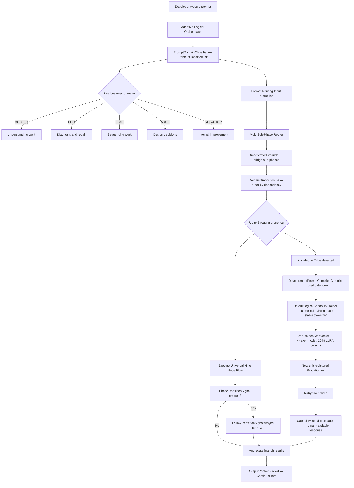
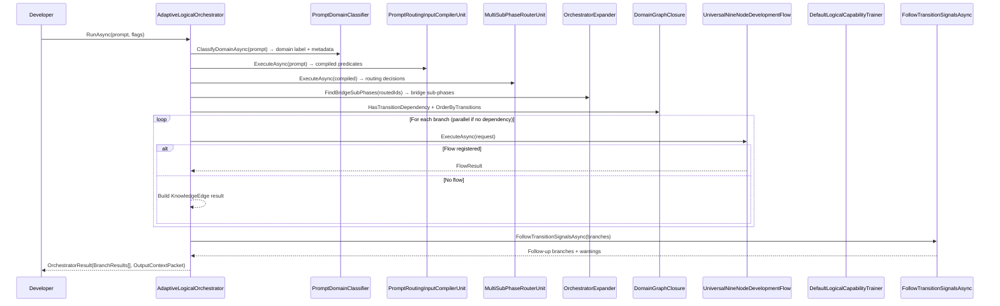
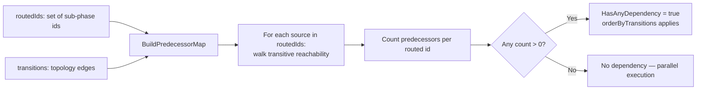

# LlmFromScratch — Implementation Documentation
# Version: 8.0 — 2026-05-07
# Covers: all flows, entities, parameters, algorithms, and code references
# Source: code review of uploaded llm_mvp_core-main, test suite 1265/1265
# Changes from v7:
#   - Section 1: system overview diagram updated — DevelopmentPromptCompiler and
#     CapabilityResultTranslator now on the main path
#   - Section 3: orchestration flow updated — compiled prompt passed to training request
#   - Section 4: prompt compiler updated — DevelopmentPromptCompiler now wired into
#     the teaching pipeline (training text, tokenizer, inference query)
#   - Section 6: capability trainer updated — three stacked failures fixed (A55);
#     DevelopmentPromptCompiler wired for training text and tokenizer vocabulary;
#     OriginalPrompt now stored in manifest; runner UserRequest now real row prompts
#   - Section 7-16: model config table updated — 4 layers, hidden 32 (locked A58)
#   - New Section 18c: CapabilityResultTranslator — back-translation of KNN output (A56)
#   - Section 22 gap inventory: A55/A56/A57→A58/A59/A60 added; Path C gap closed

---

## Contents

1. System Overview — how the parts connect
2. Core Contracts — the three interfaces every component implements
3. The Orchestration Flow — from raw prompt to result
4. The Prompt Compiler — turning text into predicate evidence
5. The Sub-Phase Router — scoring and selecting development areas
6. The Capability Trainer — learning from knowledge edges
7. The Transformer Language Model — the base neural network
8. Low-Rank Adaptation — lightweight expertise specialisation
9. Direct Preference Optimisation — teaching the model from corrections
10. The Tokeniser — converting text to token identifiers
11. The Embedding Model — turning text into searchable vectors
12. Hierarchical Navigable Small World Index — fast nearest-neighbour search
13. The Knowledge Nearest-Neighbour Unit — retrieval-based logical cells
14. The Transformer Embedding Nearest-Neighbour Unit — deep retrieval
15. The Teaching Registry — persisting what has been learned
16. The Topology Registry — the map of all development areas
17. Entity Reference — all key types and their fields
18. The Semantic Compiler Adapter — project 23 bridge classes
19. Dynamic Domains — project 17 graph algorithms
20. RegexPreprocessor and Expression Completion — E10 and E13B
21. Project Structure Reference
22. Implementation Gap Inventory

---

## 1. System Overview



**What changed since v7:**

Three critical failures in the teaching pipeline were found and fixed. One new
component (`CapabilityResultTranslator`) was added to the result path. The model
depth was increased from 1 layer to 4 layers.

**A55 — DevelopmentPromptCompiler was never used in the teaching pipeline (FIXED):**

`BuildTrainingText` and `BuildTokenizer` both received raw surface text instead of
the compiled predicate form. Three stacked failures:

1. The tokenizer vocabulary was seeded from raw surface words — different for every
   capability chain. Token ids for canonical predicates like "AUTHORIZATION" were
   unstable across sessions.
2. The DPO preference pair prompt side was raw natural language. The model was taught
   to associate "fix this Angular null ref" with sub-phase 4.1 rather than
   "IMPLEMENT BUG stack:typescript sub-phase:4.1".
3. The calibration runner constructed `originalRequest.UserRequest` as a synthetic
   batch-description string (e.g. `"XIIGen documentation teaching; batch_size=20;
   batch=1; domain=BUG; rows=7; branches=43."`) — not the actual developer prompts.

All three fixed by PLAN-DPC-INTEGRATION-v1 (Phases 1–5, implemented and tested).

**A56 — KNN output never back-translated (FIXED):**

`GeneratedCapabilityFlow` returned the raw KNN `ChosenText` string as `FinalHumanResult`.
That string is `"Generated capability for sub-phase 3.4: Security and Authorization
Model. Execute the requested work through task type security-and-authorization-model."` —
a machine routing decision, not a developer-readable response.

Fixed by `CapabilityResultTranslator` (PLAN-BACK-TRANSLATION-DEEPER-MODEL-v1,
Phases 1–4, implemented and tested). Back-translation combines the sub-phase's
`Purpose` and `PredicateIds` from the topology with the original developer prompt.

**A58 — Model depth fixed (1 layer → 4 layers):**

`BuildTinyConfig` now produces 4 layers at hidden dimension 32. Total parameters:
69,920. LoRA-trainable: 2,048 (was 256). Prior checkpoints (1-layer) are incompatible
with the new config and must not be used as continued-learning parents.

**A59 — Inference path now compiles prompt before KNN lookup:**

`GeneratedCapabilityFlow.ExecuteAsync` compiles the incoming prompt through
`DevelopmentPromptCompiler` before passing to the KNN unit. Training form and
inference form now use identical compiled predicate vocabulary.

**Remaining structural gap:**

The eight production-class Infrastructure copies in `35.ExperimentsV2/Infrastructure/`
(`DomainClassifier.cs`, `FamilyCollapser.cs`, `LogicExtractor.cs`,
`SemanticNormalizer.cs`, `SentencePatternClassifier.cs`, `StopSignalDetector.cs`,
`PromptSplitter.cs`, `AttributedRouter.cs`) are still present. Step 2D of the
domain classifier consolidation plan is incomplete (A51 partial).

**Three execution paths — current status:**

```
Path A — Runtime prompt path
  Now active:   PromptDomainClassifier (DomainClassifierUnit from project 23)
                TrainingVectorBuilder 60-slot vector in capability trainer training text
                OrchestratorExpander bridge insertion (E49)
                DomainGraphClosure dependency ordering (E50)
                DevelopmentPromptCompiler at inference time before KNN lookup (A59)
  Still planned: SemanticCompilerFacade full pipeline (E01/E15/E16/E17/E18/E20/E21)
                 AttributedSegmentRouter per-segment routing (E24)

Path B — Training path
  Now active:   DevelopmentPromptCompiler wired — compiled predicate form in training text
                Stable tokenizer vocabulary seeded from canonical predicate ids (A55)
                Runner passes real row prompts as UserRequest (A55)
                CompiledPrompt field on training request (A55)
  Still planned: ReplayBuffer capacity cap (A54) — grows unboundedly
                 IdleDetector gate (E41)
                 TrustScorer promotion (E40V2)

Path C — Result translation
  Now active:   CapabilityResultTranslator — back-translates KNN output using
                sub-phase Purpose + PredicateIds + original prompt (A56)
```

---

## 2. Core Contracts

```mermaid
classDiagram
    class ILogicalUnit {
        <<interface>>
        +ExecuteAsync(request, cancellation) Task~OperationResult~LogicalUnitResult~~
    }
    class ILogicalFlow {
        <<interface>>
        +ExecuteAsync(request, cancellation) Task~OperationResult~LogicalFlowResult~~
    }
    class ILogicalOrchestrator {
        <<interface>>
        +RunAsync(request, cancellation) Task~OperationResult~LogicalOrchestratorResult~~
    }
    ILogicalUnit <|.. KnnLogicalUnit
    ILogicalUnit <|.. TransformerEmbeddingKnnLogicalUnit
    ILogicalUnit <|.. LogicalDpoTrainingUnit
    ILogicalUnit <|.. PromptRoutingInputCompilerUnit
    ILogicalUnit <|.. MultiSubPhaseRouterUnit
    ILogicalUnit <|.. PromptDomainClassifierUnit
    ILogicalUnit <|.. ExpressionCompletionUnit
    ILogicalUnit <|.. AddDomainTopologyMutationUnit
    ILogicalFlow <|.. UniversalNineNodeDevelopmentFlow
    ILogicalFlow <|.. SecurityVerification34FlowAdapter
    ILogicalFlow <|.. TopologyMutationFlow
    ILogicalOrchestrator <|.. AdaptiveLogicalOrchestrator
```



**New unit types since v6:**

`PromptDomainClassifierUnit` — implements `ILogicalUnit<string, PromptDomainClassification>`.
Wraps `DomainClassifierUnit` from project 23. Called via `ClassifyDomainAsync` at the
start of every orchestrator request. Resolvable from the unit registry — a learned
replacement can be registered at role `"domain_classifier"`.

`ExpressionCompletionUnit` — implements `ILogicalUnit<string, string>`. Thin wrapper
over `ExpressionCompletionCore` from project 23. Binary exact-memory lookup:
confidence 1.0 on match, 0.0 on no-match. Participates in KNN scoring matrix like
any other unit. See Section 20.

`AddDomainTopologyMutationUnit`, `AddPhaseTopologyMutationUnit`,
`AddSubPhaseTopologyMutationUnit`, `AddTransitionTopologyMutationUnit` — implement
`ILogicalUnit` for their respective command/entry type pairs. Used by
`TopologyMutationFlow` to extend the topology registry at runtime.

`ILogicalFlowFactory<TInput>` — new interface. Creates a flow instance at execution
time so learned units can be selected before construction. Carries
`LogicalFlowFactoryRequest` with `MinimumTrustState` (default `Trusted`).

`PhaseTransitionSignal` — new record on `LogicalUnitResult`. Optional advisory from
a flow node requesting a follow-up orchestration pass on a different prompt. Fields:
`SuggestedDomain`, `TransitionPrompt`, `SourceNodeId`, `SourceSubPhaseId`,
`EvidenceIds`.

**Code reference:**

`21.AgentInfrastructure.Logical.LogicalContracts`
- `ILogicalUnit<TInput, TOutput>.ExecuteAsync`
- `ILogicalFlow<TInput>.ExecuteAsync`
- `ILogicalOrchestrator.RunAsync`
- `PhaseTransitionSignal` record — line 114
- `LogicalUnitResult.TransitionSignal` optional property — line 110
- `LogicalOrchestratorResult.OutputContextPacket` — line 220
- `LogicalFlowResult.TransitionSignals[]` — line 166

---

## 3. The Orchestration Flow



**Domain classification wiring (new since v6):**

`ClassifyDomainAsync` runs before compilation and routing on every request. It
resolves the domain classifier through the unit registry first — if a learned
replacement has been registered at `PromptDomainClassifierUnit.Role`, it is used.
Otherwise the deterministic `PromptDomainClassifierUnit` fallback runs. The domain
label, confidence, and evidence terms are added to request metadata under
`domain.label`, `domain.confidence`, and `domain.evidence_terms` keys. These keys
travel through all subsequent flow execution and appear in flow result metrics.

**OrchestratorExpander wiring (E49, new since v6):**

After routing produces a set of decisions, `ExpandRoutedDecisions` calls
`OrchestratorExpander.FindBridgeSubPhases` with the routed sub-phase ids and the
topology transition graph. Any sub-phase that lies on a dependency path between two
routed endpoints is inserted as a bridge branch with confidence 0.71. The total
branch count is then capped at `MaxAdaptiveBranchCount` (8), keeping direct router
choices and dropping the weakest bridge candidates when necessary.

**DomainGraphClosure ordering (E50, new since v6):**

`HasTransitionDependency` uses `DomainGraphClosure.BuildPredecessorMap` to determine
whether any routed sub-phase is reachable from another. If a dependency exists,
`OrderByTransitions` sorts branches by predecessor count before execution, so upstream
sub-phases always execute before downstream ones. Parallel execution is used when no
dependency exists, preserving the prior behaviour.

**Phase transition signal handling (new since v6):**

After all branches complete, `FollowTransitionSignalsAsync` collects all
`PhaseTransitionSignal` records from branch results. For each signal it re-classifies
the suggested domain, skips transitions with confidence below 0.40, and runs a new
`RunAsync` call for the transition prompt. A depth counter prevents infinite chains —
transitions beyond depth 3 are logged as warnings and skipped. Follow-up branches are
merged into the aggregate result.

**Context carry-forward wiring (new since v6):**

When `UseContextCarryForward` is true, `BuildContextPacket` assembles completed
upstream branches into a `LogicalContextPacket`. For dependent sequential branches,
the packet is written to `context.packet` in the downstream branch metadata before
execution, so downstream flow nodes can read prior branch verdicts and evidence. The
final packet is surfaced as `OutputContextPacket` on the orchestrator result. The
static `ContinueFrom` factory method creates a new request with the prior result's
packet pre-loaded into metadata.

**Code reference:**

`21.AgentInfrastructure.Logical.AdaptiveLogicalOrchestrator`
- `ClassifyDomainAsync` — domain classification before routing, line 200
- `ExpandRoutedDecisions` — bridge insertion + branch cap, line 517
- `HasTransitionDependency` / `OrderByTransitions` — dependency ordering, line 570
- `ExecuteBranchesAsync` — parallel or sequential execution, line 267
- `FollowTransitionSignalsAsync` — transition chain, line 340
- `MaxAdaptiveBranchCount = 8` — branch cap constant, line 15
- `MaxTransitionDepth = 3` — transition depth cap, line 19
- Transition confidence floor: `classified.Value.Confidence < 0.40` — line 386
- `BuildContextPacket` — assembles `LogicalContextPacket`, line 763
- `ContinueFrom` — static factory for chained requests, line 623
- `OutputContextPacket` written on result — line 619

---

## 4. The Prompt Compiler

The compiler receives the raw developer prompt and produces a `SubPhaseRouterSourceDocument`
for routing. It normalises to lowercase and checks against a fixed lexicon of nine
development signal categories. Output confidence is 0.92 with predicates, 0.70 without.

Nine predicates: Security, Authorization, API contract, Architecture, Implement,
Test, Quality Assurance, User Interface, Document.

**DevelopmentPromptCompiler wiring into the teaching pipeline (new since v7):**

`DevelopmentPromptCompiler` from project 29 (`SemanticCompiler29`) is now wired
into the teaching pipeline at three points, fixing the A55 failures:

1. **Training text (BuildTrainingText):** When a `CompiledPrompt` is available on the
   training request, `BuildTrainingText` uses the compiled predicate ids, normalised
   text, pipeline predicates, domain, and stack language as the prompt side of the DPO
   pair — not the raw developer string. Falls back to on-demand compilation when the
   caller did not pre-compile.

2. **Tokenizer vocabulary (BuildTokenizer):** The BpeTokenizer is now seeded from the
   compiled predicate vocabulary — canonical ids (IMPLEMENT, SECURITY, API_CONTRACT,
   etc.) plus normalised roots. The vocabulary is stable across all capability chains
   for the same domain, so token ids for canonical predicates are consistent.

3. **Inference query (GeneratedCapabilityFlow.ExecuteAsync):** The incoming developer
   prompt is compiled through `DevelopmentPromptCompiler` before passing to the KNN
   unit. The query now uses the same compiled predicate representation as the training
   examples, making embedding distances meaningful.

**Runner representative prompt (new since v7):**

The calibration runner now builds `originalRequest.UserRequest` from the actual
joined prompts of the domain-group rows (up to 5 joined with ` | `), replacing the
previous synthetic batch-description string. The representative prompt is compiled
through `DevelopmentPromptCompiler` and attached to the training request as
`CompiledPrompt`.

**Code reference:**

`21.AgentInfrastructure.Logical.PromptRoutingInputCompilerUnit` — routing compiler (unchanged)
`29.SemanticCompiler.DevelopmentPromptCompiler` — full predicate compilation for teaching
`21.AgentInfrastructure.Logical.DefaultLogicalCapabilityTrainer`
- `BuildTrainingText` — now takes `DevelopmentPromptCompilation?` as first parameter
- `BuildTokenizer` — now takes `DevelopmentPromptCompilation?` for stable vocabulary seeding
`21.AgentInfrastructure.Logical.GeneratedCapabilityFlow.ExecuteAsync`
- compiles incoming prompt before KNN lookup (A59)

---

## 5. The Sub-Phase Router

*(Scoring algorithm unchanged from v6. OrchestratorExpander and DomainGraphClosure
are now applied to router output — see Section 3.)*

Three-component scoring: predicate overlap 55%, exact sub-phase name mention 25%,
anchor-term token overlap 20%. Relevance floor: `bestScore × 0.80`. Confidence
conversion: `0.70 + (score × 0.27)`, capped at 0.97. Below 0.70 = knowledge edge.

**Code reference:**
`21.AgentInfrastructure.Logical.MultiSubPhaseRouterUnit`

---

## 6. The Capability Trainer

**DevelopmentPromptCompiler integration (new since v7 — A55 fix):**

The trainer now receives a `CompiledPrompt` field (`DevelopmentPromptCompilation?`)
on `LogicalCapabilityTrainingRequest`. When present, both `BuildTrainingText` and
`BuildTokenizer` use the compiled form. When absent, both compile on demand from
`UserRequest`. See Section 4 for the three wiring points.

`LogicalCapabilityTrainingRequest` gains one new optional field:
`CompiledPrompt` — `SemanticCompiler29.DevelopmentPromptCompilation?`, default null.
Backward compatible: existing callers without the field continue to work.

**OriginalPrompt in manifest (new since v7 — A56 support):**

`GeneratedCapabilityCheckpointManifest` gains one new field:
`OriginalPrompt` — the raw developer prompt from `request.OriginalRequest.UserRequest`
at training time, trimmed. Used by `GeneratedCapabilityFlow` at inference time to
include the original request in the back-translated human response.

**TrainingVectorBuilder wiring (carried from v7):**

`BuildTrainingText` calls `TrainingVectorBuilder.Build()` on the compiled prompt side
(not raw text) to produce the 60-slot vector and appends it as `teaching_vector_60`.

**Everything else unchanged from v7** — domain-keyed warm cache, replay mixer,
continued-weight learning from prior checkpoints, Rank=2 Alpha=4 LoRA config,
Probationary trust on registration, one DPO step per domain group.

**Code reference:**

`21.AgentInfrastructure.Logical.DefaultLogicalCapabilityTrainer`
- `BuildTrainingText(DevelopmentPromptCompilation?, string, LogicalFlowResult, LogicalSubPhase)`
- `BuildTokenizer(DevelopmentPromptCompilation?, string trainingText)`
- `TrainAndRegisterAsync` — reads `request.CompiledPrompt`

`21.AgentInfrastructure.Logical.LogicalCapabilityTrainingContracts`
- `LogicalCapabilityTrainingRequest.CompiledPrompt` — new optional field

`21.AgentInfrastructure.Logical.GeneratedCapabilityCheckpointManifest`
- `OriginalPrompt` — new field, populated at training time

---

## 7–16. Core Components

*(Sections 7 through 16 are unchanged from v7 except the model config table below.
Transformer model, LoRA, DPO, tokeniser, embedding model, HNSW index, KNN unit,
transformer embedding KNN unit, teaching registry, and topology registry all have
the same algorithms, parameters, and code references as documented in v7.)*

Key parameter summary for reference:

| Component | Key parameter | Value |
|---|---|---|
| Transformer (teaching) | Hidden dim / layers / heads | **32 / 4 / 4** — locked A58 |
| Transformer (teaching) | Total parameters | **69,920** (was 18,736) |
| Transformer (teaching) | Checkpoint size | **~273 KB** (was ~73 KB) |
| LoRA | Rank / Alpha / Scaling | 2 / 4 / 2.0 |
| LoRA | Trainable parameters | **2,048** (was 256) |
| DPO | Learning rate | 1e-5 |
| Tokeniser (teaching) | Vocabulary size | 512 tokens |
| Tokeniser (teaching) | Vocabulary seeding | **canonical predicate ids + normalised roots** (was raw surface words) |
| HNSW | M / efConstruction / efSearch | 8 / 64 / 32 |
| Teaching registry | Trust states | Candidate / Probationary / Trusted / Rejected |

**Prior checkpoints (1-layer, hidden 16) are incompatible with the new config and
must not be used as continued-learning parents (A60).**

---

## 17. Entity Reference

*(Unchanged from v6 except the following additions.)*

### New types since v6

**PhaseTransitionSignal** — advisory record on `LogicalUnitResult`:

| Field | Type | Meaning |
|---|---|---|
| SuggestedDomain | Domain | The domain the emitting node recommends for follow-up |
| TransitionPrompt | string | The prompt text for the follow-up orchestration pass |
| SourceNodeId | string | Which node emitted the signal |
| SourceSubPhaseId | string | Which sub-phase the signal came from |
| EvidenceIds | string[] | Evidence that triggered the transition |

**ContextSignals** — extracted from `context.packet` by `ContextPacketReader`:

| Field | Type | Meaning |
|---|---|---|
| PriorDomains | Domain[] | Domains from completed upstream branches |
| CompletedSubPhases | string[] | Sub-phase ids of completed branches |
| ActiveKnowledgeEdges | string[] | Knowledge edge ids from upstream branches |
| PriorConfidenceMap | Dictionary<Domain, double> | Per-domain confidence from prior pass |

**LogicalFlowFactoryRequest** — passed to `ILogicalFlowFactory<TInput>`:

| Field | Type | Meaning |
|---|---|---|
| RunId | string | Correlation id for this execution |
| Flags | LogicalExecutionFlags | Execution configuration |
| Units | InMemoryLogicalUnitRegistry | Registry for unit selection |
| Metadata | IReadOnlyDictionary | Request metadata |
| MinimumTrustState | LogicalUnitTrustState | Floor for unit selection (default Trusted) |

---

## 18. The Semantic Compiler Adapter — Project 23

Project 23 (`23.SemanticCompilerAdapter`) was listed as "does not exist yet" in v6.
It now exists and contains five classes. Project 21 references it. Project 23 in turn
references projects 12 and 29 only — it does not reference project 21, which prevents
a circular dependency.

### DomainClassifierUnit

Plain class (not `ILogicalUnit`). Wraps `SemanticCompiler.RouteClassifier` from
project 12 and `SemanticCompiler29.RouteClassifier` from project 29.

`Classify(DomainClassifierRequest)` returns `DomainClassification`:
- Keyword-based classification via project 29's `RouteClassifier.ClassifyByKeywords`
- Trained predicate-based classification via project 12's `RouteClassifier` when
  predicates are supplied
- Context enrichment via `ContextPacketReader` when metadata contains `context.packet`
- Confidence adjustments: +0.10 for context domain match, −0.05 for domain shift,
  improved from prior confidence if `PriorConfidenceMap` contains the classified domain

`PromptDomainClassifierUnit` in project 21 wraps this as `ILogicalUnit<string,
PromptDomainClassification>`.

### TrainingVectorBuilder

Static class. Produces 60-slot float vectors from prompt text for use as structured
training features in `DefaultLogicalCapabilityTrainer`.

Three-part vector:
- Predicate slots (0–21): 1.0 if the predicate is present in the prompt roots
- Domain slot (22–26): 1.0 for predicted domain, 0.0 for others
- Root vocabulary slots (27–58): term-frequency count for each root word

`BuildRootVocabulary(prompts)` — builds a shared vocabulary dictionary from a corpus.
`Build(prompt)` — builds vocabulary from the single prompt and returns vector.
`Build(prompt, rootVocab)` — uses pre-built shared vocabulary.

### ContextPacketReader

Static class. Reads `context.packet` from metadata dictionaries and extracts
`ContextSignals`. Used by `DomainClassifierUnit` to adjust domain classification
when upstream branch context is available.

Uses reflection to read `LogicalContextFragment` properties by name — this is
technical debt A52 and will be replaced when the fragment shape stabilises.

`Read(metadata)` — extracts `ContextSignals` from `context.packet` key.
`Read(object)` — extracts from a raw packet object via reflection.

### AttributedSegmentRouter

Class. Routes a list of `AttributedSegmentInput` records through `DomainClassifierUnit`,
one segment per domain classification. Returns `AttributedSegmentDocument[]` with
domain label, confidence, and evidence per segment. Pre-existing domain is preserved
when not `UNKNOWN` — the classifier is not overridden by a prior assignment.

### ExpressionCompletionCore

Contains `ExpressionCorpusBuilder` (static) and `ExpressionCompletionCore` (class).
See Section 20 for full documentation.

**Code reference:**
`23.SemanticCompilerAdapter.*` — all five classes in one project.
`23.SemanticCompilerAdapter.SemanticCompilerAdapter.csproj` — references project 12
and project 29 only.

---

## 18c. CapabilityResultTranslator — Back-Translation (new in v8)

`CapabilityResultTranslator` is a new static class in project 21 that converts the
KNN unit's routing decision into a developer-readable response. It was added to close
A56: the raw `ChosenText` machine label was previously surfaced directly as
`FinalHumanResult`.

### Translate (primary path — topology available)

```
Inputs:  knnOutput (ChosenText string from KNN unit)
         subPhase  (LogicalSubPhase from topology registry — Name, Purpose, PredicateIds)
         originalPrompt (raw developer prompt stored in manifest at training time)

Output:  structured multi-line string:
         For your request: "{originalPrompt}"
         → Sub-phase {SubPhaseId} ({Name})
           Scope: {Purpose}
           Focus areas: {PredicateIds joined with ", "}
```

### TranslateFromKnnOutput (fallback — topology unavailable)

When the topology registry is not available or the sub-phase cannot be resolved,
the fallback combines the original prompt with the raw KNN output rather than
discarding either.

### Wiring in GeneratedCapabilityFlow

`GeneratedCapabilityFlow` now receives:
- `ILogicalTopologyRegistry? _topology` — for `ResolveSubPhase(_subPhaseId)` lookup
- `string _originalPrompt` — from the manifest's `OriginalPrompt` field

`ExecuteAsync` resolves the sub-phase, calls `CapabilityResultTranslator.Translate`,
and passes the translated string as the `FinalHumanResult` in `LogicalFlowResult`.
The raw KNN output is retained in metrics under `"knn_raw_output"` for traceability.

**Test coverage:** 8 tests added covering:
- Sub-phase name and purpose present in translated output
- Original prompt reflected in translated output
- Machine routing label (`"Generated capability"`) absent from translated output
- Fallback path when topology unavailable
- Full round-trip: compile → train (4-layer model) → infer → translated output
- LoRA adapter count: exactly 8 at 4 layers (2 per layer × 4 layers)
- `OriginalPrompt` stored in manifest and retrieved at flow construction time

**Code reference:**

`21.AgentInfrastructure.Logical.CapabilityResultTranslator`
- `Translate(knnOutput, subPhase, originalPrompt)` — primary path
- `TranslateFromKnnOutput(knnOutput, originalPrompt)` — fallback

`21.AgentInfrastructure.Logical.GeneratedCapabilityFlowFactory`
- `Create(request)` — now passes `_topology` and `_originalPrompt` to flow constructor

`21.AgentInfrastructure.Logical.GeneratedCapabilityFlow`
- constructor gains `ILogicalTopologyRegistry?` and `string originalPrompt`
- `ExecuteAsync` — calls translator before constructing `LogicalFlowResult`

---

## 19. Dynamic Domains — Project 17

Project 17 (`17.DynamicDomains`) was listed as "does not exist yet" in v6. It now
exists with one file implementing E49 and E50 production code. Project 21 references
it.

### DomainGraphClosure (E50)



`DomainGraphClosure.HasAnyDependency(routedIds, transitions)` — returns true when any
routed sub-phase is reachable from another routed sub-phase via the transition graph.
Used in `HasTransitionDependency` in the orchestrator.

`DomainGraphClosure.BuildPredecessorMap(routedIds, transitions)` — returns a
dictionary mapping each routed id to a count of how many other routed ids can reach
it. Used in `OrderByTransitions` to sort branches before sequential execution.

Algorithm: depth-first transitive closure from each source using a stack-based
traversal with cycle detection. `BuildAdjacency` groups transitions by `FromId` for
O(1) neighbour lookup.

### OrchestratorExpander (E49)

`OrchestratorExpander.FindBridgeSubPhases(routedIds, transitions)` — finds sub-phases
that lie on a shortest path between any two routed endpoints. Returns the set of
bridge ids that are not already in the routed set.

Algorithm: BFS shortest path from each source to each target in the transition graph.
Bridge ids are all intermediate nodes (skip first and last) on any such path. Returns
sorted array of bridge ids.

Used in `ExpandRoutedDecisions`: bridge sub-phases are added as routing decisions
with confidence 0.71 and `TOPOLOGY_BRIDGE` evidence predicate.

**Code reference:**
`17.DynamicDomains.DomainGraphClosure` — graph closure and dependency ordering
`17.DynamicDomains.OrchestratorExpander` — bridge sub-phase finder

---

## 20. RegexPreprocessor and Expression Completion

### RegexPreprocessor (E10)

`12.SemanticCompiler.Compression.RegexPreprocessor.Normalize(source)` strips
C# source text before syntax or semantic processing.

Normalisation order (order matters — XML docs first):
1. Remove XML doc comments: `///...`
2. Replace block comments with space: `/* ... */`
3. Remove line comments: `//...`
4. Replace string literals with `""`: both verbatim and standard
5. Collapse runs of two or more blank lines to one blank line

Result: approximately 21% character reduction, +29.5% parse time improvement (E10).
Apply only to C# source files, not to natural language prompts.

### ExpressionCompletionCore and ExpressionCorpusBuilder (E13B)

`23.SemanticCompilerAdapter.ExpressionCorpusBuilder.ExtractPairs(expressions)` splits
complete expression strings at the rightmost `=` sign. Left side becomes partial
(includes the `=`), right side becomes completion. Rows with no `=`, or where either
side is empty after trim, are skipped.

`ExpressionCompletionCore` provides exact learned-memory lookup. Train once from a
corpus; look up at runtime with binary result.

Normalisation pipeline applied identically at train and query time:
1. Extract lookup partial: trim brackets/parens/stars, find rightmost `=`, keep left
   side including `=`. This strips placeholders like `?`, `[unknown]`, trailing text.
2. Pad operators: add single space on each side of `+`, `-`, `*`, `/`, `=`.
3. Collapse whitespace runs to single space.
4. Lowercase.

Result: `"Revenue-Cost=?"` → `"revenue - cost ="` matches training key
`"Revenue - Cost ="` correctly.

`Train(expressions)` returns `ExpressionCompletionCore?` — null if no valid pairs.
`Lookup(partial)` returns `(bool Matched, string? Completion)`:
- Match: `(true, "Profit")` — confidence 1.0 in matrix
- No match: `(false, null)` — confidence 0.0 in matrix, does not affect scoring

`ExpressionCompletionUnit` in project 21 wraps this as `ILogicalUnit<string, string>`.
Participates in the KNN scoring matrix identically to cosine-based units. Weight is
owned and updated by the matrix through the standard DPO path.

**Code reference:**
`23.SemanticCompilerAdapter.ExpressionCorpusBuilder` — pair extraction
`23.SemanticCompilerAdapter.ExpressionCompletionCore` — normalisation + lookup
`21.AgentInfrastructure.Logical.ExpressionCompletionUnit` — ILogicalUnit wrapper

---

## 21. Project Structure Reference

```text
llm_mvp_core/
  00.TensorCore/          — tensor operations, autograd, optimizers (AdamW)
  01.Tokenizer/           — BpeTokenizer, RegexSplitter
  02.DatasetPipeline/     — dataset loading and batching
  03.TransformerModel/    — LlmModel, TransformerBlock, all layers, ModelConfig
  04.TrainingLoop/        — Trainer, TrainingConfig
  05.Embeddings/          — EmbeddingModel, MeanPooling
  06.VectorSearch/        — HnswIndex, BruteForceIndex, Distances
  07.GraphEngine/         — graph data structures and traversal (complete)
  08.GraphRag/            — graph-augmented retrieval (complete)
  09.Inference/           — KvCache (+54% step speed) — not connected to project 21
  10.LoRA/                — LoraLinear, LoraApplicator, LoraConfig
  11.DPO/                 — DpoTrainer, DpoBatch, DpoMetrics
  12.SearchEngine/        — search engine pipeline (complete, separate from 12.SemanticCompiler)
  12.SemanticCompiler/    — SemanticCompilerFacade, RegexPreprocessor (E10),
                            Translation pipeline (E25/E26/E27), Decomposer (E21),
                            TemplateBeautifier (E23), LogicExtractor, SemanticNormalizer,
                            StackDetector — not connected to project 21 runtime path
  13.CodeOptimizer/       — code optimisation algorithms (complete)
  14.ContinuousLearning/  — continuous learning infrastructure (complete)
  14.MachineLearning/     — consolidated ML sub-projects 14–20
  15.OrchestratorModel/   — EpisodeDecomposer (E32), QualityOrchestrator (E39)
                            — not connected to project 21
  16.AutonomousLearning/  — ReplayBuffer (E43, UNBOUNDED — A54),
                            TrustScorer (E40V2), IdleDetector (E41)
                            — not connected to project 21
  17.DynamicDomains/      — DomainGraphClosure (E50), OrchestratorExpander (E49)
                            — NOW CONNECTED to project 21
  21.AgentInfrastructure/
    Logical/
      LogicalContracts.cs                    — ILogicalUnit, ILogicalFlow,
                                               ILogicalOrchestrator, PhaseTransitionSignal,
                                               LogicalFlowBinding, LogicalFlowFactoryContracts
      AdaptiveLogicalOrchestrator.cs         — main orchestrator with domain classification,
                                               E49/E50, phase transitions, context carry-forward
      DefaultLogicalCapabilityTrainer.cs     — training with 60-slot vector
      PromptDomainClassifier.cs              — wraps DomainClassifierUnit from project 23
      PromptRoutingInputCompilerUnit.cs      — predicate extraction (raw keyword scan)
      MultiSubPhaseRouterUnit.cs             — branch scoring and relevance floor
      SubPhaseRouterUnit.cs                  — single sub-phase router (Phase A compat)
      KnnLogicalUnit.cs                      — retrieval-based learned unit
      LlmIngredientLogicalUnits.cs           — transformer embedding unit + DPO unit
      ExpressionCompletionUnit.cs            — exact-memory wrapper over Core in project 23
      LogicalExperimentOptimizations.cs      — LogicalTeachingReplayMixer
      DevelopmentLifecycleTopologySeeder.cs  — registers all 31 sub-phases + 36 transitions
      UniversalNineNodeDevelopmentFlow.cs    — scaffold flow for all sub-phases
      TopologyMutationFlow.cs                — runtime topology extension flow
      AddDomainTopologyMutationUnit.cs       — add-domain mutation unit
      AddPhaseTopologyMutationUnit.cs        — add-phase mutation unit
      AddSubPhaseTopologyMutationUnit.cs     — add-sub-phase mutation unit
      AddTransitionTopologyMutationUnit.cs   — add-transition mutation unit
      LogicalTopologyCommands.cs             — command records for topology mutation
      InMemoryLogicalUnitRegistry.cs         — unit trust state and resolution
      InMemoryLogicalFlowRegistry.cs         — flow lookup by scenario
      TeachingRegistrySnapshot.cs            — serialised registry state
      TeachingRegistryPersistence.cs         — save and load snapshot to disk
      LogicalTopologyRegistry.cs             — sub-phase and transition map
      LogicalCapabilityTrainingContracts.cs  — training request and result types
      LogicalFlowFactoryContracts.cs         — ILogicalFlowFactory, LogicalFlowFactoryRequest
    Loop/
      AgentLoop.cs, AgentState.cs, InternalLlmGateway.cs,
      LearningEventScheduler.cs, SessionStateStore.cs,
      PermissionGate.cs, ToolRegistry.cs
  21.AgentInfrastructure.Desktop/ — Windows Forms stage explorer (7 demos)
  22.AgentAlgorithms/     — AstRelevanceRanker BM25 (E04), KnnSkillFilter (E09),
                            ContextWindowManager SkillRetriever (E38V2),
                            RoleBasedTaskDecomposer SyntaxRoles (E08),
                            DependencyGraph (E35), RouteClassifier (E18)
                            — NOW REFERENCED by project 21
  22.AgentAlgorithms.Desktop/ — Windows Forms explorer (8 demos)
  23.OssEquivalents/      — MCP dispatcher, frontmatter parser, schema validator,
                            agent state machine + SQLite checkpoints (complete)
  23.OssEquivalents.Desktop/ — Windows Forms host (4 demos)
  23.SemanticCompilerAdapter/ — DomainClassifierUnit, TrainingVectorBuilder,
                            ContextPacketReader, AttributedSegmentRouter,
                            ExpressionCompletionCore + ExpressionCorpusBuilder
                            — NOW CONNECTED to project 21
  24.Compression/         — consolidated compression sub-projects 24–27 (complete)
  28.SemanticNlp/         — FrameNet (28), SRL (29), WordNet (30), AMR (31),
                            Universal Dependencies (32) with shared dispatcher (complete)
  29.SemanticCompiler/    — canonical pipeline (E01/E15/E16/E17/E18/E20),
                            RouteClassifier (canonical D-04 Domain enum),
                            RoleAssigner — NOW REFERENCED by project 21
  33.MatrixAlgorithms/    — LU/QR/SVD decompositions, sparse formats (COO/CSR/CSC),
                            Int8 quantization, SVD+quantized-residual compressor (complete)
  34.Experiments/         — early experiment series
  35.ExperimentsV2/
    LogicalFlow/
      SecurityVerification34FlowAdapter.cs  — real specialist flow for sub-phase 3.4
    Infrastructure/
      DomainClassifier.cs                   — STILL PRESENT — not yet deleted (A51)
      FamilyCollapser.cs                    — STILL PRESENT — not yet deleted (A51)
      LogicExtractor.cs                     — STILL PRESENT — not yet deleted (A51)
      SemanticNormalizer.cs                 — STILL PRESENT — not yet deleted (A51)
      SentencePatternClassifier.cs          — STILL PRESENT — not yet deleted (A51)
      StopSignalDetector.cs                 — STILL PRESENT — not yet deleted (A51)
      PromptSplitter.cs                     — STILL PRESENT — not yet deleted (A51)
      AttributedRouter.cs                   — STILL PRESENT — not yet deleted (A51)
    Experiments/
      [55+ experiment files E01–E53 + proof experiments T34, T35, P3]
  36.LibraryComparison/   — library comparison utilities (complete)
```

**Project 21 references (current):**
12.SemanticCompiler, 17.DynamicDomains, 22.AgentAlgorithms, 00.TensorCore,
01.Tokenizer, 03.TransformerModel, 05.Embeddings, 06.VectorSearch, 10.LoRA, 11.DPO,
23.SemanticCompilerAdapter, 29.SemanticCompiler

---

## 22. Implementation Gap Inventory

### Closed since v7

| Gap | What closed it |
|---|---|
| DevelopmentPromptCompiler not in teaching pipeline | `BuildTrainingText` and `BuildTokenizer` now use compiled form (A55 — PLAN-DPC-INTEGRATION-v1) |
| Runner UserRequest was synthetic batch string | Runner now joins real row prompts (A55) |
| Tokenizer vocabulary seeded from raw surface words | Seeded from canonical predicate ids (A55) |
| Inference query used raw prompt before KNN lookup | `GeneratedCapabilityFlow` compiles before KNN (A59) |
| KNN output returned as FinalHumanResult unmodified | `CapabilityResultTranslator` wired (A56 — PLAN-BACK-TRANSLATION-DEEPER-MODEL-v1) |
| Model: 1 layer hidden 16 — insufficient depth | BuildTinyConfig: 4 layers hidden 32 (A58) |
| Path C result translation | `CapabilityResultTranslator` — ACTIVE |

### Still open

**A51 — Infrastructure copies not deleted (partial):**
`DomainClassifier.cs` and 7 other Infrastructure copies still present in
`35.ExperimentsV2/Infrastructure/`. Step 2D of PLAN-DOMAIN-CLASSIFIER-SINGLE-SOURCE
not yet executed.

**A52 — ContextPacketReader reflection:**
`ContextPacketReader.Read(object)` uses reflection to read `LogicalContextFragment`
properties. Fragile if property names change. Fix: when fragment shape stabilises,
replace with typed cast.

**A53 — E13B held-out gate required:**
`ExpressionCompletionUnit` is built and integrated but has not passed held-out
validation. PLAN-E13B v3 written and ready to execute.

**A54 — ReplayBuffer unbounded growth:**
`ReplayBuffer` (project 16) has no capacity cap. Progressive DPO cost increase across
rows. PLAN-RUNNER-RAM-RELEASE-v1 written — covers registry reconstruction per batch
and trainer ClearCache(). Not yet implemented.

**A60 — Prior batch-20 checkpoints obsolete:**
Run `run-2026-05-07-133809` (317 manifests) trained with 1-layer model and raw-prompt
vocabulary. Incompatible with corrected pipeline. Do not use as continued-learning
parents. Next calibration run must start from a fresh checkpoint directory.

### Prompt path gaps still open (Path A)

| Experiment | Production class | Status |
|---|---|---|
| E01 AstTokenizer | `SemanticCompiler.AstTokenizer` | Not wired |
| E03 N-gram | `SemanticCompiler.NGramTransitionModel` | Not wired |
| E04 BM25 | `AgentAlgorithms.AstRelevanceRanker` | Not wired |
| E05 Syntax filter | `SemanticCompiler.SyntaxFilter` | Not wired |
| E08 SyntaxRoles | `AgentAlgorithms.RoleBasedTaskDecomposer` | Not wired |
| E09 KNN structural | `AgentAlgorithms.KnnSkillFilter` | Not wired |
| E15 Semantic tokenizer | `SemanticCompiler.SemanticTokenizerPipeline` | Not wired |
| E16 Synonym collapse | `SemanticCompiler.FamilyCollapser` | Not wired |
| E17 Logic predicates | `SemanticCompiler.LogicExtractor` | Not wired |
| E18 Domain classifier | `SemanticCompiler29.RouteClassifier` | WIRED via DomainClassifierUnit |
| E21 Prompt splitter | `SemanticCompiler.Decomposer` | Not wired |
| E23 TemplateBeautifier | `SemanticCompiler.TemplateBeautifier` | Not wired (CapabilityResultTranslator serves Path C now) |
| E24 AttributedSegmentRouter | `SemanticCompilerAdapter.AttributedSegmentRouter` | Built, not wired to compiler |
| E25 PatternClassifier | `SemanticCompiler.PatternClassifier` | Not wired |
| E26 ContextualDictionary | `SemanticCompiler.ContextualDictionary` | Not wired |
| E27 PatternReorderer | `SemanticCompiler.PatternReorderer` | Not wired |
| E32 EpisodeDecomposer | `OrchestratorModel.EpisodeDecomposer` | Not wired |
| E35 DependencyDetector | `AgentAlgorithms.DependencyGraph` | Not wired |
| E38V2 SkillRetriever | `AgentAlgorithms.ContextWindowManager` | Not wired |
| E39 QualityOrchestrator | `OrchestratorModel.QualityOrchestrator` | Not wired |
| E49 OrchestratorExpander | `DynamicDomains.OrchestratorExpander` | WIRED |
| E50 DomainGraphClosure | `DynamicDomains.DomainGraphClosure` | WIRED |

### Training path gaps still open (Path B)

| Experiment | Production class | Status |
|---|---|---|
| E40V2 TrustScorer | `AutonomousLearning.TrustScorer` | Not wired |
| E41 IdleDetector | `AutonomousLearning.IdleDetector` | Not wired |
| E43 ReplayBuffer | `AutonomousLearning.ReplayBuffer` | Built, no capacity cap (A54) |

### Source duplication

Five domain classification copies remain (A51). Project 29's `Domain` enum is
canonical. Eight Infrastructure copies in `35.ExperimentsV2/Infrastructure/` still
present — Step 2D incomplete.

---

# Last updated: 2026-05-07
# Based on: uploaded llm_mvp_core-main, test suite 1265/1265
# Changes from v7:
#   DevelopmentPromptCompiler wired into teaching pipeline — training text, tokenizer, inference (A55)
#   CapabilityResultTranslator added — back-translation of KNN output (A56)
#   BuildTinyConfig: 4 layers hidden 32 — 69,920 params, 2,048 LoRA-trainable (A58)
#   GeneratedCapabilityFlow compiles prompt before KNN lookup (A59)
#   OriginalPrompt stored in manifest, passed to flow factory (A56 support)
#   Prior batch-20 manifests declared obsolete (A60)
#   Section 18c added: CapabilityResultTranslator
#   Path C gap closed
