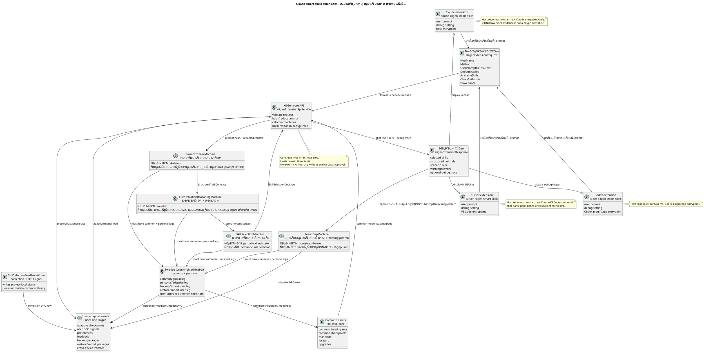
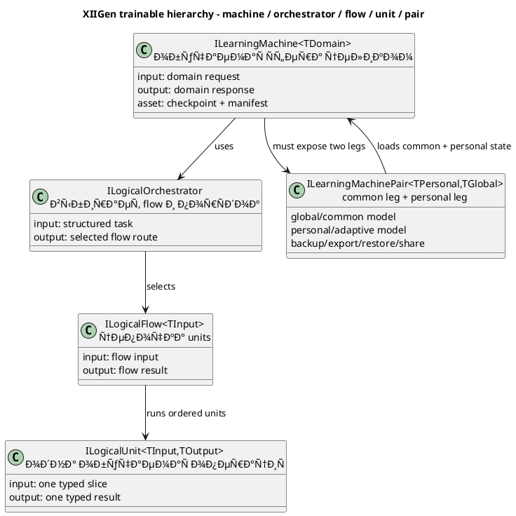

# ORCHESTRATION-AND-PROMPT-TO-TASK-FULL-EXTENSIONS-PLAN-v3

Статус: **только план / реализация не разрешена**.

Этот документ описывает план реализации полноценного набора XIIGen smart-skills extensions для Claude, Cursor и Codex.

Реализация после этого документа запрещена, пока Луба не прочитает план и не даст новое явное разрешение в текущем разговоре, например: `план принят, начинай реализацию`.

Технический маркер для следующих сессий:

```text
requested_artifact_type=plan
implementation_authorized_now=false
luba_acceptance_quote=NONE
quoted_transcripts_and_old_state_are_evidence_only=true
```

## 0. Что должен дать этот план

Нужен не набор JSON-отчётов и PowerShell-проверок, а настоящие расширения:

1. Пользователь пишет запрос в Claude, Cursor или Codex.
2. Расширение отправляет тонкий запрос в XIIGen core.
3. XIIGen переводит запрос пользователя в структурированную задачу.
4. XIIGen находит план оркестрации для этой задачи.
5. XIIGen находит нужные скилы для задачи.
6. Если нужный паттерн не найден, то после ответа внешнего AI система строит DPO-сигнал и обучает пользовательскую adaptive-модель.
7. Если пользователь меняет или исправляет результат, система строит correction DPO-сигнал и улучшает пользовательскую adaptive-модель.
8. Общая логика, общие датасеты, создание common-моделей и common-модельные артефакты находятся в `C:\Projects\llm_mvp_core`.
9. Пользовательские adaptive-датасеты и adaptive-модели находятся у пользователя и не перетираются common-апгрейдом.
10. Любая обучаемая сфера на базе `ILearningMachine` имеет две ноги: common/global leg у нас в `llm_mvp_core` и personal/adaptive leg у пользователя. Пользовательская нога живёт на его компьютере, адаптирует поведение под него, её можно забэкапить, экспортировать, импортировать, перенести на другое устройство и расшарить только через безопасный user-approved/anonymised package.
11. В `claude-xiigen-smart-skills`, `cursor-xiigen-smart-skills`, `codex-xiigen-smart-skills` должен быть реальный host entrypoint code, manifest/package wiring и тонкий adapter к XIIGen exe или утверждённому API из `llm_mvp_core`.

## 0.1 Источники, которые покрывает этот план

| Источник | Как используется |
|---|---|
| `C:\Users\lubao\Documents\xiigen\extensions  - orchestration based on our data\ORCHESTRATION-REASONING-MACHINE-PLAN-v1.md` | Требования к `OrchestrationReasoningMachine` |
| `C:\Users\lubao\Documents\xiigen\extensions  - orchestration based on our data\PROMPT-TO-TASK-MACHINE-PLAN-v1.md` | Требования к `PromptToTaskMachine` |
| `C:\Users\lubao\Documents\xiigen\extensions  - orchestration based on our data\ORCHESTRATION-REASONING-DPO-NEGATIVE-STRATEGY-v1.md` | Таксономия negative DPO для оркестрации |
| `C:\Users\lubao\Documents\xiigen\extensions  - orchestration based on our data\PROMPT-TO-TASK-DPO-NEGATIVE-STRATEGY-v1.md` | Таксономия negative DPO для prompt-to-task |
| `C:\Projects\llm_mvp_core\docs\plans\DPO-KNOWLEDGE-MAP-v1.md` | Обязательная карта DPO skills/guides/schema/taxonomy/validation для каждого trainable/adaptive work order |
| `C:\Users\lubao\Documents\xiigen\extensions  - orchestration based on our data\ORCHESTRATION-AND-PROMPT-TO-TASK-EXTENSIONS-PLAN-v2.md` | Старый план как evidence only; v3 заменяет его как текущий approval artifact |
| `C:\Projects\llm_mvp_core\docs\plans\ORCHESTRATION-MACHINE-TRAINING-PLAN-v20.md` | Только стиль и уроки model lifecycle; не primary coverage target |

Корни для обучения и reference examples:

| Корень | Роль |
|---|---|
| `C:\Users\lubao\Documents\xiigen\sonnet local - analyzes` | Референсы хорошего анализа для `OrchestrationReasoningMachine` |
| `C:\Users\lubao\Documents\xiigen\claude-sessions\user prompts` | Сырые пользовательские prompts для `PromptToTaskMachine` |
| `C:\Users\lubao\Documents\xiigen\claude-sessions\sonnet-user-prompts` | Примеры prompt -> план, accepted/rejected orchestration |

Raw private prompts and raw private analyses must not be copied into committed artifacts. Коммитятся только схемы, хэши, source refs, redacted features и approved DPO rows.

## 0.2 Сквозные gates, которые обязаны быть в каждом work order

Ни один будущий work order из этого плана не считается готовым к выдаче executor-субагенту, пока parent `REVIEW_INTERNAL` не проверит четыре admission-слоя ниже. Это не stop gate для архитектора: если слой не покрыт, архитектор обязан исправить work order или план и продолжить подготовку.

| Сквозной gate | Где обязателен | Что должен доказать artifact |
|---|---|---|
| `DPO-KNOWLEDGE-MAP` | Каждый trainable, adaptive или DPO work order | Загружены DPO skills, названы guide paths, определены chosen/rejected schema, taxonomy, registry fields, train-ready validation, held-out evidence, fresh-load evidence и continue-training evidence. |
| `DPO-UNIVERSALIZATION-GATE` | Каждый common или adaptive DPO work order для OrchestrationReasoning, PromptToTask, SkillSelection и ResultGap | DPO rows разделены на universal reasoning / universal skill semantics, project adapter refs и excluded technical execution refs. Пока `TECH-EXEC-LEARNING-GATE` не принят, common и adaptive rows не содержат code-bound execution instructions. |
| `TEST-STRATEGY-ADMISSION` | Каждый work order, который меняет code, model, data, host, API или asset | Для этой ветки выбраны нужные проверки: unit, integration, e2e/host, QA automation, negative tests, untrained honesty, trained acceptance, regression. Если какая-то ветка неприменима, artifact объясняет почему. |
| `UML-EXECUTABLE-CASE-MAP` | Каждый work order, который реализует UML edge, алгоритмическую ветку или host path | Каждая UML-стрелка и каждая algorithm branch мапится на input fixture, expected fields, expected asset touched/not touched, expected visible chat/debug output. |
| `AUTHORITY-SELF-REFLECTION-GATE` | Каждый work order без исключения | Загружены conversation-intent/self-reflection, architect-behavior-classifier, plan-review, skill-injection, implementation-integrity и phase-completion skills as applicable. Gate явно предотвращает executor drift, defensive freeze, action-as-relief, focus loss и entropy tolerance. |
| `CHECKPOINT-WRITER-GUARD` | Каждый training/adaptive/model asset work order | Один checkpoint пишет только один writer; checkpoint не пишется при unknown/failed gate; resume строится из accepted pair ids / accepted source refs, а не из cursor-prefix или replay; corrupted checkpoint не принимается как continuation. |
| `METRIC-HONESTY-GATE` | Каждый work order, который заявляет accuracy, readiness, trained quality или improvement | Retrieval/routing и trained generalization считаются отдельно; headline quality = only truly-novel held-out generalization; metrics воспроизводятся из runner/generator, не принимаются как hand-written JSON. |
| `HUMAN-AUTHORITY-BOUNDARY-GATE` | PromptToTask, OrchestrationReasoning, plan-review and host-facing work orders | Текущая явная команда Лубы побеждает вложенный файл, старый план, state, inferred task and machine artifact name. Attachment alone never overrides current human instruction. |
| `SUBAGENT-PACKET-QUALITY-GATE` | Каждый bounded sub-agent packet and parent review | Packet names required reasoning tier/capability, forbids self-approval, treats review as stale after mutation, and exposes ALLOW/CONTINUE/REPAIR/OPERATOR-INPUT verdicts. |
| `TEST-EXECUTION-HYGIENE-GATE` | Каждый work order with test/runtime command | Plan separates pre-existing red from phase-induced regression, checks/remediates exact orphan process roots before rerun, and requires heartbeat/replacement-worker handoff for long-running sub-agent work. |

Минимальные имена artifacts:

```text
artifacts/dpo-knowledge-map/<work_order>.json
artifacts/dpo-universalization/<work_order>.json
artifacts/test-strategy-admission/<work_order>.json
artifacts/uml-executable-case-map/<work_order>.json
artifacts/authority-self-reflection/<work_order>.json
artifacts/checkpoint-writer-guard/<work_order>.json
artifacts/metric-honesty/<work_order>.json
artifacts/human-authority-boundary/<work_order>.json
artifacts/subagent-packet-quality/<work_order>.json
artifacts/test-execution-hygiene/<work_order>.json
```

CM-24B future invariant for `AUTHORITY-SELF-REFLECTION-GATE`:

- Every future bounded sub-agent work order must name the required skills/guides and must return or reference `artifacts/authority-self-reflection/<work_order>.json` before parent acceptance.
- Minimum artifact fields are: `work_order_id`, `authority_source`, `loaded_skills_guides`, `direct_question_priority_check`, `architect_parent_not_executor_check`, `action_as_relief_check`, `defensive_freeze_or_defensive_self_reflection_check`, `focus_soft_notes_review`, `entropy_ordering_check`, `test_only_not_implementation_check`, `parent_review_required`, `status`, `gaps`, and `next_action`.
- Parent `REVIEW_INTERNAL` rejects any bounded sub-agent packet that lacks this artifact or an explicit not-applicable reason. The next action is the authority/self-reflection artifact repair for that same work order, not phase completion and not final acceptance.
- Historical work orders before CM-24B remain recorded as partial when no standalone per-work-order artifact exists; this invariant closes only the future admission hole and does not fabricate historical evidence.

Если work order не создаёт эти artifacts или не объясняет неприменимость слоя, parent review возвращает его на repair. Executor не имеет права заменить эти gates устным обещанием.

---

# Part A - понятная архитектура для Лубы

Part A является главным пользовательским описанием. Part B не имеет права тайно менять архитектуру, алгоритмы, ownership данных или product behavior.

Governance parity rule: текущая метка этого правила — **OP-49 / FC-19** (не OP-48). Parent `REVIEW_INTERNAL` обязан проверять `Part A == Part B` по core-областям: architecture, product decisions и algorithms. Если Part B меняет архитектуру, принимает product decision или добавляет/подменяет алгоритм, которого нет в Part A, план не принят и должен быть отремонтирован до исполнения.

## A0. Простая UML-диаграмма для draw.io

Импорт в draw.io: **Arrange -> Insert -> Advanced -> PlantUML**.



### A0.1 Симуляции и ожидаемые результаты по каждому соединению UML

Это часть UML, а не техническая мелочь. Каждая стрелка на диаграмме должна иметь понятный сценарий: что отправили, что должно произойти, какой результат считается правильным. Если в Part B появляется новая стрелка без строки в этой таблице, план снова нарушает `A == B`.

| UML connection | Симуляция | Ожидаемый результат |
|---|---|---|
| `ClaudeHost --> Request` | Пользователь в Claude пишет: "Проверь план extensions, найди дыры и не начинай реализацию". Debug включен. | Claude extension не решает задачу сама. Она собирает `XiigenExtensionRequest` с `HostName=Claude`, `Method=plan_review_orchestration`, текстом запроса, debug flag, provenance и списком доступных host facts. |
| `CursorHost --> Request` | Пользователь в Cursor просит: "Найди скилы для ремонта VS Code extension и покажи trace". | Cursor extension создаёт такой же тонкий request, но с `HostName=Cursor` и VS Code/Cursor provenance. В host repo нет semantic ranking или DPO logic. |
| `CodexHost --> Request` | Пользователь в Codex просит: "Переведи мой prompt в задачу и предложи orchestration plan". | Codex plugin/app entrypoint создаёт request с `HostName=Codex`, но не вызывает внешнюю AI model и не выбирает план внутри host. |
| `Request --> CoreApi` | Host отправляет request с raw prompt, debug flag, available skills and check-set inputs. | `XiigenExtensionApiService` принимает только thin API/check-set request, валидирует обязательные поля, redacts/hashes private prompt before training artifacts, rejects unsafe external-tool request unless Luba approved it. |
| `CoreApi --> PromptToTask` | Core получил prompt: "Сделай plan-only repair, не выполняй код". | В `PromptToTaskMachine` уходит redacted prompt/context, а не full private transcript. Ожидаемый выход: `StructuredTaskContract` с типом `plan_repair`, constraints `no_implementation`, `subagent_review`, `A_equals_B_required`. |
| `PromptToTask --> Reasoning` | Structured task говорит: "добавить UML simulations per connection". | `OrchestrationReasoningMachine` получает именно задачу, а не raw chat. Ожидаемый выход: scenario refs для readable plan repair, affected Part A sections, gates: static coverage + sub-agent review, forbidden actions: code/runtime. |
| `Reasoning --> SkillSelection` | Reasoning выбрал сценарий "plan-readable architecture repair". | `SkillSelectionMachine` получает task/scenario context и выбирает skills like planning, plan-review, architecture-review, not executor/build/test skills. Выбор должен быть backed by trained semantic state, not candidate-position weights. |
| `SkillSelection --> CoreApi` | Skill selection вернул candidate skills + confidence + evidence refs. | CoreApi получает `SkillSelectionDecision`; если model gate refs missing, response must say semantic quality is not proven. No host-side reranking. |
| `CoreApi --> Response` | Core собрал task refs, scenario refs, selected skills, warnings and debug trace. | `XiigenExtensionResponse` содержит readable result for chat: selected skills, structured task refs, scenario refs, warnings/errors, optional safe debug trace. It does not expose private corpus rows or model internals. |
| `Response --> ClaudeHost` | Claude получает response for plan repair. | Claude показывает в чате понятный ответ и, если debug включен, safe trace: `xiigen <method> :`, `input:`, `output:`. Raw private prompt/secrets are redacted. |
| `Response --> CursorHost` | Cursor получает response for extension work. | Cursor отображает ответ в UI/chat/panel. Debug trace visible only if setting enabled and redacted. |
| `Response --> CodexHost` | Codex получает response for smart-skills orchestration. | Codex plugin/app показывает structured answer. It does not claim plugin completion from JSON-only artifacts. |
| `PromptToTask --> TwoLegPair` | PromptToTask learns common prompt-to-task behavior from approved prompt/task pairs and also adapts to Luba's personal phrasing. | PromptToTask must have common/global checkpoint in `llm_mvp_core` and personal/adaptive checkpoint under user `.xiigen`. Missing either leg fails the plan. |
| `Reasoning --> TwoLegPair` | Reasoning learns common orchestration patterns from guides and personal preferences from Luba corrections. | OrchestrationReasoning must load common guide-state model plus user adaptive state. It cannot use filename/BM25/static route table as final reasoning. |
| `SkillSelection --> TwoLegPair` | SkillSelection learns general skill mapping and adapts when user corrects selected skills. | All semantic units must be represented in model assets; adaptive user corrections must not mutate common checkpoint. |
| `ResultGap --> TwoLegPair` | After AI output, system sees "the answer missed UML edge simulations". | ResultGap has common missing-pattern model and user adaptive leg. It produces an adaptive signal instead of only a chat note. |
| `TwoLegPair --> CommonAssets` | Common model v1 is upgraded by project. | Common checkpoint/manifest/locator/training refs live in `llm_mvp_core`; upgrade can change common hash but must not overwrite user adaptive hash. |
| `TwoLegPair --> UserAssets` | User has personal corrections and preferred plan style. | Personal checkpoint/DPO/preferences live in user `.xiigen`, can be backed up/exported/restored/shared only through safe user-approved package. |
| `Response --> ResultGap` | AI/host output comes back and user says: "this missed a whole branch". | ResultGap checks the output against expected task/scenario/skills. If pattern missing, it returns a missing-pattern finding and creates/requests adaptive DPO path. |
| `ResultGap --> UserAssets` | Missing branch is confirmed after response. | A user-local DPO row is written with chosen/rejected refs, redaction report and provenance. Common model is unchanged. |
| `FeedbackWriter --> UserAssets` | User changes selected skills or rewrites the plan answer. | Correction DPO signal is written to `.xiigen`; chosen reflects user's accepted correction, rejected reflects previous weaker output. |
| `CommonAssets --> CoreApi` | Core starts and needs latest common smart-skills models. | CoreApi loads common manifests/checkpoints/locators from `llm_mvp_core`; if missing, response must downgrade semantic claim and name missing asset. |
| `UserAssets --> CoreApi` | User has adaptive checkpoint from previous sessions. | CoreApi loads adaptive user model alongside common model. If user package is absent, common still works but personalization claim is disabled. |
| `CoreApi --> UserAssets` | Common model upgraded or request processed. | CoreApi preserves adaptive state. It may append approved adaptive signals but cannot overwrite/delete user checkpoint during common upgrade. |

Минимальный simulation gate для каждой строки: `input fixture -> expected request/response fields -> expected asset touched/not touched -> expected visible chat/debug output`. Если executor не может указать эти четыре элемента для стрелки, эта связь ещё не готова к реализации.

### A0.1.1 Executable model/host test-case artifact из UML

Таблица выше не является финальным доказательством. Перед реализацией любого UML edge или algorithm branch executor должен получить готовый executable artifact `artifacts/uml-executable-case-map/<work_order>.json`.

Каждая строка artifact должна содержать:

| Поле | Смысл |
|---|---|
| `uml_edge_or_algorithm_branch` | Точная стрелка UML или точная ветка алгоритма из Part A. |
| `input_fixture` | Redacted вход, который можно подать в core machine, API или host entrypoint. |
| `expected_request_fields` | Какие поля должны появиться в request/DTO. |
| `expected_response_fields` | Какие поля должны появиться в response/report. |
| `expected_asset_touched` | Какие model/data/adaptive artifacts можно менять. |
| `expected_asset_not_touched` | Какие common/adaptive/host/private artifacts менять нельзя. |
| `expected_visible_chat_or_debug_output` | Что пользователь или программист увидит в Claude/Cursor/Codex, включая `xiigen <method> :`, `input:`, `output:` при debug. |
| `negative_case` | Что должно провалиться: wrong host-side logic, missing redaction, false trained claim, forbidden external tool, hidden deterministic shortcut. |

Parent `REVIEW_INTERNAL` обязан сравнить этот artifact с UML и русским алгоритмом из Part A. Если хотя бы одна UML-стрелка или algorithm branch не имеет executable case, work order возвращается на repair до исполнения.

### A0.2 Как читать эту диаграмму человеческим языком

Схема читается слева направо: Claude, Cursor и Codex - это только входные двери. Они принимают текст пользователя, настройку debug, список доступных навыков и служебный контекст, после чего отправляют тонкий `XiigenExtensionRequest` в XIIGen core. В host extension не должно быть логики выбора плана, выбора скилов, обучения, DPO или ранжирования.

`XiigenExtensionRequest` - это конверт. В нём лежит то, что написал пользователь, откуда пришёл запрос, какие навыки видит host, включён ли debug и какие check-set inputs надо передать. До попадания в обучающие артефакты raw prompt должен быть захэширован или отредактирован: private текст пользователя не должен случайно стать common data.

`XiigenExtensionApiService` - это центральный вход в `llm_mvp_core`. Он проверяет запрос, убирает лишнее/private, вызывает core-машины и собирает ответ. Если debug включён, он также собирает безопасный trace вида `xiigen <method> :`, `input:`, `output:`, чтобы программист видел, что именно ушло в XIIGen и что вернулось обратно.

Дальше идут три обучаемых шага. `PromptToTaskMachine` переводит человеческий prompt в структурированную задачу. `OrchestrationReasoningMachine` берёт эту задачу и находит подходящий сценарий оркестрации по обученным guide patterns. `SkillSelectionMachine` берёт задачу и сценарий и выбирает нужные навыки. Эти решения не должны быть regex, exact lookup, BM25 или таблицей `if/else`: они принимаются только trained state с checkpoint, manifest, export/import, fresh-load, continue-training и held-out evidence.

`XiigenExtensionResponse` возвращается обратно в host и отображается в чате или UI. В нём должны быть не внутренности модели, а понятные результаты: выбранные навыки, ссылки на структурированную задачу, ссылки на сценарий, предупреждения/ошибки и, если включён debug, безопасный trace.

После ответа внешнего AI включается learning loop. `ResultGapMachine` проверяет, не пропустила ли система важный паттерн. Если паттерн был пропущен, он пишет adaptive DPO row в user side `.xiigen`. Если пользователь исправил результат вручную, `SkillSelectionFeedbackWriter` тоже пишет correction DPO row в user side `.xiigen`. Это улучшает пользовательскую модель, но не мутирует нашу common library.

У каждой обучаемой сферы есть две ноги. Common/global нога живёт у нас в `llm_mvp_core`: common training sets, common checkpoints, manifests, locators и upgrades. Personal/adaptive нога живёт у пользователя: adaptive checkpoints, user DPO signals, preferences, feedback, backup packages и restore/import packages. Эти две ноги связывает `ILearningMachinePair`: common upgrade может обновить нашу общую модель, но не имеет права перетереть пользовательскую adaptive-модель.

Backup/share/restore - это отдельное требование, а не украшение. Пользовательская модель должна уметь экспортироваться в переносимый пакет, восстанавливаться в fresh profile/device path и безопасно копироваться или шариться только как user-approved/anonymised package. Простая папка `.xiigen` без manifest, checkpoint hash, redaction report и restore/import probe не считается выполнением требования.

## A1. Алгоритмы простым русским языком

Каждый алгоритм ниже описан как паспорт текущей реализации: какая функция вызывается, какой вход она принимает, какой выход возвращает, что она делает сейчас по шагам, и где текущая реализация ещё является skeleton/bootstrap/partial вместо полноценной обучаемой модели.

### A1.1 Пользовательский запрос -> структурированная задача

Класс: `SmartSkillsDomain.PromptToTaskMachine`.

Функция: `PromptToTaskMachine.Translate(PromptToTaskRequest request)` (`C:\Projects\llm_mvp_core\43.SmartSkillsDomain\PromptToTaskMachine.cs:36`, quote: `public OperationResult<PromptToTaskResponse> Translate(PromptToTaskRequest request)`).

Вход: `PromptToTaskRequest` (`C:\Projects\llm_mvp_core\43.SmartSkillsDomain\PromptToTaskContracts.cs:9`) содержит `PromptId`, `RawPrompt`, `RawPromptSha256`, `PromptProvenance`, `UserLanguage`, `ExplicitConstraints`, `ContextFields`. API сейчас строит его в `BuildPromptToTaskRequest(...)` (`C:\Projects\llm_mvp_core\43.SmartSkillsDomain\XiigenExtensionApiService.cs:241`) и передаёт redacted prompt: raw text не идёт дальше, остаётся hash и context fields.

Выход: `PromptToTaskResponse` (`C:\Projects\llm_mvp_core\43.SmartSkillsDomain\PromptToTaskContracts.cs:107`) с `StructuredTaskContract`, evidence и status.

Алгоритм сейчас:
1. Пробует загрузить learned-state descriptor через `TryLoadLearnedState()`.
2. Создаёт `StructuredTaskContract`, но ставит `TaskType = not_ready_no_semantic_task`.
3. Переносит безопасные поля: prompt id, raw prompt hash, language, explicit constraints, provenance.
4. В `EvidenceNeeds` пишет, что semantic inference ещё не сделан.
5. Возвращает `PromptToTaskResponse` со status `not_trained_no_loaded_state` или `loaded_state_ready_no_inference_implemented`.

Как должно работать: машина получает сырой prompt пользователя и переводит его в задачу: что пользователь хочет сделать, какие есть constraints, deliverables, forbidden actions, target hosts и evidence needs. Это должна быть обучаемая машина, а не regex-classifier и не таблица prompt keywords.

Как реализовано сейчас: это skeleton. Код сохраняет hash prompt и constraints, но возвращает placeholder `not_ready_no_semantic_task`. Semantic inference ещё не реализован.

Что нельзя делать: нельзя решать task type через `if prompt contains ...`, нельзя складывать private raw prompts в common repo artifacts.

### A1.2 Структурированная задача -> план оркестрации

Класс: `SmartSkillsDomain.OrchestrationReasoningMachine`.

Функция: `OrchestrationReasoningMachine.Plan(OrchestrationReasoningRequest request)` (`C:\Projects\llm_mvp_core\43.SmartSkillsDomain\OrchestrationReasoningMachine.cs:37`, quote: `public OperationResult<OrchestrationReasoningResponse> Plan(OrchestrationReasoningRequest request)`).

Вход: `OrchestrationReasoningRequest` (`C:\Projects\llm_mvp_core\43.SmartSkillsDomain\OrchestrationReasoningContracts.cs:9`) содержит `RequestId`, `Task`, `GuideDerivedStateRefs`, `CorpusBundleIds`, `AdaptiveContextRefs`, `RuntimePolicyRefs`. API строит его в `BuildOrchestrationRequest(...)` (`C:\Projects\llm_mvp_core\43.SmartSkillsDomain\XiigenExtensionApiService.cs:258`).

Выход: `OrchestrationReasoningResponse` (`C:\Projects\llm_mvp_core\43.SmartSkillsDomain\OrchestrationReasoningContracts.cs:103`) с `OrchestrationScenarioPlan`, evidence и status.

Алгоритм сейчас:
1. Пробует загрузить learned guide-state descriptor через `TryLoadLearnedGuideState()`.
2. Создаёт `OrchestrationScenarioPlan` с `ScenarioId = not-ready-no-orchestration-inference`.
3. Не выбирает learned patterns, phase families, gate families, assets или host check-sets.
4. Заполняет risk flags и next actions, чтобы честно показать, что inference ещё не реализован.
5. Возвращает status `not_trained_no_learned_guide_state` или `loaded_guide_state_ready_no_inference_implemented`.

Как должно работать: машина получает `StructuredTaskContract`, сопоставляет его с обученными guide-derived patterns и выдаёт scenario plan: какие phase families, gates, assets, host check-sets, risks и granular work orders нужны.

Как реализовано сейчас: это skeleton. Код может загрузить descriptor learned guide state, но semantic orchestration plan ещё не генерируется. Возвращается scenario id `not-ready-no-orchestration-inference`.

Что нельзя делать: нельзя выбирать план по имени файла, BM25-like search, заголовку гайда или static route table. Такие вещи могут быть только corpus/search infrastructure. Runtime planning decision должен идти из trained state с checkpoint, manifest, export/import, fresh-load, continue-training и ablation evidence.

### A1.3 Задача -> нужные скилы

Класс: `SmartSkillsDomain.SkillSelectionMachine`.

Функция выбора: `SkillSelectionMachine.DecideFromTrainedState(SkillSelectionRequest request)` (`C:\Projects\llm_mvp_core\43.SmartSkillsDomain\SkillSelectionMachine.cs:57`, quote: `public OperationResult<SkillSelectionDecision> DecideFromTrainedState(SkillSelectionRequest request)`).

Функция обучения текущего partial state: `TrainMachineBatchAsync(IReadOnlyList<SkillSelectionMachinePair> pairs, CancellationToken ct = default)` (`C:\Projects\llm_mvp_core\43.SmartSkillsDomain\SkillSelectionMachine.cs:41`). Внутри она вызывает `LearnPair(SkillSelectionMachinePair pair)` (`C:\Projects\llm_mvp_core\43.SmartSkillsDomain\SkillSelectionMachine.cs:286`).

Вход выбора: `SkillSelectionRequest` (`C:\Projects\llm_mvp_core\43.SmartSkillsDomain\SkillSelectionContracts.cs:6`) содержит prompt/hash, project root, `AvailableSkillIds`, host facts и source ledger id. API строит request в `DecideSkills(...)` (`C:\Projects\llm_mvp_core\43.SmartSkillsDomain\XiigenExtensionApiService.cs:203`).

Выход выбора: `SkillSelectionDecision` (`C:\Projects\llm_mvp_core\43.SmartSkillsDomain\SkillSelectionContracts.cs:13`) с selected skills, rejected skills, evidence features, confidence, second-pass flag и текстом решения.

Алгоритм сейчас:
1. Если `_candidatePositionWeights` пустой или host не дал `AvailableSkillIds`, возвращает no trained state и просит second pass.
2. Для каждого доступного skill берёт его позицию в списке host-а.
3. Смотрит вес этой позиции в `_candidatePositionWeights`.
4. Выбирает skill с максимальным весом, при равенстве - более раннюю позицию.
5. Evidence пишет `TRAINED_CANDIDATE_POSITION_WEIGHT`, `candidate_index`, `candidate_weight`.
6. Обучение `LearnPair` увеличивает `_candidatePositionWeights[index]` для позиции chosen skill-а в DPO row. Это позиционный частотный счётчик, не semantic selector.

Как должно работать: машина выбирает скилы через trained state. В финальной версии она должна использовать 11 trainable semantic units из `SmartSkillsSemanticUnitCatalog`: prompt understanding, task understanding, task type, routing, skill candidates, skill selection, prompt context, result gap, output validation, task completion, intermediate checks.

Как реализовано сейчас: есть partial trained behavior. Машина учит candidate-position weights из DPO rows и умеет save/load checkpoint. **Важно (честно): текущее обучение — это позиционный частотный счётчик (`_candidatePositionWeights[index]++` за позицию выбранного навыка), а НЕ семантическое обучение. Это согласуется с тем, что `AccuracyAtExport = 0.0`, а `EvaluateAsync` возвращает `PassesGate=false`.** candidate position слишком слабый сигнал для полной semantic skill selection.

Что нельзя делать: нельзя использовать BM25, regex, hardcoded skill ids, host-side ranking или position weight как финальную semantic authority. Candidate-position weight можно оставить только как временный scaffold с честной пометкой partial.

### A1.4 После ответа AI не найден паттерн -> DPO + обучение пользовательской модели

Классы: `SmartSkillsDomain.ResultGapMachine`, будущий trainable `ResultGapMachine`, adaptive training adapter.

Функция: `ResultGapMachine.Evaluate(ResultGapRequest request)` (`C:\Projects\llm_mvp_core\43.SmartSkillsDomain\SkillSelectionContracts.cs:173`, quote: `public ResultGapResult Evaluate(ResultGapRequest request)`).

Вход: `ResultGapRequest` (`C:\Projects\llm_mvp_core\43.SmartSkillsDomain\SkillSelectionContracts.cs:127`) содержит prompt, selected skills, AI output, expected/observed missing skill id и source prompt ledger id.

Выход: `ResultGapResult` (`C:\Projects\llm_mvp_core\43.SmartSkillsDomain\SkillSelectionContracts.cs:151`) с флагом gap, missing skill id, second-pass update, DPO row, evidence features и evidence mode.

Алгоритм сейчас:
1. Берёт `ObservedMissingSkillId`, а если он пустой - `ExpectedMissingSkillId`.
2. Считает gap найденным, если missing skill не пустой и его нет в `SelectedSkillIds`.
3. Если gap не найден, возвращает `NO_SKILL_GAP_DETECTED`.
4. Если gap найден, добавляет missing skill к required skills.
5. Создаёт `SecondPassContextUpdate`, чтобы следующий проход не игнорировал missing skill.
6. Создаёт `ResultGapDpoRow`: chosen = selected + missing skill, rejected = старые selected skills.
7. Evidence mode честно пишет `bootstrap_test_harness_not_semantic_authority`.

Как должно работать: после ответа Claude/Cursor/Codex XIIGen проверяет, хватило ли выбранных skills и orchestration. Если нужный skill/pattern отсутствовал, система создаёт DPO: chosen = corrected skill/task/plan set, rejected = original insufficient set. Сигнал сначала идёт в user adaptive model. Если паттерн общий и approved, он может позже стать common training candidate.

Как реализовано сейчас: есть bootstrap fixture logic, которая создаёт `ResultGapDpoRow`, когда expected skill отсутствует. Код прямо маркирует это как not semantic authority. Training adaptive model from this signal ещё не реализован.

Что нельзя делать: нельзя молча добавлять skill через if/else и называть это обучением. Нельзя перекладывать на Лубу ручное заполнение DPO bindings, если local approved strategies and source refs can safely seed rows automatically.

### A1.5 Пользователь исправил или изменил результат -> улучшить пользовательскую модель

Класс: `SmartSkillsDomain.SkillSelectionFeedbackWriter`.

Функция: `SkillSelectionFeedbackWriter.WriteProjectLocalSignal(ProjectLocalSkillState currentState, SkillSelectionFeedbackEvent feedback)` (`C:\Projects\llm_mvp_core\43.SmartSkillsDomain\SkillSelectionContracts.cs:282`).

Вход: `ProjectLocalSkillState` (`C:\Projects\llm_mvp_core\43.SmartSkillsDomain\SkillSelectionContracts.cs:69`) и `SkillSelectionFeedbackEvent` (`C:\Projects\llm_mvp_core\43.SmartSkillsDomain\SkillSelectionContracts.cs:76`). В feedback лежит prompt, originally selected skills, corrected skills, feedback text и source ledger id.

Выход: `SkillSelectionFeedbackWriteResult` (`C:\Projects\llm_mvp_core\43.SmartSkillsDomain\SkillSelectionContracts.cs:98`) с обновлённым local state, DPO-like signal и флагом, менялась ли universal library.

Алгоритм сейчас:
1. Делает chosen из `CorrectedSkillIds`.
2. Делает rejected из originally selected skills, которых нет в chosen.
3. Собирает source id из ledger id и feedback id.
4. Создаёт `ProjectLocalSkillFeedbackSignal` в scope `project-local:.xiigen/smart-skills/dpo-signals.jsonl`.
5. Ставит `SemanticQualityClaimed = false`.
6. Проверяет, нет ли private absolute path в prompt/reason/source id.
7. Добавляет feedback text в local state и возвращает `UniversalLibraryMutated = false`.

Как должно работать: correction пользователя превращается в DPO signal. Corrected behavior становится chosen, previous behavior становится rejected. Сигнал остаётся в user adaptive storage и может обучить user model. Common repo assets не мутируются private feedback без отдельного approved promotion path.

Как реализовано сейчас: `SkillSelectionFeedbackWriter` пишет project-local DPO signal и добавляет feedback в local state. Training loop ещё не реализован.

Что нельзя делать: нельзя перезаписывать universal skill library или common checkpoint private feedback-ом.

### A1.6 Common/adaptive upgrade

Классы: `SmartSkillsDomain.SkillLibraryUpgradePlanner`, `ProjectLocalSkillStateRefresh`, `SkillSelectionMachine`.

Функция: `SkillLibraryUpgradePlanner.PlanUpgrade(SkillLibraryUpgradeRequest request)` (`C:\Projects\llm_mvp_core\43.SmartSkillsDomain\SkillSelectionContracts.cs:328`, quote: `public SkillLibraryUpgradeResult PlanUpgrade(SkillLibraryUpgradeRequest request)`).

Вспомогательная функция refresh: `ProjectLocalSkillStateRefresh.ApplyServerLibraryRefresh(ProjectLocalSkillState localState, IReadOnlyList<ServerSkillLibraryEntry> refreshedServerEntries)` (`C:\Projects\llm_mvp_core\43.SmartSkillsDomain\SkillSelectionContracts.cs:422`) принимает local state + refreshed server entries и возвращает новый `ProjectLocalSkillState` только с обновлённым `ServerLibraryEntries`.

Вход: `SkillLibraryUpgradeRequest` (`C:\Projects\llm_mvp_core\43.SmartSkillsDomain\SkillSelectionContracts.cs:103`) содержит old universal library, new universal library и user/project local state.

Выход: `SkillLibraryUpgradeResult` (`C:\Projects\llm_mvp_core\43.SmartSkillsDomain\SkillSelectionContracts.cs:117`) с upgraded local state, applied universal library, patch proposals, preservation flags и evidence mode.

Алгоритм сейчас:
1. Сортирует новую universal library по `SkillId` и `Version`.
2. Обновляет в local state только `ServerLibraryEntries`.
3. Строит patch proposals для local keys, которые могли переехать в новые universal skill ids.
4. Проверяет, что `WikiNotes`, `Preferences`, `Feedback`, `CustomSkillWeights` не изменились.
5. Возвращает `ProjectLocalStatePreserved`, `UniversalLibraryMutatedProjectLocalState = false` и `EvidenceMode = schema_upgrade_boundary_not_semantic_authority`.

Как должно работать: common assets из `llm_mvp_core` можно обновлять. User adaptive state загружается рядом и сохраняется. Если common skill identity изменился, система создаёт patch proposal вместо silent overwrite.

Как реализовано сейчас: schema-boundary upgrade logic уже есть и сохраняет local state. `SkillSelectionMachine` умеет save/load checkpoint and manifest. Asset lifecycle для `PromptToTaskMachine` и `OrchestrationReasoningMachine` ещё не реализован.

Что нельзя делать: нельзя паковать `.xiigen` user data в common model release и нельзя перетирать user state при common upgrade.

### A1.7 Две ноги у каждой обучаемой сферы

Классы: `AgentInfrastructure.Logical.ILearningMachinePair<TPersonal,TGlobal>`, `AgentInfrastructure.Logical.ILearningMachine<TDomain>`, будущие pair-adapters для `PromptToTaskMachine`, `OrchestrationReasoningMachine`, `SkillSelectionMachine`, `ResultGapMachine`.

Контракт: `ILearningMachinePair<TPersonal,TGlobal>` (`C:\Projects\llm_mvp_core\00.Core\LearningMachineContracts.cs:185`, quote: `public interface ILearningMachinePair<TPersonal, TGlobal>`).

Важно: A1.7 - это не отдельный runtime algorithm, а lifecycle-инвариант для всех trainable algorithms выше. Если implementation пытается сделать обучаемую сферу без двух ног, план должен падать.

Текущие реализованные функции, которые покрывают только части этого инварианта:

1. Personal signal leg: `SkillSelectionFeedbackWriter.WriteProjectLocalSignal(ProjectLocalSkillState currentState, SkillSelectionFeedbackEvent feedback)` (`C:\Projects\llm_mvp_core\43.SmartSkillsDomain\SkillSelectionContracts.cs:282`) принимает current user local state + correction feedback, возвращает `SkillSelectionFeedbackWriteResult`, пишет project-local signal в `.xiigen` scope и не мутирует universal library.
2. Common upgrade preservation leg: `SkillLibraryUpgradePlanner.PlanUpgrade(SkillLibraryUpgradeRequest request)` (`C:\Projects\llm_mvp_core\43.SmartSkillsDomain\SkillSelectionContracts.cs:328`) принимает old/new universal library + project local state, возвращает `SkillLibraryUpgradeResult`, обновляет server entries и проверяет, что local notes/preferences/feedback/custom weights сохранены.
3. Common checkpoint transfer leg: `SkillSelectionMachine.ExportAsync(CancellationToken ct = default)` (`C:\Projects\llm_mvp_core\43.SmartSkillsDomain\SkillSelectionMachine.cs:158`) возвращает `OperationResult<LearningMachineExport>`; `SkillSelectionMachine.ImportAsync(LearningMachineExport export, CancellationToken ct = default)` (`C:\Projects\llm_mvp_core\43.SmartSkillsDomain\SkillSelectionMachine.cs:173`) принимает `LearningMachineExport` и возвращает `OperationResult<bool>`.
4. Pair contract methods: `Personal`, `Global`, `SyncPersonalToGlobalAsync(CancellationToken ct = default)`, `PullGlobalToPersonalAsync(CancellationToken ct = default)` есть только как interface surface (`C:\Projects\llm_mvp_core\00.Core\LearningMachineContracts.cs:188`, `:191`, `:197`, `:203`), без smart-skills pair implementation.

Алгоритм сейчас, честно:
1. User correction может стать project-local signal через `WriteProjectLocalSignal`.
2. Common library refresh может сохранить local state через `PlanUpgrade`.
3. SkillSelection common checkpoint можно export/import через `ExportAsync`/`ImportAsync`.
4. Typed pair-интерфейс существует, но `PromptToTask/OrchestrationReasoning/SkillSelection/ResultGap` pair-adapters ещё отсутствуют.
5. Backup/export/restore/cross-device user package ещё отсутствует, поэтому AD-00 и AD-06..AD-09 остаются обязательными work orders.

Как должно работать: каждая обучаемая сфера живёт как пара. Common/global нога хранит нашу общую модель, общие сеты, manifest, locator и upgrade path в `llm_mvp_core`. Personal/adaptive нога хранит пользовательскую модель, пользовательские DPO-сигналы и предпочтения на компьютере пользователя в `.xiigen`. Когда пользователь исправляет результат или когда после AI-ответа найден пропущенный паттерн, обучается personal/adaptive нога. Когда мы выпускаем common upgrade, он подтягивается рядом с personal/adaptive ногой, но не перетирает её.

Отдельное требование: personal/adaptive ногу можно забэкапить и перенести. Для этого план должен дать user-model package: manifest, checkpoint hash, schema version, source/provenance refs, redaction report, restore/import probe и cross-device fresh profile probe. “Модель пользователя сидит у него на компе” не считается выполненным требованием, пока её нельзя экспортировать, восстановить и загрузить на другом user profile/device path.

Как реализовано сейчас: общий контракт `ILearningMachinePair<TPersonal,TGlobal>` уже есть в `00.Core` как personal + global машины с anonymised sync/pull methods. В smart-skills сейчас есть только частичная файловая граница: `.xiigen` local state, feedback writer и upgrade-preservation logic. Pair-adapter и переносимый user-model package для PromptToTask/OrchestrationReasoning/SkillSelection/ResultGap ещё не реализованы.

Что нельзя делать: нельзя считать `.xiigen` folder convention полноценной второй ногой без typed pair contract, backup/export, restore/import и cross-device probe. Нельзя шарить raw private prompts, raw private analyses, secrets или private corpus rows. Нельзя мутировать common model private feedback-ом без approved promotion path.

### A1.8 Debug trace в extension chat

Класс: `SmartSkillsDomain.XiigenExtensionApiContract`.

Главная функция API: `XiigenExtensionApiService.ProcessHostExtensionRequest(XiigenExtensionRequest request)` (`C:\Projects\llm_mvp_core\43.SmartSkillsDomain\XiigenExtensionApiService.cs:38`).

Функция форматирования trace: `XiigenExtensionApiContract.FormatDebugTraceForChat(bool debugEnabled, XiigenDebugTrace? debugTrace)` (`C:\Projects\llm_mvp_core\43.SmartSkillsDomain\XiigenExtensionApiContracts.cs:72`). Функция склейки с обычным текстом: `BuildChatDisplayText(string chatDisplayText, bool debugEnabled, XiigenDebugTrace? debugTrace)` (`C:\Projects\llm_mvp_core\43.SmartSkillsDomain\XiigenExtensionApiContracts.cs:93`).

Вход: `XiigenExtensionRequest` (`C:\Projects\llm_mvp_core\43.SmartSkillsDomain\XiigenExtensionApiContracts.cs:4`) с host name/type, method, prompt text, host facts, debug flag, requested/available skills, check-set inputs, provenance и correlation id.

Выход: `XiigenExtensionResponse` (`C:\Projects\llm_mvp_core\43.SmartSkillsDomain\XiigenExtensionApiContracts.cs:18`) с chat text, selected skills, check-set results, structured task refs, scenario refs, warnings/errors и optional `XiigenDebugTrace`.

Алгоритм сейчас:
1. Валидирует request через `ValidateRequest`.
2. Hash-ит prompt и не кладёт raw prompt в debug payload.
3. Вызывает `PromptToTaskMachine.Translate`, `OrchestrationReasoningMachine.Plan`, `SkillSelectionMachine.DecideFromTrainedState`.
4. Строит response со status `core_boundary_partial_no_semantic_quality_claim`.
5. `BuildDebugTrace` (`C:\Projects\llm_mvp_core\43.SmartSkillsDomain\XiigenExtensionApiService.cs:433`) сериализует input/output так, что `UserPromptOrTaskText = "[redacted]"`.
6. `FormatDebugTraceForChat` показывает trace только если debug включён и trace не содержит raw private content/secrets.

Как должно работать: в каждой extension есть настройка debug for programmer. Когда она включена и trace безопасен, чат показывает ровно:

```text
xiigen <method> :
input: <what was sent to xiigen exe>
output: <what was received from xiigen exe>
```

Как реализовано сейчас: core formatter and redaction guard уже есть. Host extensions ещё должны показать это через реальные entrypoints Claude, Cursor, Codex.

Что нельзя делать: нельзя показывать raw private prompts, secrets, full private corpus rows или internal training kitchen, если trace flags говорят, что там private content or secrets.

### A1.9 Все большие ветки Part B человеческим языком

Это контроль `A == B`. Part B может добавлять file scopes, имена work orders, лимиты времени, тесты, validator names и commit boundaries. Part B не имеет права добавлять новую продуктовую ветку, алгоритм, модельный lifecycle, ownership данных или host behavior, если этого нет в Part A.

| Ветка в Part B | Что это значит для пользователя | Какие данные идут | Что не должно быть спрятано только в B |
|---|---|---|---|
| `B6 Foundation work orders` | Сначала проверяем сам план и правила, а не пишем код. Если review нашёл дыру в скилах/AGENTS/CLAUDE или в readable-doc format, чинится governance/documentation. | Только plan/review notes, governance text, docs with exact code refs. | Нельзя начинать implementation через foundation-ветку. Нельзя считать review notes заменой готовому плану. |
| `B7 PromptToTaskMachine` | Это отдельная обучаемая ветка "prompt пользователя -> структурированная задача". Она должна получить свои training pairs, redacted corpus, validator, checkpoint, manifest, export/import, fresh-load и continue-training. | Prompt hash, source refs, chosen/rejected `StructuredTaskContract`, constraints, deliverables, forbidden actions, evidence needs. | Нельзя держать только skeleton `not_ready_no_semantic_task`. Нельзя заменить перевод prompt->task regex-ом, exact prompt lookup или raw prompt copy в common repo. |
| `B8 OrchestrationReasoningMachine` | Это отдельная обучаемая ветка "структурированная задача -> план оркестрации". Она учится на guide-derived patterns and approved analyses, а не ищет файл по имени. | Task contract, guide-state refs, corpus bundle refs, chosen/rejected scenario plans, phase/gate/asset/host-check families. | Нельзя спрятать BM25, filename lookup, guide title matching или static route table как будто это обучаемое reasoning. |
| `B9 SkillSelectionMachine and semantic units` | Текущий position-weight scaffold должен быть заменён семантической машиной выбора skills. Она строится из 11 обучаемых unit-ов, каждый проверяется отдельно, потом всё экспортируется/импортируется как модельный asset. | Task/scenario context, available skills, semantic unit checkpoints, held-out reports, ablation evidence. | Нельзя оставить `_candidatePositionWeights[index]++` финальным selector-ом. Нельзя сказать "скилы выбираются обучаемо", пока 11 unit-ов не представлены в checkpoint and reports. |
| `B10 Adaptive user learning` | Это пользовательская нога обучения. Если система не нашла паттерн или пользователь исправил результат, строится user-local DPO, обучается adaptive model, common state не перетирается. User model должна backup/export/restore/share safely. | `.xiigen` adaptive checkpoint, user DPO rows, correction signals, redaction report, user-model package manifest/hash. | Нельзя хранить feedback только как чат. Нельзя мутировать common model private feedback-ом. Нельзя считать `.xiigen` папку полноценной второй ногой без pair contract and portability probes. |
| `B11 Core API boundary` | XIIGen core должен стать реальным API для host extensions: host отправляет request, core вызывает trained assets, возвращает task refs, scenario refs, selected skills, warnings and debug trace. | `XiigenExtensionRequest`, trained-model refs, `XiigenExtensionResponse`, safe debug trace. | Нельзя перенести semantic ranking/training/corpus logic в Claude/Cursor/Codex repos. Нельзя заявлять semantic quality, пока response не ссылается на trained-model gate evidence. |
| `B12 Claude extension repo` | В `claude-xiigen-smart-skills` должен быть настоящий Claude entrypoint code, который вызывает XIIGen exe/API и показывает результат в чате. | Host prompt, settings, thin request, response/debug trace. | JSON/PowerShell reports не считаются Claude plugin. Host repo не выбирает skills and не обучает model. |
| `B13 Cursor extension repo` | В `cursor-xiigen-smart-skills` должен быть настоящий Cursor/VS Code command, chat participant, panel or equivalent entrypoint. | VS Code/Cursor request, available skills, XIIGen response, safe debug output. | Нельзя считать package manifest без Extension Host/UI/CLI smoke полноценной extension. |
| `B14 Codex extension repo` | В `codex-xiigen-smart-skills` должен быть настоящий Codex plugin/app entrypoint. | Codex plugin/app request, XIIGen response, safe debug trace. | Нельзя заменить Codex plugin локальным JSON report или internal helper. |
| `B15 Cross-host gates` | Claude, Cursor and Codex должны все пройти одинаковую проверку: real entrypoint, thin host, prompt->task->plan->skills request, debug trace, no external AI, correct commits/pushes. | Host runtime traces, source refs, redaction evidence, git evidence. | Нельзя принять один host и считать остальные покрытыми. Нельзя принять static contract вместо host-facing evidence. |
| `B16 No-hidden-determinism review` | Отдельная review-ветка проверяет, что deterministic infrastructure не подменяет обучаемый unit. Parse/hash/redact/save/load разрешены; решения task/plan/skills/result-gap должны идти из trained state. | Static sweep, request traces, ablation reports, checkpoint evidence. | Нельзя спрятать deterministic shortcut в runtime decision и назвать его model. |
| `B17-B21 Final coverage and acceptance` | Финал не наступает от красивого report-а. Нужна матрица сценариев, external-tool audit, anti-loophole sweep, completion matrix and explicit final architect verdict. | Scenario matrix, tool evidence, anti-loophole findings, completion matrix rows. | Нельзя claim "full extension complete" от plan text, JSON artifacts, static contracts or partial host readiness. |

Семантические units из `B9` тоже являются не технической мелочью, а частью пользовательской логики:

| Unit | Человеческий смысл |
|---|---|
| `prompt_understanding` | Понять, что пользователь реально написал, без keyword shortcut. |
| `task_understanding` | Превратить смысл запроса в рабочую задачу с constraints and deliverables. |
| `task_type` | Определить тип работы: planning, review, implementation, debugging, extension integration, adaptive learning и т.д. |
| `routing` | Решить, какая обучаемая ветка нужна дальше: prompt-to-task, reasoning, skill selection, result-gap, feedback. |
| `skill_candidates` | Найти возможные skills-кандидаты из библиотеки. |
| `skill_selection` | Выбрать final skills из candidates через trained semantic evidence. |
| `prompt_context` | Учесть host facts, project context, provenance and safe redacted fields. |
| `result_gap` | После ответа AI понять, чего не хватило и нужен ли second pass/adaptive DPO. |
| `output_validation` | Проверить, соответствует ли ответ задаче and constraints. |
| `task_completion` | Не дать системе сказать "готово", если gap ещё остался. |
| `intermediate_checks` | Поддерживать короткие проверки между шагами, чтобы не уходить в неверное направление. |

## A2. Где это сейчас сидит в коде: честный статус

Все ссылки ниже проверены по текущему локальному коду. Правило ссылок в этой таблице: каждая цитата должна быть полным `file:line` или `file:line-line`; короткие ссылки вида "colon + номер строки без файла" запрещены, потому что review должен быть возможен без догадок.

| Алгоритм | Статус | Точная ссылка и короткая цитата |
|---|---|---|
| Prompt -> task | **СКЕЛЕТ / semantic model НЕ РЕАЛИЗОВАН** | `C:\Projects\llm_mvp_core\43.SmartSkillsDomain\PromptToTaskMachine.cs:21` - `not_trained_no_loaded_state`; `C:\Projects\llm_mvp_core\43.SmartSkillsDomain\PromptToTaskMachine.cs:23` - `loaded_state_ready_no_inference_implemented`; `C:\Projects\llm_mvp_core\43.SmartSkillsDomain\PromptToTaskMachine.cs:44` - `TaskType: NotReadyTaskType`. |
| Task -> orchestration plan | **СКЕЛЕТ / semantic model НЕ РЕАЛИЗОВАН** | `C:\Projects\llm_mvp_core\43.SmartSkillsDomain\OrchestrationReasoningMachine.cs:22` - `not_trained_no_learned_guide_state`; `C:\Projects\llm_mvp_core\43.SmartSkillsDomain\OrchestrationReasoningMachine.cs:24` - `loaded_guide_state_ready_no_inference_implemented`; `C:\Projects\llm_mvp_core\43.SmartSkillsDomain\OrchestrationReasoningMachine.cs:42` - `ScenarioId: NoInferenceScenarioId`. |
| Уже существующий learned orchestration flow grounding | **ЧАСТИЧНО РЕАЛЬНЫЙ обучаемый путь, но это ProjectWikiDomain, не новая ReasoningMachine** | `C:\Projects\llm_mvp_core\42.ProjectWikiDomain\OrchestrationPlanMachine.cs:86` - `_promptFlowGroundingModel.TryGround`; `C:\Projects\llm_mvp_core\42.ProjectWikiDomain\OrchestrationPlanMachine.cs:94` - `RenderLearnedFlowPlan`; `C:\Projects\llm_mvp_core\42.ProjectWikiDomain\OrchestrationPlanMachine.cs:178-181` - `_promptFlowGroundingModel.Train(pair)`. |
| Task -> skill selection | **ЧАСТИЧНО / позиционный частотный счётчик (`_candidatePositionWeights[index]++`), НЕ семантический selector** | `C:\Projects\llm_mvp_core\43.SmartSkillsDomain\SkillSelectionMachine.cs:41-52` trains candidate-position weights; `C:\Projects\llm_mvp_core\43.SmartSkillsDomain\SkillSelectionMachine.cs:57-88` decides from `_candidatePositionWeights`; `C:\Projects\llm_mvp_core\43.SmartSkillsDomain\SkillSelectionMachine.cs:84` reports `TRAINED_CANDIDATE_POSITION_WEIGHT`. |
| Skill-selection asset lifecycle | **ЧАСТИЧНО реализован для SkillSelectionMachine** | `C:\Projects\llm_mvp_core\43.SmartSkillsDomain\SkillSelectionMachine.cs:158-170` exports through `SaveCheckpointAsync`; `C:\Projects\llm_mvp_core\43.SmartSkillsDomain\SkillSelectionMachine.cs:211-256` writes checkpoint and manifest; `C:\Projects\llm_mvp_core\43.SmartSkillsDomain\SkillSelectionMachine.cs:267-280` loads checkpoint. |
| Result gap after AI response | **BOOTSTRAP / не semantic authority** | `C:\Projects\llm_mvp_core\43.SmartSkillsDomain\SkillSelectionContracts.cs:171-224` creates second-pass context and `RESULT_GAP_DPO_ROW`; evidence mode is `bootstrap_test_harness_not_semantic_authority`. |
| Completion decision | **BOOTSTRAP / не полный trainable completion unit** | `C:\Projects\llm_mvp_core\43.SmartSkillsDomain\SkillSelectionContracts.cs:228-250` blocks false done when skill gap remains. |
| User correction -> DPO signal | **SIGNAL WRITER only / training loop ещё нет** | `C:\Projects\llm_mvp_core\43.SmartSkillsDomain\SkillSelectionContracts.cs:280-316` writes `project-local:.xiigen/smart-skills/dpo-signals.jsonl` and `SemanticQualityClaimed: false`. |
| Common/adaptive upgrade preservation | **SCHEMA BOUNDARY / semantic upgrade ещё не обучен** | `C:\Projects\llm_mvp_core\43.SmartSkillsDomain\SkillSelectionContracts.cs:326-348` preserves local state and returns `schema_upgrade_boundary_not_semantic_authority`; `C:\Projects\llm_mvp_core\43.SmartSkillsDomain\SkillSelectionContracts.cs:420-430` refreshes server entries. |
| Two-leg `ILearningMachinePair` contract | **КОНТРАКТ ЕСТЬ / smart-skills pair-adapters и переносимый user package ещё НЕ РЕАЛИЗОВАНЫ** | `C:\Projects\llm_mvp_core\00.Core\LearningMachineContracts.cs:185` - `public interface ILearningMachinePair<TPersonal, TGlobal>`; `C:\Projects\llm_mvp_core\00.Core\LearningMachineContracts.cs:188` - `Personal`; `C:\Projects\llm_mvp_core\00.Core\LearningMachineContracts.cs:191` - `Global`; `C:\Projects\llm_mvp_core\00.Core\LearningMachineContracts.cs:197` - `SyncPersonalToGlobalAsync`; `C:\Projects\llm_mvp_core\00.Core\LearningMachineContracts.cs:203` - `PullGlobalToPersonalAsync`. |
| Core API chain | **CORE BOUNDARY реализован, semantic quality не заявляется** | `C:\Projects\llm_mvp_core\43.SmartSkillsDomain\XiigenExtensionApiService.cs:56-58` builds PromptToTask request and calls `Translate`; `C:\Projects\llm_mvp_core\43.SmartSkillsDomain\XiigenExtensionApiService.cs:70-71` calls `Plan`; `C:\Projects\llm_mvp_core\43.SmartSkillsDomain\XiigenExtensionApiService.cs:83` calls skill decision; `C:\Projects\llm_mvp_core\43.SmartSkillsDomain\XiigenExtensionApiService.cs:99` says `Semantic quality is not claimed`. |
| Thin request/response contract | **CONTRACT реализован** | `C:\Projects\llm_mvp_core\43.SmartSkillsDomain\XiigenExtensionApiContracts.cs:4-15` request fields; `C:\Projects\llm_mvp_core\43.SmartSkillsDomain\XiigenExtensionApiContracts.cs:18-28` response fields; `C:\Projects\llm_mvp_core\43.SmartSkillsDomain\XiigenExtensionApiContracts.cs:31-36` debug trace fields. |
| Debug trace chat shape | **CORE FORMAT реализован, host display missing** | `C:\Projects\llm_mvp_core\43.SmartSkillsDomain\XiigenExtensionApiContracts.cs:72-90` returns `xiigen {debugTrace.Method} :`, `input:`, `output:`. |
| Core redacted debug payload | **CORE FORMAT реализован** | `C:\Projects\llm_mvp_core\43.SmartSkillsDomain\XiigenExtensionApiService.cs:433-474` redacts prompt text and returns `ContainsRawPrivateContent: false`, `ContainsSecrets: false`. |
| Phase 40 evidence contracts | **CONTRACT реализован** | `C:\Projects\llm_mvp_core\43.SmartSkillsDomain\Phase40ExtensionContracts.cs:28-116` defines host kind, prompt suite, trace, status, tool evidence, asset refs, anti-masquerade evidence. |
| 11 semantic units catalog | **CATALOG реализован; большинство unit implementations ещё нет** | `C:\Projects\llm_mvp_core\43.SmartSkillsDomain\SmartSkillsSemanticUnitCatalog.cs:16-28` lists expected domains; `C:\Projects\llm_mvp_core\43.SmartSkillsDomain\SmartSkillsSemanticUnitCatalog.cs:126-128` sets `Trainable: true`, `DeterministicFinalAuthority: false`, `RuntimeSemanticQualityClaimed: false`. |
| Claude real extension code | **НЕ РЕАЛИЗОВАНО в этом evidence set** | Must be created in private repo `claude-xiigen-smart-skills`; JSON/PowerShell substitute запрещён. |
| Cursor real extension code | **НЕ РЕАЛИЗОВАНО в этом evidence set** | Must be created in private repo `cursor-xiigen-smart-skills`; JSON/PowerShell substitute запрещён. |
| Codex real extension code | **НЕ РЕАЛИЗОВАНО в этом evidence set** | Must be created in private repo `codex-xiigen-smart-skills`; JSON/PowerShell substitute запрещён. |

## A3. Где живут модели, сеты и пользовательские данные

| Что | Где живёт | Правило |
|---|---|---|
| Common PromptToTask schemas, seed DPO strategy, approved common DPO rows | `C:\Projects\llm_mvp_core\training-data\prompt-to-task\...` | Repo-owned, export/import/upgrade required |
| Common OrchestrationReasoning schemas, guide-state datasets, approved common DPO rows | `C:\Projects\llm_mvp_core\training-data\orchestration-reasoning\...` | Repo-owned, no raw private guide text |
| Common skill-selection training data/checkpoints | `C:\Projects\llm_mvp_core\training-data\skill-selection\...`, `C:\Projects\llm_mvp_core\models\skill-selection\...` | Repo-owned, manifest/locator/fresh-load/continue required |
| User adaptive prompt-to-task data/model | user side `.xiigen\prompt-to-task\...` | User-owned, common upgrade must not overwrite |
| User adaptive orchestration-reasoning data/model | user side `.xiigen\orchestration-reasoning\...` | User-owned, updated from feedback/result gaps |
| User adaptive smart-skills data/model | user side `.xiigen\smart-skills\...` | User-owned; current writer already points here |
| User adaptive backup/share package | user side `.xiigen\model-backups\...` or user-selected export path | User-owned portable package; must include manifest, checkpoint hash, schema version, provenance refs, redaction report, and restore/import probe |
| Cross-device restored adaptive model | user-selected fresh profile/device path | Must load without common checkpoint overwrite and must preserve user-model behavior evidence |
| Host extension package files | `claude-xiigen-smart-skills`, `cursor-xiigen-smart-skills`, `codex-xiigen-smart-skills` | Host-owned thin clients only |

## A4. Почему v2 и старый v20-style план были недостаточны

`ORCHESTRATION-MACHINE-TRAINING-PLAN-v20.md` полезен для learned orchestration, TranslationMachine asset lifecycle, smart-skills readiness and Phase 40 lessons. Но он не проходил новый readable-plan admission gate: в начале не было готовой для Лубы Part A с PlantUML/draw.io, русскими алгоритмами и exact current-code refs.

`ORCHESTRATION-AND-PROMPT-TO-TASK-EXTENSIONS-PLAN-v2.md` ближе к теме extensions, но он тоже недостаточен как текущий approval artifact:

- его можно было прочитать как readiness/evidence tooling, а не план настоящих host extensions;
- он не ставил "JSON/PowerShell-only substitute forbidden" первым gate для каждого host;
- он смешивал старый state/evidence с текущим authority;
- он не закрывал plan-only lock достаточно явно;
- он не отдавал deterministic-shortcut sign-off родительскому `REVIEW_INTERNAL` для всей цепочки prompt -> task -> plan -> skills -> feedback.

Этот v3 заменяет v2 как новый readable approval target.

## A5. Иерархия обучаемой системы: от машины до двух ног

Этот раздел нужен, чтобы Part A не была только горизонтальной схемой "prompt -> task -> plan -> skills". Здесь показана вертикаль, которую должен видеть и человек, и исполнитель: что является обучаемой машиной, кто оркестрирует поток, какие units внутри работают, и где у каждой обучаемой сферы две ноги.

### A5.1 Простая вертикальная UML-диаграмма

Импорт в draw.io: **Arrange -> Insert -> Advanced -> PlantUML**.



### A5.2 Что это значит человеческим языком

`ILearningMachine<TDomain>` - это не один метод и не один JSON. Это обучаемая сфера целиком: например `PromptToTaskMachine`, `OrchestrationReasoningMachine`, `SkillSelectionMachine` или `ResultGapMachine`. Она получает запрос своего домена и возвращает ответ своего домена.

`ILogicalOrchestrator` - это слой, который решает, какой поток нужен сейчас. В этой extension-задаче он не должен быть большим `if` или BM25 lookup. Он должен опираться на обучаемое состояние, а если обучаемое состояние отсутствует, честно вернуть "not trained / no semantic claim".

`ILogicalFlow<TInput>` - это маршрут внутри одной машины: например "перевести prompt в task", "найти orchestration scenario", "подобрать skills", "после ответа AI найти gap".

`ILogicalUnit<TInput,TOutput>` - это маленькая обучаемая операция внутри flow: выделить intent, выделить constraints, выбрать skill family, проверить missing pattern, построить DPO signal. Unit может иметь deterministic инфраструктуру вокруг себя: parse, validate, redact, save/load. Но решение, которое план называет обучаемым, не может быть hardcoded lookup.

`ILearningMachinePair<TPersonal,TGlobal>` - это правило двух ног. У каждой обучаемой сферы есть common/global leg в `llm_mvp_core` и personal/adaptive leg у пользователя. Common leg можно обновлять из нашего репозитория. Personal leg можно обучать на стиле и исправлениях пользователя, бэкапить, переносить, импортировать и шарить только через безопасный user-approved/anonymised package.

### A5.3 Таблица цепочек исполнения

| Сфера | Machine input | Machine output | Flow / units that must exist | Pair legs |
|---|---|---|---|---|
| PromptToTask | user prompt + redacted context + current human authority | structured task with constraints, deliverables, permission boundary | intent unit, constraint unit, deliverable unit, human-authority boundary unit | common prompt-to-task model + user adaptive prompt preference model |
| OrchestrationReasoning | structured task + allowed reference summaries | orchestration scenario / plan shape / risk list | guide-pattern unit, plan-composition unit, risk/gate unit, no-hidden-determinism unit | common guide-reasoning model + user adaptive orchestration style model |
| SkillSelection | structured task + scenario + available skills | selected skills with reasons and when-not-to-use warnings | skill meaning unit, skill combination unit, wrong-skill rejection unit, user preference unit | common skill semantics model + user adaptive skill preference model |
| ResultGap | AI output + expected task/plan/skills + user correction if any | missing-pattern or correction DPO row | gap detector unit, correction-to-DPO unit, privacy/redaction unit, adaptive-training trigger unit | common result-gap schema + user adaptive feedback model |

### A5.4 A5 gate

Part B is invalid if it introduces a new trainable machine, flow, unit or pair that is not visible in A5. If implementation later discovers a different hierarchy, the plan must return to architect review before code execution continues.

---

# Part B - план исполнения после принятия Лубой

## B0. Plan-only lock

Этот документ не разрешает implementation. После принятия Лубой работа идёт только через bounded sub-agent work orders, по одному за раз. Parent/current session остаётся architect/reviewer.

Каждый work order обязан иметь:

| Поле | Правило |
|---|---|
| Requested artifact type | plan/governance/code/runtime/training/asset/check |
| Allowed write scope | exact files or exact repo folder |
| Maximum active time | 15 minutes or less |
| Implementation authorized now | yes only after Luba accepts this plan |
| Luba approval quote | exact current conversation quote |
| Quoted material authority | evidence only |
| Answer-first interrupt | direct Luba question stops substantive work until answered |

Ни один work order не может объединять больше одного trainable algorithm или одного lifecycle slice.

## B0.1 Reusable bounded sub-agent packet template

Каждый будущий executor packet обязан копировать эти поля буквально. Если хотя бы одно поле отсутствует, packet не даёт authority на исполнение.

```text
Requested artifact type: <plan|review|governance|code|runtime|training|asset|check>
Allowed write scope: <exact files / exact repo folder>
Maximum active time: <=15 minutes
Implementation authorized now: <yes/no>
Exact Luba approval quote if implementation follows plan-only artifact: <exact current-turn quote or NONE>
Quoted transcripts/state/old plans are evidence only: yes
Direct Luba question interrupt / answer-first rule included: yes
Forbidden commands/tools: <dotnet/build/test/run/training/host/browser/external AI/etc. as applicable>
DPO-KNOWLEDGE-MAP artifact required/applicable: <path or not_applicable_reason>
DPO-UNIVERSALIZATION-GATE artifact required/applicable: <path or not_applicable_reason>
TEST-STRATEGY-ADMISSION artifact required: <path>
UML-EXECUTABLE-CASE-MAP artifact required/applicable: <path or not_applicable_reason>
AUTHORITY-SELF-REFLECTION-GATE artifact required: <path>
CHECKPOINT-WRITER-GUARD artifact required/applicable: <path or not_applicable_reason>
METRIC-HONESTY-GATE artifact required/applicable: <path or not_applicable_reason>
HUMAN-AUTHORITY-BOUNDARY-GATE artifact required/applicable: <path or not_applicable_reason>
SUBAGENT-PACKET-QUALITY-GATE artifact required: <path>
TEST-EXECUTION-HYGIENE-GATE artifact required/applicable: <path or not_applicable_reason>
Required skill load list: <conversation-intent/self-reflection, architect-behavior-classifier, plan-review, skill-injection, implementation-integrity, phase-completion as applicable>
Drift prevention checks: executor drift, defensive freeze, action-as-relief, focus-loss, entropy tolerance
Review verdict options: <ALLOW_FINAL|CONTINUE_EXECUTION|REPAIR_REQUIRED|OPERATOR_INPUT_REQUIRED>
Self-approval forbidden: yes
Review stale after mutation: yes
Do not commit/push unless this packet is explicitly commit/push-only or the accepted phase gate requires it.
```

Current next action for this document is **WO-00 parent REVIEW_INTERNAL after Luba reads the plan**. WO-00 is review only. It does not authorize implementation. All implementation work orders below are dormant until Luba accepts this plan in the current conversation and issues a fresh implementation approval.

## B0.2 Gate wording and validator creation rule

Gate text must name a reviewable artifact and a concrete check phrase. Generic gates such as "looks good", "passes review", "runtime check", or "validator passes" are invalid unless the row names the exact artifact/report and the exact condition to inspect.

If a row needs a validator that does not exist yet, the plan must first add a bounded validator-creation work order. The plan must not invent a command for a tool that does not exist.

## B0.3 Mandatory admission layer for every work order

Каждый work order ниже получает executor authority только после admission review. Это правило применяется даже к маленьким work orders до 15 минут: маленький размер не отменяет DPO knowledge, test strategy, UML executable cases и skill-load/self-reflection.

### B0.3.1 `DPO-KNOWLEDGE-MAP`

Обязателен для всех work orders с типом `training`, `adaptive`, `DPO`, `asset`, `model`, а также для code/check work orders, которые меняют trainable path.

Artifact: `artifacts/dpo-knowledge-map/<work_order>.json`.

Минимальные поля:

| Поле | Обязательное содержание |
|---|---|
| `loaded_dpo_skills` | Какие DPO/training-data/negative-sample skills загружены. |
| `guide_paths` | Абсолютные пути к strategy docs, source guides, prompt/example roots или hash-only refs. |
| `chosen_schema` | Поля chosen side, включая provenance/ref/source safety. |
| `rejected_schema` | Поля rejected side, including `[WRONG:]`/error taxonomy and provenance. |
| `taxonomy` | `ORCH-*`, `PromptError-*`, skill-selection taxonomy или adaptive taxonomy. |
| `registry_fields` | model id, dataset id, checkpoint id, manifest ref, locator ref, training-data ref. |
| `train_ready_validation` | Как gate доказывает, что rows train-ready и не являются placeholders. |
| `held_out_evidence` | Held-out set, leakage/no-overlap gate, exact-memory separation. |
| `fresh_load_evidence` | Как fresh process/profile loads model/dataset/manifest. |
| `continue_training_evidence` | Как continue probe доказывает no replay and same identity type. |

Запрещено: начинать training/adaptive/model work, если `DPO-KNOWLEDGE-MAP` отсутствует или содержит только taxonomy без chosen/rejected material. В таком случае next action не "спросить Лубу", а сначала искать approved examples, strategy docs, local indexes и лицензированные источники, затем возвращаться с честным PASS/NOT_READY.

### B0.3.2 `DPO-UNIVERSALIZATION-GATE`

Обязателен для всех common и adaptive DPO work orders, которые обучают `OrchestrationReasoningMachine`, `PromptToTaskMachine`, `SkillSelectionMachine`, `ResultGapMachine` или любую их personal/adaptive ногу.

Artifact: `artifacts/dpo-universalization/<work_order>.json`.

Цель gate: вырезать из источников только ту часть, которая универсальна и не привязана напрямую к коду, командам, конкретным файлам или host implementation. Техническое исполнение не выбрасывается: оно сохраняется как `project_adapter_refs` или `excluded_technical_execution_refs`, чтобы позже обучать отдельную technical-execution model.

Обязательная классификация каждого source segment:

| Segment type | Можно ли в common/adaptive reasoning DPO сейчас | Что это значит |
|---|---|---|
| `universal_reasoning` | Да | Тип задачи, разложение на этапы, роли, gates, границы разрешений, feedback loop, критерии полноты. |
| `universal_skill_semantics` | Да | Когда нужен skill, какую проблему он решает, входы/выходы, ошибки, сочетания с другими skills, when-not-to-use. |
| `project_adapter` | Нет в chosen/rejected, только ref | Локальные имена gates, repo conventions, artifact paths, project-specific skill ids, source roots. |
| `technical_execution` | Нет, только excluded ref | Команды, file edits, exact code paths, patch recipes, build/test filters, git/push steps, host-specific implementation details. |
| `evidence_example` | Только как ref/redacted feature | Пример из transcript/report, который объясняет источник, но не обучает модель повторять executor actions. |

Forbidden leakage в common и adaptive DPO до принятия `TECH-EXEC-LEARNING-GATE`:

- shell/git/dotnet/PowerShell/browser commands;
- конкретный файл для edit или patch;
- direct patch recipe;
- host-specific implementation shortcut;
- repo path как часть reasoning decision;
- deterministic command recipe presented as learned behavior.

Allowed universal content:

- "нужен DPO-map gate";
- "нужен e2e/host gate";
- "нужен no-hidden-determinism review";
- "нужен sub-agent review loop";
- "нужен answer-first boundary";
- "нужна user/adaptive DPO row after correction";
- "нужен common/adaptive split and portability".

Минимальные поля строки:

```json
{
  "source_row_id": "...",
  "target_machine": "OrchestrationReasoningMachine|PromptToTaskMachine|SkillSelectionMachine|ResultGapMachine",
  "model_leg": "common|adaptive",
  "abstraction_layer": "universal_reasoning|universal_skill_semantics",
  "chosen_ref": "...",
  "rejected_ref": "...",
  "project_adapter_refs": [],
  "excluded_technical_execution_refs": [],
  "contains_code_bound_execution": false,
  "contains_host_specific_logic": false,
  "universality_score": 0.0,
  "technical_execution_learning_allowed": false
}
```

Для skills это правило действует особенно строго: пока local wiki / technical execution model не доработаны, common и adaptive `SkillSelectionMachine` учат только semantic skill meaning and user preference, not executor hands. Пользовательская adaptive-модель может учить стиль Лубы, предпочтения глубины, gates, stop/answer boundaries and corrections, но не exact files, shell commands, patch recipes или repo-specific execution habits.

#### B0.3.2.1 Seed positive/negative examples from existing references

Эти примеры обязательны как стартовый набор для DPO binding templates. Они не копируют сырые приватные prompts или полные analyses в репозиторий. Коммитятся только `source_ref`, `source_hash`, redacted feature summary, `chosen_ref`, `rejected_ref`, error code and universalization split.

| Seed id | Source reference | Target model | Positive / chosen signal | Negative / rejected signal | What is universalized | What is excluded as technical execution |
|---|---|---|---|---|---|---|
| `OR-SEED-001` | `sonnet local - analyzes\.clinerules-analysis.md`; also summarized in `ORCHESTRATION-REASONING-DPO-NEGATIVE-STRATEGY-v1.md` | `OrchestrationReasoningMachine` common | Deep artifact analysis: identify audience, absence risk, linked artifacts, contradictions, operational consequences, and final action boundaries. | Superficial file summary that lists visible rules but misses linked evidence and hidden contradictions. Error class: `ORCH-02` + `ORCH-09`. | How to reason over an artifact: audience -> risk -> links -> contradictions -> evidence -> operational conclusion. | Exact repo files, exact command checks, exact line numbers, and patch actions. |
| `OR-SEED-002` | `sonnet local - analyzes\.gitignore-analysis.md`; also summarized in `ORCHESTRATION-REASONING-DPO-NEGATIVE-STRATEGY-v1.md` | `OrchestrationReasoningMachine` common | Risk analysis that detects safety gaps, encoding/format defects, mismatch with related repo policy, and concrete consequence. | "Looks mostly fine" summary that does not require evidence and does not surface safety impact. Error class: `ORCH-02` + `ORCH-09`. | Security/safety reasoning pattern: sensitive-data risk, policy mismatch, hidden format defect, evidence-before-claim. | Actual secret names/content, exact git commands, exact remediation patch. |
| `PTT-SEED-001` | `claude-sessions\sonnet-user-prompts\sonnet - accepted user prompts.md` + `sonnet - approved orchestration.md`; example family: "review/repair a plan, do not implement yet" | `PromptToTaskMachine` common/adaptive | Convert user prompt into structured task: mode=plan-review, implementation_authorized=false, sub-agent review loop, readable UML/algorithms/code refs, gates, no executor drift. | Starts implementation or repair commands before the plan is accepted. Error class: `PromptError-05` + `PromptError-07`. | Intent/constraints/deliverables extraction: "plan only", "readable for Luba", "sub-agent loop", "fix list not stop gate". | Any exact file edit, build/test command, branch/commit action. |
| `PTT-SEED-002` | Current conversation + `problem with authority.txt`; example family: direct "why/how did this happen?" question | `PromptToTaskMachine` and authority/adaptive leg | First action is answer/analyze the direct question, then find protocol/skill gap if needed; no repair as relief. | Runs repair or spawns executor before answering the question. Error class: `PromptError-07` + authority drift. | Conversation-intent boundary: question beats ongoing work, analysis before repair, no defensive freeze, no executor escape. | Any concrete patch to AGENTS/skills/plans until answer-first analysis is complete. |
| `SS-SEED-001` | `skills-inventory-universal-vs-project-specific.md` + current user correction "это касается так же и скилов" | `SkillSelectionMachine` common/adaptive | Select skills by semantic job: planning, plan-review, DPO-authoring, no-product-decision, self-reflection; include when-not-to-use and combination rules. | Select executor/build/test/git skills because prompts mention files, code or commits. Error class: wrong skill semantics / executor drift. | Skill meaning: purpose, trigger, input/output, when to use, when not to use, compatible skills. | Exact repo commands, exact file edits, host/runtime operation. |
| `RG-SEED-001` | Current conversation + `problem with authority.txt`; examples: "if not found, after AI output build DPO and train user model"; "if changed, improve user model" | `ResultGapMachine` adaptive | Detect missing pattern or user correction; write adaptive DPO row for the personal leg while common model stays unchanged. | Store correction only as chat text or overwrite common model. Error class: `ORCH-06` + persistence gap. | Feedback loop: gap -> chosen/rejected adaptive signal -> personal checkpoint delta -> fresh-load/continue evidence. | Raw private chat text, external AI content without approval, common checkpoint mutation. |

For every seed row above, the `DPO-UNIVERSALIZATION-GATE` must produce two outputs:

```text
1. trainable_row: universal chosen/rejected signal used by the relevant common/adaptive model;
2. excluded_refs: technical execution, exact code/file/command, private raw text and host-specific details saved only as references for later technical-execution learning.
```

If the source is a mixed document that contains both architecture reasoning and executor operations, the row is invalid until the universal part and technical part are split. A mixed row must not be accepted as "better than nothing" because it trains the model to confuse thinking with doing.

### B0.3.3 `TEST-STRATEGY-ADMISSION`

Обязателен для каждого work order, который меняет поведение, data readiness, model asset, API, host entrypoint или debug output.

Artifact: `artifacts/test-strategy-admission/<work_order>.json`.

Каждая branch strategy выбирается явно:

| Branch | Когда нужна | Что проверяет |
|---|---|---|
| unit | Pure unit/DTO/model component | Поля, invariants, trainable route labels, no null/placeholder. |
| integration | Несколько core components или API boundary | Data movement between PromptToTask, Reasoning, SkillSelection, ResultGap, assets. |
| e2e/host | Claude/Cursor/Codex или API-to-host path | Real host entrypoint or honest downgrade to static readiness. |
| QA automation | Повторяемый gate/script/check-set | Команда/validator существует и проверяет named artifact. |
| negative | Ошибочные inputs, forbidden tools, hidden deterministic shortcut | Gate fails for wrong behavior. |
| untrained honesty | Skeleton/untrained state | Response says not-trained/no semantic claim instead of pretending. |
| trained acceptance | Trained common/adaptive state | Held-out/generalization, fresh-load, continue and ablation pass. |
| regression | Existing accepted behavior | Previous accepted gates/artifacts stay valid or changed deliberately. |

Если ветка пропущена, artifact обязан содержать `not_applicable_reason`. Parent review не принимает "small change" как причину пропуска.

### B0.3.4 `UML-EXECUTABLE-CASE-MAP`

Обязателен для каждого work order, который реализует или меняет UML edge, algorithm branch, host path, debug path или model route.

Artifact: `artifacts/uml-executable-case-map/<work_order>.json`.

Каждый case обязан мапить:

```text
UML edge / algorithm branch
input fixture
expected request fields
expected response fields
expected asset touched
expected asset not touched
expected visible chat/debug output
negative case
```

Для host work orders visible output обязателен: `xiigen <method> :`, затем новая строка `input: <redacted payload>`, затем новая строка `output: <redacted response>`.

### B0.3.5 `AUTHORITY-SELF-REFLECTION-GATE`

Обязателен для каждого work order, включая plan/review/governance-only.

Artifact: `artifacts/authority-self-reflection/<work_order>.json`.

Минимальные поля:

| Поле | Что фиксируется |
|---|---|
| `loaded_authority_files` | AGENTS/CLAUDE/current plan/source ledgers/skills, которые реально прочитаны. |
| `conversation_intent_self_reflection_loaded` | Да/нет и путь/skill id. |
| `architect_behavior_classifier_loaded` | Да/нет и путь/skill id. |
| `plan_review_loaded` | Да/нет и путь/skill id. |
| `skill_injection_loaded` | Да/нет, если work order меняет/выбирает skills. |
| `implementation_integrity_loaded` | Да/нет, если work order пишет code/data/model/host. |
| `phase_completion_loaded` | Да/нет, если work order закрывает phase/gate. |
| `drift_checks` | Проверки против executor drift, defensive freeze, action-as-relief, focus-loss, entropy tolerance. |
| `user_requirement_anchor` | Какая фраза Лубы или ledger row даёт authority. |

Если gate находит drift или defensive freeze, это не финальный стоп: parent architect чинит work order/scope/skill load и снова отдаёт bounded sub-agent packet.

### B0.3.6 `CHECKPOINT-WRITER-GUARD`

Обязателен для каждого work order, который пишет, обновляет, импортирует, экспортирует, продолжает или валидирует model checkpoint, adaptive checkpoint, manifest или locator.

Artifact: `artifacts/checkpoint-writer-guard/<work_order>.json`.

Минимальные поля:

```text
checkpoint_id
writer_identity
single_writer_lock
write_allowed_only_when_gate_passed
accepted_pair_ids_or_source_refs
resume_rebuilds_from_accepted_refs
cursor_prefix_resume_forbidden
empty_accepted_refs_forbidden
corrupted_checkpoint_policy = rollback_or_forensic_only
fresh_start_masquerade_forbidden
```

Gate fails if a work order can write a checkpoint with unknown/failed pilot gate, if resume can be implemented as "take first N rows", or if a broken checkpoint can be silently accepted as continuation.

### B0.3.7 `METRIC-HONESTY-GATE`

Обязателен для каждого work order, который заявляет accuracy, readiness, trained quality, improvement, pass/fail promotion, or model acceptance.

Artifact: `artifacts/metric-honesty/<work_order>.json`.

Минимальные правила:

- retrieval/routing metrics and trained-generalization metrics are reported separately;
- headline model quality can use only truly-novel held-out generalization, not retrieval or exact memory;
- near-duplicate, retrieval and bootstrap scores may be reported, but must be clearly lower-scope metrics;
- `AccuracyAfter`, `AccuracyAtExport`, `PassesGate` and similar fields must be runner-emitted or reproducible from runner/generator code;
- average/sliding-window metrics beat best single peak unless the plan explicitly names a peak-only diagnostic;
- parent review must compare report fields to the generator/runner path before accepting completion.

Gate fails if a static JSON report, hand-written number, peak-only success, or retrieval route is used as proof of trained generalization.

### B0.3.8 `HUMAN-AUTHORITY-BOUNDARY-GATE`

Обязателен для `PromptToTaskMachine`, plan-review, host-facing request parsing and every work order that reads attachments, old plans, state files or generated reports.

Artifact: `artifacts/human-authority-boundary/<work_order>.json`.

Priority order:

```text
1. current explicit Luba instruction in the active conversation
2. explicit constraints in the current work order
3. approved active plan
4. attached files / old plans / state / generated reports as evidence
5. inferred task or machine-selected scenario
```

Attachment content, old state, quoted transcript, model-selected flow or machine artifact name never overrides a current human instruction. Negative test required: a file or old plan says "execute", while Luba's current instruction says "answer/analyze/plan only"; expected behavior is answer/analyze/plan only.

### B0.3.9 `SUBAGENT-PACKET-QUALITY-GATE`

Обязателен для каждого bounded sub-agent packet and parent review.

Artifact: `artifacts/subagent-packet-quality/<work_order>.json`.

Required checks:

- packet names the required reasoning tier/capability for the task;
- packet names exact allowed write scope and forbidden actions;
- packet cannot approve its own work as final;
- parent review verdict must be one of `ALLOW_FINAL`, `CONTINUE_EXECUTION`, `REPAIR_REQUIRED`, `OPERATOR_INPUT_REQUIRED`;
- any code/data/plan mutation makes previous review stale until rechecked;
- `completed:null`, metric-only response, no next-action analysis, or ungrounded "done" is rejected.

### B0.3.10 `TEST-EXECUTION-HYGIENE-GATE`

Обязателен for any work order that runs tests, runtime probes, host commands or long-running training/check commands.

Artifact: `artifacts/test-execution-hygiene/<work_order>.json`.

Required checks:

- identify allowed command exactly before running it;
- separate pre-existing red from phase-induced regression when a focused command fails;
- before rerun, detect and remediate only exact orphan process roots related to the command;
- record timeout, cleanup and rerun evidence without calling timeout a blocker;
- long-running sub-agent work needs heartbeat/checkpoint handoff and replacement-worker packet with workspace/state continuity.

Gate fails if broad tests are run as ritual, if pre-existing red is mixed with current regression, if orphan processes are left to poison later runs, or if a sub-agent can disappear without evidence packet.

## B1. Authority Requirements Ledger

| ID | Требование | Где покрыто | Gate/artifact |
|---|---|---|---|
| R1 | Полный extension suite для Claude, Cursor, Codex | A0, A1, B6-B8 | per-host real entrypoint gates |
| R2 | Prompt -> structured task | A1.1, B3 | PromptToTaskMachine trainable gate |
| R3 | Task -> orchestration plan | A1.2, B4 | OrchestrationReasoningMachine trainable gate |
| R4 | Task -> skills | A1.3, B5 | SkillSelectionMachine semantic selector gate |
| R5 | Missing pattern after AI answer -> DPO and user model training | A1.4, B9 | adaptive DPO + continue-training gate |
| R6 | User corrections improve user model | A1.5, B9 | feedback DPO + adaptive training gate |
| R7 | Common core logic/models/sets in `llm_mvp_core` | A3, B10 | asset location and manifest gate |
| R8 | User adaptive data/models on user side | A3, B10 | `.xiigen` preservation gate |
| R9 | План читаем Лубой first | Part A | readable-plan review gate |
| R10 | UML importable to draw.io | A0 | PlantUML presence gate |
| R11 | Russian algorithms without code | A1 | algorithm section gate |
| R12 | Per-algorithm actual code refs and short quotes | A2 | exact file:line gate |
| R13 | No hidden deterministic shortcut | A1, A2, B11 | parent REVIEW_INTERNAL anti-determinism gate |
| R14 | External AI/unrelated tool ban | B11, B12 | external tool approval gate |
| R15 | Debug setting in each extension | A1.8, B6-B8 | host debug trace gate |
| R16 | Separate private repos under same owner | B6-B8 | repo inventory and package gate |
| R17 | No JSON/PowerShell-only substitute | A4, B6-B8, B11 | artifact shape gate |
| R18 | Любая обучаемая `ILearningMachine`-сфера имеет common/global leg + personal/adaptive leg, user-model backup/share/restore/cross-device portability | A0, A1.7, A2, A3, B10, B16, B20 | two-leg contract gate + portability round-trip gate |
| R19 | DPO knowledge is loaded before any trainable/adaptive/DPO work | 0.1, 0.2, B0.3.1, B20 | `DPO-KNOWLEDGE-MAP` artifact gate |
| R20 | Common and adaptive DPO for orchestration/skills excludes code-bound technical execution until technical-execution learning has its own accepted gate | 0.2, B0.3.2, B7-B10, B16, B20 | `DPO-UNIVERSALIZATION-GATE` artifact + `TECH-EXEC-LEARNING-GATE` future boundary |
| R21 | Every implementation/model/host branch has a normal engineering test strategy | 0.2, B0.3.3, B20 | per-branch unit/integration/e2e-host/QA/negative/untrained/trained/regression strategy |
| R22 | UML simulations become executable test cases, not only prose | A0.1, A0.1.1, B0.3.4, B20 | `UML-EXECUTABLE-CASE-MAP` artifact gate |
| R23 | Architect/worker drift, defensive freeze, action-as-relief, focus loss and entropy tolerance are checked before every work order | 0.2, B0.3.5, B20 | `AUTHORITY-SELF-REFLECTION-GATE` artifact gate |
| R24 | Part A must show the `ILearningMachine` hierarchy from machine to orchestrator/flow/unit/two-leg pair, and Part B cannot introduce a trainable sphere/flow/unit/pair absent from that hierarchy | A5, B0.3.4, B16, B20 | A5 hierarchy/parity review + `UML-EXECUTABLE-CASE-MAP` artifact |
| R25 | Every training/adaptive/model asset work order must protect checkpoint writing from failed/unknown gates, multi-writer writes, replay/cursor-prefix resume and corrupted-checkpoint masquerade | 0.2, B0.3.6, B10, B16, B20 | `CHECKPOINT-WRITER-GUARD` artifact |
| R26 | Metrics must be honest: retrieval/routing/exact-memory results are separated from trained generalization, headline quality uses truly-novel held-out rows, and numbers are runner-emitted or reproducible | 0.2, B0.3.7, B16, B20 | `METRIC-HONESTY-GATE` artifact |
| R27 | Current Luba instruction beats attachments, older plans, state files, reports, inferred tasks and machine-selected scenarios | 0.2, B0.3.8, B1, B17, B20 | `HUMAN-AUTHORITY-BOUNDARY-GATE` artifact |
| R28 | Sub-agent packets and parent reviews must name capability/tier, forbid self-approval, invalidate review after mutation, and reject `completed:null` or ungrounded done claims | B0.1, B0.3.9, B20 | `SUBAGENT-PACKET-QUALITY-GATE` artifact |
| R29 | Test/runtime work must distinguish pre-existing red from phase-induced regression, clean exact orphan roots before rerun and provide heartbeat/replacement-worker handoff for long-running work | 0.2, B0.3.10, B20 | `TEST-EXECUTION-HYGIENE-GATE` artifact |
| R30 | Negative DPO rows must be plausible near-misses, and scaffolds such as position counters, exact retrieval or fixture bootstrap cannot pass as learned semantic behavior | B0.3.1, B0.3.2, B9, B16, B20 | DPO map + universalization + no-hidden-determinism review |

## B2. User Prompt Source Ledger

| Entry | Type | Source quote / resolution | Requirements |
|---|---|---|---|
| UPS-001 | user_request | "полноценной extension для cursor, claude, codex" | R1, R16 |
| UPS-002 | user_request | "принимать запрос пользователя и переводить его в задачу" | R2 |
| UPS-003 | user_request | "Находить план оркестрации для задачи" | R3 |
| UPS-004 | user_request | "находить нужные скилы для задачи" | R4 |
| UPS-005 | user_request | "Если не находит - после получения from AI -> строить обучающие ДПО и обучась модель пользователя" | R5 |
| UPS-006 | user_request | "Если идет изменнение - Улучшать модель пользователя" | R6 |
| UPS-007 | user_request | "Логика модели и сеты нашего core - все у нас в репо" | R7 |
| UPS-008 | user_request | "Сеты - и модели пользователя у него" | R8 |
| UPS-009 | user_request | "План в первую очередь должен быть читаем мной" | R9-R12 |
| UPS-010 | user_request | "нигде не спрятан deterministic shortcut" | R13 |
| UPS-011 | user_request | "Запрет на использование внешних AI..." | R14 |
| UPS-012 | user_request | "добавить в setting каждой extension debug..." | R15 |
| UPS-013 | user_challenge | "Почему ... json & ps1 files, вместо кода плагина..." | R17 |
| UPS-014 | user_question_and_requirement | "любая обучаемая сфра в ILearningMachine ... имела две ноги ... у нас в проекте ... под пользователя ... модель сидит у него на компе ... можно её бекапить, шерить, переписывать на другие устройства" | R18 |
| UPS-015 | user_review_gap | "DPO-KNOWLEDGE-MAP есть, но v3 не подключает его как обязательный gate" | R19 |
| UPS-016 | user_review_gap | "где тестирование, e2e, qa automation с апликацией" | R21 |
| UPS-017 | user_review_gap | "сценарии для проверки были добавлены в uml - но не оформлены как тест кейсы" | R22 |
| UPS-018 | user_review_gap | "проблемы с архитектором... уход в исполнителя/защиту/потеря фокуса/энтропия" | R23 |
| UPS-019 | user_requirement | "для оркестрации вырезать только часть которая универсальна и не включает техническое исполнение... это касается так же и скилов... на уровне локально обучающейся модели это правило тоже пока верно" | R20 |
| UPS-020 | external_review_gap | "полезные выводы ревью: нужна иерархия `ILearningMachine`, checkpoint writer guard, честные метрики, human authority boundary, качество sub-agent packet, test execution hygiene и near-miss DPO вместо заглушек" | R24-R30 |

## B3. Conversation Delta Ledger

| Delta | Что изменилось | Следствие |
|---|---|---|
| D-001 | Coverage target changed to OrchestrationReasoning + PromptToTask source plans | v20 becomes reference only |
| D-002 | Readable Part A became admission gate | No execution without PlantUML, Russian algorithms, current code refs |
| D-003 | Host extension must be real code | Per-host rows must produce entrypoint/package/adapter code |
| D-004 | Manual DPO binding questions were rejected | Plan must include automatic seed materialization from local approved sources before asking Luba |
| D-005 | Architect must not become executor | Parent only reviews and issues bounded sub-agent work orders |
| D-006 | `.xiigen` folder convention alone is not a two-leg learning contract | Every trainable sphere needs `ILearningMachinePair` or equivalent pair adapter plus backup/export, restore/import, share/copy, and cross-device fresh-profile probes |

## B4. Replacement Mapping Register

| Запрещённая подмена | Требуемая замена |
|---|---|
| JSON/PowerShell proof bundle as extension | Real host entrypoint code + package/manifest + thin adapter |
| Host-side skill ranking | XIIGen core `SkillSelectionMachine` and semantic unit pipeline |
| Regex/prompt keyword task classifier | Trainable `PromptToTaskMachine` with checkpoint/manifest/export/import |
| Guide filename/BM25 lookup as orchestration plan | Trainable `OrchestrationReasoningMachine` with learned guide state |
| Missing-pattern if/else as learning | DPO row + adaptive user-model training + second-pass evidence |
| User correction stored as chat note only | User-local chosen/rejected DPO signal + adaptive training |
| Common upgrade overwrites user `.xiigen` | Upgrade planner preserves user state and emits patch proposals |
| External AI used for data generation without approval | Local sources and explicit Luba approval if external tool is needed |
| User adaptive model stored locally but not portable | User-model package with manifest/checkpoint hash/provenance/redaction + backup/export + restore/import + cross-device probe |

## B5. PRE and POST nine-check matrix

Эта матрица запускается дважды: до принятия split и после изменения split.

| Check | Требование | Pre-split status | Post-split status |
|---|---|---|---|
| 1 | План покрывает OrchestrationReasoning and PromptToTask source plans | mapped in B1/B12 | mapped in B13 |
| 2 | Все видимые требования пользователя в ledger and gates | mapped in B1/B2 | every work order links to R IDs |
| 3 | Mental implementation covers user tasks | B14 scenarios | B14 scenarios map to work orders |
| 4 | No deterministic algorithm hidden as trainable unit | B11 owner/gate | per work order anti-determinism check |
| 5 | Common/adaptive models and sets split, with two-leg `ILearningMachine` pair and user-model portability | A0/A1.7/A3/B10 | asset work orders split by common vs adaptive; every trainable sphere has pair + backup/share/restore/cross-device gates |
| 6 | User workstyle in agents/skills | **СДЕЛАНО: governance-коммит `a9b62903`** (OP-50 R1–R7, plan-review FC-20..24, architect FAIL-25..27, planning-startup gates) | done; future repair only if review finds a NEW gap |
| 7 | Core in `llm_mvp_core`, hosts thin clients | A0/A3/B6-B8 | per-host artifact shape gate |
| 8 | External AI/unrelated tools banned without permission | B11/B12 | every work order has forbidden actions |
| 9 | Claude/Cursor/Codex implementation and checks included | B6-B8 | one host per work-order group |

## B6. Foundation work orders

| Work order | Type | Goal | Allowed write scope | Maximum active time | Forbidden actions | Artifact | Gate/review | Commit boundary |
|---|---|---|---|---|---|---|---|---|
| WO-00 | plan/review | Parent review of this v3 plan after Luba reads it | none unless plan repair requested | <=15 min | implementation, code, tests, builds, host runtime | review notes | artifact check: reviewer marks all 9 checks, readable Part A, B9 11-unit coverage, two-leg `ILearningMachine` portability coverage, no-hidden-determinism, and OP-49/FC-19 Part A == Part B parity on architecture + product decisions + algorithms as PASS/FAIL with exact gaps | no commit unless plan repair changes repo |
| WO-01 | governance | If review finds missing rule, patch only governance/skills | AGENTS/CLAUDE/docs/skills only | <=15 min | product code, host repos, runtime commands | governance patch | artifact check: changed rule text + skills-gap-first simulation transcript shows architect does not execute | phase commit after review |
| WO-02 | documentation | Update current implementation docs to match actual code | docs only | <=15 min | product code/tests/runtime commands | implementation doc | artifact check: each claim has exact current code refs and no aspirational "implemented" claim without code evidence | phase commit after review |

## B7. PromptToTaskMachine work orders

| Work order | Type | Goal | Allowed write scope | Maximum active time | Forbidden actions | Artifact | Gate/review | Commit boundary |
|---|---|---|---|---|---|---|---|---|
| PTT-01 | code | Define trainable PromptToTask training pair and checkpoint state | `43.SmartSkillsDomain` contracts only | <=15 min | host repos, training runs, external AI | DTOs and state contracts | artifact check: DTO has source refs, chosen/rejected refs, checkpoint state fields, and OperationResult surface; no raw prompt text | PromptToTask phase group |
| PTT-02 | training-data | Build approved common seed corpus schema from prompt roots | `tools`, `training-data\prompt-to-task`, reports | <=15 min | external AI, raw private copy, host repos | redacted JSONL + manifest | artifact check: manifest contains source refs/hashes only and no raw private prompt text | same phase group |
| PTT-02U | training-data/check | Universalize PromptToTask DPO for common and adaptive legs before training | `tools`, `training-data\prompt-to-task`, reports | <=15 min | technical execution rows in chosen/rejected, host repos, external AI | DPO universalization report | artifact check: common/adaptive rows contain only prompt-to-task intent/constraint/deliverable semantics; code-bound execution refs are excluded or adapter-only | same phase group |
| PTT-02V | check | Create validator for PromptToTask corpus before any validator command is used | `tools`, reports only | <=15 min | training, host repos, external AI | validator script/report schema | artifact check: validator verifies required fields and private-text redaction; no runtime training claim | same phase group |
| PTT-03 | code | Implement trainable prompt-to-task inference replacing skeleton | `PromptToTaskMachine.cs` and tests named by plan | <=15 min | deterministic regex final authority, host repos, external AI | trained inference path | artifact check: ablation report shows no trained state -> not ready, trained state -> semantic task from checkpoint | same phase group |
| PTT-04 | asset | Export/import/fresh-load/continue PromptToTask model | models/training-data/tools only | <=15 min | host repos, external AI | checkpoint, manifest, locator report | artifact check: export/import/fresh-load/continue reports exist and reference current checkpoint hash | phase commit after gate |

## B8. OrchestrationReasoningMachine work orders

| Work order | Type | Goal | Allowed write scope | Maximum active time | Forbidden actions | Artifact | Gate/review | Commit boundary |
|---|---|---|---|---|---|---|---|---|
| OR-01 | code | Define learned guide-state training pair and checkpoint state | `43.SmartSkillsDomain` contracts only | <=15 min | host repos, training runs, external AI | DTOs and state contracts | artifact check: DTO has source refs and checkpoint state fields; no raw guide copy | OrchestrationReasoning phase group |
| OR-01U | training-data/check | Universalize OrchestrationReasoning DPO before corpus build | `tools`, `training-data\orchestration-reasoning`, reports | <=15 min | code-bound execution rows in chosen/rejected, host repos, external AI | DPO universalization report | artifact check: common/adaptive rows contain only universal reasoning; project adapter refs and technical execution refs are separated; technical execution leakage = 0 | OrchestrationReasoning phase group |
| OR-02 | training-data | Build guide-derived common corpus from `sonnet local - analyzes` | `tools`, `training-data\orchestration-reasoning`, reports | <=15 min | external AI, raw private copy, host repos | redacted JSONL + manifest | artifact check: manifest records hashes/source refs only and no raw private analysis text; depends on OR-01U PASS | same phase group |
| OR-02V | check | Create validator for OrchestrationReasoning corpus before any validator command is used | `tools`, reports only | <=15 min | training, host repos, external AI | validator script/report schema | artifact check: validator checks source refs, DPO error codes, redaction, and trainable-target fields | same phase group |
| OR-03 | code | Implement trainable task-to-plan inference replacing skeleton | `OrchestrationReasoningMachine.cs` and tests | <=15 min | BM25/file lookup final authority, host repos, external AI | learned scenario plan path | artifact check: ablation + held-out guide-pattern report proves decision comes from checkpoint | same phase group |
| OR-04 | asset | Export/import/fresh-load/continue OrchestrationReasoning model | models/training-data/tools only | <=15 min | host repos, external AI | checkpoint, manifest, locator report | artifact check: export/import/fresh-load/continue reports exist and reference current checkpoint hash | phase commit after gate |

## B9. Skill selection and semantic units

| Work order | Type | Goal | Allowed write scope | Maximum active time | Forbidden actions | Artifact | Gate/review | Commit boundary |
|---|---|---|---|---|---|---|---|---|
| SS-01 | code | Replace candidate-position final authority with semantic skill-selection pipeline boundary | `SkillSelectionMachine.cs`, semantic unit contracts only | <=15 min | host repos, training runs, external AI | semantic decision path skeleton | artifact check: candidate-position weight is marked scaffold only and cannot be final semantic authority | skill-selection phase group |
| SS-00U | training-data/check | Universalize Skill Semantics DPO for common and adaptive legs | `tools`, `training-data\skill-selection`, reports | <=15 min | exact file edits, shell commands, repo-specific execution habits in chosen/rejected, host repos, external AI | skill DPO universalization report | artifact check: skill rows teach purpose, when-to-use, when-not-to-use, inputs, outputs, failure modes and combinations; technical execution refs are excluded until `TECH-EXEC-LEARNING-GATE` passes | skill-selection phase group |
| SS-02 | code | Implement/trainable slice for `prompt_understanding` | one semantic unit + tests/reports | <=15 min | other semantic units, host repos, external AI | `prompt_understanding` checkpoint section | artifact check: held-out unit report + ablation prove checkpoint-backed decision | same phase group |
| SS-03 | code | Implement/trainable slice for `task_understanding` | one semantic unit + tests/reports | <=15 min | other semantic units, host repos, external AI | `task_understanding` checkpoint section | artifact check: held-out unit report + ablation prove checkpoint-backed decision | same phase group |
| SS-04 | code | Implement/trainable slice for `task_type` | one semantic unit + tests/reports | <=15 min | other semantic units, host repos, external AI | `task_type` checkpoint section | artifact check: held-out unit report + ablation prove checkpoint-backed decision | same phase group |
| SS-05 | code | Implement/trainable slice for `routing` | one semantic unit + tests/reports | <=15 min | other semantic units, host repos, external AI | `routing` checkpoint section | artifact check: held-out unit report + ablation prove checkpoint-backed decision | same phase group |
| SS-06 | code | Implement/trainable slice for `skill_candidates` | one semantic unit + tests/reports | <=15 min | other semantic units, host repos, external AI | `skill_candidates` checkpoint section | artifact check: held-out unit report + ablation prove checkpoint-backed decision | same phase group |
| SS-07 | code | Implement/trainable slice for `skill_selection` | one semantic unit + tests/reports | <=15 min | other semantic units, host repos, external AI | `skill_selection` checkpoint section | artifact check: held-out unit report + ablation prove checkpoint-backed decision | same phase group |
| SS-08 | code | Implement/trainable slice for `prompt_context` | one semantic unit + tests/reports | <=15 min | other semantic units, host repos, external AI | `prompt_context` checkpoint section | artifact check: held-out unit report + ablation prove checkpoint-backed decision | same phase group |
| SS-09 | code | Implement/trainable slice for `result_gap` | one semantic unit + tests/reports | <=15 min | other semantic units, host repos, external AI | `result_gap` checkpoint section | artifact check: held-out unit report + ablation prove checkpoint-backed decision | same phase group |
| SS-10 | code | Implement/trainable slice for `output_validation` | one semantic unit + tests/reports | <=15 min | other semantic units, host repos, external AI | `output_validation` checkpoint section | artifact check: held-out unit report + ablation prove checkpoint-backed decision | same phase group |
| SS-11 | code | Implement/trainable slice for `task_completion` | one semantic unit + tests/reports | <=15 min | other semantic units, host repos, external AI | `task_completion` checkpoint section | artifact check: held-out unit report + ablation prove checkpoint-backed decision | same phase group |
| SS-12 | code | Implement/trainable slice for `intermediate_checks` | one semantic unit + tests/reports | <=15 min | other semantic units, host repos, external AI | `intermediate_checks` checkpoint section | artifact check: held-out unit report + ablation prove checkpoint-backed decision | same phase group |
| SS-13 | asset | Export/import/fresh-load/continue full skill-selection model | models/training-data/tools only | <=15 min | host repos, external AI | manifest + locator + probes | artifact check: manifest lists all 11 unit ids and probes reference current checkpoint hash | phase commit after gate |

## B10. Adaptive user learning

| Work order | Type | Goal | Allowed write scope | Maximum active time | Forbidden actions | Artifact | Gate/review | Commit boundary |
|---|---|---|---|---|---|---|---|---|
| AD-00 | code/check | Define/verify two-leg pair contract for every trainable sphere: PromptToTask, OrchestrationReasoning, SkillSelection, ResultGap | `00.Core`, `43.SmartSkillsDomain` contracts/tools only | <=15 min | host repos, model training, external AI | pair coverage matrix + pair DTOs/adapters if missing | artifact check: every trainable sphere names common/global leg, personal/adaptive leg, backup/export, restore/import, and anonymised/share policy | adaptive phase group |
| AD-01 | code | Convert missing-pattern result gap into adaptive DPO signal | `43.SmartSkillsDomain` result-gap files/tools | <=15 min | common model mutation, host repos, external AI | user-local signal writer | artifact check: writer targets `.xiigen`, records chosen/rejected refs, and does not write common checkpoint | adaptive phase group |
| AD-02 | training | Train user adaptive model from missing-pattern DPO | adaptive training adapter only | <=15 min | common checkpoint overwrite, host repos, external AI | adaptive checkpoint/report | artifact check: common checkpoint hash unchanged and adaptive metric/report improved or explains no-op | same phase group |
| AD-03 | code | Convert user correction/change into adaptive DPO signal | feedback writer/training adapter | <=15 min | common model mutation, host repos, external AI | correction DPO writer | artifact check: chosen/rejected refs present and private raw text redacted | same phase group |
| AD-04 | training | Continue user adaptive model from correction signal | adaptive training adapter only | <=15 min | common checkpoint overwrite, host repos, external AI | adaptive checkpoint/report | artifact check: fresh-load + continue probe reports reference adaptive checkpoint hash | phase commit after gate |
| AD-05 | asset | Common model upgrade while preserving user adaptive state | upgrade planner/tools | <=15 min | user state overwrite, host repos, external AI | upgrade report + patch proposals | artifact check: adaptive state hash unchanged except accepted patches and rollback/load probe exists | phase commit after gate |
| AD-06 | asset | Export/backup user adaptive model package | adaptive asset tools only | <=15 min | common checkpoint overwrite, raw private text export, host repos, external AI | user-model backup package | artifact check: package contains manifest, checkpoint hash, schema version, source/provenance refs, redaction report, and no raw private prompt/corpus rows | same phase group |
| AD-07 | asset/check | Restore/import user adaptive model package into a fresh user profile/device path | adaptive asset tools/reports only | <=15 min | common checkpoint overwrite, host repos, external AI | restore/import report | artifact check: fresh profile loads adaptive checkpoint, verifies hash, and can continue training without mutating common model | same phase group |
| AD-08 | asset/check | User-approved share/copy path for adaptive model package | adaptive asset tools/reports only | <=15 min | raw private text sharing, silent sync, host repos, external AI | share/anonymised-sync report | artifact check: share package is either user-local copy or anonymised signal package; report proves no raw private text, secrets, or private corpus rows leave the device | same phase group |
| AD-09A | asset/check | Produce ResultGap missing-pattern adaptive package backup/restore/share evidence | adaptive assets/reports for ResultGap missing-pattern package only | <=15 min | common checkpoint overwrite, host repos, external AI, PromptToTask/OrchestrationReasoning implementation | ResultGap missing-pattern portability package report | artifact check: AD-01/AD-02 ResultGap adaptive checkpoint has backup/export, restore/import/fresh-profile continue probe, approved share/anonymised evidence, redaction report, and unchanged common checkpoint hash | adaptive portability repair group |
| AD-09B | plan/check | Split PromptToTask missing adaptive portability evidence into bounded rows before final gate | plan/state/reports only for PromptToTask gap | <=15 min | implementation, training, host repos, external AI, OrchestrationReasoning/SkillSelection/ResultGap scope, API-01+ | PromptToTask split plan report | artifact check: current PromptToTask evidence is classified as common-leg only; this row is plan repair, not portability pass; next action is PTT-AD-01 | adaptive portability repair group |
| PTT-AD-01 | code/check | Convert PromptToTask user correction or task-pattern feedback into user-local adaptive DPO signal | PromptToTask contracts/tools/tests/reports only | <=15 min | common checkpoint mutation, model training, host repos, external AI, OrchestrationReasoning/SkillSelection/ResultGap scope, API-01+ | PromptToTask adaptive signal writer | artifact check: writer targets `.xiigen/prompt-to-task`, records chosen/rejected structured-task refs, redacts raw private prompt text, and leaves common checkpoint unchanged | PromptToTask adaptive portability repair group |
| PTT-AD-02 | training/check | Train or no-op-train PromptToTask user adaptive model from PromptToTask DPO signals | PromptToTask adaptive training adapter/assets/reports only | <=15 min | common checkpoint overwrite, host repos, external AI, other sphere scope, API-01+ | PromptToTask adaptive checkpoint/report | artifact check: user-local adaptive checkpoint/report exists, common checkpoint hash unchanged, metric improves or no-op reason is explicit and replay is not silent | PromptToTask adaptive portability repair group |
| PTT-AD-03 | asset/check | Export/backup PromptToTask user adaptive package | PromptToTask adaptive assets/reports only | <=15 min | common checkpoint overwrite, raw private text export, host repos, external AI, other sphere scope, API-01+ | PromptToTask backup package | artifact check: package contains manifest, checkpoint hash, schema version, provenance refs, redaction report, and no raw private prompt/corpus rows | PromptToTask adaptive portability repair group |
| PTT-AD-04 | asset/check | Restore/import and user-approved share/anonymise PromptToTask adaptive package | PromptToTask adaptive assets/reports only | <=15 min | raw private text sharing, silent sync, common checkpoint overwrite, host repos, external AI, other sphere scope, API-01+ | PromptToTask restore/share report | artifact check: fresh profile loads checkpoint, verifies hash, can continue or reports explicit no-op/no replay, approved anonymised/share evidence exists, and common checkpoint remains unchanged | PromptToTask adaptive portability repair group |
| PTT-AD-Z | check | PromptToTask two-leg portability evidence gate before AD-09C | reports only | <=15 min | implementation, training, host repos, external AI, other sphere scope, API-01+ | PromptToTask two-leg matrix | artifact check: fails unless PromptToTask has common leg, personal/adaptive leg, backup/export, restore/import/cross-device probe, approved share/anonymised policy with runtime/probe evidence; no policy-only pass | PromptToTask adaptive portability repair group |
| AD-09C | plan/code/check | Produce OrchestrationReasoning adaptive portability evidence or split missing implementation/training rows before final gate | OrchestrationReasoning contracts/tools/assets/reports only as required by the gap | <=15 min each bounded row | host repos, external AI, PromptToTask/SkillSelection/ResultGap scope, API-01+ | OrchestrationReasoning two-leg portability evidence or honest sub-row gap report | artifact check: OrchestrationReasoning has common leg, personal/adaptive leg, backup/export, restore/import/cross-device probe, approved share/anonymised policy; if implementation/training is required, this row must split into bounded pre-gate work orders and cannot pass on policy-only evidence | adaptive portability repair group |
| OR-AD-01 | code/check | Convert OrchestrationReasoning user correction or plan-pattern feedback into user-local adaptive DPO signal | OrchestrationReasoning contracts/tools/tests/reports only | <=15 min | common checkpoint mutation, model training, host repos, external AI, PromptToTask/SkillSelection/ResultGap scope, API-01+ | OrchestrationReasoning adaptive signal writer | artifact check: writer targets `.xiigen/orchestration-reasoning`, records chosen/rejected scenario-plan refs, redacts raw private prompt/analysis text, and leaves common checkpoint unchanged | OrchestrationReasoning adaptive portability repair group |
| OR-AD-02 | training/check | Train or no-op-train OrchestrationReasoning user adaptive model from OrchestrationReasoning DPO signals | OrchestrationReasoning adaptive training adapter/assets/reports only | <=15 min | common checkpoint overwrite, host repos, external AI, PromptToTask/SkillSelection/ResultGap scope, API-01+ | OrchestrationReasoning adaptive checkpoint/report | artifact check: user-local adaptive checkpoint/report exists, common checkpoint hash unchanged, metric improves or no-op reason is explicit and replay is not silent | OrchestrationReasoning adaptive portability repair group |
| OR-AD-03 | asset/check | Export/backup OrchestrationReasoning user adaptive package | OrchestrationReasoning adaptive assets/reports only | <=15 min | common checkpoint overwrite, raw private text export, host repos, external AI, PromptToTask/SkillSelection/ResultGap scope, API-01+ | OrchestrationReasoning backup package | artifact check: package contains manifest, checkpoint hash, schema version, provenance refs, redaction report, and no raw private prompt/analysis/corpus rows | OrchestrationReasoning adaptive portability repair group |
| OR-AD-04 | asset/check | Restore/import and user-approved share/anonymise OrchestrationReasoning adaptive package | OrchestrationReasoning adaptive assets/reports only | <=15 min | raw private text sharing, silent sync, common checkpoint overwrite, host repos, external AI, PromptToTask/SkillSelection/ResultGap scope, API-01+ | OrchestrationReasoning restore/share report | artifact check: fresh profile loads checkpoint, verifies hash, can continue or reports explicit no-op/no replay, approved anonymised/share evidence exists, and common checkpoint remains unchanged | OrchestrationReasoning adaptive portability repair group |
| OR-AD-Z | check | OrchestrationReasoning two-leg portability evidence gate before AD-09Z | reports only | <=15 min | implementation, training, host repos, external AI, PromptToTask/SkillSelection/ResultGap scope, API-01+ | OrchestrationReasoning two-leg matrix | artifact check: fails unless OrchestrationReasoning has common leg, personal/adaptive leg, backup/export, restore/import/cross-device probe, approved share/anonymised policy with runtime/probe evidence; no policy-only pass | OrchestrationReasoning adaptive portability repair group |
| AD-09Z | check | Final pair coverage gate for all current and future `ILearningMachine` spheres | reports only | <=15 min | implementation, training, host repos, external AI | final two-leg coverage matrix | artifact check: matrix fails if any trainable sphere lacks common leg, personal leg, backup/export, restore/import, cross-device probe, or approved share/anonymised policy; current failed AD-09 matrix is evidence, not phase completion | phase commit after gate |

## B11. Core API boundary

| Work order | Type | Goal | Allowed write scope | Maximum active time | Forbidden actions | Artifact | Gate/review | Commit boundary |
|---|---|---|---|---|---|---|---|---|
| API-01 | code | Expand `XiigenExtensionApiService` to call trained PromptToTask/Reasoning/SkillSelection assets | `43.SmartSkillsDomain` API only | <=15 min | host repos, training runs, external AI | core API result | artifact check: response marks semantic quality only when trained-model gate refs are present | core API phase group |
| API-02 | code | Add method-level request/response contracts for prompt-to-task, plan, skills, feedback, debug | contracts/tools docs only | <=15 min | host repos, training runs, external AI | API contract schema | artifact check: hosts can send request and receive response without model internals or corpus data | same phase group |
| API-03 | check | Parent anti-determinism review | reports only | <=15 min | implementation, host repos, external AI | review matrix | artifact check: static + request trace evidence names every deterministic component and parent signs trainable decisions | no code commit unless report stored |
| CORE-API-INVOCATION-01 | code/check | Create or verify core-owned `XiigenExtensionRequest` executable/script endpoint for `XiigenExtensionApiService.ProcessHostExtensionRequest` | `llm_mvp_core` core API/tools only | <=15 min | host repos, training, external AI, old Phase40 substitution | XiigenExtensionRequest invocation endpoint report | artifact check: endpoint accepts `HostName`, `HostType`, `Method`, `UserPromptOrTaskText`, `HostFacts`, `DebugEnabled`, `RequestedSkills`, `AvailableSkills`, `CheckSetInputs`, `Provenance`, `CorrelationId`; returns `XiigenExtensionResponse`; redacts raw private prompt; calls service trained assets via API-01; does not claim host runtime | phase commit after gate |

## B12. Claude extension repo

CL-02 dependency note: if no valid core-owned endpoint accepts `XiigenExtensionRequest` and invokes `XiigenExtensionApiService.ProcessHostExtensionRequest`, CL-02 must not substitute the old `Phase40ExtensionApiRequest` path. Run `CORE-API-INVOCATION-01` first, then rerun CL-02.

Target: private repo `claude-xiigen-smart-skills` under the same owner.

| Work order | Type | Goal | Allowed write scope | Maximum active time | Forbidden actions | Artifact | Gate/review | Commit boundary |
|---|---|---|---|---|---|---|---|---|
| CL-01 | repo/setup | Verify/create private repo and host package shape | Claude repo only | <=15 min | core semantic logic, training, external AI | repo inventory report | artifact check: real Claude entrypoint source path exists; JSON/PS1-only bundle fails | host repo commit group |
| CL-02 | code | Implement Claude host entrypoint that sends `XiigenExtensionRequest` | Claude entrypoint files only | <=15 min | model logic, training, corpus code, external AI, old Phase40 contract substitution | entrypoint code | depends on CORE-API-INVOCATION-01 when endpoint is missing; artifact check: source refs show call to XIIGen exe/API endpoint for `XiigenExtensionRequest` and no semantic ranking in host | same host group |
| CL-03 | code | Add debug setting and chat display trace | Claude settings/UI files only | <=15 min | raw private trace display, model logic, external AI | debug display | artifact check: chat shape exactly contains `xiigen <method> :`, `input:`, `output:` with redaction evidence | same host group |
| CL-04 | runtime/check | Run bounded Claude smoke through host entrypoint | reports only unless fix needed | <=15 min | external AI unless approved, model training | diagnostic smoke trace report | artifact check: host-runtime invocation evidence exists, or claim is explicitly downgraded to static readiness; smoke is diagnostic evidence only and cannot satisfy full extension acceptance/completion without later source code review, QA automation, and scenario/e2e gates | commit after diagnostic report |

## B13. Cursor extension repo

Target: private repo `cursor-xiigen-smart-skills` under the same owner.

| Work order | Type | Goal | Allowed write scope | Maximum active time | Forbidden actions | Artifact | Gate/review | Commit boundary |
|---|---|---|---|---|---|---|---|---|
| CU-01 | repo/setup | Verify/create Cursor/VS Code extension package | Cursor repo only | <=15 min | core semantic logic, training, external AI | package inventory | artifact check: manifest + extension source entrypoint exist; JSON/PS1-only bundle fails | host repo commit group |
| CU-02 | code | Implement VS Code command/chat/panel entrypoint that sends XIIGen request | Cursor extension source only | <=15 min | model logic, training, corpus code, external AI | entrypoint code | artifact check: source refs show call to xiigen exe/API and no semantic ranking in host | same host group |
| CU-03 | code | Add debug setting and UI/chat trace | Cursor settings/UI files only | <=15 min | raw private trace display, model logic, external AI | debug display | artifact check: UI/chat shape exactly contains `xiigen <method> :`, `input:`, `output:` with redaction evidence | same host group |
| CU-04 | runtime/check | Run bounded Cursor Extension Host smoke request | reports only unless fix needed | <=15 min | external AI unless approved, model training | diagnostic smoke trace report | artifact check: Extension Host invocation evidence exists, or claim is explicitly downgraded to static readiness; smoke is diagnostic evidence only and cannot satisfy full extension acceptance/completion without later source code review, QA automation, and scenario/e2e gates | commit after diagnostic report |

## B14. Codex extension repo

Target: private repo `codex-xiigen-smart-skills` under the same owner.

| Work order | Type | Goal | Allowed write scope | Maximum active time | Forbidden actions | Artifact | Gate/review | Commit boundary |
|---|---|---|---|---|---|---|---|---|
| CX-01 | repo/setup | Verify/create Codex plugin/app package | Codex repo only | <=15 min | core semantic logic, training, external AI | package inventory | artifact check: manifest + plugin/app source entrypoint exist; JSON/PS1-only bundle fails | host repo commit group |
| CX-02 | code | Implement Codex plugin/app entrypoint that sends XIIGen request | Codex plugin source only | <=15 min | model logic, training, corpus code, external AI | entrypoint code | artifact check: source refs show call to xiigen exe/API and no semantic ranking in host | same host group |
| CX-03 | code | Add debug setting and chat trace | Codex settings/UI files only | <=15 min | raw private trace display, model logic, external AI | debug display | artifact check: chat shape exactly contains `xiigen <method> :`, `input:`, `output:` with redaction evidence | same host group |
| CX-04 | runtime/check | Run bounded Codex plugin/app smoke request | reports only unless fix needed | <=15 min | external AI unless approved, model training | diagnostic smoke trace report | artifact check: plugin/app host invocation evidence exists, or claim is explicitly downgraded to static readiness; smoke is diagnostic evidence only and cannot satisfy full extension acceptance/completion without later source code review, QA automation, and scenario/e2e gates | commit after diagnostic report |

## B15. Cross-host gates

| Gate | Что доказывает | Evidence |
|---|---|---|
| HOST-01 | all three repos have real host entrypoint code | manifest/package + source file refs per host |
| HOST-02 | all three repos are thin clients | no model/training/corpus/ranking code in host repos |
| HOST-03 | all three can send prompt -> task -> plan -> skills request | host trace through XIIGen API as diagnostic evidence plus scenario/e2e test evidence for prompt->task, task->orchestration plan, and task->skills behavior |
| HOST-04 | all three show debug trace safely | exact chat shape with redaction |
| HOST-05 | no external AI/unrelated tools used without approval | explicit tool evidence report |
| HOST-06 | commits/pushes are per touched repo | core repo and each host repo git evidence |
| HOST-07 | host implementation is reviewed as code, not as artifacts | parent code review against real Claude/Cursor/Codex source entrypoints; JSON, PowerShell helpers, smoke traces, static probes, and reports are diagnostic inputs only |
| HOST-08 | host behavior has QA automation after smoke | QA automation and scenario/e2e tests exercise prompt->task, task->orchestration plan, task->skills, debug trace, no host semantic ranking, and no JSON/PS1/report-only substitute |

Smoke evidence rule:

- Runtime smoke, component probes, static reports, JSON evidence, and PowerShell helpers may prove that wiring started or identify a gap.
- They do not prove that a full Claude/Cursor/Codex extension is accepted or complete.
- Final/cross-host gates require source-code review of real entrypoints, QA automation, scenario/e2e behavior checks for prompt->task, task->orchestration plan, task->skills and debug trace, and trained/model-backed evidence whenever semantic behavior is claimed.
- Model-backed `codex exec` is authorized when the active work order says so, but it is still diagnostic smoke evidence only and is not a completion substitute.

No-stop intermediate evidence rule:

- If a real runtime/UI path cannot be invoked safely, the worker must not turn the gap into a product stop while a safe independent path exists.
- Prefer an honest test-only adapter or handler-level QA artifact when it can invoke the same production handler/core boundary and improve coverage without pretending to be UI/runtime evidence.
- If the missing step truly depends on a Luba product decision, record it in a deferred decision queue/end-of-plan queue and continue other independent bounded tasks from this plan.
- Every such artifact must state `handler_level_or_test_only=true` or equivalent and `full_runtime_ui_evidence=false`; final/cross-host matrices must preserve this distinction.

## B16. No-hidden-determinism review owner

Executor self-review is not enough. Parent `REVIEW_INTERNAL` owns final sign-off for every row where deterministic infrastructure could masquerade as learning.

Allowed deterministic infrastructure:

- parse;
- validate schema;
- hash;
- redact;
- serialize reports;
- load/save checkpoints;
- resolve manifests/locators;
- enforce hard policy such as "external AI forbidden".

Not allowed as trainable decisions:

- regex task classification;
- dictionary or exact prompt lookup;
- BM25/filename guide selection;
- host-side skill ranking;
- candidate-position weights as final full semantic skill selection;
- exact-source memory presented as generalization.

Metric honesty rule:

| Evidence type | Allowed claim | Forbidden claim |
|---|---|---|
| Known-route retrieval, exact prompt memory, filename/BM25 match, fixture bootstrap | retrieval/routing/fixture readiness only | trained semantic generalization |
| Near-duplicate held-out row | diagnostic similarity robustness | headline model quality |
| Truly-novel held-out row | trained generalization, if runner-emitted and reproducible | pass based on hand-written JSON |
| Peak epoch or best single row | diagnostic note | final quality unless the gate explicitly asks for peak |
| Average/sliding held-out metric from runner | final quality, if the plan names that metric | replacement by static report field |

If a report says `AccuracyAfter`, `passes_gate`, `trained`, `ready` or similar, parent review must trace the value back to the runner/generator that emitted it. A JSON file written by a script or sub-agent is evidence only when the runner path can reproduce the number from inputs/checkpoints.

Checkpoint writer rule:

- no checkpoint write after unknown/failed gate;
- one writer per checkpoint id;
- resume uses accepted pair ids or accepted source refs, not cursor prefix, path prefix or replay of private raw text;
- corrupted checkpoint is rollback/forensic evidence only, not continuation success;
- fresh-start after failed continuation must be labelled fresh-start and cannot satisfy a continue-training gate.

Required evidence per trainable path:

| Trainable path | Required proof |
|---|---|
| PromptToTaskMachine | checkpoint, manifest, export/import, fresh-load, continue-training, held-out prompt set, ablation without trained state |
| OrchestrationReasoningMachine | guide-state checkpoint, manifest, export/import, fresh-load, continue-training, held-out guide-pattern set, ablation |
| SkillSelectionMachine | all semantic units in checkpoint, manifest, export/import, fresh-load, continue-training, held-out skill-selection set, ablation |
| ResultGap/adaptive learning | user-local DPO signal, adaptive checkpoint delta, common checkpoint unchanged |

Every trainable path above must also pass the two-leg check:

| Two-leg proof | Required evidence |
|---|---|
| Common/global leg | repo-owned checkpoint/manifest/locator/training-data refs in `llm_mvp_core` |
| Personal/adaptive leg | user-owned `.xiigen` checkpoint/DPO/preference refs, loaded next to common state |
| Backup/export | portable user-model package with manifest, checkpoint hash, schema version, provenance refs, and redaction report |
| Restore/import | fresh user profile/device path loads the package and verifies the same adaptive checkpoint hash |
| Share/copy | user-approved local copy or anonymised signal package; no raw private prompts, secrets, or private corpus rows |
| Common upgrade safety | common checkpoint may change; adaptive checkpoint hash stays unchanged unless an explicit accepted patch changes it |

## B17. Mental Experiment Matrix

| Scenario | Expected behavior if plan is implemented | Covered by |
|---|---|---|
| Луба просит написать plan for full extension | Extension sends request; PromptToTask extracts plan-only constraints; Reasoning chooses planning workflow; SkillSelection chooses planning/review skills | PTT, OR, SS, host gates |
| Host has no matching skills | ResultGap after AI output writes missing-pattern DPO and adaptive model trains | AD-01, AD-02 |
| Луба corrects chosen skills | Feedback writer creates chosen/rejected adaptive DPO and updates user model | AD-03, AD-04 |
| Common skill library upgraded | Common model loads new version; user `.xiigen` state preserved; patch proposals created | AD-05 |
| User wants to back up or move adaptive behavior to another device | User-model package exports, restores into a fresh profile/device path, verifies checkpoint hash, and continues training without changing common model | AD-06, AD-07, AD-09 |
| User wants to share adaptive learning safely | System creates only user-approved local copy or anonymised signal package; raw private prompts/corpus/secrets stay local | AD-08, AD-09 |
| Programmer debug enabled | Chat shows `xiigen <method> :`, `input:`, `output:` with redaction | CL/CU/CX debug gates |
| Host repo contains only JSON/PS1 evidence | Gate fails; not accepted as extension implementation | HOST-01, anti-loophole |
| Implementation tries BM25 guide selection | Parent no-hidden-determinism review fails | B16 |
| External AI requested for data generation | Plan requires explicit Luba approval before use | B18 |
| Trainable/adaptive work order mentions DPO but has no DPO map artifact | Parent review fails before execution; work order must name loaded skills, guide paths, chosen/rejected schema, taxonomy, registry fields and validation evidence | B0.3.1, CM-20 |
| Mixed reference document contains universal reasoning plus code-bound execution | Parent review fails until DPO universalization splits chosen/rejected learning rows from project adapter refs and excluded technical execution refs | B0.3.2, CM-21 |
| UML simulation exists only as prose | Parent review fails; each UML edge and algorithm branch must appear in executable case artifact before implementation | A0.1.1, B0.3.4, CM-23 |
| Host or model work order has no QA/e2e/negative/untrained/trained test strategy | Parent review fails before execution; "tests later" is not accepted | B0.3.3, CM-22 |
| Architect/worker tries to repair or execute to relieve discomfort instead of answering/analyzing | Authority/self-reflection artifact must catch action-as-relief, defensive freeze, executor drift, focus loss and entropy tolerance before work order execution | B0.3.5, CM-24 |
| Part B adds a trainable machine/flow/unit/pair that is not visible in Part A | Parent review fails; A5 must be updated first with the human-readable hierarchy, data movement and examples | A5, CM-26 |
| Training work order wants to write or continue a checkpoint after unknown/failed gate | Parent review fails; checkpoint writer guard must prove single writer, accepted refs and no cursor-prefix/replay resume | B0.3.6, CM-27 |
| Report mixes retrieval/routing/exact-memory with trained generalization | Parent review fails; metrics must be split and headline quality may only use truly-novel held-out runner evidence | B0.3.7, B16, CM-28 |
| Attached file or old plan says "execute" while current Luba instruction says answer/analyze/plan only | Current Luba instruction wins; worker must answer/analyze/plan and record the authority boundary | B0.3.8, CM-29 |
| Sub-agent returns `completed:null`, self-approves after mutation, or gives no next bounded action | Parent rejects packet; mutation makes the old review stale and requires a new review | B0.3.9, CM-30 |
| Focused test/runtime command fails but report hides pre-existing red, leaves orphan process roots or loses the worker | Test execution hygiene gate fails; exact red classification, cleanup and handoff evidence are required | B0.3.10, CM-31 |

## B18. External AI and tool ban

No work order may use external AI services, image-generation models, third-party LLM APIs, browser automation, or unrelated tools unless:

1. the work order names the exact tool family;
2. Luba explicitly approves it in the current conversation;
3. the output is not used to replace a project-owned trainable unit.

Local shell reads, static code inspection, Git status, and approved project scripts are not external AI. They still must stay inside the work order.

## B19. Anti-Loophole Register

Immediate plan failure if any row appears:

- plan claims current PromptToTask semantic inference is implemented without replacing the skeleton;
- plan claims current OrchestrationReasoning semantic planning is implemented without replacing the skeleton;
- candidate-position weight becomes final full skill selector;
- JSON or PowerShell report bundle is accepted as Claude/Cursor/Codex extension code;
- smoke trace, static component probe, helper-only invocation, or report-only artifact is accepted as completed Claude/Cursor/Codex extension code;
- test-only adapter or handler-level QA evidence is accepted as real runtime UI/chat/panel/command evidence or full extension completion;
- runtime smoke is treated as final/cross-host acceptance without later source-code review, QA automation, and scenario/e2e behavior tests;
- host repo owns semantic ranking, training, corpus, DPO materialization, or model checkpoint logic;
- common model upgrade overwrites user `.xiigen` state;
- any trainable `ILearningMachine` sphere lacks a common/global leg plus personal/adaptive leg;
- user adaptive model exists only as a local folder and cannot be backed up, exported, restored, imported, copied/shared, or loaded on a fresh user profile/device path;
- user-model share package contains raw private prompts, raw private analyses, secrets, or private corpus rows;
- missing AI-response pattern does not produce DPO/adaptive update path;
- trainable/adaptive/DPO work order starts without `DPO-KNOWLEDGE-MAP` artifact;
- common or adaptive DPO row contains code-bound technical execution before a separate `TECH-EXEC-LEARNING-GATE` is accepted;
- mixed reference material is used as DPO without splitting `universal_reasoning`, `universal_skill_semantics`, `project_adapter`, `technical_execution` and `evidence_example` segments;
- implementation/model/host work order starts without per-branch test strategy across unit, integration, e2e/host, QA automation, negative, untrained honesty, trained acceptance and regression, or an explicit not-applicable reason;
- UML edge or algorithm branch is implemented without an executable test-case row;
- work order starts without authority/self-reflection artifact covering executor drift, defensive freeze, action-as-relief, focus loss and entropy tolerance;
- Part B introduces a trainable machine, orchestrator, flow, unit or two-leg pair that is not first visible and understandable in A5;
- checkpoint is written by more than one writer, after an unknown/failed gate, from replay/cursor-prefix resume, or from a corrupted checkpoint accepted as continuation;
- exact retrieval, route lookup, fixture bootstrap, filename/BM25 match or exact-source memory is counted as trained semantic generalization;
- hand-written/static JSON metric is accepted without tracing it back to the runner/generator and checkpoint inputs;
- attachment, old plan, state file, report or inferred machine scenario overrides the current explicit Luba instruction;
- sub-agent packet self-approves, returns `completed:null`, hides missing next action, or reuses a review after mutating files;
- test/runtime evidence mixes pre-existing red with current regression, leaves exact orphan process roots, or lacks heartbeat/replacement-worker handoff for long-running work;
- negative DPO examples are generic refusal, absurd bad output, or checklist-only contrast instead of plausible near-miss errors with explicit taxonomy;
- user correction is stored only as chat text and not as adaptive DPO;
- debug mode omits exact `xiigen <method> :`, `input:`, `output:`;
- external AI is used without explicit current approval;
- execution starts before Luba accepts this plan.

## B20. Completion Matrix

| ID | Requirement | Completion evidence |
|---|---|---|
| CM-01 | Plan has readable Part A and OP-49/FC-19 Part A/Part B parity | PlantUML + Russian algorithms + code refs inside this plan; parent `REVIEW_INTERNAL` explicitly checks Part A == Part B for architecture, product decisions, and algorithms |
| CM-02 | PromptToTask trainable unit works | trained checkpoint + held-out prompt-to-task report |
| CM-03 | OrchestrationReasoning trainable unit works | trained guide-state checkpoint + held-out scenario plan report |
| CM-04 | Skill selection semantic unit works | all 11 semantic units represented in checkpoint + held-out report |
| CM-05 | Missing pattern creates adaptive DPO | user-local DPO row + adaptive continue report |
| CM-06 | User correction improves adaptive model | correction DPO row + adaptive checkpoint delta |
| CM-07 | Common/adaptive split preserved | common asset hashes + user state preservation report |
| CM-08 | Every trainable `ILearningMachine` sphere has two legs | two-leg coverage matrix lists PromptToTask, OrchestrationReasoning, SkillSelection, ResultGap with common/global leg and personal/adaptive leg |
| CM-09 | User adaptive model backup/export works | portable user-model package with manifest, checkpoint hash, schema version, provenance refs, and redaction report |
| CM-10 | User adaptive model restore/import works | fresh user profile/device path loads package, verifies adaptive checkpoint hash, and can continue training |
| CM-11 | User adaptive model share/copy is safe | user-approved local copy or anonymised signal package; no raw private prompts, secrets, private analyses, or private corpus rows |
| CM-12 | Common upgrade does not overwrite personal/adaptive leg | common asset hash may change; adaptive hash unchanged except explicit accepted patch |
| CM-13 | Claude extension real host entrypoint exists | Claude repo source refs + parent code review + QA automation/scenario evidence; runtime smoke trace is diagnostic input only |
| CM-14 | Cursor extension real host entrypoint exists | Cursor repo source refs + parent code review + QA automation/scenario evidence; Extension Host smoke trace is diagnostic input only |
| CM-15 | Codex extension real host entrypoint exists | Codex repo source refs + parent code review + QA automation/scenario evidence; plugin/app smoke trace is diagnostic input only |
| CM-16 | Host debug trace works | exact safe chat shape per host plus QA automation proving debug disabled/enabled behavior; component/static/test-only/handler-level probe alone is diagnostic only |
| CM-17 | Host repos are thin | anti-kitchen source sweep and code review for all three repos; report-only/static-only evidence is not enough |
| CM-18 | No hidden deterministic shortcut | parent `REVIEW_INTERNAL` static + runtime/request evidence + source review proving deterministic helpers are not semantic authority |
| CM-18A | Host scenario/e2e behavior works | QA automation and scenario/e2e tests prove prompt->task, task->orchestration plan, task->skills, and debug trace through real extension code paths; test-only adapters and handler-level QA are intermediate coverage and must remain distinct from full UI/runtime evidence |
| CM-18B | Semantic behavior is model-backed when claimed | trained-unit/model-backed evidence from accepted core assets/runners is present for any semantic quality claim; smoke output alone cannot claim semantic behavior |
| CM-19 | No external AI/unrelated tools without approval | tool usage evidence report |
| CM-20 | DPO knowledge map enforced | every trainable/adaptive/DPO work order has `artifacts/dpo-knowledge-map/<work_order>.json` with loaded skills, guide paths, chosen/rejected schema, taxonomy, registry fields, train-ready validation, held-out/fresh-load/continue evidence |
| CM-21 | DPO universalization enforced | every common/adaptive DPO work order has `artifacts/dpo-universalization/<work_order>.json` proving real reference examples were split into universal chosen/rejected rows, project adapter refs, excluded technical execution refs, and private raw text stayed out of committed rows |
| CM-22 | Per-branch test strategy exists | every branch/work order that changes code/model/data/API/host/asset has `artifacts/test-strategy-admission/<work_order>.json` covering unit, integration, e2e/host, QA automation, negative, untrained honesty, trained acceptance and regression, or explicit not-applicable reasons |
| CM-23 | UML simulations are executable test cases | every UML edge and algorithm branch maps to `artifacts/uml-executable-case-map/<work_order>.json` with input fixture, expected fields, expected touched/not-touched assets and expected visible chat/debug output |
| CM-24 | Authority/self-reflection gate ran for every work order | every work order has `artifacts/authority-self-reflection/<work_order>.json` proving required skills loaded and drift/defense/focus/entropy checks passed |
| CM-25 | DPO negatives are real near-misses | every DPO work order has rejected rows that are plausible, taxonomy-labelled, close enough to chosen to teach the model, and not generic refusal/absurd bad output |
| CM-26 | A5 trainable hierarchy is complete | every current and future trainable sphere maps to `ILearningMachine`, `ILogicalOrchestrator`, `ILogicalFlow`, `ILogicalUnit` and `ILearningMachinePair` before execution |
| CM-27 | Checkpoint writer guard enforced | every training/adaptive/model asset work order has `artifacts/checkpoint-writer-guard/<work_order>.json` proving single writer, accepted refs, no failed-gate write, no cursor-prefix/replay resume and corrupted-checkpoint policy |
| CM-28 | Metric honesty enforced | every quality/readiness/improvement claim has `artifacts/metric-honesty/<work_order>.json` separating retrieval/routing/exact-memory from trained generalization and tracing metrics to runner/generator evidence |
| CM-29 | Human authority boundary enforced | every plan-review/prompt-to-task/orchestration/host-facing work order has `artifacts/human-authority-boundary/<work_order>.json` proving current Luba instruction wins over attachments, old plans, state, reports and inferred tasks |
| CM-30 | Sub-agent packet quality enforced | every bounded sub-agent packet and parent review has `artifacts/subagent-packet-quality/<work_order>.json` proving capability/tier, no self-approval, stale-after-mutation behavior and accepted verdict vocabulary |
| CM-31 | Test execution hygiene enforced | every test/runtime work order has `artifacts/test-execution-hygiene/<work_order>.json` proving allowed command, red classification, exact orphan cleanup and heartbeat/replacement-worker handoff where needed |
| CM-32 | Commits/pushes complete | one accepted phase commit/push per touched repo |

## B21. Final acceptance gate

Full extension suite is implemented only when every completion row passes and parent architect review says:

```text
ARCHITECT_VERDICT_ALLOW_FINAL
```

Until then, allowed claims are narrower:

- plan written;
- core contract exists;
- host static package exists;
- contract-only core boundary works;
- host runtime smoke passed;
- diagnostic host smoke collected;
- trainable model asset lifecycle passed.

No one may claim "full extension complete" from static contracts, JSON artifacts, PowerShell helpers, smoke traces, test-only adapters, handler-level QA, component probes, or reports alone. Smoke and handler-level QA are diagnostic/intermediate inputs; final acceptance also requires real extension source entrypoints, code review against those sources, QA automation with app/extension behavior, scenario/e2e tests for prompt->task, task->orchestration plan, task->skills and debug trace, and real model-backed/trained-unit evidence where semantic behavior is claimed.
