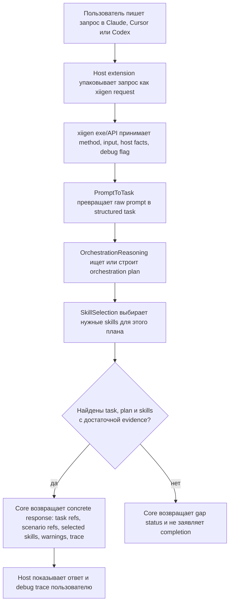
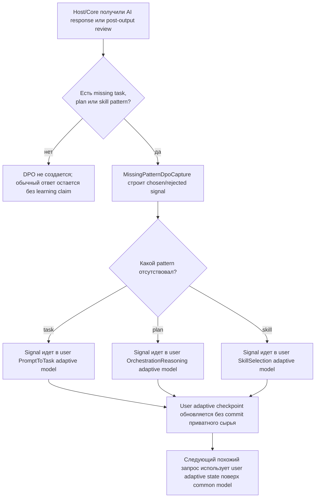
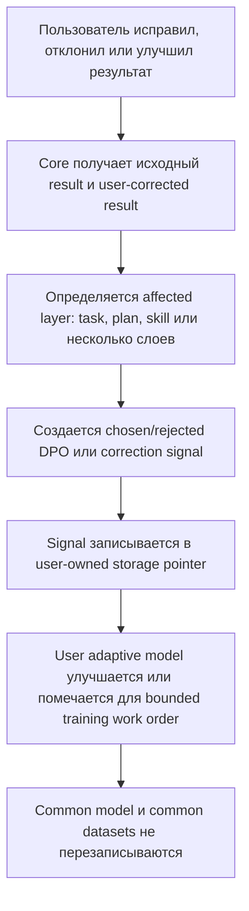
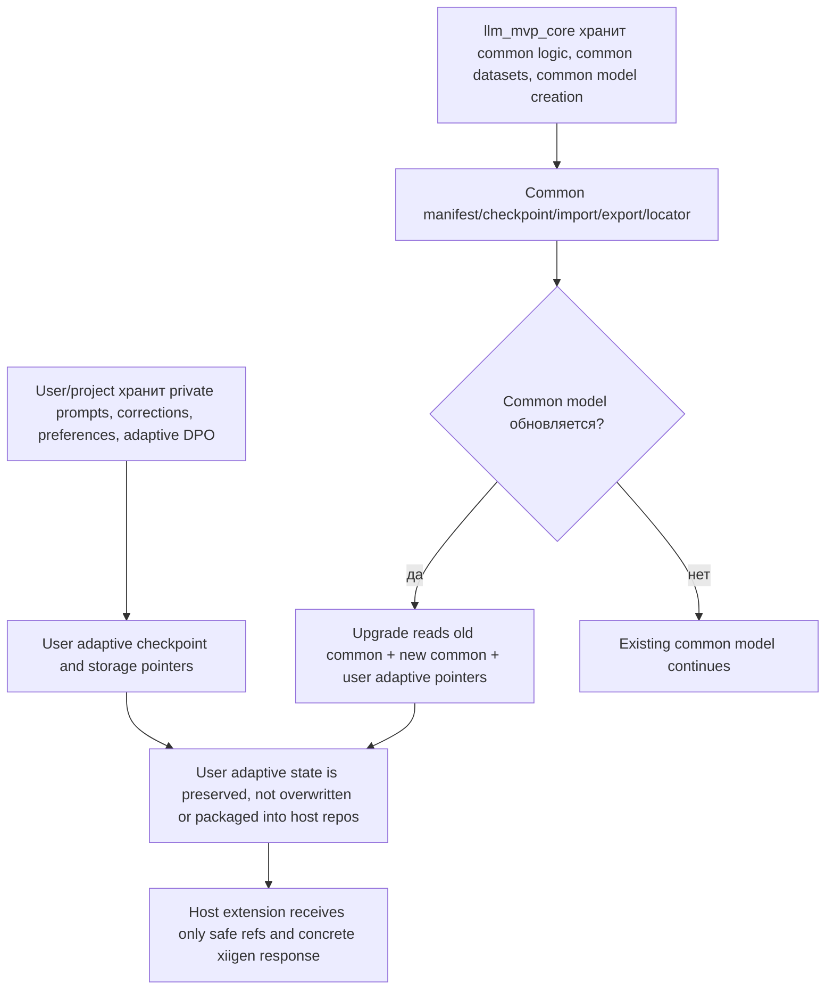
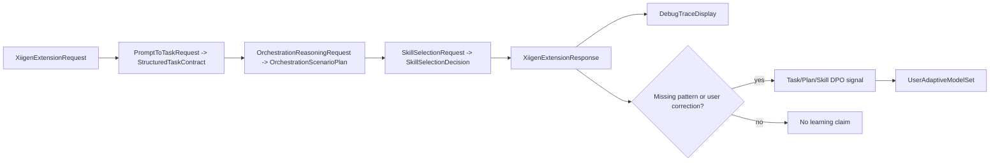

# ORCHESTRATION-MACHINE-TRAINING-PLAN-v20
# Integrated trainable orchestration, translation, smart-skills extension readiness, and extension implementation

Status: **integrated replacement for v19; v19 is not executor-ready; one-way skill-selection reference is not enough**.

This document fixes the remaining v19 contradictions:

- no deterministic production prompt/flow grounding;
- `PromptFlowGroundingModel` owns learned flow grounding end to end;
- `FlowReferenceDetector` is build-time only;
- exact-prompt leakage fails the gate instead of being hidden;
- model assets are exportable, importable, locatable, loadable, and continue-trainable;
- TranslationMachine asset readiness is tracked as the adjacent required phase instead of being lost;
- `SkillSelectionMachine` and smart-skills host extension work are part of this same execution plan, not a separate loose reference;
- extension host packaging is split into `claude-xiigen-smart-skills`, `codex-xiigen-smart-skills`, and `cursor-xiigen-smart-skills`;
- Phase 39 is only trainable smart-skills readiness/static/package boundary; actual installable user-facing extension implementation is Phase 40;
- Phase 40 host implementation lives only in `claude-xiigen-smart-skills`, `codex-xiigen-smart-skills`, and `cursor-xiigen-smart-skills`, while all semantic/trainable logic stays in `llm_mvp_core`;
- executor work orders are bounded to one small <=15-minute slice.

---

## Authority Requirement Binding Check

Active authorities:

| Authority | Binding scope |
|---|---|
| Current human/product owner instruction | All requirements in this conversation, including "not wishlist" and "not just for Luba" |
| Architect work order | Sub-agent work orders must preserve all architect requirements |
| Accepted reviewer findings | v18/v19 review findings become repair requirements |
| AGENTS.md / CLAUDE.md | Authority ledger, replacement mapping, contradiction sweep, trainable model asset rules |

Conversation Delta Ledger:

| ID | Source | Requirement | Old assumption invalidated | Required replacement | Status |
|---|---|---|---|---|---|
| D1 | Luba | FlowReferenceDetector + explicit FlowIndex deterministic routing is not allowed | Mode 1 deterministic source-authority | Trainable `PromptFlowGroundingModel` | mapped |
| D2 | Luba | PromptFlowIndex removal is not enough | Deletion-only fix | Trainable grounding model with checkpoint/import/export/locator tests | mapped |
| D3 | Luba | KNN must not become exact-prompt memory lookup | Paraphrase tests alone are enough | Leakage gate that fails on exact overlap | mapped |
| D4 | Luba | Requirements from user/architect are hard, not wishlist | Requirements can be narrowed by sub-agent | Authority ledger + downstream work-order preservation | mapped |
| D5 | Luba | Product is not only for Luba | Luba-only phrasing | Product-owner / current human operator wording | mapped |
| D6 | Luba | Translator asset readiness was discussed too | Orchestration-only completion claim | Adjacent Phase 38 TranslationMachine asset gate | mapped |
| D7 | Luba | Skill-selection smart-skills plan must be merged with v20 tasks | One-way reference from skill-selection plan to v20 | Unified Phase 39 and integrated work-order ledger in this file | mapped |
| D8 | Luba | Extension host packages must be separate repos | One shared extension implementation repo | `claude-xiigen-smart-skills`, `codex-xiigen-smart-skills`, `cursor-xiigen-smart-skills` | mapped |
| D9 | Luba | Executor task must not be too large | Whole-phase sub-agent work order | Single-slice work order, expected <=15 minutes | mapped |
| D10 | Luba | Plan review should use sub-agents until no minor findings | Single architect self-approval | zero-findings review loop gate before executor approval | mapped |
| D11 | Luba | Coverage checks must run before and after phase splitting | One post-hoc review after splitting | `PRE_SPLIT_NINE_CHECK` and `POST_SPLIT_NINE_CHECK` gates, both recorded in state | mapped |
| D12 | Luba | Architect must not cut corners or simplify scope; architect mistakes have much higher blast radius | Architect may choose a smaller interpretation if it seems reasonable | Architect anti-simplification rule in AGENTS.md and planning/phase-planning/plan-review skills; plan requires explicit interpretation before edits | mapped |
| D13 | Luba | v20 included extension readiness but not full extension implementation; extend the plan to include full Claude/Codex/Cursor extension implementation in separate `[platform]-xiigen-smart-skills` repos | Readiness/static/package boundary is enough | New Phase 40 Actual Extension Platform Implementation with user-facing installable gates, prompt-suite/check-set host entrypoint evidence, and no host code folded into `llm_mvp_core` | mapped |
| D14 | Architect review | Phase 40 gates must not be `pwsh`-only because this environment already hit missing `pwsh`; bounded work orders must use `powershell.exe` unless `pwsh` is verified in the same subphase | `pwsh`-only literal gates | Phase 40 command rule and E.0-E.6/E.9 `powershell.exe -NoProfile -ExecutionPolicy Bypass` forms | mapped |
| D15 | Architect review | Phase 40 commit/push evidence must be per touched repository, not one core commit | Single Phase 40 commit proves all host implementation | Per-repo core/Claude/Codex/Cursor git evidence boundary and matrix rows | mapped |
| D16 | Architect review | Phase 40 work-order split must name concrete manifest/package files, entrypoint files/commands, install script, trace report, and prompt-suite file per host | "as appropriate for host" hides static readiness | Entry point specificity rule and E.3-E.5 concrete work-order requirements | mapped |
| D17 | Architect review | Phase 40 split must include required implementation categories before execution | Generic future split statement | E.10 required split categories for core API/check-set tools, per-host packaging, entrypoints, install smoke, prompt-suite traces, cross-host report gate, anti-kitchen sweep, and per-repo git evidence | mapped |
| D18 | Current P40-SPLIT-a work order | Split Phase40 into concrete <=15-minute work orders without implementing code/scripts/packages, without running gates, and without commit/push | Phase40 categories only | Phase 40 Implementation Work Orders table with rows for preflight, core, each host, cross-host checks, per-repo git evidence, and final reconciliation | mapped |
| D19 | Post-split architect review | Phase 40 split rows must not combine multiple host repositories for inventory, implementation, edit, or sweep work; only explicit cross-host report-comparison rows may read already-produced per-host reports | Broad preflight and anti-kitchen rows can hide scope creep | Split repo inventory and anti-kitchen sweeps per repo, and narrow cross-host rows to report comparison only | mapped |
| D20 | PLAN-REPAIR-SUBPHASE-1 | Full Cursor, Claude, and Codex extensions must accept a user prompt, translate it into a task, find an orchestration plan, and find required skills | Phase 40 described host packages but did not explain the full prompt-to-task-to-plan-to-skills user flow in Luba-readable form | Russian-first Phase 40 architecture section with draw.io-importable diagrams, algorithm descriptions, gates, and exact file-line implementation honesty table | mapped |
| D21 | PLAN-REPAIR-SUBPHASE-1 | If a required task, plan, or skills pattern is missing, then after the AI response the system must build DPO examples and train/update the user model | Result-gap and feedback rows were present but not tied to the full extension algorithm | Russian algorithms for missing-pattern DPO capture and correction update plus DPO update gate | mapped |
| D22 | PLAN-REPAIR-SUBPHASE-1 | Core logic, common datasets, and common models live in `llm_mvp_core`; user datasets/models stay with the user; common model creation remains in this repo | Prior Phase 40 boundary was technical but not user-readable and not linked to data ownership diagram | Data ownership diagram and common/user asset algorithm | mapped |
| D23 | PLAN-REPAIR-SUBPHASE-1 | Plan must be readable by Luba first: simple UML importable to draw.io, simple Russian algorithm explanations without code, then exact logic locations and short code quotes | Existing Phase 40 was gate-heavy and not Luba-first | Russian-first overview, Mermaid diagrams, Russian algorithm table, exact file-line implementation references | mapped |
| D24 | PLAN-REPAIR-SUBPHASE-1 | Do not claim current implementation where code is only skeleton or contract; mark missing code as NOT IMPLEMENTED YET | Plan risk: planned fantasy can look like implemented capability | Code-reference honesty table with current file:line references and NOT IMPLEMENTED YET gaps | mapped |
| D25 | PLAN-REPAIR-SUBPHASE-1 | No deterministic shortcut may hide where a trainable unit is required | Existing anti-loophole rows were broad but not attached to the full extension algorithm | No deterministic shortcut gate added to Phase 40 user-readable gates | mapped |
| D26 | PLAN-REPAIR-SUBPHASE-1 | Implementation after plan repair must be split into bounded subphases of <=15 minutes, one subphase at a time, and must not claim execution is done | Work-order list existed but did not include the new user-readable architecture repair follow-up split | P40-REPAIR follow-up work-order rows | mapped |
| D27 | P40-READABLE-FULL-EXTENSION-PLAN-REPAIR-01 | Newest binding goal is full Claude, Codex, and Cursor extensions: prompt -> task -> orchestration plan -> skills, with missing-pattern and correction DPO updating user adaptive model | Prior Phase 40 could still be read as host package readiness rather than full extension algorithm | Phase 40 §0..§5 Part A plus authoritative Part B split | mapped |
| D28 | P40-READABLE-FULL-EXTENSION-PLAN-REPAIR-01 | Part A must be Luba-readable first: draw.io-importable Mermaid classDiagram with notes, human-language flowcharts, Russian algorithm descriptions, exact current-code refs, status table and ILogical/ILearning chain | Technical gate-first plan is acceptable | Phase 40 §0..§5 and E.11..E.20 | mapped |
| D29 | P40-READABLE-FULL-EXTENSION-PLAN-REPAIR-01 | Current repair sub-agent must not edit production/test code, run dotnet/build/test/npm/training/host runtime, touch host repos, or commit/push | Plan repair can continue into implementation | State update sets next action to parent REVIEW_INTERNAL only | mapped |

Replacement Mapping Register:

| Superseded mechanism | Required replacement | Plan section | Gate/artifact | Status |
|---|---|---|---|---|
| `PromptFlowIndex` runtime lookup | none at runtime; build-time contamination audit only | Corpus rules | grep/static gate | mapped |
| `FlowReferenceDetector` production route | build-time corpus labeling only | FlowReferenceDetector scope | static no-runtime-use test | mapped |
| `_flowIndex.TryGetValue` / dictionary by FlowRef | `PromptFlowGroundingModel` learned prediction | PromptFlowGroundingModel | tests 6, 37, 38, 42, 43 | mapped |
| `KnownFlowRetrieval` route | `LearnedFlowGrounding` route | Contracts + generation | Gate B B.5/B.7 | mapped |
| `RetrievalSource.FlowIndex` | no retrieval source; all trained modes `MlGenerated=true` | Contracts | compile + grep gate | mapped |
| exact eval prompt overlap | hard leakage failure | Evaluation | test 40 + B.5 | mapped |

Contradiction Sweep:

| Search term | Production occurrence allowed? | Helper occurrence allowed? | Verdict |
|---|---:|---:|---|
| `PromptFlowIndex` | no | only historical text in old plans | reject if present in implementation |
| `FlowReferenceDetector` | no | corpus builder, audit, fixtures, eval setup | reject if reachable from `GeneratePlanAsync` or runtime classifier |
| `FlowIndex` / `_flowIndex` | no | corpus audit helper may parse FLOW docs but not store runtime index | reject if in machine/checkpoint/manifest |
| `KnownFlowRetrieval` | no | old plans only | reject if in contracts/tests/gates |
| `RetrievalSource` | no | old plans only | reject if in contracts/tests/gates |
| `retrieved correctly` | no | no | reject stale gate language |
| `privateCorpusDir` constructor | no | no | reject runtime corpus dependency |

Verdict target for this v20 plan: **executor-ready only when every row above remains mapped and no contradiction term appears in the new production/test/gate implementation**.

---

## Scope

This is one integrated model-readiness and extension-readiness plan:

| Phase | Scope | Completion |
|---|---|---|
| Phase 37 | `OrchestrationPlanMachine` with three trained modes | Gate B B.0-B.7 passes, model bundle committed/published |
| Phase 38 | `TranslationMachine` asset readiness using the same model-lifecycle contract | Gate T B.0-B.5 passes, translation bundle committed/published |
| Phase 39 | `SkillSelectionMachine` + smart-skills host extension readiness/static package boundary | SkillSelection gates pass, model bundle committed/published, three host repos pass readiness/package-boundary smoke gates; this is not full extension implementation |
| Phase 40 | Actual Extension Platform Implementation for Claude, Codex, and Cursor | Three separate host repositories are installable, expose user-facing entrypoints, execute prompt-suite/check-set gates through those entrypoints, emit traces/logs, and prove thin-client API/check-set boundary |

Phase 37 must finish before Phase 38 execution starts. Phase 39 implementation
can only claim model-lifecycle readiness after the relevant Phase 37/38 evidence
exists, but its plan review and corpus/contract decomposition are integrated
here so the smart-skills work is not lost. Phase 40 starts only after Phase 39
readiness exists and the combined plan passes the mandatory nine-check review
before and after Phase 40 work-order splitting. Each phase remains a separate
commit.

Integrated source inputs:

| Source | Role in this unified plan |
|---|---|
| `ORCHESTRATION-MACHINE-TRAINING-PLAN-v20.md` | Phase 37/38 trainable model lifecycle, governance, and no-deterministic-grounding authority |
| `PLAN-XIIGEN-SKILL-SELECTION-MACHINE-EXTENSION-v1.md` | Phase 39 smart-skills machine, Phase 40 host extension repository implementation source, gates, and mental experiment authority |
| `# Next planning.md` / `Please review the plan again and va.txt` | Conversation source ledger for IMachineTraining, second pass, sub-agent review loop, and 15-minute work-order corrections |
| `skills-inventory-universal-vs-project-specific.md` | Universal skill library vs project-specific adapter boundary |
| `C:\Users\lubao\Documents\xiigen\extensions  - orchestration based on our data\ORCHESTRATION-REASONING-MACHINE-PLAN-v1.md` | Source plan for `OrchestrationReasoningMachine`, common/adaptive split, core API layer, and thin Claude/Cursor/Codex extension expectation |
| `C:\Users\lubao\Documents\xiigen\extensions  - orchestration based on our data\PROMPT-TO-TASK-MACHINE-PLAN-v1.md` | Source plan for `PromptToTaskMachine`, raw prompt to structured task, DPO pairs, common/adaptive split, and extension API boundary |
| `C:\Users\lubao\Documents\xiigen\extensions  - orchestration based on our data\ORCHESTRATION-REASONING-DPO-NEGATIVE-STRATEGY-v1.md` | Source taxonomy for orchestration negative examples, especially deterministic shortcut, wrong unit selection, weak decomposition, and product decision masquerade |
| `C:\Users\lubao\Documents\xiigen\extensions  - orchestration based on our data\PROMPT-TO-TASK-DPO-NEGATIVE-STRATEGY-v1.md` | Source taxonomy for prompt-to-task negative examples, especially missing structure, weak decomposition, missing gates, and prompt-plan correction examples |
| `C:\Users\lubao\Documents\xiigen\extensions  - orchestration based on our data\ORCHESTRATION-AND-PROMPT-TO-TASK-EXTENSIONS-PLAN-v2.md` | External readable source plan for the two-machine extension architecture, source ledgers, host debug trace contract, DPO/corpus schemas, and bounded work orders |
| `C:\Users\lubao\Documents\xiigen\sonnet local - analyzes` | Corpus/reference root for approved-style analysis examples; cite as source root only, do not copy private raw content into committed plan or artifacts |
| `C:\Users\lubao\Documents\xiigen\claude-sessions\user prompts` | Corpus/reference root for raw prompt and accepted orchestration pattern sources; cite as source root only, do not copy private raw content |
| `C:\Users\lubao\Documents\xiigen\claude-sessions\sonnet-user-prompts` | Corpus/reference root for accepted, approved, declined, and rejected prompt/orchestration examples; cite as source root only, do not copy private raw content |

Merge rule: this document is the executor-facing plan. The extension plan is a
source input, not a separate approval target. A requirement from the extension
plan is covered only when it is mapped below to a section, gate, artifact, and
bounded work order in this document.

---

## Mandatory Nine-Check Gate Before And After Phase Splitting

This gate is mandatory twice:

1. `PRE_SPLIT_NINE_CHECK` runs before creating or changing the bounded
   work-order split.
2. `POST_SPLIT_NINE_CHECK` runs after the split is written.

If either pass finds a gap, the architect records the gap in
`docs/plans/ORCHESTRATION-MACHINE-TRAINING-STATE.json`, patches this plan, and
reruns the same check. Splitting the plan without the pre-split check, or
approving the split without the post-split check, is a plan-governance failure.
The legacy `PRE_SPLIT_SEVEN_CHECK` / `POST_SPLIT_SEVEN_CHECK` names are no
longer sufficient after D13; any seven-row-only review is a failed review for
this plan.

Sources for both passes:

- this unified plan;
- `C:\Users\lubao\Documents\xiigen\llm mvp\skills loading as an ai extension\skills-inventory-universal-vs-project-specific.md`;
- `C:\Users\lubao\Documents\xiigen\llm mvp\skills loading as an ai extension\# Next planning.md`;
- `C:\Users\lubao\Documents\xiigen\llm mvp\skills loading as an ai extension\Please review the plan again and va.txt`;
- `AGENTS.md`, `docs/skills/planning-session-startup-SKILL.md`,
  `docs/skills/phase-planning-SKILL.md`, and
  `docs/skills/plan-review-SKILL.md` for the architect workstyle rule.

| Check | Required coverage | Evidence in this plan | Gate |
|---|---|---|---|
| SC-1 | The plan covers both v20 orchestration/translation lifecycle and the skill-inventory universal-vs-project-adapter analysis | Integrated source inputs; Phase 37/38; Phase 39/40; source ledger | pre/post nine-check state rows |
| SC-2 | Every user requirement from this conversation and the two conversation files is represented in the plan and covered by checks | Conversation Delta Ledger, Phase 39 User Prompt Source Ledger, Phase 40 Authority Requirements, Completion Matrix | S.12 + E.0 + pre/post nine-check state rows |
| SC-3 | Mental experiment: if implemented, the plan covers all tasks the user defined | Phase 37 fixtures, Phase 38 probes, Phase 39 Mental Experiment Review, Phase 40 Mental Experiment Review, cross-phase scenarios below | sub-agent mental-experiment review |
| SC-4 | No deterministic algorithm is hidden as a replacement for a learning unit | Non-Negotiable Architecture, FlowReferenceDetector Scope, Trainable Semantic Units, Anti-Loophole Register | B.5/B.7, S.6, S.14, static sweeps |
| SC-5 | Models and data sets are repo assets split into common trained/shared and adaptive user/project-specific parts; common assets are saveable, importable, exportable, publishable, and upgradable | Common/Adaptive Asset Boundary below; Phase 37/38/39 model gates | B.7, Phase 38 gates, S.9/S.11/S.13 |
| SC-6 | User feedback and workstyle corrections are added to agent rules and planning/review skills | Governance Block, User Workstyle Rule Coverage below | static check of AGENTS.md and three skill files |
| SC-7 | Core logic lives in `llm_mvp_core`; host agents/extensions stay simple API/check-set request-response shells | Core/Host API Boundary below, Separate Host Repositories | S.7/S.8/S.10 |
| SC-8 | No external AI, image-generation, or unrelated tool family is used for trainable routing, selection, validation, orchestration, completion, evidence, or extension implementation unless Luba explicitly requests or approves it | Core/Host API Boundary, OP-46, Phase 40 evidence boundary | S.12/S.14, E.8 |
| SC-9 | The plan includes actual Claude, Codex, and Cursor extension implementation and verification, not only readiness/static placeholders | Phase 40 Actual Extension Platform Implementation | E.0-E.10 + CM-31..CM-40 |

### Nine-Check Review Output Contract

Every pre/post reviewer returns exactly:

```text
nine_check_pass=true|false
checks:
  SC-1: covered|gap + section/gate/artifact
  ...
  SC-9: covered|gap + section/gate/artifact
open_findings: []
required_patch: <none or exact section to patch>
```

No single "looks good" sentence can replace the nine explicit rows.

### Split Review Status Qualification

The phase-split review must not be reported as an unqualified clean `PASS` when
`PRE_SPLIT_NINE_CHECK` was performed and returned `FAIL_THEN_REPAIRED`.

Accepted status semantics:

```text
pre_split_status=PASS
post_split_status=PASS
overall_split_review_status=PASS
```

is allowed only when the pre-split snapshot itself was clean.

```text
pre_split_status=FAIL_THEN_REPAIRED
post_split_status=PASS
overall_split_review_status=PASS_WITH_PRE_SPLIT_REPAIR
```

is the required status when the pre-split nine-check failed, all gaps were
patched, and the post-split review then passed. A clean pre-split `PASS`
snapshot is a stronger requirement and must be requested explicitly by Luba
before replacing `PASS_WITH_PRE_SPLIT_REPAIR`.

### Common And Adaptive Asset Boundary

Common trained/shared repo assets:

- `models/orchestration/orchestration-v1/*`;
- `models/translation/translation-v1/*`;
- `models/skill-selection/skill-selection-v1/*`;
- `training-data/orchestration/orchestration-v1/training-manifest.json`;
- `training-data/translation/translation-v1/training-manifest.json`;
- `training-data/skill-selection/skill-selection-v1/training-manifest.json`;
- compressed safe corpus snapshots or corpus hash/pointer files approved by the
  relevant phase gate;
- `models/index.json` registry entries.

Common assets must support save, export, import, publish, load, fresh-load probe,
continue-training, and upgrade/compatibility checks. A model that is trained but
cannot be located and loaded through the repo asset path is not done.

Adaptive user/project-specific state:

- `.xiigen\smart-skills\wiki`;
- `.xiigen\smart-skills\preferences`;
- `.xiigen\smart-skills\feedback`;
- `.xiigen\smart-skills\adaptation-profile`;
- private raw corpora outside committed repo paths;
- project-local DPO signals generated from feedback or second-pass gaps.

Adaptive state must never be overwritten by server/common library upgrades.
Ambiguous migration creates a patch proposal or DPO row; it does not silently
rewrite user/project preferences.

### Core/Host API Boundary

All semantic and training logic lives in `C:\Projects\llm_mvp_core`:

- trainable units;
- DPO row builders;
- model checkpoints/manifests;
- project-owned trainable assets, checkpoints/manifests, and runner reports;
- selection/orchestration/translation APIs;
- result-gap and validation machines;
- registry and model locator logic.

No external/image-generation model is allowed to perform trainable semantic
selection, routing, validation, completion, or orchestration logic for this
plan. Any "model" claim in this plan means a project-owned trainable asset with
a checkpoint, manifest, import/export path, report, and repo/registry lifecycle.
Image-generation tools may not be substituted for trainable project logic.

Host repositories are thin product packages:

- `claude-xiigen-smart-skills`;
- `codex-xiigen-smart-skills`;
- `cursor-xiigen-smart-skills`.

They send concrete API/check-set requests such as `SkillSelectionRequest`,
orchestration generation requests, fixture probes, and host trace rows. They
receive concrete answers such as `SkillSelectionDecision`, selected skill IDs,
gap decisions, completion decisions, and trace reports. They must not own the
internal training kitchen, private corpus, canonical library source, semantic
candidate ranking, or model-update logic.

### User Workstyle Rule Coverage

The plan is executor-ready only if static review confirms:

- `AGENTS.md` forbids architects from cutting corners, shrinking scope, or
  replacing merge/split tasks with references;
- `AGENTS.md` preserves OP-45 anti-masquerade review: deterministic replay,
  exact-memory, or lookup evidence must not be reported as learned behavior;
- `planning-session-startup-SKILL.md` includes the same architect
  anti-simplification rule;
- `phase-planning-SKILL.md` requires bounded work orders and explicit
  interpretation before plan edits;
- `plan-review-SKILL.md` requires reviewers to flag architect simplification,
  missing source coverage, and unreviewed phase splitting.

---

## Non-Negotiable Architecture

1. All production orchestration plan generation is ML-generated.
2. `PromptFlowGroundingModel` is the only component that predicts canonical FLOW grounding in production.
3. `FlowReferenceDetector` is not called from `GeneratePlanAsync`, `TrainedRouteComposerUnit`, or runtime intent classification.
4. `HumanIntentBoundaryClassifier` is a non-trainable policy guard. It extracts human intent, approval gates, phase-only constraints, save/download requirements, and raw human text spans. It does not select canonical FLOW content and does not provide a dictionary key for a plan lookup.
5. Deterministic policy extraction may enforce hard human constraints, but it may not source plan content. User requirements are hard constraints, not suggestions.
6. Canonical FLOW docs are training data only. They are parsed by corpus builder into `OrchestrationTrainingPair` rows and are not stored as a runtime index.
7. Private raw corpus files stay private. Approved training pairs, model checkpoints, manifests, runner reports, and marketplace registry entries are project assets.
8. Skill selection is a trainable semantic layer: `SkillSelectionMachine : ILearningMachine<SkillSelectionDomain>` with `IMachineTraining<TDomain>` adapter coverage, not BM25/regex/static routing.
9. All semantic smart-skills units are trainable: prompt understanding, task understanding, task type, routing, skill candidates, skill selection, prompt context, result gap, output validation, task completion, and intermediate checks.
10. Host extension repositories are packaging shells only. They must not own training logic, semantic decisions, canonical skill library source, private corpus, or project-local user state.

---

## Runtime Flow

```text
raw prompt
  -> HumanIntentBoundaryClassifier
       produces IntentBoundaryContract:
       Kind, HumanConstraints, PhaseScope, raw RequestedFlowTextSpans,
       ForbiddenFlowScope/OnlyFlowScope for hard compliance only
  -> if SkillLoadSessionInit: Passthrough
  -> if HumanOrchestrationExplanation: Mode 3 HumanExplanation model
  -> PromptFlowGroundingModel.TryGround(prompt, contract)
       returns FlowGroundingResult(FlowRef, Confidence, EvidenceFeatures, PlanFeatures)
  -> if confidence >= threshold and contract allows it:
       Mode 1 LearnedFlowGrounding
     else:
       Mode 2 Generalization
  -> UserRequirementGuard verifies:
       forbidden scope absent, phase-only respected, approval gate marker present,
       requested user/architect constraints not ignored
```

`FlowGroundingResult.FlowRef` is a learned prediction. It is not a key from `FlowReferenceDetector`, `_flowIndex`, or an exact-prompt table.

---

## Core Contracts

```csharp
public enum PairMode
{
    Mode1LearnedFlowGrounding,
    Mode2Generalization,
    Mode3HumanExplanation
}

public enum GenerationRouteMode
{
    LearnedFlowGrounding,
    Mode2Generalization,
    Mode3HumanExplanation,
    Passthrough
}

public sealed record FlowGroundingResult(
    string FlowRef,
    double Confidence,
    IReadOnlyList<string> EvidenceFeatures,
    IReadOnlyList<string> PredictedPhaseSequence,
    IReadOnlyList<string> PredictedArtifactNames,
    IReadOnlyList<string> PredictedGateSequence);

public sealed record OrchestrationGenerationResult(
    string PlanText,
    GenerationRouteMode RouteMode,
    BoundarySource BoundarySource,
    bool MlGenerated,
    IntentKind IntentKind,
    FlowGroundingResult? FlowGrounding,
    IReadOnlyList<string> Warnings);

public sealed record OrchestrationFlowGroundingWeights(
    IReadOnlyDictionary<string, float> FlowRefWeights,
    IReadOnlyDictionary<string, float> PhaseWeights,
    IReadOnlyDictionary<string, float> ArtifactWeights,
    IReadOnlyDictionary<string, float> GateWeights,
    IReadOnlyDictionary<string, float> StackWeights);
```

Removed contracts:

```text
PromptFlowIndex
GenerationRouteMode.KnownFlowRetrieval
RetrievalSource
RetrievalSource.FlowIndex
BoundarySource.PromptFlowIndex
OrchestrationPlanMachine(privateCorpusDir)
_flowIndex
```

---

## PromptFlowGroundingModel

`PromptFlowGroundingModel` is a named trainable subcomponent inside `OrchestrationPlanMachine`.

Trained state:

```csharp
private readonly OrchestrationKnnStore _flowGroundingKnn = new();
private readonly Dictionary<string, OrchestrationFlowGroundingWeights> _flowGroundingWeights = new();
```

Training:

- Input rows: `PairMode.Mode1LearnedFlowGrounding`.
- Source: canonical FLOW docs parsed by `OrchestrationCorpusBuilder`.
- Prompt variants: accepted prompts, filename prefixes, `flow 33`, `33*`, `31-*`, ordinals, and paraphrases.
- Chosen output: `OrchestrationPlanChosen`.
- Negative output: Bootstrap generic template or wrong FLOW structure.
- Exact prompt training/eval overlap is forbidden.

Inference:

```csharp
var grounding = _promptFlowGroundingModel.TryGround(prompt, contract);
if (grounding.Confidence >= options.FlowGroundingThreshold
    && UserRequirementGuard.Allows(grounding, contract))
{
    var text = ApplyFlowGroundingOverlay(grounding, _flowGroundingWeights, prompt, contract);
    return Ok(new OrchestrationGenerationResult(
        text,
        GenerationRouteMode.LearnedFlowGrounding,
        BoundarySource.Classifier,
        MlGenerated: true,
        contract.Kind,
        grounding,
        warnings));
}
```

No `flowRefHint` from deterministic detector is passed into KNN. The model may use raw prompt text and raw user spans as features; it must learn the canonical FLOW mapping.

---

## FlowReferenceDetector Scope

Allowed:

- corpus labeling;
- audit reports;
- fixture generation;
- held-out eval labeling;
- contamination audit.

Forbidden:

- `GeneratePlanAsync`;
- `TrainedRouteComposerUnit`;
- runtime classifier call path used for positive FLOW grounding;
- checkpoint load/import;
- marketplace load;
- any dictionary key selection for plan content.

Hard static gate:

```powershell
rg -n "FlowReferenceDetector" 42.ProjectWikiDomain Tests 27.TranslationDomain.Tools
# Allowed only in OrchestrationCorpusBuilder, OrchestrationCorpusAudit, fixture/eval helpers.
# Zero matches in OrchestrationPlanMachine, TrainedRouteComposerUnit, HumanIntentBoundaryClassifier runtime path.
```

---

## Evaluation Metrics

| Metric | Scope | Gate |
|---|---|---|
| `learnedFlowGroundingAccuracy` | Mode 1 held-out non-exact prompts | `>= 0.75` |
| `unseenStyleAccuracy` | Mode 2 held-out non-exact prompts | `>= 0.75` |
| `overallTrainingAccuracy` | mean of Mode 1 + Mode 2 | reported through `EvaluateAsync.Accuracy` |
| `humanExplanationAccuracy` | Mode 3 held-out non-exact prompts | `>= 0.70` |
| `exactPromptLeakageRate` | any eval prompt matching any training prompt | must be `0.0`, otherwise gate fails |
| `forbiddenScopeViolationRate` | all outputs | must be `0.0` |
| `phaseOnlyCompliance` | phase-only prompts | must be `1.0` |
| `approvalGateCompliance` | approval-gated prompts | must be `1.0` |
| `artifactNoiseResistance` | attachment noise prompts | reported |

Exact prompt rule:

```text
If any eval prompt exactly matches a training prompt after normalization:
  exactPromptLeakageRate > 0
  PassesGate = false
  the overlapping pair IDs are listed in report.exactPromptLeakagePairs
```

Do not exclude exact matches and then report 0.0. Exclusion-without-failure is forbidden.

---

## Phase 37 Files

New or updated files:

- `42.ProjectWikiDomain/OrchestrationPlanDomain.cs`
- `42.ProjectWikiDomain/OrchestrationPlanContracts.cs`
- `42.ProjectWikiDomain/FlowReferenceDetector.cs`
- `42.ProjectWikiDomain/HumanIntentBoundaryClassifier.cs`
- `42.ProjectWikiDomain/PromptFlowGroundingModel.cs`
- `42.ProjectWikiDomain/OrchestrationKnnStore.cs`
- `42.ProjectWikiDomain/TrainedRouteComposerUnit.cs`
- `42.ProjectWikiDomain/OrchestrationPlanOrchestrator.cs`
- `42.ProjectWikiDomain/OrchestrationPlanMachine.cs`
- `42.ProjectWikiDomain/OrchestrationCorpusAudit.cs`
- `42.ProjectWikiDomain/OrchestrationCorpusBuilder.cs`
- `42.ProjectWikiDomain/OrchestrationPilotLoopRunner.cs`
- `27.TranslationDomain.Tools/Program.cs`
- `Tests/OrchestrationPlanTests.cs`
- `models/orchestration/orchestration-v1/manifest.json`
- `models/orchestration/orchestration-v1/orchestration-v1-checkpoint.json`
- `models/orchestration/orchestration-v1/runner-report.json`
- `training-data/orchestration/orchestration-v1/training-manifest.json`
- `training-data/orchestration/orchestration-v1/corpus.jsonl.gz`
- `models/index.json`

---

## Phase 37 Tests

Target: **45 OrchestrationPlan tests**, 0 failed.

Required additions or repairs:

| # | Test | Required assertion |
|---|---|---|
| 6 | `Mode1_LearnedGrounding_ProducesFlowSpecificPlan` | trained Mode 1 returns `LearnedFlowGrounding`, `MlGenerated=true`, FLOW structure present |
| 7-9 | classifier metadata tests | no detector-to-retrieval assertion; trained machine uses learned grounding |
| 37 | `Mode1Grounding_ExportImport_Survives` | fresh import with no corpus dir still grounds `flow 33` |
| 38 | `Mode1Grounding_Ablation_EmptyWeightsDegrade` | empty/stripped grounding weights fail or degrade |
| 39 | `Mode2_ExportImport_GeneralizationSurvives` | paraphrase prompt works after import |
| 40 | `ExactPromptOverlap_FailsGate` | exact train/eval overlap sets leakage rate > 0 and `PassesGate=false` |
| 41 | `ContinueTraining_AfterImport_AddsNewPairs` | no replay; KNN sizes grow |
| 42 | `NoRuntimeFlowReferenceDetectorUsage` | static scan: no detector in runtime generation/classifier path |
| 43 | `PromptFlowGroundingModel_PredictsFlowRefWithoutHint` | model predicts `FLOW-33` without canonical hint parameter |
| 44 | `NoFlowIndexOrRetrievalSourceContractsRemain` | no `_flowIndex`, `FlowIndexRef`, `RetrievalSource`, `KnownFlowRetrieval` in new contracts |

---

## Phase 37 Gate B

B.0 audit:

```powershell
dotnet run --project 27.TranslationDomain.Tools -- audit-orchestration-corpus `
  --source-dir "C:\Users\lubao\Documents\xiigen\claude-sessions" `
  --output "C:\...\orchestration-corpus-audit.json"
```

Assert:

- `TrainingReadyCount >= 20`;
- `ExplanationReadyCount >= 10`;
- no private raw content written to committed artifacts.

B.1 corpus build:

```powershell
dotnet run --project 27.TranslationDomain.Tools -- build-orchestration-corpus `
  --source-dir "C:\Users\lubao\Documents\xiigen\claude-sessions" `
  --audit "C:\...\orchestration-corpus-audit.json" `
  --output "C:\...\orchestration-pilot-private.jsonl"
```

Assert:

- `Mode1TrainingPairs >= 42`;
- `Mode1HeldOutEvalPairs >= 20`;
- `Mode2TrainingPairs >= 200`;
- `Mode2HeldOutEvalPairs >= 40`;
- `Mode3TrainingPairs >= 30`;
- `Mode3HeldOutEvalPairs >= 20`;
- `NoMode1ExactPromptOverlap = true`;
- `NoMode2ExactPromptOverlap = true`;
- `NoMode3ExactPromptOverlap = true`;
- `NoMode3SourceBundleOverlap = true`;
- `NoMode3FlowRefOverlap = true`.

B.2 baseline:

```powershell
dotnet test Tests/LlmFromScratch.Tests.csproj `
  --filter "TranslationDomain|ProjectWikiDomain|OrchestrationPlan" --nologo
```

Record current count. After implementation: baseline + 44 orchestration tests pass.

B.3 orchestration tests:

```powershell
dotnet test Tests/LlmFromScratch.Tests.csproj --filter "OrchestrationPlan" --nologo
```

Assert: 44 passed, 0 failed.

B.4 builds:

```powershell
dotnet build 42.ProjectWikiDomain/42.ProjectWikiDomain.csproj --nologo
dotnet build 27.TranslationDomain.Tools/27.TranslationDomain.Tools.csproj --nologo
```

Assert: 0 errors.

B.5 smoke training:

```powershell
dotnet run --project 27.TranslationDomain.Tools -- run-orchestration-loop `
  --private-pairs "C:\...\orchestration-pilot-private.jsonl" `
  --train-size 50 --test-size 50 --mode3-train-size 20 --max-cycles 29 `
  --flow-grounding-target 0.75 --style-target 0.75 --explanation-target 0.70 `
  --checkpoint "C:\...\orchestration-machine-checkpoint.json" `
  --report "C:\...\orchestration-loop-report-cycles-001-029.json"
```

Assert:

- `checkpoint_written = true`;
- `learnedFlowGroundingAccuracy >= 0.75`;
- `unseenStyleAccuracy >= 0.75`;
- `overallTrainingAccuracy = mean(learnedFlowGroundingAccuracy, unseenStyleAccuracy)`;
- `humanExplanationAccuracy >= 0.70` when Mode 3 trained;
- all Mode 1 eval rows: `RouteMode=LearnedFlowGrounding`, `MlGenerated=true`;
- all Mode 2 eval rows: `RouteMode=Mode2Generalization`, `MlGenerated=true`;
- all Mode 3 eval rows: `RouteMode=Mode3HumanExplanation`, `MlGenerated=true`;
- `exactPromptLeakageRate = 0.0`;
- `forbiddenScopeViolationRate = 0.0`;
- `phaseOnlyCompliance = 1.0`;
- `approvalGateCompliance = 1.0`;
- fresh untrained machine fixture for `flow 33` does not produce FLOW-33 structure;
- trained machine fixture for `flow 33` produces learned FLOW-33 structure;
- no report field named `flowIndexLoaded`, `RetrievalSource`, or `KnownFlowRetrieval`.

B.6 resume gate:

```powershell
dotnet run --project 27.TranslationDomain.Tools -- run-orchestration-loop `
  --private-pairs "C:\...\orchestration-pilot-private.jsonl" `
  --train-size 50 --test-size 50 --mode3-train-size 20 --max-cycles 3 `
  --flow-grounding-target 0.75 --style-target 0.75 --explanation-target 0.70 `
  --checkpoint "C:\...\orchestration-machine-checkpoint.json" `
  --require-checkpoint-resume `
  --report "C:\...\orchestration-loop-report-resume.json"
```

Assert:

- `trainedStateLoaded = true`;
- `resumeTrainBatchCalls = 0`;
- `trainedPairIdsUsedForExclusionOnly = true`;
- `trainedPairIdsRestoredCount > 0`;
- `mode1FlowGroundingKnnSize > 0`;
- `mode1FlowGroundingWeightsSize > 0`;
- `mode2KnnStoreSize > 0`;
- `mode2PatternMapSize > 0`;
- `mode3KnnStoreSize > 0` when Mode 3 trained;
- post-load `GeneratePlanAsync("flow 33")` returns `LearnedFlowGrounding`, `MlGenerated=true`.

B.7 model asset gate:

```powershell
dotnet run --project 27.TranslationDomain.Tools -- export-orchestration-model `
  --checkpoint "C:\...\orchestration-machine-checkpoint.json" `
  --output "C:\Projects\llm_mvp_core\models\orchestration\orchestration-v1\" `
  --report "C:\...\orchestration-loop-report-cycles-001-029.json" `
  --private-pairs "C:\...\orchestration-pilot-private.jsonl"
```

Assert model bundle:

- `manifest.json` exists;
- `model_id = orchestration-v1`;
- `domain = OrchestrationPlanDomain`;
- `checkpoint_filename = orchestration-v1-checkpoint.json`;
- `source_base_commit` set to pre-export HEAD;
- `export_input_sha256` non-empty;
- no `created_from_commit`;
- no `flow_index_ref`;
- checkpoint has `flow_grounding_knn`, `flow_grounding_weights`, `knn_store`, `pattern_map`, `human_explanation_knn`, `human_explanation_pattern_map`;
- checkpoint has no `flow_index` and no `prompt_flow_index`.

Export training data:

```powershell
dotnet run --project 27.TranslationDomain.Tools -- export-orchestration-training-data `
  --private-pairs "C:\...\orchestration-pilot-private.jsonl" `
  --linked-model orchestration-v1 `
  --output "C:\Projects\llm_mvp_core\training-data\orchestration\orchestration-v1\"
```

Assert:

- `training-manifest.json` exists with `corpus_sha256`, `schema_version`, counts, split fractions;
- `corpus.jsonl.gz` exists and contains approved training pairs only;
- no absolute private paths in committed files.

Fresh load probe:

```powershell
dotnet run --project 27.TranslationDomain.Tools -- import-orchestration-model `
  --manifest "C:\Projects\llm_mvp_core\models\orchestration\orchestration-v1\manifest.json" `
  --fixture-probe
```

Assert:

- no corpus dir required;
- `mode1FlowGroundingKnnSize > 0`;
- `mode1FlowGroundingWeightsSize > 0`;
- fixture `flow 33` returns `LearnedFlowGrounding`, `MlGenerated=true`, model-predicted `FLOW-33`;
- generic Mode 2 prompt returns `Mode2Generalization`;
- explanation prompt returns `Mode3HumanExplanation` when Mode 3 trained.

Publish and load:

```powershell
dotnet run --project 27.TranslationDomain.Tools -- publish-orchestration-model `
  --manifest "C:\Projects\llm_mvp_core\models\orchestration\orchestration-v1\manifest.json"

dotnet run --project 27.TranslationDomain.Tools -- load-orchestration-model `
  --model-id orchestration-v1
```

Assert:

- `models/index.json` updated;
- locator resolves manifest;
- loaded model can generate fixture outputs.

Continue-training mini-cycle:

```powershell
dotnet run --project 27.TranslationDomain.Tools -- continue-orchestration-training `
  --manifest "C:\Projects\llm_mvp_core\models\orchestration\orchestration-v1\manifest.json" `
  --training-manifest "C:\Projects\llm_mvp_core\training-data\orchestration\orchestration-v1\training-manifest.json" `
  --max-cycles 1 `
  --output "C:\...\orchestration-v1-continued-probe\"
```

Assert:

- uses committed `corpus.jsonl.gz`, no `--private-pairs`;
- hash verified;
- old `TrainedPairIds` excluded;
- new pairs trained;
- Mode 1 or Mode 2 KNN size grows;
- no replay.

---

## Phase 38 TranslationMachine Asset Readiness

Purpose: apply the same project-asset standard to TranslationMachine.

Files:

- `27.TranslationDomain.Tools/Program.cs`
- existing TranslationMachine checkpoint/load/export code as needed
- `models/translation/translation-v1/manifest.json`
- `models/translation/translation-v1/translation-v1-checkpoint.json`
- `models/translation/translation-v1/runner-report.json`
- `training-data/translation/translation-v1/training-manifest.json`
- `training-data/translation/translation-v1/corpus.jsonl.gz`
- `models/index.json`
- `Tests/TranslationModelAssetTests.cs`

Translation gates:

```powershell
dotnet test Tests/LlmFromScratch.Tests.csproj --filter "TranslationModelAsset" --nologo
# Assert: 6 passed, 0 failed

dotnet run --project 27.TranslationDomain.Tools -- export-translation-model `
  --checkpoint "C:\...\translation-safe-checkpoint.json" `
  --output "C:\Projects\llm_mvp_core\models\translation\translation-v1\" `
  --report "C:\...\translation-runner-report.json"

dotnet run --project 27.TranslationDomain.Tools -- import-translation-model `
  --manifest "C:\Projects\llm_mvp_core\models\translation\translation-v1\manifest.json" `
  --fixture-probe

dotnet run --project 27.TranslationDomain.Tools -- publish-translation-model `
  --manifest "C:\Projects\llm_mvp_core\models\translation\translation-v1\manifest.json"

dotnet run --project 27.TranslationDomain.Tools -- load-translation-model `
  --model-id translation-v1

dotnet run --project 27.TranslationDomain.Tools -- continue-translation-training `
  --manifest "C:\Projects\llm_mvp_core\models\translation\translation-v1\manifest.json" `
  --training-manifest "C:\Projects\llm_mvp_core\training-data\translation\translation-v1\training-manifest.json" `
  --max-cycles 1 `
  --output "C:\...\translation-v1-continued-probe\"
```

Assert:

- checkpoint contains real KNN/trained state, not loop metadata only;
- manifest paths are relative;
- registry entry exists in `models/index.json`;
- fresh import works with no private raw corpus path;
- continue-training excludes old trained rows;
- committed training bundle has no absolute private path;
- translation fixture does not report bootstrap output as completed translation.

---

## Cross-Phase Bounded Work-Order Ledger

Every executor sub-agent receives one row only. The row is invalid if expected
active work exceeds 15 minutes, touches files outside its owned scope, or lacks
an architect information packet.

If an approved runner/training command may run longer than 15 minutes, the work
order is split into: start command, poll persisted artifact, repair one concrete
failure, or record real blocker. A sub-agent must not hold the whole long-running
phase as one assignment.

Required evidence packet after every row:

```text
work_order_id:
owned_files:
plan_section:
requirements_touched:
allowed_verification_used:
artifact_or_gate_output:
remaining_gaps:
next_safe_work_order:
```

Each table row below is already the architect packet skeleton. The executor
work order must copy that single row, add the current state path, and forbid
continuation beyond `Next boundary`.

### Phase 37 Work Orders

| Slice | Owned files/artifacts | Requirements | Allowed verification | Required output | Next boundary | Max active |
|---|---|---|---|---|---|---:|
| P37-WO-00 | state file only | OP-5, SC-4 | static `rg` only | OP-5 paragraph + forbidden-term baseline | P37-WO-01 | <=15 min |
| P37-WO-01 | `OrchestrationPlanContracts.cs` | CM-1 | focused compile/static only | removed stale route/source contracts | P37-WO-02 | <=15 min |
| P37-WO-02 | `PromptFlowGroundingModel.cs` | CM-2, SC-4 | focused tests 6/37/38/43 only when gate allows | trained grounding state + ablation path | P37-WO-03 | <=15 min |
| P37-WO-03 | `HumanIntentBoundaryClassifier.cs`, `FlowReferenceDetector.cs` | CM-4, SC-4 | static `FlowReferenceDetector` sweep | classifier policy-only path | P37-WO-04 | <=15 min |
| P37-WO-04a | `OrchestrationCorpusAudit.cs` | B.0 | B.0 only | v20 audit JSON schema | P37-WO-04b | <=15 min |
| P37-WO-04b | `OrchestrationCorpusBuilder.cs` | B.1, SC-5 | B.1 only | Mode 1/2/3 split + leakage booleans | P37-WO-05a | <=15 min |
| P37-WO-05a | `OrchestrationPlanMachine.cs` checkpoint save/load sections | CM-2, CM-7 | focused checkpoint tests only | six trained-state sections persisted | P37-WO-05b | <=15 min |
| P37-WO-05b | `OrchestrationPlanMachine.cs` train/evaluate sections | CM-2, CM-5 | focused tests 40/41 only | train/eval/update without replay | P37-WO-05c | <=15 min |
| P37-WO-05c | `OrchestrationPlanMachine.cs` export/import sections | CM-7, CM-9 | focused export/import tests only | fresh import and continue-training hooks | P37-WO-06 | <=15 min |
| P37-WO-06a | `OrchestrationPilotLoopRunner.cs` metrics schema | CM-5 | no long runner; report-shape/static or focused unit tests | exactPromptLeakage hard fail fields | P37-WO-06b | <=15 min |
| P37-WO-06b | `OrchestrationPilotLoopRunner.cs` compliance fields | CM-1, CM-5 | focused compliance tests only | forbidden/phase/approval metrics | P37-WO-07a | <=15 min |
| P37-WO-07a | `27.TranslationDomain.Tools/Program.cs` B.0/B.1 commands | B.0/B.1 | B.0/B.1 command help or exact gate | audit/build commands available | P37-WO-07b | <=15 min |
| P37-WO-07b | `Program.cs` B.5/B.6 commands | B.5/B.6 | command help/static only unless running gate slice | loop/resume commands available | P37-WO-07c | <=15 min |
| P37-WO-07c | `Program.cs` B.7 commands | B.7, SC-5 | command help/static only | export/import/publish/load/continue commands available | P37-WO-08 | <=15 min |
| P37-WO-08 | `Tests/OrchestrationPlanTests.cs` one failing cluster | B.3 | B.3 or narrower failing filter | one cluster fixed; no broad test ritual | repeat P37-WO-08 until B.3 passes | <=15 min |
| P37-WO-09 | one B.2 failure/timeout cluster | B.2 | one focused B.2-derived filter | one cluster fixed or real blocker recorded | repeat P37-WO-09 until B.2 accounted | <=15 min |
| P37-WO-09b | build verification only | B.4 | exact B.4 build commands only | both project builds pass or first compile failure recorded | P37-WO-10a | <=15 min active work |
| P37-WO-10a | B.5 runner artifact path | B.5 | start exact B.5 command only | process/artifact path recorded | P37-WO-10b | <=15 min |
| P37-WO-10b | B.5 report artifact | B.5 | poll/read report only | pass/fail metrics or first concrete repair | repeat P37-WO-10b or issue repair row | <=15 min |
| P37-WO-11a | B.6 resume artifact path | B.6 | start exact B.6 command only | process/artifact path recorded | P37-WO-11b | <=15 min |
| P37-WO-11b | B.6 report artifact | B.6 | poll/read report only | resume fields verified or first repair | repeat P37-WO-11b or issue repair row | <=15 min |
| P37-WO-12a | orchestration model export artifact | B.7, SC-5 | exact export command only | model bundle written | P37-WO-12b | <=15 min |
| P37-WO-12b | orchestration training-data artifact | B.7, SC-5 | exact training-data export only | safe training bundle written | P37-WO-12c | <=15 min |
| P37-WO-12c | import/fresh-load artifact | B.7 | exact import fixture probe only | fresh load evidence | P37-WO-12d | <=15 min |
| P37-WO-12d | `models/index.json` orchestration entry | B.7 | publish/load commands only | registry load evidence | P37-WO-12e | <=15 min |
| P37-WO-12e | continued-probe output | B.7, CM-9 | continue-training one mini-cycle only | no replay + weights preserved | P37-WO-13 | <=15 min |
| P37-WO-13 | state + completion matrix | CM-1..CM-10 | read reports/static only | reconciled Phase 37 matrix | P37-WO-14 | <=15 min |
| P37-WO-14 | git stage/commit/push for Phase 37 files only | commit rule | git status/diff/commit/push only | Phase 37 commit hash/push status | P38-WO-00 | <=15 min |

### Phase 38 Work Orders

| Slice | Owned files/artifacts | Requirements | Allowed verification | Required output | Next boundary | Max active |
|---|---|---|---|---|---|---:|
| P38-WO-00 | state file only | phase order | git/status/static only | Phase 37 commit/push verified, Phase 38 opened | P38-WO-01a | <=15 min |
| P38-WO-01a | translation manifest contract | CM-11, SC-5 | focused manifest/static test | relative manifest schema | P38-WO-01b | <=15 min |
| P38-WO-01b | translation checkpoint contract | CM-11 | focused checkpoint test | trained state section preserved | P38-WO-01c | <=15 min |
| P38-WO-01c | translation training-data contract | CM-11, SC-5 | focused corpus-hash/static test | safe training-data manifest | P38-WO-02a | <=15 min |
| P38-WO-02a | translation export CLI | CM-11 | exact export/help test | export command works | P38-WO-02b | <=15 min |
| P38-WO-02b | translation import CLI | CM-11 | exact import fixture probe | fresh load works | P38-WO-03a | <=15 min |
| P38-WO-03a | translation publish CLI | CM-11 | publish command only | `models/index.json` entry | P38-WO-03b | <=15 min |
| P38-WO-03b | translation load CLI | CM-11 | load command only | registry resolves model | P38-WO-04a | <=15 min |
| P38-WO-04a | translation continue-training command start | CM-11 | exact continue command start only | output path/process recorded | P38-WO-04b | <=15 min |
| P38-WO-04b | translation continue-training report | CM-11 | poll/read report only | no replay + hash verified or first repair | repeat P38-WO-04b or issue repair row | <=15 min |
| P38-WO-05 | one TranslationMachine asset test cluster | CM-11 | one focused failing filter | one cluster fixed | repeat P38-WO-05 until tests pass | <=15 min |
| P38-WO-06 | state + completion matrix | CM-11 | read reports/static only | reconciled Phase 38 matrix | P38-WO-07 | <=15 min |
| P38-WO-07 | git stage/commit/push for Phase 38 files only | commit rule | git status/diff/commit/push only | Phase 38 commit hash/push status | Phase 39 first open row | <=15 min |

### Phase 39 Work-Order Rule

The `SS-WO-*` table below remains the Phase 39 implementation split. It is part
of this cross-phase ledger and is checked by S.15. If review finds any `SS-WO`
row too broad, the architect splits that row before execution.

---

## Phase 39 SkillSelectionMachine And Smart-Skills Extension Readiness

Purpose: implement the trainable skill-selection and smart-skills extension
layer without losing the Phase 37/38 model-lifecycle rules.

Phase 39 is not a deterministic extension MVP. The earlier idea of a
BM25/vector-search-only first release is superseded by Luba's later
`IMachineTraining` requirement. Deterministic helpers may read manifests,
normalize schemas, verify package boundaries, or enforce hard non-semantic
policy boundaries. They must not collect, rank, filter, or select semantic skill
candidates for the production path.

### Phase 39 Authority Requirements

| ID | Requirement | Covered by | Gate/artifact |
|---|---|---|---|
| S-R1 | Skill selection must use `IMachineTraining<TDomain>` / `ILearningMachine<TDomain>` | `SkillSelectionMachine`, training adapter contracts | Gate S.1, S.9 |
| S-R2 | No deterministic semantic units | Trainable semantic unit matrix; deterministic path ban | Gate S.6, S.14 |
| S-R3 | All semantic decisions around prompt, task, routing, candidate, selection, context, result gap, output validation, completion, and intermediate checks are trainable | Trainable Semantic Units table | Gate S.14 |
| S-R4 | Second pass after AI output is required | `ResultGapMachine` + rerun/feedback DPO path | Gate S.5 |
| S-R5 | Server skill library is universal; user wiki/preferences/feedback/adaptation profile are project-local | Server/project-local boundary | Gate S.11, S.13 |
| S-R6 | Extension host packages live in separate repositories | Host repository table | Gate S.10, S.12 |
| S-R7 | Host repos are packaging shells only | Core/host boundary contracts | Gate S.10 |
| S-R8 | Plan approval uses sub-agent review/fix cycles until no blocking or minor findings remain | Sub-agent review loop | Gate S.15 |
| S-R9 | Executor work orders are small enough for an agent, expected <=15 minutes | Bounded work-order ledger | Gate S.15 |
| S-R10 | User prompt source evidence is plan evidence, not decoration | User Prompt Source Ledger | Gate S.12 |
| S-R11 | The nine-check gate runs before and after any phase/work-order split | Mandatory Nine-Check Gate | `PRE_SPLIT_NINE_CHECK`, `POST_SPLIT_NINE_CHECK`, S.15, E.0 |
| S-R12 | Common trained/shared assets and adaptive user/project-local state are explicitly separated | Common And Adaptive Asset Boundary | B.7, Phase 38 gates, S.9, S.11, S.13 |
| S-R13 | User workstyle corrections are persisted in `AGENTS.md` and architect/planning/review skills | User Workstyle Rule Coverage | static workstyle gate |
| S-R14 | `llm_mvp_core` owns internal logic; host repos use simple API/check-set request-response only | Core/Host API Boundary | S.7, S.8, S.10 |
| S-R15 | Phase 37 and Phase 38 also need <=15-minute sub-agent work orders, not only Phase 39 | Cross-Phase Bounded Work-Order Ledger | S.15 + post-split review |
| S-R16 | Actual Claude/Codex/Cursor extension implementation is Phase 40, not Phase 39 readiness | Phase 40 Actual Extension Platform Implementation | E.0-E.10 |

### Phase 39 User Prompt Source Ledger

These source rows are binding. A Phase 39 work order that omits one of these
rows is invalid.

| Entry | Type | Source quote / close paraphrase | Resolution in this plan | Requirement IDs |
|---|---|---|---|---|
| UPS-S-001 | user prompt | "Нужно интегрировать этот план с задачами которые поставлены в 20-м" | Phase 39 is embedded here with gates/artifacts/work orders, not referenced externally | S-R1..S-R10 |
| UPS-S-002 | user correction | "часть extensions - должны быть в отдельных репо [extension platform: cursor/claude/codex]-xiigen-smart-skills" | Three host repositories are first-class artifacts and Gate S.10 fails if collapsed | S-R6, S-R7 |
| UPS-S-003 | user correction | "Еще раз ты объединила ORCHESTRATION... и этот?" / "но это же не то что я просила" | One-way reference is explicitly forbidden; S.0 checks source coverage in this file | S-R8, S-R10 |
| UPS-S-004 | user correction | "задача для экзекьютора не должна быть слишком большая - не больше 15 минут" | Phase 39 uses `SS-WO-*` single-slice work orders and S.15 max-minute gate | S-R9 |
| UPS-S-005 | user instruction | "включи цикл суб агентов -> объединение двух планов -> проверка... -> фиксы -> снова ревью" | Architect Sub-Agent Merge Review Loop requires zero open findings | S-R8 |
| UPS-S-006 | earlier skill-selection requirement | skill selection must use `IMachineTraining`, not only deterministic selector | `SkillSelectionMachine` and every semantic unit use trainable adapters | S-R1, S-R2, S-R3 |
| UPS-S-007 | inventory source | universal skills vs project adapter boundary | Server library and `.xiigen` project-local state are separated | S-R5 |
| UPS-S-008 | user correction | The coverage checks must be done before splitting the plan and again after splitting it | Mandatory Nine-Check Gate blocks splitting until pre-check is recorded and blocks approval until post-check passes | S-R11 |
| UPS-S-009 | user correction | All user requirements from this conversation and the other conversation file must be in the plan and covered by checks | Source ledger, completion matrix, and nine-check output contract require section/gate/artifact mapping, not a summary-only claim | S-R10, S-R11 |
| UPS-S-010 | user correction | If the plan were mentally implemented, it must cover all user-defined tasks | Phase 37/38/39/40 mental experiments and cross-phase scenarios must pass before executor approval | S-R8, S-R11, S-R16 |
| UPS-S-011 | user correction | There must be no hidden deterministic algorithm where a learning unit is required | Deterministic semantic and grounding paths are immediate failures across all phases | S-R2, S-R3, S-R11 |
| UPS-S-012 | user correction | Models and sets are saved in repo and split into common trained/shared and adaptive user-specific parts | Common/adaptive asset boundary defines committed common model/training assets and protected adaptive `.xiigen` state | S-R12 |
| UPS-S-013 | user correction | User feedback/workstyle must be added to agent files and architect/planning/plan-review skills | Workstyle static gate checks `AGENTS.md`, `planning-session-startup`, `phase-planning`, and `plan-review` | S-R13 |
| UPS-S-014 | user correction | The discussed logic lives in `llm_mvp_core`; agent/host logic stays simple API/check-set request-response | Core/host API boundary and host repository gates reject internal training logic in host packages | S-R14 |
| UPS-S-015 | user correction | Executor work orders must be small, not more than 15 minutes | Cross-phase work-order ledger covers Phase 37/38/39 and Phase 40 requires a later <=15-minute split after nine-check approval | S-R9, S-R15, S-R16 |
| UPS-S-016 | user correction | No external/image-generation model is needed or allowed for this plan's trainable logic; any model claim must mean project-owned trainable assets/checkpoints/manifests in repo | Core/host boundary and S.12 ledger checks reject external ML/image model substitution; host repos remain API/check-set shells and do not perform semantic selection/routing/validation/completion | S-R1, S-R2, S-R3, S-R12, S-R14 |
| UPS-S-017 | current product-owner instruction | v20 included extension readiness but not the full implementation of extensions; add full cursor/claude/codex extension implementation in separate `[extension platform]-xiigen-smart-skills` repositories | Phase 40 adds actual installable/user-facing extension implementation gates for Claude, Codex, and Cursor while Phase 39 remains readiness/static boundary | S-R6, S-R14, S-R16, E-R1..E-R10 |

### Core Project Boundary

Core project: `C:\Projects\llm_mvp_core`

Core owns:

- trainable contracts and implementations;
- `SkillSelectionDomain`;
- `SkillSelectionMachine : ILearningMachine<SkillSelectionDomain>`;
- `IMachineTraining<TDomain>` adapter surface where product/API vocabulary
  requires it;
- trainable semantic units;
- server skill library registry;
- project-local state schema and update logic;
- DPO pair capture and training runners;
- model export/import/publish/load/continue-training commands;
- core conformance and contradiction-gate tools.

Core must not put host-specific packaging assumptions into trained semantic
logic. Host adapters call core APIs and receive explicit JSON contracts.

### Separate Host Repositories

Each host repository is separate from `C:\Projects\llm_mvp_core`:

| Host | Repository | Role | Must not own |
|---|---|---|---|
| Claude Code product host | `C:\Users\lubao\Documents\xiigen\extensions reasearch\claude-xiigen-smart-skills` | Product package and Claude-facing skill load flow | training logic, private corpus, canonical skill library, project-local state |
| Codex measurement host | `C:\Users\lubao\Documents\xiigen\extensions reasearch\codex-xiigen-smart-skills` | Codex-side measurement and trace harness | semantic decisions, model checkpoints, user preferences |
| Cursor later host | `C:\Users\lubao\Documents\xiigen\extensions reasearch\cursor-xiigen-smart-skills` | Cursor package after Claude/Codex boundary is stable | training logic, canonical skill source, project-local state |

The host repositories consume:

- exported core package or local build output;
- model manifest or locator ID;
- JSON request/response contracts;
- read-only canonical skill metadata;
- project-local state path supplied by the user's active workspace.

The host repositories produce:

- host smoke logs;
- prompt/trace evidence rows;
- packaging reports;
- project-local feedback events.

### Server Library And Project-Local State

Universal server skill library:

- canonical skill ID;
- description and applicability text;
- portability label;
- source package/version;
- universal examples;
- upgrade metadata;
- compatibility constraints.

Project-local user state:

- default root: `<active project root>\.xiigen\smart-skills\`;
- `skill-state.json`;
- `preferences.json`;
- `feedback.jsonl`;
- `dpo-signals.jsonl`;
- `adaptation-profile.json`;
- `wiki-index\*`;
- project wiki index and code evidence;
- accepted/rejected skill-selection traces;
- user preferences and overrides;
- adaptation profile;
- feedback and repair history;
- project-specific skill aliases;
- local DPO rows created from real use.

Upgrade rule: server skill library upgrades must never overwrite project-local
wiki, preferences, feedback, or adaptation state. Ambiguous migrations produce a
project-local preference patch proposal, not a silent overwrite.

### Phase 39 Trainable Semantic Units

All rows below are trainable units or training adapters. A deterministic
implementation is allowed only as a non-semantic artifact reader, schema
normalizer, package-boundary checker, or hard policy guard. It is not allowed as
a semantic candidate generator, ranker, selector, result-gap classifier,
completion classifier, or final authority.

| Unit | Domain | Training adapter | Role |
|---|---|---|---|
| PromptUnderstandingMachine | `PromptUnderstandingDomain` | `IPromptUnderstandingTraining` | extracts task meaning from the raw first prompt |
| TaskUnderstandingMachine | `TaskUnderstandingDomain` | `ITaskUnderstandingTraining` | maps task meaning to work intent and evidence needs |
| TaskTypeMachine | `TaskTypeDomain` | `ITaskTypeTraining` | classifies task families and expected workflows |
| RoutingMachine | `RoutingDomain` | `IRoutingTraining` | chooses project/domain routing path |
| SkillCandidateMachine | `SkillCandidateDomain` | `ISkillCandidateTraining` | ranks candidate skill sets |
| SkillSelectionMachine | `SkillSelectionDomain` | `ISkillSelectionTraining` / `IMachineTraining<SkillSelectionDomain>` | final trainable skill decision |
| PromptContextMachine | `PromptContextDomain` | `IPromptContextTraining` | creates skill context packet before AI call |
| ResultGapMachine | `ResultGapDomain` | `IResultGapTraining` | detects missing/wrong skill use after AI output |
| OutputValidationMachine | `OutputValidationDomain` | `IOutputValidationTraining` | validates output against task and skill expectations |
| TaskCompletionMachine | `TaskCompletionDomain` | `ITaskCompletionTraining` | decides whether the task is complete or needs second pass |
| IntermediateCheckMachine | `IntermediateCheckDomain` | `IIntermediateCheckTraining` | checks partial outputs and chain steps |

Required invariant: Gate S.14 fails if any semantic decision path is still
owned by `CandidateSkillRetriever`, `TaskIntentBoundaryClassifier`,
`ResultGapInspector`, `OutputValidator`, `TaskCompletionGuard`, regex rules,
BM25-only routing, or static configuration as final authority.

### Phase 39 Runtime Flow

```text
raw user prompt
  -> PromptUnderstandingMachine
  -> TaskUnderstandingMachine
  -> TaskTypeMachine
  -> RoutingMachine
  -> SkillCandidateMachine
  -> SkillSelectionMachine
  -> PromptContextMachine
  -> host adapter loads selected skills and calls the AI host
  -> ResultGapMachine reviews AI output
  -> OutputValidationMachine validates against task/skills
  -> TaskCompletionMachine decides done vs second pass
  -> IntermediateCheckMachine records partial-chain checks when needed
  -> DpoSignalWriter writes accepted/rejected traces for future training
```

Second pass rule: if the post-output trainable units detect missing skills,
wrong skill load, insufficient context, or incomplete task outcome, the system
must produce a second-pass context update and either rerun or record a
human-reviewable DPO row. A one-shot first prompt is not enough.

### Phase 39 Contracts And Artifacts

Core files:

- `43.SmartSkillsDomain/SkillSelectionDomain.cs`
- `43.SmartSkillsDomain/SkillSelectionContracts.cs`
- `43.SmartSkillsDomain/IMachineTraining.cs`
- `43.SmartSkillsDomain/SkillSelectionMachine.cs`
- `43.SmartSkillsDomain/SkillSelectionOrchestrator.cs`
- `43.SmartSkillsDomain/PromptContextMachine.cs`
- `43.SmartSkillsDomain/ResultGapMachine.cs`
- `43.SmartSkillsDomain/DpoSignalWriter.cs`
- `43.SmartSkillsDomain/SkillSelectionTrainingRunner.cs`
- `43.SmartSkillsDomain/ServerSkillLibraryRegistry.cs`
- `43.SmartSkillsDomain/ProjectLocalSkillState.cs`
- `43.SmartSkillsDomain/SkillLibraryUpgradePlanner.cs`
- `27.TranslationDomain.Tools/Program.cs`
- `Tests/SkillSelectionMachineTests.cs`
- `tools/skill-selection-core-extension-boundary-gate.ps1`
- `tools/skill-selection-plan-coverage-gate.ps1`

Required DTO and training row contracts:

```csharp
public sealed record SkillSelectionRequest(
    string Prompt,
    string ProjectRoot,
    IReadOnlyList<string> AvailableSkillIds,
    IReadOnlyDictionary<string, string> HostFacts,
    string UserPromptSourceEntryId);

public sealed record SkillSelectionDecision(
    IReadOnlyList<string> SelectedSkillIds,
    IReadOnlyList<string> RejectedSkillIds,
    IReadOnlyList<string> EvidenceFeatures,
    double Confidence,
    bool RequiresSecondPass,
    string DecisionText);

public sealed record SkillSelectionMachinePair(
    string PairId,
    SkillSelectionRequest Request,
    SkillSelectionDecision Chosen,
    SkillSelectionDecision Rejected,
    string RejectedType,
    string SourcePromptEntryId,
    string TargetTrainingAdapter);

public interface IMachineTraining<TDomain> : ILearningMachine<TDomain>
{
    Task<OperationResult<TrainingResult>> TrainMachineBatchAsync(
        IReadOnlyList<SkillSelectionMachinePair> pairs,
        CancellationToken ct);
}
```

The concrete adapter may be domain-specialized, but Gate S.1 must prove that
the product-facing `IMachineTraining<TDomain>` surface exists and delegates to
the `ILearningMachine<TDomain>` lifecycle rather than a separate deterministic
selector.

Model and training-data assets:

- `models/skill-selection/skill-selection-v1/manifest.json`
- `models/skill-selection/skill-selection-v1/skill-selection-v1-checkpoint.json`
- `models/skill-selection/skill-selection-v1/runner-report.json`
- `training-data/skill-selection/skill-selection-v1/training-manifest.json`
- `training-data/skill-selection/skill-selection-v1/corpus.jsonl.gz`
- `models/index.json`

Host repository artifacts:

- `claude-xiigen-smart-skills/package.json`
- `claude-xiigen-smart-skills/src/*`
- `claude-xiigen-smart-skills/smoke-report.json`
- `codex-xiigen-smart-skills/package.json`
- `codex-xiigen-smart-skills/src/*`
- `codex-xiigen-smart-skills/trace-report.json`
- `cursor-xiigen-smart-skills/package.json`
- `cursor-xiigen-smart-skills/src/*`
- `cursor-xiigen-smart-skills/smoke-report.json`

### Phase 39 Gate S

S.0 plan merge and source coverage:

```powershell
pwsh -NoProfile -File C:\Projects\llm_mvp_core\tools\skill-selection-plan-coverage-gate.ps1 `
  -UnifiedPlan "C:\Projects\llm_mvp_core\docs\plans\ORCHESTRATION-MACHINE-TRAINING-PLAN-v20.md" `
  -SkillPlan "C:\Users\lubao\Documents\xiigen\extensions reasearch\PLAN-XIIGEN-SKILL-SELECTION-MACHINE-EXTENSION-v1.md" `
  -Inventory "C:\Users\lubao\Documents\xiigen\llm mvp\skills loading as an ai extension\skills-inventory-universal-vs-project-specific.md"
```

Assert: every S-R requirement has plan section, gate, artifact, and bounded
work-order mapping; no "see other plan" coverage rows.

### Phase 39 Tests

The Phase 39 test suite must cover:

| Test group | Required examples |
|---|---|
| Contract tests | `IMachineTraining_AdapterExtendsILearningMachine`, `SkillSelectionRequestDecision_SerializeRoundTrip`, `SkillSelectionMachinePair_SerializeRoundTrip` |
| Machine tests | `SkillSelectionMachine_ImplementsILearningMachine`, `SkillSelectionMachine_ExposesIMachineTrainingAdapter`, `SkillSelectionMachine_TrainsFromDpoPairs` |
| Semantic unit tests | `SmartSkillsTrainableSemanticUnits_AllElevenDomainsHaveAdapters`, `SmartSkillsTrainableSemanticUnits_NoDeterministicFinalAuthority` |
| Runtime flow tests | `SkillSelection_FirstPrompt_SelectsExpectedSkills`, `ResultGapMachine_SecondPassAddsMissingSkill`, `TaskCompletionMachine_BlocksFalseDoneWhenGapRemains` |
| State boundary tests | `ProjectLocalSkillState_UsesXiigenSmartSkillsRoot`, `ServerLibraryUpgrade_DoesNotOverwriteProjectLocalState` |
| Host boundary tests | `SmartSkillsHosts_AreSeparateRepositories`, `SmartSkillsHosts_DoNotContainTrainingLogic` |
| Model asset tests | `SkillSelectionModel_ExportImportFreshLoadWorks`, `SkillSelectionModel_ContinueTrainingExcludesOldRows` |

S.1 learning machine contract:

```powershell
dotnet test Tests/LlmFromScratch.Tests.csproj --filter "IMachineTraining_AdapterExtendsILearningMachine|SkillSelectionMachine_ImplementsILearningMachine|SkillSelectionMachine_ExposesIMachineTrainingAdapter|SkillSelectionOrchestrator_AcceptsRequestAndReturnsDecision|SkillSelectionRequestDecision_SerializeRoundTrip" --nologo
```

Assert: all listed tests pass.

S.2 50-pair corpus and DPO shape:

```powershell
dotnet run --project 27.TranslationDomain.Tools -- build-skill-selection-corpus `
  --source "C:\Projects\llm_mvp_core\docs\skills" `
  --output "C:\Users\lubao\Documents\xiigen\private-corpora\skill-selection\skill-selection-corpus.jsonl" `
  --min-pairs 50
```

Assert: at least 50 accepted/rejected DPO rows; rows include prompt, candidate
skills, chosen skills, rejected skills, reason, target training adapter, and
source prompt ledger ID.

S.3 first prompt selection evaluation:

```powershell
dotnet run --project 27.TranslationDomain.Tools -- run-skill-selection-loop `
  --private-pairs "C:\Users\lubao\Documents\xiigen\private-corpora\skill-selection\skill-selection-corpus.jsonl" `
  --train-size 40 --test-size 10 --max-cycles 5 `
  --target-accuracy 0.75 `
  --checkpoint "C:\Users\lubao\Documents\xiigen\private-corpora\skill-selection\skill-selection-checkpoint.json" `
  --report "C:\Users\lubao\Documents\xiigen\private-corpora\skill-selection\skill-selection-runner-report.json"
```

Assert: selected skill set matches expected first-prompt skills with held-out
accuracy >= 0.75 and exact-prompt leakage = 0.

S.4 user/project skill preservation:

```powershell
dotnet test Tests/LlmFromScratch.Tests.csproj --filter "SkillSelection_ProjectLocalState_PreservesUserPreferences|SkillSelection_ServerLibrary_DoesNotOverwriteProjectLocalAdaptation" --nologo
```

Assert: project-local wiki/preferences/feedback survive server library refresh.

S.5 second-pass recovery:

```powershell
dotnet test Tests/LlmFromScratch.Tests.csproj --filter "ResultGapMachine_DetectsMissingSkillAfterOutput|SkillSelection_SecondPassAddsMissingSkillAndWritesDpoRow|TaskCompletionMachine_BlocksFalseDoneWhenSkillGapRemains" --nologo
```

Assert: post-output gap creates a second-pass context update or DPO row; false
completion is rejected.

S.6 deterministic semantic path ban:

```powershell
rg -n "CandidateSkillRetriever|TaskIntentBoundaryClassifier|ResultGapInspector|OutputValidator|TaskCompletionGuard|BM25|regex" 43.SmartSkillsDomain "C:\Users\lubao\Documents\xiigen\extensions reasearch\claude-xiigen-smart-skills" "C:\Users\lubao\Documents\xiigen\extensions reasearch\codex-xiigen-smart-skills" "C:\Users\lubao\Documents\xiigen\extensions reasearch\cursor-xiigen-smart-skills"
```

Assert: matches are absent from semantic candidate, selection, routing,
result-gap, output-validation, completion, and intermediate-check paths.
Non-semantic artifact readers or boundary guards must be annotated as
non-authority and covered by tests.

Claude, Codex, and Cursor use the approved external separate repository roots
above. Do not create relative host directories under
`C:\Projects\llm_mvp_core`.

S.7 Codex measured hook trace:

```powershell
dotnet run --project 27.TranslationDomain.Tools -- run-codex-smart-skills-trace `
  --host-repo "C:\Users\lubao\Documents\xiigen\extensions reasearch\codex-xiigen-smart-skills" `
  --model-id skill-selection-v1 `
  --output "C:\Users\lubao\Documents\xiigen\private-corpora\skill-selection\codex-trace-report.json"
```

Assert: trace contains prompt, selected skills, loaded skills, AI result,
ResultGapMachine result, completion decision, DPO signals, elapsed time, and no
private absolute path in committed host files.

S.8 Claude host package smoke:

```powershell
pwsh -NoProfile -File "C:\Users\lubao\Documents\xiigen\extensions reasearch\claude-xiigen-smart-skills\scripts\smoke.ps1" `
  -CoreRoot "C:\Projects\llm_mvp_core" `
  -Output "C:\Users\lubao\Documents\xiigen\extensions reasearch\claude-xiigen-smart-skills\smoke-report.json"
```

If `pwsh` is unavailable in the local execution environment, S.8 uses the
approved OP-13 runtime fallback:

```powershell
powershell.exe -NoProfile -ExecutionPolicy Bypass -File "C:\Users\lubao\Documents\xiigen\extensions reasearch\claude-xiigen-smart-skills\scripts\smoke.ps1" `
  -CoreRoot "C:\Projects\llm_mvp_core" `
  -Output "C:\Users\lubao\Documents\xiigen\extensions reasearch\claude-xiigen-smart-skills\smoke-report.json"
```

Assert: Claude package loads core contract, resolves model ID, loads selected
skills, records prompt/skill/result trace, and does not own training logic.

S.9 model asset readiness:

```powershell
dotnet run --project 27.TranslationDomain.Tools -- export-skill-selection-model `
  --checkpoint "C:\Users\lubao\Documents\xiigen\private-corpora\skill-selection\skill-selection-checkpoint.json" `
  --output "C:\Projects\llm_mvp_core\models\skill-selection\skill-selection-v1\" `
  --report "C:\Users\lubao\Documents\xiigen\private-corpora\skill-selection\skill-selection-runner-report.json" `
  --private-pairs "C:\Users\lubao\Documents\xiigen\private-corpora\skill-selection\skill-selection-corpus.jsonl"

dotnet run --project 27.TranslationDomain.Tools -- import-skill-selection-model `
  --manifest "C:\Projects\llm_mvp_core\models\skill-selection\skill-selection-v1\manifest.json" `
  --fixture-probe

dotnet run --project 27.TranslationDomain.Tools -- publish-skill-selection-model `
  --manifest "C:\Projects\llm_mvp_core\models\skill-selection\skill-selection-v1\manifest.json"

dotnet run --project 27.TranslationDomain.Tools -- load-skill-selection-model `
  --model-id skill-selection-v1

dotnet run --project 27.TranslationDomain.Tools -- continue-skill-selection-training `
  --manifest "C:\Projects\llm_mvp_core\models\skill-selection\skill-selection-v1\manifest.json" `
  --training-manifest "C:\Projects\llm_mvp_core\training-data\skill-selection\skill-selection-v1\training-manifest.json" `
  --max-cycles 1 `
  --output "C:\Users\lubao\Documents\xiigen\private-corpora\skill-selection\continued-probe\"
```

Assert: checkpoint has trained state, manifest paths are relative, registry
entry exists, fresh load needs no private corpus path, continue-training
excludes prior trained rows, and `semantic_domains_covered = 11`.

S.10 core/separate host repository package boundary:

```powershell
pwsh -NoProfile -File C:\Projects\llm_mvp_core\tools\skill-selection-core-extension-boundary-gate.ps1 `
  -CoreRoot "C:\Projects\llm_mvp_core" `
  -ClaudeRepoRoot "C:\Users\lubao\Documents\xiigen\extensions reasearch\claude-xiigen-smart-skills" `
  -CodexRepoRoot "C:\Users\lubao\Documents\xiigen\extensions reasearch\codex-xiigen-smart-skills" `
  -CursorRepoRoot "C:\Users\lubao\Documents\xiigen\extensions reasearch\cursor-xiigen-smart-skills"
```

Assert: three separate repositories exist; host repos do not contain model
training code, private corpus, canonical library source, or project-local state.
When `pwsh` is unavailable in the local runtime, use the project-approved
fallback `powershell.exe -NoProfile -ExecutionPolicy Bypass -File` with the
same script and arguments. This fallback does not weaken the boundary checks.

S.11 server library, project-local wiki, and feedback learning:

```powershell
dotnet test Tests/LlmFromScratch.Tests.csproj --filter "ServerSkillLibraryRegistry_LoadsUniversalSkills|ProjectLocalSkillState_StoresWikiPreferencesFeedback|SkillSelectionFeedback_WritesProjectLocalDpoSignal" --nologo
```

Assert: universal library and project-local state stay separated and feedback
creates project-local training rows.

S.12 in-plan user prompt source coverage:

```powershell
pwsh -NoProfile -File C:\Projects\llm_mvp_core\tools\skill-selection-plan-coverage-gate.ps1 `
  -UnifiedPlan "C:\Projects\llm_mvp_core\docs\plans\ORCHESTRATION-MACHINE-TRAINING-PLAN-v20.md" `
  -RequireUserPromptLedger
```

Assert: all user prompts and assistant resolutions that shaped smart-skills,
v20 integration, sub-agent loops, and separate repos are represented in the
ledger and completion matrix, including the external/image-generation model ban
and the requirement that every model claim refers to project-owned trainable
assets/checkpoints/manifests in the repo.

S.13 server library upgrade boundary:

```powershell
dotnet test Tests/LlmFromScratch.Tests.csproj --filter "SkillLibraryUpgrade_DoesNotOverwriteProjectLocalState|SkillLibraryUpgrade_ProducesPreferencePatchForAmbiguousMigration" --nologo
```

Assert: upgrade never overwrites user/project state; ambiguous migration creates
a patch proposal.

S.14 trainable semantic unit coverage:

```powershell
dotnet test Tests/LlmFromScratch.Tests.csproj --filter "SmartSkillsTrainableSemanticUnits" --nologo
```

Assert: every row in the Trainable Semantic Units table has a domain, machine,
training adapter, DPO row shape, checkpoint section, and held-out fixture.

S.15 plan approval loop and bounded work-order ledger:

```powershell
pwsh -NoProfile -File C:\Projects\llm_mvp_core\tools\skill-selection-plan-coverage-gate.ps1 `
  -UnifiedPlan "C:\Projects\llm_mvp_core\docs\plans\ORCHESTRATION-MACHINE-TRAINING-PLAN-v20.md" `
  -RequireSubAgentReviewLoop `
  -MaxWorkOrderMinutes 15
```

Assert: plan has independent sub-agent review rounds; every finding is fixed or
recorded as a real blocker; no executor work order exceeds one narrow <=15
minute slice. The S.15 review gate also checks OP-45 and OP-46; no
external/image-generation or non-required AI tool may substitute for
project-owned trainable logic. Architect fix-list requirements are not stop
gates: they are mandatory repair items for the architect/sub-agent review loop.
Therefore architect fix-list requirements are not stop gates, review findings
and phase/gate boundaries are not stop gates when the next bounded action is
known, and a finding must drive a fix row or a real blocker record. If review finds any SS-WO row too broad, the architect must split or repair that row
before execution approval; the finding is not a permission to pause.
The parent architect session does not execute production/test code or dotnet
commands; execution goes only through bounded sub-agent work orders.

### Phase 39 Implementation Slices

Each work order below is deliberately small. A sub-agent receives only one row
unless architect explicitly splits it further.

| Slice | Owned files/artifacts | Requirements | Allowed verification | Required output | Next boundary | Max active |
|---|---|---|---|---|---|---:|
| SS-WO-00a | `tools/skill-selection-plan-coverage-gate.ps1` input schema only | S.0/S.12 | static script self-check only | source coverage schema | SS-WO-00b | <=15 min |
| SS-WO-00b | coverage gate assertions | S.15 | static script check only | max-work-order and source-ledger checks | SS-WO-01a | <=15 min |
| SS-WO-01a | `IMachineTraining<TDomain>` adapter contract | S.1 | focused contract test | adapter compiles/serializes | SS-WO-01b | <=15 min |
| SS-WO-01b | `SkillSelectionDomain` DTOs | S.1 | focused DTO serialization test | request/decision/pair DTOs | SS-WO-02a | <=15 min |
| SS-WO-02a | `SkillSelectionMachine` shell | S.1/S.6 | focused interface test | implements `ILearningMachine` + adapter | SS-WO-02b | <=15 min |
| SS-WO-02b | SkillSelection checkpoint skeleton | S.9 | focused checkpoint test | no deterministic final decision; checkpoint section present | SS-WO-03 | <=15 min |
| SS-WO-03 | trainable semantic unit matrix contracts | S.14 | focused matrix/static test | 11 domains/adapters mapped | SS-WO-04a | <=15 min |
| SS-WO-04a | server skill library registry | S.11 | focused registry test | portability labels load | SS-WO-04b | <=15 min |
| SS-WO-04b | `.xiigen\smart-skills` project-local state schema | S.11/S.13 | focused state preservation test | wiki/preferences/feedback schema | SS-WO-04c | <=15 min |
| SS-WO-04c | user/project skill preservation behavior | S.4 | exact S.4 focused tests only | user preferences and project adaptation survive refresh | SS-WO-05a | <=15 min |
| SS-WO-05a | skill-selection DPO row schema | S.2 | focused serialization/static test | row fields present | SS-WO-05b | <=15 min |
| SS-WO-05b | corpus builder minimum 50 rows | S.2 | exact S.2 command only | corpus count and leakage fields | SS-WO-06a | <=15 min |
| SS-WO-06a | SkillSelection training loop command start | S.3 | exact S.3 command start only | process/artifact path recorded | SS-WO-06b | <=15 min |
| SS-WO-06b | SkillSelection held-out report read/poll | S.3 | poll/read report only | accuracy/leakage result or first repair | repeat SS-WO-06b or issue repair row | <=15 min |
| SS-WO-07a | ResultGap contracts | S.5 | focused contract tests | second-pass DTOs | SS-WO-07b | <=15 min |
| SS-WO-07b | ResultGap DPO writer | S.5 | focused DPO writer test | gap creates DPO/context update | SS-WO-08a | <=15 min |
| SS-WO-08a | SkillSelection export CLI | S.9 | exact export/help test | model bundle export | SS-WO-08b | <=15 min |
| SS-WO-08b | SkillSelection import CLI | S.9 | exact import fixture probe | fresh load evidence | SS-WO-08c | <=15 min |
| SS-WO-08c | SkillSelection publish/load CLI | S.9 | publish/load commands only | registry entry and load evidence | SS-WO-09 | <=15 min |
| SS-WO-09 | SkillSelection continue-training mini-cycle | S.9 | exact continue command only | no replay + semantic domains preserved | SS-WO-10 | <=15 min |
| SS-WO-10 | Claude host smoke harness | S.8/S.10 | exact S.8 smoke only | Claude trace report | SS-WO-11 | <=15 min |
| SS-WO-11 | Codex host trace harness | S.7/S.10 | exact S.7 trace only | Codex measured trace | SS-WO-12 | <=15 min |
| SS-WO-12 | Cursor host skeleton/smoke contract | S.10 | static/package smoke only | separate Cursor repo boundary | SS-WO-13 | <=15 min |
| SS-WO-13 | deterministic-path ban: one failing path only | S.6 | exact S.6 static sweep | one path repaired or blocker recorded | repeat SS-WO-13 until S.6 passes | <=15 min |
| SS-WO-14a | plan-review sub-agent round only | S.15 | read-only sub-agent review | PASS/FAIL findings packet | SS-WO-14b if FAIL; approval if PASS | <=15 min |
| SS-WO-14b | patch one review finding row only | S.15 | static diff/check only | one finding repaired and recorded | repeat SS-WO-14a | <=15 min |

If a slice cannot fit 15 minutes, the architect must split it before issuing
the work order. A sub-agent must return a packet with owned files, evidence,
remaining gaps, and no authority to continue beyond the slice.

### Phase 39 Mental Experiment Review

The plan is not executor-ready until these scenarios pass:

| Scenario | Expected behavior | Gate |
|---|---|---|
| First prompt asks for a plan but does not name skills | trainable selection chooses planning/review/governance skills from prompt meaning, not static defaults | S.3/S.14 |
| First prompt is ambiguous, AI output reveals missing skill | ResultGapMachine creates second-pass context or DPO row | S.5 |
| User feedback says wrong skills were loaded | feedback updates project-local state and future DPO rows, not server library | S.11 |
| Server skill library upgrades | upgrade preserves project-local wiki/preferences/feedback and proposes patch on ambiguity | S.13 |
| Plan reviewer checks source quotes | User Prompt Source Ledger maps each quote to section/gate/artifact | S.12 |
| Conditional-pass findings appear | sub-agent loop returns findings to architect repair, then reruns review | S.15 |
| Executor work order is too large | plan gate rejects it before execution | S.15 |
| Host extensions accidentally collapse into one repo | boundary gate fails until three repos are distinct | S.10 |
| Deterministic candidate helper appears in production semantic path | deterministic-path ban fails; candidate, routing, selection, gap, validation, and completion decisions must be trained | S.6/S.14 |
| Architect tries to split phases before running the nine checks | pre-split gate fails and state records `PRE_SPLIT_NINE_CHECK` gap before any work-order split is accepted | Mandatory Nine-Check Gate |
| Architect completes split but skips rerunning the same nine checks | post-split gate fails; plan approval remains blocked even if the work-order table exists | Mandatory Nine-Check Gate |
| User asks whether every conversation requirement is actually in the plan | source ledger and completion matrix show each requirement mapped to a section, gate, artifact, and work order | S.12 + SC-2 |
| Common model is exported but adaptive project-local feedback is overwritten by upgrade | S.13 fails; upgrade must preserve `.xiigen\smart-skills` and create a patch proposal or DPO signal | S.11/S.13 + SC-5 |
| Host repo starts implementing skill ranking or model training internally | S.10 fails; host must call core API/check-set request-response and keep semantic logic in `llm_mvp_core` | S.7/S.8/S.10 + SC-7 |
| Architect omits the no-corner-cutting user correction from agent skills | workstyle static gate fails until `AGENTS.md`, planning startup, phase planning, and plan review skills contain the rule | SC-6 |

### Nine-Check Mental Experiment Matrix

| Nine-check row | Cross-phase thought experiment | Must pass by |
|---|---|---|
| SC-1 | Implementer completes Phase 37 and Phase 38 but ignores skill-inventory universal/project-adapter boundaries; post-split review must fail because Phase 39 and inventory gates are not satisfied | Integrated source inputs + S.0/S.12/S.15 |
| SC-2 | Reviewer asks for every user correction from both conversation files; plan must produce source-ledger rows, completion rows, and gates for each one | UPS-S-001..015 + CM-20..CM-25 |
| SC-3 | Imagine all Phase 37, Phase 38, Phase 39, and Phase 40 rows are implemented exactly; the result must include trained orchestration, translation asset readiness, trainable skill selection, real installable Claude/Codex/Cursor extensions, and preserved adaptive state | B.0-B.7 + Phase 38 gates + S.0-S.15 + E.0-E.10 |
| SC-4 | A helper tries to become the final semantic or flow authority; static/test gates fail until the path is trainable or demoted to non-semantic artifact reading | B.5/B.7 + S.6/S.14 |
| SC-5 | Common model bundle is upgraded while project-local feedback exists; upgrade must preserve `.xiigen` state and common model remains export/import/load/continue-trainable | B.7 + Phase 38 gates + S.9/S.11/S.13 |
| SC-6 | Architect repeats the earlier mistake and simplifies a merge/split task; workstyle gate must catch missing anti-simplification rules in AGENTS and planning/review skills | User Workstyle Rule Coverage + CM-24 |
| SC-7 | Claude/Codex/Cursor host package wants to rank skills internally; S.10 fails until it calls `llm_mvp_core` request-response APIs and stores no training kitchen | Core/Host API Boundary + S.7/S.8/S.10 |
| SC-8 | A host package or executor tries to use external AI/image-generation/unrelated tools as semantic evidence; review fails until evidence comes from project-owned trainable assets and approved local host gates | OP-46 + E.8 + CM-30 |
| SC-9 | Phase 39 readiness passes, but no Claude/Codex/Cursor user-facing entrypoint executes the prompt-suite/check-set; Phase 40 remains open and cannot be reported as implementation complete | Phase 40 Mental Experiment Review + E.3-E.7 + CM-31..CM-38 |

### Phase 39 Commit Boundary

Phase 39 is a separate commit after S.0-S.15 pass:

```text
phase 39: skill-selection smart-skills trainable extension readiness - core/host/model assets
```

Do not combine Phase 39 with Phase 37 or Phase 38.

---

## Phase 40 Actual Extension Platform Implementation

Purpose: implement the real installable Claude, Codex, and Cursor smart-skills
extensions after Phase 39 readiness. Phase 40 is not satisfied by manifests,
static package boundaries, helper calls, copied binaries, or smoke placeholders
alone. It must prove user-facing host entrypoints that send concrete tasks or
check sets to the core XIIGen APIs and receive concrete answers, traces, and
gap decisions.

Phase 40 does not move semantic logic into the host repositories. All trainable
skill-selection, universal/adaptive skill-set logic, model export/import,
locator, API, and check-set contracts remain in `C:\Projects\llm_mvp_core`.
The host repositories are thin clients:

- `C:\Users\lubao\Documents\xiigen\extensions reasearch\claude-xiigen-smart-skills`;
- `C:\Users\lubao\Documents\xiigen\extensions reasearch\codex-xiigen-smart-skills`;
- `C:\Users\lubao\Documents\xiigen\extensions reasearch\cursor-xiigen-smart-skills`.

They may contain platform manifests, package metadata, install scripts, command
or hook wiring, chat/panel/adapter entrypoints when the host supports them,
read-only locator/config files, copied core runner artifacts, smoke prompts,
check-set definitions, logs, traces, and install notes. They must not contain
training logic, private corpus handling, canonical skill library source,
project-local `.xiigen` state ownership, hidden deterministic routing/memory,
or semantic skill ranking/selection/validation/completion code.

### Phase 40 - понятная для Лубы архитектура расширений

Этот подраздел сначала объясняет картину по-человечески, а уже потом ведет к
gate-строкам и коду. Главная история такая:

Расширение Claude, Cursor или Codex должно быть тонкой оболочкой. Пользователь
пишет обычный запрос в своем инструменте. Расширение не решает задачу само и не
выбирает навыки локальными `if`, словарями или regex. Оно отправляет запрос в
`xiigen exe` или утвержденный API `llm_mvp_core`. Дальше ядро делает цепочку:
`PromptToTaskMachine` превращает промпт в задачу, `OrchestrationReasoningMachine`
подбирает или строит план оркестрации, `SkillSelectionMachine` выбирает нужные
скиллы, затем ответ возвращается в расширение. Если после ответа видно, что
паттерна задачи, плана или скиллов не хватило, ядро записывает DPO-пример для
дообучения пользовательской модели. Если пользователь исправил результат, это
тоже становится DPO-сигналом для адаптивной пользовательской части.

Common-часть живет в `C:\Projects\llm_mvp_core`: логика, общие датасеты,
общие модели, манифесты, checkpoint/import/export/locator и создание новых
общих моделей. User/adaptive часть живет у пользователя или в проекте
пользователя: приватные промпты, локальные предпочтения, исправления, обратная
связь, локальные DPO-сигналы и пользовательская адаптация. Апгрейд common модели
не имеет права перезаписывать user/adaptive состояние.

#### §0. Простая UML classDiagram - структура компонентов

Эту Mermaid `classDiagram` можно импортировать в draw.io через Mermaid import.
Она показывает только архитектурные компоненты Phase 40. Если класса нет в
текущем коде, статус прямо говорит `NOT IMPLEMENTED YET`, а не выдает план за
реализацию.

```mermaid
classDiagram
  class ClaudeExtension
  class CursorExtension
  class CodexExtension
  class XiigenExeApiBoundary
  class CoreHostRequestResponse
  class PromptToTaskMachine
  class OrchestrationReasoningMachine
  class SkillSelectionMachine
  class MissingPatternDpoCapture
  class UserCorrectionAdaptiveUpdate
  class DebugTraceDisplay
  class CommonRepoModelSet
  class UserAdaptiveModelSet

  ClaudeExtension ..> XiigenExeApiBoundary : sends host request
  CursorExtension ..> XiigenExeApiBoundary : sends host request
  CodexExtension ..> XiigenExeApiBoundary : sends host request
  XiigenExeApiBoundary --> CoreHostRequestResponse : validates and routes
  CoreHostRequestResponse --> PromptToTaskMachine : raw prompt to task
  PromptToTaskMachine --> OrchestrationReasoningMachine : structured task
  OrchestrationReasoningMachine --> SkillSelectionMachine : plan requires skills
  SkillSelectionMachine --> CoreHostRequestResponse : selected skills and gaps
  CoreHostRequestResponse --> DebugTraceDisplay : redacted trace
  PromptToTaskMachine ..> CommonRepoModelSet : common task model
  OrchestrationReasoningMachine ..> CommonRepoModelSet : common plan model
  SkillSelectionMachine ..> CommonRepoModelSet : common skill model
  PromptToTaskMachine ..> UserAdaptiveModelSet : user task adaptation
  OrchestrationReasoningMachine ..> UserAdaptiveModelSet : user plan adaptation
  SkillSelectionMachine ..> UserAdaptiveModelSet : user skill adaptation
  MissingPatternDpoCapture --> UserAdaptiveModelSet : DPO after missing pattern
  UserCorrectionAdaptiveUpdate --> UserAdaptiveModelSet : DPO after correction

  note for ClaudeExtension "NOT IMPLEMENTED YET in this core repo\nReal code must live in claude-xiigen-smart-skills\nThin host client only: no ranking, no training, no private corpus."
  note for CursorExtension "NOT IMPLEMENTED YET in this core repo\nReal code must live in cursor-xiigen-smart-skills\nThin host client only: command/chat/panel/adapter calls xiigen."
  note for CodexExtension "NOT IMPLEMENTED YET in this core repo\nReal code must live in codex-xiigen-smart-skills\nThin host client only: no hidden semantic choice."
  note for XiigenExeApiBoundary "PARTIAL CONTRACT\nXiigenExtensionApiContracts has request/response/debug DTOs\nConcrete executable method/CLI routing still needs proof."
  note for CoreHostRequestResponse "PARTIAL CONTRACT\nHost-neutral request/response contract exists\nConcrete prompt->task->plan->skills orchestration method is NOT IMPLEMENTED YET."
  note for PromptToTaskMachine "SKELETON\nLoads optional descriptor and returns not-ready task\nNo trainable semantic prompt-to-task inference yet."
  note for OrchestrationReasoningMachine "SKELETON\nLoads optional guide descriptor and returns no-plan\nNo trainable task-to-orchestration reasoning yet."
  note for SkillSelectionMachine "PARTIAL\nLearns candidate-position weights and has checkpoint persistence\nFull semantic skill selection is not proven."
  note for MissingPatternDpoCapture "PARTIAL CONTRACTS\nSkill result-gap bootstrap exists; task/plan missing-pattern capture is contract-only\nNot a trained authority."
  note for UserCorrectionAdaptiveUpdate "PARTIAL\nSkill correction signal exists for project-local state\nPrompt/task/plan correction adapters are NOT IMPLEMENTED YET."
  note for DebugTraceDisplay "PARTIAL CONTRACT\nCore formats xiigen method/input/output when debug is safe\nHost UI display must be implemented per host repo."
  note for CommonRepoModelSet "PARTIAL BY COMPONENT\nCommon logic/model creation belongs in llm_mvp_core\nPromptToTask and OrchestrationReasoning asset lifecycle missing."
  note for UserAdaptiveModelSet "PARTIAL CONTRACT\nUser/private prompts, DPO rows, corrections and adaptive checkpoints stay user-owned\nUpgrade preservation must be proven."
```



| Класс | Что делает | Статус |
|---|---|---|
| `ClaudeExtension` | Пользовательский вход Claude -> thin xiigen request -> trace/answer back to Claude UI. | NOT IMPLEMENTED YET in `llm_mvp_core`; must be separate host repo evidence. |
| `CursorExtension` | Пользовательский вход Cursor command/chat/panel/adapter -> thin xiigen request -> trace/answer. | NOT IMPLEMENTED YET in `llm_mvp_core`; must be separate host repo evidence. |
| `CodexExtension` | Пользовательский вход Codex -> thin xiigen request -> trace/answer. | NOT IMPLEMENTED YET in `llm_mvp_core`; must be separate host repo evidence. |
| `XiigenExeApiBoundary` | Граница между host extension и core: принимает concrete request, возвращает concrete response. | Partial contract only. |
| `CoreHostRequestResponse` | Связывает request с PromptToTask, OrchestrationReasoning, SkillSelection, DPO and trace. | NOT IMPLEMENTED YET as one concrete method. |
| `PromptToTaskMachine` | Переводит raw prompt в structured task when trained. | Skeleton; semantic inference missing. |
| `OrchestrationReasoningMachine` | Находит/строит план оркестрации по structured task when trained. | Skeleton; semantic inference missing. |
| `SkillSelectionMachine` | Выбирает skills from plan/task/context using trained state. | Partial; persistence exists, semantic completeness not proven. |
| `MissingPatternDpoCapture` | После AI response превращает missing task/plan/skill pattern into user-adaptive DPO signal. | Partial contracts; missing task/plan path not implemented. |
| `UserCorrectionAdaptiveUpdate` | Превращает user rejection/correction into adaptive model update signal. | Partial skill feedback only. |
| `DebugTraceDisplay` | Показывает `xiigen <method> :`, `input:`, `output:` with redaction. | Core formatter exists; host display missing. |
| `CommonRepoModelSet` | Common logic, common datasets, common models, manifests, checkpoint/import/export/locator. | Partial by machine. |
| `UserAdaptiveModelSet` | User-owned prompts, corrections, DPO rows, preferences, adaptive checkpoints. | Partial contracts; preservation probes required. |

#### §1. Человекочитаемые flowcharts

Нормальный путь: пользователь пишет запрос, host не выбирает смысл сам, core
возвращает concrete response.



Путь missing pattern: если задача, план или skills не находятся, обучение идет
после получения AI/host response и явного gap evidence.



Путь correction: если пользователь меняет, отвергает или улучшает результат,
это не chat-only feedback, а training signal.



Владение common/adaptive и upgrade path:



### Phase 40 - алгоритмы простым русским языком

Сначала алгоритм описывается без кода. Кодовые ссылки идут ниже и служат
честной привязкой к текущему состоянию, а не заменой объяснения.

| Алгоритм | Простое описание | Что НЕ делает | Текущий статус |
|---|---|---|---|
| `PromptToTask` | Как секретарь, который получает свободный текст и должен заполнить карточку задачи: тип задачи, требования, ограничения, deliverables, forbidden actions, required hosts, evidence needs. Вход: raw prompt, language, provenance, explicit constraints, host facts. Выход: `StructuredTaskContract`. | Не выбирает смысл regex/словарем/host-side ranking; не считает exact prompt replay обучением; не использует внешний AI response как доказательство корректной task classification; не заявляет semantic translation, пока trainable inference, common/user checkpoint, manifest, import/export и locator не доказаны. | Skeleton: может вернуть structured task со статусом not-ready, но semantic inference NOT IMPLEMENTED YET. |
| `OrchestrationReasoning` | Как архитектор, который берет карточку задачи и подбирает план: какие фазы, gates, assets, host check sets, risks и следующие bounded work orders нужны. Вход: `StructuredTaskContract`, guide state refs, corpus bundle ids, adaptive refs, policy refs. Выход: `OrchestrationScenarioPlan`. | Не подменяет план deterministic template, flow index, BM25, exact prompt memory или host-local rule; не выдает Phase 37 `OrchestrationPlanMachine` за полный extension scenario planner; не использует внешний AI как gate evidence. | Skeleton: возвращает no-plan/no-inference. Full task-to-plan trainable reasoning NOT IMPLEMENTED YET. |
| `SkillSelection` | Как диспетчер, который смотрит на задачу и план, затем выбирает skills из доступной библиотеки и объясняет confidence/rejections/second pass. Вход: prompt/task/plan context, project root, available skill ids, host facts, user prompt ledger id. Выход: selected/rejected skills, evidence features, confidence, second-pass flag. | Не имеет права стать BM25/regex/static-map selector; не может прятать host-side ranking; не может claim full semantic quality from candidate-position weights alone; exact prompt hash is identity/leakage guard, not replay learning. | Partial: DPO pair training, candidate-position weights, checkpoint save/load/import/export path exist; semantic completeness and full model lifecycle still open. |
| `MissingPatternDpoCapture` | Как журнал ошибок после ответа: если AI/host response показал, что missing task/plan/skill pattern не был найден, система записывает chosen/rejected signal для правильного user adaptive training target. | Не считает сам AI response истиной; не записывает raw private prompt into committed repo; не создает DPO без source prompt ledger id; не заменяет trainable gap authority bootstrap helper. | Partial: skill result-gap bootstrap and DPO row exist; missing task/plan routing NOT IMPLEMENTED YET. |
| `UserCorrectionAdaptiveUpdate` | Как учитель, который смотрит на исправление пользователя: было неверно, пользователь показал лучше, значит нужно записать chosen/rejected correction для affected layer: task, plan, skill или несколько слоев. | Не хранит correction только как chat feedback; не перезаписывает common model; не пакует user `.xiigen` state into host repo; не считает exact prompt replay обучением. | Partial: skill feedback writer exists; PromptToTask and OrchestrationReasoning correction adapters NOT IMPLEMENTED YET. |
| `Core/HostRequestResponse` | Как стойка регистрации: host extension отправляет concrete xiigen request, core validates request, вызывает PromptToTask -> OrchestrationReasoning -> SkillSelection, затем возвращает concrete xiigen response with refs, warnings/errors and optional trace. | Host не делает semantic ranking; core не принимает host package static report как runtime evidence; direct helper call не доказывает user-facing extension; external AI output не является evidence. | Partial: DTO contracts exist; single concrete xiigen executable/API orchestration method NOT IMPLEMENTED YET. |
| `DebugTrace` | Как прозрачный чек для программиста: если debug включен и redaction rules allow display, host показывает `xiigen <method> :`, `input:`, `output:`. | Не показывает secrets/raw private content; не скрывает method/input/output when debug is enabled; не заменяет runtime host evidence text-only contract check. | Partial: core formatter exists; Claude/Codex/Cursor host display must be implemented and runtime-smoked per host. |
| `Common/Adaptive ownership and upgrade` | Common logic/datasets/models live in `llm_mvp_core`; user prompts/corrections/preferences/DPO/adaptive checkpoints live with the user/project. Common upgrade reads/updates common refs while preserving user adaptive pointers. | Common upgrade не перезаписывает user adaptive state; host repo не хранит private corpus; common model creation remains in repo, user model training remains user-owned unless explicitly exported/imported by approved path. | Partial across machines; full common/user lifecycle probes required for PromptToTask, OrchestrationReasoning and SkillSelection. |

### Phase 40 - честная таблица реализации и точные ссылки на код

Эта таблица обязательна: если в строке написано NOT IMPLEMENTED YET, executor
не имеет права заявлять runtime/product completion для этого алгоритма, пока
нужный класс/файл не появится и gate ниже это не докажет. Каждая ссылка на код
должна быть `file:line`, а короткая цитата не заменяет gate.

| Алгоритм | Текущий статус кода | Точная ссылка `file:line` и короткая цитата | Где должна жить недостающая логика |
|---|---|---|---|
| `PromptToTask` | CONTRACT + SKELETON ONLY. DTOs and DPO signal builder exist; semantic prompt-to-task inference NOT IMPLEMENTED YET. | `43.SmartSkillsDomain\PromptToTaskContracts.cs:9` `PromptToTaskRequest`; `:19` `StructuredTaskContract`; `:58` `PromptToTaskTaskPatternDpoSignalBuilder`; `:88` `var signal`. `43.SmartSkillsDomain\PromptToTaskMachine.cs:36` `Translate`; `:44` `TaskType: NotReadyTaskType`; `:77` `semantic inference implementation remains pending`. | Trainable translation, common/user checkpoints, manifest/import/export/locator, DPO training adapter in `43.SmartSkillsDomain` and repo model assets. |
| `OrchestrationReasoning` | CONTRACT + SKELETON ONLY. Scenario DTOs and plan-pattern DPO signal builder exist; trainable task-to-plan inference NOT IMPLEMENTED YET. | `43.SmartSkillsDomain\OrchestrationReasoningContracts.cs:9` `OrchestrationReasoningRequest`; `:18` `OrchestrationScenarioPlan`; `:54` `OrchestrationReasoningPlanPatternDpoSignalBuilder`; `:84` `var signal`; `:91` `IOrchestrationReasoningPlanPatternDpoTraining`. `43.SmartSkillsDomain\OrchestrationReasoningMachine.cs:37` `Plan`; `:42` `NoInferenceScenarioId`; `:88` `implement trainable... inference`; `:99` `NO_ORCHESTRATION_PLAN_GENERATED`. | Trainable guide-derived planner, DPO update path, asset lifecycle and locator in `43.SmartSkillsDomain`; Phase 37 `OrchestrationPlanMachine` is only a reference, not this full planner. |
| Existing `OrchestrationPlanMachine` reference | IMPLEMENTED for Phase 37 learned flow grounding, not full extension reasoning. | `42.ProjectWikiDomain\OrchestrationPlanMachine.cs:7` `ILearningMachine`; `:47` `GeneratePlanAsync`; `:267` `ExportAsync`; `:282` `ImportAsync`; `:306` `ExportCheckpoint`. | Do not claim it satisfies `OrchestrationReasoningMachine`; use as implementation pattern only. |
| `SkillSelection` | PARTIAL IMPLEMENTATION EXISTS. Candidate-position training and checkpoint persistence exist; full semantic selection still open. | `43.SmartSkillsDomain\SkillSelectionMachine.cs:10` `ILearningMachine`; `:41` `TrainMachineBatchAsync`; `:57` `DecideFromTrainedState`; `:95` `ExportCheckpoint`; `:158` `ExportAsync`; `:173` `ImportAsync`; `:211` `SaveCheckpointAsync`. `43.SmartSkillsDomain\SkillSelectionContracts.cs:434` `IMachineTraining<TDomain>`. | Continue lifecycle proof: semantic evidence, no replay/leakage, locator, fresh-load, continue-training and parent REVIEW_INTERNAL static+runtime shortcut check. |
| `MissingPatternDpoCapture` | PARTIAL. Skill result-gap bootstrap exists; task/plan missing-pattern DPO capture NOT IMPLEMENTED YET beyond contract builders. | `43.SmartSkillsDomain\SkillSelectionContracts.cs:127` `ResultGapRequest`; `:171` `ResultGapMachine`; `:201` `ResultGapDpoRow`; `:222` `TRAINABLE_REPLACEMENT_REQUIRED_BY_S6_S14`. Prompt/plan builders: `PromptToTaskContracts.cs:58`, `OrchestrationReasoningContracts.cs:54`. | Unified missing task/plan/skill capture after AI response, user adaptive storage, no raw private prompt commit. |
| `UserCorrectionAdaptiveUpdate` | PARTIAL for skill corrections only. Prompt/task/plan correction routing NOT IMPLEMENTED YET. | `43.SmartSkillsDomain\SkillSelectionContracts.cs:76` `SkillSelectionFeedbackEvent`; `:280` `SkillSelectionFeedbackWriter`; `:282` `WriteProjectLocalSignal`; `:304` `project-local:.xiigen/smart-skills/dpo-signals.jsonl`; `:326` `SkillLibraryUpgradePlanner`. | Add correction adapters for PromptToTask and OrchestrationReasoning and private pointer manifests. |
| `Core/HostRequestResponse` | PARTIAL CONTRACT ONLY. Request/response DTOs exist; concrete xiigen method that runs prompt->task->plan->skills NOT IMPLEMENTED YET. | `43.SmartSkillsDomain\XiigenExtensionApiContracts.cs:4` `XiigenExtensionRequest`; `:18` `XiigenExtensionResponse`; `:42` `XiigenExtensionApiContract`; `:44` `ValidateRequest`. | xiigen CLI/API method in core that takes concrete request and returns concrete response. |
| `DebugTrace` | CORE FORMATTER EXISTS. Host display must be implemented separately. | `43.SmartSkillsDomain\XiigenExtensionApiContracts.cs:31` `XiigenDebugTrace`; `:72` `FormatDebugTraceForChat`; `:88` `xiigen {debugTrace.Method} :`; `:89` `input`; `:90` `output`; `:93` `BuildChatDisplayText`. | Claude/Codex/Cursor host entrypoints must display the same redacted trace through real user-facing extension surfaces. |

### Phase 40 - §4 статус текущей реализации

| Компонент | Файл | Статус | Что реально работает сейчас |
|---|---|---|---|
| `ClaudeExtension` | separate `claude-xiigen-smart-skills` repo | NOT INSPECTED IN THIS SUBPHASE | This plan-repair sub-agent did not touch host repos; Phase 40 must require separate host evidence, not core repo claims. |
| `CodexExtension` | separate `codex-xiigen-smart-skills` repo | NOT INSPECTED IN THIS SUBPHASE | Same: real host code must be reviewed in its repo and cannot be substituted by JSON/PowerShell bundles. |
| `CursorExtension` | separate `cursor-xiigen-smart-skills` repo | NOT INSPECTED IN THIS SUBPHASE | Same: real Cursor command/chat/panel/adapter evidence must come from the host repo. |
| `XiigenExtensionApiContract` | `43.SmartSkillsDomain\XiigenExtensionApiContracts.cs` | PARTIAL CONTRACT | Request/response DTOs, request validation, and safe debug trace formatting exist. |
| `CoreHostRequestResponse` | NOT IMPLEMENTED YET as one concrete method | MISSING | No single xiigen method currently proves prompt -> task -> plan -> skills -> response orchestration. |
| `PromptToTaskMachine` | `43.SmartSkillsDomain\PromptToTaskMachine.cs` | SKELETON | `Translate()` returns a not-ready structured task and explicitly says no semantic inference is implemented. |
| `PromptToTaskTaskPatternDpoSignalBuilder` | `43.SmartSkillsDomain\PromptToTaskContracts.cs` | PARTIAL CONTRACT | Builds explicit chosen/rejected task-pattern signal without raw prompt text claim. |
| `OrchestrationReasoningMachine` | `43.SmartSkillsDomain\OrchestrationReasoningMachine.cs` | SKELETON | `Plan()` returns no-inference/no-plan evidence and does not use selector/ranker/template/flow index. |
| `OrchestrationReasoningPlanPatternDpoSignalBuilder` | `43.SmartSkillsDomain\OrchestrationReasoningContracts.cs` | PARTIAL CONTRACT | Builds explicit chosen/rejected plan-pattern signal. |
| `SkillSelectionMachine` | `43.SmartSkillsDomain\SkillSelectionMachine.cs` | PARTIAL | Trains candidate-position weights, decides from trained state, saves/loads checkpoint and manifest, exports/imports from persistence paths. |
| `ResultGapMachine` | `43.SmartSkillsDomain\SkillSelectionContracts.cs` | BOOTSTRAP | Detects missing skill in bootstrap harness and emits DPO row; not final trainable result-gap authority. |
| `SkillSelectionFeedbackWriter` | `43.SmartSkillsDomain\SkillSelectionContracts.cs` | PARTIAL | Writes project-local skill correction signal and preserves universal library mutation boundary. |
| `SkillLibraryUpgradePlanner` | `43.SmartSkillsDomain\SkillSelectionContracts.cs` | PARTIAL | Plans server library refresh while preserving project-local state and proposing preference patches. |
| `CommonRepoModelSet` | mixed core assets | PARTIAL | Existing Phase 37 and SkillSelection assets are partial references; PromptToTask/OrchestrationReasoning lifecycle missing. |
| `UserAdaptiveModelSet` | user/project `.xiigen` roots | PARTIAL CONTRACT | Storage scopes are named, but full user adaptive import/export/upgrade probes are still required. |

### Phase 40 - §5 ILogical / ILearningMachine hierarchy and data chain

Level map:

```text
Level 1: Host extension entrypoint
  Принимает: user prompt + host facts + debug flag
  Возвращает: host-visible answer + optional xiigen trace
  Роль: thin UI/client layer, no semantic ranking or training.

Level 2: XiigenExtensionApiContract
  Принимает: XiigenExtensionRequest(HostName, HostType, Method, UserPromptOrTaskText, HostFacts, DebugEnabled, RequestedSkills, AvailableSkills, CheckSetInputs, Provenance, CorrelationId)
  Возвращает: XiigenExtensionResponse(Success, Status, ChatDisplayText, SelectedSkills, CheckSetResults, StructuredTaskRefs, ScenarioRefs, Warnings, Errors, DebugTrace)
  Роль: host/core boundary and debug display contract.

Level 3: PromptToTaskMachine
  Принимает: PromptToTaskRequest(PromptId, RawPromptSha256, PromptProvenance, UserLanguage, ExplicitConstraints, ContextFields)
  Возвращает: PromptToTaskResponse -> StructuredTaskContract
  Роль: future trainable raw prompt -> task translator; currently skeleton.

Level 4: OrchestrationReasoningMachine
  Принимает: OrchestrationReasoningRequest(Task, GuideDerivedStateRefs, CorpusBundleIds, AdaptiveContextRefs, RuntimePolicyRefs)
  Возвращает: OrchestrationReasoningResponse -> OrchestrationScenarioPlan
  Роль: future trainable task -> orchestration plan reasoner; currently skeleton.

Level 5: SkillSelectionMachine : ILearningMachine<SkillSelectionDomain>, IMachineTraining<SkillSelectionDomain>
  Принимает: SkillSelectionRequest(Prompt, ProjectRoot, AvailableSkillIds, HostFacts, UserPromptSourceEntryId)
  Возвращает: SkillSelectionDecision(SelectedSkillIds, RejectedSkillIds, EvidenceFeatures, Confidence, RequiresSecondPass, DecisionText)
  Роль: trainable skill selector; currently partial candidate-position model with persistence.

Level 6: DPO/adaptive update chain
  Принимает: chosen/rejected task, plan, skill or correction signal + source prompt ledger id
  Возвращает: user-owned adaptive DPO row/pointer/checkpoint update
  Роль: improves user adaptive model without overwriting common assets.
```

Execution chain:



Current hierarchy honesty:

| Unit | Implements `ILearningMachine` now? | Implements DPO/training now? | Data chain status |
|---|---:|---:|---|
| `PromptToTaskMachine` | no | contract signal builder only | Request/response exists; model lifecycle missing. |
| `OrchestrationReasoningMachine` | no | contract signal builder only | Request/response exists; model lifecycle missing. |
| `SkillSelectionMachine` | yes | yes via `IMachineTraining<SkillSelectionDomain>` | Partial trained state and persistence exist; semantic coverage still gated. |
| `OrchestrationPlanMachine` | yes | yes for Phase 37 | Reference implementation pattern only; not a substitute for Phase 40 reasoning. |

### Phase 40 - gates для читаемой архитектуры расширений

| Gate | Что должно быть доказано | Артефакт или проверка |
|---|---|---|
| E.11 draw.io UML present | В плане есть Mermaid `classDiagram` with `note for` every class, legend table, and human-language flowcharts for normal path, missing-pattern path, correction path, and common/adaptive ownership. | Static plan review of `§0` and `§1`; draw.io import syntax inspection. |
| E.12 Russian algorithm descriptions present | Каждый обязательный алгоритм объяснен простым русским языком before code refs: PromptToTask, OrchestrationReasoning, SkillSelection, MissingPatternDpoCapture, UserCorrectionAdaptiveUpdate, Core/HostRequestResponse, DebugTrace, Common/Adaptive ownership. | Static plan review of `Phase 40 - алгоритмы простым русским языком`. |
| E.13 code-reference honesty gate | Каждый алгоритм называет текущий статус, точные `file:line` ссылки и NOT IMPLEMENTED YET там, где код skeleton или отсутствует. Нельзя описывать planned class как implemented. | Static `rg`/file-read review only; no build/test. |
| E.14 no deterministic shortcut gate | Prompt translation, plan generation, skill choice, result gap, validation и completion нельзя заменить regex, static maps, exact prompt replay, local host-side ranking или helper-only retrieval. | Parent REVIEW_INTERNAL checks static + runtime evidence; executor self-review is not accepted. |
| E.15 extension host code gate | Claude, Cursor и Codex repos должны содержать real host manifest/package wiring и user-facing entrypoints, которые вызывают xiigen/core API; reports/scripts alone не закрывают gate. | Per-host P40 work-order evidence and host repo review. |
| E.16 debug trace gate | Debug mode показывает `xiigen <method> :`, `input:`, `output:` through host entrypoint, а secrets/raw private content redacted. | Host trace report plus `XiigenExtensionApiContract` compatibility review. |
| E.17 common/user assets gate | Common logic/datasets/models остаются в `llm_mvp_core`; user prompts/corrections/adaptive state остаются у пользователя и survive common upgrades. | Asset manifest/locator/fresh-load/upgrade review. |
| E.18 DPO update gate | Missing task/plan/skill pattern after AI response и user corrections создают DPO rows/signals для user adaptive model до любой completion claim. | DPO row/report review with no raw private content copied. |
| E.19 parent deterministic shortcut review gate | Кто проверяет shortcut? Только parent REVIEW_INTERNAL. Required evidence: static source sweep for regex/BM25/static maps/exact replay/host ranking, runtime/request trace showing core path, and DPO/training evidence where trainable unit is claimed. | Parent review packet; executor self-review or report-only `passed:true` is insufficient. |
| E.20 Part A/Part B parity gate | Every component, algorithm, data flow, ownership rule, DPO path, host boundary and completion claim in Part B appears in Part A. | Parent REVIEW_INTERNAL compares §0..§5 with Phase 40 work-order split before issuing executor work. |

### Phase 40 Authority Requirements

| ID | Requirement | Covered by | Gate/artifact |
|---|---|---|---|
| E-R1 | Phase 40 is actual extension implementation, distinct from Phase 39 readiness | Phase 40 purpose and completion matrix | E.0, CM-31 |
| E-R2 | Extensions live in three separate platform repositories and no host package code is folded into `llm_mvp_core` | Repository boundary above | E.2, E.8, CM-32 |
| E-R3 | Core logic remains in `llm_mvp_core`; host packages are API/check-set clients | Core/host contract gates | E.1, E.2, E.8, CM-33 |
| E-R4 | Claude package is installable and exposes a user-facing Claude entrypoint | Claude gate | E.3, E.6, CM-34 |
| E-R5 | Codex package is installable and exposes a user-facing Codex entrypoint | Codex gate | E.4, E.6, CM-35 |
| E-R6 | Cursor package is installable and exposes a user-facing Cursor command/chat/panel/adapter entrypoint | Cursor gate | E.5, E.6, CM-36 |
| E-R7 | Prompt-suite/check-set execution goes through user-facing host entrypoints, not internal helper invocation | Cross-host prompt-suite gate | E.6, CM-37 |
| E-R8 | Logs/traces/package reports are required and must state host-runtime evidence scope | Evidence boundary | E.3-E.7, CM-38 |
| E-R9 | Common trained model/set assets stay repo-owned while user/project adaptive state remains separate | Model/adaptive asset gate | E.9, CM-39 |
| E-R10 | Phase 40 work orders are split only after the combined plan passes the nine-check review before and after splitting | Slicing rule | E.10, CM-40 |
| E-R11 | User-readable plan starts with simple Russian architecture and draw.io-importable UML before detailed gates | `Phase 40 - понятная для Лубы архитектура расширений` | E.11, E.12, CM-46 |
| E-R12 | Full extension flow covers prompt-to-task, orchestration plan, skill selection, answer, missing-pattern DPO update, and correction update | `Phase 40 - алгоритмы простым русским языком` and sequence diagram | E.12, E.18, CM-47 |
| E-R13 | Current implementation claims are honest and cite exact local `file:line` references; missing pieces are marked NOT IMPLEMENTED YET | `Phase 40 - честная таблица реализации и точные ссылки на код` | E.13, CM-48 |
| E-R14 | No deterministic shortcut replaces trainable PromptToTask, OrchestrationReasoning, SkillSelection, result-gap, validation, or completion units | No deterministic shortcut gate | E.14, CM-49 |
| E-R15 | Programmer debug trace displays exact xiigen method/input/output through the real host entrypoint | Debug trace algorithm and gate | E.16, CM-50 |
| E-R16 | Common model/data lifecycle remains repo-owned while user adaptive data/models are preserved across upgrades | Data ownership diagram and common/user asset algorithm | E.17, CM-51 |
| E-R17 | Post-repair implementation is split into <=15-minute subphases and does not claim execution is done | P40-REPAIR follow-up work orders | E.10, CM-52 |
| E-R18 | Deterministic shortcut checks are performed by parent REVIEW_INTERNAL with static and runtime evidence, not executor self-review | E.19 parent deterministic shortcut review gate | CM-53 |
| E-R19 | Part B implements exactly the Part A architecture and cannot add hidden components, algorithms or data paths | E.20 Part A/Part B parity gate | CM-54 |

### Phase 40 Command Rule

Phase 40 bounded work orders in this environment must use:

```powershell
powershell.exe -NoProfile -ExecutionPolicy Bypass -File <script> <args>
```

`pwsh -NoProfile -File <script> <args>` is allowed only when that same
subphase first verifies `pwsh` availability and records the verification in its
evidence packet. E.0-E.6 and E.9 list the required `powershell.exe` form. A
future work-order split may include a paired `pwsh` form as an optional
environment-specific alternative, but no Phase 40 gate or work order may be
`pwsh`-only.

### Phase 40 Entrypoint Specificity Rule

Before any Phase 40 implementation work order is issued, the Phase 40 split must
name concrete files and commands for each host:

- manifest/package metadata files;
- user-facing entrypoint files and exact entrypoint command/hook/chat/panel/
  adapter name;
- install-smoke script path;
- trace report path;
- prompt-suite/check-set file path.

If a host runtime API or install mechanism is unknown, that work order must
record `product_decision_required=true` or
`evidence_scope=contract_only_host_runtime_unknown`, and Phase 40 remains open.
Runtime-unavailable or host-API-unknown evidence is never a PASS for E.3, E.4,
E.5, E.6, or Phase 40 completion.

### Phase 40 Gates

E.0 Phase 40 plan authority gate:

```powershell
powershell.exe -NoProfile -ExecutionPolicy Bypass -File C:\Projects\llm_mvp_core\tools\skill-selection-plan-coverage-gate.ps1 `
  -UnifiedPlan "C:\Projects\llm_mvp_core\docs\plans\ORCHESTRATION-MACHINE-TRAINING-PLAN-v20.md" `
  -RequirePhase40Implementation `
  -RequirePrePostNineCheck
```

Assert: Phase 40 is present, separate from Phase 39 readiness, maps E-R1..E-R19
to gates/artifacts, and records `PRE_SPLIT_NINE_CHECK` plus
`POST_SPLIT_NINE_CHECK`. A seven-check-only review fails.

E.1 core extension API/check-set contract:

```powershell
powershell.exe -NoProfile -ExecutionPolicy Bypass -File C:\Projects\llm_mvp_core\tools\skill-selection-core-extension-boundary-gate.ps1 `
  -CoreRoot "C:\Projects\llm_mvp_core" `
  -RequireApiCheckSetContract `
  -ForbidHostPackageCodeInCore
```

Assert: core exposes request/response API and check-set contracts for skill
selection, prompt context, result gap, output validation, task completion,
intermediate checks, model locator, universal skill library load, project-local
adaptive state load, and trace emission. Core may expose generic host-neutral
contracts and runner binaries, but no Claude/Codex/Cursor package code.

E.2 separate repo implementation boundary:

```powershell
powershell.exe -NoProfile -ExecutionPolicy Bypass -File C:\Projects\llm_mvp_core\tools\skill-selection-core-extension-boundary-gate.ps1 `
  -CoreRoot "C:\Projects\llm_mvp_core" `
  -ClaudeRepoRoot "C:\Users\lubao\Documents\xiigen\extensions reasearch\claude-xiigen-smart-skills" `
  -CodexRepoRoot "C:\Users\lubao\Documents\xiigen\extensions reasearch\codex-xiigen-smart-skills" `
  -CursorRepoRoot "C:\Users\lubao\Documents\xiigen\extensions reasearch\cursor-xiigen-smart-skills" `
  -RequireImplementationFiles `
  -ForbidHostSemanticKitchen `
  -ForbidExternalAiOrUnrelatedToolUse `
  -ForbidDeterministicMasquerade
```

Assert: all three repositories exist and contain implementation files for their
host package, while `llm_mvp_core` contains only host-neutral API/check-set and
runner artifacts. No shared extension implementation repo is accepted. The gate
also fails any Claude, Codex, or Cursor repo that contains host semantic,
ranking, training, validation, or completion kitchen; unapproved external AI,
image-generation, or unrelated tool use; or deterministic/static evidence
masquerading as trainable/core decision authority.

E.3 Claude installable user-facing entrypoint:

```powershell
powershell.exe -NoProfile -ExecutionPolicy Bypass -File "C:\Users\lubao\Documents\xiigen\extensions reasearch\claude-xiigen-smart-skills\scripts\install-smoke.ps1" `
  -CoreRoot "C:\Projects\llm_mvp_core" `
  -PromptSuite "C:\Users\lubao\Documents\xiigen\extensions reasearch\skill-selection-machine-runs\batch-001\claude-smoke-prompts.jsonl" `
  -Output "C:\Users\lubao\Documents\xiigen\extensions reasearch\claude-xiigen-smart-skills\phase40-claude-install-smoke-report.json"
```

Assert: the Phase 40 split names the exact Claude manifest/package metadata
files, user-facing Claude entrypoint file and hook/command name, install-smoke
script path, trace report path, and prompt-suite file. Those named files exist,
the package can be installed or loaded by the approved local Claude host path,
that named user-facing prompt path invokes the extension, the extension sends a
core API/check-set request, and the trace records selected skills, injected
context, result-gap decision, completion decision, elapsed time, and
`deterministic_semantic_source_count=0`.

E.4 Codex installable user-facing entrypoint:

```powershell
powershell.exe -NoProfile -ExecutionPolicy Bypass -File "C:\Users\lubao\Documents\xiigen\extensions reasearch\codex-xiigen-smart-skills\scripts\install-smoke.ps1" `
  -CoreRoot "C:\Projects\llm_mvp_core" `
  -PromptSuite "C:\Users\lubao\Documents\xiigen\extensions reasearch\skill-selection-machine-runs\batch-001\codex-smoke-prompts.jsonl" `
  -Output "C:\Users\lubao\Documents\xiigen\extensions reasearch\codex-xiigen-smart-skills\phase40-codex-install-smoke-report.json"
```

Assert: the Phase 40 split names the exact Codex manifest/package metadata or
adapter registration files, user-facing Codex entrypoint file and command/hook/
chat name, install-smoke script path, trace report path, and prompt-suite file.
Those named files exist, the named user-facing Codex entrypoint is invoked, the
package sends concrete check sets to the core API, and the trace records machine
decisions for all eleven semantic surfaces plus post-output gap and completion
decisions.

E.5 Cursor installable user-facing entrypoint:

```powershell
powershell.exe -NoProfile -ExecutionPolicy Bypass -File "C:\Users\lubao\Documents\xiigen\extensions reasearch\cursor-xiigen-smart-skills\scripts\install-smoke.ps1" `
  -CoreRoot "C:\Projects\llm_mvp_core" `
  -PromptSuite "C:\Users\lubao\Documents\xiigen\extensions reasearch\skill-selection-machine-runs\batch-001\cursor-smoke-prompts.jsonl" `
  -Output "C:\Users\lubao\Documents\xiigen\extensions reasearch\cursor-xiigen-smart-skills\phase40-cursor-install-smoke-report.json"
```

Assert: the Phase 40 split names the exact Cursor manifest/package metadata
files, user-facing Cursor entrypoint file and command/chat/panel/adapter name,
install-smoke script path, trace report path, and prompt-suite file. Those named
files exist, the named Cursor entrypoint is registered, an install/load smoke
invokes that user-facing entrypoint, the package calls the core API/check-set
contract, and the trace proves no semantic decision was made inside the Cursor
package.

E.6 cross-host prompt-suite/check-set execution through user-facing entrypoints:

```powershell
powershell.exe -NoProfile -ExecutionPolicy Bypass -File C:\Projects\llm_mvp_core\tools\phase40-extension-prompt-suite-gate.ps1 `
  -ClaudeReport "C:\Users\lubao\Documents\xiigen\extensions reasearch\claude-xiigen-smart-skills\phase40-claude-install-smoke-report.json" `
  -CodexReport "C:\Users\lubao\Documents\xiigen\extensions reasearch\codex-xiigen-smart-skills\phase40-codex-install-smoke-report.json" `
  -CursorReport "C:\Users\lubao\Documents\xiigen\extensions reasearch\cursor-xiigen-smart-skills\phase40-cursor-install-smoke-report.json" `
  -RequireUserFacingEntrypoint
```

Assert: every prompt/check-set row records the host repository, package version,
entrypoint type, entrypoint invocation evidence, core request payload reference,
core response payload reference, selected skills, result-gap decision,
completion decision, logs/traces, and no internal-helper-only invocation.

E.7 host-runtime evidence boundary:

```text
If a true Claude, Codex, or Cursor host runtime cannot be run in the local
environment, the report must set:
  host_runtime_unavailable=true
  evidence_scope=package_static_or_adapter_contract_only
  full_phase40_implementation_proven=false
  next_action=<first host-runtime work order needed>
```

A fallback direct helper, direct core runner, package static check, or adapter
contract check may support a narrower readiness claim only. It cannot satisfy
E.3, E.4, E.5, E.6, or Phase 40 completion.

Per Luba's later instruction to move true interactive host-runtime evidence to
the end of the plan, missing true Claude/Codex/Cursor host process evidence is
no longer an immediate blocker for other non-deferred Phase 40 rows. It remains
a deferred completion appendix requirement. Reconciliation before that appendix
may report only a narrow install-smoke-to-core-API readiness scope and must keep
`full_phase40_implementation_proven=false` until the deferred true-host rows
actually run or record their final blockers.

E.8 cross-host anti-kitchen and external-tool sweep:

```powershell
rg -n "BM25|regex|Jaccard|AstRelevanceRanker|SkillRetriever|CandidateSkillRetriever|TaskIntentBoundaryClassifier|ResultGapInspector|OutputValidator|TaskCompletionGuard|OpenAI|Claude API|external AI|image generation|stable diffusion|private corpus|TrainBatch|DpoOptimizer" `
  "C:\Users\lubao\Documents\xiigen\extensions reasearch\claude-xiigen-smart-skills" `
  "C:\Users\lubao\Documents\xiigen\extensions reasearch\codex-xiigen-smart-skills" `
  "C:\Users\lubao\Documents\xiigen\extensions reasearch\cursor-xiigen-smart-skills"
```

Assert: no host repository contains semantic routing/selection/validation/
completion implementation, training code, private corpus handling, external
AI/image-generation substitution, or unrelated tool-family dependency. Allowed
matches must be documented as comments in install notes or test reports and not
reachable from production host entrypoints.

E.9 model/dataset asset split for extension use:

```powershell
powershell.exe -NoProfile -ExecutionPolicy Bypass -File C:\Projects\llm_mvp_core\tools\skill-selection-core-adaptation-gate.ps1 `
  -ServerLibraryRoot "C:\Projects\llm_mvp_core\skills\server-library" `
  -ModelManifest "C:\Projects\llm_mvp_core\models\skill-selection\skill-selection-v1\manifest.json" `
  -TrainingManifest "C:\Projects\llm_mvp_core\training-data\skill-selection\skill-selection-v1\training-manifest.json" `
  -RequireCommonAdaptiveSplit
```

Assert: common trained model/set assets are saved in the repo with manifest,
checkpoint, training-data manifest or hashed pointer, locator entry,
fresh-load, export/import, upgrade, and continue-training evidence. User/project
adaptive state remains under project-local `.xiigen` roots and is not copied
into host repositories or server/common model bundles.

E.10 Phase 40 work-order slicing rule:

Phase 40 is now split here. This Part B split implements exactly the Part A
components in §0..§5. Every row is one bounded subphase, max 15 minutes active
work, and follows check/fix/check: read owned files, make only the named fix when
the work order authorizes implementation, then run only the named focused check.
No row may start the next row; every implementation evidence packet returns to
parent REVIEW_INTERNAL first.

The split must include all categories below:

- core `PromptToTask` common model lifecycle and user adaptive lifecycle;
- core `OrchestrationReasoning` common model lifecycle and user adaptive lifecycle;
- core `SkillSelection` lifecycle while semantic/export/import/locator gaps remain open;
- xiigen API/CLI method that takes concrete request and returns concrete response;
- DPO capture after missing pattern and after user correction;
- debug trace display in Claude/Codex/Cursor with `xiigen <method> :`, `input:`, `output:`;
- actual host extension code in separate Claude, Codex and Cursor repos, not JSON/PowerShell bundles as substitutes;
- runtime/host smoke gates and anti-kitchen sweeps;
- per-repository commit/push boundary.

### Phase 40 Part B - authoritative bounded work-order split

| Slice | Owned files/artifacts | Implements Part A item | Allowed verification | Required output | Next boundary | Max active |
|---|---|---|---|---|---|---:|
| P40-PARENT-REVIEW-01 | plan only; parent review packet | §0..§5, E.11..E.20, CM-46..CM-54 | parent static review only; no executor self-review | PASS/FAIL on Luba-readable docs, current-code honesty, deterministic shortcut evidence requirements and Part A/B parity | P40-CORE-HOST-API-01 | <=15 min |
| P40-CORE-HOST-API-01 | `43.SmartSkillsDomain\XiigenExtensionApiContracts.cs`, new narrow xiigen core API/CLI file if needed, host-neutral report path | `Core/HostRequestResponse` | focused read, implementation if authorized, targeted API/CLI contract check; no host repo | concrete method takes `XiigenExtensionRequest` and returns `XiigenExtensionResponse`; host code remains outside core | parent REVIEW_INTERNAL | <=15 min |
| P40-CORE-PTT-COMMON-01 | `PromptToTaskMachine.cs`, `PromptToTaskContracts.cs`, common PromptToTask manifest/checkpoint/import/export/locator refs | `PromptToTask` common lifecycle | focused code read, narrow implementation, focused asset/report check | common PromptToTask model lifecycle evidence or exact NOT IMPLEMENTED YET gap | parent REVIEW_INTERNAL | <=15 min |
| P40-CORE-PTT-ADAPTIVE-01 | PromptToTask user adaptive DPO/storage contracts and reports | `PromptToTask` user adaptive lifecycle | focused read/implementation/check; no raw private prompt copy | user-owned task-pattern DPO signal/update path evidence | parent REVIEW_INTERNAL | <=15 min |
| P40-CORE-ORCH-COMMON-01 | `OrchestrationReasoningMachine.cs`, `OrchestrationReasoningContracts.cs`, common reasoning manifest/checkpoint/import/export/locator refs | `OrchestrationReasoning` common lifecycle | focused code read, narrow implementation, focused asset/report check | common OrchestrationReasoning model lifecycle evidence or exact NOT IMPLEMENTED YET gap | parent REVIEW_INTERNAL | <=15 min |
| P40-CORE-ORCH-ADAPTIVE-01 | OrchestrationReasoning user adaptive DPO/storage contracts and reports | `OrchestrationReasoning` user adaptive lifecycle | focused read/implementation/check; no raw private prompt copy | user-owned plan-pattern DPO signal/update path evidence | parent REVIEW_INTERNAL | <=15 min |
| P40-CORE-SKILL-LIFECYCLE-01 | `SkillSelectionMachine.cs`, `SkillSelectionContracts.cs`, SkillSelection manifest/checkpoint/import/export/locator/fresh-load/continue reports | `SkillSelection` lifecycle | focused code read, narrow implementation, focused lifecycle check | full lifecycle gap closed or first remaining semantic/export/import/locator gap named | parent REVIEW_INTERNAL | <=15 min |
| P40-CORE-MISSING-DPO-01 | task/plan/skill missing-pattern DPO contracts/reports | `MissingPatternDpoCapture` | focused read/implementation/check; no training runtime unless later authorized | after AI/host response missing task/plan/skill creates chosen/rejected user adaptive signal | parent REVIEW_INTERNAL | <=15 min |
| P40-CORE-CORRECTION-DPO-01 | user correction adaptive contracts/reports | `UserCorrectionAdaptiveUpdate` | focused read/implementation/check; no raw private prompt commit | user rejection/change/improvement creates correction DPO signal for affected task/plan/skill layer | parent REVIEW_INTERNAL | <=15 min |
| P40-CORE-DEBUG-TRACE-01 | `XiigenExtensionApiContracts.cs`, core response/trace report | `DebugTrace` | focused read/implementation/check | core emits redacted debug trace lines exactly `xiigen <method> :`, `input:`, `output:` | parent REVIEW_INTERNAL | <=15 min |
| P40-HOST-CLAUDE-ENTRYPOINT-01 | `claude-xiigen-smart-skills` repo only | `ClaudeExtension` | host repo read/implementation/static check only | actual Claude manifest/package/entrypoint code calls xiigen; JSON/PowerShell bundle alone fails | parent REVIEW_INTERNAL | <=15 min |
| P40-HOST-CODEX-ENTRYPOINT-01 | `codex-xiigen-smart-skills` repo only | `CodexExtension` | host repo read/implementation/static check only | actual Codex manifest/package/entrypoint code calls xiigen; no semantic host ranking | parent REVIEW_INTERNAL | <=15 min |
| P40-HOST-CURSOR-ENTRYPOINT-01 | `cursor-xiigen-smart-skills` repo only | `CursorExtension` | host repo read/implementation/static check only | actual Cursor command/chat/panel/adapter code calls xiigen; no semantic host ranking | parent REVIEW_INTERNAL | <=15 min |
| P40-HOST-CLAUDE-RUNTIME-01 | Claude host runtime smoke report | normal path + DebugTrace | exact approved Claude host smoke only; no broad build/test | Claude user-facing entrypoint invocation evidence, request, response, trace, or exact blocker | parent REVIEW_INTERNAL | <=15 min |
| P40-HOST-CODEX-RUNTIME-01 | Codex host runtime smoke report | normal path + DebugTrace | exact approved Codex host smoke only; no broad build/test | Codex user-facing entrypoint invocation evidence, request, response, trace, or exact blocker | parent REVIEW_INTERNAL | <=15 min |
| P40-HOST-CURSOR-RUNTIME-01 | Cursor host runtime smoke report | normal path + DebugTrace | exact approved Cursor host smoke only; no broad build/test | Cursor user-facing entrypoint invocation evidence, request, response, trace, or exact blocker | parent REVIEW_INTERNAL | <=15 min |
| P40-SWEEP-CLAUDE-01 | Claude anti-kitchen report | host thin-client boundary | `rg`/static sweep inside Claude repo only | no training/private corpus/canonical skill/source ranking/external AI substitute in host path | parent REVIEW_INTERNAL | <=15 min |
| P40-SWEEP-CODEX-01 | Codex anti-kitchen report | host thin-client boundary | `rg`/static sweep inside Codex repo only | no training/private corpus/canonical skill/source ranking/external AI substitute in host path | parent REVIEW_INTERNAL | <=15 min |
| P40-SWEEP-CURSOR-01 | Cursor anti-kitchen report | host thin-client boundary | `rg`/static sweep inside Cursor repo only | no training/private corpus/canonical skill/source ranking/external AI substitute in host path | parent REVIEW_INTERNAL | <=15 min |
| P40-CROSS-HOST-REPORT-01 | already-produced Claude/Codex/Cursor reports only | normal path, missing-pattern path, correction path, debug trace | read/compare reports only; do not inspect host repos directly | cross-host matrix rejects contract-only/helper-only evidence for runtime completion | parent REVIEW_INTERNAL | <=15 min |
| P40-COMMIT-CORE-01 | `C:\Projects\llm_mvp_core` git evidence only | core commit boundary | status/diff/stage/commit/push only after parent accepts core files | core commit/push for core Phase 40 files only | parent REVIEW_INTERNAL | <=15 min |
| P40-COMMIT-CLAUDE-01 | `claude-xiigen-smart-skills` git evidence only | Claude commit boundary | status/diff/stage/commit/push only after parent accepts Claude files | Claude commit/push; cannot claim Codex/Cursor/core | parent REVIEW_INTERNAL | <=15 min |
| P40-COMMIT-CODEX-01 | `codex-xiigen-smart-skills` git evidence only | Codex commit boundary | status/diff/stage/commit/push only after parent accepts Codex files | Codex commit/push; cannot claim Claude/Cursor/core | parent REVIEW_INTERNAL | <=15 min |
| P40-COMMIT-CURSOR-01 | `cursor-xiigen-smart-skills` git evidence only | Cursor commit boundary | status/diff/stage/commit/push only after parent accepts Cursor files | Cursor commit/push; cannot claim Claude/Codex/core | parent REVIEW_INTERNAL | <=15 min |
| P40-FINAL-RECONCILE-01 | state, completion matrix, per-repo git/runtime reports | full Phase 40 | read-only reconciliation; no implementation/commit/push | Phase 40 remains open unless E.0..E.20, CM-31..CM-54 and all per-repo commit/runtime rows pass | parent final review | <=15 min |

Legacy true-host-runtime appendix retained for historical traceability. The
authoritative runtime smoke rows are now `P40-HOST-CLAUDE-RUNTIME-01`,
`P40-HOST-CODEX-RUNTIME-01`, and `P40-HOST-CURSOR-RUNTIME-01` in the Part B
split above. These legacy rows may be used only as prior evidence references and
must not override Part A/Part B parity or parent REVIEW_INTERNAL gates:

| Work order | Scope | Requirements | Allowed verification | Exit artifact | Next | Budget |
|---|---|---|---|---|---|---|
| P40-WO-07e-deferred | Claude true interactive host runtime evidence | E-R4, E-R7, E-R8, CM-34, CM-37, CM-38 | run only an explicitly approved local non-AI Claude host/plugin runtime command; otherwise record exact missing command/blocker | true Claude host runtime report or final blocker; no direct install-smoke/core-runner masquerade | P40-WO-07f-deferred | <=15 min |
| P40-WO-07f-deferred | Codex true interactive host runtime evidence | E-R5, E-R7, E-R8, CM-35, CM-37, CM-38 | run only an explicitly approved local non-AI Codex host/plugin runtime command; otherwise record exact missing command/blocker | true Codex host runtime report or final blocker; no direct install-smoke/core-runner masquerade | P40-WO-07g-deferred | <=15 min |
| P40-WO-07g-deferred | Cursor true interactive host runtime evidence | E-R6, E-R7, E-R8, CM-36, CM-37, CM-38 | run only an explicitly approved local non-AI Cursor extension-host command/chat/panel/adapter invocation; otherwise record exact missing command/blocker | true Cursor host runtime report or final blocker; no direct install-smoke/core-runner masquerade | Phase40 final true-host-runtime reconciliation | <=15 min |

### Phase 40 Mental Experiment Review

| Scenario | Expected behavior | Gate |
|---|---|---|
| Phase 39 package/static smoke passes but no host entrypoint was invoked | Phase 40 remains open; readiness is not implementation | E.0/E.7 |
| Claude package has a manifest but only direct core helper was run | E.3/E.6 fail because plugin-facing user entrypoint evidence is missing | E.3/E.6 |
| Codex package records trace by calling an internal helper, not a Codex-facing entrypoint | E.4/E.6 fail and evidence is downgraded to contract-only | E.4/E.6/E.7 |
| Cursor package is added under `llm_mvp_core` | E.2 fails; host repo code must live in `cursor-xiigen-smart-skills` | E.2 |
| Host repo implements skill ranking locally | E.8 fails; host must send API/check-set requests to core | E.8 |
| Host runtime cannot be launched in this environment | report must mark narrower evidence scope and keep `full_phase40_implementation_proven=false` | E.7 |
| External AI or image-generation tool is used as semantic evidence | E.8 fails; project-owned trainable model evidence is required | E.8/SC-8 |
| Common skill-selection model loads, but project-local adaptive state is copied into a host package | E.9 fails; common/adaptive split is violated | E.9 |

### Phase 40 Commit Boundary

Phase 40 is not proven by a single `llm_mvp_core` commit. Because the actual
extensions live in separate repositories, Phase 40 completion requires separate
git evidence for every touched repository:

| Repository/root | Commit/push boundary |
|---|---|
| `C:\Projects\llm_mvp_core` | Commit/push only core API, gate scripts, docs, model assets, and host-neutral runner/check-set changes that belong to the core repo |
| `C:\Users\lubao\Documents\xiigen\extensions reasearch\claude-xiigen-smart-skills` | Commit/push Claude manifest/package, entrypoint, install-smoke, prompt-suite, trace, and README/install-note changes |
| `C:\Users\lubao\Documents\xiigen\extensions reasearch\codex-xiigen-smart-skills` | Commit/push Codex manifest/package, entrypoint, install-smoke, prompt-suite, trace, and README/install-note changes |
| `C:\Users\lubao\Documents\xiigen\extensions reasearch\cursor-xiigen-smart-skills` | Commit/push Cursor manifest/package, entrypoint, install-smoke, prompt-suite, trace, and README/install-note changes |

No host implementation can be claimed committed or pushed by only the
`llm_mvp_core` commit. If a host root is not a git repository, has no configured
remote, or cannot accept a commit/push through an approved non-interactive path,
the evidence packet must record explicit repo-setup/product-decision evidence
and keep the affected host implementation row open. That condition is not a
silent success.

Recommended commit messages when each touched repository gate passes:

```text
phase 40: core extension API and check-set gates - llm_mvp_core
phase 40: claude extension implementation - claude-xiigen-smart-skills
phase 40: codex extension implementation - codex-xiigen-smart-skills
phase 40: cursor extension implementation - cursor-xiigen-smart-skills
```

Do not combine Phase 40 with Phase 37, Phase 38, or Phase 39.

---

## Architect Sub-Agent Merge Review Loop

This loop applies before declaring this unified plan executor-ready.

Round structure:

1. Architect extracts authority requirements and updates the ledger.
2. Architect merges/fixes the unified plan.
3. Architect issues bounded read-only sub-agent review work orders:
   - coverage reviewer;
   - contradiction reviewer;
   - mental-experiment reviewer;
   - work-order-size reviewer.
4. Each sub-agent returns PASS/FAIL and concrete plan patches needed.
5. Architect patches the plan or records a real blocker.
6. Architect reruns static coverage/contradiction sweeps.
7. Repeat until no blocking or minor findings remain.

Sub-agent constraints:

- one review topic per agent;
- expected runtime <=15 minutes;
- read-only unless architect assigns an explicit disjoint patch scope;
- no dotnet/build/test/runner commands during plan review;
- no final approval by a sub-agent;
- no single sub-agent receives "merge the whole plan to completion".

Plan approval requires:

```text
full_requested_outcome_preserved=true
one_unified_plan=true
no_one_way_reference_substitute=true
all_phase37_phase38_phase39_phase40_requirements_mapped=true
pre_split_nine_check_recorded=true
post_split_nine_check_passed=true
sub_agent_review_findings_open=0
bounded_work_orders_all_<=15_minutes=true
mental_experiment_scenarios_pass=true
contradiction_sweep_pass=true
```

---

## Governance Block

Required skills:

- plan creation: `authority-requirement-binding`, `planning-session-startup`, `phase-planning`;
- plan review: `authority-requirement-binding`, `plan-review`, `plan-self-validation`;
- execution work order: `authority-requirement-binding`, `session-output-contract`, `code-execution`;
- code review: `generated-code-review`, `self-verification`, `test-integrity`;
- completion: `goal-delivery-completeness`, `coverage-completeness-gate`, `verification-before-completion`.

State file:

`docs/plans/ORCHESTRATION-MACHINE-TRAINING-STATE.json`

Required state fields:

```json
{
  "authority_requirements_ledger": [],
  "conversation_delta_ledger": [],
  "replacement_mapping_register": [],
  "contradiction_register": [],
  "first_unmapped_requirement_next_action": null,
  "phase": "37",
  "goal_reached": false,
  "stop_allowed": false,
  "gate_status": "IN_PROGRESS_NEXT_STEP_KNOWN",
  "next_action": "Gate B B.0 audit",
  "execution_score": {
    "current_score": 0,
    "premature_stop_count": 0,
    "severe_violation_count": 0
  }
}
```

Branch rule:

- current branch only;
- no `git checkout`;
- no branch creation unless explicitly requested.

Role rule:

- parent architect session does not execute production/test code or dotnet commands;
- execution uses bounded sub-agent work orders when OP-41 applies;
- sub-agent must preserve every authority ledger row.

Commit rule:

- one commit per phase;
- Phase 37 commit after B.0-B.7 pass;
- Phase 38 commit after translation gates pass;
- Phase 39 commit after S.0-S.15 pass;
- Phase 40 uses separate commit/push evidence per touched repository after
  E.0-E.10 pass; a core repo commit cannot claim host repo implementation;
- push current branch after each completed phase commit when push is part of the phase deliverable.

---

## Completion Matrix

| Row | Requirement | Evidence |
|---|---|---|
| CM-1 | No deterministic production grounding | grep/static gate + tests 42/44 |
| CM-2 | PromptFlowGroundingModel trained state exists | checkpoint sections + tests 6/37/38/43 |
| CM-3 | PromptFlowIndex removed | grep/static gate |
| CM-4 | FlowReferenceDetector build-time only | grep/static gate + test 42 |
| CM-5 | Exact prompt leakage fails | test 40 + B.5 report |
| CM-6 | Orchestration tests pass | 45 tests, 0 failed |
| CM-7 | Orchestration model asset export/import works | B.7 fresh load probe |
| CM-8 | Orchestration marketplace load works | B.7 publish/load probe |
| CM-9 | Orchestration continue-training works | B.7 mini-cycle |
| CM-10 | No private absolute paths in committed orchestration artifacts | B.7 manifest/training-data asserts |
| CM-11 | TranslationMachine asset readiness tracked and gated | Phase 38 gates |
| CM-12 | Authority requirements preserved in downstream work order | state ledger + work-order evidence packet |
| CM-13 | SkillSelectionMachine uses trainable `IMachineTraining`/`ILearningMachine` path | S.1/S.3/S.9 |
| CM-14 | All smart-skills semantic units are trainable, not deterministic final authorities | S.6/S.14 |
| CM-15 | Server skill library and project-local state are separated and upgrade-safe | S.11/S.13 |
| CM-16 | Claude, Codex, and Cursor smart-skills host readiness packages are separate repositories | S.10 plus host readiness smoke/trace gates |
| CM-17 | Phase 39 model asset export/import/publish/load/continue-training works | S.9 |
| CM-18 | Sub-agent review loop reaches zero open findings before executor approval | S.15 + Architect Sub-Agent Merge Review Loop |
| CM-19 | Every executor work order is bounded to a single <=15-minute slice | Phase 39 Implementation Slices + S.15 |
| CM-20 | Pre-split nine-check gate ran before the bounded work-order split was accepted | `PRE_SPLIT_NINE_CHECK` state row + sub-agent review evidence |
| CM-21 | Post-split nine-check gate reran after the Phase 37/38/39/40 split and passed all nine rows | `POST_SPLIT_NINE_CHECK` state row + sub-agent review evidence |
| CM-22 | Phase 37 and Phase 38 work orders are also <=15-minute slices | Cross-Phase Bounded Work-Order Ledger + S.15 |
| CM-23 | Common trained/shared assets and adaptive user/project-local state are separated across Orchestration, Translation, and SkillSelection | Common/Adaptive Asset Boundary + B.7 + Phase 38 gates + S.9/S.11/S.13 |
| CM-24 | User workstyle corrections are persisted in agent governance and planning/review skills | User Workstyle Rule Coverage static check |
| CM-25 | Core logic remains in `llm_mvp_core`; host repos use API/check-set request-response only | Core/Host API Boundary + S.7/S.8/S.10 |
| CM-26 | Phase 37 work-order ledger covers every Gate B sub-gate without broad hidden continuation | P37-WO-00..P37-WO-14 packet rows map B.0-B.7, CM-1..CM-10 |
| CM-27 | Phase 38 work-order ledger covers every translation asset gate without broad hidden continuation | P38-WO-00..P38-WO-07 packet rows map Phase 38 contract/export/import/publish/load/continue/test/reconcile/commit gates |
| CM-28 | Phase 39 work-order ledger covers S.0-S.15 without broad hidden continuation | SS-WO-00a..SS-WO-14b packet rows map S.0-S.15 |
| CM-29 | Nine-check mental experiment matrix explicitly exercises SC-1..SC-9 | Nine-Check Mental Experiment Matrix |
| CM-30 | No external/image-generation model substitutes for project-owned trainable logic or model assets | UPS-S-016 + Core/Host API Boundary + S.12/S.14 |
| CM-31 | Phase 40 actual extension implementation is distinct from Phase 39 readiness/static/package boundary | Phase 40 purpose + E.0 |
| CM-32 | Actual extension implementation lives in `claude-xiigen-smart-skills`, `codex-xiigen-smart-skills`, and `cursor-xiigen-smart-skills`, not folded into `llm_mvp_core` | E.2 + E.8 |
| CM-33 | Host repositories are thin API/check-set clients; core trainable logic remains in `llm_mvp_core` | E.1 + E.2 + E.8 |
| CM-34 | Claude extension is installable and invokes XIIGen through a user-facing Claude entrypoint | E.3 + E.6 |
| CM-35 | Codex extension is installable and invokes XIIGen through a user-facing Codex entrypoint | E.4 + E.6 |
| CM-36 | Cursor extension is installable and invokes XIIGen through a user-facing Cursor command/chat/panel/adapter entrypoint | E.5 + E.6 |
| CM-37 | Prompt-suite/check-set execution runs through user-facing host entrypoints and records logs/traces | E.6 |
| CM-38 | Missing true host runtime downgrades evidence scope and keeps Phase 40 open | E.7 |
| CM-39 | Common trained model/set assets remain repo-owned while adaptive user/project state remains separate | E.9 + Common/Adaptive Asset Boundary |
| CM-40 | Phase 40 work orders are split into <=15-minute check/fix/check subphases only after pre/post nine-check review | E.10 + Phase 40 Part B authoritative bounded work-order split |
| CM-41 | Phase 40 gates use `powershell.exe` by default and are not `pwsh`-only | Phase 40 Command Rule + E.0-E.6/E.9 |
| CM-42 | Phase 40 split names concrete manifest/package files, entrypoint files/commands, install script paths, trace report paths, and prompt-suite files per host before execution | Phase 40 Entrypoint Specificity Rule + E.3-E.5 |
| CM-43 | Phase 40 split includes required implementation categories before executor work begins | E.10 required split categories + Phase 40 Part B authoritative bounded work-order split |
| CM-44 | Phase 40 commit/push evidence is separate per touched repository and no host implementation is claimed by only the core repo commit | Phase 40 Commit Boundary |
| CM-45 | Missing host git repo or remote is explicit repo-setup/product-decision evidence, not silent success | Phase 40 Commit Boundary |
| CM-46 | Luba-readable Russian overview, draw.io-importable Mermaid classDiagram with `note for` every class, legend, and four human flowcharts exist before detailed implementation gates | `Phase 40 - понятная для Лубы архитектура расширений` §0/§1 + E.11/E.12 |
| CM-47 | Full extension algorithm covers user prompt -> task -> orchestration plan -> skills -> response -> DPO update on missing pattern or correction | `Phase 40 - алгоритмы простым русским языком` + sequence diagram + E.12/E.18 |
| CM-48 | Current implementation references are honest: skeletons are marked NOT IMPLEMENTED YET and implemented code cites exact local `file:line` references | `Phase 40 - честная таблица реализации и точные ссылки на код` + E.13 |
| CM-49 | No deterministic shortcut is allowed for trainable task translation, plan generation, skill selection, result-gap, validation, or completion decisions | E.14 + Anti-Loophole Register |
| CM-50 | Extension programmer debug trace contract includes exact `xiigen <method> :`, `input:`, and `output:` display through host entrypoints | E.16 + `XiigenExtensionApiContract` reference |
| CM-51 | Common model/data assets remain in `llm_mvp_core` while user adaptive data/models remain user-owned and upgrade-preserved | data ownership diagram + E.17 |
| CM-52 | Post-repair implementation path is bounded to <=15-minute subphases and cannot claim execution done from this plan-repair slice | Phase 40 Part B authoritative bounded work-order split + E.10 |
| CM-53 | Deterministic shortcut review is performed by parent REVIEW_INTERNAL with static source evidence plus runtime/request trace evidence; executor self-review is insufficient | E.14 + E.19 + P40-PARENT-REVIEW-01 |
| CM-54 | Part B implements exactly Part A on core architecture, algorithms, data flow, ownership, DPO paths, host boundary and completion claims | E.20 + P40-PARENT-REVIEW-01 |

---

## Anti-Loophole Register

Immediate failure:

- `FlowReferenceDetector` called from `GeneratePlanAsync`;
- `FlowReferenceDetector` called from runtime `HumanIntentBoundaryClassifier` positive flow grounding path;
- `_flowIndex`, `FlowIndexRef`, `flow_index`, or `FlowIndexLoaded` in new machine/checkpoint/manifest/report;
- `PromptFlowIndex` in runtime code;
- `RetrievalSource` in new contracts/tests/gates;
- `KnownFlowRetrieval` in new contracts/tests/gates;
- Mode 1 returns `MlGenerated=false`;
- exact prompt overlap is silently excluded without failing the gate;
- `continue-orchestration-training` requires `--private-pairs` after training bundle export;
- Phase 37 claims all discussed topics are complete while Phase 38 TranslationMachine gates are still open;
- sub-agent work order omits any authority ledger row.
- Phase 39 claims readiness while SkillSelectionMachine is deterministic-only;
- any smart-skills semantic unit is final-authority BM25/regex/static routing;
- host package repos are collapsed into one repository;
- host repositories contain model training logic, private corpus, canonical skill library source, or project-local user state;
- server skill library upgrade overwrites project-local wiki/preferences/feedback;
- sub-agent review loop stops with minor findings still open;
- executor work order covers more than one <=15-minute slice.
- architect creates or changes the phase/work-order split before recording `PRE_SPLIT_NINE_CHECK`;
- architect approves the split before recording a passing `POST_SPLIT_NINE_CHECK`;
- seven-row-only review is used as a substitute for the mandatory nine-check review;
- Phase 37 or Phase 38 receives a whole-phase executor work order instead of a single <=15-minute slice;
- a work-order row lacks owned files/artifacts, requirements, allowed verification, required output, next boundary, or max active time;
- a row says "one sub-step per assignment" without enumerating that sub-step as its own row;
- common model/training assets and adaptive user/project-local state are mixed in one artifact without upgrade/preservation rules;
- host repositories implement semantic ranking, model training, private corpus handling, or internal training logic instead of calling `llm_mvp_core` APIs;
- Phase 39 readiness/static/package smoke is claimed as Phase 40 actual extension implementation;
- internal helper invocation, direct core runner execution, adapter contract check, or package static check is claimed as plugin-facing/user-facing extension evidence;
- a Phase 40 gate or bounded work order is `pwsh`-only without same-subphase `pwsh` availability evidence;
- Phase 40 host runtime unavailable or host API unknown is marked PASS instead of contract-only/open;
- Phase 40 work-order split omits concrete manifest/package files, entrypoint files/commands, install script path, trace report path, or prompt-suite file for any host;
- Phase 40 future split omits one of the required categories: core API/check-set tools, per-host package skeleton, per-host entrypoint, per-host install-smoke script, per-host prompt-suite trace, cross-host report gate, anti-kitchen sweep, or per-repo git evidence;
- a Phase 40 inventory, implementation, edit, or sweep work-order row combines multiple host repositories;
- a Phase 40 cross-host report-comparison row inspects host repositories directly instead of reading already-produced per-host reports only;
- a Phase 40 work-order row combines implementation with status/stage/commit/push;
- hidden deterministic routing, exact memory, BM25, regex, static maps, or local host-side ranking appears in a trainable semantic path;
- Claude/Codex/Cursor host package implementation files are placed under `C:\Projects\llm_mvp_core` instead of the required separate host repositories;
- external AI, image-generation, or unrelated tool-family output is used as semantic routing, selection, validation, completion, orchestration, or extension implementation evidence without Luba's explicit approval;
- a Phase 40 work order exceeds 15 minutes, skips the required future split, or proceeds to the next subphase before its check/fix/check loop is clean;
- a single `llm_mvp_core` commit or push is used to claim Claude, Codex, or Cursor host implementation committed/pushed;
- host repository root is not a git repository, has no remote, or cannot be pushed and the plan/evidence treats that as success instead of repo-setup/product-decision evidence;
- `AGENTS.md`, planning startup, phase planning, or plan review skills omit the architect anti-simplification/no-corner-cutting workstyle rule.
- the user-readable Phase 40 explanation omits Russian algorithm descriptions or importable UML and jumps straight to technical gates;
- a plan row says `PromptToTaskMachine`, `OrchestrationReasoningMachine`, or `SkillSelectionMachine` is fully implemented when the cited code shows only contract/skeleton/partial behavior;
- a required task, plan, or skill pattern is missing after the AI response and no DPO row/signal/update path is produced;
- a user correction is treated as chat feedback only and is not converted into a user adaptive model update signal;
- host debug output hides the exact `xiigen <method> :`, `input:`, and `output:` trace when programmer debug is enabled and redaction rules allow display;
- common model upgrade/import/export overwrites or packages user adaptive `.xiigen` prompts, preferences, feedback, DPO rows, or local checkpoints;
- Phase 40 Part A lacks a Mermaid `classDiagram`, `note for` annotations for every class, or the legend table;
- Phase 40 Part A lacks one of the four required human flowcharts: normal prompt path, missing-pattern path, correction path, common/adaptive ownership and upgrade path;
- Phase 40 algorithm descriptions omit the "what it does NOT do" rule for PromptToTask, OrchestrationReasoning, SkillSelection, MissingPatternDpoCapture, UserCorrectionAdaptiveUpdate, Core/HostRequestResponse, DebugTrace, or Common/Adaptive ownership;
- Phase 40 code-reference table cites planned classes without exact current `file:line` evidence or fails to mark missing parts as NOT IMPLEMENTED YET;
- Phase 40 Part B adds a component, algorithm, data path, DPO path, host boundary, completion claim, or ownership rule that is not visible in Part A;
- an executor self-review, `passed:true` JSON, static-only report, or helper-only trace is used as the deterministic shortcut gate instead of parent REVIEW_INTERNAL with static plus runtime/request evidence;
- a JSON, PowerShell script, package manifest, direct core helper, or copied runner is accepted as a substitute for actual Claude/Codex/Cursor host extension code in separate repos;
- a host extension changes semantic task translation, orchestration planning, skill ranking, missing-pattern detection, correction learning, validation, or completion locally instead of sending a concrete xiigen request to `llm_mvp_core`.

---

## Commit Message

Phase 37:

```text
phase 37: orchestration learned grounding model asset - plan/contracts/tests/model bundle
```

Phase 38:

```text
phase 38: translation model asset readiness - manifest/checkpoint/locator/training bundle
```

Phase 39:

```text
phase 39: skill-selection smart-skills trainable extension readiness - core/host/model assets
```

Phase 40:

```text
phase 40: core extension API and check-set gates - llm_mvp_core
phase 40: claude extension implementation - claude-xiigen-smart-skills
phase 40: codex extension implementation - codex-xiigen-smart-skills
phase 40: cursor extension implementation - cursor-xiigen-smart-skills
```
