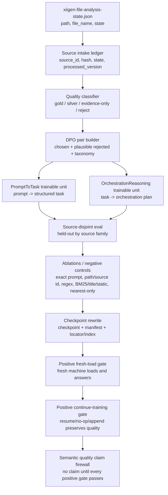

# SMART-SKILLS-SEMANTIC-QUALITY-COMPLETION-PLAN-v1

Вердикт: **PLAN-ONLY**. Во время чернового создания плана PLAN-CREATION SUB-AGENT не запускал реализацию, обучение, тесты, build, git-операции или смену ветки. Это не запрещает parent после review отдельно commit/push сам plan artifact по протоколу репозитория; такой commit/push плана не авторизует implementation/training.

Этот план закрывает недостающую semantic-quality дорожную карту для `PromptToTask` и `OrchestrationReasoning` на основании уже собранного источника:

`C:\Users\lubao\Documents\xiigen\sonnet local - analyzes\xiigen-file-analysis-state.json`

План не заявляет, что semantic quality готова. Текущий честный статус остается: Q9 дал прозрачные baseline units и checkpoint lifecycle, но полноценная semantic quality все еще требует source-disjoint eval, ablations, checkpoint rewrite, positive fresh-load gate и positive continue-training gate.

## 1. Журнал требований и полномочий

### 1.1. Источник требований Luba

| entry_id | entry_type | source_quote | assistant_answer_or_resolution | requirements_created_or_changed | plan_sections_updated | gates_or_artifacts_updated | status |
|---|---|---|---|---|---|---|---|
| UP-001 | luba_task_requirement | "полноценная semantic quality всё ещё требует следующих фаз: source-disjoint eval, ablations, checkpoint rewrite, positive fresh-load/continue-training gates" | План строит именно completion-фазы, а не readiness report. | Нет semantic-quality claim до source-disjoint, ablations, checkpoint rewrite, fresh-load и continue-training. | 3, 4, 5, 7, 9. | Semantic-quality firewall, lifecycle gates. | applied |
| UP-002 | luba_task_requirement | "сделай план на основании анализов собранных в файле: C:\Users\lubao\Documents\xiigen\sonnet local - analyzes\xiigen-file-analysis-state.json" | analysis-state используется как source queue/source-ref ledger input; файл не выгружается целиком в план. | Source intake, source quality classifier, DPO seed candidates и source-disjoint split должны опираться на observed refs из analysis-state. | 2, 3, 4, 7.6. | Intake/source-disjoint/DPO gates. | applied |
| UP-003 | luba_task_requirement | "план делать в верном формате через суб агентов" | План оформлен как human-readable Russian plan с будущими bounded sub-agent phases и parent review/fix gates. | Один суб-агент за раз, <=15 минут, role/skills/write scope/evidence/review gate на фазу. | 6, 7.9. | Sub-agent packet gate, four review/fix cycles. | applied |
| UP-004 | luba_task_requirement | "план" как текущий deliverable, до принятия плана implementation не начинается. | Этот артефакт остается PLAN-ONLY; будущая реализация требует свежего принятия плана Luba. | Plan-only/no implementation/training until accepted. | 1, 6, 8. | PLAN-ONLY gate, no-claim gate. | applied |
| UP-005 | luba_task_requirement | "from documents, the training/extraction process may use ONLY universal orchestration rules, not stack-specific or project-stack execution rules" | План усиливает universalization gate: документы являются source evidence, а не прямым training content; в common DPO/training проходят только универсальные orchestration boundaries. | Stack-specific details и project execution recipes должны быть evidence-only/adaptive/local или reject/quarantine; common training запрещает WPF, VS Code/Cursor, Claude hooks, .NET commands, repo paths, exact filenames, PowerShell scripts, UI framework details, host integration mechanics и project-specific recipes как обучающие правила. | 1.2, 4.2-4.7, 6, 7.6, 7.6.2, 9. | Universal-orchestration-only gate, stack-specific execution removed gate, stack-specific shortcut ablation gate. | applied |
| UP-006 | luba_task_requirement | "the plan must analyze examples from existing documents and explicitly state which parts are universal and which are stack/project-specific" | План больше не ограничивается абстрактным universal-only правилом: рядом с universalization gate добавлен конкретный разбор named source families Luba с chosen/rejected DPO формой и ablation обязанностью. | Для каждого candidate перед DPO acceptance нужен decomposition artifact: source fragment/class/concept, universal boundary, removed stack/project mechanics, chosen shape, rejected near miss, ablation proof. | 1.2, 2, 6, 7.6, 7.6.2, 9. | Concrete universal-vs-stack decomposition gate; reviewer checklist gate. | applied |

Bounded sub-agent packet, через который создан этот артефакт, является **executor constraint**, а не источником требований Luba. Он ограничивает эту попытку ремонта: писать только plan/state, не запускать tests/build/training/git/implementation, не делать commit/push и не менять ветку. Он не подменяет требования Luba выше и не авторизует implementation.

### 1.2. Authority requirements ledger

| ID | Требование Luba | Где покрыто | Gate | Artifact |
|---|---|---|---|---|
| R-01 | План только, без реализации/тренировки/кода. | 1, 6, STATE | PLAN-ONLY gate | Этот `.md`, STATE |
| R-02 | Для bounded plan-writing sub-agent: не commit/push, не switch branch, не run tests/build/training/implementation. Parent plan artifact commit/push после review по протоколу репозитория находится вне этого запрета и не авторизует implementation/training. | 1, 6, STATE | Plan-writing sub-agent forbidden-action gate | STATE |
| R-03 | Прочитать audit, uplift plan, domain doc, analysis-state structure. | 2, STATE | Source-read gate | STATE `files_read` |
| R-04 | Использовать `xiigen-file-analysis-state.json` как исходный source queue. | 3, 4.1, 6 | Intake gate | Source ledger future artifact |
| R-05 | Русский, human-readable формат для Luba. | Все разделы | Human-readable review | Этот `.md` |
| R-06 | Mermaid UML: analysis-state -> ledger -> classifier -> DPO -> units -> eval -> ablations -> rewrite -> gates -> firewall. | 3 | Diagram gate | Раздел 3 |
| R-07 | Объяснить данные на ребрах с конкретными examples из analysis-state. | 3.2 | Source-example gate | Раздел 3.2 |
| R-08 | No-code algorithms: intake, classifier, universalization, DPO, splits, ablations, rewrite, fresh-load, continue, claim. | 4 | Algorithm coverage gate | Раздел 4 |
| R-09 | Code-reference layer with Q9 classes/methods. | 5 | Code-anchor gate | Раздел 5 |
| R-10 | `было -> должно стать` для baseline units как deliverables/files/tests. | 5.2 | Deliverable mapping gate | Раздел 5.2 |
| R-11 | Execution phases <=15 minutes, one sub-agent at a time. | 6 | Sub-agent packet gate | Раздел 6 |
| R-12 | Mandatory gates: no claim, source-disjoint, ablations, checkpoint rewrite, fresh-load/continue, DPO quality, dashboard QA, docs, four review/fix cycles. | 7 | Completion gates | Раздел 7 |
| R-13 | Non-goals/no-claims: host runtime, external AI, SkillSelection full unitization unless future phase. | 8 | No-overclaim gate | Раздел 8 |
| R-14 | STATE records files read, source path, plan-only, no tests/training, next action parent review/fix. | STATE | State gate | `SMART-SKILLS-SEMANTIC-QUALITY-COMPLETION-PLAN-v1-STATE.json` |
| R-15 | Из документов в common DPO/training можно брать только универсальные orchestration rules. Stack-specific/project-stack execution rules остаются evidence-only/adaptive/local или quarantined/rejected. | 4.2-4.7, 6, 7.6, 7.6.2, 9 | Universal-orchestration-only gate | План и будущие classifier/DPO/split/ablation/readiness artifacts |
| R-16 | По named documents Luba нужен конкретный human-readable разбор: что универсально, что стековое/проектное, как это превращается в chosen/rejected DPO row и какая ablation доказывает, что модель не выучила shortcut. | 2, 7.6.2, 9 | Concrete decomposition before DPO acceptance gate | Future `universal-vs-stack-decomposition` artifact and DPO dataset cards |

## 2. Что уже известно из источников

1. `TRAINABLE-ARCHITECTURE-AUDIT-v4.md` говорит: Q9 исправил architecture authority gap для `PromptToTaskMachine` и `OrchestrationReasoningMachine`, потому что runtime decision теперь делегируется в typed `ILogicalUnit` units. Но это **baseline**, не semantic-quality proof.
2. `SMART-SKILLS-SEMANTIC-QUALITY-UPLIFT-PLAN-v1.md` уже задал общий quality loop: intake из analysis-state, material quality, DPO rows, held-out, ablations, checkpoint lifecycle, no deterministic shortcuts.
3. `43-smart-skills-domain.md` подтверждает текущую границу: `SemanticQualityClaimed=false` нужно читать буквально; checkpoint/export/import/materialization не равны semantic quality.
4. `xiigen-file-analysis-state.json` имеет форму массива строк с `path`, `file_name`, `state`. Обнаружено 1,103,977 записей: 2,940 `done`, 1,101,037 `todo`. Это значит: `done` rows являются candidate source refs, но не автоматически gold; `todo` rows остаются backlog.
5. `doc-07956-xiigen-universal-orchestrator-plan` показывает переносимую runtime форму: prompt разделяется на домены, домены переводятся в формальные statements, work pieces остаются отдельными, review идет до formatting, failed fragment возвращается на reprocess. Но `XIIGen`, `v12 loops`, `genie dna`, node filenames и source-document title являются provenance/adapter context, не common DPO сигналом.
6. `skills-inventory-universal-vs-project-specific.md` прямо проводит границу: universal core хранит session mode, requirements ledger, arbiters, evidence scope, router и portability labels; project adapter хранит `.NET 9`, C#, `xUnit`, `OperationResult<T>`, concrete subproject map, Windows Forms, exact commands и artifact paths.
7. Две named copies `UniversalDependencies.cs` имеют одинаковый SHA256 и считаются одной source family. Они могут учить только общую идею "единица имеет head/root/children и relation"; `ConlluParser`, `DependencyTreeNavigator`, `RuleBasedParser`, CoNLL-U fields, C# services и implementation mechanics не входят в common orchestration DPO.
8. `UniversalNineNodeDevelopmentFlow.cs` может учить stack-free фазовую цепочку split -> translate -> plan -> process -> apply -> result translate -> select arbiters -> arbitrate -> format. `UniversalNineNodeDevelopmentFlow`, `NodeDefinitions`, singleton/shared units, `Project15Bridge`, `SemanticCompiler29`, C# async/envelope/metrics и exact node ids остаются code evidence only.
9. `UniversalFlowSingletonTests.cs` полезен как local evidence о no cross-run contamination, deduplication и canonical flow assertions. Но `[Fact]`, `Assert.Same`, `xUnit`, temp checkpoint root, subphase ids `3.1/3.4`, singleton mechanics и test method names не могут стать common orchestration training rules.

Конкретные refs, найденные при sampling analysis-state:

| Пример ref | state | Как используется в плане |
|---|---:|---|
| `C:\Users\lubao\Documents\xiigen\.clinerules` | done | Evidence/source ref для orchestration-rule reasoning, не raw common text. |
| `C:\Users\lubao\Documents\xiigen\AGENTS.md` | done | Authority/interrupt examples для PromptToTask и OrchestrationReasoning. |
| `C:\Users\lubao\Documents\xiigen\CLAUDE.md` | done | User-local/adaptive rules; в common попадает только redacted reusable boundary. |
| `C:\Users\lubao\Documents\xiigen\basic prompt.txt` | done | PromptToTask seed ref, если есть accepted interpretation. |
| `C:\Users\lubao\Documents\xiigen\PROMPTS.md` | done | Prompt family ref для task-contract DPO. |
| `C:\Users\lubao\Documents\xiigen\Wordpress integration\...\PATCH-phase-transition-protocol-SKILL.md` | done | Protocol/phase-transition near-miss examples после universalization. |
| `C:\Users\lubao\Documents\xiigen\platform development\extracted_v18\V17-skills\...\SKILL.md` | todo | Backlog only; не использовать до state=`done`. |

## 3. Человеческая карта потока данных

### 3.1. Mermaid UML



### 3.2. Что передается на каждом ребре

| Ребро | Что передается | Пример из analysis-state |
|---|---|---|
| `analysis-state -> source ledger` | Только ref-метаданные: path, file_name, state, stable source id, hash. | `AGENTS.md`, `CLAUDE.md`, `.clinerules` со `state=done`. |
| `source ledger -> classifier` | Source ref плюс признаки пригодности: есть ли accepted outcome, учит ли reusable boundary, нет ли raw-private leakage. | `basic prompt.txt` может быть candidate для PromptToTask; `translation-checkpoints/*.out.log` скорее evidence-only для lifecycle, не common DPO text. |
| `classifier -> DPO pairs` | `gold/silver` rows становятся chosen/rejected pairs; `evidence-only` сохраняется как proof ref; `reject` не идет в training. | `PATCH-phase-transition-protocol-SKILL.md` может дать near-miss: wrong answer continues execution across phase boundary. |
| `DPO pairs -> PromptToTask unit` | User prompt ref, chosen structured task, rejected task-contract near miss, taxonomy. | Prompt-only ref вроде `PROMPTS.md` или `basic prompt.txt`, если есть approved task interpretation. |
| `DPO pairs -> OrchestrationReasoning unit` | Structured task ref, chosen orchestration scenario/gates, rejected scenario near miss. | `.clinerules`/`.cursorrules`/routing guides как refs для authority/routing scenario, без path lookup authority. |
| `units -> source-disjoint eval` | Checkpoint output на held-out prompts/tasks, где source families не пересекаются с train. | Train на `AGENTS.md` family нельзя eval на near-duplicate `CLAUDE.md` если они несут один и тот же copied protocol block. |
| `eval -> ablations` | Те же held-out rows прогоняются через deterministic controls. | Контроль должен провалиться, если ответ можно получить по filename `AGENTS.md` или title `ROUTING_GUIDE.md`. |
| `ablations -> checkpoint rewrite` | Только после выигрыша trained model над controls создается новый component checkpoint. | Manifest получает новые source-ledger refs и hashes; старый baseline не перетирается без lineage. |
| `rewrite -> fresh-load` | Checkpoint/manifest/locator открываются в fresh machine/process. | `PromptToTaskMachine.LoadCheckpointAsync` и `OrchestrationReasoningMachine.LoadCheckpointAsync` должны загрузить новый asset. |
| `fresh-load -> continue-training` | Fresh-loaded model продолжает обучение или no-op continue без потери lineage/quality. | Report должен показать previous checkpoint sha + new checkpoint sha + held-out non-regression. |
| `continue -> firewall` | Positive evidence markers и отсутствие no-claim evidence. | `XiigenExtensionApiService.ShouldClaimSemanticQuality` остается final blocker. |

## 4. Алгоритмы без кода

### 4.1. Source intake / idempotent re-run

1. Читать `xiigen-file-analysis-state.json` как очередь source refs, не как готовый датасет.
2. Для каждой строки создать `source_id = sha256(path + file_name + source_state_row_index)`.
3. Если `state != done`, записать backlog row и не материализовать DPO.
4. Если `state == done`, вычислить file hash/mtime только через безопасный source ref; если файл отсутствует, row становится `evidence-only: missing_source`.
5. Проверить intake ledger: если `source_id + content_hash + classifier_version` уже обработан, skip с reason `idempotent_no_change`.
6. Если hash изменился, создать новую `source_version_id`, не затирая старую.
7. На выходе: `source-ledger.jsonl`, `intake-rerun-report.json`, список new/changed/skipped/backlog rows.

Gate: повторный запуск на том же input не должен менять DPO rows или checkpoint refs.

### 4.2. Source material quality classifier

Классы:

| Класс | Когда ставить | Можно ли в common DPO |
|---|---|---|
| `gold` | Есть real user/project situation, accepted outcome или явная correction Luba, один reusable boundary, source ref/hash. | Да. |
| `silver` | Есть полезная reasoning structure, но accepted outcome косвенный или нужен reviewer confirmation. | Да, после review или с меньшим весом. |
| `evidence-only` | Полезно как proof/lineage/runtime/log, но не учит semantic decision. | Нет, только provenance. |
| `reject` | Raw dump, exact path trick, command recipe, stale duplicate, absurd negative, private text leakage. | Нет. |

Правило: `state=done` только открывает дверь в classifier. Оно не равно `gold`.

Обязательная поправка к classifier: строка не может стать `gold` или `silver` для common DPO, если ее полезность держится на конкретном стеке или проектной механике. WPF, VS Code/Cursor, Claude hooks, `.NET` commands, repo paths, exact filenames, PowerShell scripts, UI framework details, host integration mechanics и project-specific implementation recipes классифицируются как `evidence-only` или `adaptive/local`. Если из них нельзя честно сформулировать универсальную orchestration boundary без этих деталей, строка получает `reject/quarantine` для common training.

Gate classifier: reviewer должен явно подтвердить три вещи: documents are source evidence, not direct training content; universal orchestration rule is stated in human language; stack-specific execution removed. Без этих трех подтверждений row не идет в common DPO.

### 4.3. Universalization algorithm

Документы в этом плане являются источником evidence: они показывают реальные ошибки, правила, near-miss и review outcomes. Они не являются прямым training content и не должны копироваться в common DPO как инструкции к конкретному стеку.

В common DPO/training может попасть только универсальная orchestration rule: правило о границе полномочий, фазе, gate, проверке evidence, no-claim firewall, review/fix цикле, source quality или безопасном переходе между шагами. Стековые и проектные детали остаются только provenance/evidence/adaptive-local metadata.

1. Взять candidate source row и выделить human decision boundary: authority, plan-only, review gate, DPO quality, orchestration family, privacy, no-claim.
2. Удалить project-specific execution: локальные пути, команды, patch recipe, filenames as answer, host-specific workaround, UI framework details, host integration mechanics.
3. Проверить стековые слова и рецепты: WPF, VS Code/Cursor, Claude hooks, `.NET` commands, repo paths, exact filenames, PowerShell scripts и project-specific recipes не могут быть общим обучающим правилом.
4. Оставить source refs и hashes в provenance, а не raw private text.
5. Превратить пример в универсальную форму:
   - было: "в этом repo запусти конкретную команду/почини конкретный файл";
   - должно стать: "когда задача plan-only, structured task запрещает implementation и требует review gate".
6. Если исходная строка является "specific stack instruction", ее можно превратить в training row только тогда, когда универсальная orchestration boundary ясна и может быть сказана без stack details.
7. Если такую boundary нельзя сформулировать без WPF/VS Code/Cursor/Claude/.NET/path/PowerShell/UI/host mechanics, строка rejected/quarantined для common training и может остаться только evidence-only или adaptive/local.
8. Reviewer проверяет, что common row можно применить в другом проекте без знания `C:\Users\lubao\...`, имени файла, UI стека, shell-команды или host integration recipe.

Gate universalization: accepted row должна отвечать на вопрос "какое универсальное orchestration решение должен принять агент?" Если ответ звучит как "в этом стеке сделай конкретный технический шаг", row не common-training-ready.

### 4.4. PromptToTask DPO construction

Input: real prompt source ref + accepted interpretation.

Chosen должен содержать:

- `task_type`;
- цель;
- constraints;
- deliverables;
- forbidden actions;
- allowed verification;
- artifact type;
- implementation_authorized;
- required evidence.

Rejected должен быть plausible near miss:

- начал код/тесты при plan-only;
- пропустил "no commit/push";
- принял quoted transcript как live command;
- спутал "semantic quality completion plan" с training execution;
- забыл source-disjoint/ablation gates.

Quality gate: у пары есть positive и negative examples из real refs (`AGENTS.md`, `CLAUDE.md`, prompt files, accepted plans), а rejected не является карикатурно плохим.

Universal-only gate для PromptToTask DPO: chosen/rejected могут ссылаться на source ref как provenance, но не должны учить исполнять стековую команду, менять конкретный файл, следовать repo path или включать exact filename как сигнал. `technical_execution_refs_excluded=true` обязателен; если excluded refs содержат единственный смысл строки, строка не идет в common DPO.

### 4.5. OrchestrationReasoning DPO construction

Input: structured task + source/evidence refs.

Chosen должен выбрать orchestration scenario:

- source intake;
- material classifier;
- DPO materialization;
- source-disjoint split;
- ablation controls;
- checkpoint lifecycle;
- fresh-load/continue-training;
- claim firewall;
- review/fix cycle.

Rejected near misses:

- route by filename/title only;
- BM25/static guide lookup без reasoning;
- implementation plan вместо architecture-only plan;
- пропуск checkpoint rewrite;
- JSON report accepted as quality;
- dashboard/API evidence claimed as host runtime.

Quality gate: row объясняет hidden risk and required gate, а не просто пересказывает файл.

Universal-only gate для OrchestrationReasoning DPO: chosen orchestration must select phase/gate/evidence boundary, not WPF/VS Code/Cursor/Claude hook/.NET/PowerShell/host recipe. Rejected example должен проверять именно плохую orchestration boundary, а не знание конкретного стека.

### 4.6. Source-disjoint split

1. Группировать rows по `source_family`: root directory, archive name, normalized filename/title, prompt family, copied protocol block hash.
2. Запретить попадание одной `source_family` в train и held-out.
3. Для PromptToTask held-out должен иметь новые формулировки prompts и новые task constraints, а не near-duplicate.
4. Для OrchestrationReasoning held-out должен требовать scenario/gate reasoning, а не узнавание guide filename.
5. Сохранять `split_manifest.json`: train/dev/heldout source ids, family ids, leakage checks.
6. Reviewer должен увидеть examples из каждого split, но без raw private dump.

Gate: если deterministic exact/source/title lookup может пройти held-out, split invalid.

Дополнительный leakage check: held-out invalid, если его можно пройти по stack/project shortcut: WPF термин, VS Code/Cursor/Claude hook, `.NET` command, PowerShell script name, repo path, exact filename, UI framework marker или host integration mechanic. Такие признаки не должны быть train/test bridge для common orchestration quality.

### 4.7. Ablation / negative controls

Каждый component eval запускается против trained checkpoint и controls:

| Control | Что доказывает |
|---|---|
| `exact_prompt_lookup` | Нельзя пройти eval только запомнив prompt. |
| `filename_path_source_id_lookup` | Нельзя route по `AGENTS.md`, `.clinerules`, source id или локальному path. |
| `regex_keyword_classifier` | Нельзя пройти на словах "plan", "commit", "semantic" без понимания. |
| `bm25_title_static_route` | OrchestrationReasoning не должен побеждать только по title/guide retrieval. |
| `nearest_only_baseline` | Q9 nearest overlap baseline должен проигрывать или деградировать на source-disjoint held-out. |
| `no_trained_state` | Без checkpoint система не должна silently claim quality. |

Gate: trained model должен показать положительный delta над каждым control; иначе `SemanticQualityClaimed=false`.

Stack-specific shortcut ablation обязательна отдельно от filename/path controls. Контроль должен попытаться пройти held-out только по стековым маркерам: WPF, VS Code/Cursor, Claude hooks, `.NET` commands, repo paths, exact filenames, PowerShell scripts, UI framework details, host integration mechanics и project-specific recipes. Если этот shortcut проходит, значит модель или dataset выучили execution recipe вместо универсальной orchestration boundary; common training gate FAIL.

### 4.8. Checkpoint rewrite

1. Не перетирать baseline checkpoint до PASS по source-disjoint и ablations.
2. Создать новый checkpoint с lineage:
   - previous checkpoint sha;
   - training dataset sha;
   - held-out dataset sha;
   - source-ledger refs;
   - DPO materializer version;
   - ablation report refs;
   - fresh-load/continue report refs.
3. Обновить manifest и index/locator only after review.
4. Если SkillSelection не входит в этот phase, API-wide semantic claim остается blocked, даже если PromptToTask/OrchestrationReasoning component gates прошли.
5. Старые no-claim markers снимаются только component-local positive gate; final API firewall снимается только при full pipeline pass.

### 4.9. Positive fresh-load gate

1. Запустить fresh machine/process без in-memory state.
2. Загрузить checkpoint через `LoadCheckpointAsync` + `ImportAsync`.
3. Проверить hash manifest/checkpoint.
4. Прогнать source-disjoint held-out sample.
5. Проверить evidence:
   - no `BASELINE_NOT_SEMANTIC_QUALITY`;
   - no `SEMANTIC_QUALITY_CLAIMED_FALSE` for that component;
   - positive component evidence marker exists only after all component gates.

Gate: fresh output должен совпасть с accepted semantic contract или пройти tolerance; не только "файл загрузился".

### 4.10. Positive continue-training gate

1. Взять fresh-loaded checkpoint.
2. Выполнить bounded continue-training на new gold/silver rows или explicit no-op continue path.
3. Доказать:
   - previous source refs preserved;
   - new source refs appended;
   - checkpoint sha changed when rows added;
   - checkpoint sha stable or explicit no-op marker when no rows;
   - held-out quality не деградировала;
   - manifest lineage обновлен.

Gate: "resume command succeeded" не достаточно; нужен fresh-load after continue + held-out non-regression.

### 4.11. Semantic-quality claim gate

`semanticQualityClaimed=true` запрещен, пока не выполнены все пункты:

- DPO rows have real positive/negative refs;
- source-disjoint eval PASS;
- all ablations PASS;
- checkpoint rewrite PASS;
- manifest/index locator updated;
- concrete universal-vs-stack decomposition artifact exists and every accepted row answers the four reviewer questions;
- positive fresh-load PASS;
- positive continue-training PASS;
- no raw private text copied;
- no external AI dependence;
- documentation updated in human format;
- dashboard QA added if API/result display changed;
- four review/fix cycles completed before implementation commit/push;
- API firewall sees positive evidence from every component it requires.

Важно: текущий `XiigenExtensionApiService.ShouldClaimSemanticQuality` требует positive evidence от PromptToTask, OrchestrationReasoning и SkillSelection. Этот план может довести PromptToTask и OrchestrationReasoning до component-level readiness, но не должен заявлять full API semantic quality, если SkillSelection full unitization не включена отдельной будущей фазой.

## 5. No-code -> code-reference layer

### 5.1. Текущие Q9 anchors

`43.SmartSkillsDomain/PromptToTaskTaskPatternUnit.cs:80-83`

```csharp
public sealed class PromptToTaskTaskPatternUnit(...)
    : ILogicalUnit<PromptToTaskRequest, PromptToTaskTaskPatternUnitDecision>
```

`43.SmartSkillsDomain/PromptToTaskTaskPatternUnit.cs:164-167`

```csharp
if (state.SemanticQualityClaimed)
    return ... "does not accept semantic quality claims in this slice."
```

`43.SmartSkillsDomain/OrchestrationReasoningScenarioUnit.cs:92-95`

```csharp
public sealed class OrchestrationReasoningScenarioUnit(...)
    : ILogicalUnit<OrchestrationReasoningRequest, OrchestrationReasoningScenarioDecision>
```

`43.SmartSkillsDomain/OrchestrationReasoningScenarioUnit.cs:182`

```csharp
if (state.SemanticQualityClaimed || state.HostRuntimeClaimed)
```

`43.SmartSkillsDomain/XiigenExtensionApiService.cs:560-575`

```csharp
private bool ShouldClaimSemanticQuality(...)
    => _commonAssetLoadState.AllLoaded
        && !skillDecision.RequiresSecondPass
        && HasPositiveSemanticQualityEvidence(promptToTask.ContractEvidence)
        && HasPositiveSemanticQualityEvidence(orchestration.ContractEvidence)
        && HasPositiveSemanticQualityEvidence(skillDecision.EvidenceFeatures)
        && !HasSemanticNoClaimEvidence(...);
```

`43.SmartSkillsDomain/PromptToTaskMachine.cs:281-363`

```csharp
SaveCheckpointAsync(...)
ImportAsync(...)
LoadCheckpointAsync(...)
```

Текущий manifest пишет `SemanticQualityClaimed: false`, поэтому checkpoint lifecycle существует, но не является quality claim.

`43.SmartSkillsDomain/OrchestrationReasoningMachine.cs:308-393`

```csharp
SaveCheckpointAsync(...)
ImportAsync(...)
LoadCheckpointAsync(...)
```

Текущий manifest пишет `SemanticQualityClaimed: false`, `ContinueTrainingClaimed: false`, `HostRuntimeClaimed: false`.

### 5.2. Было -> должно стать

| Component | Было сейчас | Должно стать в реализации | Files/artifacts | Verification |
|---|---|---|---|---|
| PromptToTask unit | `PromptToTaskTaskPatternUnit` выбирает nearest learned pattern и честно маркирует baseline/no-claim. | DPO-trained component с source-disjoint held-out, ablation delta, rewritten checkpoint, positive fresh-load, positive continue-training. | `training-data/prompt-to-task/*`, `artifacts/prompt-to-task/*`, checkpoint/manifest/locator, report json/md. | Focused component eval + ablations + fresh-load/continue reports; no full `dotnet test` unless phase gate says. |
| OrchestrationReasoning unit | `OrchestrationReasoningScenarioUnit` выбирает nearest guide pattern, no host/semantic claim. | DPO-trained scenario reasoner, который выбирает gate family, а не filename/BM25/title/static route. | `training-data/orchestration-reasoning/*`, `artifacts/orchestration-reasoning/*`, checkpoint/manifest/locator, report json/md. | Source-disjoint scenario eval + BM25/title/static/nearest ablations + fresh-load/continue reports. |
| API firewall | `ShouldClaimSemanticQuality` требует positive evidence от всех компонентов и блокирует no-claim evidence. | Firewall остается. Добавляются только новые positive markers после всех gates. | `XiigenExtensionApiService` and tests only if API/result display changes. | Contract tests + dashboard QA if surface changes; no claim unless full pipeline passes. |
| Documentation | Domain docs говорят no-claim. | Human docs объясняют component-level vs API-level claim и evidence boundaries. | `docs/projects/43-smart-skills-domain.md`, future phase docs. | Docs review cycle. |

## 6. Фазы исполнения через суб-агентов

Правило исполнения: **один bounded sub-agent за раз**, max active time 15 минут. Parent/architect читает evidence, дает fix-list, затем запускает следующий bounded sub-agent. Реализация начинается только после свежего принятия этого плана Luba.

Каждый future work order должен содержать: artifact type, allowed write scope, forbidden scope, exact verification, max active time, implementation authorization, Luba acceptance quote, instruction that quoted transcripts are evidence only, instruction that direct Luba questions interrupt first.

Примечание о commit/push: упоминания commit/push в этой таблице относятся только к будущим implementation sub-agent phases и их phase-boundary protocol. Parent может отдельно commit/push **сам план** после review по протоколу репозитория; такой commit/push плана не является разрешением на implementation, training, tests или checkpoint rewrite.

| Phase | Role | Skills to load | Allowed write scope | Tests/evidence | Review gate |
|---|---|---|---|---|---|
| P0 | PLANNER | project rules, planning/review | Этот plan/state only | Markdown/state self-check | Parent review/fix, no implementation. |
| P1 | SOURCE-INTAKE executor | data curation, privacy/redaction | source-ledger/intake report only | Idempotent rerun report, done/todo counts | Reviewer proves no raw private dump and no `todo` DPO. |
| P2 | MATERIAL-CLASSIFIER executor | DPO curation, taxonomy | material-quality report, seed table, universal-vs-stack decomposition artifact | Gold/silver/evidence-only/reject examples + universal-orchestration-only decision + concrete named-source decomposition | Reviewer samples real refs, rejects filename/path learning, and proves stack-specific execution is evidence-only/adaptive/local or quarantined. |
| P3 | PROMPT-TO-TASK DPO author | PromptToTask, DPO | prompt-to-task DPO rows/cards | Positive/negative row table from real refs + stack-specific execution removed + decomposition row id | Reviewer checks chosen/rejected plausibility and rejects any common row that teaches a stack command, repo path, exact filename, host recipe, code class name, or implementation recipe. |
| P4 | ORCHESTRATION DPO author | OrchestrationReasoning, DPO | orchestration DPO rows/cards | Scenario/gate rows from real refs + universal orchestration boundary + rejected near miss that tests orchestration | Reviewer checks no BM25/title/static route and no WPF/VS Code/Cursor/Claude/.NET/PowerShell/host mechanic, class name, method name, test name, or file path as final authority. |
| P5 | SPLIT executor | eval design | split manifests/held-out fixtures | Source-disjoint leakage report + stack/project shortcut leakage report | Reviewer tries to break split by source family and stack-specific shortcut. |
| P6 | PROMPT-TO-TASK training executor | trainable asset lifecycle | PromptToTask checkpoint/assets/reports only | Component training report, checkpoint manifest | No claim until P7/P8/P9 pass. |
| P7 | PROMPT-TO-TASK eval reviewer | eval/ablation | reports only | Source-disjoint metrics + all ablations + stack-specific shortcut ablation | FAIL creates fix order, not commit. |
| P8 | ORCHESTRATION training executor | trainable asset lifecycle | Orchestration checkpoint/assets/reports only | Component training report, checkpoint manifest | No claim until P9/P10/P11 pass. |
| P9 | ORCHESTRATION eval reviewer | eval/ablation | reports only | Source-disjoint metrics + BM25/title/static/nearest controls + stack-specific shortcut ablation | FAIL creates fix order. |
| P10 | CHECKPOINT-REWRITE executor | asset registry/manifest | manifests/index/locator/checkpoint refs | Rewrite report with lineage | Reviewer checks manifest flags and locator. |
| P11 | FRESH-LOAD executor | lifecycle QA | fresh-load reports only | Fresh process loads each checkpoint and answers held-out sample | Reviewer rejects file-load-only proof. |
| P12 | CONTINUE-TRAINING executor | lifecycle QA | continue reports/checkpoint refs | Resume/no-op continue + non-regression | Reviewer checks lineage and no degradation. |
| P13 | API/DASHBOARD QA executor, only if surface changes | API QA/dashboard docs | API/dashboard tests/docs only | Visible result, raw/debug boundary, negative/untrained case | Scope must remain dashboard/API, not host runtime. |
| P14 | DOCS executor | docs | human docs only | Human-readable no-claim/claim-boundary docs | Documentation drift gate. |
| P15 | FOUR-ROUND REVIEW coordinator | code review/evidence | review ledgers/reports only | Four review/fix cycles before commit/push | Commit/push allowed only after four PASS rechecks and Luba-approved implementation phase. |

## 7. Обязательные gates

### 7.1. No semantic quality claim

Semantic quality нельзя заявлять, пока не прошли все positive gates. Любой missing gate должен давать reason code и `semantic_quality_claimed=false`.

### 7.2. Source-disjoint eval

Train/dev/held-out должны быть disjoint по source file, path family, archive root, prompt family, copied protocol block, title/guide id. Простая случайная разбивка по строкам запрещена.

Дополнительно held-out не считается source-disjoint, если его можно пройти по stack/project marker вместо смысла: WPF, VS Code/Cursor, Claude hook, `.NET` command, PowerShell script, repo path, exact filename, UI framework detail или host integration mechanic.

### 7.3. Ablations

Обязательные controls:

- exact prompt lookup;
- filename/path/source id lookup;
- regex/keyword classifier;
- BM25/title/static route;
- nearest-only baseline;
- stack-specific shortcut control;
- no-trained-state.

### 7.4. Checkpoint rewrite + manifest/index locator

Новый checkpoint становится candidate только после eval/ablation PASS. Manifest/index/locator должны ссылаться на exact checkpoint sha, dataset sha, held-out sha, source ledger, report refs.

### 7.5. Positive fresh-load and continue-training

Fresh-load должен доказать, что fresh machine/process реально загрузил asset и решил held-out examples. Continue-training должен доказать resume/no-op behavior, lineage и non-regression.

### 7.6. DPO quality from real references

Каждая DPO seed row должна иметь:

- real source ref;
- source sha;
- concrete universal-vs-stack decomposition ref;
- chosen ref;
- rejected ref;
- error taxonomy;
- source quality;
- common/adaptive flag;
- `raw_private_text_copied=false`;
- `technical_execution_refs_excluded=true`;
- reviewer answers for the four universalization questions from 7.6.2.

PromptToTask examples:

- positive: plan-only/user authority prompt -> structured task with `implementation_authorized=false`;
- negative: starts tests/commit or treats transcript quote as current command.

OrchestrationReasoning examples:

- positive: task asks semantic-quality completion -> phases for intake, DPO, held-out, ablation, lifecycle gates;
- negative: routes by filename/title or claims checkpoint load as quality.

### 7.6.1. Seed/example candidates from observed analysis-state refs

Эти строки являются **seed/example candidates**, а не готовыми training rows. Каждая из них должна пройти source hash, redaction, source-quality review, source-disjoint split и ablations. `state=done` в analysis-state означает только, что ref можно рассматривать; это не означает `gold`.

| Candidate | Target machine | Source ref | Какую универсальную границу может учить | Positive/chosen shape | Plausible rejected shape | Почему это не filename/path learning | Почему нужен source-disjoint/ablation proof |
|---|---|---|---|---|---|---|---|
| S-AGENTS-001 | PromptToTask + OrchestrationReasoning | `C:\Users\lubao\Documents\xiigen\AGENTS.md` | Human override, interrupt-before-continuation, plan-only vs execution authority. | PromptToTask: structured task фиксирует `implementation_authorized=false`, forbidden actions, review gate. OrchestrationReasoning: выбирает plan/review scenario и останавливает execution до acceptance. | Агент продолжает commit/test/training по старому state или трактует quoted transcript как живую команду. | В row нельзя писать "если filename AGENTS.md, включи authority gate"; нужно извлечь reusable rule: текущая human instruction wins, transcript evidence only. | Held-out должен содержать другую формулировку authority/interrupt rules из другого source family; controls по filename `AGENTS.md`, exact text и regex "stop/continue" должны деградировать. |
| S-CLAUDE-001 | PromptToTask + OrchestrationReasoning | `C:\Users\lubao\Documents\xiigen\CLAUDE.md` | Старые правила/планы не являются свежим разрешением; execution после plan-only требует acceptance. | Chosen task/plan разделяет evidence from old rules и active approval; future work order требует `luba_acceptance_quote`. | Rejected берет старое "continue/proceed" как разрешение на implementation/training. | Ref используется как provenance, а не как ключ `CLAUDE.md`; common row хранит redacted boundary без локального пути и без raw private text. | Нужен source-disjoint split с похожим rule из другого документа, чтобы доказать понимание authority freshness, а не запоминание текста CLAUDE. |
| S-BASIC-PROMPT-001 | PromptToTask | `C:\Users\lubao\Documents\xiigen\basic prompt.txt` | Как обычный человеческий prompt превращается в task contract: goal, constraints, deliverables, forbidden actions, evidence. | Chosen structured task выделяет намерение пользователя, границы исполнения и artifact type. | Rejected либо пересказывает prompt как свободный текст, либо сразу строит implementation steps без task contract. | Модель не должна узнавать строку "basic prompt.txt"; training row должен использовать redacted prompt ref + accepted interpretation. | Exact prompt lookup и keyword classifier могут легко пройти такой пример; held-out нужен с перефразированным prompt и другим source family. |
| S-PROMPTS-001 | PromptToTask | `C:\Users\lubao\Documents\xiigen\PROMPTS.md` | Prompt families, где одинаковое намерение может быть сказано разными словами; task contract должен быть стабильным. | Chosen нормализует разные prompt variants в один task type и разные constraints. | Rejected меняет task type из-за поверхностного слова или теряет forbidden actions. | Используется не имя `PROMPTS.md`, а группировка prompt variants и expected task-contract behavior. | Ablation по exact prompt/regex должен провалиться на paraphrase held-out; иначе это не semantic PromptToTask. |
| S-CLINERULES-001 | OrchestrationReasoning | `C:\Users\lubao\Documents\xiigen\.clinerules` | Project/tool rules как source of constraints: orchestration должна уважать authority, allowed scope, review gates. | Chosen scenario выбирает safe planning/review/verification flow и явно отделяет evidence от execution permission. | Rejected route выбирает action только потому, что source выглядит как tool config, или превращает rules в command recipe. | Row не должен говорить "если файл .clinerules"; он должен учить "rules artifact imposes constraints and gates". | Filename/path/source-id ablation обязателен: `.clinerules` очень легко использовать как shortcut без понимания rule content. |
| S-PHASE-PATCH-001 | OrchestrationReasoning + PromptToTask | `C:\Users\lubao\Documents\xiigen\Wordpress integration\Worpdpress updated plugin\update skills between phases\PATCH-phase-transition-protocol-SKILL.md` | Phase transition protocol: plan/review/fix/commit boundaries нельзя смешивать; next phase starts only after gate. | Chosen orchestration строит bounded phase order, review/fix cycle, explicit commit boundary only after accepted implementation phase. PromptToTask фиксирует requested artifact type and allowed write scope. | Rejected перескакивает к следующей phase, делает commit/push before review или выдает protocol patch как уже выполненную implementation. | Нужно извлечь universal phase-boundary rule, а не учить путь `Wordpress integration` или имя `PATCH-phase-transition-protocol-SKILL.md`. | Source-disjoint eval должен проверить другой phase-transition материал; static title/BM25 route и exact path lookup должны проиграть trained reasoning. |

Минимальный вывод reviewer для каждой seed/example candidate: `candidate_only`, `needs_source_hash`, `needs_redaction`, `needs_accepted_interpretation`, `needs_disjoint_split`, `needs_ablation_controls`. Только после этого строка может стать `gold` или `silver`; до этого она не является training-ready.

### 7.6.2. Gate: только универсальная orchestration, не stack execution

Этот gate обязателен для source quality classifier, DPO construction, source-disjoint/ablation и итогового readiness contract.

Человеческое правило: документы дают evidence, а не прямой common training text. Common DPO/training может учить только универсальную orchestration boundary. Все, что зависит от конкретного стека, host, UI framework, repo path, имени файла, shell command, PowerShell script, `.NET` command, WPF, VS Code/Cursor, Claude hooks или project-specific implementation recipe, остается evidence-only/adaptive/local или rejected/quarantined.

Если из конкретной инструкции можно ясно извлечь универсальную границу, строку можно использовать после redaction и review. Если универсальная граница исчезает без stack details, строка не идет в common training.

| Source ref | Было в документе / риск | Что оставить как universal orchestration rule | Что исключить из common training |
|---|---|---|---|
| `AGENTS.md` | Правила ветки, tests/build/training, commit/push, interrupt и authority могут выглядеть как literal repo execution protocol. | Текущая human instruction wins; quoted/state material is evidence only; interrupt-before-continuation stops execution; plan-only artifact не запускает implementation. | Branch name, repo path, exact command choices, project-specific commit protocol, local file names as triggers. |
| `CLAUDE.md` | Старые правила или старое "continue/proceed" могут быть ошибочно взяты как live approval. | Fresh approval is required after plan-only deliverable; old plans/transcripts are evidence, not execution authorization. | Claude-specific runtime behavior, local Claude hooks, tool-specific command recipes, exact old file paths. |
| `.clinerules` | Tool config может превратиться в "если файл .clinerules, следуй этому техническому маршруту". | A rules artifact can impose constraints, allowed scope, review gates and forbidden actions; orchestration must separate evidence from permission. | Filename `.clinerules` as shortcut, VS Code/Cursor mechanics, local extension settings, project-stack execution details. |
| `PATCH-phase-transition-protocol-SKILL.md` | Phase-transition patch может быть скопирован как WordPress/plugin-specific implementation recipe. | Phase boundaries must not be mixed; review/fix/commit boundaries require explicit gate; next phase starts only after accepted evidence. | `Wordpress integration` path, plugin folder structure, exact patch steps, PowerShell scripts, host integration mechanics. |

Required reviewer sentence before common training: "Эта строка учит универсальную orchestration boundary; stack-specific execution removed; stack-specific shortcut ablation must fail." Без этой фразы row остается candidate/evidence-only.

#### 7.6.2.A. Конкретная decomposition по named sources Luba

Этот artifact должен быть human-readable, на русском, и заполняется до принятия любых DPO rows из этих источников. Он не заменяет source hash/redaction, а добавляет обязательную смысловую проверку: источник может быть очень полезным evidence, но в common DPO проходит только stack-free orchestration boundary.

| Source family и конкретный фрагмент | Что универсально и может войти в common orchestration DPO после redaction | Что stack/project-specific и остается evidence-only/adaptive/local/quarantined | Как пример превращается в DPO row: chosen shape и rejected near miss | Что должна доказать ablation |
|---|---|---|---|---|
| `doc-07956-xiigen-universal-orchestrator-plan`: `01-UML-FRAME.md` Active Nodes/Edges, `node-03-scheme-planner-set.md` Pair 3.1, `node-07-arbiter-selector-set.md`, `node-08-arbiter-units-set.md`, `10-SIMULATION-CHECK.md` failure signs. | Runtime input не является source-document line; prompt раскладывается на отдельные responsibilities; независимые work pieces могут идти параллельно; review выбирается до formatting; failed fragment возвращается на repair без сброса approved fragments. | `XIIGen - Universal Orchestrator Plan`, старый source path, package folder `doc-07956`, node filenames, exact node numbers, `v12 loops`, `genie dna`, брендовые фразы и title-specific labels. | Chosen: для multi-domain orchestration сохранить отдельные branches, merge только после evidence/review, до final answer вернуть only failed fragment. Rejected near miss: схлопнуть все domains в один happy path, сделать review after formatting или трактовать source document line как runtime input. | Нельзя пройти по folder name `doc-07956`, file names `node-03`/`node-08`, title `XIIGen`, exact "Active Nodes" order, node number labels или branded phrases; модель должна решать по boundary "separate branches + pre-format review + targeted repair". |
| `skills-inventory-universal-vs-project-specific.md`: разделы 3, 4, 7, 8, 10, 11. | Переносимая AI-extension архитектура: skill registry, session router, arbiter panel, evidence engine, portability labels, conflict policy; universal core хранит discipline, adapters подставляют stack rules и project map. | `.NET 9`, C#, `xUnit`, `OperationResult<T>`, `BaseService`, concrete subproject map `00..43`, `TensorCore`, Windows Forms, exact commands, branch/commit conventions, domain guards, local artifact paths. | Chosen: DPO row учит отделять universal skill-loading/session/evidence discipline от adapter policy. Rejected near miss: зашить `.NET`/XIIGen project map в universal engine или объявить every skill universal без adapter boundary. | Нельзя пройти по filename `skills-inventory`, словам `.NET`, `C#`, `XIIGen`, `OperationResult`, `Windows Forms`, names of skill files или path `docs\skills`; held-out должен требовать portability reasoning на другом stack/domain. |
| `UniversalDependencies.cs` в extracted и source-examination-cache copies: same SHA256; `DependencyTreeNavigator.GetChildren/GetHead/GetRoot`, `RuleBasedParser` relation assignment, annotator relation-as-role. | Общая dependency idea: элементы имеют root/head/children и relation; orchestration может сначала определить root decision, затем child dependencies и relation labels перед sequencing/review. Это полезно только как generalized relationship model. | C# файл, namespace `SemanticNlp`, class names `ConlluParser`, `DependencyTreeNavigator`, `RuleBasedParser`, method names, CoNLL-U field positions, `nsubj/obj/det` как literal syntax, `OperationResult`, service/idempotency mechanics, demo sentence rules. | Chosen: для планового reasoning определить главный decision node, dependent evidence/gates и relation type, затем строить order/review. Rejected near miss: выбрать route потому что source file называется `UniversalDependencies.cs`, потому что встречены `GetRoot`/`GetHead`, или потому что C# parser mechanics похожи на задачу. | Нельзя route по `.cs`, filename, class/method names, namespace, CoNLL-U syntax, UD relation names, C# implementation structure или project path; ablation должна оставить только generalized dependency/relation prompt и проверить orchestration choice. |
| `UniversalNineNodeDevelopmentFlow.cs`: `NodeDefinitions`, ordered `ExecuteAsync` loop, transform roles, arbiter selection/quality/formatter flow. | Stack-free phase/order concept: split -> translate -> plan -> process -> apply -> translate result -> select arbiters -> arbitrate -> format; carry evidence through stations; choose reviewers before final formatting; allow ordered/parallel responsibilities. | C# records/classes, `UniversalNineNodeDevelopmentFlow`, `UniversalDevelopmentNodeUnit`, `NodeDefinitions`, singleton `SharedNodeUnits`, async `OperationResult` envelope, metrics keys, `Project15Bridge`, `SemanticCompiler29`, exact node ids and phase/subphase ids. | Chosen: OrchestrationReasoning row chooses a phase/gate chain with review before claim and evidence carried across steps. Rejected near miss: hardcode exactly nine nodes, call `Project15Bridge`, claim singleton execution proves semantic quality, or use node id names as the answer. | Нельзя пройти по class/file/method name, `node-01-domain-splitter`, `node-09-formatter`, `UniversalNineNodeDevelopmentFlow`, metrics names, `Project15Bridge`, `SemanticCompiler29`, phase id or C# async shape; success must survive renamed phases and non-C# examples. |
| `UniversalFlowSingletonTests.cs`: `SingletonIdentityTests`, `ConcurrentExecutionIsolationTests`, `CrossBatchIsolationTests`, `DeduplicationTests`, canonical nine-node assertion. | Universal evidence concept: reusable orchestration assets need isolation across runs, no state bleed between branches/batches, deduplication of duplicate work, and independent assertions before a readiness claim. | `[Fact]`, `xUnit`, `Assert.Same`, concrete subphase ids `3.1/3.4`, `Path.GetTempPath`, `DefaultLogicalCapabilityTrainer`, singleton identity mechanics, test method names, run ids, temp checkpoint folder. | Chosen: readiness plan requires isolation/dedup/no-cross-contamination evidence for reusable orchestration assets before claim. Rejected near miss: accept because a test named `UniversalFlowsAlwaysHaveExactlyNineCanonicalNodes` exists, or learn "singleton shared node" as universal product behavior. | Нельзя пройти по test name, `[Fact]`, `Assert`, `xUnit`, run-id strings, subphase ids, temp paths, class names или "exactly nine" assertion; ablation must prove the row tests evidence isolation, not C# test mechanics. |

Для code files действует отдельная красная линия: `UniversalDependencies.cs` может учить только обобщенную dependency/relationship идею, если она сказана без C# names, parser mechanics и CoNLL-U syntax. `UniversalNineNodeDevelopmentFlow.cs` может учить только high-level phase/order concepts, если они stack-free; code/test/singleton mechanics остаются local evidence. Любая DPO row, где смысл исчезает после удаления class name, method name, filename, `.cs`, test name или project path, не является common orchestration DPO.

Reviewer обязан ответить письменно для каждого candidate:

- "Какая универсальная граница?"
- "Что удалено как стековая механика?"
- "Почему это не C#/file/class-name shortcut?"
- "Какой rejected near miss проверяет именно orchestration?"

Если хотя бы один ответ отсутствует или звучит как stack/project recipe, candidate остается `evidence-only` или `adaptive/local`; PromptToTask/OrchestrationReasoning DPO row не принимается.

### 7.7. Dashboard QA if API/result display changes

If implementation changes API/result display/dashboard:

- add user-facing scenario name;
- input label and example;
- visible result assertion;
- raw/debug boundary;
- negative/untrained case;
- evidence scope `dashboard_api_only_not_model_quality_not_host_runtime`.

### 7.8. Documentation in human format

Docs must explain:

- component-level PromptToTask/OrchestrationReasoning status;
- API-level semantic claim remains blocked until all required components pass;
- checkpoint load is not quality proof;
- dashboard/API QA is not host runtime proof.

### 7.9. Four review/fix cycles before commit/push

Future implementation phases must complete four independent review/fix cycles before staging/commit/push. A phase cannot be claimed ready with open review items, missing docs, missing state, or missing evidence.

## 8. Остаточные non-goals and no-claims

Не входит в этот completion plan как готовая реализация:

- host runtime for Claude/Cursor/Codex;
- external AI dependency or external AI evaluation as proof;
- full SkillSelection unitization unless a separate future phase explicitly includes it;
- copying raw private user text into common training;
- treating JSON/static reports as model quality;
- treating dashboard/API automation as model semantic quality;
- treating checkpoint existence, import/export, or nearest overlap as semantic quality;
- claiming full `XiigenExtensionApiService` semantic quality while SkillSelection-required positive evidence is absent.

Разрешенная будущая формулировка после выполнения этого plan scope: "PromptToTask and OrchestrationReasoning component gates passed." Запрещенная формулировка без SkillSelection/full firewall pass: "full smart-skills semantic quality is ready."

## 9. Итоговый readiness contract для будущей реализации

Будущая implementation phase считается закрытой только если есть:

1. `source-ledger.jsonl` + idempotent rerun report.
2. Material quality report with gold/silver/evidence-only/reject samples.
3. Concrete `universal-vs-stack-decomposition` artifact for every candidate source family before any DPO row is accepted. It must name the source fragment/class/concept, universal boundary, removed stack/project mechanics, chosen shape, rejected near miss, and required ablation.
4. PromptToTask DPO dataset card, where every accepted row references a decomposition entry and answers: "Какая универсальная граница?", "Что удалено как стековая механика?", "Почему это не C#/file/class-name shortcut?", "Какой rejected near miss проверяет именно orchestration?"
5. OrchestrationReasoning DPO dataset card with the same decomposition reference and reviewer answers.
6. Source-disjoint split manifests.
7. PromptToTask source-disjoint eval and ablation report.
8. OrchestrationReasoning source-disjoint eval and ablation report.
9. Rewritten checkpoints with manifests/index locators.
10. Positive fresh-load reports.
11. Positive continue-training reports.
12. API/firewall report showing either full PASS or explicit blocked reason.
13. Dashboard QA if result/API changed.
14. Human documentation update.
15. Four review/fix cycle ledger before any implementation commit/push.
16. Universal-orchestration-only evidence in classifier and DPO dataset cards: documents are source evidence, stack-specific execution removed, common rows state reusable orchestration boundaries in human language.
17. Stack-specific shortcut ablation PASS: WPF/VS Code/Cursor/Claude hooks/.NET commands/repo paths/exact filenames/PowerShell scripts/UI framework/host mechanics/project recipes cannot pass held-out evaluation.
18. Code-source shortcut ablation PASS: C# syntax, `.cs` filenames, class names, method names, namespace names, test names, xUnit/Assert markers, node ids and project paths cannot pass held-out evaluation.

Until all relevant rows exist and pass, semantic quality remains **not claimed**.
