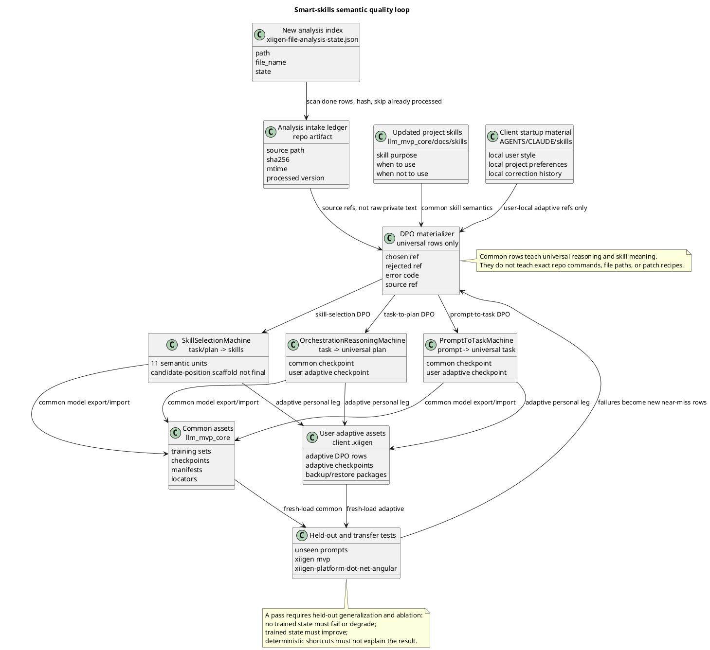

# Smart Skills Semantic Quality Uplift Plan v1

Status: **plan-only**. This plan improves the semantic quality of the smart-skills orchestration core. It does not start implementation, training, build, host runtime, commit, or push.

This is a companion plan to `docs/plans/ORCHESTRATION-AND-PROMPT-TO-TASK-FULL-EXTENSIONS-PLAN-v3.md`. It does not replace the extension plan. It narrows the next improvement target to the three weak semantic decisions:

1. `PromptToTaskMachine`: user prompt -> universal structured task.
2. `OrchestrationReasoningMachine`: structured task -> universal orchestration plan.
3. `SkillSelectionMachine`: task/plan -> correct skills, without candidate-position final authority.

## A. Human-readable model

### A1. What this plan fixes

The current core has the correct shape: extensions send a request into `XiigenExtensionApiService`, and the service calls the three machines in order. The weak part is not the API shape. The weak part is proof of real semantic generalization.

The plan therefore creates a repeatable quality loop:

1. Read new approved analyses from `C:\Users\lubao\Documents\xiigen\sonnet local - analyzes\xiigen-file-analysis-state.json`.
2. Convert only reusable reasoning into DPO rows.
3. Use updated project skills as common skill-semantics training material.
4. Use client startup `AGENTS.md`, `CLAUDE.md`, and skills as user-local adaptive material only.
5. Train or continue common/adaptive models.
6. Validate on new held-out prompts and on two real projects:
   - `C:\Projects\xiigen mvp`
   - `C:\Projects\xiigen-platform-dot-net-angular`
7. Fail if the result can be explained by exact prompt lookup, filename lookup, BM25, candidate position, regex, or static routing.

### A1.1. How the model knows what is good study material

This section exists because a generic "train the model" row is not enough. The
machine cannot learn quality if the plan does not say which source material is
good, which material is bad, and what decision boundary each example teaches.

Good study material has four properties:

1. It contains a real user or project situation, not an invented abstract task.
2. It has an approved outcome or a clear correction from Luba.
3. It teaches one reusable decision boundary.
4. It can be cited by a source ref, hash, and provenance row without copying raw
   private text into common training data.

Bad study material is rejected before DPO materialization when it is only a
file summary, a raw transcript with no resolution, a command recipe tied to one
repository, a filename/path clue, a generic refusal, an absurdly bad rejected
answer, or a checklist that does not teach a semantic difference.

Per-machine material rubric:

| Machine | Good common material | Bad common material | What the row must teach |
| --- | --- | --- | --- |
| `PromptToTaskMachine` | Real user prompts from the prompt roots, paired with approved task interpretation, constraints, permission boundary, and deliverables | Raw prompt with no accepted interpretation; prompt copied verbatim into common row; answer that starts implementation when the task was plan-only | How a human prompt becomes a universal task contract |
| `OrchestrationReasoningMachine` | Approved analyses that identify audience, hidden risk, linked evidence, contradiction, consequence, and next safe action | Superficial file summary; exact file-path lookup; technical patch recipe; host-specific command sequence | How a task maps to a reusable orchestration scenario and gate family |
| `SkillSelectionMachine` | Current skill docs with purpose, trigger, input/output, when-not-to-use, compatible skills, and wrong-skill near misses | Stale duplicate skills; candidate order; over-select-all; exact host command; code-bound execution details | How a task/plan selects the smallest correct skill set and rejects tempting wrong skills |

Every training row must carry:

```text
source_quality=gold | silver | rejected
machine_target=PromptToTask | OrchestrationReasoning | SkillSelection
teaches_boundary=<one sentence>
chosen_quality_reason=<why this is the approved behavior>
rejected_quality_reason=<why this near miss is plausible but wrong>
common_or_adaptive=common | user_adaptive
technical_execution_refs_excluded=true/false
raw_private_text_copied=false
```

Rows with `source_quality=rejected`, `raw_private_text_copied=true`, or
`technical_execution_refs_excluded=false` cannot enter common training.

### A1.1a. То же самое человеческим языком

Модель нельзя учить на всём подряд. Сначала каждый источник проходит сортировку.

Хороший материал для обучения:

- показывает реальную задачу пользователя или реальный разбор проекта;
- имеет понятный правильный результат: одобренный план, исправление Лубы,
  хороший анализ, актуальный скил;
- учит одной мысли: например "план нельзя превращать в исполнение", "скилл
  выбирается по задаче, а не по позиции в списке", "универсальная оркестрация
  не должна тащить прямые команды конкретного репозитория";
- может быть сохранён как ссылка/хэш, без копирования приватного текста в общий
  датасет.

Плохой материал для общего обучения:

- просто пересказывает файл без вывода;
- содержит только локальный путь, команду или рецепт патча;
- не имеет принятого правильного ответа;
- делает rejected пример слишком очевидно плохим;
- смешивает универсальную логику с техническим исполнением, которое мы пока
  не хотим учить в этой модели.

Если материал хороший, он идёт в common training. Если он полезен только для
Лубы или конкретного проекта, он идёт в user adaptive leg. Если он нужен только
как доказательство, он остаётся evidence-only. Если он путает модель, он
отбрасывается.

### A1.2. How training quality is measured

Quality is not measured by "a JSON report exists" or "a checkpoint exists".
Each machine must produce a dataset card and a runner-emitted quality report.

Required dataset cards:

```text
training-data/prompt-to-task/dataset-card.json
training-data/orchestration-reasoning/dataset-card.json
training-data/skill-selection/dataset-card.json
```

Each dataset card must list source roots, source-ledger refs, split ids,
taxonomy coverage, rejected-row types, redaction status, held-out construction,
and known weak categories.

Required quality evidence:

```text
checkpoint_sha256
training_dataset_sha256
held_out_dataset_sha256
runner_emitted_metrics
trained_vs_no_trained_delta
trained_vs_regex_or_lookup_delta
failure_examples
semantic_quality_claimed
semantic_quality_block_reason_codes
```

The gate passes only when trained state improves over untrained and deterministic
controls on source-disjoint held-out rows. If any held-out, ablation,
fresh-load, continue-training, redaction, or lifecycle row is missing,
`semantic_quality_claimed=false` with reason codes.

### A2. Simple UML for draw.io

Import in draw.io: Arrange -> Insert -> Advanced -> PlantUML.



### A3. Algorithms in plain language

#### Algorithm 1: repeatable analysis intake

The intake reads `xiigen-file-analysis-state.json` as a source queue. Rows
marked `done` are candidates for training material. Rows marked `todo` are
recorded as backlog, not processed. If the same row later changes from `todo`
to `done`, it is processed for the first time even when the content hash did
not change.

The loop computes a stable hash for each source file and records
`source_row_id + source_version_id + path + hash + modified time + processed
version + processing decision` into a repo ledger. If a `done` row was already
processed with the same hash, it is skipped. If a row changed content hash, the
loop creates a new source version and keeps the old version addressable instead
of overwriting it.

Expected result: we can rerun the same command whenever new analyses appear. Old analyses are not silently reprocessed, and new analyses become traceable source refs.

Not allowed: train on file path, filename, or index position as if that were content understanding.

#### Algorithm 2: universal DPO materialization

The materializer turns approved analyses, prompts, and skills into chosen/rejected pairs. It extracts only reusable reasoning:

- how a prompt becomes a task;
- how a task implies orchestration steps;
- how a task and plan imply required skills;
- which tempting wrong answer is a plausible near miss.

For common training, the materializer must exclude exact project execution details: concrete shell commands, patch recipes, exact local file paths, and host-specific tricks. Those details may be stored only as evidence refs or project adapter refs.

Expected result: common models learn universal reasoning. Later technical execution can be trained separately when the local wiki/technical execution path is ready.

#### Algorithm 3: PromptToTask quality loop

The model receives a user prompt and should produce a universal structured task: task type, goal, constraints, deliverables, forbidden actions, evidence needs, and whether implementation is authorized.

Positive examples come from real user prompts and approved orchestration plans. Negative examples are near misses: starting execution when the prompt asked for plan-only, missing authority constraints, confusing review with implementation, or failing to preserve "universal only" boundaries.

Expected result: an unseen prompt like "write a plan, do not implement" becomes a structured task that prevents executor drift.

#### Algorithm 4: OrchestrationReasoning quality loop

The model receives a structured task and chooses a universal orchestration scenario. It should not pick a guide by filename or BM25. It should infer the reasoning pattern: plan review, DPO authoring, model training, test strategy, code review, documentation, or adaptive learning.

Positive examples come from approved file analyses and orchestration plans. Negative examples are near misses: using the wrong scenario, skipping gates, making an implementation plan when the task is architecture-only, or hiding deterministic retrieval as reasoning.

Expected result: an unseen structured task maps to the correct orchestration plan family and gate set.

#### Algorithm 5: SkillSelection quality loop

The model receives the task, orchestration scenario, available skill inventory, and optional user-local preferences. It should select a small compatible set of skills and reject tempting wrong skills with reasons.

The 11 semantic units are the current coverage skeleton:

1. `prompt_understanding`
2. `task_understanding`
3. `task_type`
4. `routing`
5. `skill_candidates`
6. `skill_selection`
7. `prompt_context`
8. `result_gap`
9. `output_validation`
10. `task_completion`
11. `intermediate_checks`

Expected result: for a plan-review task, it chooses planning/review/authority/DPO skills, not build/test/git execution skills merely because files are mentioned.

Not allowed: `_candidatePositionWeights` or candidate order as final semantic authority.

#### Algorithm 6: user-local adaptive learning

At client startup, local `AGENTS.md`, `CLAUDE.md`, and skill files can be read as user-local adaptation material. They teach the user's style, preferred depth, local project rules, and correction patterns. They must not mutate the common model and must not leak raw private text into committed common rows.

Expected result: the user's machine becomes better for that user's projects, while the shared model remains clean and portable.

### A4. Current code anchors

These quotes describe where the existing pipeline already connects and where quality gates must attach.

`C:\Projects\llm_mvp_core\43.SmartSkillsDomain\XiigenExtensionApiService.cs:20`

```csharp
private readonly PromptToTaskMachine _promptToTaskMachine;
private readonly OrchestrationReasoningMachine _orchestrationReasoningMachine;
private readonly SkillSelectionMachine _skillSelectionMachine;
```

`C:\Projects\llm_mvp_core\43.SmartSkillsDomain\XiigenExtensionApiService.cs:74`

```csharp
var promptToTaskResult = _promptToTaskMachine.Translate(promptToTaskRequest);
```

`C:\Projects\llm_mvp_core\43.SmartSkillsDomain\XiigenExtensionApiService.cs:87`

```csharp
var orchestrationResult = _orchestrationReasoningMachine.Plan(orchestrationRequest);
```

`C:\Projects\llm_mvp_core\43.SmartSkillsDomain\XiigenExtensionApiService.cs:111`

```csharp
var semanticQualityClaimed = ShouldClaimSemanticQuality(promptToTask, orchestration, skillDecision);
```

`C:\Projects\llm_mvp_core\43.SmartSkillsDomain\PromptToTaskMachine.cs:86`

```csharp
public const string LearnedPatternStatus = "learned_state_semantic_task_produced";
```

`C:\Projects\llm_mvp_core\43.SmartSkillsDomain\OrchestrationReasoningMachine.cs:103`

```csharp
public const string LearnedPatternStatus = "loaded_guide_state_semantic_plan_produced";
```

`C:\Projects\llm_mvp_core\43.SmartSkillsDomain\SkillSelectionMachine.cs:18`

```csharp
public const string CandidatePositionScaffoldEvidence = "CANDIDATE_POSITION_WEIGHT_SCAFFOLD_ONLY";
```

`C:\Projects\llm_mvp_core\43.SmartSkillsDomain\SkillSelectionMachine.cs:55`

```csharp
private const string RouteMode = "candidate_position_scaffold_not_final_semantic_authority";
```

`C:\Projects\llm_mvp_core\43.SmartSkillsDomain\SkillSelectionMachine.cs:680`

```csharp
DecisionText: "prompt_understanding selected from the learned checkpoint section; candidate-position scaffold was not used as final authority.");
```

## B. Plan execution model

Every work order below is run through one bounded sub-agent at a time. Parent session reviews evidence, gives fix list, and loops until the plan row is accepted. A review failure is not a stop gate; it creates the next bounded fix.

Each row has max active time 15 minutes. Each row must list required skills, allowed write scope, forbidden scope, expected artifact, and exact verification. Every implementation row that changes repository files ends with a commit/push boundary according to `AGENTS.md`, but that boundary is not allowed until the B3 Pre-Commit Review Gate passes.

### B1. Sub-agent packet and review contract

Every executable row must be issued as a bounded sub-agent packet with these fields:

```text
work_order_id:
requested_artifact_type:
required_skills:
allowed_write_scope:
forbidden_scope:
expected_artifact_paths:
exact_verification:
max_active_time: <=15 minutes
implementation_authorized_now:
luba_acceptance_quote:
quoted_transcripts_state_old_plans_are_evidence_only: true
answer_luba_questions_first: true
pre_commit_push_review_cycles_required: 4 when repository files changed
final_ready_execution_review_cycles_required: 4 before any ready/completion report
dashboard_qa_scenarios_required: true for semantic-quality API/dashboard scenarios
```

Default authorization for this plan file is:

```text
implementation_authorized_now=false
luba_acceptance_quote=NONE
```

No executor row may run until Luba gives a fresh current-turn acceptance quote for this plan, for example `план принят, начинай реализацию`. The quote must be copied into the row packet. Old approvals, state `next_action`, and quoted transcripts cannot fill this field.

Current delegation requirement for this semantic-quality plan was given by Luba as:

```text
Ок, выполняйте через агентов
```

That quote controls the execution method: when implementation is later
authorized, it must run through bounded agents. It is not a standalone
implementation approval for this Q0 governance slice, and it cannot override
`implementation_authorized_now=false`, Q0-02 review, or the fresh row-level
`luba_acceptance_quote` requirement. This bounded patch may not build, test,
train, commit, push, or edit production/test/dashboard code.

Reviewer verdict vocabulary:

| Verdict | Meaning | Next action |
| --- | --- | --- |
| `PASS` | Row evidence satisfies the gate and claim scope. | Commit/push if files changed, then next row. |
| `PASS_WITH_REPAIR_ACCEPTED` | Row had a gap, repair was done, reviewer accepted the repaired evidence. | Commit/push accepted file set, then next row. |
| `FAIL_ACTIONABLE` | Gap is real and fixable. | Create `Qx-FIX-n` bounded repair row; no stop. |
| `FAIL_AUTHORITY` | Row attempted work not authorized by Luba or plan. | Patch packet/plan authority first, then rerun review. |
| `FAIL_OVERCLAIM` | Evidence is narrower than the claim. | Downgrade claim or add missing evidence row. |

Every row must produce a parent review artifact under:

```text
artifacts/smart-skills-quality-uplift/reviews/<work_order_id>.json
```

Every failed row must create a repair row with this shape:

```text
repair_row_id: <work_order_id>-FIX-<n>
source_failure_artifact:
single_gap_to_fix:
allowed_write_scope:
forbidden_scope:
exact_verification:
review_after_repair_required: true
```

### B2. Minimum review-fix floor for this plan

This plan has a stricter review floor because Luba explicitly requested at
least four review-fix sets after the previous premature ready claim.

Required before saying this plan is ready:

```text
review_fix_floor=4
minimum_distinct_review_focuses=4
ready_claim_allowed_only_after_round_4=true
round_with_actionable_gap_requires_fix_and_recheck=true
single_pass_is_not_enough=true
```

Required focus areas:

1. Source intake and repeatability.
2. DPO quality and universalization.
3. Model quality gates, ablation, and metric honesty.
4. Authority, sub-agent execution discipline, and user-local adaptive safety.

Review-Fix Ledger:

| Round | Focus | Verdict | Fix applied | Recheck |
| --- | --- | --- | --- | --- |
| 1 | Source intake and repeatability | FAIL_ACTIONABLE then PASS | Added exact Q1 artifact paths, `todo -> done`, source/version ids, changed-source retention, and rerun scenario matrix | PASS |
| 2 | DPO quality and universalization | FAIL_ACTIONABLE then PASS | Added material-quality audit, real-reference seed table, `DPO-KNOWLEDGE-MAP` binding, exact actual-contract vs envelope split, near-miss taxonomy, and row-level redaction | PASS |
| 3 | Model quality gates, ablation, metric honesty | FAIL_ACTIONABLE then PASS | Added regex/keyword ablation, SkillSelection source-disjoint held-out, 11-unit lifecycle/fresh-load/continue gates, `semantic_quality_claimed=false` reason-code guard, and JSON/static overclaim rejection | PASS |
| 4 | Authority, sub-agent execution discipline, adaptive safety | FAIL_ACTIONABLE then PASS | Added good/bad study-material rubric, Q2-00 material-quality audit, adaptive learning loop, concrete metric fields, and matching skill gates | PASS |

The final H section must not say "ready for Luba review" while any ledger row is
`pending`, `FAIL_ACTIONABLE`, or missing a recheck. Current ledger status: all
four requested review-fix rounds have PASS rechecks.

### B3. Pre-commit/push and final-ready review gates

Luba's current execution conditions add two review floors that every future
executor packet must carry. These are not stop gates. A failed review creates a
fix row and the loop continues.

Before every commit or push that includes repository file changes:

```text
pre_commit_push_review_floor=4
review_cycle_1=code review -> fixes/recheck
review_cycle_2=code review -> fixes/recheck
review_cycle_3=code review -> fixes/recheck
review_cycle_4=code review -> fixes/recheck
commit_push_allowed_only_after_cycle_4=true
all_findings_fixed_or_explicitly_moved_to_later_plan_row=false is forbidden
```

The four reviews must be independent focus passes, not one summary repeated
four times. For this plan the default focus set is:

1. Implementation reality and anti-stub path.
2. Trainable evidence, DPO/data quality, and no-hidden-determinism.
3. Test strategy, regression, dashboard quality assurance automation, and
   failure cases.
4. Documentation sync, human-readable evidence, security/privacy, and
   artifact-class honesty.

Before any final "ready", "complete", or "done" report:

```text
final_execution_review_floor=4
execution_review_cycle_1=PASS
execution_review_cycle_2=PASS
execution_review_cycle_3=PASS
execution_review_cycle_4=PASS
documentation_fixes_applied=true
documentation_drift_open=false
dashboard_qa_new_scenarios_status=PASS when dashboard/API surface changed
```

The final review package must include the execution-review ledger, the
documentation-fix ledger, and the dashboard QA scenario ledger. A dashboard QA
PASS proves only dashboard/API coverage. It does not prove model semantic
quality, Claude/Cursor/Codex host runtime, or trained-feature readiness.

## C. Required skills and guides to load per task type

| Task type | Required local skill/guide inputs |
| --- | --- |
| DPO authoring | `docs/plans/DPO-KNOWLEDGE-MAP-v1.md`, `docs/skills/dpo-triple-format-SKILL.md`, `docs/skills/planning-dpo-authoring-SKILL.md` |
| PromptToTask DPO | `C:\Users\lubao\Documents\xiigen\extensions  - orchestration based on our data\PROMPT-TO-TASK-DPO-NEGATIVE-STRATEGY-v1.md` |
| OrchestrationReasoning DPO | `C:\Users\lubao\Documents\xiigen\extensions  - orchestration based on our data\ORCHESTRATION-REASONING-DPO-NEGATIVE-STRATEGY-v1.md` |
| SkillSelection DPO | `docs/plans/SKILL-SELECTION-DPO-NEGATIVE-STRATEGY-v1.md`, updated `docs/skills/*.md` inventory |
| User-local adaptive learning | `docs/skills/client-adaptive-learning-loop-SKILL.md`, current client `AGENTS.md`, `CLAUDE.md`, local skills |
| Test strategy | `docs/skills/test-integrity-SKILL.md`, `docs/skills/integration-testing-SKILL.md`, `docs/skills/e2e-test-matrix-SKILL.md`, `docs/skills/uml-simulation-to-testcase-SKILL.md` |
| Anti-overclaim review | `docs/skills/claim-verification-SKILL.md`, `docs/skills/output-skepticism-SKILL.md`, `docs/skills/plan-review-SKILL.md` |
| Pre-commit code review | `docs/skills/generated-code-review-SKILL.md`, `docs/skills/implementation-integrity-SKILL.md`, `docs/skills/test-integrity-SKILL.md`, `docs/skills/documentation-sync-SKILL.md`, `docs/skills/phase-completion-packager-SKILL.md` |
| Dashboard QA automation | `docs/skills/ui-testing-SKILL.md`, `docs/skills/test-integrity-SKILL.md`, `docs/skills/integration-testing-SKILL.md`, `docs/skills/documentation-sync-SKILL.md` |

## C1. Mandatory packet fields per row

The compact row tables in section D are readable summaries. The execution packet must also use this matrix. If the compact table and this matrix conflict, this matrix wins.

| Rows | Required skills | Forbidden scope | Expected artifact paths | Exact verification | Luba acceptance quote |
| --- | --- | --- | --- | --- | --- |
| Q0-01..Q0-02 | plan-review, authority-requirement-binding, output-readability-gate | code, training, build, host runtime, external AI | `docs/plans/SMART-SKILLS-SEMANTIC-QUALITY-UPLIFT-STATE.json`, review JSON | state has goal/current row/next row; reviewer marks all current requirements PASS/FAIL | `NONE` until Luba accepts plan |
| Q1-01..Q1-03 | infrastructure-discovery, data-flow-integrity, DPO-KNOWLEDGE-MAP | training, model mutation, raw private text commit, filename-as-learning | `artifacts/smart-skills-quality-uplift/intake/source-ledger.jsonl`, `artifacts/smart-skills-quality-uplift/intake/rerun-report.json`, `artifacts/smart-skills-quality-uplift/intake/todo-backlog.json`, `artifacts/smart-skills-quality-uplift/intake/changed-source-versions.json`, `artifacts/smart-skills-quality-uplift/intake/no-path-learning-review.json` | full rerun scenario matrix passes; changed hash creates a new retained version; `todo -> done` processes once | required before executor row |
| Q2-00..Q2-04 | dpo-triple-format, planning-dpo-authoring, DPO-KNOWLEDGE-MAP, negative-example-patching | generic rejected rows, raw private text, code-bound execution in common rows | `training-data/<machine>/*.jsonl`, dataset cards, `artifacts/dpo-material-quality/*.json`, `artifacts/dpo-quality/*.json` | material-quality audit + schema validation + near-miss review + universalization report | required before executor row |
| Q3-01..Q3-03 | planning-dpo-authoring, test-integrity, metric-honesty, claim-verification | exact prompt lookup, regex/keyword classifier, JSON-only metric | PromptToTask checkpoint/manifest/reports/held-out/ablation artifacts | no-trained-state, exact prompt lookup, and regex/keyword controls fail/degrade; trained state improves on unseen prompts; fresh-load and continue pass | required before executor row |
| Q4-01..Q4-03 | planning-dpo-authoring, test-integrity, metric-honesty, claim-verification | BM25, filename lookup, guide title lookup, static route table | OrchestrationReasoning checkpoint/manifest/reports/held-out/ablation artifacts | deterministic controls fail/degrade; trained guide state improves on unseen tasks | required before executor row |
| Q5-01..Q5-05 | skill-graph-sync, skill-injection, test-integrity, metric-honesty, claim-verification | candidate position as final authority, over-select-all, host-side ranking | SkillSelection inventory snapshot, 11-unit checkpoint/reports/held-out/ablation artifacts | source-disjoint skill held-out + candidate-order permutations pass; all 11 units have lifecycle and report evidence | required before executor row |
| Q6-01..Q6-05 | client-adaptive-learning-loop, privacy/redaction review, claim-verification | common checkpoint mutation, raw client prompt/skill text commit, silent sync | user-local adaptive refs, local DPO reports, backup/restore/share reports under artifacts/test profiles | AI output -> gap/correction -> adaptive DPO -> user model continue -> local held-out improvement; common hash unchanged | required before executor row |
| Q7-00..Q7-04 | e2e-test-matrix, integration-testing, uml-simulation-to-testcase, metric-honesty, output-skepticism | full extension claim, host runtime claim, exact project lookup, JSON-only quality | transfer fixtures/reports for both named projects | common-only and common+adaptive results match expected task/plan/skills and deterministic controls fail | required before executor row |
| Q8-01..Q8-03 | ui-testing, test-integrity, integration-testing, documentation-sync, output-skepticism | model-quality overclaim, host-runtime overclaim, dashboard-only evidence as final proof | dashboard QA scenario fixtures/reports/docs | new semantic-quality dashboard/API scenarios pass; evidence scope says dashboard/API only | required before executor row |
| Commit/Push boundary after any changed-files row | generated-code-review, implementation-integrity, documentation-sync, phase-completion-packager, plan-review | one-review commit, unresolved findings, stale docs, commit from JSON/static evidence | `artifacts/smart-skills-quality-uplift/code-reviews/<phase>/*.json`, documentation-fix ledger, commit-boundary ledger | four code-review/fix cycles PASS before commit/push | inherited from accepted row |
| Final ready package | phase-completion-packager, implementation-integrity, documentation-sync, plan-review, output-readability-gate | partial ready report, missing docs, dashboard QA overclaim, model/host overclaim | execution-review ledger, documentation-fix ledger, dashboard QA ledger, completion matrix | four execution reviews PASS and documentation fixes applied before ready report | inherited from accepted final row |

## D. Bounded work orders

### Q0. Plan admission and state

| Row | Owner | Work | Write scope | Gate |
| --- | --- | --- | --- | --- |
| Q0-01 | architect sub-agent | Create/repair `SMART-SKILLS-SEMANTIC-QUALITY-UPLIFT-STATE.json` with current plan, source refs, and governance requirements | `docs/plans/*STATE.json` and governance skill files only | State names current goal, records `implementation_authorized_now=false`, `commit_push_blocked_until_4_reviews=true`, and next row is Q0-02_REVIEW |
| Q0-02 | reviewer sub-agent | Review this plan against current user requirements and v3 gaps | reports/state only | Fails if plan lacks repeatable intake, updated skills, client adaptive material, transfer projects, or deterministic-shortcut gates |

### Q1. Repeatable source intake from new analyses

| Row | Owner | Work | Write scope | Gate |
| --- | --- | --- | --- | --- |
| Q1-01 | executor sub-agent | Build analysis intake ledger for `xiigen-file-analysis-state.json` | tools/artifacts/training-data/source-ledgers only | `source-ledger.jsonl` records `source_row_id`, `source_version_id`, `path`, `file_name`, `first_seen_state`, `last_seen_state`, `sha256`, `mtime`, `processed_version`, `processed_at`, `processing_decision`; opaque ids are not model-learning content |
| Q1-02 | reviewer sub-agent | Verify intake does not train on filename/path/index and preserves changed-source history | artifacts/reports only | `no-path-learning-review.json` plus `changed-source-versions.json` prove old `source_version_id` retained, new version created on changed hash, both hashes addressable, and DPO rows cite intended version |
| Q1-03 | executor sub-agent | Add rerunnable command/script for new analyses | tools + docs only | `rerun-report.json` covers first `done` run, immediate rerun zero new processed rows, `todo` backlog, `todo -> done` first processing even with same hash, changed mtime with same hash no new content version, changed hash new version |

### Q2. DPO universalization and binding templates

| Row | Owner | Work | Write scope | Gate |
| --- | --- | --- | --- | --- |
| Q2-00 | reviewer sub-agent | Classify source material before DPO creation | `artifacts/dpo-material-quality/*` only | Every source ref is classified as `trainable_common`, `adaptive_only`, `evidence_only`, or `reject`, with reason, machine target, and `teaches_boundary`; rejected/evidence-only refs do not enter common rows |
| Q2-01 | executor sub-agent | Materialize PromptToTask DPO bindings from approved prompts and analyses | `training-data/prompt-to-task`, `artifacts/dpo-*` | Uses `DPO-KNOWLEDGE-MAP-v1.md`; rows implement `PromptToTaskTrainingPairContract` fields listed below; no raw private text |
| Q2-02 | executor sub-agent | Materialize OrchestrationReasoning DPO bindings from file analyses and orchestration plans | `training-data/orchestration-reasoning`, `artifacts/dpo-*` | Uses `DPO-KNOWLEDGE-MAP-v1.md`; rows implement `OrchestrationReasoningTrainingPairContract`; universal reasoning split from technical execution refs |
| Q2-03 | executor sub-agent | Materialize SkillSelection DPO bindings from updated project skill library | `training-data/skill-selection`, `artifacts/dpo-*` | Uses current `docs/skills/*.md`; rows implement `SkillSelectionMachinePair` and teach purpose/trigger/when-not-to-use with wrong-skill near misses |
| Q2-04 | reviewer sub-agent | Near-miss DPO quality review | reports only | Every rejected row maps to `PromptError-*`, `ORCH-*`, or `SS-DPO-*`; forbids generic refusal, absurd negative, checklist-only contrast, exact-path learning, missing taxonomy; reviewer proves chosen/rejected teach one boundary |

Required binding contracts:

```text
Actual PromptToTaskTrainingPairContract
  (43.SmartSkillsDomain/PromptToTaskContracts.cs):
  TrainingPairId, SourceRowId, ApprovedPairRef, ChosenRef, RejectedRef,
  ErrorCode, ErrorTaxonomyRef, SourcePromptSha256, SourceManifestRef,
  SplitId, SplitRole, HeldOutSetId, NearMissStrategyRef,
  ContainsRawPrivateText, ProvenanceRefs

Actual OrchestrationReasoningTrainingPairContract
  (43.SmartSkillsDomain/OrchestrationReasoningContracts.cs):
  TrainingPairId, SourceRowId, ApprovedPairRef, ChosenScenarioRef,
  RejectedScenarioRef, ErrorCode, ErrorTaxonomyRef, SourceGuideSha256,
  SourceManifestRef, SplitId, SplitRole, HeldOutSetId,
  NearMissStrategyRef, ContainsRawPrivateText, ProvenanceRefs

Actual SkillSelectionMachinePair
  (43.SmartSkillsDomain/SkillSelectionContracts.cs):
  PairId, Request, Chosen, Rejected, RejectedType,
  SourcePromptEntryId, TargetTrainingAdapter

DPO materialization envelope around those contracts:
  SourceVersionId, SourceQuality, CommonOrAdaptive,
  InventedApproval=false, TechnicalExecutionRefsExcluded=true,
  RedactedProvenanceRefs, DatasetCardRef, MaterialQualityReportRef
```

The envelope fields are audit/source-curation metadata. They must not be
pretended to exist inside the current C# contracts unless a later implementation
row explicitly changes those contracts and updates this plan's code references.

### Q3. PromptToTask quality uplift

| Row | Owner | Work | Write scope | Gate |
| --- | --- | --- | --- | --- |
| Q3-01 | executor sub-agent | Train/continue common PromptToTask model from approved universal DPO rows | PromptToTask training/assets/reports only | Checkpoint, manifest, locator, export/import, fresh-load, continue-training |
| Q3-02 | executor sub-agent | Build held-out prompt-to-task set from unseen prompts | held-out/artifacts only | Held-out rows include paraphrases and changed wording, not near-duplicates |
| Q3-03 | reviewer sub-agent | PromptToTask ablation review | reports only | No-trained-state, exact prompt lookup, regex classifier, and keyword classifier controls must fail/degrade; trained model must produce correct universal task on source-disjoint prompts |

### Q4. OrchestrationReasoning quality uplift

| Row | Owner | Work | Write scope | Gate |
| --- | --- | --- | --- | --- |
| Q4-01 | executor sub-agent | Train/continue common OrchestrationReasoning model from universal guide-pattern DPO rows | OrchestrationReasoning training/assets/reports only | Checkpoint, manifest, locator, export/import, fresh-load, continue-training |
| Q4-02 | executor sub-agent | Build held-out task-to-plan set from new analyses | held-out/artifacts only | Held-out tasks require scenario/gate reasoning, not guide filename matching |
| Q4-03 | reviewer sub-agent | Orchestration ablation review | reports only | BM25, filename, exact guide title, static table cannot explain pass |

### Q5. SkillSelection quality uplift

| Row | Owner | Work | Write scope | Gate |
| --- | --- | --- | --- | --- |
| Q5-01 | executor sub-agent | Refresh skill inventory from updated `docs/skills/*.md` | training-data/skill-selection/artifacts only | Inventory includes purpose, trigger, inputs, outputs, when-not-to-use, compatible skills |
| Q5-02 | executor sub-agent | Build held-out skill-selection set | held-out/artifacts only | Held-out rows are source-disjoint, include wrong-skill near misses, candidate-order permutations, train/test leakage checks, and expected selected/rejected skill reasons |
| Q5-03 | executor sub-agent | Train/continue the 11 semantic units | SkillSelection training/assets/reports only | All 11 units have checkpoint section, manifest/locator refs, export/import, fresh-load, continue/no-op continue, and runner report evidence |
| Q5-04 | reviewer sub-agent | Candidate-position ablation review | reports only | Candidate order/position cannot be final authority; candidate-order permutations do not change semantic decision; model-backed selection wins on held-out skill tasks |
| Q5-05 | reviewer sub-agent | Wrong-skill near-miss review | reports only | Rejected rows cover executor drift, over-select-all, external tool misuse, test-only-as-complete, adaptive/common mixing |

### Q6. User-local adaptive learning from client startup material

| Row | Owner | Work | Write scope | Gate |
| --- | --- | --- | --- | --- |
| Q6-01 | executor sub-agent | Define client startup material intake for `AGENTS.md`, `CLAUDE.md`, and skills | user-local adaptive tools/artifacts only | Material becomes user-local refs; common checkpoint hash unchanged |
| Q6-02 | executor sub-agent | Test adaptive intake on `C:\Projects\xiigen mvp` | user-local `.xiigen` test profile/artifacts only | Adaptive rows created from local refs; no raw private text committed; common unchanged |
| Q6-03 | executor sub-agent | Test adaptive intake on `C:\Projects\xiigen-platform-dot-net-angular` | user-local `.xiigen` test profile/artifacts only | Same request contract works on second project; local preferences separated |
| Q6-04 | executor sub-agent | Prove local learning loop on a redacted scenario | user-local `.xiigen` test profile/artifacts only | AI output observed -> gap/correction detected -> DPO row generated with loaded guides -> adaptive model continue-training -> local held-out scenario improves over pre-adaptive baseline |
| Q6-05 | reviewer sub-agent | Adaptive portability review | reports only | User model can backup/export, restore/import, share redacted package if allowed, and continue/no-op without common mutation |

### Q7. Cross-project transfer and end-to-end semantic proof

| Row | Owner | Work | Write scope | Gate |
| --- | --- | --- | --- | --- |
| Q7-00 | architect sub-agent | Create cross-project fixture matrix before running transfer evaluation | reports/fixtures only | Matrix names input prompt, expected structured task, expected orchestration plan, expected skills, negative deterministic controls, and mode common-only/common+adaptive for each project |
| Q7-01 | executor sub-agent | Run common-only transfer evaluation on both projects | reports only | Same universal prompts produce stable task/plan/skill contracts without project-specific exact lookup |
| Q7-02 | executor sub-agent | Run common+adaptive evaluation on both projects | reports only | Adaptive improves local fit without changing common checkpoint |
| Q7-03 | reviewer sub-agent | Metric honesty review | reports only | Quality claims trace to runner metrics, held-out rows, ablation, fresh-load, continue-training |
| Q7-04 | reviewer sub-agent | Final no-hidden-determinism sweep | reports only | Fails if exact memory, filename/BM25, regex, candidate position, or JSON-only metrics explain the result |

Cross-project fixture rows must use this shape before any Q7 evaluation runs:

```json
{
  "fixture_id": "transfer-<project>-<n>",
  "project_root": "C:\\Projects\\xiigen mvp | C:\\Projects\\xiigen-platform-dot-net-angular",
  "mode": "common_only | common_plus_adaptive",
  "input_prompt_ref": "<redacted-ref>",
  "expected_structured_task": {
    "task_type": "<universal type>",
    "constraints": ["..."],
    "forbidden_actions": ["..."]
  },
  "expected_orchestration_plan": {
    "scenario_family": "<universal scenario>",
    "required_gates": ["..."]
  },
  "expected_skills": {
    "chosen": ["..."],
    "rejected_with_reasons": ["..."]
  },
  "negative_controls": [
    "exact_prompt_lookup",
    "filename_or_bm25_route",
    "candidate_position_order"
  ]
}
```

### Q8. Dashboard QA automation scenarios for semantic-quality APIs

These rows are mandatory because the semantic-quality work changes what the
dashboard/API lab must be able to exercise and explain. They do not replace the
model quality gates in Q3-Q7 and they do not prove Claude/Cursor/Codex runtime.

| Row | Owner | Work | Write scope | Gate |
| --- | --- | --- | --- | --- |
| Q8-01 | executor sub-agent | Add dashboard QA automation scenarios for PromptToTask semantic-quality API paths | dashboard tests/QA docs only | Scenario covers human API name, example input, run action, visible structured task output, raw/debug boundary, negative/untrained honesty, and no model-quality overclaim |
| Q8-02 | executor sub-agent | Add dashboard QA automation scenarios for OrchestrationReasoning and SkillSelection semantic-quality API paths | dashboard tests/QA docs only | Scenarios cover task-to-plan and task/plan-to-skills calls, expected warnings, selected/rejected skills, and dashboard-only evidence boundary |
| Q8-03 | reviewer sub-agent | Dashboard QA scope review | reports/docs only | PASS only when new scenarios are automated, documented for human use, and explicitly labelled as dashboard/API evidence rather than model semantic quality or extension host runtime |

Minimum dashboard scenario shape:

```json
{
  "scenario_id": "dashboard-semantic-quality-<machine>-<n>",
  "human_api_name": "<plain name shown to Luba>",
  "technical_method_id": "<technical API id>",
  "input_field_label": "<plain label beside the input field>",
  "example_input": "<redacted user-entered text>",
  "run_action_label": "<plain label on the run button or command>",
  "expected_visible_result": "<human-readable summary>",
  "expected_raw_or_debug_fields": ["..."],
  "negative_case": "<malformed, untrained, or missing-state example>",
  "debug_raw_boundary": "debug/raw view shows xiigen <method>, input ref, output fields, warning/status, and no private raw prompt copy",
  "evidence_scope": "dashboard_api_only_not_model_quality_not_host_runtime"
}
```

Concrete seed scenarios that Q8 executors must automate or explicitly supersede
with equivalent dashboard/API rows:

| Scenario | Human API name | Technical API id | Input field and example | Run result expected in dashboard | Raw/debug boundary | Negative/untrained honesty | Evidence scope |
| --- | --- | --- | --- | --- | --- | --- | --- |
| `dashboard-semantic-quality-prompt-to-task-1` | Understand a request as a task | `PromptToTaskMachine.Translate` through the dashboard/API handler | Field label: "User request". Example: "Write a plan for improving skill selection; do not implement." | Visible result shows task type, goal, constraints, forbidden actions, required evidence, and `implementation_authorized=false` in human-readable wording. | Raw/debug view may show method id, redacted input ref, structured task fields, warning/status, and reason codes; it must not show raw private prompt text as training evidence. | Missing or untrained checkpoint shows an honest not-ready/degraded message and does not claim semantic quality. | `dashboard_api_only_not_model_quality_not_host_runtime` |
| `dashboard-semantic-quality-orchestration-1` | Plan the work steps from a task | `OrchestrationReasoningMachine.Plan` through the dashboard/API handler | Field label: "Structured task". Example: task type `plan_review_or_plan_repair` with review gates and no implementation authorization. | Visible result shows selected orchestration family, required gates, sub-agent/review boundaries, and warnings when implementation is not authorized. | Raw/debug view may show method id, redacted task ref, selected scenario, rejected scenario reasons, warning/status, and reason codes. | Empty, malformed, or untrained input shows an honest unable/not-ready result instead of inventing a plan. | `dashboard_api_only_not_model_quality_not_host_runtime` |
| `dashboard-semantic-quality-skill-selection-1` | Choose the right skills for the task | `SkillSelectionMachine.SelectSkills` through the dashboard/API handler | Field label: "Task and orchestration plan". Example: plan-review task with dashboard QA requirement and commit forbidden. | Visible result shows chosen skills, rejected tempting skills with reasons, candidate-position scaffold warning, and no claim that candidate order is final authority. | Raw/debug view may show method id, redacted task/plan refs, selected and rejected skill ids, scaffold evidence, warning/status, and reason codes. | Untrained or missing skill inventory shows an honest not-ready/degraded message and does not silently fall back to candidate position as semantic proof. | `dashboard_api_only_not_model_quality_not_host_runtime` |

Q8 review must fail if the implemented dashboard ledger uses only method ids,
omits user-facing input labels, lacks a run-result assertion, hides raw/debug
expectations, omits a negative or untrained case, or uses dashboard evidence as
proof of model semantic quality or Claude/Cursor/Codex host runtime.

## E. Positive and negative DPO example families

| Machine | Positive family | Negative near-miss |
| --- | --- | --- |
| PromptToTask | "Write a plan, use sub-agents, do not execute" -> task type `plan_review_or_plan_repair`, `implementation_authorized=false`, evidence gates listed | Starts code/test/commit work, or forgets that quoted transcripts are evidence only |
| PromptToTask | "Improve model quality from new analyses" -> task type `semantic_quality_uplift`, source intake, DPO, held-out, ablation | Treats it as host extension implementation or dashboard work |
| OrchestrationReasoning | Analysis of `.clinerules` style artifact -> scenario: artifact analysis, evidence links, contradiction detection, operational consequence | Summarizes visible lines only and misses linked evidence/hidden contradiction |
| OrchestrationReasoning | Task asks for universal reasoning only -> scenario excludes technical execution and code-bound recipes | Builds a repo-specific patch plan as if it were universal reasoning |
| SkillSelection | Plan-only/review task -> planning, plan-review, DPO, authority, test strategy skills | Selects build/test/git/executor skills because files or commits are mentioned |
| SkillSelection | User correction/adaptive task -> client-adaptive-learning, DPO authoring, privacy/redaction, metric honesty | Writes user preference into common model or stores correction only as chat text |

### E1. Real-reference seed rows required before training

The families above are not enough for training. Q2 must create a real-reference
seed table before any model run. The table must use stable refs and hashes, not
free prose.

Minimum seed table shape:

```text
seed_id:
machine_target:
source_ref:
source_sha256:
source_version_id:
strategy_doc_ref:
chosen_ref:
rejected_ref:
error_code:
teaches_boundary:
source_quality:
common_or_adaptive:
raw_private_text_copied=false
technical_execution_refs_excluded=true
```

Required seed sources:

| Machine | Required source refs |
| --- | --- |
| PromptToTask | prompt roots under `C:\Users\lubao\Documents\xiigen\claude-sessions\user prompts` and `sonnet-user-prompts`, approved task/plan refs, `PROMPT-TO-TASK-DPO-NEGATIVE-STRATEGY-v1.md`, `DPO-KNOWLEDGE-MAP-v1.md` |
| OrchestrationReasoning | approved entries from `C:\Users\lubao\Documents\xiigen\sonnet local - analyzes\xiigen-file-analysis-state.json`, approved analysis files, `ORCHESTRATION-REASONING-DPO-NEGATIVE-STRATEGY-v1.md`, `DPO-KNOWLEDGE-MAP-v1.md` |
| SkillSelection | current `docs/skills/*.md` inventory snapshot, skill review notes, wrong-skill near-miss refs, `SKILL-SELECTION-DPO-NEGATIVE-STRATEGY-v1.md` if present, `DPO-KNOWLEDGE-MAP-v1.md` |
| User adaptive | client `AGENTS.md`, `CLAUDE.md`, local skills, and local correction history as redacted refs only; never committed as raw common rows |

If a required source root is missing or has no approved refs, the row becomes
`evidence_only` or backlog. Do not invent approval.

## F. Deterministic shortcut firewall

Allowed deterministic infrastructure:

- schema parsing;
- hashing;
- redaction;
- checkpoint load/save;
- manifest/locator resolution;
- report serialization;
- hard policy enforcement.

Forbidden final semantic authority:

- exact prompt lookup;
- regex or keyword task classification;
- filename, guide title, or BM25 route as orchestration reasoning;
- candidate position or frequency as final skill selection;
- exact-source memory presented as generalization;
- JSON/static report accepted as model quality;
- user-local client files copied into common training rows.

## G. Completion matrix

| ID | Requirement | Evidence |
| --- | --- | --- |
| QC-01 | New analyses can be processed repeatedly | Intake ledger + rerun report proves idempotent processing |
| QC-02 | PromptToTask quality improved | Common checkpoint + dataset card + runner-emitted held-out metrics + exact/regex/keyword ablation deltas + failure examples |
| QC-03 | OrchestrationReasoning quality improved | Guide-pattern checkpoint + dataset card + runner-emitted held-out metrics + BM25/filename/title/static route ablation deltas + failure examples |
| QC-04 | SkillSelection quality improved | 11-unit checkpoint lifecycle + dataset card + held-out metrics + candidate-order permutation report + candidate-position ablation |
| QC-05 | Updated project skills are used | Skill inventory snapshot + DPO bindings from current `docs/skills` |
| QC-06 | Client AGENTS/skills train only user-local leg | Adaptive intake report + common checkpoint hash unchanged |
| QC-07 | Cross-project validation works | Reports for `C:\Projects\xiigen mvp` and `C:\Projects\xiigen-platform-dot-net-angular` |
| QC-08 | No hidden deterministic shortcut | Parent review static/runtime/metric sweep |
| QC-09 | No overclaim | `semantic_quality_claimed=false` is emitted with reason codes until every material-quality, held-out, ablation, fresh-load, continue-training, redaction, lifecycle, and transfer gate passes; JSON/static/contract-only reports are rejected for quality claims |
| QC-10 | Sub-agent plan discipline preserved | Every row has sub-agent evidence, parent review, fix loop, commit/push boundary for changed files |
| QC-11 | Commit/push guarded by four code-review/fix cycles | Commit/push boundary ledger shows four independent code-review passes, fixes, and rechecks before staging/commit/push |
| QC-12 | Final ready report guarded by four execution reviews and documentation fixes | Final package includes four execution-review cycles, documentation-fix ledger, and zero open documentation drift |
| QC-13 | Dashboard QA automation scenarios added without overclaim | New dashboard semantic-quality scenarios run through dashboard/API QA automation and explicitly state they do not prove model semantic quality or host runtime |

## H. Review result for this plan draft

Sub-agent review incorporated: Herschel recommended a separate quality-uplift artifact, idempotent intake ledger, updated skill library input, client-local adaptive leg, transfer validation on the two named projects, and explicit ablation/determinism gates. Those items are represented in sections A-G above.

First Herschel review verdict was `FAIL_ACTIONABLE`: row packet fields, review vocabulary, repair template, cross-project fixture matrix, and Luba acceptance quote were missing. This revision adds those gaps in B1, C1 and Q7-00.

Second Herschel review verdict: `PASS`. Previous fail items are fixed: per-row packet fields, sub-agent verdict/repair template, cross-project fixture matrix, and `luba_acceptance_quote` coverage.

After Luba's review-depth correction, the previous ready claim is superseded.
The B2 four-round Review-Fix Ledger is now complete with PASS rechecks. This
means the plan artifact is ready for Luba review. It does not authorize
implementation, training, builds, tests, commit, or push by itself.

After Luba's execution-start instruction, this plan adds B3 and Q8 so future
execution cannot commit/push with fewer than four code-review/fix cycles and
cannot report final readiness without four execution-review cycles plus
documentation fixes. Dashboard QA automation is mandatory for new
semantic-quality API/dashboard scenarios, but remains a narrow dashboard/API
evidence scope.
