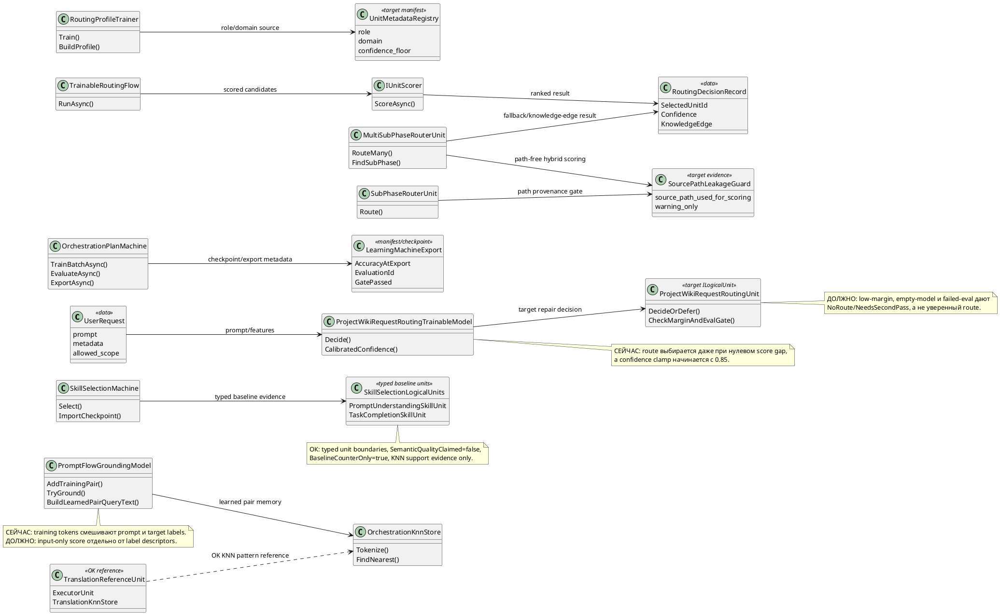

# Человекочитаемый аудит trainable-architecture v2

Этот аудит написан для архитектора-человека. Сначала идут смысл, схема,
алгоритмы и конкретные решения; машинные яккоря оставлены только как вторичная
навигация рядом с находками и выводами.

Короткий вывод: исправления после первого аудита действительно убрали старые
машинные dictionary/source-pair замены из `SkillSelectionMachine.cs`.
Но более широкий проход по соседним зонам runtime/trainable authority нашёл
одну блокирующую проблему и три серьёзных риска: высокий route confidence без
margin/eval gate, экспорт synthetic progress как accuracy, target-label leakage
в grounding и routing-to-first-candidate без confidence floor. Это не означает,
что KNN, словари или scorers запрещены. Риск появляется там, где они становятся
последним runtime authority или выглядят как semantic-quality claim без
честного gate, manifest, checkpoint и lifecycle.

Этот документ не разрешает исправление реализации, запуск обучения, commit или
push. Он только объясняет, что найдено, что должно быть исправлено, какими
классами/records/methods это должно оформляться, какие sets/checkpoints/
manifests затронуты и какие проверки нужны после отдельной авторизации.

Проверенная граница:

- ветка: `codex/chat-gpt-5.5`;
- исходная граница аудита v2: артефакт аудита только по файлам;
- разрешённая запись для текущего прохода по читабельности: только этот файл и
  `docs/plans/TRAINABLE-ARCHITECTURE-AUDIT-v2-STATE.json`;
- исправления кода, обучение, тесты и сборки: не разрешены;
- `27.TranslationDomain/*` использованы только как справочные примеры: наличие
  KNN и словарей там не является нарушением само по себе.

## Раздел 0. Архитектурная карта и симуляции данных

Диаграмма ниже специально простая и импортируемая в draw.io как PlantUML. Она
показывает не все классы проекта, а те связи данных, которые важны для
этого аудита: где сейчас возникает риск, и куда должна переехать логика исправления.

Симуляции по каждому соединению:

| Соединение | Пример входа | Ожидаемый результат по ветке |
|---|---|---|
| `UserRequest -> ProjectWikiRequestRoutingTrainableModel` | prompt="обнови request-router training rows", scores=[0,0,0] | Сейчас модель всё равно может выбрать label с высокой confidence; исправление должно вернуть `NeedsSecondPass` из-за пустого/равного score. |
| `ProjectWikiRequestRoutingTrainableModel -> ProjectWikiRequestRoutingUnit` | top score=0.51, second=0.50, eval gate missing | Target unit возвращает `NoRoute`, confidence ниже route floor, target runner не вызывается. |
| `OrchestrationPlanMachine -> LearningMachineExport` | trained rows=50, eval не запускался | Сейчас synthetic progress может попасть в `AccuracyAtExport`; исправление экспортирует `baseline_unverified` и `GatePassed=false`. |
| `PromptFlowGroundingModel -> OrchestrationKnnStore` | prompt="сделай flow 05", chosen title содержит target label | Сейчас chosen title может усилить nearest result; исправление строит query только из input evidence и allowed scope. |
| `TrainableRoutingFlow -> IUnitScorer` | scorer вернул candidate score=0.12, confidence=0.05 | Сейчас первый candidate может победить; исправление требует confidence floor и score gap. |
| `IUnitScorer -> RoutingDecisionRecord` | ranked=[doc:0.21, plan:0.20] | Исправление пишет `KnowledgeEdge=true`, selected unit пустой, ranked candidates сохраняются как learning evidence. |
| `RoutingProfileTrainer -> UnitMetadataRegistry` | unit id=`doc-foo`, registry entry отсутствует | Сейчас substring `doc` задаёт domain; исправление отклоняет профиль или требует явные `general` metadata. |
| `SubPhaseRouterUnit -> SourcePathLeakageGuard` | SourcePath=`plans/phase-7-routing.md`, content слабый | Исправление сохраняет path как provenance/warning; score не растёт от имени файла. |
| `MultiSubPhaseRouterUnit -> SourcePathLeakageGuard` | inputText содержит title/type/content/path | Исправление передаёт в hybrid score только title/type/content/predicate ids, path-free. |
| `MultiSubPhaseRouterUnit -> RoutingDecisionRecord` | single fallback id=`missing-id`, topology=[A,B] | Сейчас `entries[0]`; исправление возвращает knowledge-edge/failure без routed subphase. |
| `SkillSelectionMachine -> SkillSelectionLogicalUnits` | prompt candidates переставлены местами | Typed units могут дать baseline evidence, но candidate-order leakage guard не даёт позиции стать final authority. |
| `TranslationReferenceUnit ..> OrchestrationKnnStore` | nearest translation pair найден с source-aware guard | Это OK reference: KNN участвует как named model component, не как скрытый shortcut. |

## Раздел 1. Карта текущих проблемных алгоритмов без кода

Представь диспетчера, который должен честно сказать: "я уверен, потому что
видел похожие проверенные случаи", или "я не уверен, нужен второй проход".
Проблемные места появляются там, где диспетчер звучит уверенно, хотя его
доказательство слабое, синтетическое или частично взято из target label.

1. **Маршрутизация ProjectWiki request сейчас звучит слишком уверенно.**
   В `ProjectWikiRequestRoutingTrainableModel` запрос превращается в score по
   route labels, выбирается максимальный label, затем `CalibratedConfidence`
   поднимает confidence минимум до `0.85`. Если scores равны или модель почти
   пустая, пользователь всё равно получает решение, похожее на route. Это проблема
   не из-за словаря как структуры, а из-за runtime authority без low-margin
   branch, eval gate и honest `SemanticQualityClaimed=false` metadata.

2. **OrchestrationPlanMachine смешивает progress и accuracy.**
   В training path `_accuracyAfterLastBatch` растёт от количества trained rows.
   В evaluation path есть настоящий `LearningEvaluationResult`, но export берёт
   `_accuracyAfterLastBatch`. Поэтому следующий читатель контура может принять "мы
   потренировались" за "модель прошла quality gate".

3. **PromptFlowGroundingModel учит grounding на смеси input и метки ответа.**
   При добавлении training pair tokens строятся из prompt, `FlowRef`,
   `Chosen.FlowRef` и `Chosen.Title`. Runtime confidence потом зависит от
   score/KNN, в который мог попасть target label. Это target-label leakage:
   модель может узнавать правильный ответ по словам ответа, а не по смыслу
   пользовательского prompt.

4. **TrainableRoutingFlow доверяет первому кандидату из ранжирования.**
   Flow спрашивает scorer, берёт `FirstOrDefault`, пишет `ROUTE_TO_UNIT`, а
   summary считается успешным при confidence > 0. Даже очень слабый scorer
   становится последним runtime authority.

5. **RoutingProfileTrainer выводит role/domain из имени unit.**
   Keywords идут из examples, но `orchestration`, `translation`, `doc` в unit id
   используются как metadata. Переименование unit может изменить domain без
   training data и без manifest evidence.

6. **Sub-phase routers используют SourcePath как scoring text.**
   `SourcePath` попадает в тот же token stream, что title/type/content. Path
   может содержать phase name, private folder или старый artifact id, то есть
   shortcut вместо semantic evidence.

7. **MultiSubPhaseRouterUnit превращает неизвестный fallback id в первую entry.**
   Если single-router вернул id, которого нет в topology, `FindSubPhase`
   возвращает первую entry. В отчёте это выглядит как route, хотя фактически
   это защитный fallback.

8. **Три найденных baseline-механизма допустимы только пока честно названы.**
   `PromptToTaskMachine`, `OrchestrationReasoningMachine` и новые typed
   `SkillSelection` units остаются допустимым baseline, потому что прямо
   отказываются от semantic-quality/host-runtime/full-checkpoint claims. Их
   нельзя переименовывать в полноценные semantic models без отдельного gate.

Что текущие механизмы **не должны** делать:

- не должны поднимать confidence из target labels, source paths или candidate
  position;
- не должны экспортировать synthetic training progress как accuracy;
- не должны route-to-unit при low confidence или missing eval gate;
- не должны считать KNN/словарь нарушением сами по себе;
- не должны писать "add KNN", "wrap in ILogicalUnit", "create schema" без
  named classes, records, methods, tests, rows и lifecycle. Такой текст
  не является решением.

## Раздел 2. Карта решений без кода

Целевой принцип: deterministic helpers остаются допустимыми как diagnostics,
baseline или model component, но последнее runtime decision должно проходить
через явно названный разрешённый уровень, typed state, честную confidence boundary,
manifest provenance и tests.

1. **Route decision для ProjectWiki request через явную границу.**
   Логика должна сидеть в
   `ProjectWikiRequestRoutingUnit : ILogicalUnit<ProjectWikiRequestRoutingInput, ProjectWikiRequestRoutingDecision>`.
   Старый `ProjectWikiRequestRoutingTrainableModel.Decide` становится provider
   score/evidence, но не выпускает route с высокой confidence без:
   `TrainingRowCount > 0`, top score > 0, top-2 gap >= `MinimumRouteMargin`,
   latest eval gate passed и snapshot metadata. Данные движутся так: prompt
   features -> score vector -> margin/eval gate -> route decision или
   `NeedsSecondPass`. Checkpoint: `ProjectWikiRequestRoutingModelSnapshot`
   получает `TrainingRowCount`, `HeldOutRowCount`, `EvaluationId`,
   `RouteAccuracy`, `WrongAnnotationRate`, `SemanticQualityClaimed`,
   `GatePassed`, `MinimumRouteMargin`.

2. **Экспорт accuracy для OrchestrationPlanMachine.**
   `TrainingProgressScore` и `LastEvaluationAccuracy` должны стать разными
   полями. `TrainBatchAsync` меняет только progress/state; `EvaluateAsync`
   создаёт `LearningEvaluationResult`; `ExportAsync` берёт accuracy только из
   последнего passed evaluation. Если evaluation нет, export говорит
   `baseline_unverified`, accuracy не выдаётся за model quality.

3. **Input-only grounding для PromptFlow.**
   `OrchestrationFlowGroundingWeights` должен разделиться на
   `InputFeatureWeights`, `AllowedScopeFeatures`, `LabelDescriptorFeatures` и
   `EvidenceOnlyTargetFeatures`. Runtime score использует только input and
   allowed scope. `BuildLearnedPairQueryText` не включает predicted
   `grounding.FlowRef`; он может использовать `FlowRef` только после class
   decision как filter/explanation, не как query feature.

4. **Confidence/gap gate для TrainableRoutingFlow.**
   `TrainableRoutingFlow.RunAsync` должен требовать
   `RoutingFlowThresholds.MinimumRoutingConfidence` и
   `MinimumScoreGap`. Если confidence/gap слабые, результат:
   `RoutingDecisionRecord.KnowledgeEdge=true`, `SelectedUnitId=null`,
   ranked candidates сохраняются для обучения, unit не вызывается.

5. **Metadata registry вместо substring inference.**
   `RoutingProfileTrainer` должен получать `UnitMetadataRegistry` или manifest
   map: `unit_id -> role, domain, allowed_inputs, confidence_floor,
   metadata_source_ref`. `BuildProfile` не выводит role/domain из unit id.
   Unknown unit либо rejected, либо явно marked `general` with source.

6. **SourcePath как provenance, не feature.**
   `SubPhaseRouterUnit` и `MultiSubPhaseRouterUnit` строят score из title,
   document type, compiled text and predicate ids. `SourcePathLeakageGuard`
   записывает `source_path_used_for_scoring=false` и warning, если path
   конфликтует с semantic evidence. Path нельзя использовать для повышения
   confidence.

7. **Неизвестный fallback как knowledge edge.**
   `MultiSubPhaseRouterUnit.FindSubPhase` должен возвращать
   `OperationResult<SubPhaseEntry>` или nullable result with explicit reason.
   Missing id не превращается в first entry; report получает
   `fallback_subphase_id_not_registered`.

8. **Baseline units остаются baseline.**
   `PromptToTaskPatternSelectionUnit`,
   `OrchestrationReasoningGuideSelectionUnit` и текущие
   `SkillSelectionLogicalUnits` могут быть future promotion targets. Пока
   promotion не сделан, docs/manifests/tests должны продолжать говорить:
   `SemanticQualityClaimed=false`, `BaselineCounterOnly=true`, support-only
   KNN, no host runtime claim, no continue-training claim without checkpoint.

Общий lifecycle для trainable repairs:

1. загрузить user/cache checkpoint first;
2. если его нет, загрузить repo/common fallback;
3. если обоих нет, вернуть honest untrained/scaffold status, а не high
   confidence;
4. backup/export/import/share сохраняют provenance, eval ids и license/source
   refs;
5. continue-training загружает текущий checkpoint и обновляет его, а не учит
   с нуля;
6. common leg обучается только на разрешённых источниках с verified license;
   private/project-specific rows остаются user-adaptive или quarantine.

## Раздел 3. Находки и выводы с цитатами и решениями рядом

### 3.1 ProjectWiki request routing звучит уверенно даже при нулевом margin

Проблема человеческим языком: модель маршрутизации может сказать "я уверенно выбрал
training runner", хотя evidence не отделяет лучший route от второго route и не
доказывает, что snapshot прошёл evaluation gate.

Служебный якорь: `F-01`; серьёзность: `BLOCKING`; решение: `NEEDS_REPAIR`;
разрешённый уровень: `ILogicalUnit` для runtime route decision плюс
`ILearningMachine`/trainer для snapshot, manifest и eval gate.

Короткие цитаты:

> `C:/Projects/llm_mvp_core/42.ProjectWikiDomain/ProjectWikiRequestRoutingTrainableModel.cs:70`
> `var confidence = CalibratedConfidence(scores, predicted);`
>
> `C:/Projects/llm_mvp_core/42.ProjectWikiDomain/ProjectWikiRequestRoutingTrainableModel.cs:74`
> `"The trained routing model selected request-router training."`
>
> `C:/Projects/llm_mvp_core/42.ProjectWikiDomain/ProjectWikiRequestRoutingTrainableModel.cs:160`
> `return Math.Clamp(0.84 + marginConfidence * 0.15, 0.85, 0.99);`
>
> `C:/Projects/llm_mvp_core/42.ProjectWikiDomain/ProjectWikiDomainModels.cs:526`
> `public sealed record ProjectWikiRequestRoutingModelSnapshot(`

Сейчас: route берёт max score, строит текст "trained routing model selected...",
и калибрует confidence минимум в `0.85`. Если веса пустые или scores равны,
gap равен нулю, но confidence всё равно получается высоким.

Почему это риск: это runtime route authority и quality-sounding claim без
явного low-margin fallback, `Unknown/NotProjectWiki` gate,
`SemanticQualityClaimed=false`, held-out gate id или snapshot quality metadata.
Пользователь может увидеть "trained model selected" там, где модель должна
честно сказать "нужен второй проход".

Было -> должно стать:

- Было: `MaxIndex(scores)` всегда выбирает label, а confidence clamp начинает
  с `0.85`.
- Должно стать: `ProjectWikiRequestRoutingUnit` возвращает `NoRoute` или
  `NeedsSecondPass` при пустой модели, нулевом max score, малом top-2 gap или
  отсутствии passed eval gate. Confidence остаётся low-bound, например
  `0.0..0.49`, пока route не проходит margin/eval gate.
- Было: snapshot хранит только weights/biases.
- Должно стать: snapshot/manifest хранит row counts, evaluation id, accuracy,
  wrong annotation rate, semantic-quality flag, gate status and thresholds.

Точная замена:

- файл: `42.ProjectWikiDomain/ProjectWikiRequestRoutingTrainableModel.cs`;
- новый class: `ProjectWikiRequestRoutingUnit : ILogicalUnit<ProjectWikiRequestRoutingInput, ProjectWikiRequestRoutingDecision>`;
- новые records: `ProjectWikiRequestRoutingInput`, `ProjectWikiRequestRoutingDecision`,
  `ProjectWikiRequestRoutingGateEvidence`;
- меняемый record: `ProjectWikiRequestRoutingModelSnapshot`;
- методы: `DecideOrDefer`, `ComputeTopTwoMargin`, `HasPassedEvaluationGate`,
  `BuildLowConfidenceDecision`;
- старый `CalibratedConfidence` остаётся только внутри gate-aware path и не
  может возвращать high confidence при failed gate.

Как обучается/работает: trainer собирает `ProjectWikiRequestRoutingDpoPair`
rows, строит snapshot, прогоняет held-out eval, записывает gate evidence. На
runtime prompt -> features -> score vector -> top-two margin -> eval gate ->
route или `NeedsSecondPass`. Continue-training сначала грузит существующий
user/cache checkpoint, затем repo/common fallback, после чего обновляет state и
перезапускает held-out gate.

Sets/checkpoints/manifests:

- `ProjectWikiRequestRoutingDpoPair` rows;
- `ProjectWikiRequestRoutingModelSnapshot`;
- request-router training run result;
- publication manifest and capability manifest for project-wiki request routing;
- quarantine rows where chosen route can be predicted from route label text
  rather than prompt evidence.

Tests/e2e/qa:

- `ProjectWikiRequestRoutingTrainableModel_UntrainedModelDoesNotEmitHighConfidenceRoute`;
- `ProjectWikiRequestRoutingTrainableModel_ZeroMarginReturnsNeedsSecondPass`;
- `ProjectWikiRequestRoutingTrainableModel_SnapshotCarriesEvalGateAndSemanticQualityFalse`;
- `ProjectWikiRequestRoutingTrainingRunner_DoesNotPublishWhenHeldOutGateFails`;
- e2e: request with equal scores must not start target runner.

Заметка о полноте проверки: эта finding объясняет, почему прежняя "SS-only"
формулировка sufficiency была слишком широкой. Более широкий audit runtime
confidence floors нашёл бы этот риск по тем же repository evidence.

### 3.2 OrchestrationPlanMachine экспортирует synthetic progress как accuracy

Проблема человеческим языком: machine может экспортировать "accuracy", полученную
арифметикой training progress, а не evaluation. Это выглядит как качество
модели, хотя quality gate мог не запускаться.

Служебный якорь: `F-02`; серьёзность: `HIGH`; решение: `NEEDS_REPAIR`;
разрешённый уровень: `ILearningMachine<OrchestrationPlanDomain>`.

Короткие цитаты:

> `C:/Projects/llm_mvp_core/42.ProjectWikiDomain/OrchestrationPlanMachine.cs:147`
> `_accuracyAfterLastBatch`
>
> `C:/Projects/llm_mvp_core/42.ProjectWikiDomain/OrchestrationPlanMachine.cs:203`
> `: Math.Min(1.0, _accuracyAfterLastBatch + 0.05 + trained.Count * 0.001);`
>
> `C:/Projects/llm_mvp_core/42.ProjectWikiDomain/OrchestrationPlanMachine.cs:254`
> `var accuracy = correct / (double)evalSet.EvaluationItems.Count;`
>
> `C:/Projects/llm_mvp_core/42.ProjectWikiDomain/OrchestrationPlanMachine.cs:278`
> `_accuracyAfterLastBatch`

Сейчас: training batch искусственно увеличивает `_accuracyAfterLastBatch`.
`EvaluateAsync` считает настоящую accuracy, но `ExportAsync` пишет
`_accuracyAfterLastBatch` в `LearningMachineExport.AccuracyAtExport`.

Почему это риск: downstream gates могут решить, что model quality passed, хотя
реально были только counted training rows. Это не просто naming issue, а
граница quality claim.

Было -> должно стать:

- Было: training progress меняет `_accuracyAfterLastBatch`.
- Должно стать: разделить `TrainingProgressScore` и `LastEvaluationAccuracy`.
- Было: `ExportAsync` публикует synthetic `_accuracyAfterLastBatch`.
- Должно стать: export использует latest persisted `LearningEvaluationResult`
  только при `PassesGate=true`; иначе accuracy равна `0.0` или явно labelled
  `baseline_unverified`.
- Было: manifest/checkpoint не несут eval provenance.
- Должно стать: checkpoint/manifest records `EvaluationId`, `EvalSetRef`,
  `RowsEvaluated`, `PassesGate`, `SemanticQualityClaimed=false`.

Точная замена:

- файл: `42.ProjectWikiDomain/OrchestrationPlanMachine.cs`;
- новые fields/records: `TrainingProgressScore`, `LastEvaluationGate`,
  `OrchestrationPlanEvaluationGate`;
- методы: `TrainBatchAsync` обновляет только progress; `EvaluateAsync` записывает
  gate result; `ExportAsync` вызывает `GetExportAccuracyFromGate`;
- export record: `LearningMachineExport` несёт evaluation provenance.

Как обучается/работает: batch training меняет learned state и progress
counter. Separate evaluation берёт held-out `OrchestrationPlanEvaluationSet`,
считает true accuracy, сохраняет gate id и pass/fail. Export не публикует
quality, пока passed evaluation не привязан к текущей версии checkpoint.

Sets/checkpoints/manifests:

- `OrchestrationPlanMachineCheckpoint`;
- `LearningMachineExport` for `orchestration-plan-machine`;
- training history rows;
- orchestration eval sets used by `EvaluateAsync`;
- quarantine rule: rows used in training cannot be reused as held-out eval.

Tests/e2e/qa:

- `OrchestrationPlanMachine_TrainBatchDoesNotInventAccuracyAtExport`;
- `OrchestrationPlanMachine_ExportLabelsUnverifiedWhenNoEvalGatePassed`;
- `OrchestrationPlanMachine_ExportCarriesLastPassedEvaluationProvenance`;
- `OrchestrationPlanMachine_EvaluateAccuracyIsTheOnlyQualityGate`;
- QA: exported manifest must answer "which eval set produced this accuracy?"

Заметка о полноте проверки: export accuracy claims не входили в узкую проверку
SS-01..SS-12, но OP-61 теперь требует проверять их в breadth challenge перед
любой формулировкой whole-architecture sufficiency.

### 3.3 PromptFlowGroundingModel смешивает target labels с runtime grounding

Проблема человеческим языком: grounding может научиться видеть правильный flow
по словам правильного ответа, а не по пользовательскому prompt. Это создаёт
иллюзию semantic grounding.

Служебный якорь: `F-03`; серьёзность: `HIGH`; решение: `NEEDS_REPAIR`;
разрешённый уровень: `ILogicalUnit` или helper inside `ILearningMachine`, но target
label features должны быть изолированы от runtime scoring.

Короткие цитаты:

> `C:/Projects/llm_mvp_core/42.ProjectWikiDomain/PromptFlowGroundingModel.cs:98`
> `var tokens = OrchestrationKnnStore.Tokenize(`
>
> `C:/Projects/llm_mvp_core/42.ProjectWikiDomain/PromptFlowGroundingModel.cs:99`
> `$"{pair.Prompt} {pair.FlowRef} {pair.Chosen.FlowRef} {pair.Chosen.Title}");`
>
> `C:/Projects/llm_mvp_core/42.ProjectWikiDomain/PromptFlowGroundingModel.cs:46`
> `var confidence = Math.Min(1.0, 0.70 + best.Score * 0.10 + (nearest?.Score ?? 0.0) * 0.20);`
>
> `C:/Projects/llm_mvp_core/42.ProjectWikiDomain/PromptFlowGroundingModel.cs:64`
> `var queryText = BuildLearnedPairQueryText(prompt, contract, grounding);`

Сейчас: Mode1 grounding weights строятся из prompt, target flow refs и
chosen title. Runtime scoring затем использует эти weights, а learned pair lookup
включает predicted `grounding.FlowRef` в query.

Почему это риск: target labels могут стать runtime evidence. Риск не в том, что
есть dictionary/KNN; риск в том, что dictionary используется как route authority
и confidence source, хотя содержит chosen-target tokens.

Было -> должно стать:

- Было: одна map `FlowRefWeights` смешивает input prompt tokens и target labels.
- Должно стать: split into `InputFeatureWeights`, `AllowedScopeFeatures`,
  `LabelDescriptorFeatures`, `EvidenceOnlyTargetFeatures`.
- Было: confidence использует best score плюс KNN score.
- Должно стать: confidence использует input-only score и held-out calibration.
  Target-label descriptors могут объяснять/tie-break только после allowed-scope check,
  но не повышать confidence.
- Было: learned pair query includes `grounding.FlowRef`.
- Должно стать: `grounding.FlowRef` может filter внутри selected class after class
  decision, но не должен быть частью nearest-neighbour query text.

Точная замена:

- файл: `42.ProjectWikiDomain/PromptFlowGroundingModel.cs`;
- меняемый record: `OrchestrationFlowGroundingWeights`;
- новые records: `PromptFlowInputFeatureWeights`, `PromptFlowLabelDescriptorFeatures`,
  `PromptFlowGroundingEvidence`;
- методы: `BuildInputOnlyTrainingTokens`, `BuildEvidenceOnlyTargetTokens`,
  `ComputeInputOnlyConfidence`, `BuildLearnedPairQueryTextWithoutPredictedFlow`;
- target leakage guard: `PromptFlowTargetLabelLeakageGuard`.

Как обучается/работает: training pair разделяется. Prompt/user scope tokens обновляют
input weights. Flow refs/title descriptors хранятся только как explanation/tie-break
metadata. KNN memory хранит input text и chosen result отдельно; query
использует prompt/contract/allowed scope, а не predicted `FlowRef`. Continue-training
loads existing checkpoint, rewrites or quarantines rows where chosen title is
the only predictive feature, then saves updated checkpoint.

Sets/checkpoints/manifests:

- Mode1 `OrchestrationTrainingPair` rows;
- `OrchestrationFlowGroundingWeights`;
- `FlowGroundingKnn` section of `OrchestrationPlanMachineCheckpoint`;
- train-ready copies that include `pair.Chosen.Title` in feature material;
- quarantine rows: prompt has no input feature evidence and target descriptor
  alone predicts class.

Tests/e2e/qa:

- `PromptFlowGroundingModel_DoesNotGroundFromChosenTitleOnly`;
- `PromptFlowGroundingModel_DoesNotUsePredictedFlowRefAsKnnQueryFeature`;
- `PromptFlowGroundingModel_ConfidenceUsesInputOnlyFeatures`;
- `OrchestrationPlanMachine_Mode1GroundingRejectsTargetLabelLeakageRows`;
- QA: adversarial prompt with only flow title in target material must fail.

Заметка о полноте проверки: target-label leakage прямо перечислен в OP-61.
Любой будущий audit, который не проверяет эту зону, не может claim broad
sufficiency.

### 3.4 TrainableRoutingFlow ведёт к первому ranked candidate без confidence floor

Проблема человеческим языком: router может вызвать unit только потому, что этот
unit оказался первым в ranked list, даже если confidence barely above zero.

Служебный якорь: `F-04`; серьёзность: `HIGH`; решение: `NEEDS_REPAIR`;
разрешённый уровень: `ILogicalFlow<RoutingRequest>`.

Короткие цитаты:

> `C:/Projects/llm_mvp_core/26.TrainableRouter/Training/TrainableRoutingFlow.cs:34`
> `var chosen = ranked.FirstOrDefault();`
>
> `C:/Projects/llm_mvp_core/26.TrainableRouter/Training/TrainableRoutingFlow.cs:38`
> `var reason = $"Selected {chosen.UnitId} for domain {chosen.DomainTag} with score {chosen.Score:0.###}.";`
>
> `C:/Projects/llm_mvp_core/26.TrainableRouter/Training/TrainableRoutingFlow.cs:43`
> `chosen.Confidence`
>
> `C:/Projects/llm_mvp_core/26.TrainableRouter/Training/TrainableRoutingFlow.cs:73`
> `decision.Confidence > 0`

Сейчас: flow доверяет первому scored candidate и помечает logical summary
успешным, когда confidence больше нуля.

Почему это риск: `IUnitScorer` может вернуть defensive/unknown candidate с
tiny confidence. Flow всё равно выпускает `ROUTE_TO_UNIT`, и слабый scorer
становится runtime authority без knowledge-edge branch.

Было -> должно стать:

- Было: побеждает first candidate.
- Должно стать: `TrainableRoutingFlow` requires configured
  `MinimumRoutingConfidence` and `MinimumScoreGap`.
- Было: low confidence всё равно даёт `ROUTE_TO_UNIT`.
- Должно стать: low confidence возвращает `ROUTING_KNOWLEDGE_EDGE` или
  `NeedsSecondPass`, logs ranked candidates и не вызывает target unit.
- Было: confidence floor неявный.
- Должно стать: confidence floor фиксируется в manifest/config evidence и проверяется тестом.

Точная замена:

- файл: `26.TrainableRouter/Training/TrainableRoutingFlow.cs`;
- новые records/classes: `RoutingFlowThresholds`, `RoutingKnowledgeEdge`,
  `RoutingScoreGapEvidence`;
- методы: `TryChooseRoutableCandidate`, `ComputeScoreGap`,
  `BuildKnowledgeEdgeDecision`;
- меняемый record: `RoutingDecisionRecord` получает explicit `KnowledgeEdge`,
  `ScoreGap`, `ThresholdsRef`.

Как обучается/работает: scorer возвращает ranked candidates. Flow считает top-2
gap и confidence floor. Passing candidates могут route; failing candidates
создают knowledge-edge evidence для будущих DPO rows. Continue-training
сохраняет rejected low-confidence routes как rejected examples, а не accepted routes.

Sets/checkpoints/manifests:

- trainable-router profiles from `RoutingProfileTrainer`;
- `RoutingDecisionRecord`;
- routing training reports with chosen/rejected candidates;
- threshold manifest for route confidence/gap;
- quarantine rows where low confidence route was counted as accepted.

Tests/e2e/qa:

- `TrainableRoutingFlow_LowConfidenceDoesNotRouteToUnit`;
- `TrainableRoutingFlow_RequiresScoreGapBeforeChoosing`;
- `TrainableRoutingFlow_LogsKnowledgeEdgeForLearning`;
- `RoutingTrainingRunner_DoesNotCountLowConfidenceRouteAsAccepted`;
- e2e: weak scorer must not call downstream unit.

Заметка о полноте проверки: runtime routing confidence floors теперь являются
обязательной строкой breadth challenge.

### 3.5 RoutingProfileTrainer выводит role/domain из частей unit id

Проблема человеческим языком: trainer смотрит на имя unit и угадывает domain.
Это удобный bootstrap, но опасный, если экспортировать его как learned metadata.

Служебный якорь: `F-05`; серьёзность: `MEDIUM`; решение: `NEEDS_REPAIR`;
разрешённый уровень: OK helper under trainable router или `ILearningMachine`
trainer, если profiles checkpointed with registry metadata.

Короткие цитаты:

> `C:/Projects/llm_mvp_core/26.TrainableRouter/Training/RoutingProfileTrainer.cs:24`
> `var keywordMap = new Dictionary<string, HashSet<string>>(StringComparer.Ordinal);`
>
> `C:/Projects/llm_mvp_core/26.TrainableRouter/Training/RoutingProfileTrainer.cs:42`
> `pair => BuildProfile(pair.Key, pair.Value.OrderBy(value => value, StringComparer.OrdinalIgnoreCase).ToArray()),`
>
> `C:/Projects/llm_mvp_core/26.TrainableRouter/Training/RoutingProfileTrainer.cs:69`
> `if (unitId.Contains("orchestration", StringComparison.OrdinalIgnoreCase) || unitId.Contains("plan", StringComparison.OrdinalIgnoreCase))`
>
> `C:/Projects/llm_mvp_core/26.TrainableRouter/Training/RoutingProfileTrainer.cs:75`
> `if (unitId.Contains("doc", StringComparison.OrdinalIgnoreCase))`

Сейчас: keywords learned from examples, но role/domain/base score выводятся
из текстовой формы `unitId`.

Почему это риск: сам dictionary допустим. Shortcut в том, что unit metadata
приходят из части имени, а не из разрешённого registry/manifest. Renaming a unit
может изменить domain/role без training data или gate evidence.

Было -> должно стать:

- Было: substring classifier для `orchestration`, `translation`, `doc`.
- Должно стать: `RoutingProfileTrainer` получает `UnitMetadataRegistry` или
  manifest map: `unit_id -> role, domain, allowed_inputs, confidence_floor`.
- Было: base score неявно берётся из unit id.
- Должно стать: base score learned/evaluated или фиксируется в manifest как
  `baseline_prior`, with `SemanticQualityClaimed=false`.
- Было: profile checkpoint может скрыть, почему назначен domain.
- Должно стать: profile export включает `MetadataSourceRef` и rejects unknown
  units, если они явно не labelled `general`.

Точная замена:

- файл: `26.TrainableRouter/Training/RoutingProfileTrainer.cs`;
- новый class: `UnitMetadataRegistry`;
- новый record: `UnitRoutingMetadata(UnitId, Role, Domain, AllowedInputs, ConfidenceFloor, MetadataSourceRef)`;
- изменения methods: `Train(examples, metadataRegistry)`, `BuildProfile(unitId, keywords, metadata)`;
- remove/diagnostics-only method path: substring inference becomes migration
  warning, not runtime metadata source.

Как обучается/работает: examples обучают keyword profile; registry supplies
role/domain/floors. Unknown unit id останавливает profile publication или получает
explicit `general` metadata with source ref. Continue-training reloads profile
checkpoint и validates registry refs before adding new examples.

Sets/checkpoints/manifests:

- routing profile snapshots;
- unit registry/capability manifest;
- routing training examples where `ChosenUnitId` is the only domain evidence;
- quarantine rows where domain can be predicted only from id substring.

Tests/e2e/qa:

- `RoutingProfileTrainer_DoesNotInferDomainFromUnitIdSubstring`;
- `RoutingProfileTrainer_UsesRegistryMetadataForRoleAndDomain`;
- `RoutingProfileTrainer_UnknownUnitRequiresExplicitGeneralMetadata`;
- `RoutingProfileTrainer_ProfileSnapshotRecordsMetadataSource`;
- QA: rename unit without registry update must not change domain silently.

Заметка о полноте проверки: source/path/provenance leakage включает metadata
source leakage. Severity medium, потому что это trainer/profile metadata, а не
direct route-to-unit authority само по себе.

### 3.6 Sub-phase routers используют SourcePath как scoring text

Проблема человеческим языком: file path может подсказать ответ. Path вроде
`phase-7-routing.md` может толкнуть router к "routing", даже когда content слабый.

Служебный якорь: `F-06`; серьёзность: `MEDIUM`; решение: `NEEDS_REPAIR`;
разрешённый уровень: `ILogicalUnit`, но source path должен быть provenance/
warning evidence, а не classification feature.

Короткие цитаты:

> `C:/Projects/llm_mvp_core/21.AgentInfrastructure/Logical/SubPhaseRouterUnit.cs:123`
> `// Tokenize the compiled source text, title, type, and path for text-level evidence.`
>
> `C:/Projects/llm_mvp_core/21.AgentInfrastructure/Logical/SubPhaseRouterUnit.cs:124`
> `var inputTokens = Tokenize($"{request.Input.DocumentTitle} {request.Input.DocumentType} {request.Input.CompiledText} {request.Input.SourcePath}");`
>
> `C:/Projects/llm_mvp_core/21.AgentInfrastructure/Logical/MultiSubPhaseRouterUnit.cs:145`
> `var inputText = $"{request.Input.DocumentTitle} {request.Input.DocumentType} {request.Input.CompiledText} {request.Input.SourcePath}";`
>
> `C:/Projects/llm_mvp_core/21.AgentInfrastructure/Logical/MultiSubPhaseRouterUnit.cs:148`
> `var hybridScores = BuildHybridScores(inputText, inputPredicates, subPhases.Value);`

Сейчас: file path tokens попадают в тот же scoring text, что title, document type и
compiled content.

Почему это риск: source path может кодировать phase/subphase names, private project
folders или historical artifact names. Он может стать deterministic shortcut for
route selection, даже если compiled semantic evidence слабый.

Было -> должно стать:

- Было: `SourcePath` является part of scoring text.
- Должно стать: score использует `DocumentTitle`, `DocumentType`, `CompiledText`,
  `CompiledPredicateIds`; `SourcePath` moves to provenance only.
- Было: explicit path-leakage gate отсутствует.
- Должно стать: добавить `SourcePathLeakageGuard` evidence:
  `source_path_used_for_scoring=false`.
- Было: path tokens могут влиять на hybrid rank.
- Должно стать: `BuildHybridScores` получает path-free text; path может создавать
  только warning, когда он конфликтует с semantic evidence.

Точная замена:

- files: `21.AgentInfrastructure/Logical/SubPhaseRouterUnit.cs`,
  `21.AgentInfrastructure/Logical/MultiSubPhaseRouterUnit.cs`;
- новый class/record: `SourcePathLeakageGuard`, `SourcePathProvenanceEvidence`;
- methods: `BuildPathFreeScoringText`, `BuildSourcePathWarning`,
  `BuildHybridScores(pathFreeText, predicates, subPhases)`;
- old path tokenization becomes provenance metadata, not scoring input.

Как обучается/работает: route evidence считается из title/type/content/
predicate ids. Path сохраняется как provenance and warning context. Path-only
match не может raise confidence; он может создать audit warning и DPO rejected
row for path leakage.

Sets/checkpoints/manifests:

- WDA compiled source document fixtures;
- topology routing reports;
- sub-phase routing evidence artifacts;
- quarantine rows where route changes when only SourcePath changes.

Tests/e2e/qa:

- `SubPhaseRouterUnit_DoesNotClassifyFromSourcePathOnly`;
- `MultiSubPhaseRouterUnit_DoesNotUseSourcePathInHybridRank`;
- `SubPhaseRouterUnit_SourcePathStaysInProvenanceOnly`;
- `MultiSubPhaseRouterUnit_PathLeakageWarningDoesNotRaiseConfidence`;
- QA: same content under two paths must produce same route.

Заметка о полноте проверки: source/path/provenance leakage теперь явная строка
breadth challenge.

### 3.7 MultiSubPhaseRouterUnit превращает unknown fallback subphase id в first entry

Проблема человеческим языком: если fallback сказал неизвестный id, router не
должен притворяться, что первый subphase является ответом.

Служебный якорь: `F-07`; серьёзность: `LOW`; решение: `NEEDS_REPAIR`;
разрешённый уровень: `ILogicalUnit`.

Короткие цитаты:

> `C:/Projects/llm_mvp_core/21.AgentInfrastructure/Logical/MultiSubPhaseRouterUnit.cs:190`
> `scored = [new CandidateScore(FindSubPhase(subPhases.Value, single.Value!.Output.PredictedSubPhaseId), single.Value.Output.Confidence, single.Value.Output.EvidencePredicates)];`
>
> `C:/Projects/llm_mvp_core/21.AgentInfrastructure/Logical/MultiSubPhaseRouterUnit.cs:341`
> `// Return the matching entry or the first entry as a defensive fallback.`
>
> `C:/Projects/llm_mvp_core/21.AgentInfrastructure/Logical/MultiSubPhaseRouterUnit.cs:342`
> `return entries.FirstOrDefault(entry => entry.SubPhase.SubPhaseId == subPhaseId) ?? entries[0];`

Сейчас: если single-router fallback возвращает id, которого нет в current
topology list, multi-router silently converts it to first entry.

Почему это риск: это deterministic first-entry shortcut. Это defensive
code, но в routing output он может выглядеть как real classification.

Было -> должно стать:

- Было: missing id становится `entries[0]`.
- Должно стать: missing id возвращает failure или `knowledge_edge` without routed
  subphase.
- Было: нет evidence, что fallback id отсутствовал.
- Должно стать: emit `fallback_subphase_id_not_registered` и keep single
  router evidence только как diagnostic.

Точная замена:

- file: `21.AgentInfrastructure/Logical/MultiSubPhaseRouterUnit.cs`;
- method: `FindSubPhase` возвращает `OperationResult<SubPhaseEntry>` или
  `SubPhaseLookupResult`;
- новый record: `FallbackSubPhaseLookupEvidence`;
- routing result field: `KnowledgeEdgeReason="fallback_subphase_id_not_registered"`.

Как обучается/работает: unknown fallback id становится rejected/knowledge-edge
training signal, а не accepted route. Continue-training uses these rows to teach
topology consistency and missing-id behavior.

Sets/checkpoints/manifests:

- multi-subphase routing reports;
- WDA topology registry consistency tests;
- rejected DPO rows for missing fallback id.

Tests/e2e/qa:

- `MultiSubPhaseRouterUnit_UnknownSingleFallbackIdDoesNotRouteToFirstEntry`;
- `MultiSubPhaseRouterUnit_EmitsKnowledgeEdgeWhenFallbackIdMissing`;
- `MultiSubPhaseRouterUnit_RequiresTopologyRegistryConsistency`.

Заметка о полноте проверки: fallback/default candidate shortcut challenge ловит
этот класс bugs даже при lower severity.

### 3.8 PromptToTaskMachine learned-pattern selector допустим как baseline при честной метке

Смысл: deterministic learned-pattern selection допустим как baseline, потому что
machine отказывается заявлять semantic translation или checkpoint asset quality.

Служебный якорь: `F-08`; серьёзность: `OK_REFERENCE`; решение:
`OK_INTERNAL_DETAIL`; разрешённый уровень: OK helper inside current
`PromptToTaskMachine` lifecycle, future promotion should become `ILogicalUnit`
or `ILearningMachine`.

Короткие цитаты:

> `C:/Projects/llm_mvp_core/43.SmartSkillsDomain/PromptToTaskMachine.cs:120`
> `var selectedPattern = SelectBestPattern(request, learnedState);`
>
> `C:/Projects/llm_mvp_core/43.SmartSkillsDomain/PromptToTaskMachine.cs:180`
> `"NO_TRAINING_CHECKPOINT_OR_ASSET_CLAIM"`
>
> `C:/Projects/llm_mvp_core/43.SmartSkillsDomain/PromptToTaskMachine.cs:210`
> `SemanticQualityClaimed: false`
>
> `C:/Projects/llm_mvp_core/43.SmartSkillsDomain/PromptToTaskMachine.cs:432`
> `if (selected is null || score > selectedScore || (score == selectedScore && pattern.Confidence > selected.Confidence))`

Сейчас: loads learned patterns, считает matched normalized request signals и
chooses strongest pattern. Он явно refuses semantic quality claim in
checkpoint/manifest validation.

Почему это ок: selector deterministic, но state-driven, а не raw source-id
driven, и artifact говорит no full semantic quality. Его нужно держать labelled as
learned-pattern baseline, not full semantic translation.

Было -> должно стать:

- Было: acceptable baseline.
- Должно остаться: no raw prompt/source id shortcut, no semantic quality claim,
  no training checkpoint claim unless real checkpoint/manifest is loaded.
- Будущее повышение уровня: `PromptToTaskPatternSelectionUnit :
  ILogicalUnit<PromptToTaskInput, PromptToTaskPatternEvidence>`.

Точная граница/future replacement:

- current file остаётся `43.SmartSkillsDomain/PromptToTaskMachine.cs`;
- future class: `PromptToTaskPatternSelectionUnit`;
- future records: `PromptToTaskInput`, `PromptToTaskPatternEvidence`,
  `PromptToTaskPatternState`;
- old method `SelectBestPattern` становится internal detail или delegates to unit.

Training/update/checkpoint lifecycle: текущий baseline должен сохранять
`NO_TRAINING_CHECKPOINT_OR_ASSET_CLAIM` until a real checkpoint, manifest,
fresh-load probe and continue-training probe exist. Future unit loads
user/cache first, repo/common fallback second, and rejects exact prompt replay.

Sets/checkpoints/manifests:

- PromptToTask learned state descriptor;
- PromptToTask checkpoint/manifest;
- future DPO rows with paraphrases, not exact source prompt ids.

Tests/e2e/qa:

- `PromptToTaskMachine_NoLoadedStateDoesNotClaimSemanticTranslation`;
- `PromptToTaskMachine_CheckpointRejectsSemanticQualityClaim`;
- `PromptToTaskMachine_PatternTieBreakDoesNotUseSourceProvenance`;
- QA: two equivalent prompts with different wording should not require exact
  source prompt match after future promotion.

Заметка о полноте проверки: это OK reference, потому что confidence/export/
runtime claims ограничены.

### 3.9 OrchestrationReasoningMachine learned-guide selector допустим как baseline при честной метке

Смысл: guide selector остаётся deterministic pattern matching, но он guarded и
не заявляет host runtime, semantic quality или continue-training run.

Служебный якорь: `F-09`; серьёзность: `OK_REFERENCE`; решение:
`OK_INTERNAL_DETAIL`; future promotion to `ILogicalUnit` recommended.

Короткие цитаты:

> `C:/Projects/llm_mvp_core/43.SmartSkillsDomain/OrchestrationReasoningMachine.cs:139`
> `var chosenPattern = ChooseBestPattern(request, learnedGuideState);`
>
> `C:/Projects/llm_mvp_core/43.SmartSkillsDomain/OrchestrationReasoningMachine.cs:203`
> `SemanticQualityClaimed: false`
>
> `C:/Projects/llm_mvp_core/43.SmartSkillsDomain/OrchestrationReasoningMachine.cs:294`
> `ContinueTrainingRunClaimed: false`
>
> `C:/Projects/llm_mvp_core/43.SmartSkillsDomain/OrchestrationReasoningMachine.cs:613`
> `if (checkpoint.SemanticQualityClaimed)`

Сейчас: chooses learned guide pattern только после того, как required task,
constraint, requirement, deliverable и evidence signals satisfied. Он rejects
checkpoint/manifest semantic-quality, continue-training and host-runtime claims.

Почему это ок: deterministic pattern matching visible and guarded. Он
not claiming host runtime or semantic quality. Keep it as baseline до появления
proper learned-guide unit/gate.

Было -> должно стать:

- Было: acceptable baseline.
- Должно остаться: no ranker template/flow-index shortcut claim, no host
  runtime claim, no continue-training run claim unless checkpoint rewrite and
  runner report exist.
- Будущее повышение уровня: `OrchestrationReasoningGuideSelectionUnit :
  ILogicalUnit<OrchestrationReasoningInput, GuidePatternEvidence>`.

Точная граница/future replacement:

- current file остаётся `43.SmartSkillsDomain/OrchestrationReasoningMachine.cs`;
- future class: `OrchestrationReasoningGuideSelectionUnit`;
- future records: `OrchestrationReasoningInput`, `GuidePatternEvidence`,
  `GuideSelectionState`;
- old method `ChooseBestPattern` становится internal detail или delegates to unit.

Training/update/checkpoint lifecycle: текущий state не может claim
continue-training. Будущее повышение уровня требует checkpoint rewrite, runner
report, fresh-load probe, continue-training probe и manifest fields, которые
доказывают host runtime boundary.

Sets/checkpoints/manifests:

- orchestration reasoning learned guide state;
- checkpoint/manifest for current OR-04A boundary;
- future guide DPO sets with rejected/quarantine rows for missing required
  signals.

Tests/e2e/qa:

- `OrchestrationReasoningMachine_RejectsSemanticQualityClaim`;
- `OrchestrationReasoningMachine_RejectsHostRuntimeClaim`;
- `OrchestrationReasoningMachine_DoesNotPlanWhenRequiredSignalsMissing`;
- QA: missing deliverable/evidence signal must block guide selection.

Заметка о полноте проверки: OK, потому что code уже guards over-claims. Если
future docs назовут это semantic reasoning model, он должен снова пройти audit.

### 3.10 SkillSelection typed baseline units допустимы после SS-01..SS-12

Смысл: старые raw dictionaries/source pairs из v1 больше не выглядят как direct
machine-level authority. Current units остаются typed boundaries with explicit
baseline labels.

Служебный якорь: `F-10`; серьёзность: `OK_REFERENCE`; решение:
`OK_INTERNAL_DETAIL`; разрешённый уровень: `ILearningMachine` plus `ILogicalUnit`.

Короткие цитаты:

> `C:/Projects/llm_mvp_core/43.SmartSkillsDomain/SkillSelectionLogicalHierarchy.cs:475`
> `SemanticQualityClaimed: false`
>
> `C:/Projects/llm_mvp_core/43.SmartSkillsDomain/SkillSelectionLogicalHierarchy.cs:476`
> `BaselineCounterOnly: true`
>
> `C:/Projects/llm_mvp_core/43.SmartSkillsDomain/SkillSelectionLogicalHierarchy.cs:1975`
> `"task_completion:knn_role=support_evidence_only",`
>
> `C:/Projects/llm_mvp_core/43.SmartSkillsDomain/SkillSelectionMachine.cs:2600`
> `if (checkpoint.PromptUnderstanding.SemanticQualityClaimed)`

Сейчас: units могут make baseline decisions from typed state, but they carry
`SemanticQualityClaimed=false`, `BaselineCounterOnly=true`, provenance and
support-only KNN evidence.

Почему это ок: dictionaries/KNN больше не являются raw machine-level authority.
Они находятся inside named state/unit boundaries, and import rejects full semantic
quality claims.

Было -> должно стать:

- Было в v1: raw machine-level dictionaries/source-pair state.
- Должно остаться: typed unit boundaries, support-only KNN, checkpoint
  validation rejecting quality claim.
- Future upgrade: replace baseline counters with stronger learned units only
  when eval gates and manifests exist.

Точная граница/future replacement:

- current files: `43.SmartSkillsDomain/SkillSelectionMachine.cs`,
  `43.SmartSkillsDomain/SkillSelectionContracts.cs`,
  `43.SmartSkillsDomain/SkillSelectionLogicalHierarchy.cs`;
- current units include `PromptUnderstandingSkillUnit`,
  `TaskUnderstandingSkillUnit`, `PromptContextSkillSelectionUnit`,
  `IntermediateChecksSkillUnit`;
- future upgrades must name per-unit state, KNN role, DPO rows, checkpoint
  fields and tests before claiming semantic quality.

Training/update/checkpoint lifecycle: продолжать loading user/cache checkpoint first,
repo/common fallback second, and reject checkpoints that claim full semantic
quality without eval gate. Continue-training must update existing typed state,
not reintroduce raw source-pair dictionaries.

Sets/checkpoints/manifests:

- skill-selection checkpoint sections for SS-02..SS-12;
- skill-selection manifest;
- `Tests/SkillSelectionMachineTests.cs` and logical hierarchy tests;
- quarantine rows where selected skill can be predicted from candidate order or
  source pair id.

Tests/e2e/qa:

- existing SS-01..SS-12 tests that assert no old raw fields;
- import validation tests for every `SemanticQualityClaimed=true` section;
- KNN support evidence tests that assert KNN is not final selector when labelled
  support-only;
- QA: candidate permutation must not change final skill selection via position.

Заметка о полноте проверки: это закрывает original SS-focused scope, но само по
себе не закрывает broader architecture sufficiency.

## Раздел 4. Проверка широты и ретроактивная ошибка достаточности

Вопрос, который теперь обязана задавать родительская проверка:

**Что бы нашёл более широкий аудит, если не ограничиться старым SS-01..SS-12
scope?**

Ответ: он как раз нашёл бы зоны, которые v2 теперь проверил: claims об уверенности,
экспорт accuracy, target-label leakage, runtime routing confidence floors,
source/path/provenance leakage и fallback/default candidate shortcuts. Именно
там v2 нашёл одну блокирующую и три серьёзные проблемы.

| Зона широкой проверки | Что проверено в v2 | Что найдено | Итоговая граница |
|---|---|---|---|
| Claims об уверенности и нижние пороги | ProjectWiki request routing confidence clamp | Высокая confidence даже при нулевом/слабом margin | `F-01` блокирует; нельзя заявлять достаточность до исправления. |
| Claims об accuracy в экспорте | OrchestrationPlanMachine export | Synthetic progress может стать accuracy при export | `F-02` серьёзная; нужен export quality gate. |
| Target-label leakage | PromptFlowGroundingModel training/query path | Prompt weights включают flow refs/chosen title | `F-03` серьёзная; нужны input-only features. |
| Runtime routing confidence floors | TrainableRoutingFlow candidate selection | Первый ranked candidate routes при confidence > 0 | `F-04` серьёзная; нужен confidence/gap gate. |
| Source/path/provenance leakage | SubPhase/MultiSubPhase path tokenization and trainer metadata | `SourcePath` scoring и unit-id metadata inference | `F-05`, `F-06`; provenance не должен повышать score. |
| Fallback/default candidate shortcuts | MultiSubPhase unknown id fallback | Unknown id maps to first entry | `F-07`; нужен knowledge-edge вместо first entry. |

Ретроактивный провал утверждения о достаточности:

- Прежнее утверждение, что первый аудит был "достаточным", было слишком широким,
  если означало готовность всей trainable architecture. Оно было достаточным
  только для узкой границы SS-01..SS-12 raw-field replacement.
- Позже v2 нашёл `F-01` blocking и `F-02`/`F-03`/`F-04` high issues, которые были
  видны по тем же repository evidence.
- Пропуск произошёл потому, что prior review проверял, исчезли ли старые
  raw dictionaries/source pairs из `SkillSelectionMachine`, но не запускал
  соседний широкий проход по runtime/trainable authority.
- Governance уже patched commit `7fcee413`: OP-61 и Delta-Severity Feedback Gate
  теперь требуют broader-audit question, explicit checked scope и запись о том,
  почему prior review пропустил поздние blocking/high issues.
- Исправленная формулировка: "v1 SS-01..SS-12 scope completed" допустима.
  "Whole trainable architecture audit sufficient/complete" недопустима, пока
  проверка широты не зелёная и blocking/high repairs не выполнены.

Этот аудит заявляет только узкую границу: focused v2 architecture audit completed
для перечисленных здесь файлов; находки и очередь исправлений можно передавать
на родительскую проверку. Он не заявляет implementation readiness или
whole-system trainable sufficiency.

## Раздел 5. Очередь исправлений как ограниченные срезы для sub-agent

Ни один срез ниже не разрешён этим артефактом к реализации. Для каждого среза
нужна свежая авторизация от parent/Luba перед implementation.

1. `PWR-01` — Исправить границу confidence для ProjectWiki request routing.
   Граница: `42.ProjectWikiDomain/ProjectWikiRequestRoutingTrainableModel.cs`,
   `ProjectWikiDomainModels.cs`, связанные tests/manifests. Результат:
   `ProjectWikiRequestRoutingUnit`, low-margin `NeedsSecondPass`, snapshot eval
   metadata и отсутствие high confidence без passed gate.

2. `OPM-01` — Разделить training progress и evaluation accuracy.
   Граница: `42.ProjectWikiDomain/OrchestrationPlanMachine.cs`, export/checkpoint
   records and tests. Результат: `TrainingProgressScore` не может become
   `AccuracyAtExport`; только passed `LearningEvaluationResult` может publish
   accuracy.

3. `PFG-01` — Убрать target-label leakage из PromptFlow grounding.
   Граница: `42.ProjectWikiDomain/PromptFlowGroundingModel.cs`,
   checkpoint weights and tests. Результат: input-only confidence, target labels
   только как explanation/tie-break, no predicted FlowRef in KNN query text.

4. `TRF-01` — Добавить confidence/gap gate в TrainableRoutingFlow.
   Граница: `26.TrainableRouter/Training/TrainableRoutingFlow.cs`, decision
   records, training reports and tests. Результат: low confidence creates
   knowledge-edge, а не `ROUTE_TO_UNIT`.

5. `RPT-01` — Заменить unit-id substring metadata на registry/manifest.
   Граница: `26.TrainableRouter/Training/RoutingProfileTrainer.cs`, metadata
   registry and tests. Результат: role/domain приходят from explicit source ref,
   а не from unit id text.

6. `SPR-01` — Убрать SourcePath из scoring text.
   Граница: `21.AgentInfrastructure/Logical/SubPhaseRouterUnit.cs`,
   `MultiSubPhaseRouterUnit.cs` и router tests. Результат:
   `SourcePathLeakageGuard`, path-free scoring, path warning only.

7. `MSP-01` — Unknown fallback subphase id становится knowledge-edge.
   Граница: `21.AgentInfrastructure/Logical/MultiSubPhaseRouterUnit.cs` и
   topology consistency tests. Результат: no fallback to `entries[0]`.

8. `BASELINE-LABEL-01` — Сохранить честные labels для OK baseline mechanisms.
   Граница: docs/manifests/tests around PromptToTask, OrchestrationReasoning и
   SkillSelection units. Результат: no accidental semantic-quality, host-runtime
   or continue-training claims without evidence.

9. `AUDIT-STATE-01` — Обновить audit state после parent review.
   Граница: только documentation/state. Результат: parent review фиксирует
   accepted findings, точную bounded scope и оставшуюся границу авторизации
   implementation.

## Раздел 6. Журнал 10 циклов проверки и исправления

### Цикл 1

Применённый навык/gate: Human-Readable Architecture Artifact Gate.
Что провалилось: старые title and summary были machine-first и слишком
англоязычными.
Исправление: добавлены русский title и human summary перед всеми machine labels.
Почему стало читабельнее: architect видит границу audit и главные риски до
чтения finding ids.

### Цикл 2

Применённый навык/gate: Implementation Documentation UML gate.
Что провалилось: не было importable diagram и per-connection simulations.
Исправление: добавлены PlantUML class map и simulation table для каждого
connection.
Почему стало читабельнее: читатель видит, куда движутся данные и какой branch
outcome ожидается, прежде чем читать code quotes.

### Цикл 3

Применённый навык/gate: Implementation Documentation Algorithm gate.
Что провалилось: находки описывали симптомы, но не объясняли текущие
алгоритмы как человеческие flows.
Исправление: добавлен Раздел 1 с no-code map of current mechanisms и причина,
почему каждый механизм создаёт риск.
Почему стало читабельнее: no-code explanation теперь идёт перед code
references.

### Цикл 4

Применённый навык/gate: Concrete Repair Blueprint Gate.
Что провалилось: несколько repairs читались как prompts/specs, а не как named
solutions. Governance gap уже patched commit `7fcee413`, поэтому этот cycle
применил patched rule без редактирования governance.
Исправление: добавлен Раздел 2 и per-finding concrete classes, records,
methods, state fields, sets, manifests, lifecycle and tests.
Почему стало читабельнее: каждое solution names what an executor would change,
не заставляя executor invent the architecture.

### Цикл 5

Применённый навык/gate: Code References with Explanations gate.
Что провалилось: code evidence было сгруппировано выше explanation и не
сопровождалось immediate concrete repair. Governance уже patched by `7fcee413`;
artifact теперь применяет этот gate.
Исправление: каждый finding теперь имеет exact file:line quote, за которым
сразу идут `сейчас`, `почему это риск/ок`, `было -> должно стать`,
replacement shape, lifecycle, sets and tests.
Почему стало читабельнее: читателю не нужно прыгать между appendix, table и
finding, чтобы понять fix.

### Цикл 6

Применённый навык/gate: Trainable Architecture Decision Skill.
Что провалилось: KNN/dictionaries/scorers могли читаться как forbidden by default.
Исправление: clarified, что KNN/dictionaries допустимы как named model
components, diagnostics или typed baseline state; нарушение - hidden runtime
authority или over-claim.
Почему стало читабельнее: findings отделяют architecture risk от implementation
detail.

### Цикл 7

Применённый навык/gate: Output Readability Gate.
Что провалилось: machine labels были primary and too visible.
Исправление: severity/verdict ids перенесены в small secondary anchor lines,
primary text написан русской human prose.
Почему стало читабельнее: labels остаются searchable, но не становятся главным
языком документа.

### Цикл 8

Применённый навык/gate: Audit Sufficiency Boundary Gate.
Что провалилось: prior wording мог imply broader audit sufficiency после
focused SS scope.
Исправление: добавлен Раздел 4 с проверкой широты и bounded completion
wording.
Почему стало читабельнее: читатель видит, что было checked, что было found и
что этот аудит не заявляет.

### Цикл 9

Применённый навык/gate: Delta-Severity Feedback Gate.
Что провалилось: document не объяснял, почему v2 мог найти one blocking and
three high issues после того, как prior audit считался enough.
Исправление: добавлена запись о ретроактивной ошибке достаточности и объяснено, как
OP-61 / Delta-Severity теперь prevents the miss.
Почему стало читабельнее: governance lesson стал explicit and reviewable, а не
спрятанным в state.

### Цикл 10

Применённый навык/gate: Audit Protocol plus bounded sub-agent backlog review.
Что провалилось: backlog был набором slice ids with technical shorthand, а не
human execution boundaries.
Исправление: backlog rewritten as bounded Russian slices with scope, outcome and
authorization boundary; code repair оставлен без разрешения.
Почему стало читабельнее: parent может delegate next work without guessing
scope и не спутает этот audit с implementation approval.

## Итоговые счётчики и статус

- `BLOCKING`: 1
- `HIGH`: 3
- `MEDIUM`: 2
- `LOW`: 1
- `OK_REFERENCE`: 3

Вердикт по артефакту аудита: документ можно передавать на родительскую проверку
как читаемый и ограниченный audit artifact. Исправление кода, tests/builds/training,
commit и push этим sub-agent slice не разрешены.
