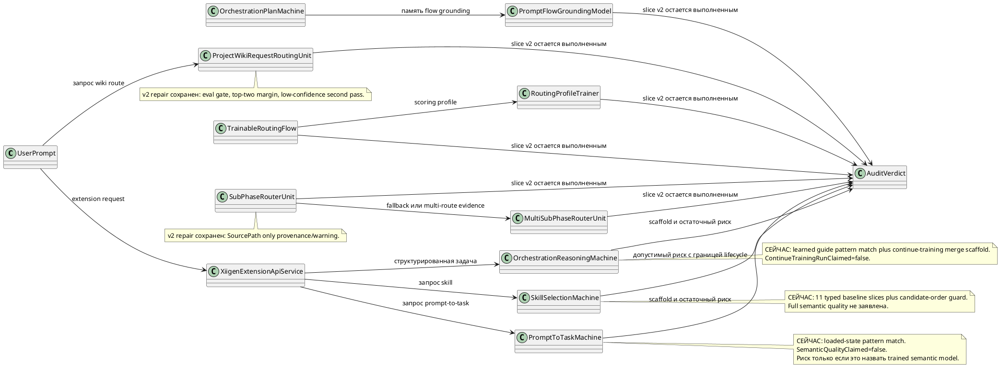

# Trainable Architecture Audit v3 (человекочитаемый аудит обучаемой архитектуры)

Этот аудит написан для Лубы как для человека-архитектора. Машинные метки оставлены только как поисковые якоря.

## 1. Короткий вывод

После repair backlog из v2 стало заметно лучше: прежние блокирующие места больше не выглядят как открытые runtime-shortcut ошибки. Request routing теперь требует held-out gate и margin, export accuracy в `OrchestrationPlanMachine` больше не берется из training progress, `PromptFlowGroundingModel` считает runtime confidence только по input-side evidence, `TrainableRoutingFlow` возвращает knowledge-edge при слабой уверенности, `RoutingProfileTrainer` требует явную metadata registry, `SourcePath` в sub-phase routers стал provenance/warning-only, а unknown fallback id больше не превращается в `entries[0]`.

Что остается слабым: в `PromptToTaskMachine` и `OrchestrationReasoningMachine` есть честно промаркированные pattern-match baselines (`SelectBestPattern`, `ChooseBestPattern`, `CountMatchingSignals`). Они не заявляют semantic quality, но это еще не полноценные trainable semantic models. В `SkillSelectionMachine` есть много typed dictionary/KNN state внутри semantic-unit slices; сейчас это допустимо только потому, что `SemanticQualityClaimed=false`, есть guard против candidate-order authority, и flow явно говорит, что full semantic quality не запущена.

Что не заявляется: этот v3 audit не заявляет product readiness, full model readiness, host runtime readiness, semantic quality, завершенное обучение, marketplace readiness или достаточность всей trainable architecture. Он говорит только о текущем кодовом состоянии в проверенной области после v2 repair backlog.

Итоговый ограниченный вердикт: v3 не нашел новых блокирующих или высоких проблем (BLOCKING/HIGH) в проверенной области. Найдены остаточные будущие риски: два MEDIUM, один LOW и несколько допустимых зон риска (OK-risk), которые остаются допустимыми только при честных non-claim labels.

## 2. Простая UML карта для draw.io



Симуляции по соединениям:

| Соединение | Пример входа | Ожидаемый outcome |
|---|---|---|
| `UserPrompt -> XiigenExtensionApiService` | prompt="разбей задачу и выбери skills", no live host proof | API response несет `RuntimeExtensionClaimed=false`; host runtime не заявляется. |
| `XiigenExtensionApiService -> PromptToTaskMachine` | prompt без loaded checkpoint | `PromptToTaskMachine` возвращает `not_trained_no_loaded_state`, не semantic task inference. |
| `XiigenExtensionApiService -> OrchestrationReasoningMachine` | structured task, guide state не loaded | `OrchestrationReasoningMachine` возвращает `not_trained_no_learned_guide_state`. |
| `XiigenExtensionApiService -> SkillSelectionMachine` | есть typed baseline checkpoint | skill decision может быть baseline-backed, warning говорит, что semantic quality не заявлена. |
| `UserPrompt -> ProjectWikiRequestRoutingUnit` | scores близкие, eval gate missing | request routing возвращает `NeedsSecondPass`, не уверенный route. |
| `OrchestrationPlanMachine -> PromptFlowGroundingModel` | prompt с allowed scope, target title содержит label | runtime score берет weights только из input и allowed-scope; target label остается только как evidence-only. |
| `TrainableRoutingFlow -> RoutingProfileTrainer` | top candidate confidence 0.21, gap 0.01 | `RoutingDecision.KnowledgeEdge=true`, `ChosenUnitId=null`. |
| `SubPhaseRouterUnit -> MultiSubPhaseRouterUnit` | single fallback id отсутствует в topology | multi-router возвращает `FALLBACK_SUBPHASE_ID_NOT_REGISTERED`, не первый entry. |
| `PromptToTaskMachine -> AuditVerdict` | загруженный pattern совпал по двум строковым сигналам | вывод: остаточный средний риск; допустимо только при `SemanticQualityClaimed=false`. |
| `OrchestrationReasoningMachine -> AuditVerdict` | guide совпал по токенам constraint/deliverable | вывод: остаточный средний риск; это не trained semantic readiness. |
| `SkillSelectionMachine -> AuditVerdict` | загружены 11 typed slices, активна проверка candidate order | вывод: допустимый риск; lifecycle/eval остаются будущей работой, нового blocker нет. |

## 3. Карта алгоритмов без кода

1. `ProjectWikiRequestRoutingTrainableModel.Decide`: request text превращается в token weights, scores сравниваются по label, затем код проверяет held-out evaluation evidence, top-two margin и minimum confidence. Если gate или margin слабые, метод возвращает second-pass status вместо route. Так сохраняется PWR-01.

2. `OrchestrationPlanMachine.ExportAsync` и import helpers: export accuracy берется из `GetExportAccuracyFromGate`, а import отказывается считать `baseline_unverified` refs пройденным gate. Training progress может существовать, но это больше не export accuracy. Так сохраняется OPM-01.

3. `PromptFlowGroundingModel.TryGround`: prompt и allowed scope вместе формируют токены запроса. Runtime score использует `InputFeatureWeights` и `AllowedScopeFeatures`; label/title features сохраняются только для explanation/checkpoint inspection. Так сохраняется PFG-01, с ограничением: KNN остается model component, а не самостоятельным доказательством semantic quality.

4. `TrainableRoutingFlow.RunAsync`: scorer отдает ранжированных candidates; flow считает score gap и confidence. Если любой показатель ниже threshold, метод возвращает knowledge-edge и сохраняет ранжированный список candidates. Так сохраняется TRF-01.

5. `RoutingProfileTrainer.Train`: examples создают keyword profiles, но role/domain/confidence floor/source ref должны приходить из `RoutingUnitMetadataRegistry.Require`. Unknown unit ids завершаются ошибкой. Так сохраняется RPT-01.

6. `SubPhaseRouterUnit.ExecuteAsync` и `MultiSubPhaseRouterUnit.ExecuteAsync`: оба строят scoring text без `SourcePath`, затем добавляют `source_path_used_for_scoring=false` и держат source path только как provenance. Multi-router также отклоняет unknown fallback ids. Так сохраняются SPR-01 и MSP-01.

7. `SkillSelectionMachine.Decide`: decision обходит одиннадцать typed slices в фиксированном порядке и выполняет export/import checkpoints с `SemanticQualityClaimed=false`. Dictionary/KNN structures существуют внутри slice state, но текущий код относится к ним как к baseline/training-state internals и отклоняет semantic-quality claims.

8. `PromptToTaskMachine.Translate`: если learned state не загружен, метод возвращает not-ready. Если state есть, он выбирает best pattern через сопоставление normalized request signals с learned pattern signals. Это scaffold behavior, а не доказанный semantic inference.

9. `OrchestrationReasoningMachine.Plan`: если learned guide state не загружен, метод возвращает not-trained. Если state есть, он выбирает learned guide pattern через required-signal satisfaction и count matching. Continue-training сейчас сливает pattern descriptors и явно оставляет `ContinueTrainingRunClaimed=false`, `CheckpointRewritten=false`, `SemanticQualityClaimed=false`, `HostRuntimeClaimed=false`.

10. `XiigenExtensionApiService`: агрегирует outputs PromptToTask, OrchestrationReasoning и SkillSelection и предупреждает, что это только core boundary без host runtime claim.

## 4. Проверка ссылок на строки

Все цитаты и диапазоны строк в этом отчете были сверены с текущими файлами в рабочем дереве на branch `codex/chat-gpt-5.5`, HEAD `786bdaab`, перед ремонтом этого parent-review. Проверка была сделана не по старому v2 тексту, а по текущим файлам: `ProjectWikiRequestRoutingTrainableModel.cs`, `OrchestrationPlanMachine.cs`, `PromptFlowGroundingModel.cs`, `TrainableRoutingFlow.cs`, `RoutingProfileTrainer.cs`, `SubPhaseRouterUnit.cs`, `MultiSubPhaseRouterUnit.cs`, `SkillSelectionMachine.cs`, `SkillSelectionLogicalHierarchy.cs`, `PromptToTaskMachine.cs`, `OrchestrationReasoningMachine.cs` и `XiigenExtensionApiService.cs`.

## 5. Находки аудита (findings)

### F-01 - Допустимый риск: блокер v2 в ProjectWiki request routing остается исправленным

Серьёзность (severity): допустимый риск (OK-risk).

`42.ProjectWikiDomain/ProjectWikiRequestRoutingTrainableModel.cs:181-190`

```csharp
if (requireEvaluationGate && !HasPassedEvaluationGate(_gateEvidence))
    return BuildLowConfidenceDecision(... NeedsSecondPass ...);
var confidence = CalibratedConfidence(scores, predicted, topTwoMargin);
if (confidence < MinimumSelectionConfidence)
```

Сейчас: request routing отказывается от уверенного route, если held-out gate отсутствует или confidence ниже порога.

Почему ок: блокирующий риск v2 был в высокой route confidence без eval/margin. Текущий механизм вводит second-pass boundary до runtime target selection.

Должно стать / остается допустимым: остается допустимым как held-out-gated baseline. Его нельзя описывать как полноценный trained semantic router, пока нет runner metrics, manifest, checkpoint, fresh-load и continue-training evidence.

Было -> должно быть: было: route даже при weak/empty margin; стало: `NeedsSecondPass`, когда gate или confidence слабые.

Точные файлы/classes/records/methods, если позже понадобится repair: `ProjectWikiRequestRoutingTrainableModel`, `ProjectWikiRequestRoutingUnit`, `ProjectWikiRequestRoutingDecision`, tests around low-margin and missing-gate decisions.

Как обучается или работает: обучающий input состоит из request rows с route labels; изменение state обновляет token weights и gate evidence; сохранение checkpoint должно сохранить token weights вместе с held-out gate evidence до того, как route confidence можно считать надежной.

KNN/nearest методы и роль: N/A. Этот путь является weighted token baseline, а не KNN.

Примеры DPO rows:
- положительная строка: prompt "создай wiki answer validation runner", chosen `ProjectValidation`, rejected `DocumentationBuild`, обучает границу validation-route.
- отклоненная строка: prompt "построй документацию по flow", неверный signal `wiki_domain_root` сам по себе выбрал `ProjectValidation`; правильный chosen должен быть `DocumentationBuild`.
- quarantine-строка: prompt содержит точный target unit id `ProjectWikiRealProjectValidationRunner`; строка уходит в quarantine из-за утечки целевой метки.

Граница источников и лицензий: общие строки могут приходить из MIT/Apache-2.0 docs/task examples только после license file verification; приватные project prompts остаются user-adaptive или eval-only, если они не redacted и не approved.

Затронутые sets/checkpoints/manifests: request-router DPO set, route snapshot checkpoint, evaluation gate manifest. Rebuild/quarantine применяется к rows, где prompt text содержит точные target unit ids.

Точные проверки tests/e2e/dashboard/API QA: сохранить tests, которые проверяют, что missing gate и low confidence возвращают `NeedsSecondPass`; добавить dashboard row с `top_two_margin`, `gate_passed`, `confidence`.

Жизненный цикл: сначала load user/cache route snapshot, затем repo/common baseline; export/import выполняется with gate refs; continue-training идет от existing snapshot и добавляет новый held-out eval result.

### F-02 - Допустимый риск: export accuracy больше не выдается за training progress

Серьёзность (severity): допустимый риск (OK-risk).

`42.ProjectWikiDomain/OrchestrationPlanMachine.cs:300-305`

```csharp
BuildPortableCheckpointRef(),
BuildPortableManifestRef(),
GetExportAccuracyFromGate(),
exportedAtUtc
```

Сейчас: export читает accuracy из evaluation gate path, а не из `TrainingProgressScore`.

Почему ок: высокий риск v2 был в synthetic progress, который маскировался под accuracy. Текущий export path завязан на gate, а import отклоняет `baseline_unverified` refs.

Должно стать / остается допустимым: допустимо только как evaluated export boundary. Если gate отсутствует, accuracy должна оставаться untrusted, а export refs должны оставаться unverified.

Было -> должно быть: было "trained rows can inflate AccuracyAtExport"; стало "AccuracyAtExport comes from passed evaluation gate".

Точные файлы/classes/records/methods, если позже понадобится repair: `OrchestrationPlanMachine.GetExportAccuracyFromGate`, `OrchestrationPlanEvaluationGate`, `LearningMachineExport`.

Как обучается или работает: training rows обновляют KNN stores и `TrainingProgressScore`; evaluation rows создают `LastEvaluationGate`; сохранение checkpoint сохраняет оба набора данных, но export использует только passed gate.

KNN/nearest методы и роль: `OrchestrationKnnStore.FindNearest` — model component для plan retrieval, а не proof export-quality.

Примеры DPO rows:
- положительная строка: prompt "сделай план с gate B для audit", chosen plan содержит явный gate и evidence refs; rejected plan содержит расплывчатое "works".
- отклоненная строка: большое число training rows без held-out evaluation отклоняется как proof для export-quality.
- quarantine-строка: строка, где expected answer скопирован из target plan title, уходит в quarantine из-за exact-answer leakage.

Граница источников и лицензий: common orchestration examples могут использовать MIT/Apache-2.0 workflow docs после license verification; private project execution recipes остаются project-local/adaptive.

Затронутые sets/checkpoints/manifests: orchestration plan checkpoint, export manifest, evaluation report. Rebuild нужен, если `AccuracyAtExport` был derived from progress.

Точные проверки tests/e2e/dashboard/API QA: assert: export accuracy равна zero или gated, если нет passed eval; assert: import игнорирует `baseline_unverified` refs.

Жизненный цикл: сначала load user/cache checkpoint, затем repo/common fallback; backup/export/import/share manifests идут with evaluation id; continue-training стартует from checkpoint перед new eval.

### F-03 - Допустимый риск: PromptFlow grounding использует runtime evidence со стороны input

Серьёзность (severity): допустимый риск (OK-risk).

`42.ProjectWikiDomain/PromptFlowGroundingModel.cs:31-40`

```csharp
InputScore = ScoreTokens(tokens, pair.Value.InputFeatureWeights),
AllowedScopeScore = ScoreTokens(tokens, pair.Value.AllowedScopeFeatures),
Score = item.InputScore + item.AllowedScopeScore
```

Сейчас: runtime flow selection использует input и allowed-scope weights. Label/title features остаются в checkpoint как evidence, но не добавляют runtime score.

Почему ок: утечка целевой метки из v2 исправлена в runtime scoring. Оставшийся риск в формулировках: это все еще KNN/weighted baseline, пока semantic gates не подтвердят большее.

Должно стать / остается допустимым: допустимо как input-only grounding component; недопустимо как full semantic flow grounding claim без held-out no-label leakage tests.

Было -> должно быть: было: target labels могли повышать runtime confidence; стало: target labels сохраняются только как evidence.

Точные файлы/classes/records/methods, если позже понадобится repair: `PromptFlowGroundingModel.BuildWeights`, `TryGround`, `BuildInputOnlyTrainingTokens`, `BuildEvidenceOnlyTargetTokens`.

Как обучается или работает: обучающий input — `OrchestrationTrainingPair`; изменение state обновляет input weights, allowed-scope weights, evidence-only target fields и KNN memory; сохранение checkpoint экспортирует pairs и weights.

KNN/nearest методы и роль: `OrchestrationKnnStore.FindNearestWithScore(string, PairMode)` — вспомогательное evidence; метод не должен replay exact target labels как final authority.

Примеры DPO rows:
- положительная строка: prompt "разбей API dashboard validation", chosen flow `FLOW-DASHBOARD-QA`, rejected `FLOW-DOCS`; строка обучает input wording плюс allowed scope.
- отклоненная строка: chosen title содержит "dashboard"; в prompt нет dashboard signal; строка отклоняется, потому что title-only signal не является input evidence.
- quarantine-строка: prompt говорит "use FLOW-DASHBOARD-QA"; строка уходит в quarantine из-за target label внутри prompt.

Граница источников и лицензий: общие строки могут использовать MIT/Apache-2.0 public workflow examples только с license file refs; local project flow ids остаются user/project-local.

Затронутые sets/checkpoints/manifests: prompt-flow grounding pairs, KNN store, grounding weights. Quarantine применяется к rows, где `FlowRef` или chosen title предсказывает target без prompt evidence.

Точные проверки tests/e2e/dashboard/API QA: input-only confidence tests, target-title ablation, проверка отсутствия predicted FlowRef in query text, dashboard display для evidence-only target features.

Жизненный цикл: сначала загружаются user/cache grounding weights, затем repo/common fallback; backup/export/import/share используют pair refs; continue-training идет от current weights.

### F-04 - Допустимый риск: TrainableRoutingFlow теперь имеет порог confidence и разрыв score

Серьёзность (severity): допустимый риск (OK-risk).

`26.TrainableRouter/Training/TrainableRoutingFlow.cs:38-45`

```csharp
var chosen = ranked.FirstOrDefault();
var scoreGap = ComputeScoreGap(ranked, _thresholds);
if (!TryChooseRoutableCandidate(ranked, _thresholds, out chosen, out scoreGap))
    return OperationResult<RoutingDecision>.Ok(BuildKnowledgeEdgeDecision(...));
```

Сейчас: первого ranked candidate недостаточно. Low confidence или low gap возвращает knowledge-edge.

Почему ок: риск v2 был в маршрутизации по первому candidate без достаточного confidence. Текущий код сохраняет ranked evidence, но отказывается от target unit routing, когда threshold не достигнут.

Должно стать / остается допустимым: допустимо как trainable-routing guard; semantic quality все еще зависит от scorer training/eval metrics.

Было -> должно быть: было: первый candidate выигрывает всегда; стало: первый candidate выигрывает только при passed confidence и score gap.

Точные файлы/classes/records/methods, если позже понадобится repair: `TrainableRoutingFlow.TryChooseRoutableCandidate`, `RoutingScoreGapEvidence`, `RoutingKnowledgeEdge`.

Как обучается или работает: routing examples обучают profiles/scorer; изменение state меняет profiles; checkpoint/report должны сохранить thresholds и profile provenance.

KNN/nearest методы и роль: N/A в этом flow; scorer может иметь собственный retrieval, но этот gate трактует его только как candidate evidence.

Примеры DPO rows:
- положительная строка: request "translate text", chosen translation unit имеет confidence 0.83 и gap 0.31; rejected — docs unit.
- отклоненная строка: top confidence 0.24 и gap 0.01; правильный output — knowledge-edge, а не route.
- quarantine-строка: candidate list ставит correct unit первым, но scores равны; строка уходит в quarantine из-за candidate-order leakage.

Граница источников и лицензий: route examples из MIT/Apache-2.0 docs являются common только после license verification; project-specific unit ids обучают local/adaptive profiles.

Затронутые sets/checkpoints/manifests: routing profile report, scorer manifest, threshold config. Rebuild для rows, где chosen можно предсказать по candidate order.

Точные проверки tests/e2e/dashboard/API QA: low-confidence knowledge-edge test, low-gap knowledge-edge test, route success только above thresholds, dashboard metrics для confidence/gap.

Жизненный цикл: сначала load user/cache routing profile, затем repo/common fallback; export/import включает thresholds и profile refs; continue-training идет from existing profile.

### F-05 - Допустимый риск: RoutingProfileTrainer больше не берет metadata из substring unit-id

Серьёзность (severity): допустимый риск (OK-risk).

`26.TrainableRouter/Training/RoutingProfileTrainer.cs:52-59`

```csharp
var metadata = activeRegistry.Require(pair.Key);
if (!metadata.IsSuccess)
    return metadata.MapError<IReadOnlyDictionary<string, UnitScoringProfile>>();
profiles[pair.Key] = BuildProfile(... metadata.Value!);
```

Сейчас: role/domain/confidence floor/source ref должны присутствовать в `RoutingUnitMetadataRegistry`.

Почему ок: риск v2 был в unit-id substring leakage. Текущий trainer падает на unknown metadata вместо inference from text вроде `doc` или `translation`.

Должно стать / остается допустимым: допустимо как explicit metadata boundary; это не proof semantic unit correctness.

Было -> должно быть: было "unit id text implies domain"; стало "registry metadata is required".

Точные файлы/classes/records/methods, если позже понадобится repair: `RoutingUnitMetadataRegistry.Require`, `UnitRoutingMetadata`, `RoutingProfileTrainer.BuildProfile`.

Как обучается или работает: examples меняют только keyword profile; metadata приходит из manifest/registry; сохранение checkpoint должно сохранить profile вместе с metadata source ref.

KNN/nearest методы и роль: N/A.

Примеры DPO rows:
- положительная строка: chosen unit `translation-unit`, registry domain `translation`, prompt содержит translation task.
- отклоненная строка: chosen unit id `doc-fake-translation`, registry metadata отсутствует; inference from substring отклоняется.
- quarantine-строка: unit id содержит project path `C:/project/docs-unit`; строка уходит в quarantine из-за source/path leakage.

Граница источников и лицензий: common metadata can come only from repo manifest files under project control; external docs are not metadata authority.

Затронутые sets/checkpoints/manifests: routing profile manifest и metadata registry. Rebuild нужен для profiles без `MetadataSourceRef`.

Точные проверки tests/e2e/dashboard/API QA: unknown unit metadata required, role/domain from registry, no substring inference, dashboard profile provenance.

Жизненный цикл: сначала load user/cache profile, затем repo/common registry fallback; export/import использует registry refs; continue-training идет from existing profile.

### F-06 - Допустимый риск: исправления v2 для SourcePath и fallback-to-first-entry остаются на месте

Серьёзность (severity): допустимый риск (OK-risk).

`21.AgentInfrastructure/Logical/SubPhaseRouterUnit.cs:201-218`

```csharp
// Join semantic document fields while deliberately excluding SourcePath.
return string.Join(" ", source.DocumentTitle, source.DocumentType, source.CompiledText, ...);
var warnings = new List<string> { "source_path_used_for_scoring=false" };
```

`21.AgentInfrastructure/Logical/MultiSubPhaseRouterUnit.cs:189-194`

```csharp
var fallbackEntry = FindSubPhase(subPhases.Value, single.Value!.Output.PredictedSubPhaseId);
if (fallbackEntry is null)
    return BuildMissingFallbackSubPhaseFailure(single.Value);
```

Сейчас: SourcePath исключен из scoring text и сохраняется только как warning/provenance; unknown fallback id дает явную ошибку.

Почему ок: v2 SourcePath leakage and `entries[0]` shortcut are repaired.

Должно стать / остается допустимым: допустимо как deterministic router с path firewall; это не semantic trainable model claim.

Было -> должно быть: было: "path can score" и "unknown id maps to first entry"; стало: "path-free scoring" и "unknown id fails".

Точные файлы/classes/records/methods, если позже понадобится repair: `BuildPathFreeScoringText`, `BuildSourcePathWarnings`, `BuildMissingFallbackSubPhaseFailure`, `FindSubPhase`.

Как обучается или работает: N/A для current router; если он станет trainable, input rows должны исключать path из score features и держать path только как provenance/quarantine signal.

KNN/nearest методы и роль: N/A.

Примеры DPO rows:
- положительная строка: title "Phase 3 implementation gate", content упоминает Gate B; chosen `phase-3-gate`, rejected `phase-1`.
- отклоненная строка: SourcePath `phase-3.md`, но content указывает на phase 1; правильное поведение следует content или knowledge-edge, а не path.
- quarantine-строка: только SourcePath содержит target phase; строка уходит в quarantine как path-only leakage.

Граница источников и лицензий: local topology docs are project-local; no external common training unless docs license is verified and path fields are removed.

Затронутые sets/checkpoints/manifests: sub-phase router eval fixtures, topology registry. Rebuild rows using file path as answer signal.

Точные проверки tests/e2e/dashboard/API QA: path-only no-route/knowledge-edge tests, source_path warning tests, unknown fallback id failure test.

Жизненный цикл: if trainable later, load user/cache topology model first, repo/common topology fallback second, backup/export/import/share path-free state, continue-training from checkpoint.

### F-07 - Допустимый риск: SkillSelection использует разрешенную hierarchy, но остается baseline-labelled

Серьёзность (severity): допустимый риск (OK-risk).

`43.SmartSkillsDomain/SkillSelectionLogicalHierarchy.cs:53-63`

```csharp
private readonly IReadOnlyList<ILogicalUnit<SkillSelectionRequest, SkillSelectionDecision>> _units =
[
    new SkillSelectionSemanticUnitInventoryUnit(machine),
    ...
];
private readonly ILogicalUnit<SkillSelectionRequest, CandidateOrderLeakageReport> _candidateOrderLeakageGuardUnit =
```

`43.SmartSkillsDomain/SkillSelectionMachine.cs:2600-2621`

```csharp
if (checkpoint.PromptUnderstanding.SemanticQualityClaimed)
    return OperationResult<bool>.Fail(...);
...
if (checkpoint.SkillSelection.SemanticQualityClaimed)
    return OperationResult<bool>.Fail(...);
```

Сейчас: SkillSelection has flow/unit boundaries and rejects imported semantic-quality claims. Internal dictionaries and KNN memories still exist, but under `SemanticQualityClaimed=false`.

Почему ок: это допустимо как baseline/trainable scaffold, потому что код не заявляет full semantic quality и имеет candidate-order guard. Это станет проблемой, если reports назовут поведение ready semantic selection.

Должно стать / остается допустимым: для full readiness жизненный цикл уровня SS-13 все еще требует numeric held-out metrics, ablation, fresh-load, continue-training, manifest/locator и host path evidence.

Было -> должно быть: старый риск v1 был в raw machine-level dictionary authority; текущий state — typed slices плюс false semantic-quality labels.

Точные файлы/classes/records/methods, если позже понадобится repair: `SkillSelectionMachine`, `SkillSelectionLogicalFlow`, `CandidateOrderLeakageGuardUnit`, all 11 unit state records in `SkillSelectionContracts.cs`.

Как обучается или работает: training rows обновляют типизированные per-unit states и KNN memories; сохранение checkpoint сохраняет per-unit states; import отклоняет semantic-quality claims.

KNN/nearest методы и роль: per-unit `*KnnExample` memories являются вспомогательным evidence или model component внутри slice; они не должны быть exact-prompt replay или final authority без ablation.

Примеры DPO rows:
- положительная строка: prompt "добавь проверку Gate B", candidates `[plan-review, codegen]`, chosen `plan-review`, rejected `codegen`; строка обучает review-skill selection по prompt/task evidence.
- отклоненная строка: тот же prompt с обратным candidate list; chosen должен остаться `plan-review`, candidate-order choice отклоняется.
- quarantine-строка: source pair id содержит `chosen=plan-review`; строка уходит в quarantine из-за source-pair leakage.

Граница источников и лицензий: common skill rows могут использовать MIT/Apache-2.0 examples с license file refs; local prompts/skills остаются user/project adaptive.

Затронутые sets/checkpoints/manifests: SkillSelection checkpoint, 11 unit state sections, source-pair DPO rows. Rebuild/quarantine для rows с exact candidate-position или source-pair leakage.

Точные проверки tests/e2e/dashboard/API QA: candidate permutation invariance, no semantic-quality import, KNN no exact replay, fresh-load baseline label, API warning visible.

Жизненный цикл: сначала load user/cache skill state, затем repo/common fallback; backup/export/import/share state; continue-training from checkpoint перед добавлением new rows.

### F-08 - Остаточный средний риск: PromptToTask остается честным pattern matching scaffold, а не semantic inference

Серьёзность (severity): остаточный средний риск (MEDIUM residual future work).

`43.SmartSkillsDomain/PromptToTaskMachine.cs:419-449`

```csharp
var score = CountMatchingSignals(request, pattern);
if (selected is null || score > selectedScore || (score == selectedScore && pattern.Confidence > selected.Confidence))
...
return pattern.LearnedSignals.Select(NormalizeSignal).Count(signal => requestSignals.Contains(signal));
```

Сейчас: если loaded state есть, `PromptToTaskMachine` выбирает learned pattern с наибольшим числом normalized signal overlaps. Если learned state отсутствует или pattern не найден, он честно возвращает not-ready; импорт также отклоняет `SemanticQualityClaimed=true`.

Почему плохо/ок: Ок потому, что код не заявляет semantic quality; слабо потому, что final selection все еще является private signal-count matching, а не trained semantic unit с held-out metrics и ablation. Это не новая блокирующая проблема (BLOCKING), потому что текущий код маркирует поведение как scaffold.

Должно стать / остается допустимым: допустимо только как каркас контракта. Цель: `PromptToTaskTaskPatternUnit : ILogicalUnit<PromptToTaskRequest, PromptToTaskResponse>` с типизированным состоянием и evaluation gate.

Было -> должно быть: сейчас: overlap по pattern выбирает response; должно стать: trained PromptToTask unit использует learned calibrated state и отказывается от low-margin matches.

Точные файлы/classes/records/methods для repair: создать `43.SmartSkillsDomain/PromptToTaskTaskPatternUnit.cs`; расширить `43.SmartSkillsDomain/PromptToTaskContracts.cs`; изменить `PromptToTaskMachine.Translate`; оставить `SelectBestPattern` только как diagnostics-only method `SelectBestPatternForDiagnostics` или удалить после migration.

Точная новая сигнатура класса (class signature):

```csharp
public sealed class PromptToTaskTaskPatternUnit(
    Func<PromptToTaskTaskPatternUnitState?> loadUserState,
    Func<PromptToTaskTaskPatternUnitState?> loadCommonState)
    : ILogicalUnit<PromptToTaskRequest, PromptToTaskResponse>
```

Входные и выходные records с примерами полей:

```csharp
public sealed record PromptToTaskNearestQuery(
    string PromptId,                    // "ptt-2026-06-12-001"
    string RawPromptSha256,             // "sha256:9b4..."
    IReadOnlyList<string> PromptSignals,// ["migration", "tests", "gate-b"]
    IReadOnlyDictionary<string,string> ContextFields); // ["artifact"]="plan"

public sealed record PromptToTaskUnitDecision(
    string TaskType,                    // "implementation_plan_with_gate"
    double Confidence,                  // 0.82
    double TopTwoMargin,                // 0.26
    bool SemanticQualityClaimed,        // false until eval gate passes
    IReadOnlyList<string> EvidenceSignals);
```

Поля типизированного trained-state record:

```csharp
public sealed record PromptToTaskTaskPatternUnitState(
    int SchemaVersion,
    string StateId,
    string CheckpointRef,
    string ManifestRef,
    IReadOnlyDictionary<string, PromptToTaskTaskPatternProfile> TaskTypeProfiles,
    IReadOnlyList<PromptToTaskNearestPattern> NearestMemory,
    IReadOnlyList<string> AcceptedPairIds,
    IReadOnlyList<string> QuarantinedPairIds,
    double MinimumConfidence,
    double MinimumTopTwoMargin,
    bool SemanticQualityClaimed);
```

Миграция старого метода: `SelectBestPattern` и `CountMatchingSignals` перестают быть runtime authority. Во время migration они могут остаться только для диагностики, чтобы emit `baseline_overlap_score` in reports; `PromptToTaskMachine.Translate` не должен использовать их result для final task selection.

Новая цепочка runtime-вызовов: `XiigenExtensionApiService.HandleAsync` -> `PromptToTaskMachine.Translate` -> `PromptToTaskTaskPatternUnit.ExecuteAsync` -> `FindNearestPromptToTaskPatterns` -> confidence/margin gate -> `PromptToTaskResponse`. Если confidence или margin низкие, unit возвращает not-ready/no-semantic-classification, а не task.

Как обучается или работает: обучающий вход — `PromptToTaskTaskPatternDpoSignal`. Пример входной строки: `PairId="ptt-dpo-001"`, `PromptId="p-17"`, prompt signals `["migration","tests","gate-b"]`, chosen task `implementation_plan_with_gate`, rejected task `answer_question`, source ref `artifacts/prompt-to-task/dpo/common/ptt-dpo-001.json`. Изменение состояния увеличивает `TaskTypeProfiles["implementation_plan_with_gate"].FeatureWeights["migration"] += 1`, сохраняет rejected near-miss taxonomy `answer_question`, добавляет nearest-memory item с prompt hash и pair id, а также записывает accepted pair id. Сохранение checkpoint записывает `artifacts/prompt-to-task/checkpoints/common/ptt-task-pattern-unit-v1.json` и manifest `artifacts/prompt-to-task/manifests/ptt-task-pattern-unit-v1.manifest.json`; `SemanticQualityClaimed` остается false, пока held-out metrics не проходят gate.

KNN/nearest методы и роль: `FindNearestPromptToTaskPatterns(PromptToTaskNearestQuery query, int k) : IReadOnlyList<PromptToTaskNearestPattern>`; роль — вспомогательное evidence и калибровка. Метод может объяснять похожие training rows и участвовать в confidence, но exact prompt/source replay запрещен как final authority.

Заполненные DPO rows:

| row type | fields |
|---|---|
| положительная | `pair_id=ptt-dpo-001`; `source=artifacts/prompt-to-task/dpo/common/ptt-dpo-001.json`; `input.prompt="создай план миграции с тестами"`; `input.signals=["migration","tests","gate-b"]`; `chosen.task_type="implementation_plan_with_gate"`; `rejected.task_type="answer_question"`; `teaches="deliverable плюс Gate B boundary"` |
| отклоненная | `pair_id=ptt-dpo-002`; `wrong_signal="план"`; `input.prompt="напиши план без тестовой границы"`; `bad_choice.task_type="implementation_plan_with_gate"`; `chosen.task_type="planning_note_without_gate"`; `why="слово план само по себе не доказывает Gate B"` |
| quarantine | `pair_id=ptt-dpo-003`; `input.prompt="TargetTaskType=implementation_plan_with_gate"`; `leakage_reason="target label присутствует в сыром prompt"`; `rebuild_action="убрать из common training; оставить только как leakage regression fixture"` |

Граница источников и лицензий: общие строки могут использовать MIT/Apache-2.0 issue/PR/task examples только если license file reference сохранен в `source_license_ref`; приватные project prompts обучают только user-adaptive leg, если они не redacted и не approved.

Затронутые sets/checkpoints/manifests: предлагаемые paths `artifacts/prompt-to-task/dpo/common/ptt-task-pattern-common-v1.jsonl`, `artifacts/prompt-to-task/dpo/user/ptt-task-pattern-user-v1.jsonl`, `artifacts/prompt-to-task/checkpoints/common/ptt-task-pattern-unit-v1.json`, `artifacts/prompt-to-task/manifests/ptt-task-pattern-unit-v1.manifest.json`, `artifacts/prompt-to-task/reports/ptt-task-pattern-fresh-load-v1.json`. Пересборка применяется к строкам с exact target labels in input; приватный сырой text уходит в quarantine для common training.

Точные test names и проверки e2e/dashboard/API QA: `PromptToTaskTaskPatternUnit_RejectsExactLabelLeakage` проверяет: target label in prompt уходит в quarantine; `PromptToTaskTaskPatternUnit_LowTopTwoMarginReturnsNotReady` проверяет no task, когда margin ниже floor; `PromptToTaskMachine_TranslateUsesTaskPatternUnitNotSelectBestPattern` проверяет, что runtime chain вызывает unit; `PromptToTaskFreshLoad_PreservesNoSemanticClaim` проверяет, что fresh load сохраняет `SemanticQualityClaimed=false`; API check set показывает `semantic_quality_claimed=false`, пока eval gate не проходит.

Жизненный цикл: сначала загружается user/cache checkpoint from `%LOCALAPPDATA%/Xiigen/prompt-to-task/ptt-task-pattern-user.json`; затем fallback to repo/common `artifacts/prompt-to-task/checkpoints/common/ptt-task-pattern-unit-v1.json`; backup/export/import/share идет через manifest `ptt-task-pattern-unit-v1.manifest.json`; continue-training загружает existing checkpoint, применяет delta rows, записывает new checkpoint and report и не retrains from zero без явного cold-start.

### F-09 - Остаточный средний риск: OrchestrationReasoning пока выбирает guide через signal-count scaffold

Серьёзность (severity): остаточный средний риск (MEDIUM residual future work).

`43.SmartSkillsDomain/OrchestrationReasoningMachine.cs:462-529`

```csharp
if (!SatisfiesRequiredSignals(request, pattern))
    continue;
var score = CountMatchingSignals(request, pattern);
...
return pattern.RequiredTaskTypes.Concat(...).Select(NormalizeSignal).Count(signal => requestSignals.Contains(signal));
```

Сейчас: OrchestrationReasoning выбирает guide pattern по required signal presence и match count. Continue-training сливает descriptors, но возвращает `ContinueTrainingRunClaimed=false`, `CheckpointRewritten=false`, `SemanticQualityClaimed=false`, `HostRuntimeClaimed=false`.

Почему плохо/ок: Ок как honest scaffold; архитектурно слабо, потому что count matching может выглядеть как learned reasoning, если формулировки станут слишком сильными. Также есть continue-training shape, но checkpoint rewrite и runner proof не заявлены.

Должно стать / остается допустимым: цель: `OrchestrationReasoningScenarioUnit : ILogicalUnit<OrchestrationReasoningRequest, OrchestrationReasoningResponse>` плюс `OrchestrationReasoningMachine : ILearningMachine<OrchestrationReasoningDomain>` с real train/eval/export/import.

Было -> должно быть: сейчас: count по guide pattern выбирает scenario; должно стать: trained scenario unit использует calibrated learned state и возвращает no-semantic-plan при low confidence.

Точные файлы/classes/records/methods для repair: создать `43.SmartSkillsDomain/OrchestrationReasoningScenarioUnit.cs`; расширить `43.SmartSkillsDomain/OrchestrationReasoningContracts.cs`; изменить `OrchestrationReasoningMachine.Plan`; оставить `ChooseBestPattern` только как diagnostics-only method `ChooseBestPatternForDiagnostics` или удалить после migration.

Точная новая сигнатура класса (class signature):

```csharp
public sealed class OrchestrationReasoningScenarioUnit(
    Func<OrchestrationReasoningScenarioUnitState?> loadUserState,
    Func<OrchestrationReasoningScenarioUnitState?> loadCommonState)
    : ILogicalUnit<OrchestrationReasoningRequest, OrchestrationReasoningResponse>
```

Входные и выходные records с примерами полей:

```csharp
public sealed record OrchestrationReasoningNearestQuery(
    string RequestId,                         // "or-2026-06-12-001"
    string TaskType,                          // "audit_repair"
    IReadOnlyList<string> ConstraintSignals,  // ["no-code", "no-commit", "russian-first"]
    IReadOnlyList<string> DeliverableSignals, // ["audit-report", "state-file"]
    IReadOnlyDictionary<string,string> RuntimePolicyRefs);

public sealed record OrchestrationReasoningScenarioDecision(
    string ScenarioRef,                       // "architecture_audit_repair"
    double Confidence,                        // 0.84
    double TopTwoMargin,                      // 0.22
    bool HostRuntimeClaimed,                  // false
    bool SemanticQualityClaimed,              // false until eval gate passes
    IReadOnlyList<string> EvidenceSignals);
```

Поля типизированного trained-state record:

```csharp
public sealed record OrchestrationReasoningScenarioUnitState(
    int SchemaVersion,
    string StateId,
    string CheckpointRef,
    string ManifestRef,
    IReadOnlyDictionary<string, OrchestrationReasoningScenarioProfile> ScenarioProfiles,
    IReadOnlyList<OrchestrationReasoningNearestGuide> NearestGuideMemory,
    IReadOnlyList<string> AcceptedPairRefs,
    IReadOnlyList<string> QuarantinedPairRefs,
    double MinimumConfidence,
    double MinimumTopTwoMargin,
    bool ContinueTrainingRunClaimed,
    bool CheckpointRewritten,
    bool HostRuntimeClaimed,
    bool SemanticQualityClaimed);
```

Миграция старого метода: `ChooseBestPattern`, `SatisfiesRequiredSignals` и `CountMatchingSignals` перестают быть runtime authority. Они могут остаться только для диагностики, чтобы emit `baseline_required_signal_overlap` и compare old/new decisions during ablation.

Новая цепочка runtime-вызовов: `XiigenExtensionApiService.HandleAsync` -> `OrchestrationReasoningMachine.Plan` -> `OrchestrationReasoningScenarioUnit.ExecuteAsync` -> `FindNearestOrchestrationGuidePatterns` -> confidence/margin gate -> `OrchestrationReasoningResponse`. Если confidence или margin низкие, response остается no-semantic-plan и `HostRuntimeClaimed=false`.

Как обучается или работает: обучающий вход — `OrchestrationReasoningPlanPatternDpoSignal`. Пример входной строки: `PairId="or-dpo-001"`, structured task type `audit_repair`, constraints `["no-code","no-commit","russian-first"]`, chosen scenario `architecture_audit_repair`, rejected scenario `code_implementation`, source ref `artifacts/orchestration-reasoning/dpo/common/or-dpo-001.json`. Изменение состояния увеличивает `ScenarioProfiles["architecture_audit_repair"].ConstraintWeights["no-commit"] += 1`, сохраняет rejected scenario ref и reason code `authority_boundary_violation`, добавляет nearest guide memory и записывает accepted pair ref. Сохранение checkpoint записывает `artifacts/orchestration-reasoning/checkpoints/common/or-scenario-unit-v1.json` плюс manifest `artifacts/orchestration-reasoning/manifests/or-scenario-unit-v1.manifest.json`; `ContinueTrainingRunClaimed`, `HostRuntimeClaimed` и `SemanticQualityClaimed` остаются false, пока runner не перепишет checkpoint и не пройдет held-out evaluation.

KNN/nearest методы и роль: `FindNearestOrchestrationGuidePatterns(OrchestrationReasoningNearestQuery query, int k) : IReadOnlyList<OrchestrationReasoningNearestGuide>`; роль — вспомогательное evidence и калибровка. Метод не может route по exact scenario id, source path или prompt replay.

Заполненные DPO rows:

| row type | fields |
|---|---|
| положительная | `pair_id=or-dpo-001`; `source=artifacts/orchestration-reasoning/dpo/common/or-dpo-001.json`; `input.task_type="audit_repair"`; `input.constraints=["no-code","no-commit","russian-first"]`; `chosen.scenario_ref="architecture_audit_repair"`; `rejected.scenario_ref="code_implementation"`; `teaches="artifact и authority boundary"` |
| отклоненная | `pair_id=or-dpo-002`; `wrong_signal="tests"`; `input.constraints=["tests mentioned","builds forbidden"]`; `bad_choice.scenario_ref="test_execution"`; `chosen.scenario_ref="documentation_audit_only"`; `why="test mention is not permission to run tests"` |
| quarantine | `pair_id=or-dpo-003`; `input.raw="ScenarioId=architecture_audit_repair"`; `leakage_reason="target scenario id в сыром prompt"`; `rebuild_action="убрать из training; оставить как leakage regression fixture"` |

Граница источников и лицензий: common guide examples могут использовать MIT/Apache-2.0 workflow/review docs только после license verification; private transcripts остаются adaptive-only и ref-hashed.

Затронутые sets/checkpoints/manifests: предлагаемые paths `artifacts/orchestration-reasoning/dpo/common/or-scenario-common-v1.jsonl`, `artifacts/orchestration-reasoning/dpo/user/or-scenario-user-v1.jsonl`, `artifacts/orchestration-reasoning/checkpoints/common/or-scenario-unit-v1.json`, `artifacts/orchestration-reasoning/manifests/or-scenario-unit-v1.manifest.json`, `artifacts/orchestration-reasoning/reports/or-scenario-continue-training-v1.json`. Пересборка нужна для строк, где scenario можно вывести из ids/path/source refs.

Точные test names и проверки e2e/dashboard/API QA: `OrchestrationReasoningScenarioUnit_RejectsScenarioIdLeakage` проверяет: target id rows уходят в quarantine; `OrchestrationReasoningScenarioUnit_LowMarginReturnsNoSemanticPlan` проверяет low margin no-plan; `OrchestrationReasoningMachine_PlanUsesScenarioUnitNotChooseBestPattern` проверяет, что runtime chain вызывает unit; `OrchestrationReasoningContinueTraining_DoesNotClaimRunUntilCheckpointRewrite` проверяет false claim fields; dashboard/API QA показывает `ContinueTrainingRunClaimed=false`, `HostRuntimeClaimed=false`, `SemanticQualityClaimed=false`.

Жизненный цикл: сначала загружается user/cache learned guide from `%LOCALAPPDATA%/Xiigen/orchestration-reasoning/or-scenario-user.json`; затем fallback to repo/common `artifacts/orchestration-reasoning/checkpoints/common/or-scenario-unit-v1.json`; backup/export/import/share идет через manifest `or-scenario-unit-v1.manifest.json`; continue-training загружает imported checkpoint, применяет delta rows и записывает new checkpoint/report только после validation.

### F-10 - Остаточный низкий риск: Xiigen API честно отказывается от host/runtime claims, но позже нужны реальные host-доказательства

Серьёзность (severity): остаточный низкий риск (LOW residual future work).

`43.SmartSkillsDomain/XiigenExtensionApiService.cs:332-349`

```csharp
$"semantic_quality_claimed={semanticQualityClaimed.ToString().ToLowerInvariant()}",
"core_boundary_only_no_host_runtime_claim",
...
warnings.Add("SkillSelectionMachine used loaded baseline/typed trained state; semantic quality remains unclaimed.");
```

Сейчас: API wrapper показывает честные warnings, а serialized response содержит `RuntimeExtensionClaimed = false`.

Почему ок: это предотвращает host-runtime overclaim. Остаточный gap в том, что real extension/plugin runtime остается за пределами этого audit.

Должно стать / остается допустимым: допустимо как core API boundary; будущая runtime readiness требует реальные Claude/Cursor/Codex host integration evidence.

Было -> должно быть: старые слишком широкие формулировки могли намекать на runtime; текущий output говорит, что host runtime claim отсутствует.

Точные файлы/classes/records/methods, если позже понадобится repair: `XiigenExtensionApiService.BuildWarnings`, `SerializeForExtension`, tests для host adapter.

Как обучается или работает: N/A. Это boundary/API reporting.

KNN/nearest методы и роль: N/A.

Примеры DPO rows: N/A, кроме случая, когда API response examples обучают UI/host explainer; тогда положительная строка должна предпочитать честный non-claim text вместо readiness language.

Граница источников и лицензий: N/A для API wrapper; host QA examples остаются local/test-only.

Затронутые sets/checkpoints/manifests: checkpoint модели отсутствует; это влияет на evidence для API contract/dashboard.

Точные проверки tests/e2e/dashboard/API QA: smoke проверка host adapter; debug trace показывает `semantic_quality_claimed=false`, `RuntimeExtensionClaimed=false` и отсутствие hidden tool/runtime claim.

Жизненный цикл: когда host появится, model state должен загружаться через project manifest/locator до вызова host; export/import/share остаются зоной ответственности manifests базовой модели.

## 6. Проверка широты аудита (breadth challenge)

| Область проверки | Что проверено в v3 | Результат |
|---|---|---|
| Пороги confidence | request routing, trainable routing, sub-phase routers | исправления v2 остаются на месте; новой высокой проблемы нет. |
| Accuracy при export | `OrchestrationPlanMachine`, адаптеры PromptToTask/OrchestrationReasoning | ProjectWiki export исправлен; адаптеры PromptToTask/OrchestrationReasoning честно экспортируют `AccuracyAtExport=0.0`. |
| Утечка целевой метки | PromptFlow, PromptToTask, OrchestrationReasoning, DPO examples для SkillSelection | PromptFlow исправлен; PromptToTask/OrchestrationReasoning остаются средними рисками scaffold-уровня. |
| Confidence в runtime routing | `TrainableRoutingFlow` и sub-phase routers | knowledge-edge paths существуют. |
| Утечка через source/path | SourcePath routers, source-pair ids в SkillSelection, provenance refs в PromptToTask/OR | SourcePath исправлен; source-pair/path leakage остается правилом quarantine для будущих наборов. |
| Fallback/default shortcuts | `FirstOrDefault`, unknown fallback id, поведение без state | first-candidate защищен там, где нужно; multi fallback unknown id падает безопасно; PromptToTask/OR без state возвращают not-ready. |
| Заявления baseline label | формулировки SmartSkills и Xiigen | baseline labels честные; semantic/runtime readiness не заявлена. |

Что более широкий аудит, вероятно, нашел бы сверх этой области? Скорее всего, он нашел бы больше остаточной средней работы в фактических datasets, dashboards, runner reports и host adapters, потому что v3 проверял code surfaces и ближайшие contract evidence. Это вне текущего scope. Поэтому этот аудит не заявляет достаточность всей системы.

## 7. Проверка регрессии относительно repair slices v2

| v2 slice | Текущие evidence | Статус |
|---|---|---|
| PWR-01 | `42.ProjectWikiDomain/ProjectWikiRequestRoutingTrainableModel.cs:181-190`, `42.ProjectWikiDomain/ProjectWikiRequestRoutingTrainableModel.cs:317-324` | Остается выполненным. Missing/failed gate и low confidence переводят решение во второй проход. |
| OPM-01 | `42.ProjectWikiDomain/OrchestrationPlanMachine.cs:300-305`, `42.ProjectWikiDomain/OrchestrationPlanMachine.cs:513-523` | Остается выполненным. Export/import отделяет accuracy от training progress и отклоняет baseline-unverified refs. |
| PFG-01 | `42.ProjectWikiDomain/PromptFlowGroundingModel.cs:31-40`, `42.ProjectWikiDomain/PromptFlowGroundingModel.cs:106-143` | Остается выполненным. Runtime score использует input/allowed-scope features; target features остаются только evidence-only. |
| TRF-01 | `26.TrainableRouter/Training/TrainableRoutingFlow.cs:38-45`, `26.TrainableRouter/Training/TrainableRoutingFlow.cs:162-188` | Остается выполненным. Weak confidence/gap возвращает knowledge-edge. |
| RPT-01 | `26.TrainableRouter/Training/RoutingProfileTrainer.cs:52-59`, `26.TrainableRouter/Training/RoutingProfileTrainer.cs:119-128` | Остается выполненным. Требуется explicit metadata registry. |
| SPR-01 | `21.AgentInfrastructure/Logical/SubPhaseRouterUnit.cs:201-218`, `21.AgentInfrastructure/Logical/SubPhaseRouterUnit.cs:266-274` | Остается выполненным. `SourcePath` исключен из scoring и сохранен как provenance/warning. |
| MSP-01 | `21.AgentInfrastructure/Logical/MultiSubPhaseRouterUnit.cs:189-194`, `21.AgentInfrastructure/Logical/MultiSubPhaseRouterUnit.cs:438-449` | Остается выполненным. Unknown fallback id падает с `FALLBACK_SUBPHASE_ID_NOT_REGISTERED`. |
| BASELINE-LABEL-01 | `43.SmartSkillsDomain/SkillSelectionMachine.cs:2600-2641`, `43.SmartSkillsDomain/XiigenExtensionApiService.cs:332-349`, PromptToTask/OR flags | Остается выполненным. Semantic/runtime/continue-training claims отклонены или false. |
| AUDIT-STATE-01 | state v2 фиксирует, что все slices были committed/pushed и backlog закрыт только в bounded scope | Остается выполненным как historical ledger, а не новая execution authority. |

## 8. Итоговый ограниченный вердикт (bounded verdict)

Этот аудит v3 не нашел новых блокирующих или высоких проблем (BLOCKING/HIGH) в проверенной текущей code surface. Важная оставшаяся работа является остаточной и будущей: PromptToTask и OrchestrationReasoning требуют настоящих trainable units и eval lifecycle до любых заявлений о semantic quality; SkillSelection требует lifecycle/e2e proof до полной semantic readiness; Xiigen требует реальных host runtime evidence до runtime readiness. Этот аудит не дает права заявлять product/model/runtime readiness.

## 9. Внутренние циклы самопроверки и ремонта

1. Проверка понятности для человека: первый черновик начинался с severity. Исправлено: русское резюме поставлено раньше технических якорей.
2. Проверка UML: добавлены PlantUML и таблица симуляций по соединениям, чтобы были видны data flow и исходы ветвлений.
3. Проверка карты алгоритмов: перед findings добавлена карта без кода для каждой проверенной capability.
4. Проверка ссылок на код: каждый finding теперь содержит точный file path, line numbers, короткую quote и рядом детали: сейчас, почему, цель и repair.
5. Проверка конкретности blueprint: findings PromptToTask и OrchestrationReasoning содержат имена классов-замен, типизированное state, KNN signatures, DPO examples, lifecycle и tests.
6. Проверка широты аудита: добавлена явная проверка confidence/export/leakage/fallback/baseline и ограниченная формулировка без заявления достаточности.
7. Родительский ремонт #1: repeated labels/headings findings переведены в Russian-first, добавлено доказательство line-reference verification, а F-08/F-09 расширены до implementation-ready blueprint.
8. Родительский ремонт #2: заголовки findings, UML-исходы, таблица breadth, финальный verdict, self-review и state prose приведены к русскому-first тексту при сохранении code identifiers.
9. Родительский ремонт #3: английские объяснительные фразы в user-facing prose переведены в Russian-first, blueprint details сохранены.
10. Родительский ремонт #4: англоязычные глаголы действий, labels входных/выходных записей, цепочки runtime-вызовов, описания вспомогательных evidence, общих строк, F-10 lifecycle, regression statuses и self-review приведены к русскому-first виду.
11. Родительский ремонт #5: короткие `.cs:line` ссылки в regression table заменены на точные relative paths от repo root; повторные диапазоны строк больше не оставлены без имени файла.
12. Родительский ремонт #6: оставшиеся mixed-prose фразы в algorithm map, F-07 и self-review приведены к русским глаголам и русскому-first порядку без изменения технических деталей.
