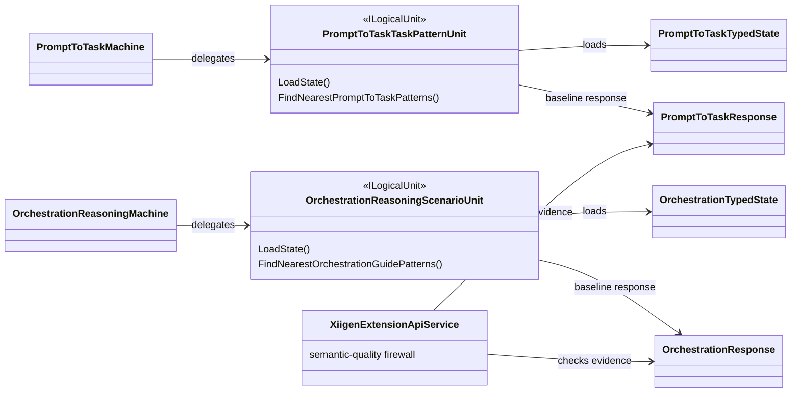

# TRAINABLE-ARCHITECTURE-AUDIT-v4

Вердикт: **PASS_WITH_LIMITATIONS**.

Q9 с baseline commit `e57aee281b9f8c5f54d7308beb046fb968894277` исправил важное архитектурное место: `PromptToTaskMachine` и `OrchestrationReasoningMachine` теперь делегируют runtime-выбор в отдельные typed `ILogicalUnit` units, а не держат решающую логику как скрытый private scorer/dictionary внутри machine-класса. Это улучшает границу ответственности, делает state/load/nearest evidence видимыми и снижает риск ложного semantic-quality claim. Но Q9 не превращает baseline overlap в полноценную семантическую модель: semantic quality все еще **не заявлена**, host runtime не заявлен, checkpoint rewrite и положительные fresh-load/continue-training gates остаются будущей работой.

## PromptToTask

Как сейчас: machine грузит learned state и передает решение в unit: `43.SmartSkillsDomain/PromptToTaskMachine.cs:120-122` — `new PromptToTaskTaskPatternUnit(...); var unitDecision = unit.Decide(request);`.

Unit является явной логической единицей: `43.SmartSkillsDomain/PromptToTaskTaskPatternUnit.cs:81-83` — `: ILogicalUnit<PromptToTaskRequest, PromptToTaskTaskPatternUnitDecision>`.

State-загрузка вынесена в unit и идет через user/cache first, затем common fallback: `43.SmartSkillsDomain/PromptToTaskTaskPatternUnit.cs:285-286` — `=> loadUserState() ?? loadCommonState();`.

Nearest baseline тоже находится в unit: `43.SmartSkillsDomain/PromptToTaskTaskPatternUnit.cs:224-232` — `FindNearestPromptToTaskPatterns(...)`, `LoadState()`, `BuildSignalSet(...)`.

Semantic false evidence остается явным: `43.SmartSkillsDomain/PromptToTaskMachine.cs:193-197` — `BASELINE_NOT_SEMANTIC_QUALITY`, `SEMANTIC_QUALITY_CLAIMED_FALSE`, `NO_TRAINING_CHECKPOINT_OR_ASSET_CLAIM`; `43.SmartSkillsDomain/PromptToTaskTaskPatternUnit.cs:273-281` — `SemanticQualityClaimed: false` и `Nearest/KNN-style overlap is a transparent baseline`.

Почему лучше: runtime authority больше не выглядит как закрытый scorer внутри machine. Выбор проходит через named unit, с typed state и видимой evidence-поверхностью.

Что еще слабое: nearest/KNN-style overlap остается baseline, а не доказательством source-disjoint semantic generalization. Нет положительного semantic-quality claim, checkpoint rewrite, fresh continue-training proof и ablation evidence.

Тесты: здесь не запускались. По parent Q9 evidence: focused tests PASS 62/62, extended lifecycle/API tests PASS 59/59. Локальные refs: `Tests/PromptToTaskMachineStateLoadingTests.cs:87-90`, `Tests/PromptToTaskContractsTests.cs:374-435`, `Tests/PromptToTaskMachineAssetLifecycleTests.cs:51-53`.

## OrchestrationReasoning

Как сейчас: machine делегирует learned-guide decision в unit: `43.SmartSkillsDomain/OrchestrationReasoningMachine.cs:139-142` — `new OrchestrationReasoningScenarioUnit(...); var unitDecision = unit.Decide(request);`.

Unit является явной логической единицей: `43.SmartSkillsDomain/OrchestrationReasoningScenarioUnit.cs:93-95` — `: ILogicalUnit<OrchestrationReasoningRequest, OrchestrationReasoningScenarioDecision>`.

State-загрузка также user/cache first, затем common fallback: `43.SmartSkillsDomain/OrchestrationReasoningScenarioUnit.cs:306-307` — `=> loadUserState() ?? loadCommonState();`.

Nearest baseline находится в unit: `43.SmartSkillsDomain/OrchestrationReasoningScenarioUnit.cs:244-252` — `FindNearestOrchestrationGuidePatterns(...)`, `LoadState()`, `BuildSignalSet(query)`.

Semantic/host false evidence остается явным: `43.SmartSkillsDomain/OrchestrationReasoningMachine.cs:496-501` — `BASELINE_NOT_SEMANTIC_QUALITY`, `HOST_RUNTIME_CLAIMED_FALSE`, `SEMANTIC_QUALITY_CLAIMED_FALSE`, `NO_TRAINING_CHECKPOINT_OR_ASSET_CLAIM`; `43.SmartSkillsDomain/OrchestrationReasoningScenarioUnit.cs:293-302` — `HostRuntimeClaimed: false`, `SemanticQualityClaimed: false`, transparent baseline note.

Почему лучше: scenario selection больше не спрятан в machine. Unit делает decision boundary читаемой: typed state, nearest guides, confidence/margin и no-claim evidence находятся рядом.

Что еще слабое: это не full semantic planner и не host runtime proof. Unit честно возвращает baseline evidence, но не доказывает reasoning quality на source-disjoint held-out задачах и не закрывает checkpoint/continue-training/ablation gates.

Тесты: здесь не запускались. По parent Q9 evidence: focused tests PASS 62/62, extended lifecycle/API tests PASS 59/59. Локальные refs: `Tests/OrchestrationReasoningStateLoadingTests.cs:91-94`, `Tests/OrchestrationReasoningContractsTests.cs:390-463`, `Tests/XiigenExtensionApiContractsTests.cs:365-367`.

## API firewall

`XiigenExtensionApiService` теперь требует positive semantic evidence от всех трех компонентов и блокирует no-claim evidence. Это важно: baseline units могут быть полезны, но API не должен превращать их в semantic-quality claim.

Ключевые refs:

- `43.SmartSkillsDomain/XiigenExtensionApiService.cs:19-24` — positive marker `SEMANTIC_QUALITY_CLAIMED_TRUE` и no-claim markers `BASELINE_NOT_SEMANTIC_QUALITY`, `SEMANTIC_QUALITY_CLAIMED_FALSE`.
- `43.SmartSkillsDomain/XiigenExtensionApiService.cs:570-575` — positive evidence required for PromptToTask, OrchestrationReasoning, SkillSelection, and no no-claim evidence allowed.
- `43.SmartSkillsDomain/XiigenExtensionApiService.cs:577-583` — helper methods for positive/no-claim checks.
- `Tests/XiigenExtensionApiContractsTests.cs:338-340` and `365-367` — baseline/no-claim evidence blocks semantic quality.

## Remaining work

- Full semantic training/eval для PromptToTask и OrchestrationReasoning.
- Checkpoint rewrite как настоящий результат training/eval lifecycle.
- Positive fresh-load gates и positive continue-training gates.
- Held-out source-disjoint eval без source/prompt/pair leakage.
- Ablations и negative controls.
- Dashboard QA, если scope потребует UI/API runtime evidence.
- Host runtime не заявлен.
- `SkillSelection` остается отдельной целью unitization/eval lifecycle, если не закрыт другой фазой.

Итог: Q9 закрывает прежний architectural authority gap для PromptToTask и OrchestrationReasoning, но честно оставляет semantic quality в состоянии **not claimed**.
