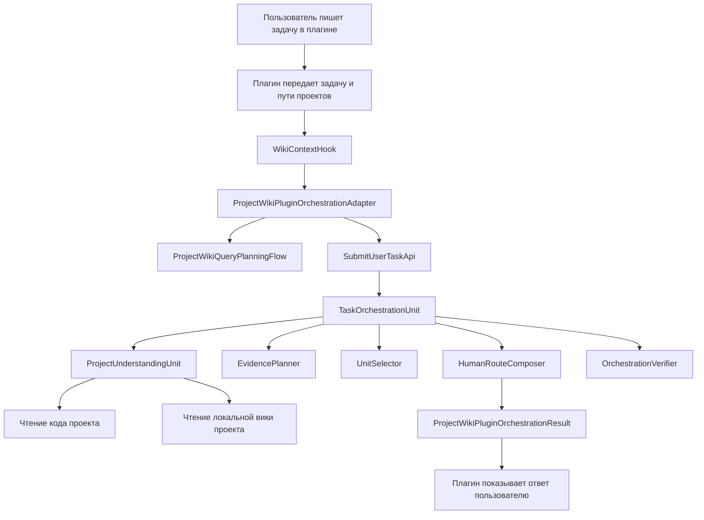
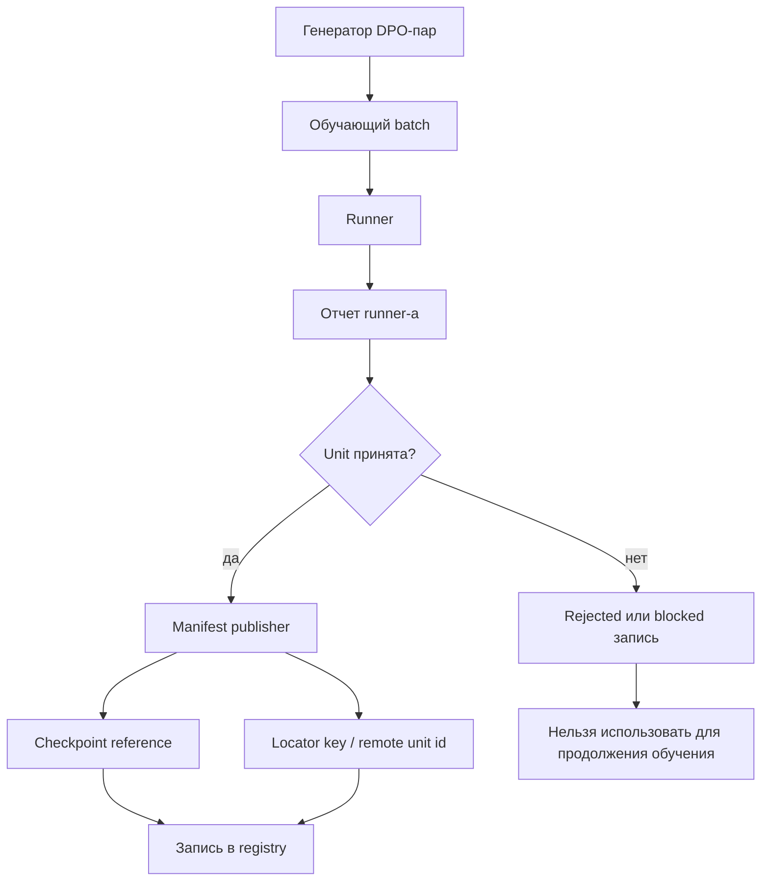

# Текущее устройство локальной вики XIIGen - v1

Дата: 2026-05-26

Этот документ описывает текущее состояние локальной вики XIIGen.

Это не отчет о завершении и не план исправлений. Это простое описание того, что уже есть в коде: какие проекты участвуют, где лежит код, какие данные куда передаются, какие алгоритмы сейчас используются, что училось, что возвращается пользователю и что пока устроено плохо.

Английскими в документе оставлены только настоящие имена классов, файлов, полей, статусов и команд. Их нельзя переводить, потому что они должны совпадать с кодом.

## 1. Что такое локальная вики XIIGen

Локальная вики - это слой знаний о конкретном проекте.

Она нужна, чтобы XIIGen отвечал не общими словами, а по реальному проекту:

```text
вопрос пользователя
-> активный проект
-> связанные проекты
-> факты из кода
-> факты из локальной вики
-> план вопросов к вики и RAG
-> выбор нужных wiki units
-> ответ пользователю
```

Для проектов на Angular, .NET и SQL смысл такой:

```text
Angular-клиент + .NET-сервер + SQL = одна бизнес-система
```

То есть правильный ответ должен видеть цепочку:

```text
экран
-> действие пользователя
-> HTTP-вызов
-> .NET controller
-> service
-> storage / SQL
```

## 2. Какие проекты и папки участвуют

| Где находится | Что это | Что там лежит |
|---|---|---|
| `C:\Projects\llm_mvp_core\42.ProjectWikiDomain` | Основная логика локальной вики | Код, который строит evidence, планирует вопросы, ищет context, собирает ответ, запускает wiki units |
| `C:\Projects\llm_mvp_core\43.LearningLocalWikiData` | Данные обучения локальной вики | Registry, batch-и, отчеты, manifests, проверки, state files, планы |
| `C:\Projects\llm_mvp_core\15.OrchestratorModel` | Главный orchestrator XIIGen | Здесь wiki flows должны подключаться к общей системе |
| `C:\Projects\llm_mvp_core\25.ModelServer` | Хранилище обученных units | Здесь должны публиковаться checkpoints, manifests и locator entries |
| `<project>\.xiigen\wiki-domain` | Wiki-данные внутри конкретного проекта | Evidence, documentation, system map, manifest references |
| `C:\Users\lubao\Documents\xiigen\llm mvp\localwikis\<project>` | Wiki-данные рядом с `llm mvp` | Project-local evidence, если не хотим класть его внутрь проверочного проекта |

Главное разделение:

```text
42.ProjectWikiDomain = логика
43.LearningLocalWikiData = данные обучения и отчеты
<project>/.xiigen/wiki-domain или localwikis/<project> = знания конкретного проекта
```

## 3. Общая передача данных



По-человечески:

1. Пользователь дает задачу через плагин.
2. Плагин передает задачу в `llm_mvp_core`.
3. `WikiContextHook` собирает request.
4. `ProjectWikiPluginOrchestrationAdapter` запускает wiki-планирование и task orchestration.
5. `ProjectUnderstandingUnit` смотрит код и локальную wiki.
6. `HumanRouteComposer` собирает ответ для пользователя.
7. Adapter возвращает результат плагину.

## 4. Что плагин передает в core

Сейчас вход идет через `WikiContextHook`.

Файл:

```text
C:\Projects\llm_mvp_core\43.LearningLocalWikiData\tools\WikiContextHook\Program.cs
```

Hook читает:

| Данные | Что означает |
|---|---|
| `HOOK_PROMPT` | Задача пользователя |
| `XIIGEN_PROJECT_ROOT` | Активный проект |
| `XIIGEN_LINKED_REPO_PATHS` | Связанные проекты |
| `XIIGEN_PLUGIN_ENTRYPOINT` | Команда, через которую пользователь вошел |

Пример запуска:

```powershell
$env:HOOK_PROMPT = "задача пользователя"
$env:XIIGEN_PROJECT_ROOT = "C:\Projects\GenieDynamicApp"
$env:XIIGEN_LINKED_REPO_PATHS = '["C:\\Projects\\GenieDynamicServer"]'
$env:XIIGEN_PLUGIN_ENTRYPOINT = "xiigen.orchestratePrompt"

dotnet run --no-build `
  --project "C:\Projects\llm_mvp_core\43.LearningLocalWikiData\tools\WikiContextHook\WikiContextHook.csproj" `
  -- --orchestrate
```

Hook делает четыре вещи:

1. читает входные данные;
2. собирает `ProjectWikiPluginOrchestrationRequest`;
3. вызывает `ProjectWikiPluginOrchestrationAdapter`;
4. печатает результат в формате JSON.

## 5. Что делает `ProjectWikiPluginOrchestrationAdapter`

Файл:

```text
C:\Projects\llm_mvp_core\42.ProjectWikiDomain\ProjectWikiPluginOrchestrationAdapter.cs
```

Adapter получает:

```text
ProjectWikiPluginOrchestrationRequest
```

Главные поля:

| Поле | Что означает |
|---|---|
| `PromptText` | Задача пользователя |
| `ActiveRepoPath` | Активный проект |
| `LinkedRepoPaths` | Связанные проекты |
| `RepoScopeClass` | Один проект или группа проектов |
| `PluginHost` | Откуда пришла задача |
| `UserFacingEntrypoint` | Пользовательская команда |

Adapter делает:

1. проверяет, что задача и активный проект не пустые;
2. собирает список проектов: active + linked;
3. вызывает `ProjectWikiQueryPlanningFlow`;
4. проверяет, есть ли локальная wiki evidence;
5. выбирает текущие wiki units;
6. вызывает `ProjectWikiOrchestrationFlow` через `ILogicalOrchestrator` (если настроен) или напрямую `SubmitUserTaskApi` (BOOTSTRAP_FALLBACK — логируется как warning);
7. возвращает `ProjectWikiPluginOrchestrationResult`.

## 6. Что делает `ProjectWikiQueryPlanningFlow`

Файл:

```text
C:\Projects\llm_mvp_core\42.ProjectWikiDomain\ProjectWikiQueryPlanningFlow.cs
```

Вход:

```text
ProjectWikiUserQuestion
```

Внутри передается:

| Поле | Что означает |
|---|---|
| `QuestionId` | ID вопроса |
| `ProjectId` | Имя проекта |
| `RepositoryRoot` | Путь проекта |
| `RawUserText` | Текст задачи пользователя |
| `DetectedStack` | Найденный или ожидаемый стек |
| `KnownProjectAliases` | Имена связанных проектов |

Что делает:

1. определяет тип вопроса;
2. выделяет важные сущности;
3. строит шаги поиска по wiki;
4. добавляет проверки на missing evidence;
5. добавляет проверки на неправильный проект;
6. добавляет проверки на устаревшую документацию;
7. возвращает `ProjectWikiQueryPlan`.

Текущий алгоритм частично детерминистический. Это важно: он работает как каркас, но не является финальной обучаемой логикой.

## 7. Что делает `SubmitUserTaskApi`

Файл:

```text
C:\Projects\llm_mvp_core\42.ProjectWikiDomain\ProjectTaskOrchestrationPipeline.cs
```

Вход:

```text
SubmitUserTaskRequest
```

Поля:

| Поле | Что означает |
|---|---|
| `UserPrompt` | Задача пользователя |
| `ActiveProjectRoot` | Активный проект |
| `LinkedProjectRoots` | Связанные проекты |
| `UserFacingEntrypoint` | Пользовательская команда |

`SubmitUserTaskApi` просто передает request в `TaskOrchestrationUnit`.

## 8. Внутренний путь `prompt -> result`

Сейчас путь такой:

```text
SubmitUserTaskApi
-> TaskOrchestrationUnit
-> BuildIntent
-> ProjectUnderstandingUnit
-> EvidencePlanner
-> UnitSelector
-> HumanRouteComposer
-> OrchestrationVerifier
-> TaskOrchestrationResponse
```

### 8.1. `TaskOrchestrationUnit`

Что делает:

1. проверяет request;
2. строит intent;
3. строит понимание проекта;
4. строит список вопросов к evidence;
5. выбирает wiki units;
6. собирает человеческий маршрут;
7. ставит статус.

Передача данных:

```text
задача пользователя
-> TaskOrchestrationIntent
-> ProjectUnderstanding
-> TaskEvidencePlan
-> TaskUnitSelection
-> HumanTaskRoute
-> TaskOrchestrationResponse
```

### 8.2. `BuildIntent`

Что получает:

```text
текст задачи пользователя
```

Что возвращает:

```text
TaskOrchestrationIntent
```

Внутри:

| Поле | Что означает |
|---|---|
| `Goal` | Короткая формулировка цели |
| `RequestedWorkItems` | Части работы, вырезанные из prompt |
| `UserNamedObjects` | Похожие на имена объекты |

Текущий алгоритм:

```text
regex + разделение текста по запятым, and, then, ->
```

Это плохое место, потому что смысловое понимание задачи сейчас находится в статичном C#.

### 8.3. `ProjectUnderstandingUnit`

Что получает:

```text
SubmitUserTaskRequest
```

Что делает:

1. берет активный проект;
2. добавляет связанные проекты;
3. обходит файлы каждого проекта;
4. пропускает `node_modules`, `bin`, `obj`;
5. ищет признаки технологий;
6. ищет признаки архитектуры;
7. читает локальную wiki evidence;
8. собирает список missing evidence.

Какие признаки ищет:

| Что найдено | Какой факт добавляется |
|---|---|
| `angular.json` | найден Angular workspace |
| `package.json` | найден JavaScript/TypeScript проект |
| `.sln` или `.csproj` | найден .NET проект |
| `.sql` | найдены SQL files |
| `.drawio` или `.drawio.xml` | найдены diagrams |
| папка `Controllers` | найден backend controller layer |
| папка `Services` | найден service layer |
| папка `src\app` | найден Angular app source |
| папка `.github\workflows` | найден CI workflow |

Откуда читает wiki evidence:

```text
<project>\.xiigen\wiki-domain\evidence
C:\Users\lubao\Documents\xiigen\llm mvp\localwikis\<project>\evidence
```

Какие файлы читает:

```text
.md
.txt
.json
.yaml
.yml
```

Что возвращает:

```text
ProjectUnderstanding
```

Поля:

| Поле | Что означает |
|---|---|
| `ProjectRoots` | Все участвующие проекты |
| `StackFacts` | Факты о технологиях |
| `CodeEvidenceFacts` | Факты из кода и локальной wiki |
| `MissingEvidence` | Чего не хватает |

### 8.4. `EvidencePlanner`

Что получает:

```text
TaskOrchestrationIntent
ProjectUnderstanding
```

Что возвращает:

```text
TaskEvidencePlan
```

Поля:

| Поле | Что означает |
|---|---|
| `EvidenceQuestions` | Какие вопросы нужно задать wiki/RAG |
| `EvidenceGaps` | Что нельзя замазывать |

Текущий алгоритм:

1. добавляет общие вопросы про экраны, маршруты, сервисы, flows, jobs, storage;
2. добавляет вопрос по каждой части задачи;
3. переносит missing evidence из `ProjectUnderstanding`;
4. по словам вроде `figma`, `audio`, `diagram`, `hosting`, `platform` добавляет требования внешнего input.

Это плохое место, потому что вопросы часто получаются одинаковыми для разных задач.

### 8.5. `UnitSelector`

Что получает:

```text
TaskOrchestrationIntent
ProjectUnderstanding
TaskEvidencePlan
```

Что возвращает:

```text
TaskUnitSelection
```

Сейчас он выбирает такие units:

```text
TaskOrchestrationUnit
ProjectUnderstandingUnit
EvidencePlanner
UnitSelector
HumanRouteComposer
VerificationAbstentionUnit
CrossStackBusinessFlowGraphUnit
WikiContextRoutingUnit
MissingEvidenceAbstentionUnit
```

Текущий алгоритм:

1. базовые units добавляются всегда;
2. `CrossStackBusinessFlowGraphUnit` добавляется, если проектов больше одного;
3. `WikiContextRoutingUnit` добавляется, если в prompt есть RAG или context;
4. `MissingEvidenceAbstentionUnit` добавляется, если есть gaps.

Это плохое место, потому что выбор units сейчас сделан через `if`, а не через обучаемую unit.

### 8.6. `HumanRouteComposer`

Что получает:

```text
request
intent
project understanding
evidence plan
unit selection
```

Что возвращает:

```text
HumanTaskRoute
```

Что кладет в ответ:

```text
Конечный ответ XIIGen
Я понял задачу так
Что я вижу в проекте
Как вести работу
Какие вопросы XIIGen должен задать project wiki/RAG
Что нельзя замазывать
Внутри XIIGen для этого используются
```

Текущий алгоритм:

1. вставляет цель;
2. вставляет факты из кода и wiki;
3. пишет одинаковые первые шаги;
4. для каждой части задачи пишет похожий пункт;
5. вставляет вопросы к evidence;
6. вставляет gaps;
7. вставляет выбранные units.

Это плохое место. Именно поэтому ответы по разным prompt выглядят слишком одинаково.

### 8.7. `OrchestrationVerifier`

Что получает:

```text
HumanTaskRoute
TaskOrchestrationIntent
ProjectUnderstanding
TaskEvidencePlan
```

Что проверяет:

```text
есть текст ответа
есть части задачи
есть project roots
есть вопросы к evidence
```

Что возвращает:

```text
true или false
```

Если `true`, ставится:

```text
Status = ORCHESTRATED
```

Если `false`, ставится:

```text
Status = NEEDS_MORE_EVIDENCE
```

Важно: сейчас verifier проверяет форму ответа, а не настоящую продуктовую глубину.

### 8.8. Bootstrap ILogicalUnit обёртки (TD1) и ProjectWikiOrchestrationFlow (TD2)

Файл Bootstrap units:

```text
C:\Projects\llm_mvp_core\42.ProjectWikiDomain\BootstrapOrchestrationUnits.cs
```

После TD1 каждый из шести шагов оркестрации обёрнут в `ILogicalUnit`:

| Bootstrap unit | Что оборачивает |
|---|---|
| `BootstrapIntentBuilderUnit` | `BuildIntent` |
| `BootstrapProjectScannerUnit` | `ProjectUnderstandingUnit` |
| `BootstrapEvidencePlannerUnit` | `EvidencePlanner` |
| `BootstrapUnitSelectorUnit` | `UnitSelector` |
| `BootstrapRouteComposerUnit` | `HumanRouteComposer` |
| `BootstrapOrchestrationVerifierUnit` | `OrchestrationVerifier` |

Важно:

- Каждая Bootstrap unit **делегирует** существующей статичной логике — output полностью совпадает с pre-TD1 (decision A-LM-03).
- Bootstrap units — это стартовая точка для DPO-обучения. Обученная unit может заменить Bootstrap default после того, как runner опубликует валидированные веса.
- Train\* методы существуют **только** на `ILearningMachine`. `ILogicalUnit` — это чистый контракт инференса (A-LM-02 locked).

Файл ProjectWikiOrchestrationFlow (TD2):

```text
C:\Projects\llm_mvp_core\15.OrchestratorModel\Logical\ProjectWikiOrchestrationFlow.cs
```

Flow зарегистрирован в `LogicalOrchestratorAssistant` под id `project-wiki-orchestration-flow`.

Логика:

1. если `ILogicalOrchestrator` настроен — вызывает его через `RunAsync`;
2. если не настроен — вызывает напрямую `SubmitUserTaskApi` (BOOTSTRAP_FALLBACK, логируется как warning).

До тех пор, пока runner не опубликует веса, flow сообщает `DOCUMENTATION_GRAPH_READY_TRAINING_RUNNER_MISSING` / `runner_missing` вместо того, чтобы утверждать о наличии обученной модели.

## 9. Что возвращается плагину

Adapter возвращает:

```text
ProjectWikiPluginOrchestrationResult
```

Поля:

| Поле | Что означает |
|---|---|
| `Status` | Статус результата |
| `OrchestrationPlan` | Технические фазы adapter-а |
| `SelectedUnits` | Выбранные wiki units |
| `WikiQueryPlan` | План вопросов к wiki |
| `EvidenceRequirements` | Какие evidence нужны |
| `MissingEvidence` | Чего не хватает |
| `BlockedReason` | Почему нельзя честно продолжать |
| `AnswerPreviewOrPlanSummary` | Главный ответ для пользователя |
| `StateUpdate` | Какое состояние записать |
| `RepoScopeClass` | Один проект или группа проектов |
| `ActiveRepoPath` | Активный проект |
| `LinkedRepoPaths` | Связанные проекты |
| `Metrics` | CPU/RAM/time |

Главное поле для пользователя:

```text
AnswerPreviewOrPlanSummary
```

Именно его должен показывать plugin.

## 10. Как сейчас используется local wiki evidence

Пример подключенной wiki:

```text
C:\Users\lubao\Documents\xiigen\llm mvp\localwikis\GenieDynamicApp\evidence\content-generation-pipeline.md
```

Смысл файла:

```text
GenieDynamicApp может иметь экран content generation flow.
Клиент должен вызывать backend job endpoints.
Клиент не должен принимать orchestration decisions внутри себя.
Надо переиспользовать routing, shared components и CI workflow.
```

Как эти данные попадают в ответ:

```text
ProjectUnderstandingUnit
-> ReadProjectWikiEvidenceFacts
-> CodeEvidenceFacts
-> HumanRouteComposer
-> раздел "Что я вижу в проекте"
```

То есть сейчас local wiki влияет на блок:

```text
Что я вижу в проекте
```

Но пока не управляет всей логикой построения маршрута.

## 11. Как сейчас работает поиск evidence

Файл:

```text
C:\Projects\llm_mvp_core\42.ProjectWikiDomain\ProjectEvidenceIndex.cs
```

Что делает:

1. хранит records evidence;
2. индексирует evidence;
3. ищет evidence по текстовому запросу;
4. возвращает подходящие records.

Текущий алгоритм поиска:

```text
лексический поиск BM25 через 12.SearchEngine
```

Есть wrapper:

```text
C:\Projects\llm_mvp_core\42.ProjectWikiDomain\WikiContextRetriever.cs
```

Он выбирает режим:

| Режим | Что означает |
|---|---|
| `Mode3LexicalEvidence` | Лексический поиск по evidence |
| `Mode2SemanticHybrid` | Семантический поиск через GraphRAG, если он подключен |

## 12. Что училось

Registry:

```text
C:\Projects\llm_mvp_core\43.LearningLocalWikiData\registry\PROJECT-WIKI-TRAINING-ASSET-REGISTRY.json
```

Текущие статусы:

| Статус | Количество |
|---|---:|
| `accepted` | 19 |
| `rejected` | 182 |
| `experimental_no_authority` | 193 |
| `blocked` | 26 |

Всего:

```text
421 entries
```

Какие units есть в registry:

| Unit | Количество |
|---|---:|
| `CodeTraceBuilderUnit` | 72 |
| `CrossStackBusinessFlowGraphUnit` | 4 |
| `DocumentationGeneratorUnit` | 18 |
| `EntityImpactMapperUnit` | 46 |
| `NegativeDpoGenerator` | 42 |
| `ProjectAnswerVerifier` | 28 |
| `ProjectWikiAnswerComposer` | 50 |
| `ProjectWikiQueryPlanningFlow` | 25 |
| `ProjectWikiRequestRouterUnit` | 53 |
| `ProjectWikiTrainingOrchestrator` | 1 |
| `StackAndVersionClassifierUnit` | 2 |
| `SystemBoundaryMapperUnit` | 1 |
| `WikiContextRoutingUnit` | 24 |
| `WikiTraceAggregator` | 29 |
| `UNKNOWN` | 26 |

Важно:

```text
запись в registry не равна готовой рабочей модели
```

Чтобы unit считалась пригодной, нужны:

```text
accepted status
runner report
manifest ref
checkpoint ref
locator key
remote unit id
import/export status
```

## 13. Жизненный цикл обучаемой wiki unit



По-человечески:

1. generator делает обучающие пары;
2. runner проверяет unit;
3. если gate пройден, publisher делает manifest;
4. manifest ссылается на checkpoint;
5. locator позволяет найти unit;
6. registry фиксирует статус;
7. rejected checkpoint нельзя брать как основу продолжения.

## 14. Import / export обучаемых units

Готовая trainable unit должна быть project asset.

Нужны:

```text
unit id
unit version
manifest ref
locator key
remote unit id
checkpoint ref
upgrade policy
rollback ref
import/export status
```

Граница model repository:

```text
C:\Projects\llm_mvp_core\25.ModelServer
```

Модель manifest:

```text
ProjectWikiUnitManifest
```

Что это означает:

- checkpoint без manifest не является законченной unit;
- manifest без locator плохо находится;
- accepted unit без runner report нельзя считать доказанной;
- rejected checkpoint нельзя использовать как continuation source;
- нельзя утверждать, что model weights есть, если есть только documentation graph.

## 15. Проверочный пример

Активный проект:

```text
C:\Projects\GenieDynamicApp
```

Связанный проект:

```text
C:\Projects\GenieDynamicServer
```

Задача:

```text
Пользователь хочет оркестрировать pipeline генерации контента: принять текст или аудио, превратить аудио в текст, улучшить текст, спланировать изображения, видео, музыку, голос/avatar, собрать пакеты для платформ, сделать описания, запланировать публикации, сохранить prompts/assets/feedback и поддержать правки пользователя.
```

Текущий путь:

```text
задача
-> WikiContextHook
-> ProjectWikiPluginOrchestrationAdapter
-> ProjectWikiQueryPlanningFlow
-> SubmitUserTaskApi
-> TaskOrchestrationUnit
-> ProjectUnderstandingUnit
-> local wiki evidence
-> HumanRouteComposer
-> ProjectWikiPluginOrchestrationResult.AnswerPreviewOrPlanSummary
```

Что local wiki добавляет в ответ:

```text
GenieDynamicApp может иметь экран content generation flow.
Клиент должен вызывать backend job endpoints.
Клиент не должен принимать orchestration decisions внутри себя.
```

## 16. Что сейчас устроено плохо

### 16.1. В pipeline остался статичный мозг

Это плохо.

| Место | Что плохо |
|---|---|
| `BuildIntent` | Режет prompt через regex |
| `EvidencePlanner` | Добавляет похожие вопросы для разных задач |
| `UnitSelector` | Выбирает units через `if` |
| `HumanRouteComposer` | Строит одинаковый маршрут шаблоном |
| `RequiresExternalInput` | Решает по словам `figma`, `audio`, `platform` |

Именно поэтому разные задачи сейчас получают слишком похожий раздел:

```text
Как вести работу:
1. подтвердить систему
2. разложить задачу
3. для каждой части найти evidence
...
```

Это не финальная архитектура.

### 16.2. Local wiki читается поверхностно

Сейчас local wiki добавляет факты в ответ.

Но она еще не управляет:

- тем, как строить flow;
- тем, как адаптировать сценарий под проект;
- тем, что переиспользовать в UI/backend/storage;
- тем, где проверять SQL/stored procedures;
- тем, какие части являются missing evidence;
- тем, как вести задачу до результата.

### 16.3. Статус `ORCHESTRATED` пока слишком слабый

Сейчас `ORCHESTRATED` означает:

```text
минимальная структура ответа есть
```

Но это еще не означает:

```text
ответ глубоко связан с проектом
```

## 17. Что можно честно сказать сейчас

Можно сказать:

```text
runtime path локальной вики существует
hook передает prompt и project roots в llm_mvp_core
код проекта сканируется
local wiki evidence читается
registry обучающих assets существует
часть project wiki units имеет accepted entries
plugin path может вернуть human answer
```

Нельзя сказать:

```text
orchestration brain полностью обучаемый
все prompt-и глубоко оркестрируются
все plugin scenarios готовы как продукт
все model weights встроены в проект
каждая accepted unit полностью import/export ready
текущий HumanRouteComposer достаточно хороший
```

## 18. Итог

Сейчас у XIIGen local wiki есть рабочий каркас:

- runtime domain в `42.ProjectWikiDomain`;
- learning data и registry в `43.LearningLocalWikiData`;
- чтение code evidence;
- чтение project-local wiki evidence;
- plugin/hook вход;
- query planning flow;
- training asset registry;
- manifest/checkpoint/locator model;
- evidence-bound answer path.

Но есть серьезный архитектурный дефект:

```text
часть смыслового мозга все еще находится в детерминистическом C# коде
```

Это нужно считать текущей проблемой архитектуры, а не нормальным финальным состоянием.
