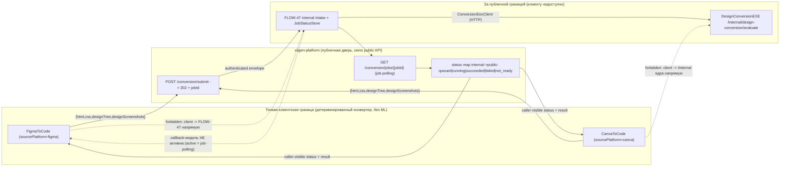
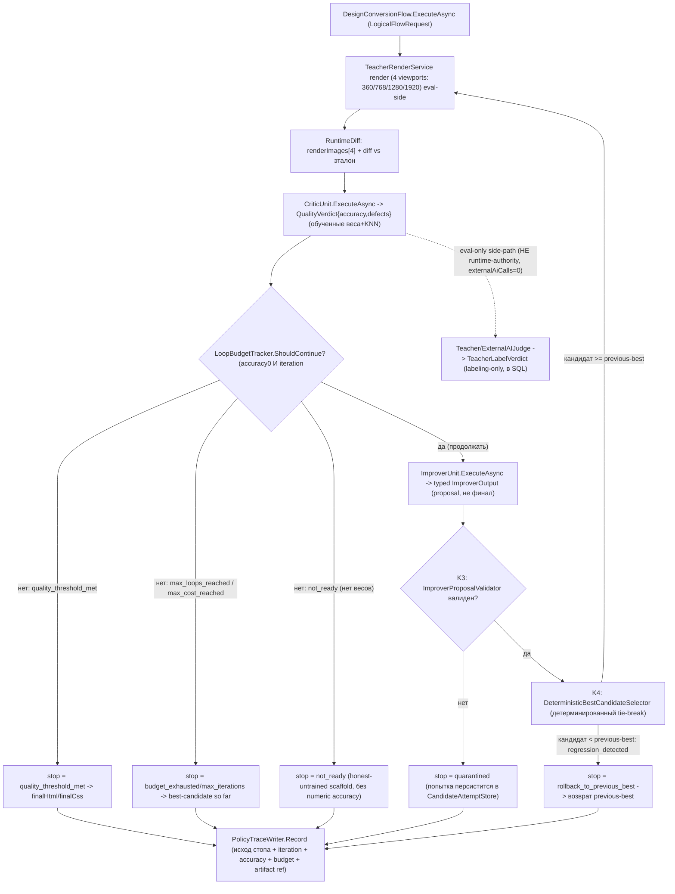
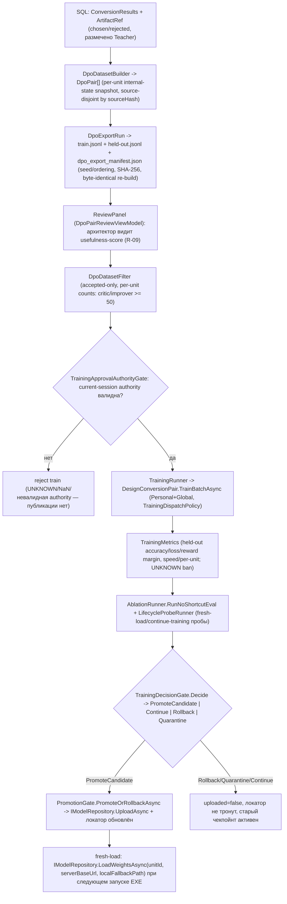

# DCM — План: серверная конверсия дизайна → HTML+CSS с обучаемой ILearningMachine
## (v1, PLAN-ONLY + PARTIALLY MERGED IN CODE AS HONEST UNTRAINED SCAFFOLD — trained-feature не доказана · ФАЗОВАЯ структура исполнения Фаза 0..12)

- **Версия:** 1.0
- **Статус:** PARTIALLY MERGED IN CODE AS HONEST UNTRAINED SCAFFOLD; PLAN-ONLY LOCK REMAINS; NOT AUTHORIZED AS TRAINED FEATURE.
- **Ветка:** `DesignToCode`
- **Структура исполнения:** строгая фазовая последовательность **Фаза 0 → Фаза 12**. Иерархия нумерации сквозная: **Фаза N → под-Фаза N.M → под-шаг N.M.K**. Каждая фаза полностью завершается своим «Gate завершения Фазы N» до старта следующей. Текущая активная фаза/под-Фаза/под-шаг видны в разделе «Доска прогресса / Execution Tracking» (сразу ниже). Существующие якоря `ST-1..ST-11` (декомпозиция исполнения), `§0..§5` (Часть A), `R-01..R-20` (реестр требований) и `G-01..G-31` (governance-гейты) сохранены как стабильные имена внутри фаз — это НЕ вторая система нумерации, а человекочитаемые ярлыки фаз/секций, на которые ссылается весь документ.
**Связанные гайды (не дублировать, только ссылаться):**
- `docs/skills/dcm-dpo-construction-GUIDE.md` — построение DPO-пар
- `docs/skills/dcm-training-GUIDE.md` — обучение модели
- `docs/skills/dcm-measurement-GUIDE.md` — измерение качества

**Граница исполнения после одобрения Luba:** этот файл остаётся планом и
картой доказательств; сам по себе он не является product evidence и не
разрешает прямое исполнение родительской сессией. Если текущая нецитированная
команда Luba разрешает выполнение, выполнение идёт только через bounded
sub-agent work orders с точным scope, без broad verification, без смешивания
commit/push групп, и с Gate B evidence по конкретной ST перед claim `done`.

**Governance compatibility для исполнения через sub-agent:** этот план
наследует Parent Architect Subagent-Only Firewall:

```text
Parent Architect Subagent-Only Firewall
parent local sidecar work ban
read-only verification after a sub-agent packet returns
sub-agent waiting is not a stop
no local non-overlapping work escape
```

Родительская/архитекторская сессия не становится исполнителем по факту
готовности следующего шага, прохождения architecture gate или наличия
`next_action`. Если текущая команда Luba требует sub-agent-only/architect-only
исполнение, любые product, governance, skill, protocol, plan, report, data и
code изменения выполняются только bounded sub-agent work orders; родитель
после packet делает только review/integration и отдельную явно назначенную
commit/push boundary.

Канонические trainable levels в этом плане: `ILearningMachine`,
`ILogicalOrchestrator`, `ILogicalFlow`, `ILogicalUnit`,
`ILearningMachinePair`. Generic-формы вроде `ILearningMachine<TDomain>` или
`ILogicalUnit<TInput,TOutput>` ниже являются только C# contract signatures и не
добавляют новые архитектурные уровни. Любая замена Dictionary/counter/scorer/KNN
или private decision method должна называть конкретный `ILogicalUnit`, typed
trained state, training method, KNN role, DPO pair construction, affected sets,
tests, lifecycle и source/license gate.

---

## Карта фаз исполнения (Фаза 0 → Фаза 12)

> Каноническая последовательность фаз. Каждая фаза завершается ПОЛНОСТЬЮ (её «Gate завершения Фазы N» зелёный) до старта следующей. Колонка «Якоря/секции» показывает, какие существующие блоки документа (ST/§/Check/матрицы) живут внутри фазы — это и есть renumber: блоки реорганизованы под фазы, а их прежние имена сохранены как стабильные ярлыки.

| Фаза | Название | Под-Фазы | Якоря/секции документа |
|---|---|---|---|
| **Фаза 0** | Архитектурная документация (Часть A — справочное основание) | 0.1 §0 UML · 0.2 §5 иерархия · 0.3 §1 алгоритмы · 0.4 §2 где логика · 0.5 §3 код-цитаты · 0.6 §4 статус | Часть A §0, §5, §1, §2, §3, §4 |
| **Фаза 1** | Основания: контракты, scaffold домена, типобарьеры, граница API/ownership | 1.1 §1.1 граница API/ownership · 1.2 контракты ILearningMachine/ILogical* · 1.3 scaffold `NN.DesignConversionDomain` · 1.4 типобарьеры (ConversionResponse/QualityVerdict/TeacherLabelVerdict) | §1.1 (Project Ownership/API Boundary), §3 Блок A (контракты), §3 Блок F (граница типов), §0.1 Diagram Index |
| **Фаза 2** | Приём: клиенты → публичный `xiigen-platform` → внутренний FLOW-47 intake | 2.1 клиенты FigmaToCode/CanvaToCode (submit + job-polling) · 2.2 внутренний intake FLOW-47 + JobStatusStore | ST-1, ST-2 |
| **Фаза 3** | Ядро EXE + юниты: EXE-хост, Orchestrator/Flow, CriticUnit+ImproverUnit | 3.1 EXE + внутренний API домена + Critic/Improver (честный not_ready) | ST-3 |
| **Фаза 4** | Teacher render-QA: безопасная сборка, sandbox, viewport-матрица, стабильные артефакты+SHA | 4.1 Teacher render-QA | ST-4 |
| **Фаза 5** | Teacher визуальное сравнение + ИИ-судья: visual diff, JudgeResponse + provider abstraction | 5.1 Teacher сравнение + ИИ-судья | ST-5 |
| **Фаза 6** | Цикл улучшения: Critic→Improver loop, lineage, previous-best, rollback, stop conditions | 6.1 цикл улучшения (Flow) | ST-6 |
| **Фаза 7** | БД результатов: SQL store, ArtifactRef lifecycle, tenant-RLS, migrations | 7.1 SQL-БД результатов + ArtifactRef lifecycle | ST-7 |
| **Фаза 8** | Построение DPO: DpoDatasetBuilder, per-unit пары, negative taxonomy, reproducible export | 8.1 построение DPO + reproducible export | ST-8 |
| **Фаза 9** | Панель архитектора (DPO review UI): usefulness + comparison, фильтры, authority gate, audit | 9.1 панель полезности DPO (локальный UI) | ST-9 |
| **Фаза 10** | Обучение + lifecycle: TrainBatchAsync, checkpoint/export/import, fresh-load, continue-training, ablation, promotion | 10.1 обучение + lifecycle | ST-10 |
| **Фаза 11** | Дообучение по запросу + заливка весов: architect-triggered retrain, held-out gate, UploadAsync/LoadWeightsAsync (метода `DownloadAsync` в `IModelRepository` НЕТ — загрузка только через `LoadWeightsAsync`) | 11.1 дообучение по запросу + заливка | ST-11 |
| **Фаза 12** | Production controls + документация + финальная приёмка | 12.1 тест-стратегия по фазам · 12.2 Checks (discovery/diagram/R-20) · 12.3 Anti-Hidden-Determinism · 12.4 DOC-deliverables · 12.5 governance-блок · 12.6 матрица покрытия · 12.7 target-outcome e2e · 12.8 усиления (codex-индекс) | Стадия-4 (тест-стратегия), Стадия-5 (Check 17/18/19), Anti-Hidden-Determinism, DOC-01..06, Governance-блок, Completion Coverage Matrix, Target Outcome Matrix, Дополнение/Дополнение-2 |

---

## Доска прогресса / Execution Tracking

> Этот раздел отвечает на вопрос «что происходит прямо сейчас»: какая Фаза/под-Фаза/под-шаг активна, ЧТО конкретно решается, сколько фаз завершено и сколько осталось. Обновляется исполнителем на каждом переходе под-шага/под-Фазы/Фазы (а также при смене активного gate). Источник правды по факту завершения фазы — её «Gate завершения Фазы N» (в конце блока фазы) и поля `STATE.json` (`goal_reached`/`stop_allowed`/`next_action`/`completion_matrix`).

**Формат строки статуса (одна строка, всегда актуальная):**

```text
DCM-PROGRESS | active_phase=Фаза N | active_sub_phase=N.M | active_sub_step=N.M.K
            | now_deciding="<что конкретно сейчас решается/делается>"
            | phases_total=13 (Фаза 0..12) | phases_done=<count> | phases_left=<count>
            | done_phases=[<список завершённых: Фаза 0, ...>]
            | current_gate="Gate завершения Фазы N" | gate_status=<NOT_STARTED|IN_PROGRESS|PASSED>
            | next_action="<следующий bounded под-шаг>"
```

**Правило обновления (Execution Tracking Rule):**
1. На входе в новую Фазу N — выставить `active_phase=Фаза N`, `active_sub_phase=N.1`, `active_sub_step=N.1.1`, `current_gate="Gate завершения Фазы N"`, `gate_status=NOT_STARTED`, обновить `now_deciding`.
2. На каждом под-шаге N.M.K — обновлять `active_sub_step` и `now_deciding` (одна фраза: какой конкретно артефакт/решение в работе).
3. Фаза N считается `phases_done` ТОЛЬКО когда её «Gate завершения Фазы N» = PASSED (все его проверяемые условия выхода зелёные); тогда `phases_done += 1`, `phases_left -= 1`, имя фазы добавляется в `done_phases`, и разрешён переход на Фаза N+1. Частичный прогресс внутри фазы — НЕ завершение фазы (CLAUDE.md «Partial-progress stop firewall»).
4. `phases_total = 13` (Фаза 0..12 включительно). Стартовое состояние: `phases_done=0`, `phases_left=13`, `active_phase=Фаза 0`, `done_phases=[]`.
5. Доска прогресса — человекочитаемый индекс для Luba; она НЕ заменяет per-phase Gate и `STATE.json`, а отражает их. Расхождение доски с фактическим gate/STATE — дефект видимости, чинится до продолжения.
6. **Entry-precondition (жёсткая связка board↔gate, доказуемая):** вход в Фазу N разрешён ТОЛЬКО когда `gate_status` предыдущей фазы = `PASSED` для каждой Фазы 1..12 (для Фазы 0 entry-precondition = одобрение Luba). То есть каждый «Gate завершения Фазы N» несёт строку `entry precondition = Gate завершения Фазы (N-1) PASSED` (для Фазы 0 — `entry precondition = одобрение Luba`); board и набор gate-ов связаны явно, а не подразумеваемо. Нарушение порядка (вход в Фазу N при незелёном Gate N-1) — дефект исполнения, чинится до продолжения.
7. **Per-phase DCM-PROGRESS литерал (наблюдаемость, Human-Readable Execution Board Gate).** На входе в каждую фазу board печатает РОВНО одну строку этого формата (пример для входа в Фазу 3 после зелёного Gate Фазы 2):

```text
DCM-PROGRESS | active_phase=Фаза 3 | active_sub_phase=3.1 | active_sub_step=3.1.1
            | now_deciding="Ядро EXE: EXE-хост + Orchestrator/Flow + CriticUnit/ImproverUnit (честный not_ready)"
            | phases_total=13 (Фаза 0..12) | phases_done=3 | phases_left=10
            | done_phases=[Фаза 0, Фаза 1, Фаза 2]
            | current_gate="Gate завершения Фазы 3" | gate_status=IN_PROGRESS
            | entry_precondition="Gate завершения Фазы 2 = PASSED"
            | next_action="bounded work order на под-шаг 3.1.1 (ST-3 EXE + API домена)"
```

Аналогичная одна строка печатается на входе в каждую из Фаз 0..12 (`phases_done`/`done_phases`/`entry_precondition` пересчитываются по факту PASSED предыдущего gate); board и gate-ы провязаны — `phases_done` board = числу фаз с `gate_status=PASSED`.

**Текущее состояние (PLAN-ONLY, исполнение не начато):**

```text
DCM-PROGRESS | active_phase=Фаза 0 | active_sub_phase=0.1 | active_sub_step=0.1.1
            | now_deciding="PLAN-ONLY: план написан и реструктурирован в фазы; исполнение не начато (ждёт явного одобрения Luba)"
            | phases_total=13 (Фаза 0..12) | phases_done=0 | phases_left=13
            | done_phases=[]
            | current_gate="Gate завершения Фазы 0" | gate_status=NOT_STARTED
            | next_action="Получить одобрение Luba; затем bounded work order на под-Фазу 0.1 (Часть A §0 UML как справочное основание)"
```

---

## Человеческое саммари (RU)

Мы строим серверный pipeline, который превращает дизайн из Figma или Canva в рабочий HTML+CSS. Суть не только в детерминированной конверсии — она была и раньше, — а в том, что сервер учится делать её **лучше** с каждым новым дизайном. Тонкий клиент (плагин Figma или приложение Canva) отправляет результат конверсии на **публичный адресат — `xiigen-platform`** (`POST /conversion/submit`), а потом читает готовый результат через **публичный job-polling `GET /conversion/jobs/{jobId}`**. Публичная платформа — это внешняя дверь для клиентов; за ней внутренний intake/orchestration **FLOW-47** (в `xiigen-flows`) принимает уже аутентифицированный платформой envelope и вызывает ядро — серверный EXE из llm_mvp_core — по внутреннему шву (`POST /internal/design-conversion/evaluate`). Ядро прогоняет рендер и оценку через внутренний Teacher, записывает результаты в SQL-базу, а при необходимости предлагает улучшенный вариант HTML+CSS через обучаемую модель. Граница двухуровневая: `xiigen-platform` = публичный API-адресат клиентов; `FLOW-47` = внутренний intake/orchestration за этой границей (см. §1.1 «Project Ownership / API Boundary Matrix»).

Два совершенно разных пользователя работают с системой. **Тенант** — конечный пользователь платформы xiigen. Он генерирует конверсии через клиентов, имеет собственные ключи к внешнему ИИ и не знает ничего о весах модели. **Архитектор модели** — специалист, у которого есть доступ к локальному обучающему проекту. Он открывает DPO-пары (с оценкой полезности R-09), решает, принять ли их, запускает дообучение и заливает новые веса обратно на сервер через 25.ModelServer.

Поток данных выглядит так: клиент (FigmaToCode / CanvaToCode) → **публичный `xiigen-platform` (`POST /conversion/submit` → `GET /conversion/jobs/{jobId}`)** → внутренний intake **FLOW-47** (`xiigen-flows`) → EXE-ядро по внутреннему шву (`POST /internal/design-conversion/evaluate`; Teacher: рендер в 4 разрешениях → визуальный diff → внешний ИИ-судья → метки chosen/rejected) → SQL-БД → локальный обучающий проект (DPO-build → показ архитектору с полезностью → train → measure → залить веса на ModelServer). Активный путь чтения результата клиентом — публичный job-polling (`GET /conversion/jobs/{jobId}`), а не outbound-callback. Веса пути возвращаются в EXE при следующем запуске через IModelRepository.LoadWeightsAsync(unitId, serverBaseUrl, localFallbackPath).

Это **настоящая** обучаемая модель, а не детерминированный конвертер: модель имеет сохранённый чекпойнт, экспорт/импорт через manifest, fresh-load из ModelServer, continue-training от существующего чекпойнта и ablation-тест, доказывающий, что качество падает без обученных весов. Teacher — это только инструмент разметки данных, он **не** является runtime-authority; финальное решение об улучшении HTML+CSS принимает ImproverUnit через обученные веса.

---

## Реестр требований (Authority Requirements Ledger)

| ID | Требование | Слой / подзадача | Как проверяется |
|----|-----------|-----------------|----------------|
| R-01 | Приём результата конверсии (html+css+`designTree`+скрины) от клиента + чтение результата | Двухуровневая граница (см. §1.1): публичный адресат клиентов = **`xiigen-platform`** (`POST /conversion/submit` → `GET /conversion/jobs/{jobId}`, job-polling); внутренний intake = **FLOW-47** в **xiigen-flows** (за публичной границей, не вызывается клиентом напрямую). Активный путь чтения результата — публичный job-polling, callback-модель НЕ активна | Интеграционный тест: `POST /conversion/submit` с корректным телом (html+css+`designTree`+скрины) → `202` + `jobId`; затем `GET /conversion/jobs/{jobId}` отдаёт caller-visible статус `queued|running|succeeded|failed|not_ready` |
| R-02 | Платформа передаёт данные в ядро через внутренний intake FLOW-47 → API EXE ILearningMachine | `xiigen-platform` (публичный submit) → внутренний **FLOW-47** (`xiigen-flows`) → **HTTP к EXE** (внутренний шов `POST /internal/design-conversion/evaluate`; EXE = ASP.NET Minimal API-сервис; единый транспорт хост→ядро, `ConversionEexClient`, см. блок «Транспорт хост→ядро»). Клиент/платформа НЕ вызывают внутренний API ядра напрямую (§1.1 Forbidden ownership) | Тест вызова: EXE принимает внутренний HTTP-запрос от FLOW-47, возвращает EXE-ответ ConversionResponse (≠ unit-вердикт QualityVerdict) |
| R-03 | Рендер QA в 4 разрешениях (360/768/1280/1920) | Teacher в ядре `NN.DesignConversionDomain/Teacher/` (Playwright .NET), вызывается из EXE | Артефактный тест: 4 скрина сохраняются в папку при каждом вызове |
| R-04 | Визуальное сравнение через внешний ИИ-судья (accuracy%/defects) | Teacher → внешний Claude/OpenAI/Gemini | Тест: вызов возвращает labeling-only `TeacherLabelVerdict` с numeric rawAccuracy (НЕ runtime-тип QualityVerdict) |
| R-05 | Цикл улучшения до достижения порога качества | ImproverUnit + CriticUnit в ILogicalFlow | E2E тест: дизайн с заведомо плохим HTML улучшается до accuracy ≥ 0.8 |
| R-06 | SQL-БД результатов (chosen/rejected, размечено Teacher) | Infrastructure: SQL store с хранимками | Тест: после обработки запись появляется в БД с корректными метками |
| R-07 | DPO-пары [unit+source+result] с негативными кандидатами | Локальный обучающий проект, DPO-builder | Gate: каждая пара имеет chosen, rejected, teaching_point, нормализованный source_design_snapshot (НЕ source-ref), и непустой unit_internal_state_snapshot без leakage (§10) |
| R-08 | Гайды/скилы построения DPO-пар написаны и актуальны | `dcm-dpo-construction-GUIDE.md` | Файл существует, задокументирован, ссылки корректны; И зарегистрирован в `docs/HOW-TO-USE-SKILLS.md` (index-строка + activation trigger) по Maintenance Map «New skill added to docs/skills/» (G-20) |
| R-09 | Показ DPO с оценкой полезности архитектору перед обучением | Локальный UI обучающего проекта (Desktop/Local) | Ручная проверка: архитектор видит пары с usefulness-score |
| R-10 | Архитектор дообучает и заливает веса через ModelServer | TrainBatchAsync + IModelRepository.UploadAsync | Runner report: accuracy_delta > 0, checkpoint saved, UploadAsync succeeded |
| R-11 | Реализация через bounded sub-agent work orders; ядро — llm_mvp_core | Все рабочие приказы | Каждый PR содержит только разрешённые файлы; ядро в llm_mvp_core |
| R-12 | Гайды DPO/обучение/измерение написаны как docs/skills/dcm-*.md | `dcm-training-GUIDE.md`, `dcm-measurement-GUIDE.md` | Файлы существуют и не пустые; И каждый зарегистрирован в `docs/HOW-TO-USE-SKILLS.md` (index-строка + activation trigger); индексные файлы скилов (document-hierarchy/skill-graph, если есть) синхронизированы (G-20) |
| R-13 | Декомпозиция на подзадачи ST-1..ST-11 с полными блоками | Секции подзадач ST-1..ST-11 раскрыты ниже | Каждая ST имеет UML + алгоритм + код-ссылки + gate |
| R-14 | Каждая подзадача — один полный блок (RU язык → UML → алго → код) | Part A §0..§5 для каждой ST | Reviewed gate: Part A полная до запуска executor |
| R-15 | Нет скрытого детерминизма в позиции runtime-authority | CriticUnit / ImproverUnit только через обученные веса | Code review: нет BM25/regex/dictionary как финального решателя |
| R-16 | Общая модель хранится в llm_mvp_core (R5) | DesignConversionDomain, DesignConversionGlobal | Путь чекпойнта внутри репо; UploadAsync = ModelServer в llm_mvp_core |
| R-17 | Тонкие клиенты и хост (R6): логика только в ядре | FigmaToCode, CanvaToCode, xiigen-flows | Code review: клиент не содержит ML-логики; хост только проксирует |
| R-18 | Внешний ИИ-судья разрешён Luba (R7) | Teacher, вызов Claude/OpenAI/Gemini | Явное разрешение Luba зафиксировано в этом плане |
| R-19 | Настоящая обучаемость: checkpoint/export/import/locator/fresh-load/continue-training/ablation (R4); **обе ноги (Personal+Global) обучаются по DPO** | DesignConversionGlobal + DesignConversionPersonal lifecycle; обучение через `DesignConversionPair.TrainBatchAsync(batch, TrainingDispatchPolicy)` (§1 алгоритм 5b) | Runner report: каждый из 7 пунктов имеет тест/артефакт; `TrainingDispatchReport{personalRows>0, globalRows>0}` доказывает обучение обеих ног (`TrainingDispatchPolicyTests`), runner вызывает pair, не Global напрямую |
| R-20 | Production controls / security boundary (внутренний-API auth, artifact access, license gate, provider security, cost ledger, observability) — улучшение из codex | Check 19 (Стадия-5); адаптировано к `ITenantKeyProvider`/LocalTeacher/DPO-источникам | `ProductionControlsGateTests` + per-подсистемные тесты; внутренний шов недоступен напрямую клиенту/платформе; ключи только через secret manager; license gate блокирует не-MIT/Apache без approval; cost ledger денаит overrun (runtime `externalAiCalls=0`) |

### Выбор хоста: xiigen-platform vs xiigen-flows

Luba назвала два кандидатных репозитория хоста — `xiigen-platform-dot-net-angular` и `xiigen-flows-dot-net-angular`. Хост обязан быть **тонким** (R-06/R-17): только приём задачи и проброс в EXE-ядро, без алгоритмической логики. Ниже — сравнение и фиксированное решение.

| Критерий | `xiigen-platform-dot-net-angular` | `xiigen-flows-dot-net-angular` |
|---|---|---|
| Назначение репо | Платформенный слой: аутентификация/авторизация тенантов, gateway/прокси к тенанту, общие сервисы платформы | Каталог изолированных flow-приёмников (`flows/FLOW-NN-.../server/Xiigen.Flow.*`), каждый — отдельный Minimal API под конкретный сценарий приёма данных |
| Готовый образец «learning-loop receiver» | Нет прямого образца приёма результата + запуска обучения | **Есть:** FLOW-38 (`Xiigen.Flow.RagQualityFeedback.Api`) — приём обратной связи с качеством, `X-Idempotency-Key`/`If-Match`, Application/Infrastructure split (см. §3 Блок D) |
| Соседние профильные дизайн-flows | Нет | **Есть:** FLOW-31 (анализ Figma-дизайна), FLOW-41 (Canva-адаптер `ICanvaWriter`) — те же входные типы `designImage`/`designTree`, тот же Application/Infrastructure паттерн (см. §3 Блок D) |
| Изоляция нового сценария | Новый код пришлось бы вплетать в общий платформенный слой → риск утечки бизнес-логики в платформу и нарушения тонкости хоста | Новый FLOW-47 — отдельный изолированный проект, ниоткуда не наследует бизнес-логику, легко держать тонким |
| Риск размещения здесь | Платформенный слой не для приёма доменных задач конверсии; смешение тенант-gateway и конверсии нарушает границу слоёв и тонкость (R-06) | — |

**Решение: FLOW-47 размещается в `xiigen-flows-dot-net-angular`, потому что** именно там уже живут receiver-flows того же класса — образец learning-loop receiver FLOW-38 и соседние дизайн-flows FLOW-31/FLOW-41, — а каждый flow изолирован в собственном Minimal API-проекте, что естественно держит хост тонким (R-06/R-17) и даёт прямой образец для копирования (§3 Блок D).

**Уточнение двухуровневой границы (см. §1.1).** Это решение касается размещения **внутреннего intake** FLOW-47. **Публичный приём от клиента** (`POST /conversion/submit`) и **публичное чтение результата** (`GET /conversion/jobs/{jobId}`, job-polling) размещаются НЕ во FLOW-47, а на **публичной платформе `xiigen-platform`** (улучшение 1): именно она — внешняя дверь клиентов, аутентифицирует тенанта и маршрутизирует во внутренний FLOW-47. То есть `xiigen-platform` не «принимает доменную задачу в платформенный слой» в смысле алгоритмики (алгоритмика остаётся в ядре `llm_mvp_core`), а служит публичным API-адресатом/gateway; доменный intake и вызов ядра — во FLOW-47. Итоговая цепочка: `client → xiigen-platform (public submit + job-polling) → FLOW-47 (internal intake) → EXE-ядро`.

**Граница с xiigen-platform (двухуровневая, см. §1.1).** Роль `xiigen-platform-dot-net-angular` в этой системе — **публичный API-адресат клиентов** и платформенный слой аутентификации/авторизации/gateway: он выпускает/валидирует токен тенанта, принимает публичный `POST /conversion/submit`, выдаёт `jobId`, отдаёт результат через публичный `GET /conversion/jobs/{jobId}` (job-polling) и маршрутизирует приём во внутренний flow. `FLOW-47` — **внутренний intake/orchestration за этой публичной границей**: он принимает уже аутентифицированный платформой envelope (проверяет роль/скоуп тенанта и привязку `X-Tenant-Id` к субъекту токена как defence-in-depth, см. ST-2 Auth), не дублирует продуктовую авторизацию платформы и вызывает ядро по внутреннему шву (`POST /internal/design-conversion/evaluate`). Клиент НЕ обращается к `FLOW-47` напрямую, а `FLOW-47` НЕ выставляет публичный клиентский endpoint. Алгоритмика конверсии и обучения целиком в EXE-ядре `llm_mvp_core`. Итоговая цепочка: `client → xiigen-platform → FLOW-47 → EXE-ядро`.

### Транспорт хост→ядро (единый шов FLOW-47 → DesignConversionEXE)

Связь `XiigenHostFlow47 → DesignConversionEXE` реализуется **ровно одним транспортом: HTTP**. EXE-ядро — это out-of-process **ASP.NET Minimal API-сервис** (`DesignConversionEXE` слушает HTTP), а хост обращается к нему HTTP-клиентом `ConversionEexClient` (retry, timeout, `X-Idempotency-Key`); опционально адрес EXE резолвится через `IRemoteUnitLocator.LocateAsync` вместо хардкода (см. §3 Блок C). Варианты named-pipe и запуск EXE дочерним процессом со stdin/stdout в этой архитектуре **не используются** — единый транспорт HTTP синхронизирован во всех местах документа (R-02, §0-ребро/ноты, §2 Блоки 2–3, ST-2, ST-3, Gate B, матрица R-02). Класс-источник правды для этого шва — `ConversionEexClient` (HTTP), а не process-launcher. Этот шов `FLOW-47 → EXE` остаётся **внутренним** (он за публичной границей платформы, см. §1.1) и не выставляется клиентам.

---

## §1.1 — Project Ownership / API Boundary Matrix (двухуровневая граница)

> Этот раздел фиксирует двухуровневую границу: **публичный API-адресат клиентов = `xiigen-platform`**, **внутренний intake/orchestration = `FLOW-47` в `xiigen-flows`**, **ядро/логика/обучение = `llm_mvp_core`**. Клиенты адресуют только публичную платформу; внутренний API ядра и шов `FLOW-47 → EXE` им недоступны. Точные controller/route/middleware-пути внутри `xiigen-platform` и `xiigen-flows` сейчас НЕ известны (репозитории не вскрыты) — их обязан зафиксировать Pre-Execution Discovery Gate (Check 17) ДО написания платформенного кода; в плане они помечены как `endpoint_path: UNKNOWN_UNTIL_DISCOVERY`, а не выдуманы.

### Repo roots: что owns / does not own / canonical paths

| Repo root | Owns (отвечает за) | Does NOT own (не отвечает) | Canonical paths (известные / `UNKNOWN_UNTIL_DISCOVERY`) |
|---|---|---|---|
| `xiigen-platform-dot-net-angular` | Публичный API-адресат клиентов: `POST /conversion/submit`, `GET /conversion/jobs/{jobId}` (job-polling); выпуск/валидация токена тенанта, продуктовая авторизация/скоупы, rate-limit/quota публичной двери; маппинг внутренних статусов в caller-visible `queued|running|succeeded|failed|not_ready` | Алгоритмика конверсии/обучения; рендер/diff/Teacher; веса/чекпойнты; внутренний шов к ядру | `endpoint_path: UNKNOWN_UNTIL_DISCOVERY` (точный controller/route/middleware фиксирует Check 17 → `docs/discovery/dcm-platform-endpoint-location.md`) |
| `xiigen-flows-dot-net-angular` | Внутренний intake/orchestration `FLOW-47`: приём аутентифицированного платформой envelope, defence-in-depth проверка `X-Tenant-Id`↔токен, вызов ядра по `POST /internal/design-conversion/evaluate` через `ConversionEexClient`, ведение job/status store (`JobStatusStore`) | Публичная клиентская дверь; продуктовая авторизация (она на платформе); алгоритмика ядра | `flows/FLOW-47-design-conversion/server/Xiigen.Flow.ConversionResultIntake.Api/...` (конвенция flows); внутренний роут `POST /internal/design-conversion/evaluate` (`endpoint_path` внутри flows: `UNKNOWN_UNTIL_DISCOVERY` до Check 17) |
| `llm_mvp_core` (ядро) | EXE-сервис (`DesignConversionEXE`), Orchestrator→Flow→Units, Teacher (eval-only), ILearningMachinePair, чекпойнт/manifest/locator, общий тренинг/веса (R-05/R-16) | Публичный приём от клиента; продуктовая авторизация тенанта; хост-транспорт платформы/flows | `NN.DesignConversionDomain/...`, `NN.DesignConversionDomain.Host/Program.cs`; внутренний приём — `POST /internal/design-conversion/evaluate` |
| `FigmaToCode-design-gen` (клиент, cross-repo) | Детерминированный конвертер Figma→HTML/CSS; упаковка `{html,css,designTree,png}`; вызов **только** публичного `xiigen-platform` submit + чтение job API | Любая ML/алгоритм-логика; прямой вызов FLOW-47/ядра (R-06/R-17) | `C:\Projects\FigmaToCode-design-gen\src\...` (см. §3 Блок E) |
| `CanvaToCode` (клиент, cross-repo) | Детерминированный конвертер Canva→HTML/CSS; упаковка `{html,css,designTree,png}`; вызов **только** публичного `xiigen-platform` submit + чтение job API | Любая ML/алгоритм-логика; прямой вызов FLOW-47/ядра (R-06/R-17) | `C:\Projects\CanvaToCode\src\...` (см. §3 Блок E) |

### Public vs Internal API Boundary

| Уровень | Кто адресует | Endpoint | Назначение |
|---|---|---|---|
| **Public** | Клиенты (Figma/Canva) | `POST /conversion/submit` (`xiigen-platform`) | Приём результата конверсии; возвращает `jobId`; платформа аутентифицирует и кладёт задачу во внутренний intake |
| **Public** | Клиенты (Figma/Canva) | `GET /conversion/jobs/{jobId}` (`xiigen-platform`) | **Активный путь чтения результата** (job-polling); отдаёт caller-visible статус `queued|running|succeeded|failed|not_ready` + результат при `succeeded` |
| **Internal** | `xiigen-platform` → `FLOW-47` | внутренний intake FLOW-47 (за публичной границей) | Платформа передаёт аутентифицированный envelope во FLOW-47; не доступно клиенту |
| **Internal** | `FLOW-47` → ядро | `POST /internal/design-conversion/evaluate` (EXE, `ConversionEexClient`) | Единственный внутренний шов хост→ядро; не доступно клиенту/платформе напрямую как продуктовый API |

### Forbidden ownership (что НЕ владеет чем)

- **Клиент НЕ владеет** прямым вызовом `FLOW-47` или внутреннего `/internal/design-conversion/evaluate` — только публичный `xiigen-platform`.
- **`xiigen-platform` НЕ владеет** алгоритмикой конверсии/обучения, рендером/diff/Teacher, весами — это ядро `llm_mvp_core`.
- **`FLOW-47` НЕ владеет** публичной клиентской дверью и продуктовой авторизацией тенанта (она на платформе) — FLOW-47 внутренний receiver.
- **Платформа/клиент НЕ обходят** внутренний шов: «`client/platform → internal API ядра directly`» запрещено (DCM-MMD-01/02 рисуют этот запрет, см. §0.1 Diagram Index).

### Security boundary (Part A указатель на Check 19 / R-20 — 6 подсистем)

> Полная глубина с именованными тест-семействами — в Фазе 12.2 «Check 19 — Production controls / security boundary». Этот компактный блок делает границу безопасности видимой прямо в Part A (а не только ссылкой R-20), потому что она — часть архитектуры границы §1.1, а не финальный довесок. Каждая подсистема привязана к уже названным в Part A механизмам моего плана (`ITenantKeyProvider`, tenant-RLS, `PrivacyRedactionValidator`, `CostBudgetLedger`).

| # | Подсистема (Check 19) | Что защищает (Part A контекст) | Привязка к моей архитектуре |
|---|---|---|---|
| 1 | `InternalDesignConversionAuthGate` | Внутренний шов `POST /internal/design-conversion/evaluate` (mTLS/signed token FLOW-47↔ядро, tenant/job ownership, idempotency, rate-limit); прямой вызов клиента/платформы запрещён | §1.1 Forbidden ownership (`client/platform → internal API ядра directly` запрещён) |
| 2 | `ArtifactAccessPolicy` | Доступ к артефактам (ST-7 `ArtifactRef`) tenant-scoped, signed/expiring URL, запрет path traversal | tenant-RLS ST-7 (`usp_GetDpoRows` предикат) |
| 3 | `LicenseAndDataUseGate` | Провенанс лицензии источника перед DPO/training/provider; allow (MIT/Apache) / deny (unknown/GPL) / quarantine (private-user → adaptive-leg) | CLAUDE.md license/source gate; LocalTeacher/DPO-источники |
| 4 | `ProviderSecurityGate` | Ключи провайдеров только через secret manager (НЕ appsettings), outbound redaction, персист hash/ref не raw | мой `ITenantKeyProvider`/`TenantSecretResolver` (ST-5), G-22 |
| 5 | `CostBudgetLedger` | Учёт стоимости внешнего ИИ в LocalTeacher/QA-пути, denial при overrun, idempotency replay (runtime `externalAiCalls=0`) | `PolicyTraceWriter`/`DesignTierPolicy` (ST-6); `resolvedKeyId`/`keyScope` штамп (G-22) |
| 6 | Structured observability | Span/metric + redaction-denylist (нет raw screenshots/PII/secrets/tenant_id в логах) | privacy-граница ST-11 (G-21), та же denylist |

> Gate B (полный набор именованных тестов + `ProductionControlsGateTests` зонтичный) — в Фазе 12.2; реестровая строка — R-20; governance-гейт — G-27.

### Caller-visible статус-маппинг (internal → public)

`JobStatusStore` (во FLOW-47) хранит внутренний статус задачи, а `xiigen-platform` отдаёт клиенту только platform-safe статус. Фикс-маппинг:

| Internal (FLOW-47 `JobStatusStore`) | Public (caller-visible, `xiigen-platform`) |
|---|---|
| `pending` | `queued` |
| `running` | `running` |
| `completed` | `succeeded` |
| `failed` | `failed` |
| `quarantined` | `failed` (с safe reason; внутренняя причина не утекает) |
| `not_ready` | `not_ready` |

> **Замечание про «inbound ≠ outbound» (бывшая callback-модель).** Раньше план различал inbound-приём и отдельный outbound-callback. В двухуровневой границе активный путь чтения результата — **публичный job-polling** (`GET /conversion/jobs/{jobId}`), а callback-модель помечена как **НЕ активная**. Прежний акцент «inbound ≠ outbound» переносится в это разделение **internal status (FLOW-47 `JobStatusStore`) vs public caller-visible status (`xiigen-platform`)**: внутренние значения `pending|running|completed|failed|quarantined|not_ready` НЕ равны публичным `queued|running|succeeded|failed|not_ready` и проходят через явный маппинг выше.

### Публичный статус-код матрица + error envelope (владелец — `xiigen-platform`)

> Эта подсекция фиксирует **полный контракт публичной двери** `xiigen-platform` поверх таблицы «Public vs Internal API Boundary» выше: набор HTTP-кодов, форму успешного ответа и публичный error envelope. Она **дополняет** (не заменяет) caller-visible статус-маппинг internal→public и Discovery Gate (Check 17). Владелец контракта — только `xiigen-platform`; FLOW-47 (внутренний intake) и EXE-ядро этот публичный контракт НЕ выставляют (§1.1 Forbidden ownership). Точный controller/route на платформе остаётся `endpoint_path: UNKNOWN_UNTIL_DISCOVERY` до Check 17 — эта подсекция фиксирует контракт двери, а не её внутренний путь.

**HTTP status-code matrix (публичная дверь `xiigen-platform`).** Применяется к `POST /conversion/submit` и `GET /conversion/jobs/{jobId}`:

| HTTP code | Когда | Endpoint | Значение для клиента |
|---|---|---|---|
| `202 Accepted` | Задача принята публичной платформой, аутентифицирована и поставлена во внутренний intake | `POST /conversion/submit` | Тело `{ jobId, statusUrl, correlationId }`; клиент начинает job-polling по `statusUrl` |
| `200 OK` | Чтение статуса/результата задачи | `GET /conversion/jobs/{jobId}` | Тело `{ jobId, status, result?, error?, correlationId }`; `status` ∈ caller-visible `queued|running|succeeded|failed|not_ready` |
| `400 Bad Request` | Невалидное тело (пустое/битый JSON/нет обязательных полей `html`/`css`) | `POST /conversion/submit` | Error envelope `{ code, message, correlationId, details? }` |
| `401 Unauthorized` | Нет/просрочен токен тенанта | оба | Error envelope; внутренняя причина не раскрывается |
| `403 Forbidden` | Токен валиден, но нет роли/скоупа на конверсию | оба | Error envelope |
| `404 Not Found` | Неизвестный `jobId` (или чужой тенант — без раскрытия владельца) | `GET /conversion/jobs/{jobId}` | Error envelope |
| `409 Conflict` | Повтор idempotency-ключа с иным телом, либо `If-Match`/версионный конфликт | `POST /conversion/submit` | Error envelope; повтор того же ключа с тем же телом → не 409, а исходный `202`+`jobId` (идемпотентность) |
| `422 Unprocessable Entity` | Семантически непригодная нагрузка / неподдерживаемый тариф (tier) | `POST /conversion/submit` | Error envelope; `tier` определяется из токена/тенанта, НЕ из заголовка запроса |
| `429 Too Many Requests` | Превышен бюджет тенанта/тарифа (rate-limit/quota публичной двери) | оба | Error envelope; опц. `Retry-After` |
| `503 Service Unavailable` | Внутренний flow/ядро недоступны (FLOW-47/EXE down) | оба | Error envelope; внутренняя причина (connection refused и т.п.) НЕ утекает наружу |

**Форма успешного ответа (публичная дверь).**
- `POST /conversion/submit` → `202` с телом `{ jobId, statusUrl, correlationId }`, где `statusUrl` — публичный путь job-polling (`GET /conversion/jobs/{jobId}`), `correlationId` — сквозной идентификатор трассировки.
- `GET /conversion/jobs/{jobId}` → `200` с телом `{ jobId, status, result?, error?, correlationId }`: `status` — только caller-visible `queued|running|succeeded|failed|not_ready` (через маппинг выше); `result` присутствует лишь при `succeeded`; `error` (если есть) — в форме error envelope, без internal-причины.

**Публичный submit DTO (тело `POST /conversion/submit`).** Это форма клиентского тела на публичной двери (наполнение строит ST-1; здесь фиксируется контракт двери):

| Поле | Тип | Обяз. | Значение |
|---|---|---|---|
| `sourcePlatform` | `string` (`figma`\|`canva`\|`other`) | да | Дискриминатор источника; ОБА клиента шлют его (figma/canva), платформа пробрасывает во внутренний intake → EXE → SQL/DPO (per-platform lineage). `other` зарезервирован для будущих клиентов |
| `html` | `string` | да | Сгенерированная разметка |
| `css` | `string` | да | Сгенерированные стили |
| `designTree` | `object` | да | Нормализованное дерево дизайна (выход `scanElements`/Canva-адаптера), кладётся как есть |
| `designScreenshots` | `bytes[]` (base64) | да | Скриншот(ы) дизайна (как выглядит дизайн); раньше — единичный `designImagePng` |
| `expectedDesignExports` | `bytes[]` (base64) | нет | Эталон-экспорт дизайнера для визуального diff (отдельно от `designScreenshots`); если не прислан — Teacher реконструирует эталон server-side из `designScreenshots` (см. §0 «Решения по клиентскому payload» / ST-4) |
| `viewportMetadata` | `object[]` (`{label,width,height,deviceScaleFactor,orientation}`) | нет | Caller-driven render-viewports; серверный потолок — `DesignTierPolicy.maxRenderViewports`; если не прислан — default `[360,768,1280,1920]` (см. §0 «Решения по клиентскому payload» / ST-4) |
| `previousResult` | `string` | нет | Предыдущий результат (для повторного прохода) |
| `idempotencyKey` | `string` (uuid) | да | Совпадает с заголовком `X-Idempotency-Key`; повтор того же ключа с тем же телом → исходный `202`+`jobId`, не `409` |

> Дискриминатор `sourcePlatform` и опциональные `expectedDesignExports[]`/`viewportMetadata[]` проходят публичную дверь без раскрытия internal-семантики; платформа передаёт их во внутренний `ConversionRequest`/`DesignConversionInput` (§1.1 internal-шов, ST-3), не вычисляя сама (тонкий хост). Решения «client-provided vs server-side» по эталону и viewports зафиксированы в §0 «Решения по клиентскому payload».

**Публичный error envelope.** Любой не-2xx ответ публичной двери имеет ровно форму:

```json
{ "code": "string", "message": "string", "correlationId": "string", "details": { } }
```

**Инвариант не-утечки.** Клиенту наружу **никогда** не выставляется `OperationResult<T>` internals, внутренние reason-строки FLOW-47/EXE, стек-трейсы или внутренние статусы. `quarantined` (internal `JobStatusStore`) уже маппится в публичный `failed` с safe reason (см. маппинг выше) — error envelope несёт только safe `code`/`message`, а корреляция (`correlationId`) служит для последующего разбора по логам, не раскрывая внутренней причины клиенту. Этот инвариант — публичный контракт `xiigen-platform`; ось проверяется boundary/negative-тестами ST-1/ST-2 (форма envelope, коды 409/422/429/503) и связан с Anti-Hidden-Determinism (auth — deterministic-owned) и Discovery Gate (Check 17).

### §0.1 Diagram Index (именованные диаграммы-ссылки для ST)

> Эти диаграммы — ссылки для ST (улучшение 14). Точные внутренние пути платформенных endpoint-ов помечены `UNKNOWN_UNTIL_DISCOVERY` до Check 17.

- **DCM-UML-00** — §0 class diagram (полная диаграмма классов ниже) + таблица симуляций по всем связям.
- **DCM-MMD-01** — boundary sequence: `client → xiigen-platform (submit) → FLOW-47 (internal intake) → EXE (/internal/design-conversion/evaluate)`; рисует запрет ребра `client/platform → internal API ядра directly`.
- **DCM-MMD-02** — job-polling/status: `client → GET /conversion/jobs/{jobId} → xiigen-platform → JobStatusStore (FLOW-47)`; маппинг internal→public статусов; рисует, что callback-путь НЕ активен.
- **DCM-MMD-03** — render/judge loop: `DesignConversionFlow → CriticUnit → (accuracy<threshold) → ImproverUnit → re-render`; deterministic-gate перед re-render (ST-6, K3/K4).
- **DCM-MMD-04** — DPO/training lifecycle: `SQL → DpoDatasetBuilder → DpoExportRun(manifest) → ReviewPanel → TrainingRunner → PromotionGate → ModelServer`.

```mermaid
sequenceDiagram
    participant C as Client (Figma/Canva)
    participant P as xiigen-platform (public)
    participant F as FLOW-47 (internal intake)
    participant E as DesignConversionEXE (core)
    Note over C,E: DCM-MMD-01 — boundary; client/platform НЕ вызывают /internal напрямую
    C->>P: POST /conversion/submit {html,css,designTree,png}
    P-->>C: 202 + jobId
    P->>F: internal intake (authenticated envelope)
    F->>E: POST /internal/design-conversion/evaluate (ConversionEexClient)
    E-->>F: ConversionResponse
    F-->>P: job status update (JobStatusStore)
    C->>P: GET /conversion/jobs/{jobId}
    P-->>C: status queued|running|succeeded|failed|not_ready (+result)
```

**DCM-MMD-02 — тонкая клиентская граница + job-polling (нарисовано).** Зеркалит §1.1 «Public vs Internal API Boundary»: клиент (Figma/Canva) адресует ТОЛЬКО публичную дверь `xiigen-platform`; рёбра к внутреннему intake FLOW-47 и к `/internal/...` ядра помечены как `forbidden` (клиент их не вызывает, §1.1 Forbidden ownership). Callback-путь помечен как НЕ активный — активно чтение через job-polling.



**DCM-MMD-03 — внутренний EXE-цикл улучшения (render -> diff -> Critic -> Stop -> Improver), нарисовано.** Зеркалит §5 Сценарий 1 и ST-6 (K3/K4). Render/diff (eval-side Teacher render: `TeacherRenderService`/`SafeRenderDocumentBuilder`/`ViewportMatrixResolver`) подают `renderImages[4]+diff` в обучаемый `CriticUnit` (accuracy из обученных весов+KNN, НЕ из pixel-diff). Стоп-узел решается `LoopBudgetTracker.ShouldContinue`, на каждое stop-решение `PolicyTraceWriter.Record`; стоп-исходы — реальный enum `ImprovementStopReason`. Внешний ИИ-судья — eval-only side-path (runtime `externalAiCalls=0`). K3: `ImproverProposalValidator` валидирует typed `ImproverOutput` ДО re-render (невалидный -> `quarantined`). K4: `DeterministicBestCandidateSelector` -> при регрессии `rollback_to_previous_best`.



**DCM-MMD-04 — DPO/training lifecycle (SQL -> Dpo -> Jsonl -> Review -> Filter -> Authority -> Train -> Metrics -> Promotion -> Upload/Rollback -> fresh-load), нарисовано.** Зеркалит ST-7..ST-11. Источник правды обучения — SQL-стор результатов (`ConversionResults` + `ArtifactRef` lifecycle). `DpoExportRun` пишет reproducible manifest (seed/ordering + byte-identical SHA-256). `TrainingApprovalAuthorityGate` проверяет current-session authority; `TrainingRunner` вызывает `DesignConversionPair.TrainBatchAsync` (обе ноги). `TrainingDecisionGate`/`PromotionGate`: `UploadAsync`+локатор ТОЛЬКО при `PromoteCandidate`, иначе `Rollback`/`Quarantine`/`Continue` (старый чекпойнт активен). После промо — fresh-load из ModelServer.



---

## Фаза 0 · под-Фаза 0.1 — Часть A §0 — Диаграмма классов

> **Фаза 0 (Архитектурная документация)** — справочное основание для всех последующих фаз. Под-Фазы 0.1..0.6 = Часть A §0/§5/§1/§2/§3/§4. Эта фаза не пишет product-код; она фиксирует UML, алгоритмы, код-цитаты, статус и иерархию, на которые ссылаются Фазы 1..12. Якоря `§0..§5` сохранены как стабильные имена секций.

```mermaid
classDiagram
    class FigmaToCodePlugin {
        +sourcePlatform: string (figma, fixed)
        +html: string
        +css: string
        +designTree: object
        +designImagePng: bytes
        +designScreenshots: bytes[]
        +expectedDesignExports: bytes[]
        +viewportMetadata: object[]
        +previousResult: string
        +apiEndpoint: string (configurable)
        +sendResult()
    }
    note for FigmaToCodePlugin "Тонкий Figma-плагин: детерминированный конвертер дизайна → HTML+CSS. Отправляет результат на ПУБЛИЧНУЮ платформу `xiigen-platform` (`POST /conversion/submit`) и читает результат через публичный `GET /conversion/jobs/{jobId}` (job-polling), НЕ на FLOW-47 напрямую (§1.1). `designTree` — нормализованное дерево дизайна, выход существующего `scanElements` (controller.ts), отправляется как есть вместе с html/css/png. `sourcePlatform` зафиксирован = `figma` (дискриминатор источника, end-to-end до SQL/DPO — см. §1.1 публичный submit DTO и таблицу симуляций §0). `expectedDesignExports[]` (эталон-экспорт дизайнера для визуального diff) и `viewportMetadata[]` (опц. caller-driven render-viewports) — необязательные поля контракта (см. §1.1 публичный DTO; решение «client-provided vs server-side» — ниже в §0 после диаграммы). СТАТУС: существует, нужно добавить отправку (включая designTree, sourcePlatform) на публичный submit + чтение job API."

    class CanvaToCodeApp {
        +sourcePlatform: string (canva, fixed)
        +html: string
        +css: string
        +designTree: object
        +designImagePng: bytes
        +designScreenshots: bytes[]
        +expectedDesignExports: bytes[]
        +viewportMetadata: object[]
        +sendResult()
    }
    note for CanvaToCodeApp "Тонкое Canva-приложение: аналог FigmaToCode. `designTree` — нормализованное дерево дизайна, выход Canva-адаптера, отправляется как есть вместе с html/css/png. `sourcePlatform` зафиксирован = `canva` (тот же дискриминатор источника end-to-end). `expectedDesignExports[]`/`viewportMetadata[]` — те же необязательные поля контракта, что и у Figma-плагина. СТАТУС: существует, нужно добавить отправку результата (включая designTree, sourcePlatform)."

    class XiigenPlatformPublicApi {
        +POST_conversion_submit() jobId
        +GET_conversion_jobs_jobId() PublicJobStatus
        +IssueOrValidateTenantToken()
        +MapInternalStatusToPublic()
    }
    note for XiigenPlatformPublicApi "ПУБЛИЧНЫЙ адресат клиентов в xiigen-platform-dot-net-angular (§1.1). `POST /conversion/submit` принимает результат конверсии от клиента (Figma/Canva), аутентифицирует тенанта и выдаёт `jobId`; `GET /conversion/jobs/{jobId}` — активный путь чтения результата (job-polling), отдаёт caller-visible статус queued|running|succeeded|failed|not_ready + результат при succeeded. Маппит внутренний статус FLOW-47 (JobStatusStore) в публичный. НЕ владеет алгоритмикой/весами/Teacher (§1.1 Forbidden ownership). Точный controller/route — UNKNOWN_UNTIL_DISCOVERY (Check 17). СТАТУС: новый/не вскрыт, не создан."

    class XiigenHostFlow47 {
        +receiveInternalIntakeEnvelope()
        +AssertTenantIdMatchesToken()
        +X_Tenant_Id: string
        +X_Idempotency_Key: string
        +callCoreEXEViaHttp()
        +JobStatusStore: JobStatusStore
    }
    note for XiigenHostFlow47 "FLOW-47-conversion-result-intake в xiigen-flows-dot-net-angular (.NET 10, Minimal API) — ВНУТРЕННИЙ intake/orchestration за публичной границей платформы (§1.1). Принимает уже аутентифицированный платформой envelope (html+css+designTree+screenshots), как defence-in-depth проверяет привязку `X-Tenant-Id` к субъекту токена (НЕ дублирует продуктовую авторизацию платформы). Прокидывает тело (включая designTree) в EXE-ядро по внутреннему шву `POST /internal/design-conversion/evaluate` без обработки, ведёт JobStatusStore. НЕ выставляет публичный клиентский endpoint и НЕ вызывается клиентом напрямую. СТАТУС: новый, не создан."

    class JobStatusStore {
        +Upsert(jobId, internalStatus)
        +Get(jobId) InternalJobStatus
    }
    note for JobStatusStore "Внутренний job/status store FLOW-47 (§1.1). Хранит internal статус pending|running|completed|failed|quarantined|not_ready; xiigen-platform читает его и маппит в публичный queued|running|succeeded|failed|not_ready. Источник правды для чтения результата = этот store + публичный GET job API; callback-модель НЕ активна. СТАТУС: новый, не создан."

    class DesignConversionEXE {
        +start()
        +exposeConversionAPI()
        +exposeTrainingAPI()
    }
    note for DesignConversionEXE "EXE — out-of-process хост вокруг 25.ModelServer и 15.OrchestratorModel. .NET 9, ASP.NET Minimal API-сервис (слушает HTTP). Внутренний роут `POST /internal/design-conversion/evaluate` принимает HTTP-запросы от FLOW-47 (за публичной границей §1.1), вызывает Teacher и ILearningMachinePair. Единый транспорт хост→ядро — HTTP (не named-pipe, не stdin/stdout дочернего процесса). Не выставляется клиенту/платформе как продуктовый API. СТАТУС: новый, не создан."

    class Teacher {
        +renderIn4Resolutions()
        +computeVisualDiff()
        +callExternalAIJudge()
        +labelChosenRejected()
        +writeToSqlDB()
    }
    note for Teacher "Eval-only компонент ВНУТРИ EXE. Playwright .NET: рендер 360/768/1280/1920 → визуальный diff → внешний ИИ (Claude/OpenAI/Gemini) → TeacherLabelVerdict(rawAccuracy из pixel-diff, defects, метки chosen/rejected). Это РАЗМЕТКА данных для SQL-БД, НЕ runtime-authority. Тип Teacher-а — отдельный labeling-only TeacherLabelVerdict, НЕ QualityVerdict; он ЗАПРЕЩЁН на входе DesignConversionFlow/Orchestrator/EXE-runtime (pixel-diff не пробрасывается в инференс-вердикт). СТАТУС: новый, не создан."

    class ExternalAIJudge {
        +evaluate(html, designImage, diff) TeacherLabelVerdict
    }
    note for ExternalAIJudge "Внешний ИИ-судья (Claude API / OpenAI / Gemini). Разрешён Luba (R-18). Используется только Teacher-ом для разметки; возвращает labeling-only TeacherLabelVerdict (rawAccuracy, defects, метки), НЕ runtime-QualityVerdict. СТАТУС: внешний сервис."

    class SqlResultsDB {
        +writeConversionResult()
        +readDPOCandidates()
        +storedProcedures: SP[]
    }
    note for SqlResultsDB "Внешняя SQL-БД (стек Angular+.NET+SQL+хранимки). Хранит размеченные результаты (chosen/rejected). Читается локальным обучающим проектом для DPO. СТАТУС: новая таблица, не создана."

    class DesignConversionPair {
        +personal: DesignConversionPersonal
        +global: DesignConversionGlobal
        +syncAnonymizedSignals()
        +TrainBatchAsync(batch, TrainingDispatchPolicy)
        +EvaluateAsync()
        +ExportAsync()
        +ImportAsync()
        +GetOrchestratorAsync()
    }
    note for DesignConversionPair "ILearningMachinePair<Personal,Global>. Обе ноги — ILearningMachine<DesignConversionDomain>. Владелец training-orchestration: TrainBatchAsync(batch, TrainingDispatchPolicy) диспетчеризует DPO-батч по ногам (tenant-scoped → Personal, анонимизированные accepted после G-21 → Global, Both → обе), пишет TrainingDispatchReport — обе ноги обучаются (A-LM-02: Train* на уровне Pair). Синхронизируются только анонимные сигналы (A-LM-08). Уровень 1 иерархии. СТАТУС: scaffold, не создан."

    class DesignConversionGlobal {
        +TrainBatchAsync(batch: DPOBatch)
        +EvaluateAsync(input)
        +ExportAsync() manifest
        +ImportAsync(manifest)
        +GetOrchestratorAsync() ILogicalOrchestrator
        +SaveCheckpointAsync()
        +LoadCheckpointAsync()
    }
    note for DesignConversionGlobal "ILearningMachine<DesignConversionDomain>. Общая нога: хранится в llm_mvp_core, публикуется через 25.ModelServer. Все тенанты используют общий Global. СТАТУС: scaffold, не создан."

    class DesignConversionPersonal {
        +TrainBatchAsync(batch: DPOBatch)
        +EvaluateAsync(input)
        +ExportAsync() manifest
        +ImportAsync(manifest)
        +GetOrchestratorAsync() ILogicalOrchestrator
    }
    note for DesignConversionPersonal "ILearningMachine<DesignConversionDomain>. Адаптивная нога: адаптируется под конкретного тенанта, обучается на tenant-scoped DPO-парах через Pair-диспетчер (а не только подтягивается из Global). Хранится на стороне пользователя. СТАТУС: scaffold, не создан."

    class TrainingDispatchPolicy {
        +Route(pair: DesignDpoPair) TrainingLegTarget
        +BuildReport() TrainingDispatchReport
    }
    note for TrainingDispatchPolicy "Детерминированная маршрутизация обучения (НЕ обучаемый решатель, не runtime-authority). Route: tenant-scoped → Personal; анонимизированная accepted (после PrivacyRedactionValidator/G-21) → Global; Both → обе ноги. BuildReport → TrainingDispatchReport{personalRows, globalRows, bothRows, quarantinedRows} (наблюдаемость «обе ноги обучаются», G-01/G-19/R-19). СТАТУС: scaffold, не создан."

    class DesignConversionOrchestrator {
        +RunAsync(request: LogicalOrchestratorRequest) LogicalOrchestratorResult
    }
    note for DesignConversionOrchestrator "ILogicalOrchestrator. Уровень 4. Управляет циклом CriticUnit → ImproverUnit до достижения порога качества. СТАТУС: scaffold, не создан."

    class DesignConversionFlow {
        +ExecuteAsync(request: LogicalFlowRequest) LogicalFlowResult
    }
    note for DesignConversionFlow "ILogicalFlow<DesignConversionInput>. Уровень 3. Последовательность: Critic → если rejected → Improver → снова Critic. СТАТУС: scaffold, не создан."

    class CriticUnit {
        +ExecuteAsync(req: LogicalUnitRequest~CriticInput~) LogicalUnitResult~QualityVerdict~
        +accuracy: float
        +defects: Defect[]
    }
    note for CriticUnit "ILogicalUnit<(tree,html,renderImages,diff), QualityVerdict>. Уровень 2. Оценивает качество HTML+CSS относительно дизайна. СТАТУС: scaffold, контракт есть, обученного состояния НЕТ."

    class ImproverUnit {
        +ExecuteAsync(req: LogicalUnitRequest~ImproverInput~) LogicalUnitResult~ImproverOutput~
    }
    note for ImproverUnit "ILogicalUnit<ImproverInput, ImproverOutput>. Уровень 2. Вход — именованный контракт `ImproverInput { tree/sourceTree, currentHtml, currentCss, comparisonEvidence(ТА ЖЕ, что у CriticUnit: actualScreenshots/diffImages/domSnapshots/layoutBounds/computedStyles/defects/rawAccuracy refs), defects, tierPolicy, candidateTrace }` — Improver заземлён на ТО ЖЕ визуальное доказательство (рендеры/diff/computed-styles), что видел Critic (симметрия Critic↔Improver), плюс tier-политику и lineage. ПРЕДЛАГАЕТ улучшенный HTML+CSS (typed proposal `ImproverOutput`: improvedHtml/improvedCss/rationale/patchMetadata/changedRegions/candidateTrace/evidenceRefs), а не решает финально. Детерминированный `ImproverProposalValidator` + `DeterministicBestCandidateSelector` (во Flow, ST-6) принимают/откатывают proposal ДО/после re-render — learned proposes, deterministic decides (K3/K4). СТАТУС: scaffold, не создан."

    class RuntimeRenderEvidenceService {
        +RenderAsync(html, css, viewports) RuntimeRenderEvidence
    }
    note for RuntimeRenderEvidenceService "Детерминированный runtime-производитель рендер-доказательства для ЖИВОГО цикла улучшения (NN.DesignConversionDomain/Runtime/). Рендерит текущий кандидат через ту же безопасную сборку (SafeRenderDocumentBuilder/RenderSandboxPolicy/ViewportMatrixResolver, переиспользование без дублирования), но владелец вызова — EXE runtime-цикл, а НЕ eval-time Teacher (ST-4 рендерит при РАЗМЕТКЕ данных). НЕ обучаемый, НЕ вычисляет accuracy. СТАТУС: новый, не создан (улучшение из codex #1)."

    class RuntimeVisualDiffService {
        +BuildAsync(evidence, designRef) ComparisonEvidence
    }
    note for RuntimeVisualDiffService "Детерминированный runtime-производитель diff-доказательства для ЖИВОГО цикла (NN.DesignConversionDomain/Runtime/). Строит ComparisonEvidence (screenshots/diff/dom/layoutBounds/computedStyles + сырые геом. defects) — ИМЕННО ТО доказательство, что получают CriticUnit и ImproverUnit (симметрия). rawDiff/rawAccuracy — сырой признак, НЕ пробрасывается в QualityVerdict.accuracy (no-passthrough). Отдельный от eval-time TeacherComparisonService (ST-5, пишет labeling-only TeacherLabelVerdict в SQL). НЕ обучаемый. СТАТУС: новый, не создан (улучшение из codex #1)."

    class ModelServer25 {
        +UploadAsync(manifest, checkpoint)
        +LoadWeightsAsync(unitId, serverBaseUrl, localFallbackPath) Stream
        +IModelRepository
    }
    note for ModelServer25 "25.ModelServer в llm_mvp_core. Хранит и раздаёт веса через IModelRepository. DesignConversionGlobal публикует веса сюда. API-reality note (проверено §3 Блок C, `IModelRepository.cs:8/:14`): заливка = `UploadAsync` (:14), загрузка = `LoadWeightsAsync(unitId, serverBaseUrl, localFallbackPath)` (:8); метода `DownloadAsync` в `IModelRepository` НЕТ — фантомный `DownloadAsync` (как в codex §0/§5/ST-10/ST-11) НЕ используется нигде в плане. СТАТУС: существует (по эталону A-LM-07)."

    class LocalTrainingProject {
        +readFromSqlDB()
        +buildDPOPairs()
        +showDPOWithUsefulness()
        +trainBatch()
        +measureAccuracy()
        +uploadWeights()
    }
    note for LocalTrainingProject "Локальный обучающий проект (архитектор). В llm_mvp_core, по паттерну TranslationDomain runner + Desktop/Local UI. Использует master-tenant ключ (через ITenantKeyProvider) для обучающего ИИ-судьи и master-контекст для кросс-тенантного чтения DPO. СТАТУС: новый, не создан."

    class PrivacyRedactionValidator {
        +Redact(signal: PersonalSignalDraft) AnonymizedDesignSignal
        +AssertNoPrivateFields(payload) OperationResult~bool~
    }
    note for PrivacyRedactionValidator "Фокус приватности: что НЕ покидает устройство. Вырезает source paths, tenant secrets, raw screenshots/text, personal identifiers, tenant_id, exact prompt, raw .fig/.canva filenames ПЕРЕД SyncPersonalToGlobalAsync. Живёт в ядре NN.DesignConversionDomain/Privacy/. СТАТУС: новый, не создан."

    class AnonymizedDesignSignal {
        +featureWeightDeltas: float[]
        +defectToFixPatterns: Pattern[]
        +aggregatedQualityStats: Stats
        +allowlistFields: string[]
    }
    note for AnonymizedDesignSignal "Allowlist-сигнал для A-LM-08 sync: ТОЛЬКО обобщённые анонимные поля (дельты весов, паттерны defect→fix, агрегированные статистики). Запрещены raw screenshots/text, PII, tenant_id, source paths, exact prompt. Строится PrivacyRedactionValidator. СТАТУС: новый, не создан."

    class ITenantKeyProvider {
        +ResolveExternalAiKey(tenantId: string) OperationResult~string~
        +ResolveMasterTrainingKey() OperationResult~string~
    }
    note for ITenantKeyProvider "Контракт изоляции ключей внешнего ИИ. На рантайме отдаёт ключ тенанта по X-Tenant-Id (ключ тенанта A не виден тенанту B); на обучении отдаёт отдельный master-tenant ключ. Реализация TenantSecretResolver. СТАТУС: новый, не создан."

    class DesignTierPolicy {
        +maxCandidates: int
        +maxRenderViewports: int
        +maxVisualLoops: int
        +allowExternalVisualAi: bool
        +costBudget: decimal
    }
    note for DesignTierPolicy "Record-вход бюджета цикла, выведенный из ТАРИФА тенанта (free/paid/pro). Поля — ВХОДЫ политики, НЕ финальные числа качества: число кандидатов, подмножество из 4 viewport, лимит визуальных циклов, разрешён ли внешний ИИ-судья, стоимостный потолок. Резолвится DesignTierPolicyResolver в EXE по строке tier, которую FLOW-47 извлёк из токена тенанта и переслал. Влияет ТОЛЬКО на бюджет цикла (сколько работы), НИКОГДА на порог приёмки/метки chosen-rejected. СТАТУС: новый, не создан."

    class DesignTierPolicyResolver {
        +Resolve(tier: string) DesignTierPolicy
    }
    note for DesignTierPolicyResolver "Резолвер тарифа → DesignTierPolicy. Живёт в ядре (R-06/R-16), вызывается в EXE на входе. Вход — строка tier (free/paid/pro), которую FLOW-47 извлёк из субъекта токена/X-Tenant-Id (тонкий хост R-17 — без алгоритма). Выход — per-request LoopBudget для цикла улучшения. НЕ трогает AccuracyThreshold/qualityThreshold (потолки/дефолты живут в LoopConfiguration). СТАТУС: новый, не создан."

    class LoopBudgetTracker {
        +ShouldContinue(state: LoopState) bool
    }
    note for LoopBudgetTracker "Трекер per-request бюджета цикла улучшения (ST-6). ShouldContinue решает продолжать/остановить по реальному набору стоп-условий ST-6: accuracy < AccuracyThreshold И RemainingCycles > 0 И iteration < MaxIterations И юнит не not_ready. Бюджет приходит из DesignTierPolicy (тариф). СТАТУС: новый, не создан."

    class PolicyTraceWriter {
        +Record(decision: LoopStopDecision, artifactRef: string)
    }
    note for PolicyTraceWriter "Проверяемость цикла: на КАЖДОЕ stop-решение ShouldContinue пишет запись (исход стопа + iteration + accuracy + budget + artifact ref). Делает решения цикла наблюдаемыми для Gate B ST-6. Не runtime-authority, не влияет на вердикт. СТАТУС: новый, не создан."

    FigmaToCodePlugin --> XiigenPlatformPublicApi : POST /conversion/submit (html+css+designTree+png)
    CanvaToCodeApp --> XiigenPlatformPublicApi : POST /conversion/submit (html+css+designTree+png)
    FigmaToCodePlugin --> XiigenPlatformPublicApi : GET /conversion/jobs/{jobId} (job-polling)
    XiigenPlatformPublicApi --> XiigenHostFlow47 : internal intake (authenticated envelope)
    XiigenHostFlow47 --> JobStatusStore : upsert internal status
    XiigenPlatformPublicApi --> JobStatusStore : read + map internal→public status
    XiigenHostFlow47 --> DesignConversionEXE : POST /internal/design-conversion/evaluate (ConversionEexClient)
    DesignConversionEXE --> DesignConversionPair : вызов ILearningMachine
    DesignConversionEXE --> Teacher : запуск eval
    Teacher --> ExternalAIJudge : оценка качества
    Teacher --> SqlResultsDB : запись метки (chosen→verdict=accepted; rejected; quarantine)
    DesignConversionPair --> DesignConversionGlobal : global leg
    DesignConversionPair --> DesignConversionPersonal : personal leg
    DesignConversionGlobal --> DesignConversionOrchestrator : GetOrchestratorAsync
    DesignConversionPersonal --> DesignConversionOrchestrator : GetOrchestratorAsync
    DesignConversionOrchestrator --> DesignConversionFlow : ILogicalFlow
    DesignConversionFlow --> RuntimeRenderEvidenceService : рендер кандидата (runtime, не eval-Teacher)
    RuntimeRenderEvidenceService --> RuntimeVisualDiffService : RuntimeRenderEvidence
    RuntimeVisualDiffService --> CriticUnit : ComparisonEvidence (сырой признак, no-passthrough)
    RuntimeVisualDiffService --> ImproverUnit : ComparisonEvidence (та же, симметрия)
    DesignConversionFlow --> CriticUnit : оценка качества
    DesignConversionFlow --> ImproverUnit : улучшение HTML+CSS
    DesignConversionGlobal --> ModelServer25 : UploadAsync / LoadWeightsAsync
    LocalTrainingProject --> SqlResultsDB : читает DPO-кандидаты (master-tenant контекст, кросс-тенантно)
    LocalTrainingProject --> DesignConversionPair : TrainBatchAsync(batch, TrainingDispatchPolicy) — runner вызывает pair, не Global напрямую
    DesignConversionPair --> TrainingDispatchPolicy : Route(pair) → Personal/Global/Both
    DesignConversionPair --> DesignConversionPersonal : TrainBatchAsync (tenant-scoped пары)
    DesignConversionPair --> DesignConversionGlobal : TrainBatchAsync (анонимизированные accepted, после G-21) + UploadAsync
    LocalTrainingProject --> ITenantKeyProvider : ResolveMasterTrainingKey (обучающий ИИ-судья)
    DesignConversionPair --> PrivacyRedactionValidator : Redact перед SyncPersonalToGlobalAsync
    PrivacyRedactionValidator --> AnonymizedDesignSignal : строит allowlist-сигнал
    AnonymizedDesignSignal --> DesignConversionGlobal : анонимный sync (A-LM-08)
    ExternalAIJudge --> ITenantKeyProvider : ключ тенанта (runtime) / master (обучение)
    DesignConversionEXE --> DesignTierPolicyResolver : tier из токена (FLOW-47 переслал) → Resolve
    DesignTierPolicyResolver --> DesignTierPolicy : per-request бюджет (free/paid/pro)
    DesignConversionFlow --> LoopBudgetTracker : ShouldContinue (стоп-условия цикла)
    LoopBudgetTracker --> DesignTierPolicy : читает бюджет (maxVisualLoops/costBudget/allowExternalVisualAi)
    LoopBudgetTracker --> PolicyTraceWriter : Record на каждое stop-решение (artifact ref)
```

### Решения по клиентскому payload (sourcePlatform / expectedDesignExports / viewportMetadata)

> Эти три поля добавлены в клиентский контракт по итогам сравнения раунда 4 (client-contract). Каждое — явное решение, а не молчаливый пропуск.

- **`sourcePlatform` (`figma|canva`) — ОБЯЗАТЕЛЬНЫЙ дискриминатор, end-to-end.** Раньше Figma и Canva слали идентичное тело на один и тот же `POST /conversion/submit`, и единственным различием было, какой клиент прислал запрос; внутренний `ConversionRequest`/`DesignConversionInput` не нёс тег платформы, поэтому Critic/Improver/Teacher и SQL-lineage не могли отличить Figma-строки от Canva-строк для per-platform DPO-бакетинга, тегирования дефектов и метрик. Решение: `sourcePlatform` несут ОБА клиента (зафиксирован per-client: figma/canva), он попадает в публичный submit DTO (§1.1), пробрасывается во внутренний `ConversionRequest`/`DesignConversionInput` (00.Core/DesignConversionContracts.cs) без обработки, доезжает в `CriticInput`/метаданные дефекта (`JudgeResponse.defects[]`, ST-5) и сохраняется в SQL-строке `conversion_results`, так что per-platform lineage выживает в DPO. Хост (FLOW-47/EXE) поле не вычисляет — только прокидывает (тонкий хост R-06/R-17).
- **`expectedDesignExports[]` (эталон визуального diff) — решение: КЛИЕНТ-ПРОВАЙДЕД, отдельный массив от `designScreenshots[]`/`designImagePng`.** Если канонический эталон — это экспортированные дизайнером фреймы (Figma/Canva export), он должен иметь канал передачи от клиента; иначе Teacher вынужден реконструировать эталон из единственного PNG. Решение: клиент шлёт `expectedDesignExports[]` отдельно от `designScreenshots[]`; поле проходит публичный submit DTO (§1.1) и внутренний `ConversionRequest`/`DesignConversionInput`, и `ExpectedDesignExportResolver` (ST-4, §1) указывает на client-sent экспорты как на источник эталона. Поле опционально: если клиент не прислал `expectedDesignExports[]`, эталон реконструируется server-side в Teacher из `designScreenshots[]`/PNG (записанный fallback, а не дыра). Это явно зафиксировано в ST-1/ST-4.
- **`viewportMetadata[]` (render-viewports caller-driven) — решение: ОПЦИОНАЛЬНОЕ client-provided поле; hardcoded `360/768/1280/1920` — только fallback.** `ViewportMatrixResolver.Resolve(renderConfig)` (ST-4, §1) читает viewports «из caller/job-config», но без транспорта от клиента «caller/job-config» висел в воздухе и контракт всегда падал в hardcoded-профиль. Решение: клиент может прислать опциональный `viewportMetadata[]` (label, width, height, deviceScaleFactor, orientation) в публичном submit DTO (§1.1) и внутреннем DTO; EXE прокидывает его в `ViewportMatrixResolver`. Жёсткий потолок — `DesignTierPolicy.maxRenderViewports` (тариф): эффективное множество viewport = пересечение caller-присланных с лимитом тарифа; если клиент ничего не прислал — default-профиль `[360, 768, 1280, 1920]`. То есть viewports — caller-driven с серверным потолком тарифа, hardcoded — fallback (R-03).

### Легенда символов и стереотипов

| Символ / стереотип | Значение |
|-------------------|---------|
| `-->` | Вызов / отправка данных (синхронный или async HTTP) |
| `XiigenPlatformPublicApi` | Публичный API-адресат клиентов (xiigen-platform): submit + job-polling; маппинг internal→public статусов; НЕ владеет ядром (§1.1) |
| `XiigenHostFlow47` / `JobStatusStore` | Внутренний intake/orchestration за публичной границей; ведёт job/status store; не вызывается клиентом напрямую (§1.1) |
| `ILearningMachinePair` | Пара Personal+Global ног; владелец training-orchestration (диспетчер обучения по ногам); синхронизируются только анонимные сигналы |
| `TrainingDispatchPolicy` | Детерминированная маршрутизация DPO-батча по ногам (Personal/Global/Both) + dispatch report; НЕ обучаемый решатель, не runtime-authority |
| `ILearningMachine` | Полный lifecycle: Train/Evaluate/Export/Import/Checkpoint |
| `ILogicalOrchestrator` | Управляет циклом юнитов до достижения условия |
| `ILogicalFlow` | Последовательность юнитов с ветвлением |
| `ILogicalUnit` | Атомарный шаг: один вход → один выход |
| `Teacher (eval-only)` | Разметчик данных; не принимает runtime-решений |
| `DesignTierPolicy` / `DesignTierPolicyResolver` | Тариф тенанта → per-request бюджет цикла (вход политики); НЕ качество-сигнал и НЕ порог приёмки |
| `LoopBudgetTracker` / `PolicyTraceWriter` | Стоп-условия цикла улучшения (ST-6) + проверяемая запись на каждое stop-решение; не runtime-authority |
| `RuntimeRenderEvidenceService` / `RuntimeVisualDiffService` | Детерминированный runtime-производитель `ComparisonEvidence` для ЖИВОГО цикла (внутри EXE); отдельный от eval-time Teacher (ST-4/ST-5); no-passthrough (rawDiff↛accuracy); не runtime-authority по качеству |
| `СТАТУС: scaffold` | Контракт определён, реализации нет |
| `СТАТУС: существует` | Компонент уже есть в репо |
| `СТАТУС: новый` | Нужно создать с нуля |
| Контракт юнитов | Сигнатуры ILogicalUnit в классах диаграммы записаны в полной форме `ExecuteAsync(LogicalUnitRequest<TInput>) → LogicalUnitResult<TOutput>` (паттерн ILearningMachine из CLAUDE.md). В нотах (`note for`) и в таблице симуляций для краткости показан payload-тип входа/выхода (`CriticInput`→`QualityVerdict`, `ImproverInput`→`ImprovedHtmlCss`), который оборачивается в `LogicalUnitRequest`/`LogicalUnitResult` |

### Симуляция по связям

Таблица покрывает все связи (стрелки) диаграммы §0 И обе ветки цикла инференса из алгоритмов §1 (повтор цикла и выход): для каждой — конкретный пример входа и ожидаемый результат. Первыми идут связи двухуровневой границы §1.1 (client → публичный `xiigen-platform` → внутренний FLOW-47 → JobStatusStore → EXE). Связи обучения через Pair-диспетчер (LocalTrainingProject → DesignConversionPair → TrainingDispatchPolicy → Personal/Global ноги, обе обучаются по DPO), приватности/изоляции ключей (PrivacyRedactionValidator, AnonymizedDesignSignal, ITenantKeyProvider) и последние 5 связей тариф-политики/бюджета цикла (DesignTierPolicyResolver, DesignTierPolicy, LoopBudgetTracker, PolicyTraceWriter) — в конце таблицы.

> **Инвариант полноты §0-симуляции (самопроверяемость покрытия, OP-54/FAIL-33/FC-14).** Эта таблица обязана содержать РОВНО одну строку на КАЖДУЮ стрелку (`-->`/`..>`) диаграммы классов §0 И РОВНО одну строку на КАЖДУЮ ветку решения алгоритмов §1 (обе ветки цикла улучшения: `accuracy < threshold` повтор и `accuracy ≥ threshold или maxIter` выход; обе ветки Pair-routing инференса: personal-checkpoint есть/нет; обе ветки изоляции ключей: runtime tenant-key / training master-key + ветка `TENANT_KEY_MISSING`). Счётчик покрытия (само-аудит, проверяется 0-G1): `arrows_in_classDiagram = 38, simulation_rows_for_arrows = 38 (все присутствуют, включая 4 ребра runtime render/diff: Flow→RuntimeRenderEvidenceService→RuntimeVisualDiffService→CriticUnit/ImproverUnit)`; `loop_branches = 2/2 (repeat+exit присутствуют)`; `pair_routing_branches = 2/2 (personal+global присутствуют)`; `key_isolation_branches = 3/3 (tenant+master+missing присутствуют)`. Любая стрелка §0 или ветка §1 без строки симуляции — неполный §0 (HARD FAIL FC-14), а не стилистический недочёт. Анти-пример (codex-план «Симуляция по ключевым связям», ~8 строк «ключевых» связей): покрывать только подмножество стрелок и опускать ветки цикла/routing/ключей — именно то, что этот инвариант запрещает; при будущем merge текста codex таблица НЕ сужается до curated-подмножества.

| Связь | Пример входа | Ожидаемый результат |
|-------|-------------|-------------------|
| FigmaToCodePlugin → XiigenPlatformPublicApi (submit) | `POST /conversion/submit {sourcePlatform: "figma", html: "<div…>", css: ".btn{…}", designTree: {root:{…}}, designScreenshots: [bytes], expectedDesignExports: [bytes]?, viewportMetadata: [{label:"mobile",width:360,…}]?, previousResult: null}` (тело несёт дискриминатор `sourcePlatform` + нормализованное дерево дизайна — выход `scanElements`; `expectedDesignExports`/`viewportMetadata` опц.); клиент шлёт на ПУБЛИЧНУЮ платформу, НЕ на FLOW-47 | HTTP `202` + `{jobId: "job-xyz"}` (платформа аутентифицировала тенанта); `sourcePlatform="figma"` зафиксирован для per-platform lineage; X-Idempotency-Key зафиксирован |
| CanvaToCodeApp → XiigenPlatformPublicApi (submit) | `POST /conversion/submit {sourcePlatform: "canva", html: "<section…>", css: ".hero{…}", designTree: {root:{…}}, designScreenshots: [bytes], expectedDesignExports: [bytes]?, viewportMetadata: [...]?, previousResult: null}` (то же поле designTree из Canva-адаптера; `sourcePlatform="canva"`) | HTTP `202` + `{jobId}`; тот же публичный контракт платформы, что и для Figma-плагина; `sourcePlatform="canva"` зафиксирован; X-Idempotency-Key зафиксирован |
| FigmaToCodePlugin → XiigenPlatformPublicApi (job-polling) | `GET /conversion/jobs/job-xyz` (активный путь чтения результата; callback НЕ используется) | caller-visible статус `queued|running|succeeded|failed|not_ready`; при `succeeded` — `{improvedHtml, accuracy, defects}` |
| XiigenPlatformPublicApi → XiigenHostFlow47 (internal intake) | передача аутентифицированного envelope `{tenantId, sourcePlatform, html, css, designTree, designScreenshots, expectedDesignExports?, viewportMetadata?, jobId}` во внутренний intake FLOW-47 (не вызывается клиентом) | FLOW-47 принял envelope (включая `sourcePlatform`), как defence-in-depth проверил `X-Tenant-Id`↔токен; статус задачи в JobStatusStore = `pending`→`running` |
| XiigenHostFlow47 → JobStatusStore | `Upsert(jobId="job-xyz", internalStatus="running")` (по ходу обработки) | строка статуса задачи обновлена; internal значения ∈ {pending,running,completed,failed,quarantined,not_ready} |
| XiigenPlatformPublicApi → JobStatusStore | `Get("job-xyz")` при публичном GET job API → `internalStatus="completed"` | платформа маппит internal→public: `completed`→`succeeded` (см. §1.1 статус-маппинг); клиент получает `succeeded` |
| XiigenHostFlow47 → DesignConversionEXE | внутренний `POST /internal/design-conversion/evaluate` `ConversionRequest{tenantId, sourcePlatform (= "figma"\|"canva", проброшен без обработки), html, css, tree (= designTree, проброшен без обработки), imageBytes (= designScreenshots), expectedDesignExports?, viewportMetadata?, loopBudget: LoopBudget}` через `ConversionEexClient` (FLOW-47 заполняет `loopBudget` из `DesignTierPolicyResolver.Resolve(tier)`) | `ConversionResponse{status, improvedHtml, improvedCss, accuracy, defects}` (внутренний шов; не выставляется клиенту); `sourcePlatform` доезжает в EXE для per-platform lineage |
| DesignConversionEXE → DesignConversionPair | `ConversionEvalInput{tenantId:"t-42", sourcePlatform:"figma", html, css, tree, renderImages[4], expectedDesignExports?, viewportMetadata?, loopBudget}` → вызов `DesignConversionPair.EvaluateAsync` | `QualityVerdict{accuracy:0.81, defects:[]}` + улучшенные finalHtml/finalCss (Pair маршрутизирует на ноги, см. строки ниже); `sourcePlatform` сохраняется в lineage метки/дефекта |
| DesignConversionEXE → Teacher | `EvalRequest{jobId:"xyz", html, css, renderImages[4], originalPng}` → запуск eval-разметки (не runtime-решение) | Teacher стартует разметку; результат уходит в SqlResultsDB как `TeacherLabelVerdict` (labeling-only, в инференс не входит) |
| Teacher → ExternalAIJudge | `{renderedAt1280: [png], original: [png], diff: [png]}` | `TeacherLabelVerdict{rawAccuracy: 0.73, defects: ["overflow on mobile", "font mismatch"], label: "rejected"}` — labeling-only, в runtime НЕ входит |
| Teacher → SqlResultsDB | `TeacherLabelVerdict{id, sourcePlatform: "figma", html, css, rawAccuracy: 0.73, label: "rejected", defects: […]}` | Строка в таблице `conversion_results` с колонкой `source_platform`; хранимка записывает метку (это слой разметки, не инференс); `sourcePlatform` сохраняется для per-platform DPO-бакетинга/метрик |
| DesignConversionPair → DesignConversionGlobal | `ConversionEvalInput{...}` → инференс по умолчанию через global-ногу `DesignConversionGlobal.GetOrchestratorAsync()` | Возвращается оркестратор global-ноги; именно он даёт runtime-вердикт по обученным общим весам (см. §5: инференс по умолчанию = Global) |
| DesignConversionPair → DesignConversionPersonal | (а) на обучении: `TrainBatchAsync(personalBatch)` адаптирует под тенанта; (б) на инференсе, если у тенанта есть personal-checkpoint — `DesignConversionPersonal.GetOrchestratorAsync()` | (а) обновлённый personal-checkpoint тенанта; (б) если personal-checkpoint отсутствует/пуст — нога не выбирается, инференс идёт через Global (правило выбора в §5) |
| DesignConversionGlobal → DesignConversionOrchestrator | `GetOrchestratorAsync()` (global-нога) | Экземпляр `DesignConversionOrchestrator`, сконфигурированный общими обученными весами |
| DesignConversionPersonal → DesignConversionOrchestrator | `GetOrchestratorAsync()` (personal-нога; только когда personal-checkpoint существует) | Экземпляр `DesignConversionOrchestrator`, сконфигурированный персональными весами тенанта; иначе ветка не активируется |
| DesignConversionOrchestrator → DesignConversionFlow | `LogicalOrchestratorRequest{html, css, designTree, renderImages[4], qualityThreshold:0.8, loopBudget}` → `RunAsync` запускает `DesignConversionFlow.ExecuteAsync` | `LogicalOrchestratorResult{finalHtml, finalCss, iterations:2, finalScore:0.83}` (оркестратор крутит цикл Critic→Improver до порога/maxIter; число итераций ограничено `loopBudget`, порог `qualityThreshold` от тарифа НЕ зависит) |
| DesignConversionFlow → RuntimeRenderEvidenceService | `RenderAsync(currentHtml, currentCss, viewports=min(4, maxRenderViewports))` (живой цикл, НЕ eval-time Teacher) | `RuntimeRenderEvidence{screenshots[n], domSnapshots[n], layoutBounds[n], computedStyles[n]}` для n≤maxRenderViewports; рендер кандидата в EXE runtime (`NN.DesignConversionDomain/Runtime/`), Teacher-разметка не вызывается |
| RuntimeRenderEvidenceService → RuntimeVisualDiffService | `BuildAsync(RuntimeRenderEvidence, designRef)` | `ComparisonEvidence{actualScreenshots, diffImages, domSnapshots, layoutBounds, computedStyles, defects(сырые геом.), rawDiffRefs}` — то же доказательство для Critic и Improver (симметрия) |
| RuntimeVisualDiffService → CriticUnit | `ComparisonEvidence{...rawDiffRefs, layoutBounds, computedStyles...}` как сырой признак вектора (§1 CriticUnit шаг 2) | `QualityVerdict{accuracy:0.73, defects:[...]}` — `rawDiff`/`rawAccuracy` НЕ пробрасывается в `accuracy` (no-passthrough; accuracy из весов+KNN) |
| RuntimeVisualDiffService → ImproverUnit | та же `ComparisonEvidence` подаётся в `ImproverInput.comparisonEvidence` | Improver заземлён на ТО ЖЕ визуальное доказательство, что Critic (симметрия Critic↔Improver), для KNN fix-edit |
| DesignConversionFlow → CriticUnit | `(tree, html, renderImages[4], diff)` → `CriticUnit.ExecuteAsync` (§1 алгоритм 1: признаки → KNN → веса) | `QualityVerdict{accuracy:0.73, defects:["overflow on mobile","font mismatch"]}` — accuracy из обученных весов+KNN, НЕ из pixel-diff Teacher-а |
| Ветка цикла: accuracy < threshold (повтор) | `QualityVerdict.accuracy = 0.73 < threshold 0.8` | Flow вызывает ImproverUnit, затем повторяет CriticUnit с новым html (см. §5 Сценарий 1) |
| DesignConversionFlow → ImproverUnit | `(tree, html, defects:["overflow on mobile","font mismatch"])` → `ImproverUnit.ExecuteAsync` (§1 алгоритм 2: контекст дефекта → KNN-fix → компоновка) | typed proposal `ImproverOutput{improvedHtml:"<div…исправлено>", improvedCss:".btn{…media-query}", rationale, patchMetadata, changedRegions, candidateTrace, evidenceRefs}` — это ПРЕДЛОЖЕНИЕ; детерминированный `ImproverProposalValidator`+`DeterministicBestCandidateSelector` принимают/откатывают его (K3/K4) |
| Ветка цикла: accuracy ≥ threshold или maxIter (выход) | `QualityVerdict.accuracy = 0.83 ≥ threshold 0.8` (или достигнут maxIter) | Flow завершает цикл, возвращает `LogicalFlowResult{improvedHtml, improvedCss, verdict{accuracy:0.83}}` |
| LocalTrainingProject → SqlResultsDB | запрос DPO-кандидатов за период | Список пар по каноническому вектору гайда §4 (источник истины): `{id:"dcm-critic-spacing-run0042", unit:"CriticUnit", unit_internal_state_snapshot:{…состояние leg/unit без leakage-полей…}, source_design_snapshot:{tree,tokens,constraints,diff_refs}, candidate_result:{score,defects}, teacher_labels:{…}, chosen: result_A, rejected: result_B (near-miss), teaching_point:"…", pair_family:"spacing", curriculum_tier:2, validation_outcome:"accepted", sourceHash, renderHash, diffHash, checkpointRef, modelUnitIds}` (rejected — близкий near-miss, не самый сломанный) |
| LocalTrainingProject → DesignConversionPair | `TrainBatchAsync(approvedBatch{pairs[50]}, TrainingDispatchPolicy)` (runner вызывает ИМЕННО pair, не Global напрямую) | `TrainResult{accuracy:0.81, rows:50}` + `TrainingDispatchReport{personalRows:18, globalRows:30, bothRows:2, quarantinedRows:0}` — обе ноги обучены (§1 алгоритм 5b) |
| DesignConversionPair → DesignConversionPersonal (обучение) | `TrainingDispatchPolicy.Route(pair)=Personal` для 18 tenant-scoped пар → `DesignConversionPersonal.TrainBatchAsync(personalSubset{18})` → `SaveCheckpointAsync` (личный) | личный чекпойнт тенанта обновлён (per-`unitTarget` мутация SharedStore личной ноги); НЕ публикуется в ModelServer (остаётся на стороне тенанта, R-05) |
| DesignConversionPair → DesignConversionGlobal (обучение) | для 30 анонимизированных accepted-строк: сначала `PrivacyRedactionValidator.Redact`/`AssertNoPrivateFields` (G-21), затем `DesignConversionGlobal.TrainBatchAsync(globalSubset{30})` → `SaveCheckpointAsync` + `UploadAsync` (R-10) | строка с остаточным приватным полем → quarantined (в Global не входит); общий checkpoint обновлён и опубликован в ModelServer25 (только common-модель в llm_mvp_core, R-05) |
| LocalTrainingProject → ITenantKeyProvider | `ResolveMasterTrainingKey()` (обучающий ИИ-судья) | master-tenant ключ для внешнего ИИ в обучении; ключи конкретных тенантов в обучающем пути не используются |
| DesignConversionGlobal → ModelServer25 | `UploadAsync(manifest{version:"v2", accuracy:0.81}, checkpoint[bytes])` | Manifest опубликован; следующий `LoadWeightsAsync("dcm-global", serverBaseUrl, localFallbackPath)` возвращает те же веса |
| DesignConversionPair → PrivacyRedactionValidator | `PersonalSignalDraft{tenantId:"t-42", sourcePaths:["C:/figma/secret.fig"], rawScreenshots:[bytes], featureWeightDeltas:[…], defectToFixPatterns:[…]}` → `Redact(...)` перед `SyncPersonalToGlobalAsync` | `AnonymizedDesignSignal{featureWeightDeltas:[…], defectToFixPatterns:[…], aggregatedQualityStats:{…}}` — приватные поля (tenantId, sourcePaths, rawScreenshots) вырезаны; `AssertNoPrivateFields` → Ok |
| PrivacyRedactionValidator → AnonymizedDesignSignal | `Redact(draft)` — фильтрация по allowlist §10 | Сигнал содержит ТОЛЬКО allowlist-поля; попытка пронести raw screenshot / tenant_id / source path → поле отброшено, `AssertNoPrivateFields` сигналит при остаточном приватном поле |
| AnonymizedDesignSignal → DesignConversionGlobal | анонимный sync (A-LM-08): `{featureWeightDeltas, defectToFixPatterns, aggregatedQualityStats}` | Global объединяет анонимные сигналы всех тенантов; в payload нет raw screenshots / PII / tenant_id / source paths / exact prompt |
| ExternalAIJudge → ITenantKeyProvider | (runtime) `ResolveExternalAiKey("t-42")`; (обучение) `ResolveMasterTrainingKey()` | (runtime) ключ тенанта t-42 — ключ тенанта B не возвращается; (обучение) master-tenant ключ; отсутствие ключа тенанта → `OperationResult.Fail("TENANT_KEY_MISSING")`, без fallback на чужой/master ключ в runtime |
| DesignConversionEXE → DesignTierPolicyResolver | строка `tier:"free"` (FLOW-47 извлёк из субъекта токена/`X-Tenant-Id` и переслал в EXE) → `Resolve("free")` | `DesignTierPolicy{maxCandidates:1, maxRenderViewports:1, maxVisualLoops:1, allowExternalVisualAi:false, costBudget:0.00}`; EXE кладёт результат в `DesignConversionInput.loopBudget` → Orchestrator → Flow (см. §5/контракты `LoopBudget`) |
| DesignTierPolicyResolver → DesignTierPolicy | тот же резолв для `tier:"pro"` → `Resolve("pro")` | `DesignTierPolicy{maxCandidates:4, maxRenderViewports:4, maxVisualLoops:6, allowExternalVisualAi:true, costBudget:5.00}`; меняется ТОЛЬКО объём работы цикла, `AccuracyThreshold/qualityThreshold=0.8` и метки chosen/rejected НЕ меняются (G-07 на ST-6) |
| DesignConversionFlow → LoopBudgetTracker | `LoopState{iteration:1, accuracy:0.73, remainingCycles:1, maxIterations: LoopConfiguration.MaxIterations}` (бюджет из `DesignTierPolicy` тарифа) | `ShouldContinue → true` (accuracy 0.73 < 0.8 И remainingCycles 1 > 0 И не not_ready); на следующей итерации при accuracy 0.83 ≥ 0.8 → `false` (стоп = quality floor) — набор стоп-условий идентичен ST-6 §1 |
| LoopBudgetTracker → DesignTierPolicy | чтение полей бюджета: `maxVisualLoops`(стоп-лимит per-tier), `allowExternalVisualAi`(если false — судья ST-5 не вызывается), `costBudget`(стоимостный потолок), `maxCandidates`(число кандидатов улучшения), `maxRenderViewports`(подмножество из 4 viewport для Teacher.RenderAsync) | каждое поле имеет потребителя; `maxVisualLoops` согласован с `LoopConfiguration.MaxIterations` (Config = потолок-дефолт, policy = per-tier лимит, эффективный лимит = min) |
| LoopBudgetTracker → PolicyTraceWriter | `Record(LoopStopDecision{outcome:"max_iterations_reached", iteration:3, accuracy:0.78, remainingCycles:0}, artifactRef:"artifacts/.../loop-trace/{requestId}.json")` на каждое stop-решение | запись добавлена в trace-артефакт; `outcome` — одно из типизированного `ImprovementStopReason` (9 значений): tracker пишет 4 бюджетно-пороговых (`quality_threshold_met`/`max_loops_reached`/`max_cost_reached`/`not_ready`), а selector/validator/render пишут оставшиеся 5 (`no_improvement`/`regression_detected`/`rollback_to_previous_best`/`quarantined`/`render_failed`) — см. §1 алгоритм 6; делает решения цикла наблюдаемыми (Gate B ST-6) |

---

## Фаза 0 · под-Фаза 0.2 — Часть A §5 — Иерархия ILogical*

Все уровни иерархии с типами Input/Output и помеченными цепочками исполнения.

```
Уровень 1: ILearningMachinePair<DesignConversionPersonal, DesignConversionGlobal>
  Класс: DesignConversionPair
  Train*: TrainBatchAsync(DPOBatch) — только на этом уровне (A-LM-02)
  Sync: syncAnonymizedSignals() — только анонимные сигналы (A-LM-08)
  │
  ├── Уровень 1a: ILearningMachine<DesignConversionDomain> [Global leg]
  │     Класс: DesignConversionGlobal
  │     Input: DPOBatch (на Train), ConversionEvalInput (на Evaluate)
  │     Output: TrainResult, QualityVerdict
  │     Lifecycle: LoadCheckpointAsync → GetOrchestratorAsync → ...Execute... →
  │                TrainBatchAsync → SaveCheckpointAsync → UploadAsync(ModelServer25)
  │     ExportAsync / ImportAsync через manifest + IModelRepository
  │
  └── Уровень 1b: ILearningMachine<DesignConversionDomain> [Personal leg]
        Класс: DesignConversionPersonal
        Input: DPOBatch (на Train), ConversionEvalInput (на Evaluate)
        Output: TrainResult, QualityVerdict
        Lifecycle: LoadCheckpointAsync (пользовательский) → GetOrchestratorAsync →
                   TrainBatchAsync → SaveCheckpointAsync → ExportAsync/ImportAsync

Уровень 4: ILogicalOrchestrator
  Класс: DesignConversionOrchestrator
  Input:  LogicalOrchestratorRequest { html, css, designTree, renderImages, qualityThreshold, loopBudget: LoopBudget }
  Output: LogicalOrchestratorResult { finalHtml, finalCss, iterations, finalScore, chosenCandidateId, stopReason: ImprovementStopReason, lineage (candidateTrace-цепочка), rollbackApplied: bool, policyTraceRef, comparisonEvidenceRef }
  # ↑ исход цикла НАБЛЮДАЕМ в ответе наверх (additively, поверх ядра): какой кандидат победил (chosenCandidateId), почему остановились (stopReason — поднят из ImprovementLoopResult.Status), цепочка lineage, был ли откат (rollbackApplied), refs на trace/evidence. Данные уже собираются (CandidateAttemptStore/PolicyTraceWriter/DeterministicBestCandidateSelector) — возвращаются наверх caller-у (EXE/Orchestrator), а не только в БД/артефактах.
  Роль: управляет циклом CriticUnit → ImproverUnit до достижения qualityThreshold или maxIter
  Бюджет: loopBudget (из тарифа тенанта через DesignTierPolicyResolver) задаёт ТОЛЬКО объём работы (число итераций/кандидатов/вызовов судьи), НЕ qualityThreshold

Уровень 3: ILogicalFlow<DesignConversionInput>
  Класс: DesignConversionFlow
  Input:  LogicalFlowRequest<DesignConversionInput> { html, css, tree, renderImages, diffs, loopBudget: LoopBudget }
  Output: LogicalFlowResult { improvedHtml, improvedCss, verdict: QualityVerdict, chosenCandidateId, stopReason: ImprovementStopReason, lineage (candidateTrace-цепочка), rollbackApplied: bool, screenshotRefs, diffRefs, qualityMetrics, defects, policyTraceRef, comparisonEvidenceRef }
  # ↑ те же поля наблюдаемости исхода цикла, что и на Уровне 4, плюс screenshotRefs/diffRefs/qualityMetrics/defects (визуальные доказательства). stopReason поднят из ImprovementLoopResult.Status; chosenCandidateId/lineage/rollbackApplied — из DeterministicBestCandidateSelector/CandidateAttemptStore. Additively, без изменения ядра.
  Ветвление: Critic оценивает → если accuracy < threshold → Improver улучшает → повтор (стоп-условия — LoopBudgetTracker.ShouldContinue, бюджет из loopBudget)

Уровень 2a: ILogicalUnit<(DesignTree, Html, RenderImages, DiffImage), QualityVerdict>
  Класс: CriticUnit
  Input:  (designTree: DesignTree, html: string, renderImages: RenderSet, diff: DiffImage)
  Output: QualityVerdict { accuracy: float, defects: Defect[] }   # accuracy вычислен из обученных весов+KNN, НЕ из pixel-diff Teacher-а
  Роль: оценивает соответствие HTML+CSS дизайну по обученным весам
  Граница: метка ChosenRejected принадлежит слою РАЗМЕТКИ (TeacherLabelVerdict), НЕ runtime-выходу CriticUnit; инференс меток не выдаёт

Уровень 2b: ILogicalUnit<ImproverInput, ImproverOutput>
  Класс: ImproverUnit
  Input:  ImproverInput { tree/sourceTree: DesignTree, currentHtml: string, currentCss: string, comparisonEvidence: ComparisonEvidence (ТА ЖЕ, что получает CriticUnit: actualScreenshots/diffImages/domSnapshots/layoutBounds/computedStyles/defects/rawAccuracy refs), defects: Defect[], tierPolicy: DesignTierPolicy, candidateTrace: CandidateTrace }   # именованный контракт; Improver заземлён на ТО ЖЕ визуальное доказательство, что Critic (симметрия Critic↔Improver)
  Output: ImproverOutput { improvedHtml, improvedCss, rationale, patchMetadata, changedRegions, candidateTrace, evidenceRefs }   # typed PROPOSAL, не финальный результат
  Роль: ПРЕДЛАГАЕТ исправленный HTML+CSS (proposal); детерминированный validator/best-candidate-selector во Flow (ST-6) решает финально — learned proposes, deterministic decides (K3/K4)
```

### Цепочки исполнения

**Сценарий 1 — Инференс: улучшение конверсии**

```
XiigenHostFlow47
  → DesignConversionEXE.ConversionAPI
    → DesignConversionPair.EvaluateAsync(input)        # выбор ноги, см. правило ниже
      → выбор ноги (Pair routing):
          если у тенанта есть валидный personal-checkpoint → DesignConversionPersonal.GetOrchestratorAsync()
          иначе (по умолчанию)                            → DesignConversionGlobal.GetOrchestratorAsync()
        → DesignConversionOrchestrator.RunAsync(request)
          → DesignConversionFlow.ExecuteAsync(flowRequest)
            ┌─→ CriticUnit.ExecuteAsync(tree, html, renders, diff)
            │     └─ возвращает QualityVerdict{accuracy, defects}
            │   если accuracy < threshold:
            ├─→ ImproverUnit.ExecuteAsync(tree, html, defects)
            │     └─ возвращает ImproverOutput (typed proposal)
            │   ImproverProposalValidator + DeterministicBestCandidateSelector (детерминированно) принимают/откатывают → best-candidate
            │   повтор CriticUnit с best-candidate html
            └─ если accuracy ≥ threshold или maxIter: возврат finalHtml, finalCss
```

**Правило выбора ноги (Pair routing) и роль Personal-ноги при инференсе.**
`DesignConversionPair.EvaluateAsync` НЕ комбинирует ноги и НЕ усредняет их выходы — он выбирает ровно одну ногу как источник оркестратора:
- если у текущего тенанта есть валидный персональный checkpoint (`DesignConversionPersonal.LoadCheckpointAsync` вернул непустое состояние) — инференс идёт через personal-ногу (адаптация под тенанта);
- иначе инференс по умолчанию идёт через global-ногу (общие обученные веса).

Таким образом обе стрелки `DesignConversionGlobal → DesignConversionOrchestrator` и `DesignConversionPersonal → DesignConversionOrchestrator` в §0 — это два взаимоисключающих пути одного и того же выбора, а не два одновременных вызова. Personal-нога всегда участвует в обучении/адаптации тенанта (`TrainBatchAsync` на уровне Pair, A-LM-02), а в инференсе активируется только при наличии её checkpoint-а; при его отсутствии её ветка не выполняется, и противоречия между §0 и §5 нет.

**Сценарий 2 — Обучение батча**

```
LocalTrainingProject
  → SqlResultsDB.readDPOCandidates()          # читает chosen/rejected из БД
  → buildDPOPairs()                            # строит пары по dcm-dpo-construction-GUIDE
  → showDPOWithUsefulness(pairs)               # архитектор проверяет и одобряет (R-09)
  → DesignConversionPair.TrainBatchAsync(approvedBatch, TrainingDispatchPolicy)  # ОБУЧЕНИЕ ИДЁТ ЧЕРЕЗ PAIR (Train* на уровне Pair/ILearningMachine, A-LM-02); runner вызывает pair, НЕ Global напрямую
      └─ для каждой принятой пары TrainingDispatchPolicy.Route(pair) выбирает ногу:
          ├─ tenant-scoped пары (несут tenant_id/personal-state) → DesignConversionPersonal.TrainBatchAsync(batchSubset)
          │     └─ обновляет CriticUnit/ImproverUnit weights адаптивной ноги (per-unitTarget мутация SharedStore)
          ├─ анонимизированные accepted-сигналы (после PrivacyRedactionValidator.Redact/AssertNoPrivateFields, G-21) → DesignConversionGlobal.TrainBatchAsync(batchSubset)
          │     └─ обновляет CriticUnit/ImproverUnit weights общей ноги
          └─ часть пар policy может направить в ОБЕ ноги (Both)
      └─ Pair пишет dispatch report: TrainingDispatchReport{personalRows, globalRows, bothRows, quarantinedRows}
  → DesignConversionPersonal.SaveCheckpointAsync()   # личный чекпойнт тенанта (если в этом батче были Personal/Both строки)
  → DesignConversionGlobal.SaveCheckpointAsync()     # общий чекпойнт (если были Global/Both строки)
  → ModelServer25.IModelRepository.UploadAsync(manifest, checkpoint)  # публикуется ТОЛЬКО общий (Global) чекпойнт; личный остаётся на стороне тенанта (R-05), (R-10)
  → следующий EXE-запуск: Pair routing (§5 Сценарий 1) — Personal-нога при наличии personal-checkpoint, иначе Global; LoadCheckpointAsync() → LoadWeightsAsync(unitId, serverBaseUrl, localFallbackPath)
```

---

## Фаза 0 · под-Фаза 0.3 — Часть A §1 — Алгоритмы (человеческим языком)

Все обучаемые юниты следуют эталонному паттерну 27.TranslationDomain: (1) извлечение признаков из входа, (2) обучаемые веса + KNN (K-ближайших соседей)-память «вектор признаков → размеченный исход», (3) общий изменяемый state как мост между TrainBatchAsync и инференсом, (4) обновление из DPO (Direct Preference Optimization)-пар. Методы Train* существуют **только** на уровне ILearningMachine (решение A-LM-02). TensorCore используется для векторных операций при необходимости.

---

### 1. CriticUnit.ExecuteAsync — Оценка качества конвертации

**Класс и метод:** `CriticUnit.ExecuteAsync(LogicalUnitRequest<CriticInput>)`

**Параметры на входе:**
- `tree` — дерево дизайна (структурное описание компонентов Figma/дизайна)
- `html` + `css` — сгенерированная разметка и стили
- `renderImages[4]` — рендер результата в четырёх разрешениях (360/768/1280/1920 px)
- `visual-diff` — пиксельное/структурное сравнение рендера с эталоном дизайна
- `sourcePlatform` (`figma|canva`) — **только lineage-метка, НЕ признак модели.** Проброшен из клиентского тела (§1.1) для per-platform тегирования дефекта и DPO-бакетинга в SQL; НЕ входит в вектор признаков шага 3 и НЕ влияет на KNN/accuracy (запрет leakage: платформа-источник не должна становиться сигналом качества/маршрутизации). Сохраняется в метаданных дефекта/строки разметки, но исключён из обучаемого состояния.

**Пошаговый алгоритм:**

1. Из дерева дизайна (`tree`) извлечь структурные признаки: токены (отступы, размеры, цвета, типографика), иерархию компонентов, геометрические соотношения.
2. Из `renderImages[4]` и `visual-diff` извлечь пиксельные и структурные признаки: зоны несовпадения, нарушения выравнивания, отклонения цветов.
3. Сформировать единый вектор признаков из шагов 1 и 2.
4. По вектору признаков выполнить KNN-поиск ближайших размеченных случаев в обученной памяти юнита (память хранит: вектор признаков → метка quality_verdict с полями accuracy и defects[]).
5. На основе найденных соседей и обученных весов признаков вычислить итоговый балл accuracy (0..1) и составить список обнаруженных дефектов (defects[]) с описанием каждого.
6. Вернуть `QualityVerdict { accuracy, defects[] }`.

**Граница с Teacher-ом (no-passthrough):** `accuracy` вычисляется ТОЛЬКО из обученных весов признаков и KNN-памяти (шаги 4–5). Pixel-diff `rawAccuracy` Teacher-а (тип `TeacherLabelVerdict`) НЕ пробрасывается в `QualityVerdict.accuracy`: даже если на входе присутствует `visual-diff`, он используется как сырой признак для вектора (шаг 2), а не как готовый балл. Подменённый/занулённый pixel-diff Teacher-а не должен менять runtime-вердикт при тех же обученных весах (см. ablation-тест в ST-6). CriticUnit НЕ выдаёт метку ChosenRejected — это поле слоя разметки (TeacherLabelVerdict), не инференса.

**Что НЕ делает:** не исправляет html/css — это ответственность ImproverUnit. Не принимает решений о продолжении или остановке цикла — это ответственность Flow/Orchestrator. Не выносит метку chosen/rejected (это разметка Teacher-а). Не использует pixel-diff Teacher-а как готовый accuracy.

**Обучаемое состояние:** веса важности признаков (структурных и пиксельных) + KNN-память (вектор признаков → {accuracy, defects[]}), обновляемые при TrainBatchAsync из DPO-пар.

**Гайды:** `dcm-dpo-construction §2`, `dcm-measurement §2` (CriticUnit = precision/recall критики).

---

### 2. ImproverUnit.ExecuteAsync — Исправление выявленных дефектов

**Класс и метод:** `ImproverUnit.ExecuteAsync(LogicalUnitRequest<ImproverInput>)`

**Параметры на входе** (именованный контракт `ImproverInput`):
- `tree` / `sourceTree` — дерево дизайна (контекст источника)
- `currentHtml` + `currentCss` — текущая версия разметки и стилей
- `comparisonEvidence` — **ТО ЖЕ визуальное доказательство, что получил CriticUnit**: actualScreenshots/diffImages/domSnapshots/layoutBounds/computedStyles/defects/rawAccuracy refs (рендеры результата, diff-изображения, DOM/layout/computed-styles). Заземляет fix-edit KNN на реальный визуальный diff, а не только на абстрактный `defects[]` (симметрия входа Critic↔Improver)
- `defects[]` — список дефектов, возвращённый CriticUnit
- `tierPolicy` — тариф-политика цикла (`DesignTierPolicy`: maxCandidates/maxRenderViewports/maxVisualLoops/allowExternalVisualAi/costBudget)
- `candidateTrace` — lineage кандидата (`CandidateTrace`: candidateId/parentCandidateId/previousBestCandidateId/iterationIndex)

**Пошаговый алгоритм:**

1. Для каждого дефекта из `defects[]` извлечь контекстный вектор признаков: тип дефекта, затронутый компонент, окружающие элементы в html-дереве, соответствующий фрагмент дерева дизайна.
2. Для каждого контекстного вектора выполнить KNN-поиск в обученной памяти юнита (память хранит: контекст дефекта → успешное исправление: конкретная правка html/css).
3. Из найденных ближайших исправлений отобрать наиболее подходящие по обученным весам.
4. Последовательно применить/скомпоновать отобранные правки к исходному html+css, разрешая конфликты между исправлениями разных дефектов.
5. Вернуть **typed proposal** `ImproverOutput { improvedHtml, improvedCss, rationale, patchMetadata, changedRegions, candidateTrace, evidenceRefs }`. Это ПРЕДЛОЖЕНИЕ, а не финальный результат: детерминированный `ImproverProposalValidator` + `DeterministicBestCandidateSelector` во Flow (ST-6, K3/K4) принимают/откатывают его ДО/после re-render.

**Что НЕ делает:** не оценивает качество результата — это ответственность CriticUnit. Не решает, нужно ли повторять цикл и какой кандидат принять/откатить, — это ответственность Flow/детерминированного selector-а (learned proposes, deterministic decides).

**Обучаемое состояние:** KNN-память (контекст дефекта → успешный fix-edit) + веса выбора исправлений, обновляемые при TrainBatchAsync из DPO-пар.

**Гайд:** `dcm-dpo-construction §2`.

---

### 3. Teacher (разметчик данных, eval-only, в ядре NN.DesignConversionDomain/Training/)

**Роль:** инструмент формирования обучающих меток. Это НЕ обучаемый юнит и НЕ runtime-authority. Работает только в контексте подготовки данных (LocalTrainingProject).

**Класс и метод:** `Teacher.RenderAsync` / `Teacher.DiffAsync` / `Teacher.JudgeAsync` (`NN.DesignConversionDomain/Training/Teacher.cs`)

**Пошаговый алгоритм:**

1. Принять на вход результат конвертации (html+css) и эталон дизайна.
2. Выполнить рендер html+css через Playwright .NET в четырёх разрешениях: 360/768/1280/1920 px.
3. Провести пиксельное и структурное сравнение (diff) рендера с эталонным изображением/деревом дизайна.
4. Для простых случаев с явным diff — сформировать метку автоматически (chosen/rejected + причина).
5. Для сложных или неоднозначных случаев — направить пару на оценку внешнему ИИ-судье (Claude/OpenAI/Gemini), получить структурированный ответ с обоснованием.
6. Записать итоговую метку (chosen/rejected, причина, источник) в SQL-базу данных для последующего DPO-build.

**Ограничения:** тариф тенанта задаёт бюджет итераций и число вызовов внешнего судьи — это бюджетное ограничение, а не ограничение качества самого алгоритма разметки.

**Гайд:** `dcm-dpo-construction §1` (сбор размеченных данных).

---

### 4. DPO-build (LocalTrainingProject) — Построение обучающих пар

**Класс и метод:** `DpoDatasetBuilder.BuildAsync` (в LocalTrainingProject)

**Пошаговый алгоритм:**

1. Прочитать из SQL-базы данных все размеченные результаты конвертации с метками Teacher (chosen/rejected, причина, источник).
2. Для каждого юнита (CriticUnit, ImproverUnit) сформировать обучающие пары отдельно (разные обучаемые состояния → пары помечаются полем `unitTarget` ∈ {critic, improver}): [внутренний state юнита + снимок исходного дизайна + результат-кандидат] → chosen vs rejected. Critic-пара различает chosen/rejected по оценке {accuracy, defects}; Improver-пара — по {контекст дефекта → fix-edit}. **Источник меток (label authority, инвариант):** и `chosen`, и `rejected` берутся ТОЛЬКО из visual/eval-evidence Teacher (`ComparisonEvidence`/`teacher_labels`: `chosen` = вариант, помеченный evidence как accepted/наилучший по качеству; `rejected` = evidence-backed near-miss через `DominantErrorClassifier` + `NegativeQualityValidator`). `usefulness_score` НЕ выбирает ни одну из сторон пары — он служит только ранжированием приоритета показа на ревью (ST-9). Это закрывает риск скрытого детерминированного шортката (meta-ranking score как authority метки нарушает R4/R-15 и Hidden-Determinism Guard плана) и устраняет асимметрию chosen↔rejected.
3. Для негативных примеров (rejected) приоритизировать «near-miss» — случаи, когда результат был близок к правильному, но имел один доминирующий недостаток. Такие примеры дают наиболее сильный обучающий сигнал. Тривиально-сломанные/мусорные/multi-error кандидаты — в quarantine, не в rejected.
4. Разделить набор: обучающая выборка (train) и held-out выборка (минимум 50+50 пар), при этом train и held-out **disjoint** (не пересекаются) по исходным дизайнам (source).
5. Для каждой пары вычислить `usefulness_score` согласно `dcm-dpo-construction §12` (учитывает: уникальность паттерна, ясность сигнала, неоднозначность).
6. Записать готовые пары в структурированный формат для TrainBatchAsync (каждая строка несёт `unitTarget`, чтобы TrainBatchAsync обновлял нужную KNN-память — критика или улучшителя).

**Гайд:** `dcm-dpo-construction` целиком.

---

### 5. TrainBatchAsync (ILearningMachine, per-leg) — Дообучение «ноги» модели

**Класс и метод:** `DesignConversionLearningMachine.TrainBatchAsync(TrainingBatch)` — реализация уровня 5 для выбранной ноги (Global или Personal). Вызывается **не напрямую runner-ом, а из Pair-диспетчера** (см. алгоритм 5b): runner вызывает `DesignConversionPair.TrainBatchAsync`, а тот для каждого подмножества батча вызывает `ILearningMachine.TrainBatchAsync` нужной ноги.

**Параметры на входе:** подмножество DPO-пар, направленное `TrainingDispatchPolicy` в эту ногу.

**Пошаговый алгоритм:**

1. До начала дообучения загрузить существующий чекпойнт юнитов (CriticUnit, ImproverUnit) из хранилища — **continue-training** от текущего состояния, не обучение с нуля.
2. Для каждой DPO-пары из батча (по полю `unitTarget` выбрать целевой юнит — критик или улучшитель):
   a. Пропустить chosen-вариант и rejected-вариант через текущий state целевого юнита (признаки + KNN-память соответствующего `unitTarget`).
   b. Вычислить разницу между оценками chosen и rejected (reward margin).
   c. Обновить веса признаков и KNN-память целевого юнита в направлении, увеличивающем отрыв chosen от rejected, — через вызов `DesignConversionSharedStore.UpdateAsync(chosen, rejected, unitTarget)` (единая точка мутации обучаемого state, см. §2 Блок 1).
3. Проверять, что train и held-out выборки остаются **строго раздельными** — held-out данные не участвуют в обновлении весов.
4. По завершении батча сохранить обновлённый чекпойнт в хранилище.
5. Вернуть метрики батча: reward margin, изменение accuracy на held-out, количество обработанных пар.

**Гайды:** `dcm-training §3–§6`.

---

### 5b. Pair training-dispatch (ILearningMachinePair) — Маршрутизация батча по ногам (обе ноги обучаются)

**Класс и метод:** `DesignConversionLearningMachinePair.TrainBatchAsync(TrainingBatch, TrainingDispatchPolicy)` (Train* на уровне Pair/ILearningMachine — A-LM-02 соблюдён). Маршрутизатор — `TrainingDispatchPolicy.Route`; приватность анонимных сигналов — `PrivacyRedactionValidator.Redact`/`AssertNoPrivateFields` (G-21).

**Параметры на входе:** принятый батч DPO-пар (только `decision = accept`) и `TrainingDispatchPolicy` (детерминированная политика маршрутизации).

**Зачем этот шаг.** Без него обучение шло бы только на Global, а адаптивная (Personal) нога никогда не обучалась бы на tenant-scoped DPO-парах тенанта — она лишь подтягивалась бы из Global через `PullGlobalToPersonalAsync`. Этот шаг делает обе ноги реально обучаемыми по DPO и снимает расхождение §0 (где `TrainBatchAsync` объявлен на Pair) с обязывающими разделами.

**Пошаговый алгоритм:**

1. Принять батч принятых пар. Для каждой пары вызвать `TrainingDispatchPolicy.Route(pair) → TrainingLegTarget ∈ {Personal, Global, Both}`:
   - пара несёт `tenant_id`/personal-state (tenant-scoped) → `Personal`;
   - пара анонимизирована и пригодна как общий сигнал → `Global`;
   - пара пригодна и как личная адаптация, и как анонимный общий сигнал → `Both`.
2. Сформировать подмножества `personalSubset`, `globalSubset` (пары `Both` попадают в оба).
3. Перед обучением Global: для каждой строки `globalSubset`/`Both` вызвать `PrivacyRedactionValidator.Redact` и `AssertNoPrivateFields`; строка с остаточным приватным полем (`tenant_id`, source path, raw screenshot, exact prompt, PII) **не уходит в Global** — она помечается quarantined и в Global-подмножество не включается (G-21).
4. Если `personalSubset` непуст → `DesignConversionPersonal.TrainBatchAsync(personalSubset)` (алгоритм 5 для personal-ноги: per-`unitTarget` мутация SharedStore личной ноги, continue-training от личного чекпойнта).
5. Если `globalSubset` непуст → `DesignConversionGlobal.TrainBatchAsync(globalSubset)` (алгоритм 5 для global-ноги).
6. Собрать `TrainingDispatchReport{personalRows, globalRows, bothRows, quarantinedRows}` (`BuildReport`) — наблюдаемое доказательство, что обе ноги получили строки (G-01/G-19, R-19).
7. Вернуть агрегированные метрики обеих ног + dispatch report.

**Что НЕ делает:** не комбинирует выходы ног на инференсе (это правило выбора ноги, §5 Сценарий 1); не публикует веса (промо — `PromotionGate`, ST-10); не пропускает приватные поля в Global (шаг 3 — обязательный гейт G-21). `TrainingDispatchPolicy` — детерминированная маршрутизация, НЕ обучаемый решатель (не runtime-authority по качеству).

**Гайды:** `dcm-training §3–§7` (per-leg обучение + Personal/Global lifecycle, A-LM-08).

---

### 6. Improvement loop — Цикл улучшения в DesignConversionFlow/Orchestrator

**Класс и метод:** `DesignConversionFlow.ExecuteAsync` / `DesignConversionOrchestrator.RunAsync`; стоп-условия — `LoopBudgetTracker.ShouldContinue`; проверяемость — `PolicyTraceWriter.Record`.

**Параметры на входе:** исходный дизайн (tree), начальный html+css (результат первоначальной конвертации), `loopBudget: LoopBudget` — **per-request бюджет цикла, выведенный из тарифа тенанта** (`DesignTierPolicyResolver.Resolve(tier)`), проброшенный в `DesignConversionInput`. Статические дефолты/потолки (`MaxIterations`, `AccuracyThreshold`) приходят из `LoopConfiguration` (DI); фактический per-request лимит итераций = `min(LoopConfiguration.MaxIterations, loopBudget.maxVisualLoops)`.

**Единый источник бюджета (фикс расхождения):** бюджет цикла приходит **только** из тарифа per-request через `loopBudget`. `LoopConfiguration` НЕ является источником бюджета — она хранит лишь дефолты/потолки. Тариф меняет ТОЛЬКО объём работы (число итераций/кандидатов/вызовов судьи), НЕ `AccuracyThreshold`/`qualityThreshold` и НЕ метки chosen/rejected (G-07).

**Пошаговый алгоритм:**

1. Вызвать CriticUnit с текущим html+css и рендерами → получить `QualityVerdict { accuracy, defects[] }`.
2. Спросить `LoopBudgetTracker.ShouldContinue(LoopState{iteration, accuracy, remainingCycles, maxIterations})`. **Стоп-исходы, которые решает САМ tracker — это подмножество (4 из 9) типизированного `ImprovementStopReason`:** `quality_floor`(=`quality_threshold_met`, accuracy ≥ AccuracyThreshold), `budget_exhausted`(=`max_cost_reached`, remainingCycles ≤ 0 / costBudget исчерпан), `max_iterations_reached`(=`max_loops_reached`, iteration ≥ эффективный лимит), `not_ready` (юнит без весов). Остальные 5 значений `ImprovementStopReason` (`no_improvement`, `regression_detected`, `rollback_to_previous_best`, `quarantined`, `render_failed`) решают НЕ tracker, а: `no_improvement`/`regression_detected`/`rollback_to_previous_best` — `DeterministicBestCandidateSelector` (по `minAccuracyDelta`/`patience`); `quarantined` — `ImproverProposalValidator`; `render_failed` — `RuntimeRenderEvidenceService` (рендер кандидата упал). То есть 4 «бюджетно-пороговых» исхода + 5 «селектор/валидатор/рендер» исходов = полный 9-значный enum; tracker и selector не дублируют ответственность. При любом стопе — `PolicyTraceWriter.Record(decision, artifactRef)` и возврат текущего html+css.
3. Если `ShouldContinue == true` → вызвать ImproverUnit с текущим html+css и `defects[]` → получить исправленный html+css.
4. Уменьшить `remainingCycles` на одну итерацию.
5. Повторить с шага 1, используя исправленный html+css.

**Принципиально важно:** Flow/Orchestrator владеет порядком вызовов, числом итераций и условиями остановки (через `LoopBudgetTracker`). Юниты (CriticUnit, ImproverUnit) не знают о sequencing и не принимают решений о продолжении или остановке цикла. `loopBudget` задаёт объём, но не порог качества.

**Гайд:** `dcm-training §2` (описание flow-уровня).

---

### 7. Sync Personal→Global (A-LM-08) — Анонимная синхронизация обобщённых паттернов

**Класс и метод:** `DesignConversionLearningMachinePair.SyncPersonalToGlobalAsync` / `PullGlobalToPersonalAsync`; редактор приватности — `PrivacyRedactionValidator.Redact` (класс `NN.DesignConversionDomain/Privacy/PrivacyRedactionValidator.cs`); allowlist-сигнал — `AnonymizedDesignSignal` (`NN.DesignConversionDomain/Privacy/AnonymizedDesignSignal.cs`).

**Пошаговый алгоритм (Personal→Global):**

1. Собрать из Personal-модели тенанта черновик сигнала `PersonalSignalDraft` (обобщённые кандидаты: паттерны дефект→успешное-исправление, усреднённые веса признаков, агрегированные статистики).
2. Вызвать `PrivacyRedactionValidator.Redact(draft)` — **построение allowlist-сигнала**: метод оставляет ТОЛЬКО поля из allowlist (`featureWeightDeltas`, `defectToFixPatterns`, `aggregatedQualityStats`) и **вырезает** всё, что не покидает устройство — source paths, tenant secrets, raw screenshots/text, personal identifiers, `tenant_id`, exact prompt, raw `.fig`/`.canva` filenames. Результат — типизированный `AnonymizedDesignSignal`.
3. Вызвать `PrivacyRedactionValidator.AssertNoPrivateFields(signal)` ПЕРЕД отправкой: если в сигнале остаётся хоть одно приватное поле → `OperationResult.Fail` и сигнал не уходит (sync блокируется), а строка-кандидат уходит в quarantine, а не в Global.
4. Передать `AnonymizedDesignSignal` (только allowlist-поля) в Global-агрегатор.
5. Global объединяет анонимные сигналы от всех тенантов, обновляет общие веса и KNN-память глобальной модели.

**Пошаговый алгоритм (Global→Personal, PullGlobalToPersonalAsync):**

1. Загрузить актуальный Global-чекпойнт.
2. Внедрить обобщённые улучшения из Global в Personal-модель тенанта (дообучение или слияние весов).
3. Сохранить обновлённый Personal-чекпойнт.

**Что синхронизируется:** обобщённые паттерны дефект→fix, агрегированные веса признаков, анонимные статистики качества.

**Что НЕ синхронизируется (гарантировано `PrivacyRedactionValidator`, проверено тестом ST-11):** приватные дизайны тенанта, raw screenshots/text, точные промпты, пути к файлам проекта, raw `.fig`/`.canva` filenames, `tenant_id`, любые персональные идентификаторы.

**Гайд:** `dcm-training §7` (Personal/Global lifecycle, A-LM-08).

---

### 8. Изоляция ключей внешнего ИИ (per-tenant runtime, master на обучении)

**Класс и метод:** `ITenantKeyProvider.ResolveExternalAiKey(tenantId)` / `ResolveMasterTrainingKey()` (контракт `NN.DesignConversionDomain/Privacy/ITenantKeyProvider.cs`, реализация `TenantSecretResolver.cs`). Потребитель на рантайме — `ExternalAIJudgeClient` (ST-5); потребитель на обучении — `LocalTrainingProject`/обучающий ИИ-судья (ST-10/ST-11).

**Пошаговый алгоритм (выбор ключа на рантайме):**

1. На рантайме Teacher/`ExternalAIJudgeClient` получает `tenantId` из контекста запроса (`X-Tenant-Id`).
2. Вызвать `ITenantKeyProvider.ResolveExternalAiKey(tenantId)` → ключ внешнего ИИ **именно этого тенанта**.
3. Если ключ тенанта отсутствует → вернуть `OperationResult.Fail("TENANT_KEY_MISSING")` (честная ошибка), **без** fallback на ключ другого тенанта и без fallback на master-ключ в рантайме.
4. Ключ тенанта A никогда не используется для запроса тенанта B (изоляция по `tenantId`).

**Пошаговый алгоритм (выбор ключа на обучении):**

1. Обучающий путь (`LocalTrainingProject`, judge-в-обучении) НЕ использует ключ конкретного тенанта.
2. Вызвать `ITenantKeyProvider.ResolveMasterTrainingKey()` → отдельный master-tenant ключ.
3. Все внешние ИИ-вызовы в обучении идут под master-ключом; ключи тенантов в обучающем пути не задействованы.

**Принципиально важно:** ключ — это секрет, разрешаемый через `ITenantKeyProvider`, а НЕ единый ключ из общего `appsettings.json`. Рантайм-путь и обучающий путь используют разные источники ключа (tenant key vs master key); смешение запрещено.

**Гайд:** `dcm-training §7` (изоляция ключей и приватность).

---

---

## Фаза 0 · под-Фаза 0.4 — Часть A §2 — Где сидит логика (файлы и классы, которые будут созданы)

> Система ещё не реализована. Таблица ниже описывает **новые файлы**, которые предстоит создать. Пути указаны относительно корня `llm_mvp_core/`, если иное не оговорено.

### Блок 1 — Ядро DesignConversionDomain (новый подпроект `NN.DesignConversionDomain/`)

| Компонент | Новый файл (путь) | Класс | Ключевой метод | Что делает |
|---|---|---|---|---|
| Контракт чекпойнта | `NN.DesignConversionDomain/Contracts/DesignConversionCheckpoint.cs` | `DesignConversionCheckpoint` | — (record) | Типизированное состояние модели: KNN-память, веса признаков, статистики; сериализуется в checkpoint-файл |
| Манифест | `NN.DesignConversionDomain/Contracts/DesignConversionManifest.cs` | `DesignConversionManifest` | — (record) | Метаданные чекпойнта: версия, accuracy, путь к файлу, хэш; публикуется через ModelServer |
| Юнит-критик | `NN.DesignConversionDomain/Units/CriticUnit.cs` | `CriticUnit : ILogicalUnit<CriticInput, QualityVerdict>` | `ExecuteAsync(LogicalUnitRequest<CriticInput>)` | Уровень 2: принимает html+css + рендер-диф, возвращает `QualityVerdict { accuracy, defects[] }` |
| Юнит-улучшитель | `NN.DesignConversionDomain/Units/ImproverUnit.cs` | `ImproverUnit : ILogicalUnit<ImproverInput, ImproverOutput>` | `ExecuteAsync(LogicalUnitRequest<ImproverInput>)` | Уровень 2: принимает именованный `ImproverInput { tree/sourceTree, currentHtml, currentCss, comparisonEvidence (ТА ЖЕ, что у CriticUnit), defects[], tierPolicy, candidateTrace }`, ПРЕДЛАГАЕТ typed `ImproverOutput { improvedHtml, improvedCss, rationale, patchMetadata, changedRegions, candidateTrace, evidenceRefs }` (proposal); финальный выбор/откат — детерминированный validator+selector во Flow (ST-6, K3/K4) |
| Validator proposal-а / best-candidate selector | `NN.DesignConversionDomain/Flows/ImproverProposalValidator.cs`, `DeterministicBestCandidateSelector.cs`, `CandidateAttemptStore.cs` | `ImproverProposalValidator`, `DeterministicBestCandidateSelector`, `CandidateAttemptStore` | `Validate`, `SelectBest`, `Persist` | Детерминированные: валидируют proposal ДО re-render (accept/quarantine), выбирают лучший кандидат с tie-break + rollback на previous-best (regression → rollback), персистят каждую попытку (accepted/rejected/regressed/quarantined) с lineage для negative-DPO. НЕ обучаемые — это «deterministic decides» в паре «learned proposes» (K3/K4) |
| **Runtime-производитель доказательства (рендер для живого цикла)** | `NN.DesignConversionDomain/Runtime/RuntimeRenderEvidenceService.cs` | `RuntimeRenderEvidenceService` | `RenderAsync(html, css, viewports) → RuntimeRenderEvidence` | **Детерминированная граница ВНУТРИ EXE-runtime-цикла (улучшение из codex #1, ADAPT):** рендерит текущий кандидат HTML+CSS для живого improvement-loop и отдаёт `RuntimeRenderEvidence{ screenshots[], domSnapshots[], layoutBounds[], computedStyles[] }`. Отдельный first-class класс от eval-time `TeacherRenderService` (ST-4, который рендерит при РАЗМЕТКЕ данных в LocalTraining). Переиспользует ту же безопасную сборку (`SafeRenderDocumentBuilder`/`RenderSandboxPolicy`/`ViewportMatrixResolver` — без дублирования кода), но владелец вызова — EXE runtime, а не Teacher. НЕ обучаемый, НЕ вычисляет accuracy. СТАТУС: новый, не создан |
| **Runtime-производитель доказательства (diff для живого цикла)** | `NN.DesignConversionDomain/Runtime/RuntimeVisualDiffService.cs` | `RuntimeVisualDiffService` | `BuildAsync(RuntimeRenderEvidence, designRef) → ComparisonEvidence` | **Детерминированная граница ВНУТРИ EXE-runtime-цикла (улучшение из codex #1, ADAPT):** строит `ComparisonEvidence{ actualScreenshots, diffImages, domSnapshots, layoutBounds, computedStyles, defects(сырые геом.), rawDiffRefs }` из runtime-рендера — ИМЕННО ТО доказательство, что получает `CriticUnit`/`ImproverUnit` (симметрия Critic↔Improver). Это «сырой признак» для вектора Critic (§1 шаг 2), НЕ готовый балл: `rawDiff`/`rawAccuracy` НЕ пробрасывается в `QualityVerdict.accuracy` (no-passthrough сохранён — accuracy из обученных весов+KNN). Отдельный от eval-time Teacher diff (ST-5 `TeacherComparisonService`, который пишет labeling-only `TeacherLabelVerdict` в SQL). НЕ обучаемый. СТАТУС: новый, не создан |
| Общее состояние | `NN.DesignConversionDomain/Training/DesignConversionSharedStore.cs` | `DesignConversionSharedStore` | `UpdateAsync`, `QueryKnnAsync` | KNN-мост train↔inference: общий для CriticUnit и ImproverUnit, обновляется при обучении |
| Строитель DPO-датасета | `NN.DesignConversionDomain/Training/DpoDatasetBuilder.cs` | `DpoDatasetBuilder` | `BuildAsync(source, outputPath)` | Формирует DPO-пары по **каноническому вектору гайда `dcm-dpo-construction-GUIDE.md` §4** (единый источник истины схемы): `unit`(critic/improver) + `unit_internal_state_snapshot` (внутренняя часть машины — снимок состояния leg/unit без leakage-полей по §10) + `source_design_snapshot` (нормализованные tree/tokens/constraints/diff_refs, НЕ голый ref) + `candidate_result` + `teacher_labels`/chosen/rejected/quarantine из Teacher-данных + `pair_family`/`curriculum_tier`/`validation_outcome` + провенанс-хеши/`checkpointRef`/`modelUnitIds`; rejected = near-miss, не самый сломанный; образец lifecycle — TranslationStructuredBatchBuilder (схема DCM-native, не перевод `TranslationTrainReadyPair`) |
| Учитель | `NN.DesignConversionDomain/Training/Teacher.cs` | `Teacher` | `RenderAsync`, `DiffAsync`, `JudgeAsync` | Рендерит html+css, вычисляет pixel-diff, выносит labeling-only вердикт `TeacherLabelVerdict{rawAccuracy, defects, label: chosen/rejected/quarantine}` для DPO-пары. Тип НЕ равен runtime-`QualityVerdict` и не входит в Flow/Orchestrator/EXE |
| Flow уровень 3 | `NN.DesignConversionDomain/Flows/DesignConversionFlow.cs` | `DesignConversionFlow : ILogicalFlow<DesignConversionFlowInput>` | `ExecuteAsync(LogicalFlowRequest<DesignConversionFlowInput>)` | Уровень 3: итерационный цикл CriticUnit→ImproverUnit; не знает о числе итераций из внешнего договора |
| Оркестратор уровень 4 | `NN.DesignConversionDomain/Orchestration/DesignConversionOrchestrator.cs` | `DesignConversionOrchestrator : ILogicalOrchestrator` | `RunAsync(LogicalOrchestratorRequest)` | Уровень 4: принимает задачу конвертации, управляет flow, число итераций, условия остановки |
| Машина обучения уровень 5 | `NN.DesignConversionDomain/DesignConversionLearningMachine.cs` | `DesignConversionLearningMachine : ILearningMachine<DesignConversionDomain>` | `TrainBatchAsync`, `EvaluateAsync`, `ExportAsync`, `ImportAsync`, `GetOrchestratorAsync`, `SaveCheckpointAsync`, `LoadCheckpointAsync` | Уровень 5: полный lifecycle обучения — батч, оценка, чекпойнт, export/import, возврат оркестратора |
| Пара Personal+Global | `NN.DesignConversionDomain/DesignConversionLearningMachinePair.cs` | `DesignConversionLearningMachinePair : ILearningMachinePair<PersonalDomain, GlobalDomain>` | `TrainBatchAsync`, `SyncPersonalToGlobalAsync`, `PullGlobalToPersonalAsync` | Уровень 1-пара = **владелец training-orchestration** (Train* остаётся на уровне Pair/ILearningMachine, A-LM-02 не нарушается). `TrainBatchAsync(TrainingBatch, TrainingDispatchPolicy)` диспетчеризует принятые DPO-батчи по ногам через `TrainingDispatchPolicy` (см. ниже): tenant-scoped пары → Personal leg, анонимизированные accepted-сигналы (после `PrivacyRedactionValidator`/G-21) → Global leg, часть пар policy может направить в ОБЕ ноги; внутри выбранной ноги вызывается её `ILearningMachine.TrainBatchAsync` (per-`unitTarget` мутация SharedStore). Пишет dispatch report (какие строки ушли в Personal/Global/both/quarantine). Анонимный sync обобщённых паттернов Personal→Global и обратная закачка Global→Personal; перед sync вызывает `PrivacyRedactionValidator.Redact` (см. строки ниже). **Runner вызывает ИМЕННО pair, не Global напрямую (запрет Global-only runner call).** |
| Политика диспетчеризации обучения | `NN.DesignConversionDomain/Training/TrainingDispatchPolicy.cs` | `TrainingDispatchPolicy` (+ `enum TrainingLegTarget { Personal, Global, Both }`, `record TrainingDispatchReport`) | `Route(DesignDpoPair) → TrainingLegTarget`, `BuildReport()` | Решает, в какую ногу идёт каждая принятая DPO-пара: tenant-scoped (несёт `tenant_id`/personal-state) → `Personal`; анонимизированная accepted-строка (прошла `PrivacyRedactionValidator`/G-21, без `tenant_id`/PII) → `Global`; policy может вернуть `Both` (пара пригодна и как личная адаптация, и как анонимный общий сигнал). НЕ обучаемая — детерминированная маршрутизация; `BuildReport` отдаёт `TrainingDispatchReport{personalRows, globalRows, bothRows, quarantinedRows}` для проверяемости «обе ноги обучаются» (G-01/G-19, R-19) |
| Редактор приватности | `NN.DesignConversionDomain/Privacy/PrivacyRedactionValidator.cs` | `PrivacyRedactionValidator` | `Redact(PersonalSignalDraft)`, `AssertNoPrivateFields(payload)` | Фокус приватности: что НЕ покидает устройство. Перед `SyncPersonalToGlobalAsync` вырезает source paths, tenant secrets, raw screenshots/text, personal identifiers, `tenant_id`, exact prompt, raw `.fig`/`.canva` filenames; строит allowlist-only `AnonymizedDesignSignal`; `AssertNoPrivateFields` блокирует sync при остаточном приватном поле |
| Анонимный sync-сигнал | `NN.DesignConversionDomain/Privacy/AnonymizedDesignSignal.cs` | `AnonymizedDesignSignal` | — (record) | Allowlist-сигнал для A-LM-08 sync: ТОЛЬКО `featureWeightDeltas`, `defectToFixPatterns`, `aggregatedQualityStats`, `allowlistFields`. Запрещены raw screenshots/text, PII, `tenant_id`, source paths, exact prompt |
| Провайдер ключей тенанта | `NN.DesignConversionDomain/Privacy/ITenantKeyProvider.cs` | `ITenantKeyProvider` (контракт) | `ResolveExternalAiKey(tenantId)`, `ResolveMasterTrainingKey()` | Изоляция ключей внешнего ИИ: на рантайме отдаёт ключ тенанта по `X-Tenant-Id` (ключ тенанта A не виден тенанту B); на обучении отдаёт отдельный master-tenant ключ; отсутствие ключа тенанта → `Fail("TENANT_KEY_MISSING")` без fallback |
| Реализация провайдера ключей | `NN.DesignConversionDomain/Privacy/TenantSecretResolver.cs` | `TenantSecretResolver : ITenantKeyProvider` | `ResolveExternalAiKey`, `ResolveMasterTrainingKey` | Резолвит секрет per-tenant (хранилище секретов/менеджер ключей, НЕ общий `appsettings.json`); master-ключ — отдельный источник для обучающего пути |
| Тариф-политика (вход бюджета) | `NN.DesignConversionDomain/Policy/DesignTierPolicy.cs` | `DesignTierPolicy` | — (record) | Per-request вход бюджета цикла, выведенный из тарифа тенанта: `maxCandidates`, `maxRenderViewports`, `maxVisualLoops`, `allowExternalVisualAi`, `costBudget`. Поля — ВХОДЫ объёма работы, НЕ числа качества. НЕ влияет на `AccuracyThreshold`/`qualityThreshold` и метки chosen/rejected (G-07 на ST-5+ST-6) |
| Резолвер тарифа | `NN.DesignConversionDomain/Policy/DesignTierPolicyResolver.cs` | `DesignTierPolicyResolver` | `Resolve(string tier) → DesignTierPolicy` | Отображает тариф тенанта (free/paid/pro) в `DesignTierPolicy`/`LoopBudget`. Точка входа тарифа: FLOW-47 извлекает `tier` из субъекта токена/`X-Tenant-Id` и передаёт строку в EXE (тонкий хост, R-17 — без алгоритма); резолвер живёт в ядре (R-06/R-16) и вызывается в EXE на входе, результат кладётся в `DesignConversionInput.loopBudget`. Потолки/дефолты живут в `LoopConfiguration` (ST-6), per-tier лимит — здесь |
| Трекер бюджета цикла | `NN.DesignConversionDomain/Flows/LoopBudgetTracker.cs` | `LoopBudgetTracker` | `ShouldContinue(LoopState) → bool` | Стоп-условия цикла улучшения ST-6: `true`, пока `accuracy < AccuracyThreshold` И `remainingCycles > 0` И `iteration < min(MaxIterations, maxVisualLoops)` И юнит не not_ready; иначе стоп. Бюджет берёт из `DesignTierPolicy`/`LoopBudget`. Не runtime-authority по качеству — только sequencing цикла (Flow владеет порядком, см. §1 алгоритм 6) |
| Писатель трассы решений | `NN.DesignConversionDomain/Flows/PolicyTraceWriter.cs` | `PolicyTraceWriter` | `Record(LoopStopDecision, string artifactRef)` | Проверяемость: на КАЖДОЕ stop-решение пишет запись (исход стопа — одно из типизированного `ImprovementStopReason` (9 значений): tracker даёт 4 бюджетно-пороговых `quality_threshold_met`/`max_loops_reached`/`max_cost_reached`/`not_ready`; selector/validator/render — `no_improvement`/`regression_detected`/`rollback_to_previous_best`/`quarantined`/`render_failed`; + iteration, accuracy, budget, artifact ref) в trace-артефакт `artifacts/design-conversion/{requestId}/loop-trace/`. Не влияет на вердикт; делает цикл наблюдаемым для Gate B ST-6 |

### Блок 2 — EXE-хост (out-of-process сервер)

| Компонент | Новый файл (путь) | Класс | Ключевой метод | Что делает |
|---|---|---|---|---|
| EXE точка входа | `NN.DesignConversionDomain.Host/Program.cs` | — (top-level) | `Main` | Запускает ASP.NET Minimal API (слушает HTTP — единый транспорт хост→ядро); внутренний роут `POST /internal/design-conversion/evaluate` принимает `ConversionRequest{tenantId, html, css, tree, imageBytes, loopBudget}` (`loopBudget` — per-request бюджет цикла из тарифа, заполнен FLOW-47); регистрирует `ILearningMachine`, `ILogicalOrchestrator`, `IModelRepository`; обёртывает 25.ModelServer + 15.OrchestratorModel. Внутренний шов — за публичной границей (§1.1), не выставляется клиенту/платформе как продуктовый API |

### Блок 3 — xiigen-flows FLOW-47 (внутренний intake; репозиторий xiigen-flows-dot-net-angular)

> FLOW-47 — **внутренний** intake/orchestration за публичной границей `xiigen-platform` (§1.1). Публичный submit/job-polling — на платформе (`UNKNOWN_UNTIL_DISCOVERY` до Check 17), не здесь. Точные controller/route внутри flows/платформы фиксирует Pre-Execution Discovery Gate (Check 17), а не выдумываются в плане.

| Компонент | Новый файл (путь в репо flows) | Класс | Ключевой метод | Что делает |
|---|---|---|---|---|
| API-точка входа (внутренний intake) | `flows/FLOW-47-design-conversion/server/Xiigen.Flow.ConversionResultIntake.Api/Program.cs` | — (top-level) | `Main` | Minimal API: принимает от платформы validated envelope html+css+**designTree**+designImage+previousResult+jobId (внутренний intake-роут, точный путь `UNKNOWN_UNTIL_DISCOVERY` до Check 17), как defence-in-depth проверяет привязку `X-Tenant-Id`↔токен (не дублируя продуктовую авторизацию платформы), передаёт в Application-слой |
| Application-слой | `flows/FLOW-47-.../Application/ConversionService.cs` | `ConversionService` | `ConvertAsync` | Вызывает EXE-ядро через HTTP (`ConversionEexClient`, внутренний шов `/internal/design-conversion/evaluate`), пробрасывает designTree без обработки + строку `tier` (из субъекта токена/`X-Tenant-Id`) без вычисления бюджета (бюджет резолвит ядро, R-17), пишет статус в `JobStatusStore` |
| Infrastructure-слой (транспорт к ядру) | `flows/FLOW-47-.../Infrastructure/ConversionEexClient.cs` | `ConversionEexClient` | `SendAsync` | **HTTP-клиент к EXE-ядру** (`POST /internal/design-conversion/evaluate`, retry, timeout, X-Idempotency-Key) — единственный транспорт хост→ядро (источник правды для шва; process-launcher/stdin-stdout не используется) |
| Infrastructure-слой (job/status store) | `flows/FLOW-47-.../Infrastructure/JobStatusStore.cs` | `JobStatusStore` | `Upsert`, `Get` | Внутренний job/status store (internal статус `pending\|running\|completed\|failed\|quarantined\|not_ready`); публичная платформа читает его для job-polling и маппит internal→public (§1.1); callback-модель НЕ используется |

### Блок 4 — LocalTrainingProject (runner и Desktop/Local UI)

| Компонент | Новый файл (путь) | Класс | Ключевой метод | Что делает |
|---|---|---|---|---|
| Runner | `NN.DesignConversionDomain.Runner/Program.cs` | — (top-level) | `Main` | Запускает батч-обучение: загружает DPO-датасет, вызывает `TrainBatchAsync`, пишет отчёт (accuracy, loss, rows, promotionDecision) |
| Desktop/Local UI | `NN.DesignConversionDomain.Runner/TrainingDashboard.cs` | `TrainingDashboard` | `ShowAsync` | Показывает прогресс обучения: accuracy%, новые паттерны, число строк, decision (по паттерну TatoebaPilotLoopRunner) |
| No-shortcut ablation | `LocalTraining/Ablation/AblationRunner.cs` | `AblationRunner` | `RunNoShortcutEval(checkpoint, heldOutWithoutSourceIds)` | Прогон обученной модели на наборе с занулёнными source/id-полями (`heldOutWithoutSourceIds`); возвращает `NoShortcutEvalReport`. PASS = accuracy НЕ держится без обученных весов И не держится на наборе с занулёнными source/id (доказательство против детерминированного id/source-шортката; отдельно от «без весов → not_ready») |
| Lifecycle-пробы | `LocalTraining/Lifecycle/LifecycleProbeRunner.cs` | `LifecycleProbeRunner` | `FreshLoadProbeAsync(checkpoint)`, `ContinueTrainingProbeAsync(checkpoint)` | `FreshLoadProbeAsync` импортирует чекпойнт в **новый** экземпляр машины ПЕРЕД промо (портируемость отдельно от accuracy); `ContinueTrainingProbeAsync` запускает дообучение от загруженного чекпойнта; возвращают `LifecycleProbeReport` |
| Гейт решения обучения | `LocalTraining/Gates/TrainingDecisionGate.cs` | `TrainingDecisionGate` (+ `enum TrainingDecision`, `record TrainingDecisionReport`) | `Decide(RunnerReport, LifecycleProbeReport, NoShortcutEvalReport)` | Возвращает `TrainingDecision { PromoteCandidate, Continue, Rollback, Quarantine }` и per-decision `TrainingDecisionReport`; каждый исход имеет наблюдаемое следствие (см. Gate B ST-10/ST-11) |
| Гейт промо | `LocalTraining/Gates/PromotionGate.cs` | `PromotionGate` | `PromoteOrRollbackAsync(TrainingDecision, manifest, checkpoint)` | Обновляет локатор/публикует веса (`IModelRepository.UploadAsync` на `25.ModelServer`) ТОЛЬКО при `PromoteCandidate` (т.е. когда fresh-load + continue-training + held-out PASS); иначе rollback — старый чекпойнт остаётся активным, веса не публикуются |

### Блок 5 — Клиентская интеграция (правки существующих файлов; CROSS-REPO — отдельные клиентские репозитории, не llm_mvp_core)

> Пути — абсолютные, от корня проектов; эти репозитории соседствуют с `llm_mvp_core`, но в него не входят (R-06). Правки выполняются в их собственных репозиториях.

| Компонент | Файл (существующий; cross-repo; правка) | Что меняется |
|---|---|---|
| Figma-плагин | `C:\Projects\FigmaToCode-design-gen\src\ui\components\ai-enhance\AIService.ts` (fetch :228, `apiEndpoint?` :17) | Добавить `designConversionEndpoint` конфиг для редиректа на FLOW-47; при наличии `designImage` — отправлять вместе с html+css |
| Canva-адаптер | `C:\Projects\CanvaToCode\src\app.tsx` (`handleGenerateCSS` :43) + транспорт `src\canva-adapter.ts` | В `handleGenerateCSS`: добавить отправку html+css+designTree+designImage на FLOW-47 |

---

## Фаза 0 · под-Фаза 0.5 — Часть A §3 — Цитаты кода-образца (существующий код; file:line; WHY/HOW)

> Система ещё не реализована. Цитаты блоков A–D — из **существующих** доменов и проектов `llm_mvp_core`, помечены **[ОБРАЗЕЦ из существующего кода]**. Цитаты блока E — из **отдельных клиентских репозиториев** (соседних с `llm_mvp_core`, не входящих в него), помечены **[CROSS-REPO ОБРАЗЕЦ]** с абсолютным путём. Все цитируемые файлы существуют как код сегодня; новый код зеркалит эти паттерны.

---

### Блок A — Контракты уровней ILogicalUnit / ILogicalFlow / ILogicalOrchestrator / ILearningMachine / ILearningMachinePair

**[ОБРАЗЕЦ из существующего кода]**
`00.Core/LogicalContracts.cs:97` — `interface ILogicalUnit<TInput, TOutput>`

- **WHY:** Контракт уровня 2 — атомарный, обучаемый юнит. Принимает `LogicalUnitRequest<TInput>`, возвращает `OperationResult<LogicalUnitResult<TOutput>>`. Именно этот контракт обязаны реализовать CriticUnit и ImproverUnit: они — наименьший autonomous unit, который учится и делает выводы.
- **HOW:** `CriticUnit : ILogicalUnit<CriticInput, QualityVerdict>` и `ImproverUnit : ILogicalUnit<ImproverInput, ImproverOutput>` (typed proposal, K3/K4) реализуют `ExecuteAsync` этого же интерфейса. Подпись метода, тип запроса и тип ответа — идентичны.

---

**[ОБРАЗЕЦ из существующего кода]**
`00.Core/LogicalContracts.cs:166` — `interface ILogicalFlow<TInput>`

- **WHY:** Контракт уровня 3. Flow координирует несколько юнитов в последовательность; сам не обучается — только вызывает юниты. Итерационный цикл Critic→Improver живёт именно здесь.
- **HOW:** `DesignConversionFlow : ILogicalFlow<DesignConversionFlowInput>` реализует `ExecuteAsync(LogicalFlowRequest<TInput>)` по этому же контракту. Число итераций и порог остановки — параметры запроса, не хардкод в юнитах.

---

**[ОБРАЗЕЦ из существующего кода]**
`00.Core/LogicalContracts.cs:202` — `interface ILogicalOrchestrator`

- **WHY:** Контракт уровня 4. Оркестратор получает высокоуровневую задачу (task) и управляет flow. Возвращается из `ILearningMachine.GetOrchestratorAsync` — это точка входа для runtime.
- **HOW:** `DesignConversionOrchestrator : ILogicalOrchestrator` реализует `RunAsync(LogicalOrchestratorRequest)`. Именно его возвращает `DesignConversionLearningMachine.GetOrchestratorAsync()`.

---

**[ОБРАЗЕЦ из существующего кода]**
`00.Core/LearningMachineContracts.cs:208` — `interface ILearningMachine<TDomain>`

- **WHY:** Контракт уровня 5 — главная обучаемая машина. Объявляет `TrainBatchAsync`, `EvaluateAsync`, `ExportAsync`, `ImportAsync`, `GetOrchestratorAsync`. Только на этом уровне существуют методы Train* (A-LM-02).
- **HOW:** `DesignConversionLearningMachine : ILearningMachine<DesignConversionDomain>` реализует все пять методов. Никакой Train* не утекает в Flow или Unit.

---

**[ОБРАЗЕЦ из существующего кода]**
`00.Core/LearningMachineContracts.cs:245` — `interface ILearningMachinePair<TPersonal, TGlobal>`

- **WHY:** Контракт пары Personal+Global с анонимным sync. Необходим для того, чтобы общий сигнал улучшал глобальную модель, не раскрывая приватные дизайны тенанта.
- **HOW:** `DesignConversionLearningMachinePair` — владелец training-orchestration: `TrainBatchAsync(TrainingBatch, TrainingDispatchPolicy)` диспетчеризует принятый батч по ногам (tenant-scoped → Personal leg, анонимизированные accepted-сигналы после `PrivacyRedactionValidator`/G-21 → Global leg, `Both` — в обе; пишет `TrainingDispatchReport`), плюс реализует `SyncPersonalToGlobalAsync` и `PullGlobalToPersonalAsync`. Train* остаётся на уровне Pair/ILearningMachine (A-LM-02). Runner вызывает pair, не Global напрямую. Приватные дизайны в sync/Global не попадают.

---

### Блок B — Жизненный цикл обучения (эталон: 27.TranslationDomain)

**[ОБРАЗЕЦ из существующего кода]**
`27.TranslationDomain/TranslationMachine.cs:45` — метод `TrainBatchAsync`

- **WHY:** Эталонный образец реализации `TrainBatchAsync` для ILearningMachine. Принимает батч DPO (Direct Preference Optimization)-пар, итерирует по строкам, вызывает юнит-тренер, сохраняет промежуточный чекпойнт, возвращает метрики (accuracy, rows, loss).
- **HOW:** `DesignConversionLearningMachine.TrainBatchAsync` (per-leg — Global или Personal) повторяет эту структуру: итерация по DPO-тройкам из `DpoDatasetBuilder`, вызов `SharedStore.UpdateAsync` для обновления KNN (K-Nearest Neighbours)-памяти, возврат метрик в том же формате. Вызывается из Pair-диспетчера (`DesignConversionLearningMachinePair.TrainBatchAsync` → `TrainingDispatchPolicy.Route` → нужная нога, §1 алгоритм 5b), а не напрямую runner-ом, поэтому обучаются обе ноги (Personal на tenant-scoped парах, Global на анонимизированных).

---

**[ОБРАЗЕЦ из существующего кода]**
`27.TranslationDomain/TranslationMachine.cs:106` — вызов `trainer.TrainOnExample`

- **WHY:** Показывает как батчевый обучатель делегирует пообразцовое обновление состояния юниту-тренеру. Каждая строка батча — отдельный вызов с chosen/rejected; тренер обновляет внутреннее состояние.
- **HOW:** `DesignConversionLearningMachine` аналогично вызывает `SharedStore.UpdateAsync(chosen, rejected)` для каждой DPO-пары, не накапливая состояние в самой машине.

---

**[ОБРАЗЕЦ из существующего кода]**
`27.TranslationDomain/TranslationTrainedUnits.cs:253` — общий KNN-стор (`_sharedStore`)

- **WHY:** «Мост train↔inference»: один объект разделяется между всеми юнитами домена. Обновляется при обучении, читается при inference. Это гарантирует, что Critic и Improver видят одинаковое актуальное состояние.
- **HOW:** `DesignConversionSharedStore` — аналогичный singleton. Инжектируется в `CriticUnit` и `ImproverUnit` через конструктор (Fabric First, Rule 2). Обновляется в `TrainBatchAsync`; читается в `ExecuteAsync` обоих юнитов.

---

**[ОБРАЗЕЦ из существующего кода]**
`27.TranslationDomain/TranslationUnitContracts.cs:166-177` — `TrainOnExample` + комментарий о shared state

- **WHY:** Явный контракт для пообразцового обновления юнита. Комментарий поясняет, что обновление идёт через shared state, а не через поля юнита — это сохраняет thread-safety и изоляцию.
- **HOW:** `CriticUnit` и `ImproverUnit` не хранят обученное состояние в полях класса. Всё состояние — в `DesignConversionSharedStore`, переданном при создании.

---

**[ОБРАЗЕЦ из существующего кода]**
`27.TranslationDomain/TranslationStructuredBatchBuilder.cs:7` — `record TranslationTrainReadyPair`

- **WHY:** Образец структуры DPO-пары для батч-строителя: поля `chosen`, `rejected`, `quarantine`, метаданные (source, reason, phrasing). Именно этот формат потребляет `TrainBatchAsync`.
- **HOW:** `DpoDatasetBuilder.BuildAsync` зеркалит lifecycle-структуру образца (chosen/rejected/quarantine + метаданные), но **схема строки — НЕ перевод `TranslationTrainReadyPair`, а канонический DCM-native вектор гайда `dcm-dpo-construction-GUIDE.md` §4** (единый источник истины, см. ST-8 `DpoPair.cs`). Поля образца отображаются на канонические так: `chosen_html_css`/`rejected_html_css` → `chosen`/`rejected`; `defects[]`+`teacher_verdict` → `teacher_labels` (с `reason`/`teaching_point`); `quarantine_flag` → `validation_outcome ∈ {accepted, quarantine, rejected}`; добавлены отсутствующие в образце обязательные поля `unit`, `unit_internal_state_snapshot`, `source_design_snapshot`, `candidate_result`, `pair_family`, `curriculum_tier` и провенанс `sourceHash`/`renderHash`/`diffHash`/`checkpointRef`/`modelUnitIds`. Формат файла — JSONL, тот же.
  > **Отклонённый шаблон (anti-leakage grounding, закреплён против merge codex).** Codex-схема DPO-строки сохраняет тонкий `source_ref` (`DpoPair { chosen, rejected, reason, source_ref, ... }`) и в `Дополнение DesignDpoRow` всё ещё несёт `prompt`. Оба поля в нашей канонической схеме §4 ЗАПРЕЩЕНЫ: `source_ref` (тонкий указатель) заменён на полноценный `source_design_snapshot` (нормализованный снимок `tree/tokens/constraints/diff_refs` — заземление DPO-вектора на содержимое источника, а не на ссылку), а `prompt`/exact-prompt не хранится вовсе (§10; вместо него — провенанс-хеш `promptTraceHash` в `CandidateTrace`, не сам текст). Анти-leakage jq-ассерт 8-G2 структурно отклоняет `source_ref` и `prompt`; при будущем merge текста codex эти два поля НЕ возвращаются в `DpoPair.cs`.

---

**[ОБРАЗЕЦ из существующего кода]**
`27.TranslationDomain/TranslationMachine.cs:384` — `SaveCheckpointAsync`
`27.TranslationDomain/TranslationMachine.cs:447` — `LoadCheckpointAsync`
`27.TranslationDomain/TranslationMachine.cs:197-212` — `ExportAsync`

- **WHY:** Три lifecycle-метода: сохранить состояние в файл, загрузить из файла, экспортировать манифест с метриками для ModelServer. Без них модель нельзя остановить и продолжить, нельзя поделиться с другим тенантом.
- **HOW:** `DesignConversionLearningMachine.SaveCheckpointAsync` сериализует `DesignConversionCheckpoint` (KNN-память + веса) в тот же формат. `LoadCheckpointAsync` десериализует и инжектирует в `SharedStore`. `ExportAsync` публикует `DesignConversionManifest` через `IModelRepository`.

---

**[ОБРАЗЕЦ из существующего кода]**
`27.TranslationDomain/TatoebaPilotLoopRunner.cs:189` — `LoadCheckpointAsync` в runner
`27.TranslationDomain/TatoebaPilotLoopRunner.cs:658` — `SaveCheckpointAsync` в runner

- **WHY:** Runner сам управляет checkpoint-lifecycle: загрузить до первого батча, сохранить после каждого чанка, доложить метрики (accuracy%, newPattern, seenTokens, promotionDecision). Это — шаблон LocalTrainingProject.
- **HOW:** `NN.DesignConversionDomain.Runner/Program.cs` повторяет эту структуру: load → loop(train+save+report) → final_metrics. `TrainingDashboard.ShowAsync` отображает те же поля.

---

### Блок C — Промо весов через ModelServer

**[ОБРАЗЕЦ из существующего кода]**
`25.ModelServer/Contracts/IModelRepository.cs:8` — `LoadWeightsAsync`; `:14` — `UploadAsync`

- **WHY:** Публикация весов через `IModelRepository` — единственный approved путь для Global-модели (решение A-LM-07). Без этого веса не discoverable для других тенантов и не проходят locator-gate.
- **HOW:** `DesignConversionLearningMachine.ExportAsync` вызывает `IModelRepository.UploadAsync` с `DesignConversionManifest`. `LoadCheckpointAsync` вызывает `LoadWeightsAsync(unitId, serverBaseUrl, localFallbackPath)` при старте из Global-чекпойнта. Метода `DownloadAsync` в `IModelRepository` нет — загрузка весов идёт только через `LoadWeightsAsync` (см. контракт `25.ModelServer/Contracts/IModelRepository.cs`).

---

**[ОБРАЗЕЦ из существующего кода]**
`25.ModelServer/Local/LocalModelRepository.cs`
`25.ModelServer/Remote/RemoteLogicalUnitProxy.cs`
`25.ModelServer/Remote/InMemoryRemoteUnitLocator.cs`

- **WHY:** Три компонента инфраструктуры: локальное хранилище весов, прокси для удалённого юнита, in-memory locator. Вместе реализуют `IRemoteUnitLocator` — механизм discovery без хардкода адресов.
- **HOW:** EXE-хост регистрирует `DesignConversionLearningMachine` через `InMemoryRemoteUnitLocator`. FLOW-47 достаёт прокси через `IRemoteUnitLocator.LocateAsync` вместо прямого HTTP-адреса.

---

**[ОБРАЗЕЦ из существующего кода]**
`42.ProjectWikiDomain/DocumentationGeneratorManifestPublisher.cs:30` — `PublishAsync` (паттерн публикации манифеста; один из *ManifestPublisher.cs в домене)

- **WHY:** Образец того, как домен публикует manifest с checkpoint-ссылкой через ModelServer. Манифест содержит версию, accuracy, путь, хэш — достаточно для reproducibility и rollback.
- **HOW:** `DesignConversionLearningMachine.ExportAsync` следует той же структуре: создаёт `DesignConversionManifest`, заполняет все поля, публикует через `IModelRepository.UploadAsync`.

---

### Блок D — Хост: паттерн FLOW-38 (learning-loop receiver)

**[ОБРАЗЕЦ из существующего кода]**
`flows/FLOW-38-rag-quality-feedback/server/Xiigen.Flow.RagQualityFeedback.Api/Program.cs`

- **WHY:** «Learning-loop receiver» — паттерн API-хоста для приёма обратной связи с качеством и запуска обучения. Использует `X-Idempotency-Key` и `If-Match` для deduplicate и conditional update. Именно этот паттерн нужен FLOW-47: принять html+css+designTree+designImage, передать в EXE по HTTP, вернуть результат.
- **HOW:** `FLOW-47/server/.../Program.cs` копирует структуру FLOW-38: те же middleware, те же заголовки идемпотентности, тот же Application/Infrastructure split. Меняется только бизнес-логика (конвертация вместо RAG-feedback).

---

**[ОБРАЗЕЦ из существующего кода]**
`flows/FLOW-00-bundle-activation/server/Xiigen.Flow.BundleActivation.Api/Program.cs`

- **WHY:** Минимальный шаблон Minimal API для нового FLOW. Показывает обязательные регистрации: `builder.Services`, `app.MapGet/MapPost`, `app.Run`.
- **HOW:** FLOW-47 начинается с этого шаблона и добавляет Application/Infrastructure слои поверх.

---

**[ОБРАЗЕЦ из существующего кода]**
`flows/FLOW-31-design-intelligence-engine/...` — анализ Figma-дизайна
`flows/FLOW-41-canva-text-adapter/...` — Canva, включая `ICanvaWriter`

- **WHY:** Соседние профильные flows: FLOW-31 работает с дизайн-деревьями из Figma, FLOW-41 — с Canva. Оба показывают как domain-specific данные (дерево, изображение) передаются в Application-слой.
- **HOW:** FLOW-47 использует те же типы данных на входе (designImage, designTree) и ту же структуру Application/Infrastructure, что видна в FLOW-31 и FLOW-41.

---

### Блок E — Клиентская интеграция (CROSS-REPO: клиентские репозитории, не llm_mvp_core)

> **Важно про область:** цитаты этого блока — из **отдельных клиентских репозиториев** (соседние по уровню с `llm_mvp_core`), а НЕ из `llm_mvp_core`. Пути даны абсолютно от корня проектов: `C:\Projects\FigmaToCode-design-gen\…` и `C:\Projects\CanvaToCode\…`. Эти файлы существуют как код клиентов сегодня; правки клиентов выполняются в их собственных репозиториях. В сам `llm_mvp_core` эти файлы не входят (R-06: логика клиента максимально тонкая — только отправка задачи на FLOW-47).

**[CROSS-REPO ОБРАЗЕЦ — клиентский репо FigmaToCode]**
`C:\Projects\FigmaToCode-design-gen\src\ui\components\ai-enhance\AIService.ts:228` — `fetch` с конфигурируемым endpoint (`const response = await fetch(endpoint, {`); сам `apiEndpoint?` объявлен на :17, дефолт выбирается на :188 (`config.apiEndpoint || DEFAULT_ENDPOINT`)

- **WHY:** Точка интеграции Figma-плагина с AI-бэкендом. Отправляет `{ html, css, designImage, previousResult }` на configurable endpoint. Именно здесь нужно добавить редирект на FLOW-47 вместо текущего AI-сервиса.
- **HOW:** Добавить поле `designConversionEndpoint?: string` в конфиг. При его наличии — POST на FLOW-47 вместо текущего провайдера. В тело запроса к FLOW-47 добавляется `designTree` — нормализованный выход `scanElements` (см. цитату `controller.ts:19` ниже); итоговое inbound-тело = `{ html, css, designTree, designImage, previousResult }`. Клиент только упаковывает уже посчитанное дерево и шлёт его, без обработки (R-06).

---

**[CROSS-REPO ОБРАЗЕЦ — клиентский репо FigmaToCode]**
`C:\Projects\FigmaToCode-design-gen\src\plugin\core\controller.ts:19` — функция `scanElements` (объявлена на :19; конвейерные вызовы на :40, :439, :502)

- **WHY:** Детерминированный конвертер дерева Figma в html+css. Именно его выход (нормализованное дерево дизайна) поступает в AIService и далее — в нашу систему как поле `designTree`. Контекст для понимания, что FLOW-47 получает на входе.
- **HOW:** Сам `scanElements` не меняется. Его выход (дерево) теперь дополнительно кладётся в поле `designTree` тела запроса к FLOW-47 — клиент берёт уже посчитанное дерево и отправляет как есть, без обработки (R-06). EXE-ядро использует это дерево как `tree` на входе CriticUnit/ImproverUnit; хост дерево не синтезирует.

---

**[CROSS-REPO ОБРАЗЕЦ — клиентский репо CanvaToCode]**
`C:\Projects\CanvaToCode\src\app.tsx:43` — обработчик `handleGenerateCSS` (`const handleGenerateCSS = useCallback(...)`; кнопка-триггер на :130). Транспорт к Canva — `C:\Projects\CanvaToCode\src\canva-adapter.ts` (адаптер; в нём самого `handleGenerateCSS` нет — обработчик живёт в `app.tsx`)

- **WHY:** Точка генерации CSS из Canva-дизайна. Текущая реализация делает что-то локально или через другой API. Здесь нужно добавить отправку на FLOW-47.
- **HOW:** В `handleGenerateCSS` (`app.tsx:43`) добавить POST на FLOW-47 с `{ html, css, designTree, designImage }` (designTree — нормализованный выход Canva-адаптера, кладётся как есть, без обработки на клиенте, R-06). Результат (исправленный html+css) использовать вместо текущего выхода.

---

### Блок F — Граница типов OperationResult<T>

> **Важно для стыка EXE-хост - flows-хост:**
> Ядро (`NN.DesignConversionDomain`) использует `AgentInfrastructure.OperationResult<T>` (Rule 1, §OperationResult namespaces CLAUDE.md).
> FLOW-47 — отдельный .NET-проект с собственными типами ответа.
> На стыке EXE — FLOW-47 обязательно явное маппирование: `OperationResult<T>` → HTTP-статус + DTO.
> Никакого `AgentInfrastructure.OperationResult<T>` не должно утекать в flows-проект.

---

## Фаза 0 · под-Фаза 0.6 — Часть A §4 — Статус компонентов

| Компонент | Символ | Что работает сегодня | Что заглушка / чего нет |
|---|---|---|---|
| FigmaToCodePlugin | ⚠️ | Конвертер Figma→HTML/CSS существует | Отправка на публичный xiigen-platform submit + чтение job API не реализованы (🆕) |
| CanvaToCodeApp | ⚠️ | Конвертер Canva→HTML/CSS существует | Отправка на публичный xiigen-platform submit + designImage + job-polling не добавлены (🆕) |
| XiigenPlatformPublicApi (публичный submit + job-polling) | 🆕 | — | Публичный адресат клиентов (§1.1); точные controller/route — UNKNOWN_UNTIL_DISCOVERY (Check 17); не создан |
| XiigenHostFlow47 (внутренний intake) | 🆕 | — | Внутренний intake за публичной границей (§1.1); не создан |
| JobStatusStore (FLOW-47) | 🆕 | — | Внутренний job/status store; читается платформой для job-polling; не создан |
| DesignConversionEXE | 🆕 | — | Out-of-process ядро (внутренний `/internal/design-conversion/evaluate`) не создано |
| Teacher (render-QA + визуальное сравнение) | 🆕 | — | Playwright-рендер и diff-модуль не созданы |
| ExternalAIJudge | ✅ | Внешний сервис (Claude / OpenAI / Gemini) доступен через HTTP | Адаптер-вызов из Teacher не написан |
| SqlResultsDB | 🆕 | — | Таблица design_conversion_results не создана |
| DesignConversionPair / Global / Personal | 🔶 | Контракт/scaffold по образцу TranslationDomain | Обучения нет, checkpoint/manifest отсутствует; Pair = владелец training-orchestration (`TrainBatchAsync(batch, TrainingDispatchPolicy)` → обе ноги), реализация не написана |
| TrainingDispatchPolicy (+ TrainingDispatchReport) | 🆕 | — | Детерминированная маршрутизация батча по ногам (Personal/Global/Both) + dispatch report (наблюдаемость «обе ноги обучаются», §1 алгоритм 5b) не реализована |
| PrivacyRedactionValidator | 🆕 | — | Редакция приватных полей перед sync (`Redact`/`AssertNoPrivateFields`) не реализована |
| AnonymizedDesignSignal | 🆕 | — | Allowlist-only sync-сигнал (только обобщённые поля) не создан |
| ITenantKeyProvider / TenantSecretResolver | 🆕 | — | Per-tenant runtime-ключ + master-ключ на обучении не реализованы; ST-5 ещё использует один ключ из appsettings |
| DesignTierPolicy / DesignTierPolicyResolver | 🆕 | — | Record бюджета цикла + резолвер тарифа (free/paid/pro → LoopBudget) не созданы; пока бюджет цикла берётся как статический дефолт LoopConfiguration |
| LoopBudgetTracker | 🆕 | — | Стоп-условия цикла улучшения (`ShouldContinue`) ещё инлайн в цикле ST-6; отдельный трекер с бюджетом из тарифа не выделен |
| PolicyTraceWriter | 🆕 | — | Запись trace на каждое stop-решение цикла (проверяемость) не реализована; trace-артефакт `loop-trace/` не пишется |
| DesignConversionOrchestrator | 🔶 | Контракт зарегистрирован в реестре | Реальный запуск flow не проверен |
| DesignConversionFlow | 🔶 | Контракт зарегистрирован в реестре | Цикл Critic→Improver не реализован |
| CriticUnit | 🔶 | Контракт ILogicalUnit существует | Обучения нет; scaffold честно возвращает not_ready |
| ImproverUnit | 🔶 | Контракт ILogicalUnit существует | Обучения нет; scaffold честно возвращает not_ready |
| ModelServer25 | ✅ | Работает по эталону A-LM-07; экспорт/импорт/манифест | Конкретные веса DesignConversionDomain не загружены |
| LocalTrainingProject | 🆕 | — | Проект обучения не создан |
| AblationRunner (no-shortcut) | 🆕 | — | `RunNoShortcutEval` на `heldOutWithoutSourceIds` не реализован |
| LifecycleProbeRunner (fresh-load / continue-training) | 🆕 | — | `FreshLoadProbeAsync`/`ContinueTrainingProbeAsync` перед промо не реализованы |
| TrainingDecisionGate | 🆕 | — | Гейт исходов promote/continue/rollback/quarantine + per-decision отчёт не реализован |
| PromotionGate | 🆕 | — | `PromoteOrRollbackAsync` (локатор только после fresh-load+continue-training PASS) не реализован |
| ArtifactRef lifecycle (ST-7) | 🆕 | — | `ArtifactRef`/retention/quarantine/purge/tombstone + SchemaMigration/CompatibilityMatrix (улучшение 4) не реализованы |
| DpoExportRun + dpo_export_manifest.json (ST-8) | 🆕 | — | Reproducible export (seed/ordering/byte-identical manifest/SOURCE_SNAPSHOT_CHANGED, улучшение 3) не реализован |
| SafeRenderDocumentBuilder/RenderSandboxPolicy/ViewportMatrixResolver/AssetResolver (ST-4) | 🆕 | — | Safe-document/sandbox/configurable-viewports/asset-allowlist (улучшение 6) не реализованы |
| RuntimeRenderEvidenceService/RuntimeVisualDiffService (ST-6, Runtime/) | 🆕 | — | Runtime-производитель `ComparisonEvidence` для живого цикла (детерминированная граница ВНУТРИ EXE, отдельная от eval-time Teacher; улучшение из codex #1) не реализован; no-passthrough (`rawDiff`↛`accuracy`) сохранён |
| IVisualAiJudgeProvider + VisualAiJudgeProviderRegistry + JudgeResponse (ST-5) | 🆕 | — | Provider-абстракция/fallback/malformed/cost-trace + нормализованный JudgeResponse (улучшение 7) не реализованы |
| ImproverProposalValidator/DeterministicBestCandidateSelector/CandidateAttemptStore (ST-6) | 🆕 | — | Typed proposal + deterministic gate + best-candidate/rollback + lineage (улучшения 8/K3/K4) не реализованы |
| TrainingMetrics + TrainingApprovalAuthorityGate (ST-10/ST-11) | 🆕 | — | Speed/per-unit метрики + UNKNOWN ban + current-session authority gate (улучшение 11) не реализованы |
| Production controls (Check 19, R-20) | 🆕 | — | InternalAuthGate/ArtifactAccessPolicy/LicenseAndDataUseGate/ProviderSecurityGate/CostBudgetLedger/observability (улучшение 5) не реализованы |
| Pre-Execution discovery doc (Check 17) | 🆕 | — | `docs/discovery/dcm-platform-endpoint-location.md` (улучшение 9) не создан; платформенные пути UNKNOWN_UNTIL_DISCOVERY |
| 27.TranslationDomain (эталон) | ✅ | Полный обучаемый домен — образец архитектуры | Не затрагивается |
| 42.ProjectWikiDomain (эталон) | ✅ | Bootstrap ILogicalUnit + orchestration — образец | Не затрагивается |

---

### Gate завершения Фазы 0 (Архитектурная документация)

> Условия выхода Фазы 0. Все строки зелёные → `phases_done += 1`, `done_phases += [Фаза 0]`, переход на Фазу 1.

- **0-G1 (§0 UML полнота + самопроверяемый счётчик покрытия):** под-Фаза 0.1 — диаграмма классов §0 содержит `note for` на каждый класс, легенду стереотипов и таблицу симуляций по ВСЕМ связям §0 + обеим веткам цикла §1 (повтор/выход). **Само-аудит покрытия (а не «таблица длинная»):** число строк-симуляций для стрелок = числу стрелок (`-->`/`..>`) classDiagram §0 (`arrows = 38`, все покрыты, включая 4 ребра runtime render/diff); все ветки §1 покрыты — `loop_branches=2/2` (повтор/выход), `pair_routing_branches=2/2` (personal/global), `key_isolation_branches=3/3` (tenant/master/missing). Любая непокрытая стрелка/ветка = HARD FAIL (не «достаточно строк»). Решения по клиентскому payload (`sourcePlatform`/`expectedDesignExports`/`viewportMetadata`) зафиксированы.
- **0-G2 (§5 иерархия):** под-Фаза 0.2 — все уровни ILearningMachinePair→ILearningMachine→ILogicalOrchestrator→ILogicalFlow→ILogicalUnit с типами Input/Output и помеченными цепочками исполнения (Сценарий 1 инференс, Сценарий 2 обучение) присутствуют; правило выбора ноги (Pair routing) описано.
- **0-G3 (§1 алгоритмы):** под-Фаза 0.3 — для каждого из 8 алгоритмов (Critic, Improver, Teacher, DPO-build, TrainBatchAsync, Pair-dispatch 5b, Sync 7, изоляция ключей 8) назван класс+метод, параметры входа и пошаговый алгоритм; граница no-passthrough (Critic↔Teacher) и «что НЕ делает» указаны.
- **0-G4 (§2 где логика):** под-Фаза 0.4 — таблицы новых файлов/классов по Блокам 1..5 (ядро/EXE/FLOW-47/LocalTraining/клиенты) с путём, классом, ключевым методом и «что делает».
- **0-G5 (§3 код-цитаты):** под-Фаза 0.5 — Блоки A–F: каждая цитата помечена `[ОБРАЗЕЦ из существующего кода]`/`[CROSS-REPO ОБРАЗЕЦ]` (file:line) либо `[НОВЫЙ КОД — образца в репо нет]`, с WHY/HOW.
- **0-G6 (§4 статус):** под-Фаза 0.6 — по строке на компонент со статус-символом (✅/⚠️/🔶/🆕) и честным «что работает / что заглушка».
- **0-G7 (Part A Completeness Contract):** §0–§5 присутствуют на полной глубине; никаких forbidden-substitutions (functional-spec вместо алгоритма, class name вместо метода+параметров, file:line вместо объяснения, §0 без `note for`). Это справочное основание для Фаз 1..12.

---

## Фаза 1 — Основания: контракты, scaffold домена, типобарьеры, граница API/ownership

> **Фаза 1** закладывает фундамент исполнения ДО любого приёма/ядра/обучения: фиксирует двухуровневую границу API/ownership (под-Фаза 1.1), контракты уровней ILearningMachine/ILogical* (под-Фаза 1.2), создаёт scaffold подпроекта `NN.DesignConversionDomain` (под-Фаза 1.3) и типобарьеры `ConversionResponse`/`QualityVerdict`/`TeacherLabelVerdict` (под-Фаза 1.4). Эта фаза опирается на справочные блоки Фазы 0 (§1.1, §3 Блок A, §3 Блок F) и подготавливает почву для Фазы 2+. Якоря `§1.1`, `§3 Блок A`, `§3 Блок F` сохранены как стабильные имена секций.

### под-Фаза 1.1 — Граница API/ownership (§1.1)

- **1.1.1** — двухуровневая граница зафиксирована: публичный адресат клиентов = `xiigen-platform` (`POST /conversion/submit` + `GET /conversion/jobs/{jobId}`); внутренний intake/orchestration = `FLOW-47` (в `xiigen-flows`); ядро/логика/обучение = `llm_mvp_core`. Источник правды — раздел **§1.1 «Project Ownership / API Boundary Matrix»** (выше в документе): Repo roots (owns/does-not-own/canonical paths), Public vs Internal API Boundary, Forbidden ownership, caller-visible статус-маппинг, публичная статус-код матрица + error envelope.
- **1.1.2** — единый транспорт хост→ядро `FLOW-47 → DesignConversionEXE` = HTTP (`ConversionEexClient`), см. раздел «Транспорт хост→ядро»; named-pipe/stdin-stdout не используются.
- **1.1.3** — Diagram Index `DCM-MMD-01..04` (§0.1) фиксирует границы/запреты рёбер (`client/platform → internal API ядра directly` запрещено).

### под-Фаза 1.2 — Контракты уровней ILearningMachine / ILogical* (§3 Блок A)

- **1.2.1** — подтвердить контракты-образцы: `00.Core/LogicalContracts.cs:97` (`ILogicalUnit<TInput,TOutput>`), `:166` (`ILogicalFlow<TInput>`), `:202` (`ILogicalOrchestrator`); `00.Core/LearningMachineContracts.cs:208` (`ILearningMachine<TDomain>`), `:245` (`ILearningMachinePair<TPersonal,TGlobal>`). Источник правды по WHY/HOW — **§3 Блок A**.
- **1.2.2** — зафиксировать инвариант A-LM-02: `Train*` существуют ТОЛЬКО на уровне `ILearningMachine`/`ILearningMachinePair`; `ILogicalUnit`/`ILogicalFlow` — чистые inference-контракты (никаких Train* в Flow/Unit).
- **1.2.3** — DesignConversion-реализации этих контрактов (`CriticUnit`/`ImproverUnit`/`DesignConversionFlow`/`DesignConversionOrchestrator`/`DesignConversionLearningMachine`/`DesignConversionLearningMachinePair`) перечислены в §2 Блок 1 как scaffold-цели (создаются в под-Фазе 1.3, наполняются в Фазах 3/6/10).

### под-Фаза 1.3 — Scaffold подпроекта `NN.DesignConversionDomain`

- **1.3.1** — создать каркас подпроекта `NN.DesignConversionDomain/` (csproj + папки `Contracts/`, `Units/`, `Flows/`, `Orchestration/`, `Training/`, `Privacy/`, `Policy/`, `Teacher/`) по карте файлов §2 Блок 1. Эталон структуры домена — `27.TranslationDomain`.
- **1.3.2** — scaffold честно НЕ обучен: CriticUnit/ImproverUnit возвращают `not_ready` (см. §4 статус 🔶); никаких детерминированных подстановок (R-15/G-09). Полное наполнение/обучение — Фазы 3/6/10.
- **1.3.3** — Host-каркас `NN.DesignConversionDomain.Host/` (Program.cs ASP.NET Minimal API) обозначен как цель Фазы 3 (под-Фаза 3.1); здесь только структура подпроекта.

### под-Фаза 1.4 — Типобарьеры (ConversionResponse / QualityVerdict / TeacherLabelVerdict)

- **1.4.1** — `00.Core/DesignConversionContracts.cs`: `QualityVerdict { accuracy, defects[] }` — **узкий unit-вердикт** CriticUnit (accuracy из обученных весов+KNN, НЕ из pixel-diff).
- **1.4.2** — `ConversionResponse { improvedHtml, improvedCss, accuracy, defects, status }` — **широкий EXE-ответ**; он НЕ равен `QualityVerdict` (EXE упаковывает финальный HTML+CSS+status поверх unit-вердикта). Граница зафиксирована в §3 ST-3 и §1.1.
- **1.4.3** — `TeacherLabelVerdict` (он же `ComparisonResult`) — **labeling-only тип** Teacher-а (поле `rawAccuracy`, метки chosen/rejected); ЗАПРЕЩён на входе `DesignConversionFlow`/`Orchestrator`/`EXE`-runtime. Источник правды границы типов — **§3 Блок F** и Hidden Determinism Guard (Фаза 12).
- **1.4.4** — namespace-граница `OperationResult<T>`: ядро использует `AgentInfrastructure.OperationResult<T>`; на стыке EXE↔FLOW-47 обязателен явный маппинг в HTTP-статус+DTO; `AgentInfrastructure.OperationResult<T>` не утекает в flows-проект (§3 Блок F).

### Gate завершения Фазы 1 (Основания)

> Условия выхода Фазы 1. Все строки зелёные → `phases_done += 1`, `done_phases += [Фаза 1]`, переход на Фазу 2.

- **1-G1 (граница API/ownership):** §1.1 Repo-roots/Public-vs-Internal/Forbidden-ownership/статус-маппинг зафиксированы; единый транспорт HTTP; Diagram Index рисует запрет прямого вызова internal API клиентом/платформой.
- **1-G2 (контракты):** контракты-образцы §3 Блок A подтверждены (file:line); A-LM-02 закреплён (Train* только на Pair/ILearningMachine); DesignConversion-реализации перечислены как scaffold-цели §2 Блок 1.
- **1-G3 (scaffold):** каркас `NN.DesignConversionDomain/` создан по §2 Блок 1; собирается; CriticUnit/ImproverUnit честно `not_ready` без детерминированных подстановок (ablation-проба honest-untrained).
- **1-G4 (типобарьеры):** `QualityVerdict`≠`ConversionResponse`≠`TeacherLabelVerdict` объявлены в `00.Core/DesignConversionContracts.cs`; статический/компиляционный тест: runtime-сборка НЕ ссылается на `TeacherLabelVerdict`/`ComparisonResult`; `AgentInfrastructure.OperationResult<T>` не утекает в flows.
- **1-G5 (docs-sync, G-20):** при появлении контрактов/подпроекта обновлены `docs/COMPONENT-INTERFACES.md` (контракты + A-LM-02), `docs/SUBPROJECT-MAP.md` (новый подпроект), `docs/ARCHITECTURE.md` (узел домена) в том же слайсе.

---

## Фаза 2 — Приём: клиенты → публичный `xiigen-platform` → внутренний FLOW-47 (под-Фазы 2.1 ST-1, 2.2 ST-2)

> **Фаза 2** реализует приём результата конверсии: под-Фаза 2.1 (ST-1) — тонкие клиенты FigmaToCode/CanvaToCode шлют на публичный `xiigen-platform` (submit) и читают результат job-polling; под-Фаза 2.2 (ST-2) — внутренний intake FLOW-47 + JobStatusStore за публичной границей. Опирается на Фазу 1 (граница §1.1, типобарьеры). Якоря `ST-1`/`ST-2` сохранены как стабильные имена под-Фаз.

### Фаза 2 · под-Фаза 2.1 · ST-1 — Интеграция клиентов (R-01, R-17; слой: клиенты)

> Под-шаги этой под-Фазы нумеруются 2.1.K (см. «Алгоритм»/«Тесты» ниже как 2.1.1…). Якорь `ST-1` сохранён.

- **Что делаем.** Добавляем в FigmaToCodePlugin и CanvaToCodeApp отправку результата конвертации на **публичную платформу `xiigen-platform`** (`POST /conversion/submit`) и чтение результата через **публичный job-polling** (`GET /conversion/jobs/{jobId}`). Клиент НЕ обращается к FLOW-47 напрямую (§1.1) и НЕ использует outbound-callback. Каждый клиент остаётся тонким: берёт уже посчитанные HTML+CSS+designTree (выход `scanElements`/Canva-адаптера)+designScreenshots+previousResult, проставляет per-client дискриминатор `sourcePlatform` (figma/canva) и опц. `expectedDesignExports[]`/`viewportMetadata[]`, и шлёт POST на публичный submit-endpoint из конфигурации. Никакой алгоритмической логики в клиенте нет — только упаковка (включая готовое дерево designTree и константу `sourcePlatform`) + HTTP submit + polling; дерево клиент не пересчитывает и не обрабатывает, `sourcePlatform` не вычисляет (зашит per-client).

- **Что происходит.** Пользователь нажимает «Улучшить в DCM» → клиент собирает { sourcePlatform: "figma"|"canva", html, css, designTree, designScreenshots: [png_base64], expectedDesignExports?: [png_base64], viewportMetadata?, previousResult? } → `POST {platformBaseUrl}/conversion/submit` → ждёт `202` + { jobId } → polling `GET {platformBaseUrl}/conversion/jobs/{jobId}` (caller-visible статус `queued|running|succeeded|failed|not_ready`) → при `succeeded` показывает результат. `sourcePlatform` фиксируется per-client (Figma-плагин → `"figma"`, Canva-приложение → `"canva"`). `expectedDesignExports?`/`viewportMetadata?` — опциональные (см. §0 «Решения по клиентскому payload»; если клиент не шлёт — эталон/viewports резолвятся server-side). Callback-приёмник на стороне клиента НЕ требуется (job-polling устойчивее: см. K2/§1.1).

- **Файлы (создать / изменить):** *(пути согласованы с §2, блок 5 — источник правды; cross-repo, не llm_mvp_core)*
  - `C:\Projects\FigmaToCode-design-gen\src\ui\components\ai-enhance\AIService.ts` (существующий; fetch :228, `apiEndpoint?` :17) — добавить поле `conversionPlatformBaseUrl?: string` (публичный адрес `xiigen-platform`) в конфиг и метод sendToDCM(payload) → submit + poll; endpoint конфигурируется через `apiEndpoint?` :17 (отдельного `plugin.config.json` в репозитории нет)
  - `C:\Projects\CanvaToCode\src\app.tsx` (существующий; `handleGenerateCSS` :43) — в `handleGenerateCSS` добавить отправку html+css+designTree+designImage на публичный `xiigen-platform` submit + polling job API; при необходимости новый транспорт `C:\Projects\CanvaToCode\src\canva-adapter.ts`
  - Ссылка на §2: «Блок 5 — Клиентская интеграция» (оба файла — строки таблицы §2; репо `FigmaToCode-design-gen`, не `FigmaToCode`).

- **Документация (тот же слайс — documentation-follows-code; скил `documentation-sync-SKILL`):** ST-1 правит только cross-repo клиентские файлы (`FigmaToCode-design-gen`, `CanvaToCode`), не создаёт контрактов/подпроектов/registry в llm_mvp_core, поэтому канонические docs llm_mvp_core этим ST НЕ меняются (явно проверено по Maintenance Map — ни одной применимой строки). Документация клиентов — в слайсе их собственных репозиториев. Gate (см. G-20): documentation drift в llm_mvp_core отсутствует (нет применимого триггера); это фиксируется явно, а не пропускается молча.

- **UML/diagram (Check 18):** `DCM-UML-00` (§0 классы — клиентский узел и запрет ребра `client/platform → internal API ядра directly`) + `DCM-MMD-01` (boundary sequence `client → xiigen-platform (submit) → FLOW-47 → EXE`) + `DCM-MMD-02` (job-polling `client → GET /conversion/jobs/{jobId} → xiigen-platform → JobStatusStore`). См. §0.1 Diagram Index; управляющее правило — централизованный Check 18.
- **Код refs / discovery gate (Check 18):** известные `file:line` (из §3 Блок E — CROSS-REPO, не llm_mvp_core): `C:\Projects\FigmaToCode-design-gen\src\ui\components\ai-enhance\AIService.ts:228` (configurable-endpoint fetch), `:17` (`apiEndpoint?`), `:188` (`config.apiEndpoint || DEFAULT_ENDPOINT`); `C:\Projects\FigmaToCode-design-gen\src\plugin\core\controller.ts:19` (`scanElements` → `designTree`); `C:\Projects\CanvaToCode\src\app.tsx:43` (`handleGenerateCSS`); `C:\Projects\CanvaToCode\src\canva-adapter.ts` (Canva transport). Платформенные `POST /conversion/submit` / `GET /conversion/jobs/{jobId}` (точные controller/route/auth внутри `xiigen-platform`) = `UNKNOWN_UNTIL_DISCOVERY` (`blocked` by Check 17 discovery gate; не выдумываются).

- **Алгоритм (→ §1, шаги):**
  1. Класс DCMClient (TypeScript, оба клиента) — метод submitConversion(sourcePlatform, html, css, designTree, designScreenshots, previousResult?, expectedDesignExports?, viewportMetadata?). `sourcePlatform` зашит per-client (figma/canva).
  2. Собрать тело запроса: { sourcePlatform, html, css, designTree, designScreenshots, expectedDesignExports?, viewportMetadata?, previousResult, idempotencyKey: uuid() } (designTree — готовый выход `scanElements`/Canva-адаптера, кладётся как есть; `sourcePlatform` — дискриминатор источника для per-platform lineage; `expectedDesignExports?`/`viewportMetadata?` опц. — см. §0 «Решения по клиентскому payload»).
  3. `POST {platformBaseUrl}/conversion/submit` (публичный адресат `xiigen-platform`) с заголовками Content-Type: application/json, X-Idempotency-Key; токен тенанта в Authorization (платформа аутентифицирует).
  4. При `202` → сохранить jobId, начать polling `GET {platformBaseUrl}/conversion/jobs/{jobId}` каждые 3 сек до статуса `succeeded` / `failed` / таймаут 5 мин (статус `not_ready` → показать «модель обучается», не ошибка).
  5. При `succeeded` → вернуть { improvedHtml, accuracy, defects } в UI (поле `accuracy` из публичного job-результата, единое имя балла во всём документе).

- **Код-образец (→ §3):** Образец — `C:\Projects\FigmaToCode-design-gen\src\ui\components\ai-enhance\AIService.ts:228` (существующий fetch с конфигурируемым endpoint; `apiEndpoint?` :17). Новый метод sendToDCM добавить рядом с существующими callAI* методами; тело запроса формы { html, css, designTree, designImage, previousResult } шлётся на публичный `xiigen-platform` submit (designTree — выход `scanElements`, `controller.ts:19`, кладётся как есть), результат читается через публичный job API. Для Canva — правка `C:\Projects\CanvaToCode\src\app.tsx:43` (`handleGenerateCSS`). Соответствует §3 Блок E.

- **Gate B:** Клиент `POST /conversion/submit` корректное тело на mock-сервер публичной платформы (msw interceptor) → получает `202` + тело `{ jobId, statusUrl, correlationId }` (форма успешного ответа по §1.1); затем `GET /conversion/jobs/{jobId}` (mock) → `200` + `{ jobId, status: succeeded, result, correlationId }`. Дополнительно (публичный контракт двери, §1.1 статус-код матрица): mock-платформа на повтор idempotency с иным телом → `409`, на неподдерживаемый tier → `422`, на превышение бюджета → `429`, на недоступность flow/ядра → `503`; клиент в каждом из этих случаев корректно разбирает тело как error envelope `{ code, message, correlationId, details? }` и показывает понятный статус, а НЕ raw `OperationResult`/internal-причину. Тест не знает об алгоритме DCM и НЕ адресует FLOW-47 — только публичный платформенный контракт submit + job-polling.

- **Тесты:**
  - Unit: DCMClient.submitConversion с mock-fetch → проверить форму тела, заголовки, idempotencyKey присутствует; адрес = публичный `xiigen-platform` submit (не FLOW-47).
  - Unit (sourcePlatform-дискриминатор): Figma-клиент шлёт тело с `sourcePlatform="figma"`, Canva-клиент — `sourcePlatform="canva"` (зашит per-client, не вычисляется); поле присутствует в публичном submit-теле всегда (проверка по §1.1 публичному submit DTO).
  - Unit (опц. поля payload): при заданных `expectedDesignExports[]`/`viewportMetadata[]` они попадают в тело отдельными полями (expectedDesignExports ≠ designScreenshots); при незаданных — поля отсутствуют/null, и это валидно для публичной двери (server-side fallback по §0 «Решения по клиентскому payload»).
  - Unit (форма успешного ответа, §1.1): `202` → клиент читает `{ jobId, statusUrl, correlationId }` и далее polling по `statusUrl`; `GET job` `200` → клиент читает `{ jobId, status, result?, error?, correlationId }` (status ∈ caller-visible набор).
  - Integration: FigmaToCode plugin + mock публичный platform endpoint → `202` + job-polling → `succeeded`.
  - Negative: platformBaseUrl пустой → понятная ошибка в UI, не краш.
  - Negative: отсутствует designImage/screenshots → клиент формирует тело с null → mock-платформа возвращает 400 (проверяем, что клиент корректно обработал ответ).
  - Negative (публичные коды двери, §1.1 статус-код матрица): mock-платформа возвращает `409` (повтор idempotency/If-Match с иным телом), `422` (unsupported tier), `429` (budget/quota), `503` (flow/ядро недоступны) → клиент в каждом случае показывает понятный статус (не краш), а НЕ пробрасывает raw текст внутренней ошибки в UI.
  - Negative (форма envelope, инвариант не-утечки §1.1): error-ответ публичной двери имеет форму `{ code, message, correlationId, details? }`; клиент опирается на `code`/`message`/`correlationId`, и тест проверяет, что в ответе НЕТ `OperationResult<T>` internals / internal reason / стек-трейса.
  - Negative (boundary): попытка адресовать внутренний FLOW-47/`/internal/...` напрямую отсутствует в клиентском коде (статическая проверка: клиент знает только публичный platform base URL, §1.1 Forbidden ownership).
  - Honest-untrained: публичный job API вернул `not_ready` → клиент показывает «Модель ещё обучается», не пустой экран (ST-1 сам по себе — детерминированный клиентский адаптер).

---

### Фаза 2 · под-Фаза 2.2 · ST-2 — Внутренний intake FLOW-47 + job/status store (R-01, R-17; слой: xiigen-flows, .NET 10)

> Под-шаги этой под-Фазы нумеруются 2.2.K. Якорь `ST-2` сохранён.

> **Граница (§1.1).** FLOW-47 — **внутренний** intake/orchestration ЗА публичной границей `xiigen-platform`. Публичный приём от клиента (`POST /conversion/submit`) и публичное чтение результата (`GET /conversion/jobs/{jobId}`) — на платформе (см. §1.1; точные controller/route платформы — `UNKNOWN_UNTIL_DISCOVERY`, фиксирует Check 17). FLOW-47 получает **уже validated envelope** от платформы и вызывает ядро по внутреннему шву. FLOW-47 НЕ выставляет публичный клиентский endpoint и НЕ шлёт outbound-callback — результат отдаётся клиенту через публичный job-polling платформы, читающий `JobStatusStore`.

- **Что делаем.** Создаём внутренний FLOW-47 в репозитории xiigen-flows по образцу FLOW-38. Flow принимает от платформы уже аутентифицированный envelope дизайн-конвертации, как defence-in-depth проверяет привязку `X-Tenant-Id`↔токен (не дублируя продуктовую авторизацию платформы), пробрасывает тело (включая designTree) в DesignConversionEXE по внутреннему шву HTTP (`POST /internal/design-conversion/evaluate`), ведёт `JobStatusStore` (status задачи), результат публикуется клиенту через публичный job API платформы (callback НЕ используется).

- **Что происходит.** XiigenHostFlow47 (ASP.NET 10 MinimalAPI) регистрируется как внутренний design-conversion intake; принимает от `xiigen-platform` validated envelope { tenantId, html, css, designTree, screenshots, previousResult?, jobId } (внутренний intake-роут за публичной границей); как defence-in-depth проверяет, что `X-Tenant-Id` соответствует субъекту токена; вызывает DesignConversionEXE по внутреннему шву `POST /internal/design-conversion/evaluate` через `ConversionEexClient`; пишет статус задачи в `JobStatusStore` (`pending`→`running`→`completed`/`failed`/`quarantined`/`not_ready`); публичная платформа читает этот store через `GET /conversion/jobs/{jobId}` и маппит internal→public статус (§1.1). Outbound-callback к клиенту НЕ отправляется (job-polling устойчивее, K2).

- **Файлы (создать / изменить):** *(пути согласованы с §2, блок 3 — источник правды; репо xiigen-flows-dot-net-angular, конвенция `flows/FLOW-NN-.../server/Xiigen.Flow.*`)*
  - `flows/FLOW-47-design-conversion/server/Xiigen.Flow.ConversionResultIntake.Api/Xiigen.Flow.ConversionResultIntake.Api.csproj` — новый проект
  - `flows/FLOW-47-design-conversion/server/Xiigen.Flow.ConversionResultIntake.Api/Program.cs` — Minimal API (top-level `Main`), внутренний intake-роут (за публичной границей; точный путь внутри flows — `UNKNOWN_UNTIL_DISCOVERY` до Check 17), defence-in-depth auth middleware (`X-Tenant-Id`↔токен)
  - `flows/FLOW-47-design-conversion/server/Xiigen.Flow.ConversionResultIntake.Infrastructure/ConversionEexClient.cs` — HTTP-клиент к DesignConversionEXE (`POST /internal/design-conversion/evaluate`, JSON, retry, timeout, X-Idempotency-Key) — единый транспорт хост→ядро (источник правды по §2 Блок 3), без process-launcher/stdin-stdout
  - `flows/FLOW-47-design-conversion/server/Xiigen.Flow.ConversionResultIntake.Infrastructure/JobStatusStore.cs` — внутренний job/status store (`Upsert`/`Get`; internal статус `pending|running|completed|failed|quarantined|not_ready`); читается публичной платформой для job-polling (§1.1)
  - `flows/FLOW-47-design-conversion/server/Xiigen.Flow.ConversionResultIntake.Api/appsettings.json` — ExeBaseUrl (HTTP-адрес EXE-сервиса, внутренний шов)
  - Ссылка на §2: «Блок 3 — xiigen-flows FLOW-47» (строки таблицы §2; конвенция `flows/FLOW-47-design-conversion/server/...`, не `xiigen-flows/47.*`).

- **Документация (тот же слайс — documentation-follows-code; скил `documentation-sync-SKILL`):** FLOW-47 живёт в отдельном репозитории `xiigen-flows-dot-net-angular` (не llm_mvp_core), поэтому канонические docs llm_mvp_core (SUBPROJECT-MAP/COMPONENT-INTERFACES) этим ST НЕ меняются. В том же слайсе обновляется только:
  - `docs/ARCHITECTURE.md` — узел/ребро «публичный `xiigen-platform` → внутренний FLOW-47 → EXE-ядро» (хост проксирует, логика в ядре, R6), чтобы каноническая диаграмма отражала двухуровневую границу §1.1.
  Если в репозитории FLOW-47/платформы есть собственная документация хоста — она обновляется в его слайсе. Gate (см. G-20): изменение точки интеграции хоста отражено в ARCHITECTURE.md; cross-repo docs — в слайсе того репо. Рабочий приказ исполнителя ST-2 несёт загруженный скил `documentation-sync-SKILL`.

- **UML/diagram (Check 18):** `DCM-UML-00` (§0 классы — узлы FLOW-47/`ConversionEexClient`/`JobStatusStore` и шов хост→ядро) + `DCM-MMD-01` (boundary sequence: FLOW-47 как внутренний intake за публичной границей `xiigen-platform`) + `DCM-MMD-02` (job-polling/status: платформа читает `JobStatusStore`, callback не активен). См. §0.1 Diagram Index; управляющее правило — централизованный Check 18.
- **Код refs / discovery gate (Check 18):** известные `file:line` (из §3 Блок D — образцы хоста в репо xiigen-flows): `flows/FLOW-38-rag-quality-feedback/server/Xiigen.Flow.RagQualityFeedback.Api/Program.cs` (learning-loop receiver: middleware, `X-Idempotency-Key`/`If-Match`, Application/Infrastructure split), `flows/FLOW-00-bundle-activation/server/Xiigen.Flow.BundleActivation.Api/Program.cs` (минимальный Minimal-API шаблон), `flows/FLOW-31-design-intelligence-engine/...` и `flows/FLOW-41-canva-text-adapter/...` (`designImage`/`designTree` на входе, тот же Application/Infrastructure паттерн). Внутренний intake-роут FLOW-47 (`Program.cs`) и точные controller/route/middleware платформы = `UNKNOWN_UNTIL_DISCOVERY` (`blocked` by Check 17; `docs/discovery/dcm-platform-endpoint-location.md` заполняется до flows-кода).

- **Алгоритм (→ §1, шаги):**
  1. `Program.cs` (top-level Main) регистрирует **внутренний** intake-роут (за публичной границей платформы; точный путь внутри flows — `UNKNOWN_UNTIL_DISCOVERY` до Check 17).
  2. Defence-in-depth middleware проверяет: `X-Tenant-Id` не пустой И совпадает с субъектом токена (tenant A не может слать под X-Tenant-Id tenant B); X-Idempotency-Key (UUID формат). Продуктовую авторизацию тенанта уже сделала платформа — FLOW-47 не дублирует её. Тело — validated envelope { html, css, designTree, screenshots, previousResult?, jobId }.
  3. `JobStatusStore.Upsert(jobId, "running")`.
  4. ConversionEexClient.SendAsync(request) — HTTP POST JSON на ExeBaseUrl, внутренний шов `POST /internal/design-conversion/evaluate` (designTree проброшен без обработки), чтение HTTP-ответа JSON с таймаутом 10 мин, retry/idempotency по X-Idempotency-Key.
  5. Результат (ConversionResponse, см. ST-3) → `JobStatusStore.Upsert(jobId, "completed")` (или `failed`/`quarantined`/`not_ready`); публичный GET job API платформы потом читает этот статус. Outbound-callback НЕ отправляется.
  6. При ошибке EXE → `JobStatusStore.Upsert(jobId, "failed")` с safe reason (внутренняя причина не утекает в публичный статус).

- **Код-образец (→ §3):** Образец — `flows/FLOW-38-rag-quality-feedback/server/Xiigen.Flow.RagQualityFeedback.Api/Program.cs` (FLOW-38, аналогичная Minimal API структура: middleware, X-Idempotency-Key, Application/Infrastructure split; соответствует §3 Блок D). Метод ConversionEexClient.SendAsync — HTTP-клиент к EXE-сервису (`HttpClient` с retry/timeout/X-Idempotency-Key) на внутренний шов; process-launcher/stdin-stdout не используется (см. блок «Транспорт хост→ядро»).

- **Gate B (финальный — реальный endpoint FLOW-47):** e2e через реальный HTTP-хост FLOW-47, поднятый в процессе (WebApplicationFactory / Kestrel TestServer): реальный HTTP POST на внутренний intake-роут FLOW-47 с validated envelope { html, css, designTree, screenshots, jobId } и заголовками X-Tenant-Id, X-Idempotency-Key (X-Tenant-Id совпадает с субъектом токена) → ответ принят, `JobStatusStore` для `jobId` переходит `running`→`completed`. Мок допустим ТОЛЬКО на HTTP-границе EXE за хостом (мок-EXE как HTTP-эндпоинт `/internal/design-conversion/evaluate`, `ConversionEexClient` бьёт в него); сам HTTP-хост FLOW-47 — реальный. Outbound-callback НЕ проверяется (его нет). Дополнительно (внутренние условия, которые публичная дверь маппит в коды двери §1.1): повтор того же `X-Idempotency-Key` с тем же телом → тот же `jobId` без повторного внутреннего HTTP-вызова EXE (источник публичной идемпотентности `202`/`409`); EXE недоступен (connection refused/timeout) → `JobStatusStore`=`failed`/`not_ready` с safe reason (источник публичного `503`, internal-причина не утекает за границу). Сами публичные HTTP-коды `409/422/429/503` и форма error envelope `{ code, message, correlationId, details? }` — контракт публичной двери `xiigen-platform` (проверяется на платформенном контракте, см. ST-1 Gate B / §1.1), FLOW-47 их клиенту НЕ выставляет; tier/budget (источник `422`/`429`) определяется платформой из токена, не заголовком запроса. Промежуточный integration-тест с мок-EXE (см. ниже) узкую ветку закрывает, но финальным gate не является (Правило 2, governance-гейт G-08).

- **Тесты:**
  - Unit: ConversionEexClient с mock-HTTP (мок HttpMessageHandler) → корректный JSON-body POST на внутренний шов, чтение HTTP-ответа, retry/idempotency по X-Idempotency-Key.
  - Unit: JobStatusStore — `Upsert`/`Get` round-trip; переходы `pending`→`running`→`completed`/`failed`/`quarantined`/`not_ready`.
  - Integration (промежуточный, мок-EXE): полный внутренний маршрут intake → EXE(мок HTTP-эндпоинт `/internal/...`) → `JobStatusStore`=`completed`. Помечено как узкая промежуточная доказательная база, не финальный gate (Правило 2).
  - **e2e/host (финальный gate, реальный endpoint FLOW-47):** поднять реальный FLOW-47 Minimal API через WebApplicationFactory / Kestrel TestServer; выполнить реальный HTTP POST на внутренний intake-роут (реальный HTTP-клиент, не in-proc вызов handler-а) с validated envelope, включающим designTree → проверить, что `ConversionEexClient` ударил в мок-EXE по `/internal/design-conversion/evaluate` и `JobStatusStore` для `jobId` стал `completed`. EXE за хостом — мок-HTTP-эндпоинт (допустимо на HTTP-границе ядра); HTTP-хост — реальный. Эта строка операционализирует Правило 2 / G-08 (реальный endpoint FLOW-47).
  - Negative: EXE-сервис недоступен (HTTP connection refused) → `JobStatusStore`=`failed` с safe reason; таймаут HTTP-ответа EXE → `failed`/`not_ready`. Это внутренний источник публичного `503` (§1.1): safe reason в store, internal-причина (connection refused/стек) НЕ уходит за границу.
  - Auth (defence-in-depth): X-Tenant-Id не совпадает с субъектом токена → отклонено (403); без X-Tenant-Id → 400; дублированный X-Idempotency-Key с тем же телом → тот же jobId без повторного внутреннего HTTP-вызова EXE (источник публичной идемпотентности `202`/`409` на платформе, §1.1).
  - Boundary (non-leak, инвариант §1.1): результат/ошибка из `JobStatusStore`, который читает платформа, несёт только safe `code`/`message`/`correlationId`-совместимые поля; FLOW-47 НЕ выставляет наружу `OperationResult<T>` internals, internal reason-строки или стек EXE (тест проверяет отсутствие internal-полей в том, что доступно публичной двери). `quarantined`→публичный `failed` с safe reason (маппинг §1.1).
  - Boundary (ownership, статический): FLOW-47 не выставляет публичного клиентского endpoint submit/job и НЕ формирует сам публичный error envelope/публичные коды `409/422/429/503` — это контракт `xiigen-platform` (§1.1); публичный приём/чтение/коды двери — только на платформе; tier/budget определяются платформой из токена, не заголовком (источник `422`/`429`).
  - Honest-untrained: не применимо (ST-2 — детерминированный хост-адаптер, не обучаемый юнит).

---

### Gate завершения Фазы 2 (Приём)

> Условия выхода Фазы 2 (под-Фазы 2.1 ST-1 + 2.2 ST-2 завершены ОБЕ). Все строки зелёные → `phases_done += 1`, `done_phases += [Фаза 2]`, переход на Фазу 3.

- **2-G1 (под-Фаза 2.1 — клиенты, Gate B ST-1):** клиент `POST /conversion/submit` на mock публичной платформы → `202` + `{ jobId, statusUrl, correlationId }`; `GET /conversion/jobs/{jobId}` → `200` + caller-visible статус; `sourcePlatform` (figma/canva) в теле; опц. `expectedDesignExports[]`/`viewportMetadata[]` корректно передаются/опускаются; коды двери `409/422/429/503` разобраны как error envelope (не raw internal).
- **2-G2 (под-Фаза 2.2 — FLOW-47, Gate B ST-2, Правило 2):** e2e через РЕАЛЬНЫЙ endpoint FLOW-47 (WebApplicationFactory/Kestrel): реальный HTTP POST на внутренний intake → `ConversionEexClient` бьёт в мок-EXE по `/internal/design-conversion/evaluate`, `JobStatusStore` `running`→`completed`; helper/PowerShell без реального HTTP-хоста финальным gate не является.
- **2-G3 (граница §1.1/G-23, boundary):** статически — клиент НЕ адресует FLOW-47/`/internal/...` напрямую (знает только публичный platform base URL); FLOW-47 НЕ выставляет публичный клиентский endpoint и не формирует сам публичные коды/error envelope (это контракт платформы).
- **2-G4 (job-polling/G-24, defence-in-depth auth):** активный путь чтения — публичный job-polling; callback не активен; internal статусы маппятся в public; `X-Tenant-Id`↔токен проверка, idempotency-replay → тот же jobId без повторного внутреннего вызова EXE; EXE down → `JobStatusStore=failed` с safe reason (источник `503`, internal-причина не утекает).
- **2-G5 (docs-sync, G-20):** `docs/ARCHITECTURE.md` отражает узел «публичный xiigen-platform → внутренний FLOW-47 → ядро»; cross-repo docs — в слайсе репо FLOW-47/платформы (ST-1 — без триггера llm_mvp_core docs).

---

## Фаза 3 — Ядро EXE + юниты

> **Фаза 3** строит ядро домена в `llm_mvp_core` (под-Фаза 3.1, ST-3): out-of-process `DesignConversionEXE` (ASP.NET Minimal API) вокруг 25.ModelServer и 15.OrchestratorModel с внутренним швом `POST /internal/design-conversion/evaluate` за публичной границей §1.1. Это первый обучаемый ST (двойной gate `PASS_AS_HONEST_UNTRAINED_SCAFFOLD` + `PASS_AS_TRAINED_FEATURE`): без весов честно `not_ready`, с весами — семантический `ConversionResponse`. Опирается на Фазу 1 (контракты/типобарьеры) и Фазу 2 (внутренний intake FLOW-47). Якорь `ST-3` сохранён как стабильное имя под-Фазы.

### Фаза 3 · под-Фаза 3.1 · ST-3 — EXE + API домена (R-02, R-16; слой: ядро llm_mvp_core)

> Под-шаги этой под-Фазы нумеруются 3.1.K. Якорь `ST-3` сохранён. Фаза 3 — первый обучаемый ST (двойной gate `PASS_AS_HONEST_UNTRAINED_SCAFFOLD` + `PASS_AS_TRAINED_FEATURE`).

- **Что делаем.** Создаём DesignConversionEXE — out-of-process **ASP.NET Minimal API-сервис** (HTTP) вокруг 25.ModelServer и 15.OrchestratorModel. EXE принимает задачу конвертации внутренним HTTP-роутом `POST /internal/design-conversion/evaluate` (за публичной границей §1.1; вызывается только из FLOW-47), прогоняет через Orchestrator → Flow → Trainable Units, возвращает EXE-ответ `ConversionResponse` HTTP-ответом (JSON). На старте, пока нет обученных весов, честно возвращает not_ready. Транспорт хост→ядро — HTTP (единый шов, см. блок «Транспорт хост→ядро»); stdin/stdout/named-pipe не используются.

- **Что происходит.** EXE принимает HTTP POST с JSON `ConversionRequest{tenantId, sourcePlatform, html, css, tree, imageBytes, expectedDesignExports?, viewportMetadata?, loopBudget}` → десериализует в DesignConversionInput (включая `sourcePlatform` (lineage, проброшен без изменения) и `loopBudget`, проброшенный без изменения; `expectedDesignExports?`/`viewportMetadata?` опц.) → DesignConversionOrchestrator.RunAsync(request) → ILogicalFlow<DesignConversionInput> → последовательность ILogicalUnit → EXE-ответ `ConversionResponse { improvedHtml, improvedCss, accuracy, defects, status }` в теле HTTP-ответа. (Тип `ConversionResponse` — широкий EXE-ответ; он НЕ равен unit-вердикту `QualityVerdict{accuracy,defects[]}` из §1/§5 — CriticUnit отдаёт узкий `QualityVerdict`, а EXE упаковывает финальный HTML+CSS+status в `ConversionResponse`.) Если ModelServer говорит weights_missing → статус not_ready, никакого детерминированного ответа.

- **Файлы (создать / изменить):**
  - 00.Core/DesignConversionContracts.cs — DesignConversionInput (несёт `sourcePlatform: string` (`figma|canva` — lineage-дискриминатор, проброшен без обработки, НЕ признак модели), `loopBudget: LoopBudget`, опц. `expectedDesignExports: byte[][]?` (эталон визуального diff client-provided; null → Teacher реконструирует server-side), опц. `viewportMetadata: ViewportMetadata[]?` (caller-driven render-viewports; null → default-профиль; потолок `DesignTierPolicy.maxRenderViewports`)), `record LoopBudget { int remainingCycles; int maxVisualLoops; decimal costBudget; bool allowExternalVisualAi; int maxCandidates; int maxRenderViewports }` (per-request бюджет цикла из тарифа; см. §2 Блок 1 `DesignTierPolicy`/`DesignTierPolicyResolver`), `record ViewportMetadata { string label; int width; int height; double deviceScaleFactor; string orientation }`, QualityVerdict (unit-вердикт {accuracy,defects[]}), ConversionResponse (EXE-ответ {improvedHtml,improvedCss,accuracy,defects,status}), DesignConversionStatus. `ConversionRequest` (HTTP-тело внутреннего шва) несёт те же `sourcePlatform`/`expectedDesignExports?`/`viewportMetadata?` (проброшены FLOW-47 без обработки)
  - 15.OrchestratorModel/Logical/DesignConversionOrchestratorFlow.cs — регистрация design-conversion-flow
  - DesignConversionEXE/Program.cs — ASP.NET Minimal API (внутренний HTTP-роут `POST /internal/design-conversion/evaluate`), DI, запуск (слушает HTTP, не stdin/stdout)
  - DesignConversionEXE/DesignConversionEXE.csproj

- **Документация (тот же слайс — documentation-follows-code; скил `documentation-sync-SKILL` File→Canonical Docs Maintenance Map):** этот ST добавляет публичные контракты, новый flow-адаптер и новый подпроект, поэтому в том же слайсе обновляются:
  - `docs/COMPONENT-INTERFACES.md` — блоки контрактов `00.Core/DesignConversionContracts.cs` (`DesignConversionInput`, `QualityVerdict`, `ConversionResponse`, `DesignConversionStatus`) и фиксация, что `TrainBatchAsync` остаётся только на `ILearningMachine` (`00.Core/LearningMachineContracts.cs`, A-LM-02);
  - `docs/SUBPROJECT-MAP.md` — новые строки подпроектов `NN.DesignConversionDomain`, `NN.DesignConversionDomain.Host` (Host/EXE) со статусом;
  - `docs/ARCHITECTURE.md` — новый узел `DesignConversionDomain` + позиция в §иерархии (ср. ARCHITECTURE.md §9) и ребро регистрации flow-адаптера в `15.OrchestratorModel/Logical/`;
  - `CLAUDE.md` Quick Reference — ссылка на новый домен/подпроект, если он становится каноническим узлом.
  Gate (см. G-20): при изменении контрактов/registry/подпроекта перечисленные docs обновлены в том же слайсе; иначе фаза не done (CLAUDE.md «Do not claim done while known documentation drift remains»). Рабочий приказ исполнителя ST-3 обязан нести загруженный скил `documentation-sync-SKILL`.

- **UML/diagram (Check 18):** `DCM-UML-00` (§0 классы — `DesignConversionEXE`/`DesignConversionOrchestrator`/`DesignConversionFlow`/`CriticUnit`/`ImproverUnit` и их уровни иерархии) + `DCM-MMD-01` (EXE как адресат внутреннего шва `/internal/design-conversion/evaluate`). См. §0.1 Diagram Index; управляющее правило — централизованный Check 18.
- **Код refs / discovery gate (Check 18):** известные `file:line` (из §3 Блок A — контракты уровней, эталон в репо): `00.Core/LogicalContracts.cs:97` (`ILogicalUnit<TInput,TOutput>` — Critic/Improver), `:166` (`ILogicalFlow<TInput>` — DesignConversionFlow), `:202` (`ILogicalOrchestrator` — DesignConversionOrchestrator); `00.Core/LearningMachineContracts.cs:208` (`ILearningMachine<TDomain>` — `GetOrchestratorAsync`); §3 Блок C `25.ModelServer/Contracts/IModelRepository.cs:8` (`LoadWeightsAsync` — загрузка весов Critic/Improver), `:14` (`UploadAsync`). Сам `DesignConversionEXE/Program.cs` (ASP.NET Minimal API) — `[НОВЫЙ КОД — образца в репо нет]`, эталон out-of-process: `27.TranslationDomain`, эталон flow-регистрации: `42.ProjectWikiDomain/ProjectWikiOrchestrationFlow.cs`. Платформенных путей этот ST не трогает (ядро llm_mvp_core).

- **Алгоритм (→ §1, шаги):**
  1. Program.cs (Minimal API) принимает HTTP POST с JSON `ConversionRequest` → десериализует в DesignConversionInput (включая `tree`).
  2. DI: IModelRepository (25.ModelServer), IRemoteUnitLocator, DesignConversionOrchestratorFlow.
  3. DesignConversionOrchestratorFlow.RunAsync(input):
     a. Загрузить веса CriticUnit и ImproverUnit через IModelRepository.
     b. Если weights_missing → вернуть ConversionResponse { status = not_ready } — стоп.
     c. CriticUnit.ExecuteAsync(input) → QualityVerdict { accuracy, defects } (unit-вердикт §1/§5).
     d. Если accuracy >= порог → упаковать текущий HTML+CSS в ConversionResponse и вернуть.
     e. ImproverUnit.ExecuteAsync(input + verdict.defects) → typed proposal `ImproverOutput`; детерминированный `ImproverProposalValidator`+`DeterministicBestCandidateSelector` (ST-6, K3/K4) принимают/откатывают и дают финальный improvedHtml/improvedCss.
     f. Вернуть ConversionResponse { improvedHtml, improvedCss, accuracy, defects, status = completed }.
  4. Сериализовать ConversionResponse → тело HTTP-ответа (JSON).

- **Код-образец (→ §3):** Образец EXE → 27.TranslationDomain (аналогичный out-of-process паттерн); образец Flow → 42.ProjectWikiDomain/ProjectWikiOrchestrationFlow.cs.

- **Gate B (два прохода — Правило 1; ST-3 — обучаемый ST из {3,6,8,10,11}):**
  - `PASS_AS_HONEST_UNTRAINED_SCAFFOLD`: EXE принимает HTTP POST с DesignConversionInput → возвращает ConversionResponse-контракт (JSON валиден по схеме) в HTTP-ответе; ablation: без весов → status = not_ready (не детерминированный ответ с фиктивным HTML, не mock-score вида "accuracy=0.5").
  - `PASS_AS_TRAINED_FEATURE`: с загруженным checkpoint Critic/Improver через EXE-путь → семантический ConversionResponse с numeric accuracy из обученных весов+KNN; ablation внутри ST-3: те же входы С весами → семантический ответ (accuracy из весов), БЕЗ весов → not_ready. Полный trained-lifecycle (held-out numeric + fresh-load probe + continue-training probe) доказывается в ST-10/ST-11 для тех же обученных Critic/Improver (см. cross-reference в блоке «Тесты»); ST-3 закрывает свою долю trained-acceptance собственным ablation «с весами семантический ответ vs без весов not_ready» + e2e через реальный EXE.

- **Тесты:**
  - Unit: DesignConversionOrchestratorFlow с мок-репозиторием без весов → not_ready.
  - Integration: EXE HTTP-эндпоинт (POST→JSON-ответ) с реальными DI-зависимостями (мок-юниты) → валидный JSON.
  - Honest-untrained (`PASS_AS_HONEST_UNTRAINED_SCAFFOLD`): без checkpoint → статус not_ready, поле improvedHtml пустое; никакого regex/BM25/детерминированного HTML и не детерминированный mock-score вида "accuracy=0.5".
  - Trained-acceptance — ablation ST-3 (`PASS_AS_TRAINED_FEATURE`): с загруженным checkpoint Critic/Improver через EXE-путь (`LoadWeightsAsync` → реальные веса, не мок) → один и тот же DesignConversionInput С весами даёт семантический ConversionResponse с numeric accuracy, идущей из обученных весов+KNN (не mock, не "accuracy=0.5"); те же входы БЕЗ весов → not_ready. Тест доказывает, что accuracy приходит из обученных весов, а не из детерминированного mock-score.
  - Trained-acceptance — e2e через реальный EXE (`PASS_AS_TRAINED_FEATURE`): реальный DesignConversionEXE (`Program.cs`, HTTP Minimal API) с обученными весами Critic/Improver — реальный HTTP POST с тестовым HTML с явными дефектами → ConversionResponse `status=completed` с непустым improvedHtml/improvedCss и numeric accuracy (не not_ready, не пустой HTML).
  - **Cross-reference (полный trained-lifecycle тех же Critic/Improver):** held-out numeric метрики (accuracy_delta/exact_percent, не UNKNOWN), fresh-load probe (новый экземпляр через `LoadWeightsAsync`) и continue-training probe доказываются в ST-10 (обучение) и ST-11 (дообучение) для тех же обученных Critic/Improver — ST-3 их не дублирует, а ссылается; собственный trained-проход ST-3 = ablation (с весами семантический ответ vs без весов not_ready) + e2e через реальный EXE с обученными весами.
  - Negative: невалидный JSON в теле HTTP-запроса → HTTP 400 с { status: error, message }.

---

### Gate завершения Фазы 3 (Ядро EXE + юниты)

> Условия выхода Фазы 3 (под-Фаза 3.1 ST-3). Все строки зелёные → `phases_done += 1`, `done_phases += [Фаза 3]`, переход на Фазу 4.

- **3-G1 (`PASS_AS_HONEST_UNTRAINED_SCAFFOLD`):** EXE принимает HTTP POST с `DesignConversionInput` → валидный `ConversionResponse`-контракт; ablation без весов → `status = not_ready` (не детерминированный фиктивный HTML, не mock-score «accuracy=0.5»).
- **3-G2 (`PASS_AS_TRAINED_FEATURE` — доля ST-3):** с загруженным checkpoint Critic/Improver через EXE-путь (`LoadWeightsAsync` → реальные веса) → семантический `ConversionResponse` с numeric accuracy из обученных весов+KNN; те же входы без весов → `not_ready` (ablation «с весами семантично vs без весов not_ready»).
- **3-G3 (e2e через реальный EXE):** реальный `DesignConversionEXE` (`Program.cs`, HTTP Minimal API) с обученными весами → реальный HTTP POST с дефектным HTML → `status=completed`, непустой improvedHtml/improvedCss, numeric accuracy.
- **3-G4 (типобарьер):** EXE отдаёт `ConversionResponse` (≠ unit-вердикт `QualityVerdict`); невалидный JSON → HTTP 400 `{status:error,message}`.
- **3-G5 (cross-reference lifecycle):** полный trained-lifecycle тех же Critic/Improver (held-out numeric + fresh-load + continue-training) закрывается в Фазах 10/11 — ST-3 не дублирует, а ссылается; собственная доля ST-3 = ablation + e2e (3-G2/3-G3).
- **3-G6 (docs-sync, G-20):** `docs/COMPONENT-INTERFACES.md` (контракты `DesignConversionInput`/`QualityVerdict`/`ConversionResponse`/`DesignConversionStatus` + A-LM-02), `docs/SUBPROJECT-MAP.md` (домен+Host), `docs/ARCHITECTURE.md` (узел+flow-адаптер), `CLAUDE.md` QuickRef — обновлены в слайсе.

---

## Фаза 4 — Teacher render-QA

> **Фаза 4** добавляет eval-инструмент `TeacherRenderService` (под-Фаза 4.1, ST-4): Playwright .NET рендерит HTML-результат через безопасную сборку документа (`SafeRenderDocumentBuilder`) под sandbox-политикой (`RenderSandboxPolicy`) в конфигурируемой viewport-матрице (`ViewportMatrixResolver`), пишет пять стабильных артефактов на viewport (screenshot/dom/layout-bounds/computed-styles/asset-report) с SHA-256, failure-исходы — в quarantine. Teacher остаётся **eval-only** (НЕ runtime-authority) — двойной trained/untrained gate к нему не применяется. Опирается на Фазу 3 (ядро/контракты). Якорь `ST-4` сохранён как стабильное имя под-Фазы.

### Фаза 4 · под-Фаза 4.1 · ST-4 — Teacher: render-QA (R-03; слой: eval)

> Под-шаги этой под-Фазы нумеруются 4.1.K. Якорь `ST-4` сохранён. Teacher — детерминированный eval-инструмент (НЕ runtime-authority, двойной trained/untrained gate не применяется).

- **Что делаем.** Создаём TeacherRenderService — Playwright .NET компонент, который берёт HTML-результат конвертации и рендерит его. Усилен (улучшение из codex): рендер идёт не из raw-конкатенации html, а через **безопасную сборку документа** (`SafeRenderDocumentBuilder`) под **sandbox-политикой** (`RenderSandboxPolicy`) в **конфигурируемой viewport-матрице** (`ViewportMatrixResolver`; 360/768/1280/1920 — только default-профиль fallback). Артефакты стабильны (screenshot/dom/layout-bounds/computed-style/asset-report — пять артефактов на viewport), failure-исходы уходят в quarantine с diagnostics. Teacher остаётся **eval-only** (не runtime-authority).
  - **layout-bounds.json (улучшение из codex, round 9, [MEDIUM]).** На каждый viewport, рядом с screenshot/dom/computed-styles/asset-report, пишется пятый стабильный артефакт `layout-bounds.json` (bounding-boxes ключевых узлов: x/y/width/height на узел) по тому же фикс-пути и с тем же SHA-256. Это закрывает внутреннюю нестыковку моего плана: контракт `ComparisonEvidence`/`ImproverInput` (строки ~1456, ~1475) уже ССЫЛАЕТСЯ на `layoutBounds`, но раньше это поле ничем не производилось и не персистилось с хешем. Теперь downstream `ComparisonEvidence` потребляет реально записанный layout-bounds, а `ArtifactRef.kind` (ST-7) знает `layout_bounds`. Аддитивно — ядро (no-passthrough, tenant-RLS, ArtifactRef lifecycle, CSS-в-controlled-`<style>`) не меняется.

- **Что происходит.** TeacherRenderService.RenderAsync(html, renderConfig?) →
  1. `SafeRenderDocumentBuilder.Build(html, css)` экранирует/удаляет `<script>`/`<iframe>`/inline-обработчики (`onclick` и т.п.), применяет CSP/base URL, кладёт стили в контролируемый блок `<style data-dcm-render-css>` (не raw concat).
  2. `RenderSandboxPolicy`: сеть и файловая система заблокированы по умолчанию, JS выключен, детерминированные locale/timezone.
  3. `ViewportMatrixResolver.Resolve(renderConfig)` → массив `viewportMetadata[]` из caller/job-config (= опц. `viewportMetadata[]`, который клиент прислал в публичном submit DTO §1.1 и который доехал в `DesignConversionInput`); серверный потолок — `DesignTierPolicy.maxRenderViewports` (эффективное множество = пересечение caller-присланных с лимитом тарифа); если клиент ничего не прислал — hardcoded профиль `[360, 768, 1280, 1920]` как default fallback (R-03).
  4. `AssetResolver` (allowlist) резолвит ассеты, пишет `asset-report.json`; `ExpectedDesignExportResolver` сопоставляет с эталоном: если клиент прислал `expectedDesignExports[]` (публичный submit DTO §1.1 → `DesignConversionInput`) — эталоном служат именно client-sent экспорты; если поле пустое — эталон реконструируется server-side из `designScreenshots`/PNG (записанный fallback, см. §0 «Решения по клиентскому payload»).
  5. Playwright Chromium headless рендерит безопасный документ по каждому viewport → стабильные артефакты (screenshot.png + dom.json + layout-bounds.json + computed-styles.json + asset-report.json по фикс-путям + SHA-256).
  6. **CSS-effect sentinel check (улучшение из codex, round 9, [MEDIUM]).** В diagnostics, помимо blank/timeout, проверяется, что **controlled-CSS реально применён к рендеру**: `SafeRenderDocumentBuilder` добавляет в собранный документ тестовый CSS-маркер (sentinel: например, известный селектор → известный computed-style), и после рендера TeacherRenderService убеждается, что этот sentinel дал ожидаемый computed-style. Если sentinel НЕ применился (sanitizer отбросил весь CSS) → diagnostic `css_not_applied` (не молчаливая регрессия). Это важно именно потому, что мой CSS проходит через `SafeRenderDocumentBuilder` — без sentinel регрессия «sanitizer убил легитимный CSS» прошла бы незамеченной (security-тест строки ~1374 доказывает, что CSS лежит в controlled `<style data-dcm-render-css>`, но НЕ что он влияет на пиксели).
  → возвращает `RenderResult`/`RenderQaReport` со статусом `succeeded | render_timeout | blank_render | asset_resolution_failed | render_failed`; при не-`succeeded` diagnostics сохраняются в quarantine.

- **Файлы (создать / изменить):** *(пути согласованы с §2, блок 1 — источник правды; Teacher живёт в ядре `NN.DesignConversionDomain/`, не в LocalTrainingProject)*
  - NN.DesignConversionDomain/Teacher/TeacherRenderService.cs — Playwright .NET, конфигурируемая viewport-матрица
  - NN.DesignConversionDomain/Teacher/SafeRenderDocumentBuilder.cs — безопасная сборка документа (экранирование script/iframe/inline handlers, CSP/base URL, controlled `<style data-dcm-render-css>`); добавляет CSS-effect sentinel-маркер для diagnostics-проверки «controlled-CSS реально применён» (round 9)
  - NN.DesignConversionDomain/Teacher/RenderSandboxPolicy.cs — sandbox (network/file blocked, JS off, deterministic locale/timezone)
  - NN.DesignConversionDomain/Teacher/ViewportMatrixResolver.cs — `Resolve(renderConfig) → viewportMetadata[]` (caller-driven `viewportMetadata[]` из `DesignConversionInput`/§1.1; потолок `DesignTierPolicy.maxRenderViewports`; default-профиль 360/768/1280/1920 как fallback при отсутствии caller-поля)
  - NN.DesignConversionDomain/Teacher/AssetResolver.cs — allowlist-резолвер ассетов + `asset-report.json`
  - NN.DesignConversionDomain/Teacher/ExpectedDesignExportResolver.cs — резолвер эталона визуального diff: client-sent `expectedDesignExports[]` (из `DesignConversionInput`/§1.1) если присланы; иначе server-side реконструкция из `designScreenshots`/PNG (записанный fallback)
  - NN.DesignConversionDomain/Teacher/RenderResult.cs — контракт результата + `RenderQaReport` (статусы + фикс-пути + SHA-256); `RenderViewportResult` несёт `layoutBoundsJson` (пятый стабильный артефакт layout-bounds.json на viewport, round 9) рядом со screenshot/dom/computed-styles/asset-report
  - NN.DesignConversionDomain/NN.DesignConversionDomain.csproj — зависимость Microsoft.Playwright
  - Ссылка на §2: «Блок 1 — Ядро DesignConversionDomain» (Teacher — строка таблицы §2).

- **Документация (тот же слайс — documentation-follows-code; скил `documentation-sync-SKILL`):** этот ST добавляет новые классы Teacher (`TeacherRenderService`, `SafeRenderDocumentBuilder`, `RenderSandboxPolicy`, `ViewportMatrixResolver`, `AssetResolver`, `RenderResult`/`RenderQaReport`) и новый NuGet-зависимый `.csproj`, поэтому в том же слайсе обновляются:
  - `docs/SUBPROJECT-MAP.md` — статус-колонка `NN.DesignConversionDomain` (Teacher/render-QA добавлены: safe-document/sandbox/configurable-viewports/asset-allowlist; пять стабильных артефактов на viewport, включая layout-bounds.json + CSS-effect sentinel-diagnostic, round 9; зависимость Microsoft.Playwright);
  - `docs/ARCHITECTURE.md` — узел Teacher как eval-инструмента (не runtime-authority), если он отражается в диаграмме/§иерархии.
  Gate (см. G-20): добавление классов/нового `.csproj` → docs (SUBPROJECT-MAP статус) обновлены в том же слайсе. Рабочий приказ исполнителя ST-4 обязан нести загруженный скил `documentation-sync-SKILL`.

- **UML/diagram (Check 18):** `DCM-UML-00` (§0 классы — `TeacherRenderService`/`SafeRenderDocumentBuilder`/`RenderSandboxPolicy`/`ViewportMatrixResolver`/`RenderQaReport` как eval-узлы, не runtime-authority) + `DCM-MMD-03` (render/judge loop: Teacher рендерит вариант перед оценкой Critic). См. §0.1 Diagram Index; управляющее правило — централизованный Check 18.
- **Код refs / discovery gate (Check 18):** `[НОВЫЙ КОД — образца в репо нет]` (проверено: пакет `Microsoft.Playwright` не подключён ни в одном `.csproj` llm_mvp_core; упоминание Playwright в `E47ModelHubSearcher.cs:30` — строка тест-данных, не использование). Целевой контракт — внешняя спецификация Playwright .NET (`IPlaywright.Chromium.LaunchAsync` → `IBrowser.NewPageAsync` → `IPage.SetViewportSizeAsync` → `IPage.SetContentAsync` → `IPage.ScreenshotAsync`), а не цитата существующего кода. Платформенных/flows-путей этот ST не трогает — нет `UNKNOWN_UNTIL_DISCOVERY`-зависимостей (ядро/eval).

- **Алгоритм (→ §1, шаги):**
  1. TeacherRenderService.RenderAsync(string html, RenderConfig? renderConfig):
  2. `safeDoc = SafeRenderDocumentBuilder.Build(html, css)` — экранировать/удалить script/iframe/inline-handlers, CSP/base URL, controlled `<style data-dcm-render-css>` (НЕ raw concat).
  3. `viewports = ViewportMatrixResolver.Resolve(renderConfig)` — из caller/job-config (= client-присланный `viewportMetadata[]`, §1.1 публичный submit DTO → `DesignConversionInput`), ограничено потолком тарифа `DesignTierPolicy.maxRenderViewports`; если клиент не прислал — default-профиль `[360, 768, 1280, 1920]`.
  4. using var playwright = await Playwright.CreateAsync(); browser = Chromium.LaunchAsync(Headless) под `RenderSandboxPolicy` (network/file blocked, JS off, deterministic locale/timezone).
  5. Для каждого `vp` из `viewports`:
     a. var page = await browser.NewPageAsync() (sandbox-context).
     b. await page.SetViewportSizeAsync(vp.width, vp.height).
     c. `AssetResolver` (allowlist) резолвит ассеты → `asset-report.json`; недоступный ассет вне allowlist → `asset_resolution_failed`.
     d. await page.SetContentAsync(safeDoc) (safeDoc уже содержит CSS-effect sentinel-маркер от `SafeRenderDocumentBuilder`).
     e. var png = await page.ScreenshotAsync(FullPage); собрать dom.json + layout-bounds.json (bounding-boxes ключевых узлов) + computed-styles.json; пустой рендер → `blank_render`; таймаут → `render_timeout`.
     e2. **CSS-effect sentinel check (round 9):** прочитать computed-style sentinel-узла; если он НЕ совпал с ожидаемым (controlled-CSS не применился, sanitizer отбросил CSS) → diagnostic `css_not_applied` в `RenderQaReport`.
     f. Записать стабильные артефакты по фикс-пути `artifacts/design-conversion/{requestId}/render/{candidateId}/{viewport}/` (+ SHA-256) в `RenderQaReport` — `screenshot.png`, `dom.json`, `layout-bounds.json`, `computed-styles.json`, `asset-report.json` (пять артефактов на viewport).
  6. Если все viewport ок → статус `succeeded`; иначе статус (`render_timeout`/`blank_render`/`asset_resolution_failed`/`render_failed`) + diagnostics в quarantine.
  7. Вернуть RenderResult/RenderQaReport.

- **Код-образец (→ §3):** **[НОВЫЙ КОД — образца в репо нет.]** Проверено: пакет `Microsoft.Playwright` не подключён ни в одном .csproj llm_mvp_core, Playwright-рендера в коде нет (упоминание Playwright в `E47ModelHubSearcher.cs:30` — строка поискового запроса в тест-данных, не использование). Внешняя спецификация Playwright .NET: `IPlaywright.Chromium.LaunchAsync(new BrowserTypeLaunchOptions { Headless = true })` → `IBrowser.NewPageAsync()` → `IPage.SetViewportSizeAsync(width, height)` → `IPage.SetContentAsync(html)` → `IPage.ScreenshotAsync(new PageScreenshotOptions { FullPage = true })`. Эти сигнатуры — целевой контракт нового кода.

- **Gate B:** TeacherRenderService.RenderAsync(sampleHtml) → для каждого из 4 viewport заполнен `RenderQaReport` (см. усиление ST-4/ST-5, строка ~1428): по фиксированному пути `artifacts/design-conversion/{requestId}/render/{candidateId}/{viewport}/` созданы `screenshot.png` (размер > 0, не null), `dom.json`, `layout-bounds.json` (round 9), `computed-styles.json`, `asset-report.json` — все 5 файлов существуют и валидны по схеме (path/hash/viewport у каждого). Проверка идёт по `RenderQaReport`, а не только по `RenderResult.Screenshots.Count == 4`. Дополнительно (round 9): sentinel-diagnostic подтверждает, что controlled-CSS применился (нет `css_not_applied` на валидном CSS).

- **Тесты:**
  - Unit: мок-Playwright (через IPage абстракцию) → RenderResult.Screenshots.Count == 4.
  - Integration: реальный Chromium headless + простой HTML → 4 реальных PNG.
  - QA-automation (RenderQaReport артефактный контракт): после RenderAsync для каждого из 4 viewport [360, 768, 1280, 1920] по фиксированному пути `artifacts/design-conversion/{requestId}/render/{candidateId}/{viewport}/` проверить, что созданы `screenshot.png` (размер > 0), `dom.json`, `layout-bounds.json` (round 9), `computed-styles.json`, `asset-report.json`; у каждого артефакта проверяются path/hash/viewport; каждый JSON парсится и валиден по схеме `RenderQaReport` (структура путей `requestId/render/candidateId/viewport` соблюдена, ни одного отсутствующего артефакта; в частности `layout-bounds.json` присутствует с path/hash/viewport — закрывает поле `layoutBounds`, потребляемое `ComparisonEvidence`/`ImproverInput` на строках ~1456/~1475). Эта проверка закрывает render-QA артефактную ветку усиления (строка ~1428), которая иначе не имеет ни одного проверяющего теста.
  - QA-automation (CSS verification, round 9, [MEDIUM]): тот же HTML + два разных CSS-варианта → рендер даёт **разный** `computed-styles.json` И **разный** SHA-256 у `screenshot.png`. Доказывает, что CSS после `SafeRenderDocumentBuilder`/sanitizer/controlled `<style data-dcm-render-css>` действительно влияет на рендер (а не молча отброшен). Дополняет security-тест (строка ~1374), который доказывает только изоляцию CSS в controlled-блоке, но НЕ его влияние на пиксели. Регрессия «sanitizer убил весь CSS» здесь падает (одинаковый computed-style/hash при разном CSS = fail), плюс sentinel-diagnostic `css_not_applied` не выставлен на валидном CSS.
  - Negative: некорректный HTML (пустая строка) → RenderResult с ошибкой (Warnings непустой), не краш; `RenderQaReport` не создаётся либо помечает viewport как failed (не молчаливо пустой артефакт).
  - Security (`SafeRenderDocumentBuilder`): входной html с `<script>`/`<iframe>`/`onclick` → в собранном документе эти узлы экранированы/удалены; JS не исполняется (рендер не выполняет скрипт); стили только в controlled `<style data-dcm-render-css>`.
  - Sandbox (`RenderSandboxPolicy`): попытка сетевого/файлового запроса из контента блокирована по умолчанию; рендер детерминирован (фикс locale/timezone).
  - Viewport matrix (`ViewportMatrixResolver`): client-присланный `viewportMetadata[]` (через `DesignConversionInput`) → рендер по нему, но не более `DesignTierPolicy.maxRenderViewports` (потолок тарифа); без caller-поля → default-профиль `[360,768,1280,1920]`.
  - Expected-export baseline (`ExpectedDesignExportResolver`): при client-sent `expectedDesignExports[]` diff сопоставляется именно с ними; при пустом поле — эталон реконструируется server-side из `designScreenshots`/PNG (fallback не молчит, помечается в отчёте) — операционализирует решение §0 «client-provided vs server-side».
  - Asset allowlist (`AssetResolver`): ассет вне allowlist → `asset-report.json` отмечает его как denied; статус `asset_resolution_failed` при обязательном недоступном ассете.
  - Failure statuses → quarantine: имитировать timeout/blank/asset-fail → статус `render_timeout`/`blank_render`/`asset_resolution_failed`; diagnostics сохранены в quarantine (не молчаливо пустой артефакт).
  - Performance: рендер 4 viewports (default-профиль) не более 30 сек.
  - Honest-untrained: не применимо (ST-4 — детерминированный Playwright-рендер, eval-инструмент, не обучаемый юнит).

---

### Gate завершения Фазы 4 (Teacher render-QA)

> Условия выхода Фазы 4 (под-Фаза 4.1 ST-4). Все строки зелёные → `phases_done += 1`, `done_phases += [Фаза 4]`, переход на Фазу 5.

- **4-G1 (артефактный контракт RenderQaReport):** `TeacherRenderService.RenderAsync` для каждого viewport заполняет `RenderQaReport`; по фикс-пути `artifacts/design-conversion/{requestId}/render/{candidateId}/{viewport}/` созданы 5 артефактов — `screenshot.png` (>0), `dom.json`, `layout-bounds.json`, `computed-styles.json`, `asset-report.json` — все валидны по схеме (path/hash/viewport).
- **4-G2 (CSS реально влияет):** тот же HTML + 2 разных CSS → разный `computed-styles.json` И разный SHA-256 `screenshot.png`; sentinel-diagnostic `css_not_applied` не выставлен на валидном CSS (controlled-CSS применился).
- **4-G3 (security/sandbox):** `SafeRenderDocumentBuilder` экранирует/удаляет `<script>`/`<iframe>`/inline-handlers, CSS в controlled `<style data-dcm-render-css>`; `RenderSandboxPolicy` блокирует сеть/файлы, JS off, детерминированные locale/timezone.
- **4-G4 (viewport-матрица + эталон):** `ViewportMatrixResolver` рендерит по client-присланному `viewportMetadata[]` с потолком `DesignTierPolicy.maxRenderViewports`; без caller-поля → default `[360,768,1280,1920]`; `ExpectedDesignExportResolver` — client-sent эталон если прислан, иначе server-side реконструкция (записанный fallback).
- **4-G5 (failure→quarantine):** timeout/blank/asset-fail → статус `render_timeout`/`blank_render`/`asset_resolution_failed` + diagnostics в quarantine (не молчаливо пустой артефакт); Teacher остаётся eval-only.
- **4-G6 (docs-sync, G-20):** `docs/SUBPROJECT-MAP.md` (Teacher/Playwright .csproj) + `docs/ARCHITECTURE.md` (Teacher eval-only) обновлены в слайсе.

---

## Фаза 5 — Teacher сравнение + ИИ-судья

> **Фаза 5** добавляет `TeacherComparisonService` (под-Фаза 5.1, ST-5): сравнивает скриншоты результата с эталонными (сначала pixel-diff, при сложном случае — внешний ИИ-судья через provider-абстракцию `IVisualAiJudgeProvider`/`VisualAiJudgeProviderRegistry` с fallback-порядком и нормализованным `JudgeResponse`). Ключи провайдеров — через `ITenantKeyProvider` (ключ тенанта на рантайме, master-ключ в обучении), НЕ единый ключ из `appsettings.json`. Это eval-only разметка (LocalTeacher/QA-путь); runtime `externalAiCalls = 0`. Опирается на Фазу 4 (render-артефакты/эталон). Якорь `ST-5` сохранён как стабильное имя под-Фазы.

### Фаза 5 · под-Фаза 5.1 · ST-5 — Teacher: сравнение + ИИ-судья (R-04, R-18; слой: eval)

> Под-шаги этой под-Фазы нумеруются 5.1.K. Якорь `ST-5` сохранён. Teacher-сравнение/судья — eval-only разметка; runtime `externalAiCalls=0`.

- **Что делаем.** Создаём TeacherComparisonService — сравнивает скриншоты результата конвертации с эталонными скриншотами. Сначала pixel-diff для быстрой оценки; если сложный случай (accuracy < порог доверия) — вызываем внешнего ИИ-судью. Внешний ИИ вызывается **через provider-абстракцию** (улучшение из codex): `IVisualAiJudgeProvider` + `VisualAiJudgeProviderRegistry` с fallback-порядком Claude→OpenAI→Gemini→доступный, bounded backoff на rate-limit, и обработкой malformed-output (ответ провайдера не парсится → quarantine/diagnostic, не валится весь pipeline). Все провайдеры дают **нормализованный `JudgeResponse`**. Вызов внешнего ИИ — только если бюджет позволяет; при бюджете = 0 → только pixel-diff. **Ключи провайдеров резолвятся через `ITenantKeyProvider` (§1 алгоритм 8, мой контракт), а НЕ берутся как единый ключ из `appsettings.json`:** на рантайме — ключ тенанта по `X-Tenant-Id`; в обучающем пути (judge-в-обучении) — master-tenant ключ. Selection/fallback/cost/stop-reason фиксирует `PolicyTraceWriter`. Всё это — путь LocalTeacher/QA; runtime `externalAiCalls = 0`.

- **Что происходит.** ComparisonService.CompareAsync(RenderResult actual, RenderResult reference):
  1. Pixel-diff для каждого из 4 viewport → rawAccuracy.
  2. Если rawAccuracy < confidenceThreshold И budget > 0 → вызов ExternalAIJudge.EvaluateAsync(actual, reference) → { rawAccuracy, defects, labels }.
  3. Иначе → результат только по pixel-diff.
  4. Вернуть `TeacherLabelVerdict` (он же `ComparisonResult`) { rawAccuracy, defects, labels, judgeUsed } — это labeling-only тип для записи DPO-меток в SQL, он НЕ равен runtime-типу `QualityVerdict` и НЕ входит в DesignConversionFlow/Orchestrator/EXE-runtime.

- **Файлы (создать / изменить):** *(пути согласованы с §2, блок 1 — источник правды; Teacher/сравнение живёт в ядре `NN.DesignConversionDomain/`)*
  - NN.DesignConversionDomain/Teacher/TeacherComparisonService.cs
  - NN.DesignConversionDomain/Teacher/IVisualAiJudgeProvider.cs — контракт провайдера ИИ-судьи: **два метода** — `EstimateCostAsync(...) → CostEstimate` (предварительная оценка стоимости вызова ДО самого вызова — источник `estimatedCost` для pre-call overrun-denial, улучшение из codex) **и** `EvaluateAsync(...) → JudgeResponse` (сам вызов; `actualCost` берётся из `JudgeResponse.costTrace` пост-вызов)
  - NN.DesignConversionDomain/Teacher/CostEstimate.cs — нормализованный record `{ estimatedCost, currency, providerName, providerModel, estimateBasis (`token` | `image` | `flat`), estimatedAt }` — результат `EstimateCostAsync`; пишется в поле `estimatedCost` ledger `CostBudgetLedger` (§Production controls, строка 2019) для pre-call overrun-denial
  - NN.DesignConversionDomain/Teacher/VisualAiJudgeProviderRegistry.cs — `SelectProvider`/fallback (Claude→OpenAI→Gemini→доступный), bounded backoff на rate-limit, malformed-output → quarantine/diagnostic
  - NN.DesignConversionDomain/Teacher/Providers/{ClaudeVisualAiJudgeProvider,OpenAiVisualAiJudgeProvider,GeminiVisualAiJudgeProvider}.cs — реализации `IVisualAiJudgeProvider` (HTTP, ключ **через `ITenantKeyProvider`**, Fabric First Rule 2, НЕ из appsettings)
  - NN.DesignConversionDomain/Teacher/ExternalAIJudgeClient.cs — общий HTTP-транспорт, используемый провайдерами (`HttpClient` retry/timeout; ключ передаётся провайдером из `ITenantKeyProvider`, НЕ из appsettings) — это transport-деталь под `IVisualAiJudgeProvider`, а не отдельный судья
  - NN.DesignConversionDomain/Teacher/JudgeResponse.cs — **нормализованный** record `{ sourcePlatform (figma|canva — lineage из входа, не сигнал качества), score, accuracy, defects:[{message, severity, viewport, sourcePlatform, evidenceRefs}], confidence, label, rawProviderResponseRef, providerMetadata, costTrace }` (per-defect `sourcePlatform` сохраняет источник до SQL-строки `conversion_results.source_platform` для per-platform DPO-бакетинга)
  - NN.DesignConversionDomain/Teacher/TeacherLabelVerdict.cs (он же ComparisonResult — labeling-only record { rawAccuracy, defects, labels, judgeUsed }; живёт в Teacher-неймспейсе, runtime-сборка на него НЕ ссылается)
  - NN.DesignConversionDomain/Privacy/ITenantKeyProvider.cs — контракт (§2 Блок 1): `ResolveExternalAiKey(tenantId)` / `ResolveMasterTrainingKey()`
  - NN.DesignConversionDomain/Privacy/TenantSecretResolver.cs — реализация `ITenantKeyProvider` (per-tenant секрет + отдельный master-ключ; хранилище секретов, НЕ appsettings)
  - NN.DesignConversionDomain.Host/appsettings.json — ConfidenceThreshold, ExternalJudgeBudget **(только бюджет/порог; ключи внешнего ИИ здесь НЕ хранятся — они резолвятся через `ITenantKeyProvider`/`TenantSecretResolver`)**
  - Ссылка на §2: «Блок 1 — Ядро DesignConversionDomain» (Teacher + ITenantKeyProvider/TenantSecretResolver — строки таблицы §2).

- **Документация (тот же слайс — documentation-follows-code; скил `documentation-sync-SKILL`):** этот ST добавляет новые классы Teacher (`TeacherComparisonService`, `IVisualAiJudgeProvider` с двумя методами `EstimateCostAsync`/`EvaluateAsync`+`VisualAiJudgeProviderRegistry`+провайдеры, нормализованный `CostEstimate`, `ExternalAIJudgeClient` как transport, нормализованный `JudgeResponse`, labeling-only тип `TeacherLabelVerdict`/`ComparisonResult`), поэтому в том же слайсе обновляются:
  - `docs/SUBPROJECT-MAP.md` — статус-колонка `NN.DesignConversionDomain` (Teacher-сравнение + ИИ-судья: provider-абстракция/fallback/normalized JudgeResponse добавлены);
  - `docs/ARCHITECTURE.md` — фиксация, что `TeacherLabelVerdict`/`ComparisonResult` — labeling-only тип, НЕ runtime-authority и не входит в `DesignConversionFlow`/`Orchestrator`/`EXE` (если отражается в §иерархии/диаграмме).
  Gate (см. G-20): добавление классов + явный labeling-only тип → docs (SUBPROJECT-MAP статус, граница типа) обновлены в том же слайсе. Рабочий приказ исполнителя ST-5 обязан нести загруженный скил `documentation-sync-SKILL`.

- **UML/diagram (Check 18):** `DCM-UML-00` (§0 классы — `TeacherComparisonService`/`IVisualAiJudgeProvider`/`VisualAiJudgeProviderRegistry`/`TeacherLabelVerdict` как labeling-only узлы вне runtime-сборки) + `DCM-MMD-03` (render/judge loop: внешний ИИ-судья — только LocalTeacher/QA-ветвь, runtime `externalAiCalls=0`). См. §0.1 Diagram Index; управляющее правило — централизованный Check 18.
- **Код refs / discovery gate (Check 18):** известный `file:line` (из §3 Блок «Код-образец» ST-5 — паттерн HttpClient в репо): `35.ExperimentsV2/Infrastructure/NonCodeDatasetLoader.cs:24` (`using var client = new HttpClient();`), `:25` (`client.Timeout = TimeSpan.FromSeconds(60);`), `:26` (`GetStringAsync(...).GetAwaiter().GetResult();`), обёрнут в try/catch с `OperationResult<T>`. Сам внешний ИИ-вызов (POST со скриншотами + `JsonSerializer.Deserialize<JudgeResponse>`) — `[НОВЫЙ КОД — образца в репо нет]`; ключи провайдеров берутся через `ITenantKeyProvider`/`TenantSecretResolver`, НЕ из appsettings. Платформенных/flows-путей этот ST не трогает — нет `UNKNOWN_UNTIL_DISCOVERY`-зависимостей.

- **Алгоритм (→ §1, шаги):**
  1. PixelDiffCalculator.Compare(actualPng, referencePng) → pixelScore (доля совпадающих пикселей).
  2. Усреднить по 4 viewport → rawAccuracy.
  3. Если rawAccuracy >= confidenceThreshold → вернуть TeacherLabelVerdict { rawAccuracy, judgeUsed = false }.
  4. Если budget == 0 → вернуть TeacherLabelVerdict { rawAccuracy, judgeUsed = false }.
  4b. Если `loopBudget.allowExternalVisualAi == false` (per-tier запрет внешнего ИИ из тарифа) → вернуть TeacherLabelVerdict { rawAccuracy, judgeUsed = false } **независимо от бюджета** — судья не вызывается. Это per-tier булева разрешённость внешнего ИИ (потребитель поля `allowExternalVisualAi`), отдельная от числового бюджета `budget`/`ExternalJudgeBudget`.
  5. Разрешить ключ внешнего ИИ: на рантайме `key = ITenantKeyProvider.ResolveExternalAiKey(tenantId)` (tenantId из `X-Tenant-Id`); в обучающем пути `key = ITenantKeyProvider.ResolveMasterTrainingKey()`. Если рантайм-ключ тенанта отсутствует → вернуть `OperationResult.Fail("TENANT_KEY_MISSING")`, НЕ вызывать ИИ под чужим/master-ключом.
  5b. **Pre-call оценка стоимости (улучшение из codex — overrun-denial ДО траты, не после).** `provider = VisualAiJudgeProviderRegistry.SelectProvider(...)`; `estimate = provider.EstimateCostAsync(actualScreenshots, referenceScreenshots) → CostEstimate { estimatedCost, ... }`. Записать `estimatedCost = estimate.estimatedCost` в `CostBudgetLedger` (поле `estimatedCost`, строка 2019). Если `budgetBefore - estimatedCost < 0` → `decision = deny` (ledger `decision=deny`, `decisionReason="pre-call estimated overrun"`), вернуть TeacherLabelVerdict { rawAccuracy, judgeUsed = false } **БЕЗ вызова** `EvaluateAsync` (внешний вызов не делается, `externalAiCalls` не растёт). Только если `budgetBefore - estimatedCost >= 0` → перейти к шагу 6. `PolicyTraceWriter` фиксирует estimate/decision.
  6. `provider.EvaluateAsync(actualScreenshots, referenceScreenshots, key)` (тот же провайдер из шага 5b; fallback Claude→OpenAI→Gemini→доступный) → нормализованный `JudgeResponse { score, accuracy, defects[{message,severity,viewport,evidenceRefs}], confidence, label, rawProviderResponseRef, providerMetadata, costTrace }`. При rate-limit — bounded backoff и переход к следующему провайдеру; при malformed-output — quarantine/diagnostic (не падение pipeline). `PolicyTraceWriter` фиксирует selection/fallback/cost/stop-reason.
  7. Уменьшить budget -= judgeCost (фактическая стоимость — `actualCost` из `JudgeResponse.costTrace`; записывается в `actualCost`/`budgetAfter` ledger; `estimatedCost` из шага 5b сверяется с фактом).
  8. Вернуть TeacherLabelVerdict { rawAccuracy, defects, labels, judgeUsed = true } (нормализованный `JudgeResponse` маппится в labeling-only `TeacherLabelVerdict`).
  Примечание о границе типов: `TeacherLabelVerdict` (он же `ComparisonResult`) — labeling-only тип. Поле называется `rawAccuracy` (не `accuracy`), чтобы исключить переиспользование pixel-diff как runtime-`QualityVerdict.accuracy`. Этот тип пишется только в SQL-БД (ST-7) и читается локальным обучающим проектом (ST-8); он НЕ принимается DesignConversionFlow/Orchestrator/EXE.

- **Код-образец (→ §3):** **[Транспорт — образец из репо; внешний ИИ-вызов — НОВЫЙ КОД.]** Проверено: выделенного HTTP-клиента к внешнему ИИ в коде нет (совпадения anthropic/openai/gemini — строковые литералы в тест-файлах). Образец паттерна HttpClient в репо: `35.ExperimentsV2/Infrastructure/NonCodeDatasetLoader.cs:24-26` — `using var client = new HttpClient();` :24, `client.Timeout = TimeSpan.FromSeconds(60);` :25, `client.GetStringAsync(url).GetAwaiter().GetResult();` :26, обёрнуто в try/catch с возвратом `OperationResult<T>`. `ExternalAIJudgeClient` берёт этот паттерн HttpClient+таймаут+OperationResult, добавляя **[НОВЫЙ КОД]** POST с телом (скриншоты) и `JsonSerializer.Deserialize<JudgeResponse>` (POST/JSON-разбор образца в репо нет).

- **Gate B:** `TeacherLabelVerdict.rawAccuracy` — числовое значение 0.0–1.0 (labeling-only, записывается в SQL); при budget = 0 → judgeUsed = false, внешних вызовов 0. **Pre-call overrun-denial:** `provider.EstimateCostAsync` даёт `estimatedCost` ДО вызова; при `budgetBefore - estimatedCost < 0` → `decision=deny`, judgeUsed=false, `EvaluateAsync` НЕ вызывается, внешних вызовов 0 (overrun-denial происходит до траты, а не после). Граница: тип `TeacherLabelVerdict`/`ComparisonResult` НЕ ссылается на runtime-тип `QualityVerdict` и не импортируется в `DesignConversionFlow`/`Orchestrator`/`EXE` (статический тест: компиляционная/архитектурная проверка отсутствия зависимости runtime-сборки от labeling-типа). **Изоляция ключей:** `ExternalAIJudgeClient` вызывается с ключом из `ITenantKeyProvider`; на рантайме под `tenantId="A"` использован ключ A (НЕ ключ B и НЕ master); в обучающем пути использован master-ключ; при отсутствии ключа тенанта runtime-вызов возвращает `TENANT_KEY_MISSING` и внешних вызовов 0 (нет fallback на чужой/master-ключ).

- **Тесты:**
  - Unit: мок-PixelDiff + мок-JudgeClient → корректная логика ветвления по порогу и бюджету.
  - Integration: реальный pixel-diff на двух одинаковых PNG → rawAccuracy примерно 1.0.
  - Negative: эталонный скриншот недоступен → TeacherLabelVerdict { status = reference_missing }.
  - Budget gate: budget = 0 + rawAccuracy < threshold → только pixel-diff, 0 внешних вызовов.
  - Type-boundary: архитектурный/компиляционный тест — runtime-сборка (DesignConversionFlow/Orchestrator/EXE) НЕ имеет ссылки на `TeacherLabelVerdict`/`ComparisonResult`; pixel-diff `rawAccuracy` не достижим из инференс-пути.
  - Tenant-key isolation (negative): мок `ITenantKeyProvider` с ключами тенантов A и B; вызов под `tenantId="A"` использует ключ A и НЕ использует ключ B (ключ тенанта не утекает между тенантами).
  - Master-key on training (positive): обучающий путь (judge-в-обучении) использует `ResolveMasterTrainingKey()`, а не ключ конкретного тенанта.
  - Tenant-key missing (negative): рантайм-вызов без ключа тенанта → `TENANT_KEY_MISSING`, внешних вызовов 0, нет fallback на чужой/master-ключ.
  - `VisualAiJudgeProviderContractTests`: каждый провайдер (Claude/OpenAI/Gemini) возвращает нормализованный `JudgeResponse` с обязательными полями (`score`/`accuracy`/`defects`/`confidence`/`label`/`costTrace`).
  - `VisualAiJudgeFallbackRateLimitTests`: первый провайдер отдаёт rate-limit → bounded backoff → registry переходит к следующему (Claude→OpenAI→Gemini→доступный); `PolicyTraceWriter` зафиксировал selection/fallback.
  - `VisualAiJudgeMalformedOutputTests`: провайдер вернул неразбираемый ответ → quarantine/diagnostic (`rawProviderResponseRef` сохранён), pipeline не падает, переход к fallback.
  - `ExternalJudgeCostBudgetTraceTests`: `JudgeResponse.costTrace` фиксирует стоимость; `PolicyTraceWriter` пишет cost/stop-reason; при превышении бюджета судья не вызывается (judgeUsed=false).
  - `VisualAiJudgePreCallCostEstimateTests`: `provider.EstimateCostAsync` возвращает `CostEstimate { estimatedCost, ... }`; `estimatedCost` записан в `CostBudgetLedger` ДО вызова; при `budgetBefore - estimatedCost < 0` → `decision=deny`, `EvaluateAsync` НЕ вызывается (мок-провайдер фиксирует 0 вызовов `EvaluateAsync`), judgeUsed=false; при достаточном бюджете → переход к `EvaluateAsync` и `actualCost` из `costTrace`. (Связывает поле `estimatedCost` ledger строки 2019 и `CostBudgetLedgerOverrunDenialTests` строки 2020 с реальным pre-call источником.)
  - Runtime no-external (positive): в runtime-пути EXE `externalAiCalls = 0` (внешний судья только в LocalTeacher/QA-пути).
  - Honest-untrained: не применимо (Teacher — детерминированный eval-инструмент разметки данных, не runtime-authority; обучаемы только CriticUnit/ImproverUnit, см. ST-3/ST-6).

---

### Gate завершения Фазы 5 (Teacher визуальное сравнение + ИИ-судья)

> Условия выхода Фазы 5 (под-Фаза 5.1 ST-5). Все строки зелёные → `phases_done += 1`, `done_phases += [Фаза 5]`, переход на Фазу 6.

- **5-G1 (labeling-only тип + чистота runtime-выхода Critic):** `TeacherLabelVerdict.rawAccuracy` ∈ [0,1] (пишется в SQL); тип `TeacherLabelVerdict`/`ComparisonResult` НЕ ссылается на runtime `QualityVerdict` и не импортируется в `DesignConversionFlow`/`Orchestrator`/`EXE` (статический/архитектурный тест). **Именованные compile/architecture-тесты (усиление, не только прозой):** (а) `QualityVerdictHasNoChosenRejectedFieldTests` — reflection/compile-проверка, что record `QualityVerdict` НЕ содержит поля `label`/`chosenRejected`/`ChosenRejected` (метка принадлежит слою разметки `TeacherLabelVerdict`, не runtime-выходу); (б) `RuntimeAssemblyNoTeacherLabelReferenceTests` — архитектурный тест (по сборкам/ссылкам), что runtime-сборка (`DesignConversionFlow`/`Orchestrator`/`CriticUnit`/`EXE`) НЕ имеет ссылки на тип `TeacherLabelVerdict`/`ComparisonResult` (pixel-diff `rawAccuracy` структурно недостижим из инференс-пути). **Анти-пример (закреплён в Hidden Determinism Guard):** codex-план в §5 даёт runtime-выход Critic `QualityVerdict { score, defects, label: ChosenRejected }` — метка `ChosenRejected` на runtime-выходе Critic — это утечка authority разметки в инференс (нарушает R4/R-15/FC-30) и внутреннее противоречие с его же §1 (где Critic возвращает `{accuracy, defects[]}`); оба наших теста этот шаблон ловят, и при merge текста codex поле `label`/`ChosenRejected` НЕ возвращается в `QualityVerdict`.
- **5-G2 (provider abstraction + JudgeResponse):** каждый провайдер (Claude/OpenAI/Gemini) возвращает нормализованный `JudgeResponse` (score/accuracy/defects/confidence/label/costTrace); fallback Claude→OpenAI→Gemini→доступный с bounded backoff на rate-limit; malformed-output → quarantine/diagnostic (pipeline не падает), `PolicyTraceWriter` фиксирует selection/fallback.
- **5-G3 (бюджет/тариф ≠ качество, pre-call overrun-denial):** `budget=0` → 0 внешних вызовов; `allowExternalVisualAi=false` → судья не вызывается независимо от бюджета; `EstimateCostAsync` даёт `estimatedCost` ДО вызова, при `budgetBefore − estimatedCost < 0` → `decision=deny`, `EvaluateAsync` НЕ вызывается (overrun-denial до траты).
- **5-G4 (изоляция ключей, G-22):** ключ внешнего ИИ — через `ITenantKeyProvider`; runtime под `tenantId=A` использует ключ A (не B, не master); обучающий путь — master-ключ; отсутствие ключа тенанта → `TENANT_KEY_MISSING`, 0 внешних вызовов, нет fallback на чужой/master. **Concurrent-isolation negative e2e (усиление):** два одновременных runtime-вызова разных тенантов A и B (parallel `ExternalAIJudgeClient.EvaluateAsync` через `ResolveExternalAiKey("A")`/`ResolveExternalAiKey("B")`) НИКОГДА не делят один и тот же resolved key-объект — `ReferenceEquals(keyA, keyB) == false` И значение ключа A ≠ значение ключа B; кэш ключей (если есть) ключуется строго по `tenantId`, нет общего mutable key-объекта между тенантами (`TenantKeyConcurrentIsolationTests`). **Наблюдаемость изоляции в аудите (не только unit-тест):** каждый внешний ИИ-вызов штампует `resolvedKeyId` (стабильный id ключа, НЕ сам секрет) в строку `CostBudgetLedger` (поле `resolvedKeyId`, см. Check 19 (а)); строки тенанта A несут только `keyId` тенанта A, строки master-пути — `master` keyId — изоляция видна в audit-ledger, а не доказывается лишь unit-тестом.
- **5-G5 (runtime no-external):** в runtime-пути EXE `externalAiCalls = 0` (внешний судья только в LocalTeacher/QA-пути).
- **5-G6 (docs-sync, G-20):** `docs/SUBPROJECT-MAP.md` (provider-абстракция) + `docs/ARCHITECTURE.md` (TeacherLabelVerdict labeling-only, граница типа; ITenantKeyProvider) обновлены в слайсе.

---

## Фаза 6 — Цикл улучшения

> **Фаза 6** строит `ImprovementLoopFlow` — `ILogicalFlow<DesignConversionInput>` с циклом Critic→Improver→Teacher→повтор (под-Фаза 6.1, ST-6). Обучаемый `ImproverUnit` только ПРЕДЛАГАЕТ типизированный `ImproverOutput`; детерминированные validators/gates и best-candidate selector (с tie-break и rollback на previous-best) РЕШАЮТ — «learned proposes, deterministic decides» (no hidden determinism). Стоп-условия — типизированные `ImprovementStopReason` через `LoopBudgetTracker.ShouldContinue`; бюджет цикла — per-request из тарифа (`loopBudget`). Это обучаемый ST (двойной gate) и единственный сквозной runtime-e2e (клиент→FLOW-47→EXE→Flow→HTML без мок-слоёв). Опирается на Фазы 3/4/5 (EXE, Teacher render, Teacher сравнение). Якорь `ST-6` сохранён как стабильное имя под-Фазы.

### Фаза 6 · под-Фаза 6.1 · ST-6 — Цикл улучшения (R-05; слой: Flow)

> Под-шаги этой под-Фазы нумеруются 6.1.K. Якорь `ST-6` сохранён. Фаза 6 — обучаемый ST (двойной gate) + единственный сквозной runtime-e2e (клиент→FLOW-47→EXE→Flow→HTML без мок-слоёв).

- **Что делаем.** Создаём ImprovementLoopFlow — ILogicalFlow<DesignConversionInput>, реализующий цикл Critic→Improver→Teacher→повтор. Усилен (улучшение из codex, K3/K4): **обучаемый ImproverUnit только ПРЕДЛАГАЕТ** — он отдаёт типизированный `ImproverOutput` (proposal с rationale/patchMetadata/changedRegions/candidateTrace/evidenceRefs), который проходит **детерминированные validators/gates ДО re-render**; финальный выбор кандидата делает **детерминированный best-candidate selector** с tie-break и rollback на previous-best. Введена lineage кандидатов (`CandidateTrace`: candidateId/parentCandidateId/previousBestCandidateId/iterationIndex), и каждая попытка (accepted/rejected/regressed/quarantined) персистится для negative-DPO. Это прямо усиливает «no hidden determinism»: learned proposes, deterministic decides. Стоп-условия инкапсулированы в `LoopBudgetTracker.ShouldContinue`; единый перечень исходов расширен типизированными `ImprovementStopReason`: `quality_threshold_met`(=quality_floor) / `max_loops_reached`(=max_iterations_reached) / `max_cost_reached`(=budget_exhausted) / `no_improvement` / `regression_detected` / `rollback_to_previous_best` / `quarantined` / `render_failed` / `not_ready`. Бюджет цикла — per-request из тарифа (`loopBudget`, §1 алгоритм 6), НЕ статический. **`no_improvement` имеет численный критерий (улучшение из codex, MEDIUM): кандидат становится новым best только если `accuracy − previousBest.accuracy >= minAccuracyDelta`; иначе растёт счётчик `patience` (число подряд итераций без min-delta роста), и при достижении `patience`-лимита → стоп `no_improvement`. Параметры `minAccuracyDelta`/`patience` живут в `LoopConfiguration` (дефолты/потолки), НЕ в тарифных полях — это loop-control (ранняя остановка), не порог приёмки и не метки chosen/rejected (G-07 не нарушается); без min-delta цикл мог бы крутиться на суб-эпсилон приростах до исчерпания бюджета вместо ранней остановки.** До обучения юниты честно возвращают not_ready — цикл не делает детерминированных подстановок. На каждое stop-решение `PolicyTraceWriter.Record` пишет запись (проверяемость).

- **Что происходит.** ImprovementLoopFlow.ExecuteAsync(request) инициализирует currentHtml=request.Input.Html, currentCss=request.Input.Css, iteration=0, `budget=request.Input.loopBudget` (per-request из тарифа: `remainingCycles=maxVisualLoops`, `allowExternalVisualAi`, `costBudget`, `maxRenderViewports`, `maxCandidates`). Итерация 1..min(MaxIterations, maxVisualLoops):
  1. **Runtime-доказательство (НЕ eval-time Teacher, улучшение из codex #1):** `RuntimeRenderEvidenceService.RenderAsync(currentHtml, currentCss, viewports)` → `RuntimeRenderEvidence` для **подмножества из 4 viewport, ограниченного `loopBudget.maxRenderViewports`**, затем `RuntimeVisualDiffService.BuildAsync(evidence, designRef)` → `ComparisonEvidence` (screenshots/diff/dom/layoutBounds/computedStyles + сырые геом. defects). Это детерминированная граница ВНУТРИ EXE runtime-цикла (`NN.DesignConversionDomain/Runtime/`), отдельная от eval-time `TeacherRenderService`/`TeacherComparisonService` (ST-4/ST-5, которые рендерят/diff-ят при РАЗМЕТКЕ данных в LocalTraining и пишут labeling-only `TeacherLabelVerdict` в SQL). Живой цикл НЕ зависит от labeling-Teacher.
  2. CriticUnit.ExecuteAsync(скриншоты + designImage) → QualityVerdict { accuracy, defects }. accuracy ВЫЧИСЛЯЕТСЯ из обученных весов + KNN-памяти CriticUnit; pixel-diff Teacher-а (`TeacherLabelVerdict.rawAccuracy`) сюда НЕ пробрасывается (визуальный diff входит лишь как сырой признак, см. §1 CriticUnit, граница no-passthrough).
  3. `LoopBudgetTracker.ShouldContinue(LoopState{iteration, accuracy, remainingCycles, maxIterations})` → если `false`: определить исход (quality_floor / budget_exhausted / max_iterations_reached), `PolicyTraceWriter.Record(исход, artifactRef)`, стоп, вернуть лучший вердикт и текущий HTML.
  4. Если CriticUnit not_ready → `PolicyTraceWriter.Record(not_ready, artifactRef)`; вернуть { status = not_ready } (честный scaffold, не маскарад — выход после первой итерации).
  5. **ImproverUnit предлагает (не решает):** ImproverUnit.ExecuteAsync(полный `ImproverInput { tree/sourceTree, currentHtml, currentCss, comparisonEvidence (ТО ЖЕ, что получил CriticUnit на шаге 2: actualScreenshots/diffImages/domSnapshots/layoutBounds/computedStyles/defects/rawAccuracy refs), defects, tierPolicy, candidateTrace(candidateId/parentCandidateId/previousBestCandidateId/iterationIndex) }`) → типизированный `ImproverOutput { improvedHtml, improvedCss, rationale, patchMetadata, changedRegions, candidateTrace(candidateId/parentCandidateId/previousBestCandidateId/iterationIndex), evidenceRefs }` (число предложенных кандидатов ограничено `loopBudget.maxCandidates`). `comparisonEvidence` берётся из того же рендера/диффа, что Critic получил на шаге 2 (симметрия входа), а не строится заново; `tierPolicy` = `loopBudget`-источник тарифа. Это **proposal**, не финальный результат.
  6. Если ImproverUnit not_ready → `PolicyTraceWriter.Record(not_ready, artifactRef)`; вернуть { status = not_ready }.
  7. **Детерминированный gate ДО re-render:** `ImproverProposalValidator` проверяет proposal (валидный HTML/CSS, changedRegions согласованы, нет запрещённых вставок). Невалидный/идентичный/leaking → `quarantined` (попытка персистится для negative-DPO, к re-render не идёт).
  8. **Re-render + повторный Critic** прошедшего gate кандидата: **`RuntimeRenderEvidenceService`+`RuntimeVisualDiffService` (тот же runtime-производитель, что в шаге 1, НЕ eval-time Teacher)** строят `ComparisonEvidence` нового кандидата, CriticUnit даёт accuracy кандидата (из обученных весов+KNN). `DeterministicBestCandidateSelector` сравнивает кандидата с previous-best (tie-break по фиксированным ключам): если `accuracy − previousBest.accuracy >= minAccuracyDelta` → новый best, `patience`-счётчик сбрасывается; если хуже previous-best → `regression_detected` → `rollback_to_previous_best` (откат к previous-best); если прирост есть, но `< minAccuracyDelta` (суб-эпсилон) → best не меняется, `patience`-счётчик растёт, и при достижении `patience`-лимита → `no_improvement`.
  9. **Персист каждой попытки** (accepted/rejected/regressed/quarantined) с `candidateTrace` lineage для negative-DPO (ST-8).
  10. currentHtml/currentCss = best-candidate; budget.RemainingCycles -= 1 (учёт cost); iteration++.
  Стоп фиксируется `LoopBudgetTracker` и записывается `PolicyTraceWriter`; status — типизированный `ImprovementStopReason` (quality_threshold_met / max_loops_reached / max_cost_reached / no_improvement / regression_detected / rollback_to_previous_best / quarantined / render_failed / not_ready). Финальный выбор — детерминированный (selector), не обучаемый.

- **Файлы (создать / изменить):** *(пути согласованы с §2, блок 1 — источник правды; сам Flow живёт в ядре `NN.DesignConversionDomain/Flows/`, в `15.OrchestratorModel/Logical/` регистрируется только его flow-адаптер)*
  - NN.DesignConversionDomain/Flows/DesignConversionFlow.cs — реализует ILogicalFlow<DesignConversionFlowInput> (цикл Critic→Improver→Teacher; класс ImprovementLoopFlow в этом файле)
  - NN.DesignConversionDomain/Flows/LoopConfiguration.cs — **только дефолты/потолки**: MaxIterations, AccuracyThreshold, **minAccuracyDelta** (минимальный прирост accuracy для нового best), **patience** (число итераций без min-delta роста до стопа `no_improvement`) (НЕ источник per-request бюджета — бюджет приходит из тарифа через `loopBudget`)
  - NN.DesignConversionDomain/Flows/LoopBudgetTracker.cs — `ShouldContinue(LoopState)`; стоп-условия цикла, включая `no_improvement` по `minAccuracyDelta`/`patience` (счётчик итераций без min-delta роста); бюджет из `loopBudget` (тариф)
  - NN.DesignConversionDomain/Flows/PolicyTraceWriter.cs — `Record(LoopStopDecision, artifactRef)`; запись на каждое stop-решение (проверяемость) в `artifacts/design-conversion/{requestId}/loop-trace/`
  - NN.DesignConversionDomain/Policy/DesignTierPolicy.cs — record бюджета цикла (maxCandidates/maxRenderViewports/maxVisualLoops/allowExternalVisualAi/costBudget)
  - NN.DesignConversionDomain/Policy/DesignTierPolicyResolver.cs — `Resolve(tier) → DesignTierPolicy` (тариф free/paid/pro → LoopBudget; вызывается в EXE на входе)
  - NN.DesignConversionDomain/Flows/ImproverProposalValidator.cs — детерминированный validator/gate proposal-а ImproverUnit ДО re-render (валидный HTML/CSS, changedRegions, нет запрещённых вставок) → accept/quarantine
  - NN.DesignConversionDomain/Flows/DeterministicBestCandidateSelector.cs — детерминированный выбор лучшего кандидата с tie-break + rollback на previous-best (regression → rollback); финальный выбор НЕ обучаемый
  - NN.DesignConversionDomain/Flows/CandidateAttemptStore.cs — персист каждой попытки (accepted/rejected/regressed/quarantined) с lineage для negative-DPO (ST-8)
  - NN.DesignConversionDomain/Runtime/RuntimeRenderEvidenceService.cs — **runtime-производитель рендер-доказательства для живого цикла (улучшение из codex #1)**; `RenderAsync(html, css, viewports) → RuntimeRenderEvidence`; переиспользует `SafeRenderDocumentBuilder`/`RenderSandboxPolicy`/`ViewportMatrixResolver` (ST-4, без дублирования), но владелец вызова — EXE runtime, НЕ eval-time Teacher; НЕ вычисляет accuracy
  - NN.DesignConversionDomain/Runtime/RuntimeVisualDiffService.cs — **runtime-производитель diff-доказательства для живого цикла (улучшение из codex #1)**; `BuildAsync(RuntimeRenderEvidence, designRef) → ComparisonEvidence` (то же доказательство для Critic и Improver); `rawDiff`/`rawAccuracy` НЕ пробрасывается в `QualityVerdict.accuracy` (no-passthrough); отдельный от eval-time `TeacherComparisonService` (ST-5)
  - 15.OrchestratorModel/Logical/DesignConversionFlowAdapter.cs — регистрация flow-адаптера (по правилу «Register the unit's flow adapter in 15.OrchestratorModel/Logical/»)
  - 00.Core/DesignConversionContracts.cs — добавить `ImproverInput` (именованный record входа ImproverUnit: `tree`/`sourceTree`, `currentHtml`, `currentCss`, `comparisonEvidence` — ТА ЖЕ `ComparisonEvidence`, что получает CriticUnit: actualScreenshots/diffImages/domSnapshots/layoutBounds/computedStyles/defects/rawAccuracy refs, `defects`, `tierPolicy: DesignTierPolicy`, `candidateTrace: CandidateTrace`; устраняет асимметрию входа Critic↔Improver и заземляет fix-edit KNN на то же визуальное доказательство — Part-A↔contracts parity с §0/§1/§2), `ImproverOutput` (typed proposal: improvedHtml/improvedCss/rationale/patchMetadata/changedRegions/candidateTrace/evidenceRefs), `CandidateTrace` (candidateId/parentCandidateId/previousBestCandidateId/iterationIndex), `ImprovementStopReason` (enum: quality_threshold_met/max_loops_reached/max_cost_reached/no_improvement/regression_detected/rollback_to_previous_best/quarantined/render_failed/not_ready), `ImprovementLoopResult` (поля: `Html`, `Css`, `FinalAccuracy`, `Iterations`, `Status: ImprovementStopReason`, **+ additively (наблюдаемость исхода наверх):** `chosenCandidateId`, `lineage` (candidateTrace-цепочка), `rollbackApplied: bool`, `policyTraceRef`, `comparisonEvidenceRef`, `screenshotRefs`, `diffRefs` — данные уже собираются CandidateAttemptStore/PolicyTraceWriter/DeterministicBestCandidateSelector, контракт лишь возвращает их наверх; `stopReason` поднимается в `LogicalFlowResult` (Уровень 3) и `LogicalOrchestratorResult` (Уровень 4) теми же тремя output-record), `LoopBudget` (тариф-поля: `maxVisualLoops`/`maxCandidates`/`maxRenderViewports`/`allowExternalVisualAi`/`costBudget`), `LoopState`, `LoopStopDecision`. **Параметры no_improvement-критерия `minAccuracyDelta: float` и `patience: int` живут в `LoopConfiguration` (дефолты/потолки), а НЕ в тарифных полях `DesignTierPolicy`/`LoopBudget`** — это loop-control (ранняя остановка), НЕ порог приёмки (`AccuracyThreshold`=0.8 неизменен) и НЕ метки chosen/rejected, поэтому G-07 «тариф ≠ качество» не нарушается
  - Ссылка на §2: «Блок 1 — Ядро DesignConversionDomain» (Flow уровень 3 + тариф-политика/трекер/трасса + proposal-validator/best-candidate-selector — строки таблицы §2).

- **Документация (тот же слайс — documentation-follows-code; скил `documentation-sync-SKILL`):** этот ST регистрирует новый flow-адаптер в `15.OrchestratorModel/Logical/` и добавляет контракты `ImproverOutput`/`CandidateTrace`/`ImprovementStopReason`/`ImprovementLoopResult` + детерминированные `ImproverProposalValidator`/`DeterministicBestCandidateSelector`/`CandidateAttemptStore`, поэтому в том же слайсе обновляются:
  - `docs/COMPONENT-INTERFACES.md` — добавление `ImproverOutput` (typed proposal), `CandidateTrace`, `ImprovementStopReason`, `ImprovementLoopResult` в блок контрактов `00.Core/DesignConversionContracts.cs`; фиксация, что финальный выбор кандидата — детерминированный (`DeterministicBestCandidateSelector`), а не обучаемый;
  - `docs/ARCHITECTURE.md` — ребро регистрации `DesignConversionFlowAdapter` (под `design-conversion-flow`) в `15.OrchestratorModel/Logical/` и место Flow-уровня 3 в §иерархии (trainable-unit routing);
  - `docs/SUBPROJECT-MAP.md` — статус-колонка `NN.DesignConversionDomain` (добавлен Flow/адаптер).
  Gate (см. G-20): регистрация flow-адаптера — прямой триггер documentation-follows-code (contracts, trainable-unit routing); docs обновлены в том же слайсе, иначе фаза не done. Рабочий приказ исполнителя ST-6 обязан нести загруженный скил `documentation-sync-SKILL`.

- **Дополнение: единая per-tier таблица `DesignTierPolicyResolver` (форма из codex_stronger #3, БЕЗ `accuracyTarget`).** Чтобы ревьюер видел конкретную tier-матрицу одним блоком (а не только числа в строках §0-симуляции), `DesignTierPolicyResolver.Resolve(tier)` возвращает по фиксированной форме. **Ключевое отличие от codex: поле `accuracyTarget` НАМЕРЕННО исключено (G-07 — тариф задаёт только бюджет/условия остановки, НЕ порог приёмки/метки).** Порог приёмки `qualityThreshold/AccuracyThreshold=0.8` и `minAccuracyDelta`/`patience` живут в `LoopConfiguration` и tier-инвариантны.

  | Поле `DesignTierPolicy` | Free | Paid | Pro | Назначение (только бюджет/условия, НЕ качество) |
  |---|---|---|---|---|
  | `maxVisualLoops` | 1 | 3 | 6 | per-tier лимит итераций цикла (эффективный = `min(LoopConfiguration.MaxIterations, maxVisualLoops)`) |
  | `maxCandidates` | 1 | 2 | 4 | число предложенных Improver-кандидатов на итерацию (ST-6 шаг 5) |
  | `maxRenderViewports` | 1 | 2 | 4 | подмножество из 4 viewport для рендера (потолок над caller-`viewportMetadata[]`) |
  | `allowExternalVisualAi` | false | true | true | per-tier разрешённость внешнего ИИ-судьи (ST-5 шаг 4b; если false — судья не вызывается) |
  | `costBudget` / `maxCostPerUser` | 0.00 | 1.50 | 5.00 | стоимостный потолок внешнего ИИ в LocalTeacher/QA-пути (валюта из `CostBudgetLedger`); в runtime `externalAiCalls=0` |
  | `stopConditions` | `[quality_threshold_met, max_loops_reached]` | `+ [max_cost_reached, no_improvement]` | `+ [regression_detected→rollback_to_previous_best, manual_or_architect_review(только если включён как реальное product-поведение)]` | per-tier набор активных стоп-условий из `ImprovementStopReason` (числовые `minAccuracyDelta`/`patience` для `no_improvement` — из `LoopConfiguration`, не из тарифа) |
  | ~~`accuracyTarget`~~ | — | — | — | **ИСКЛЮЧЕНО (G-07): тариф НЕ задаёт порог приёмки/качество; codex per-tier `accuracyTarget` Low/Medium/High — отклонённый шаблон** |

  Числа — плановые дефолты резолвера (PLAN-ONLY); точные значения настраиваются, но форма фиксирована, и инвариант «нет `accuracyTarget` в тарифе» — жёсткий (6-G6/G-07). Эта таблица согласована с числами в строках §0-симуляции (`DesignTierPolicyResolver→DesignTierPolicy` для free/pro).

- **UML/diagram (Check 18):** `DCM-MMD-03` (render/judge loop: `DesignConversionFlow → CriticUnit → (accuracy<threshold) → ImproverUnit → re-render`; детерминированный gate перед re-render, K3/K4) + `DCM-UML-00` (§0 классы — `ImprovementLoopFlow`/`ImproverProposalValidator`/`DeterministicBestCandidateSelector`/`CandidateAttemptStore` и место Flow-уровня 3 в иерархии). См. §0.1 Diagram Index; управляющее правило — централизованный Check 18.
- **Код refs / discovery gate (Check 18):** известный `file:line` (из §3 Блок A): `00.Core/LogicalContracts.cs:166` (`ILogicalFlow<TInput>` — контракт уровня 3, который реализует `DesignConversionFlow`/`ImprovementLoopFlow`). Эталон ILogicalFlow в репо: `42.ProjectWikiDomain/ProjectWikiOrchestrationFlow.cs` (паттерн цикла). Сами `DesignConversionFlow.cs`/валидатор/селектор — целевые файлы ядра (новый код по образцу §3 Блок A). Платформенных/flows-путей этот ST не трогает (Flow в ядре) — нет `UNKNOWN_UNTIL_DISCOVERY`-зависимостей.

- **Алгоритм (→ §1, шаги):**
  1. ImprovementLoopFlow : ILogicalFlow<DesignConversionInput>, метод ExecuteAsync(LogicalFlowRequest<DesignConversionInput>).
  2. Загрузить `LoopConfiguration` из DI — **только дефолты/потолки** (`MaxIterations`, `AccuracyThreshold`). **Per-request бюджет цикла берётся из `request.Input.loopBudget`** (выведен из тарифа через `DesignTierPolicyResolver`, §1 алгоритм 6), НЕ из `LoopConfiguration`. Эффективный лимит итераций = `min(LoopConfiguration.MaxIterations, loopBudget.maxVisualLoops)`; `remainingCycles = loopBudget.maxVisualLoops`.
  3. currentHtml = request.Input.Html.
  4. for iteration = 1 to эффективный лимит:
     - Вызов CriticUnit.ExecuteAsync → QualityVerdict { accuracy, defects[] } (unit-вердикт §1/§5; статус not_ready несёт оболочка LogicalUnitResult/OperationResult, а не поле QualityVerdict).
     - if критик-результат not_ready (оболочка) → `PolicyTraceWriter.Record(not_ready, artifactRef)`; return LogicalFlowResult { Status = not_ready }.
     - `LoopBudgetTracker.ShouldContinue(LoopState{iteration, accuracy, remainingCycles, maxIterations})`: если `false` — определить исход стопа (`quality_floor` при accuracy ≥ AccuracyThreshold; `budget_exhausted` при remainingCycles ≤ 0; `max_iterations_reached` при iteration ≥ эффективный лимит), `PolicyTraceWriter.Record(исход, artifactRef)`, break.
     - Вызов ImproverUnit.ExecuteAsync → typed proposal `ImproverOutput` (статус not_ready — на оболочке результата).
     - if improver-результат not_ready (оболочка) → `PolicyTraceWriter.Record(not_ready, artifactRef)`; return not_ready.
     - `ImproverProposalValidator.Validate(proposal)` ДО re-render: невалидный/leaking → `quarantined` (попытка персистится `CandidateAttemptStore`, к re-render не идёт).
     - re-render + повторный Critic кандидата → `DeterministicBestCandidateSelector.SelectBest(...)`: `accuracy − previousBest.accuracy >= minAccuracyDelta` → новый best (сброс patience); хуже previous-best → `regression_detected`→`rollback_to_previous_best`; прирост `< minAccuracyDelta` → best не меняется, `patience`-счётчик++ (при достижении лимита → `no_improvement`). `CandidateAttemptStore.Persist(attempt)` для каждой попытки (negative-DPO).
     - currentHtml/currentCss = best-candidate (из selector, не напрямую из proposal).
     - remainingCycles -= 1 (учёт `iterationCost`; при `costBudget` — также списать стоимость).
  5. Вернуть ImprovementLoopResult { Html = currentHtml, Css = currentCss, FinalAccuracy, Iterations, Status, **chosenCandidateId** (id победившего кандидата из DeterministicBestCandidateSelector), **lineage** (candidateTrace-цепочка best-кандидата), **rollbackApplied** (true, если был откат на previous-best), **policyTraceRef** (ref на запись PolicyTraceWriter), **comparisonEvidenceRef** + **screenshotRefs**/**diffRefs** (визуальные доказательства) } (Status — один из единого перечня: quality_threshold_met / max_loops_reached / max_cost_reached / no_improvement / regression_detected / rollback_to_previous_best / quarantined / render_failed / not_ready). Уровни 3/4 (LogicalFlowResult/LogicalOrchestratorResult) поднимают `chosenCandidateId`/`stopReason`(=Status)/`lineage`/`rollbackApplied` + refs наверх caller-у — данные уже собраны, лишь возвращаются (additively, ядро не меняется).

- **Код-образец (→ §3):** Образец ILogicalFlow → 42.ProjectWikiDomain/ProjectWikiOrchestrationFlow.cs; паттерн цикла → аналог в 15.OrchestratorModel (если есть retry-flow).

- **Gate B:**
  - E2E (Flow-уровень): плохой HTML + обученные веса → после цикла accuracy >= 0.8.
  - E2E (сквозной runtime-путь, без мок-слоёв между хостом и ядром): реальный путь клиент → реальный FLOW-47 Minimal API → реальный EXE HTTP-сервис (`Program.cs`, вызов по HTTP через `ConversionEexClient`) → `DesignConversionFlow`/`ImprovementLoopFlow` → HTML+CSS возвращается через outbound-callback. Ни одного мок-слоя между HTTP-хостом FLOW-47 и ядром EXE/Flow (EXE — реальный HTTP-сервис, не мок). Это единственный тест, закрывающий настоящий runtime-путь Target Outcome (строка ~1407).
  - **PolicyTrace (проверяемость, усиление ST-6/тариф):** на КАЖДОЕ stop-решение цикла `PolicyTraceWriter.Record` пишет запись с непустым `artifactRef` и исходом из единого перечня (quality_floor / budget_exhausted / max_iterations_reached / not_ready). Тест: после прогона N итераций trace-артефакт `artifacts/design-conversion/{requestId}/loop-trace/` содержит ровно одну stop-запись с iteration, accuracy, budget и artifact ref; стоп без записи = fail.
  - **Result contract наблюдаемости исхода (улучшение из codex, MEDIUM):** возвращаемый контракт цикла на обоих уровнях содержит исход НАБЛЮДАЕМО — `ImprovementLoopResult`, `LogicalFlowResult` (Уровень 3) и `LogicalOrchestratorResult` (Уровень 4) несут `chosenCandidateId` + `lineage` (candidateTrace-цепочка) + `stopReason` (= ImprovementStopReason) + `rollbackApplied: bool`. Тест: после прогона с откатом result-контракт верхнего уровня (Flow И Orchestrator) содержит непустой `chosenCandidateId`, непустую `lineage`, конкретный `stopReason` и `rollbackApplied=true`; отсутствие любого из четырёх полей наверху = fail (аналог codex стр. 1360).
  - **Тариф ≠ качество (G-07 на ST-6, negative):** при разных тарифах (free/paid/pro) `AccuracyThreshold`/`qualityThreshold` (=0.8) и метки chosen/rejected НЕ меняются; изменяется ТОЛЬКО число итераций / вызовов судьи / кандидатов (бюджет цикла). См. блок «Тесты».
  - Honest-untrained: без весов → status = not_ready на первой же итерации; никакого детерминированного HTML-вывода (ablation: выходной HTML не равен входному и не является hardcoded образцом).

- **Тесты:**
  - Unit: мок-CriticUnit(accuracy=0.5) + мок-ImproverUnit → цикл делает N итераций, стоп по бюджету.
  - Unit: мок-CriticUnit(accuracy=0.9) → стоп на первой итерации (исход quality_floor).
  - Unit (LoopBudgetTracker стоп-исходы — подмножество, которым владеет tracker): для каждого из 4 бюджетно-пороговых исходов `{quality_threshold_met(quality_floor), max_loops_reached(max_iterations_reached), max_cost_reached(budget_exhausted), not_ready}` `ShouldContinue`/цикл возвращает именно этот `ImprovementLoopResult.Status`; tracker НЕ возвращает `no_improvement`/`regression_detected`/`rollback_to_previous_best`/`quarantined`/`render_failed` (эти 5 — зона selector/validator/render, см. отдельные тесты K3/K4/typed-stop ниже). `user_approval_required` как стоп-исход цикла отсутствует (manual_or_architect_review — только если включён как реальное product-поведение per-tier).
  - Unit (PolicyTraceWriter, проверяемость): на каждое stop-решение записана ровно одна запись в `loop-trace/` с непустым artifactRef + iteration + accuracy + budget + исход; прогон без стоп-записи = fail.
  - **Negative (G-07, тариф ≠ качество):** один и тот же вход + одни и те же обученные веса, тарифы free/paid/pro дают РАЗНОЕ число итераций / вызовов судьи / кандидатов (объём работы), но `AccuracyThreshold`/`qualityThreshold`=0.8 и метки chosen/rejected ИДЕНТИЧНЫ во всех трёх прогонах. Доказывает, что тариф управляет ТОЛЬКО бюджетом цикла, а не порогом приёмки/качеством DPO (измерение Luba). Ссылка: governance-гейт G-07 (ST-5 И ST-6).
  - Integration: связка Critic→Improver→Teacher на мок-юнитах (Critic возвращает дефект → Improver применяет fix → повторный Critic фиксирует рост accuracy) → проверка, что Flow корректно прокидывает defects между юнитами и рендерит промежуточный HTML через Teacher между итерациями.
  - Honest-untrained: CriticUnit без весов → not_ready на итерации 1; ImprovementLoopResult.Status = not_ready / "scaffold_no_weights"; тест проверяет отсутствие numeric accuracy в scaffold-ответе (не случайный и не детерминированный score).
  - No-passthrough ablation (CriticUnit): при одних и тех же обученных весах подменить/занулить входной pixel-diff (visual-diff) → `QualityVerdict.accuracy` НЕ повторяет pixel-diff `rawAccuracy` и меняется только в пределах вклада diff-признака; доказывает, что accuracy идёт из обученных весов+KNN, а не из проброшенного pixel-diff Teacher-а.
  - **Runtime/eval-time render separation (улучшение из codex #1):** `RuntimeRenderEvidenceServiceOwnsLiveLoopTests` — живой цикл (`ImprovementLoopFlow`) строит `ComparisonEvidence` через `RuntimeRenderEvidenceService`+`RuntimeVisualDiffService` (`NN.DesignConversionDomain/Runtime/`), а НЕ через eval-time `TeacherRenderService`/`TeacherComparisonService`; мок eval-time Teacher НЕ вызывается в runtime-цикле (runtime `externalAiCalls=0`, Teacher-разметка не участвует в инференсе). `RuntimeVisualDiffNoPassthroughTests` — `RuntimeVisualDiffService` отдаёт `ComparisonEvidence` с сырым diff, но `rawDiff`/`rawAccuracy` структурно не попадает в `QualityVerdict.accuracy` (accuracy из весов+KNN; no-passthrough держится и на runtime-границе, не только на eval-границе).
  - Type-boundary (статический): runtime-сборка (DesignConversionFlow/Orchestrator/EXE) не имеет ссылки на `TeacherLabelVerdict`/`ComparisonResult`; CriticUnit-выход не содержит поля `label`/ChosenRejected.
  - E2E (после обучения, Flow-уровень): реальные юниты + тестовый HTML с явными дефектами (красный фон на белом макете) → не менее 2 итераций, FinalAccuracy >= 0.8.
  - **Cross-reference (trained-lifecycle тех же Critic/Improver):** held-out numeric метрики + fresh-load probe + continue-training probe доказываются в ST-10/ST-11 для тех же обученных Critic/Improver; ST-6 (Flow-потребитель) закрывает свою долю trained-acceptance через ablation (no-passthrough, accuracy из весов+KNN, а не из проброшенного pixel-diff) + e2e с обученными весами (FinalAccuracy >= 0.8). Это снимает буквальное расхождение с Правилом 1 без дублирования полного lifecycle внутри ST-6.
  - **E2E (сквозной runtime-путь, реальный host→EXE→Flow, без мок-слоёв):** поднять реальный FLOW-47 Minimal API (WebApplicationFactory / Kestrel TestServer) И реальный DesignConversionEXE как HTTP-сервис (`Program.cs`, Minimal API; запущен на тестовом порту), сделать реальный внутренний HTTP POST от FLOW-47 на реальный EXE по `POST /internal/design-conversion/evaluate` (`ConversionEexClient`) → EXE прогоняет `DesignConversionFlow`/`ImprovementLoopFlow` → улучшенный HTML+CSS; `JobStatusStore` для `jobId` становится `completed`, и публичный job-polling (мок платформы или реальная платформа) отдаёт `succeeded` + результат. Между HTTP-хостом и ядром EXE/Flow нет мок-слоёв (в отличие от ST-2, где EXE мокается на HTTP-границе, и от integration-теста выше на мок-юнитах). Outbound-callback НЕ используется (результат через job-polling, §1.1/K2). Имена классов соответствуют §2: `DesignConversionFlow`/`ImprovementLoopFlow` (`NN.DesignConversionDomain/Flows/`), `Program.cs` Minimal API (`NN.DesignConversionDomain.Host/Program.cs` и `flows/FLOW-47-design-conversion/.../Program.cs`) — НЕ `DesignConversionController`/`RefinementCycleFlow`.
  - **Improver proposal + deterministic gate (K3):** ImproverUnit отдаёт typed `ImproverOutput` (proposal); `ImproverProposalValidator` принимает/quarantine-ит ДО re-render; невалидный proposal → `quarantined` (попытка персистится), к re-render не идёт. Тест доказывает: финальный выбор делает детерминированный selector, а не обучаемый Improver.
  - **Best-candidate + rollback (K4):** при кандидате хуже previous-best → `regression_detected` → `rollback_to_previous_best` (возвращается previous-best, не регрессировавший кандидат); tie-break детерминирован.
  - **Lineage + persist-all-attempts:** каждая попытка (accepted/rejected/regressed/quarantined) сохранена `CandidateAttemptStore` с `candidateTrace` (candidateId/parentCandidateId/previousBestCandidateId/iterationIndex) для negative-DPO (ST-8).
  - **Typed stop reasons:** для каждого из `quality_threshold_met/max_loops_reached/max_cost_reached/no_improvement/regression_detected/rollback_to_previous_best/quarantined/render_failed/not_ready` цикл возвращает именно этот `ImprovementStopReason`; `PolicyTraceWriter` пишет его на стоп.
  - **no_improvement min-delta/patience (улучшение из codex, MEDIUM; аналог `ImprovementLoopNoImprovementStopTests`):** мок-CriticUnit отдаёт суб-эпсилон приросты accuracy (`delta < minAccuracyDelta`) на `patience+1` итераций подряд → цикл останавливается ровно с `stopReason = no_improvement` (а не крутится до исчерпания бюджета). Контр-проверка: прирост `>= minAccuracyDelta` сбрасывает `patience`-счётчик (best обновляется, стоп не по no_improvement). Доказывает, что «рост» определён численно (`minAccuracyDelta`) и терпение ограничено (`patience`).
  - **Result contract наблюдаемости (улучшение из codex, MEDIUM):** после прогона с откатом `ImprovementLoopResult` И поднятые наверх `LogicalFlowResult`/`LogicalOrchestratorResult` содержат непустой `chosenCandidateId`, непустую `lineage`, конкретный `stopReason` и `rollbackApplied=true`; отсутствие любого из четырёх наверху = fail (исход цикла наблюдаем в ответе caller-у, не только в БД/артефактах).
  - Negative: MaxIterations = 0 → немедленный возврат без рендера и без вызова юнитов.

---

### Gate завершения Фазы 6 (Цикл улучшения)

> Условия выхода Фазы 6 (под-Фаза 6.1 ST-6). Все строки зелёные → `phases_done += 1`, `done_phases += [Фаза 6]`, переход на Фазу 7.

- **6-G1 (`PASS_AS_HONEST_UNTRAINED_SCAFFOLD`):** без весов → `status = not_ready` на первой итерации; никакого детерминированного HTML-вывода (ablation: выход ≠ вход и ≠ hardcoded образец).
- **6-G2 (`PASS_AS_TRAINED_FEATURE` — доля ST-6, Flow-уровень):** плохой HTML + обученные Critic/Improver → ≥2 итерации, FinalAccuracy ≥ 0.8; no-passthrough ablation: подменённый/занулённый pixel-diff НЕ повторяется в `QualityVerdict.accuracy` (accuracy из весов+KNN). Полный held-out/fresh-load/continue-training — cross-reference на Фазы 10/11.
- **6-G3 (сквозной runtime-e2e Target Outcome):** реальный путь клиент → реальный FLOW-47 Minimal API → реальный EXE HTTP-сервис (`ConversionEexClient`) → `DesignConversionFlow`/`ImprovementLoopFlow` → HTML+CSS; `JobStatusStore=completed` → публичный job-polling `succeeded`+результат; БЕЗ мок-слоёв между хостом и ядром; callback не используется.
- **6-G4 (learned proposes, deterministic decides — K3/K4):** ImproverUnit отдаёт typed `ImproverOutput` (proposal); `ImproverProposalValidator` accept/quarantine ДО re-render; `DeterministicBestCandidateSelector` tie-break + rollback на previous-best при `regression_detected`; каждая попытка персистится `CandidateAttemptStore` с lineage (negative-DPO).
- **6-G5 (стоп-условия + проверяемость):** типизированные `ImprovementStopReason` (quality_threshold_met/max_loops_reached/max_cost_reached/no_improvement/regression_detected/rollback_to_previous_best/quarantined/render_failed/not_ready); `no_improvement` по `minAccuracyDelta`/`patience`; `PolicyTraceWriter.Record` пишет ровно одну stop-запись (iteration/accuracy/budget/artifactRef); исход наблюдаем наверху (`chosenCandidateId`/`lineage`/`stopReason`/`rollbackApplied` в `LogicalFlowResult`/`LogicalOrchestratorResult`).
- **6-G6 (тариф ≠ качество, G-07; negative-acceptance тест):** `TierDoesNotChangeAcceptanceTests` — ОДИН И ТОТ ЖЕ html+css + ОДНИ И ТЕ ЖЕ обученные веса под free/paid/pro дают БИТ-В-БИТ одинаковый `QualityVerdict.accuracy` И одинаковую метку chosen/rejected (`accuracy_free == accuracy_pro` И `label_free == label_pro`); различается ТОЛЬКО число итераций/вызовов судьи/кандидатов/viewport. `DesignTierPolicy` НЕ содержит `accuracyTarget` (только budget-входы `maxCandidates`/`maxRenderViewports`/`maxVisualLoops`/`allowExternalVisualAi`/`costBudget`). Анти-пример: codex per-tier `accuracyTarget` (Free low/Paid medium/Pro high) — именно то, что G-07 запрещает (тариф как качество-authority); при merge текста codex поле НЕ добавляется.
- **6-G7 (docs-sync, G-20):** `docs/COMPONENT-INTERFACES.md` (`ImproverOutput`/`CandidateTrace`/`ImprovementStopReason`/`ImprovementLoopResult`) + `docs/ARCHITECTURE.md` (flow-адаптер в `15.OrchestratorModel/Logical/`) + `docs/SUBPROJECT-MAP.md` обновлены в слайсе.

---

Фазы 7–11 — линия данных, DPO, ревью, обучения и дообучения (под-Фазы 7.1..11.1 = ST-7..ST-11). Ниже каждая из этих фаз идёт отдельным H2-заголовком `## Фаза N — ...` в том же стиле, что Фазы 3–6 (одиночная под-Фаза N.1 + Gate завершения внутри своей фазы).

> **Конвенция «Код-образец» для ST-7..ST-11 (под-Фазы 7.1..11.1).** В отличие от §3 (Часть A) и блоков ST-1..ST-6, где каждая код-ссылка помечена `[ОБРАЗЕЦ из существующего кода]`/`[CROSS-REPO ОБРАЗЕЦ]` (реальный file:line) либо `[НОВЫЙ КОД — образца в репо нет]`, подсекции «Код-образец» в ST-7..ST-11 указывают **целевые контракты ещё не написанного кода** в проектируемых файлах `Infrastructure/*` и `LocalTraining/*`. Эти файлы в репозитории пока **отсутствуют** (проверено `git ls-files`: `DpoDatasetBuilder.cs`, `ConversionResultRepository.cs`, `RetrainOnDemandOrchestrator.cs`, `DpoPairReviewViewModel.cs`, `DpoDatasetFilter.cs` — 0 совпадений; `LocalTraining/TrainingRunner.cs` тоже отсутствует, существующие `TrainingRunner.cs` живут в других доменах). Поэтому каждая такая ссылка помечена `[НОВЫЙ КОД — образца в репо нет; целевой файл]`, а номера строк — **ориентировочные** позиции в будущем файле, а не цитата существующего кода. Реальные образцы-эталоны для этого нового кода уже процитированы в §3: контракты уровней (Блок A, `00.Core/LogicalContracts.cs`), `IModelRepository`/lifecycle промо весов (Блок C, `25.ModelServer/Local/LocalModelRepository`), и обучающий паттерн `27.TranslationDomain`.

---

## Фаза 7 — SQL-БД результатов (под-Фаза 7.1 ST-7)

> **Фаза 7** создаёт SQL-хранилище размеченных результатов конвертации в слое Infrastructure (под-Фаза 7.1, ST-7; R-06): таблица `ConversionResults` + tenant-RLS, типизированные `ArtifactRef` с lifecycle (verify-hash/quarantine/retention/purge/tombstone) и многоусловный гейт `trainingEligible`. Это единственный источник правды для последующего обучения (DPO, Фаза 8). Опирается на Фазы 1–6 (контракты ядра, EXE, Teacher, цикл улучшения). Якорь `ST-7` сохранён как стабильное имя под-Фазы.

### Фаза 7 · под-Фаза 7.1 · ST-7 — SQL-БД результатов (R-06; слой: Infrastructure / данные)

> Под-шаги этой под-Фазы нумеруются 7.1.K. Якорь `ST-7` сохранён. Сильные места фазы (tenant-RLS, ArtifactRef lifecycle) — сохранены без изменений.

- **Что делаем**
  Создаём SQL-хранилище для размеченных результатов конвертации: каждый факт обработки (дерево компонентов, HTML, рендеры, diff, вердикт, выбранный и отклонённый варианты, тенант) сохраняется в реляционную базу через хранимые процедуры. Это — единственный источник правды для последующего обучения. Формат и семантика полей должны соответствовать требованиям DPO (Прямая Оптимизация Предпочтений — Direct Preference Optimization).

- **Что происходит (поток данных)**
  Конвертационный сервис завершил обработку → вызывает SP (Stored Procedure — хранимая процедура) `usp_SaveConversionResult` → строка появляется в таблице `ConversionResults` с полями: `tree_json`, `html_result`, `render_blob_ref`, `diff_json`, `verdict` (accepted/rejected/quarantine), `chosen_candidate_id`, `rejected_candidate_id`, `tenant_id`, `timestamp`. Локальный обучающий проект читает эту таблицу через `IConversionResultRepository`.

  **Словарь меток на границе Teacher→SQL→DPO (фикс-маппинг, метка не меняет смысл):** метка Teacher-а `chosen` сохраняется в SQL-поле `verdict` как `accepted`; `rejected` и `quarantine` сохраняются под теми же именами. При чтении для DPO (ST-8) обратный маппинг: `verdict=accepted` → DPO-метка `chosen`, `rejected` → `rejected`, `quarantine` → `quarantine`. То есть единый трёхзначный словарь {chosen↔accepted, rejected, quarantine}; никаких других значений `verdict` не допускается.

  **Граница доступа к сырым строкам (tenant-isolation / row-level security):** сырые `ConversionResults` приватны на уровне тенанта. Кросс-тенантное чтение (выборка строк разных тенантов для обучения общей Global-модели) разрешено ТОЛЬКО master-tenant-контексту (роль/ключ главного тенанта). Personal-обучение конкретного тенанта ограничено строками его собственного `tenant_id`. `usp_GetDpoRows` принимает `@RequestingTenantId` и `@IsMasterContext`: при не-master запросе возвращаются только строки `tenant_id = @RequestingTenantId`; кросс-тенантную (master) выборку выполняет только master-tenant путь. Это операционализация R6/приватности на уровне БД. *(Это мой сильный слой, которого нет у codex — сохранён.)*

  **Артефакты как типизированные DB-сущности (ArtifactRef lifecycle, улучшение из codex).** Рендеры/diff/скрины НЕ хранятся как голые PNG-пути в строке результата. Каждый артефакт — отдельная DB-сущность `ArtifactRef` со своим жизненным циклом:
  - `ArtifactRef { artifactRefId, kind (screenshot|dom|layout_bounds|computed_styles|asset_report|diff|raw_provider), path, sha256Hash, status (active|missing|hash_mismatch|quarantined|expired|purged|tombstone), retentionClass, trainingEligible, createdAt, expiresAt, purgeAfter }` (`layout_bounds` добавлен round 9 — пятый стабильный render-артефакт ST-4, чтобы потребляемое `ComparisonEvidence`/`ImproverInput` поле `layoutBounds` персистилось типизированной DB-сущностью с hash/status, а не голым путём).
  - **Verification перед выдачей DPO rows:** прежде чем строка попадёт в DPO-набор (ST-8), её артефакты проверяются — `sha256Hash` совпал с файлом И `status = active`. При несовпадении хеша → `status = hash_mismatch` → артефакт уходит в `quarantined`, строка не отдаётся как обучающая.
  - **Инвариант `trainingEligible` (полный многоусловный гейт пригодности, улучшение из codex):** `trainingEligible = true` выставляется ТОЛЬКО при одновременном выполнении всех условий — `status = active` И `sha256` verified (хеш совпал с файлом) И privacy-redaction passed (артефакт прошёл редакцию приватных полей) И `schemaVersion` совместим (по `SchemaCompatibilityMatrix`) И retention не истёк (`expiresAt`/`purgeAfter` не прошли) И строка не `quarantined`. Любое из условий ложно → `trainingEligible = false`. DPO builder (ST-8) читает eligibility ТОЛЬКО из БД (`ArtifactRef.trainingEligible` через `IArtifactRefRepository`) и НЕ может «восстановить» пригодность из файловой системы (наличие файла на диске не делает артефакт обучающим). *(Аддитивно поверх tenant-RLS и per-unit DPO-вектора — их не меняет.)*
  - **Redaction-гейт на `raw_provider`-артефакте:** артефакт `kind = raw_provider` (сырой ответ внешнего провайдера) хранится ТОЛЬКО как redacted ref — сырой payload без редакции или с обнаруженными PII (Personally Identifiable Information — персональные данные) → `trainingEligible = false` + `status = quarantined`, такой артефакт не попадает в обучающий набор. Это storage-слой-условие (ST-7) и оно аддитивно к Global-sync-редакции ST-11/G-21 (`AssertNoPrivateFields`), которая остаётся как есть.
  - **Retention / expiry / purge / tombstone:** артефакты имеют `retentionClass` и `expiresAt`/`purgeAfter`. Purge идёт в фиксированном порядке — **raw provider-артефакт удаляется первым** (тяжёлый/чувствительный), потом производные; после purge запись не удаляется физически, а становится `tombstone`, чтобы audit-цепочка (ledger) не рвалась. Это даёт reproducibility и rollback (ср. DPO export, ST-8).
  - **Schema migration + compatibility matrix:** изменения схемы фиксируются в `SchemaMigrationHistory`; `SchemaCompatibilityMatrix` описывает, какие версии схемы совместимы с какими версиями DPO-export/манифеста (ST-8). Старые path-only строки (до введения ArtifactRef) **backfill**-ятся в `ArtifactRef` (kind+hash+status) миграцией, а не остаются голыми путями.

- **Файлы (создать/изменить)**
  - `Infrastructure/Sql/ConversionResultsSchema.sql` — DDL (Data Definition Language — язык определения данных) таблицы `ConversionResults` + tenant-RLS
  - `Infrastructure/Sql/ArtifactLifecycleSchema.sql` — DDL таблиц `ConversionArtifactRefs` (сущность `ArtifactRef`), `ArtifactRetentionLedger` (retention/expiry/purge/tombstone ledger), `SchemaMigrationHistory`, `SchemaCompatibilityMatrix`
  - `Infrastructure/Sql/usp_SaveConversionResult.sql` — SP записи (создаёт строку результата + связанные `ArtifactRef` с hash/status=active)
  - `Infrastructure/Sql/usp_GetDpoRows.sql` — SP чтения строк для DPO; сигнатура `usp_GetDpoRows(@RequestingTenantId NVARCHAR, @IsMasterContext BIT, @FromDate DATETIME2, @Verdict NVARCHAR)`. **RLS-предикат (закреплён в сигнатуре, проверяем против SQL):** `WHERE (@IsMasterContext = 1 OR tenant_id = @RequestingTenantId) AND ...дата/вердикт...` — при `@IsMasterContext=0` строка чужого тенанта структурно недостижима даже если её `tenant_id` явно запрошен (предикат НЕ доверяет запрошенному чужому `tenant_id`); кросс-тенантная выборка только при `@IsMasterContext=1` (master-tenant роль/ключ). Отдаёт только строки, чьи `ArtifactRef` прошли verification (`status=active` И hash совпал). 8-G6 сверяет фактический предикат SP с этим условием.
  - `Infrastructure/Sql/usp_PurgeExpiredArtifacts.sql` — SP purge по `expiresAt`/`purgeAfter` (raw provider первым → tombstone, audit не рвётся)
  - `Infrastructure/Repositories/ConversionResultRepository.cs` — реализация `IConversionResultRepository`
  - `Infrastructure/Repositories/ArtifactRefRepository.cs` — реализация `IArtifactRefRepository` (save/get/verify-hash/quarantine/purge/tombstone)
  - `Infrastructure/Contracts/IConversionResultRepository.cs` — контракт
  - `Infrastructure/Contracts/IArtifactRefRepository.cs` — контракт ArtifactRef lifecycle

- **Документация (тот же слайс — documentation-follows-code; скил `documentation-sync-SKILL`):** этот ST добавляет новые публичные контракты `IConversionResultRepository` и `IArtifactRefRepository` (ArtifactRef lifecycle) и новый набор Infrastructure-файлов, поэтому в том же слайсе обновляются:
  - `docs/COMPONENT-INTERFACES.md` — signature-блоки интерфейсов `IConversionResultRepository` (методы `SaveAsync`, `GetDpoRowsAsync`) и `IArtifactRefRepository` (методы `SaveAsync`, `VerifyAsync`, `PurgeExpiredAsync`, `MigrateBackfillAsync`), список реализаций (`ConversionResultRepository`, `ArtifactRefRepository`) и потребителей (локальный обучающий проект, ST-8);
  - `docs/SUBPROJECT-MAP.md` — статус-колонка/строка Infrastructure-слоя (SQL-стор результатов конвертации + ArtifactRef lifecycle/retention/migration).
  Gate (см. G-20): новый `I*`-контракт + lifecycle данных → docs обновлены в том же слайсе, иначе фаза не done. Рабочий приказ исполнителя ST-7 обязан нести загруженный скил `documentation-sync-SKILL`.

- **UML/diagram (Check 18):** `DCM-MMD-04` (DPO/training lifecycle: `SQL → DpoDatasetBuilder → ...`; SQL-стор результатов — источник правды для обучения) + `DCM-UML-00` (§0 классы — `IConversionResultRepository`/`IArtifactRefRepository`/`ArtifactRef` lifecycle). См. §0.1 Diagram Index; управляющее правило — централизованный Check 18.
- **Код refs / discovery gate (Check 18):** `[НОВЫЙ КОД — образца в репо нет; целевые файлы]` (проверено `git ls-files`: `ConversionResultRepository.cs` — 0 совпадений; Infrastructure-слой ещё не написан). Целевые позиции: `Infrastructure/Repositories/ConversionResultRepository.cs` (≈ :38 вызов `usp_SaveConversionResult`, ≈ :72 материализация из `usp_GetDpoRows`), `Infrastructure/Repositories/ArtifactRefRepository.cs` (≈ :30 `VerifyAsync`/`PurgeExpiredAsync`) — ориентировочные позиции будущего файла, не цитата. Эталон промо/lifecycle для смежного кода — §3 Блок C `25.ModelServer/Local/LocalModelRepository`. Платформенных/flows-путей этот ST не трогает (данные/Infrastructure) — нет `UNKNOWN_UNTIL_DISCOVERY`-зависимостей.

- **Алгоритм (→ §1)**
  Класс `ConversionResultRepository`, метод `SaveAsync(ConversionResultRecord record)`:
  1. Открыть соединение через `IDbConnectionFactory`.
  2. Вызвать `usp_SaveConversionResult` с параметрами из `record`.
  3. Получить `inserted_id` — первичный ключ новой строки.
  4. Вернуть `OperationResult<long>.Ok(inserted_id)`.
  Метод `GetDpoRowsAsync(DpoQueryParams params)`:
  1. Определить контекст доступа: `params.RequestingTenantId` + `params.IsMasterContext` (tenant-isolation / RLS). Кросс-тенантная выборка возможна только при `IsMasterContext = true` (master-tenant роль/ключ); иначе выборка жёстко ограничена `tenant_id = params.RequestingTenantId`.
  2. Вызвать `usp_GetDpoRows` с фильтрами дата/вердикт И `@RequestingTenantId`/`@IsMasterContext`: при не-master запросе SP возвращает только строки своего тенанта; кросс-тенантные строки приватны и не отдаются.
  3. **Artifact verification (ArtifactRef lifecycle):** для каждой строки проверить связанные `ArtifactRef` через `IArtifactRefRepository`: `status = active` И `sha256Hash` совпал с файлом. Строки с `hash_mismatch`/`missing`/`quarantined`/`expired`/`purged`/`tombstone` артефактами исключаются из обучающего набора (не отдаются как DPO rows).
  4. Материализовать список `ConversionResultRecord`.
  5. Вернуть `OperationResult<IReadOnlyList<ConversionResultRecord>>.Ok(list)`.
  Класс `ArtifactRefRepository` (ArtifactRef lifecycle): `SaveAsync` (создаёт `ArtifactRef` с hash+status=active), `VerifyAsync` (hash совпал И status=active, иначе → `hash_mismatch`/`quarantined`), `PurgeExpiredAsync` (`usp_PurgeExpiredArtifacts`: raw provider первым → `tombstone`, audit-ledger не рвётся), `MigrateBackfillAsync` (старые path-only строки → типизированные `ArtifactRef`).

- **Код-образец (→ §3)** **[НОВЫЙ КОД — образца в репо нет; целевой файл]** (номера строк — ориентировочные позиции в будущем файле, не цитата существующего кода)
  `Infrastructure/Repositories/ConversionResultRepository.cs` (≈ строка 38) — вызов `usp_SaveConversionResult` с параметрами
  `Infrastructure/Repositories/ConversionResultRepository.cs` (≈ строка 72) — материализация списка из `usp_GetDpoRows` (только строки с verified `ArtifactRef`)
  `Infrastructure/Repositories/ArtifactRefRepository.cs` (≈ строка 30) — `VerifyAsync` (hash+status) и `PurgeExpiredAsync` (raw provider первым → tombstone)

- **Gate B**
  После обработки одного тестового дизайна строка появляется в `ConversionResults` с корректными полями `chosen_candidate_id`, `rejected_candidate_id`, `verdict = 'accepted'` и совпадающим `tenant_id`. SQL-запрос `SELECT COUNT(*) FROM ConversionResults WHERE verdict IS NOT NULL` возвращает 1. **Tenant-isolation (RLS):** запрос `GetDpoRowsAsync` под обычным `tenant_id = "A"` (не master) НЕ возвращает ни одной строки тенанта B; кросс-тенантную выборку (строки нескольких тенантов) даёт только master-контекст (`IsMasterContext = true`). **ArtifactRef lifecycle:** (а) round-trip `ArtifactRef` (save→get, все поля); (б) подмена файла → `VerifyAsync` ставит `hash_mismatch` → `quarantined`, строка не отдаётся в DPO; (в) истёкший артефакт после `PurgeExpiredAsync` имеет `status=tombstone` (raw provider purged первым), audit-ledger строка цела; (г) `SchemaCompatibilityMatrix` отмечает совместимость версии схемы с версией DPO-export (ST-8).

- **Тесты**
  - Unit: `ConversionResultRepositoryTests` — мок `IDbConnectionFactory`, проверка параметров SP (в т.ч. `@RequestingTenantId`/`@IsMasterContext`)
  - Integration: реальная тестовая БД, insert + select, проверка round-trip всех полей
  - Negative: запись без `tenant_id` → `OperationResult.Fail`; SP с неверным `verdict` → исключение поймано, залоггировано
  - Negative (tenant-isolation / RLS): в БД строки тенантов A и B; запрос под `tenant_id = "A"`, `IsMasterContext = false` → возвращаются только строки A, ни одной строки B
  - Positive (master cross-tenant): запрос под master-контекстом (`IsMasterContext = true`) → возвращает строки нескольких тенантов (для обучения общей Global-модели)
  - Unit (`DbArtifactReferenceRoundTripTests`): `ArtifactRef` save→get round-trip всех полей (kind/path/sha256Hash/status/retentionClass/trainingEligible/expiresAt/purgeAfter)
  - Negative (`ArtifactHashMismatchQuarantineTests`): файл изменён после записи → `VerifyAsync` → `hash_mismatch` → `quarantined`; `GetDpoRowsAsync` не отдаёт строку с таким артефактом
  - Lifecycle (`ArtifactRetentionLifecycleTests`): истечение `expiresAt`/`purgeAfter` → `PurgeExpiredAsync` purge-ит raw provider первым → `status=tombstone`; audit-ledger строка остаётся (цепочка не рвётся)
  - Migration (`MigrationCompatibilityTests`): старые path-only строки backfill-ятся в `ArtifactRef`; `SchemaCompatibilityMatrix` фиксирует совместимость версии схемы с версией DPO-export (ST-8); несовместимая комбинация → явный fail, не молчаливый дрейф
  - Eligibility (`PrivacyRedactionArtifactEligibilityTests`): артефакт `kind = raw_provider` с нередактированным payload / с PII получает `trainingEligible = false` + `status = quarantined` и не отдаётся в DPO; артефакт после redaction со `status=active` + hash verified + совместимой схемой + не истёкшим retention получает `trainingEligible = true`. Покрывает полный многоусловный гейт `trainingEligible` (status/hash/redaction/schema/retention/quarantine) на уровне ST-7
  - Honest-untrained scaffold: до первого реального запуска `GetDpoRowsAsync` возвращает пустой список + статус `TRAINING_DATA_NOT_YET_COLLECTED`, не выбрасывает исключений

---

### Gate завершения Фазы 7 (БД результатов)

> Условия выхода Фазы 7 (под-Фаза 7.1 ST-7). Все строки зелёные → `phases_done += 1`, `done_phases += [Фаза 7]`, переход на Фазу 8.

- **7-G1 (round-trip результата):** после обработки тестового дизайна строка в `ConversionResults` с `chosen_candidate_id`/`rejected_candidate_id`/`verdict='accepted'`/`tenant_id`; `SELECT COUNT(*) WHERE verdict IS NOT NULL = 1`; словарь меток {chosen↔accepted, rejected, quarantine}.
- **7-G2 (tenant-RLS, сильное место сохранено):** `GetDpoRowsAsync` под `tenant_id=A`, `IsMasterContext=false` НЕ возвращает строк тенанта B; кросс-тенантную выборку даёт только master-контекст (`IsMasterContext=true`).
- **7-G3 (ArtifactRef lifecycle):** round-trip `ArtifactRef`; подмена файла → `VerifyAsync` ставит `hash_mismatch`→`quarantined`, строка не отдаётся в DPO; истёкший артефакт после `PurgeExpiredAsync` → `status=tombstone` (raw provider purged первым), audit-ledger цел.
- **7-G4 (trainingEligible многоусловный гейт):** `trainingEligible=true` только при `status=active` И sha256 verified И privacy-redaction passed И schemaVersion совместим И retention не истёк И не quarantined; `raw_provider` с PII → `trainingEligible=false`+`quarantined`; eligibility читается ТОЛЬКО из БД (не восстанавливается из файловой системы).
- **7-G5 (migration/compatibility):** старые path-only строки backfill в `ArtifactRef`; `SchemaCompatibilityMatrix` фиксирует совместимость версии схемы с версией DPO-export (Фаза 8); несовместимая комбинация → явный fail, не молчаливый дрейф.
- **7-G6 (honest scaffold):** до первого запуска `GetDpoRowsAsync` → пустой список + `TRAINING_DATA_NOT_YET_COLLECTED`, без исключений.
- **7-G7 (docs-sync, G-20):** `docs/COMPONENT-INTERFACES.md` (`IConversionResultRepository`/`IArtifactRefRepository`) + `docs/SUBPROJECT-MAP.md` (Infrastructure-стор) обновлены в слайсе.

---

## Фаза 8 — Построение DPO (под-Фаза 8.1 ST-8)

> **Фаза 8** строит обучающие DPO-пары (Прямая Оптимизация Предпочтений — Direct Preference Optimization) в локальном обучающем проекте `LocalTraining/` (под-Фаза 8.1, ST-8; R-07, R-08): `DpoDatasetBuilder` читает SQL-строки (через tenant-RLS Фазы 7), строит пары **отдельно по каждому юниту** (CriticUnit/ImproverUnit), выбирает chosen по evidence и rejected как качественный near-miss, держит source-disjoint held-out и воспроизводимый экспорт (`DpoExportRun` + манифест с SHA-256). Опирается на Фазу 7 (источник правды) и гайды `dcm-*`. Якорь `ST-8` сохранён как стабильное имя под-Фазы.

### Фаза 8 · под-Фаза 8.1 · ST-8 — Построение DPO (R-07, R-08; слой: локальный обучающий проект)

> Под-шаги этой под-Фазы нумеруются 8.1.K. Якорь `ST-8` сохранён. Сильные места (per-unit DPO-вектор, source-disjoint, reproducible export `DpoExportRun`) — сохранены.

- **Что делаем**
  Класс `DpoDatasetBuilder` читает строки из SQL-БД и строит пары обучения **отдельно по каждому юниту** (CriticUnit и ImproverUnit — разные обучаемые состояния, поле `unitTarget`): для каждой единицы конвертации — пара [внутреннее состояние юнита + исходный дизайн + результат-кандидат] «выбранный vs отклонённый». Negative (rejected) выбирается как качественный near-miss (близкий, но с одним доминирующим дефектом), а не как самый сломанный кандидат; мусорные/тривиально-сломанные/multi-error негативы уходят в quarantine. Held-out (отложенная) выборка формируется из источников, непересекающихся с обучающей выборкой (source-disjoint). Метрика `usefulness_score` вычисляется по §12 руководства `dcm-dpo-construction`.

- **Что происходит (поток данных)**
  `DpoDatasetBuilder.BuildAsync(DpoBuildRequest req)` → читает `IConversionResultRepository.GetDpoRowsAsync` **с tenant-контекстом доступа (RLS, ST-7)**: построение Global-датасета (кросс-тенантно) выполняется ТОЛЬКО под master-tenant-контекстом (`IsMasterContext = true`); построение Personal-датасета конкретного тенанта ограничено его `tenant_id` (Personal-leg builder не читает приватные дизайны чужого тенанта) → группирует по `source_design_id` → для каждой группы и **для каждого юнита отдельно** (`unitTarget ∈ {critic, improver}`) выбирает chosen (**из visual/eval-evidence**: вариант, помеченный Teacher `ComparisonEvidence`/`teacher_labels` как accepted/наилучший по качеству — НЕ по `usefulness_score`) и rejected (**качественный near-miss** через `DominantErrorClassifier` + `NegativeQualityValidator`, НЕ минимальный `usefulness_score`; мусорные/тривиально-сломанные/multi-error → `quarantine`) → вычисляет `usefulness_score` (только для приоритета показа на ревью ST-9, НЕ как селектор сторон пары) → формирует `DpoPair` по **каноническому вектору гайда `dcm-dpo-construction-GUIDE.md` §4** (единый источник истины): `{ id, unit (critic|improver), unit_internal_state_snapshot, source_design_snapshot, candidate_result, teacher_labels, chosen, rejected, teaching_point, pair_family, curriculum_tier, validation_outcome, usefulness_score, sourceHash, renderHash, diffHash, checkpointRef, modelUnitIds }` → разбивает на train (обучающий) и held-out (проверочный) наборы с контролем source-disjoint (через `source_design_snapshot.id` и через `sourceHash`) и абсолютным полом ≥50+50 на каждый `unit` → сохраняет JSONL (JSON Lines — формат файла с одним объектом на строку).

  **Reproducible export (immutable export run, улучшение из codex).** Поверх канонического per-unit вектора (он богаче codex `DesignDpoRow` и сохранён без изменений) строится **детерминированная воспроизводимая обёртка экспорта**. Сборка идёт как `DpoExportRun`:
  - **Deterministic ordering+seed:** перед train/held-out сплитом строки сортируются по фиксированному набору ключей (`unit`, `pair_family`, `sourceHash`, `id`); сплит и любая выборка используют `deterministicSeed` из `DpoBuildRequest` (не системное время/random). Один и тот же snapshot БД + тот же seed → один и тот же порядок и тот же сплит.
  - **`DpoExportRun { exportId, dbSnapshotId, dbSchemaVersion, dpoJsonlSchemaVersion, deterministicSeed, splitPolicy, sourceQueryHash, jsonlHash, heldOutHash, manifestHash, criticPairCount, improverPairCount, heldOutCount }`** — иммутабельная запись прогона экспорта.
  - **`dpo_export_manifest.json`** с SHA-256: `jsonlSha256` (train JSONL), `heldOutSha256` (held-out JSONL), `manifestSha256` (самоконтроль), `sourceDbSnapshotId`, `dbSchemaVersion`, `dpoJsonlSchemaVersion`, `deterministicSeed`, counts (`criticPairCount`/`improverPairCount`/`heldOutCount`). Манифест связывает экспорт с версией схемы БД (ST-7 `SchemaCompatibilityMatrix`).
  - **`SOURCE_SNAPSHOT_CHANGED` fail:** если во время сборки snapshot БД сдвинулся (новая строка/миграция изменили `dbSnapshotId`/`sourceQueryHash` между началом и концом build) → билд возвращает `SOURCE_SNAPSHOT_CHANGED` и НЕ публикует экспорт (защита от дрейфа источника во время сборки).
  - **Repeated-build invariant:** повторный build на ТОМ ЖЕ `dbSnapshotId` с тем же `deterministicSeed` даёт **byte-identical** train JSONL + held-out JSONL + `dpo_export_manifest.json` (те же SHA-256). Это операционализирует reproducibility/rollback (ср. ST-7 ArtifactRef retention/tombstone).

- **Файлы (создать/изменить)**
  - `LocalTraining/DpoDatasetBuilder.cs` — основной класс
  - `LocalTraining/Contracts/IDpoDatasetBuilder.cs` — контракт
  - `LocalTraining/Models/DpoPair.cs` — **авторитетная модель пары; схема = канонический вектор гайда `dcm-dpo-construction-GUIDE.md` §4 (единый источник истины для §0-симуляции, §2, §3-Блок-B и усиления `DesignDpoRow`)**. Поля:
    - `id` — `dcm-{unit}-{pair_family}-{run_id}`;
    - `unit` (critic|improver) — целевой обучаемый юнит;
    - `unit_internal_state_snapshot` — **внутренняя часть машины**: снимок состояния конкретного leg/unit ПЕРЕД кандидатом (ядро DPO-вектора по задаче); только allowlist-поля §10, без приватных leakage-полей (имена, пути, candidate_index, exact prompt, tier, raw filenames);
    - `source_design_snapshot` — **нормализованный snapshot источника figma/canva**: `{tree, tokens, constraints, breakpoints, diff_refs}` (НЕ голый `source_ref`-указатель, а сам снимок дерева/токенов/ограничений);
    - `candidate_result` — проверяемый выход юнита (`QualityVerdict` для Critic, `ImprovedHtmlCss` для Improver);
    - `teacher_labels` — render-QA + опц. external-AI метки: defect evidence, preference reason, quality class (eval-разметка);
    - `chosen`, `rejected` — предпочтённый и высококачественный near-miss варианты;
    - `teaching_point` — одно предложение, почему chosen > rejected (бывшее `reason`);
    - `pair_family` / `negativeReasonTaxonomy` — **ЗАКРЫТЫЙ валидируемый enum класса различия (улучшение из codex #2, ADOPT — больше не open-ended `…`):** ровно `spacing | color | typography | overflow_responsive | missing_element | z_order_layering | asset_image_mismatch | semantic_layout_hierarchy | accessibility_contrast | platform_normalization_mismatch | trivial_broken | multi_error | leakage_shortcut`. Прежние открытые имена приведены к закрытым: `overflow`+`responsive` → `overflow_responsive`; `z_order` → `z_order_layering`; добавлены отсутствовавшие у меня `asset_image_mismatch`, `semantic_layout_hierarchy`, `accessibility_contrast`, `platform_normalization_mismatch`. Категории `trivial_broken`/`multi_error`/`leakage_shortcut` — это quarantine-классы (их строки идут в `validation_outcome=quarantine`, НЕ в rejected). Значение вне этого enum → `DpoJsonlSchemaTests` отклоняет строку (closed vocabulary, не свободный текст);
    - `curriculum_tier` — учебная сложность дефекта 1-5 (НЕ subscription tier);
    - `validation_outcome` — accepted|quarantine|rejected;
    - `usefulness_score` — метрика полезности (§12 гайда);
    - провенанс/анти-leakage: `sourceHash`, `renderHash`, `diffHash` (SHA-256), `checkpointRef`, `modelUnitIds` (связка пары с обученным состоянием, см. ST-4/ST-5 `CandidateTrace`).
    Запрещённое поле `source_ref` (тонкая ссылка) заменено на полноценный `source_design_snapshot`; поле `prompt`/exact-prompt не хранится (§10).
  - `LocalTraining/Models/DpoBuildRequest.cs` — параметры (несёт `deterministicSeed`, `splitPolicy` для reproducible export)
  - `LocalTraining/Models/DpoExportRun.cs` — **иммутабельная запись прогона экспорта** (reproducible export): `{ exportId, dbSnapshotId, dbSchemaVersion, dpoJsonlSchemaVersion, deterministicSeed, splitPolicy, sourceQueryHash, jsonlHash, heldOutHash, manifestHash, criticPairCount, improverPairCount, heldOutCount }`
  - `LocalTraining/Export/DpoExportManifestWriter.cs` — пишет `dpo_export_manifest.json` (SHA-256: `jsonlSha256`/`heldOutSha256`/`manifestSha256` + `sourceDbSnapshotId` + `dbSchemaVersion` + `dpoJsonlSchemaVersion` + `deterministicSeed` + counts); детерминированная сортировка строк перед сплитом; `SOURCE_SNAPSHOT_CHANGED` при дрейфе snapshot во время build
  - `LocalTraining/Output/dpo_train.jsonl` — результат (обучение; детерминированный порядок)
  - `LocalTraining/Output/dpo_held_out.jsonl` — результат (проверка; детерминированный порядок)
  - `LocalTraining/Output/dpo_export_manifest.json` — манифест экспорта с SHA-256 (reproducible export)

- **Документация (тот же слайс — documentation-follows-code; скил `documentation-sync-SKILL`):** этот ST добавляет новый публичный контракт `IDpoDatasetBuilder`, новый подпроект `LocalTraining/`, и опирается на три скила-гайда `dcm-*`, поэтому в том же слайсе обновляются:
  - `docs/COMPONENT-INTERFACES.md` — signature-блок интерфейса `IDpoDatasetBuilder` (метод `BuildAsync`), реализация `DpoDatasetBuilder`, контракт reproducible export (`DpoExportRun`, `DpoExportManifestWriter`, `dpo_export_manifest.json` SHA-256), потребители (UI-панель ST-9, runner ST-10);
  - `docs/SUBPROJECT-MAP.md` — новая строка/статус подпроекта `LocalTraining` (локальный обучающий проект; reproducible DPO export);
  - `docs/HOW-TO-USE-SKILLS.md` — index-строка и activation trigger для каждого из трёх новых гайдов `dcm-dpo-construction-GUIDE.md`, `dcm-training-GUIDE.md`, `dcm-measurement-GUIDE.md` (Maintenance Map: «New skill added to `docs/skills/`» → обновить HOW-TO-USE-SKILLS.md), и проверка синхронизации индексных файлов скилов (document-hierarchy/skill-graph), если они присутствуют;
  - `CLAUDE.md` Quick Reference — ссылка на гайды dcm-*, если они становятся каноническим входом.
  Gate (см. G-20 и R-08/R-12): новый `I*`-контракт + новый подпроект + три новых скила-гайда зарегистрированы в `docs/HOW-TO-USE-SKILLS.md` (index + activation trigger); docs обновлены в том же слайсе, иначе фаза не done. Рабочий приказ исполнителя ST-8 обязан нести загруженный скил `documentation-sync-SKILL`.

- **UML/diagram (Check 18):** `DCM-MMD-04` (DPO/training lifecycle: `SQL → DpoDatasetBuilder → DpoExportRun(manifest) → ReviewPanel → ...`) + `DCM-UML-00` (§0 классы — `DpoDatasetBuilder`/`DpoPair`/`DpoExportRun`/`DpoExportManifestWriter`). См. §0.1 Diagram Index; управляющее правило — централизованный Check 18.
- **Код refs / discovery gate (Check 18):** известный `file:line` (из §3 Блок B — образец структуры DPO-пары): `27.TranslationDomain/TranslationStructuredBatchBuilder.cs:7` (`record TranslationTrainReadyPair` — поля chosen/rejected/quarantine+метаданные; JSONL-формат тот же, но схема строки — канонический DCM-вектор `dcm-dpo-construction-GUIDE.md` §4, НЕ перевод этого record). Целевые файлы билдера — `[НОВЫЙ КОД — образца в репо нет]`: `LocalTraining/DpoDatasetBuilder.cs` (≈ :55 per-unit ветки + near-miss rejected, ≈ :101 source-disjoint сплит ≥50+50) — ориентировочные позиции. Платформенных/flows-путей этот ST не трогает (локальный обучающий проект) — нет `UNKNOWN_UNTIL_DISCOVERY`-зависимостей.

- **Алгоритм (→ §1)**
  Класс `DpoDatasetBuilder`, метод `BuildAsync(DpoBuildRequest req)`:
  1. Запросить строки через репозиторий: `GetDpoRowsAsync(req.QueryParams)`. `QueryParams` несут `RequestingTenantId`/`IsMasterContext` (RLS, ST-7): для Global-датасета — master-контекст (кросс-тенантно); для Personal-датасета тенанта — только его `tenant_id`. Не-master запрос не получает строк чужого тенанта.
  2. Сгруппировать по `source_design_id`.
  3. Для каждой группы с `count >= 2` построить пары **отдельно по каждому юниту** (канон. поле `unit ∈ {critic, improver}`; ниже `unitTarget` — устаревший псевдоним того же поля), потому что CriticUnit и ImproverUnit имеют разные обучаемые состояния и разный целевой сигнал (§1 #1: память Critic = «вектор признаков → {accuracy, defects}»; §1 #2: память Improver = «контекст дефекта → fix-edit»):
     а. `chosen` — **вариант, помеченный visual/eval-evidence как accepted/наилучший по качеству** (Teacher `ComparisonEvidence`/`teacher_labels`), а НЕ строка с максимальным `usefulness_score`. Метку chosen задаёт evidence/`NegativeQualityValidator`, не meta-ranking score (инвариант label authority, см. §1 алгоритм 4 и Gate B ниже); `usefulness_score` используется только как ранжирование приоритета показа на ревью (ST-9), не как селектор стороны пары.
     б. `rejected` — **качественный near-miss**, а НЕ строка с минимальным `usefulness_score`. Выбор делает `DominantErrorClassifier` (ровно один доминирующий дефект на пару) совместно с `NegativeQualityValidator`: rejected = близкий к chosen кандидат с одним доминирующим дефектом и высоким `usefulness_score` как обучающим сигналом. Тривиально-сломанные/мусорные негативы, multi-error, идентичные chosen/rejected, label-leakage — отправляются в `quarantine` (НЕ в rejected). Строка с минимальным `usefulness_score`, как правило, и есть тривиально-сломанный негатив → quarantine, а не rejected (согласовано с §1 #3 «приоритизировать near-miss» и усилением ST-8 NegativeQualityValidator/DominantErrorClassifier).
     в. Ветка `unitTarget = critic`: пара строится по целевому сигналу оценки — `chosen`/`rejected` различаются по {accuracy, defects} (что критик должен был оценить выше/ниже).
     г. Ветка `unitTarget = improver`: пара строится по целевому сигналу исправления — `chosen`/`rejected` различаются по {контекст дефекта → fix-edit} (какая правка html/css устраняет доминирующий дефект, а какая — нет).
     д. Вычислить `teaching_point` (канон. поле §4; бывш. `reason`) — одно предложение, почему chosen предпочтительнее rejected (доминирующий дефект/разрыв).
     е. Проверить: `chosen_path != rejected_path`, нет совпадения по `candidate_index`.
  4. **Snapshot-фиксация (reproducible export):** зафиксировать `dbSnapshotId` и `sourceQueryHash` на момент чтения; если по ходу сборки snapshot сдвинулся (новая строка/миграция) → вернуть `SOURCE_SNAPSHOT_CHANGED`, экспорт не публиковать.
  5. **Детерминированная сортировка ПЕРЕД сплитом:** отсортировать все пары по фиксированному набору ключей (`unit`, `pair_family`, `sourceHash`, `id`). Разделить группы на train/held-out **source-disjoint** (см. шаг-критерий ниже) с использованием `req.deterministicSeed` (не random/время): held-out источники не попадают в train. Тот же snapshot+seed → тот же порядок и тот же сплит.
  6. Сериализовать в JSONL по **каноническому вектору гайда §4** (единый источник истины) в детерминированном порядке. Каждая строка: `{ id, unit (critic|improver), unit_internal_state_snapshot, source_design_snapshot, candidate_result, teacher_labels, chosen, rejected, teaching_point, pair_family, curriculum_tier, validation_outcome, usefulness_score, sourceHash, renderHash, diffHash, checkpointRef, modelUnitIds }`. Обязательны и непусты: `unit` (чтобы пара обучала нужную KNN-память), `unit_internal_state_snapshot` (внутренняя часть машины — ядро DPO-вектора; только allowlist §10, без приватных полей), `source_design_snapshot` (нормализованный снимок tree/tokens/constraints, НЕ голый ref), `candidate_result`.
  7. **Записать `DpoExportRun` + `dpo_export_manifest.json`** (`DpoExportManifestWriter`): посчитать `jsonlSha256`/`heldOutSha256`, заполнить `exportId`/`dbSnapshotId`/`dbSchemaVersion`/`dpoJsonlSchemaVersion`/`deterministicSeed`/`splitPolicy`/counts, затем `manifestSha256` (самоконтроль). Манифест связывает экспорт с версией схемы БД (ST-7 `SchemaCompatibilityMatrix`).
  8. Вернуть `OperationResult<DpoBuildResult>.Ok(result)` с метриками (в т.ч. `critic_pair_count`, `improver_pair_count`, `exportId`, `manifestHash`).

  **Критерий разделения train/held-out (шаг 4, согласование 80/20 ↔ пол 50+50):** уникальные `source_design_id` делятся на train/held-out в пропорции 80/20, НО абсолютный пол держится приоритетно: ≥50 пар в train и ≥50 в held-out на каждый `unitTarget`, источники train и held-out строго disjoint. Если данных мало (80/20-сплит не даёт ≥50 в held-out) → не падать с ошибкой: вернуть `DATASET_TOO_SMALL` (warning), JSONL не публиковать как готовый к обучению. То есть 80/20 — это пропорция при достаточном объёме, а 50+50 — жёсткий нижний порог готовности; они не конфликтуют, потому что при нехватке данных срабатывает явный warning-путь, а не молчаливое нарушение порога.

- **Код-образец (→ §3)** **[НОВЫЙ КОД — образца в репо нет; целевой файл]** (номера строк — ориентировочные позиции в будущем файле, не цитата существующего кода)
  `LocalTraining/DpoDatasetBuilder.cs` (≈ строка 55) — группировка, per-unit ветки (critic/improver) и выбор chosen + near-miss rejected (DominantErrorClassifier + NegativeQualityValidator)
  `LocalTraining/DpoDatasetBuilder.cs` (≈ строка 101) — source-disjoint разделение train/held-out с полом ≥50+50 на каждый unitTarget

- **Gate B**
  Схема каждой строки соответствует **каноническому вектору гайда §4** (единый источник истины). Каждая пара в JSONL имеет непустые `unit` (critic|improver), `unit_internal_state_snapshot`, `source_design_snapshot`, `candidate_result`, `chosen`, `rejected`, `teaching_point`. **(а) Непустой `unit_internal_state_snapshot`** (внутренняя часть машины) присутствует в КАЖДОЙ паре. **(б) Анти-leakage `unit_internal_state_snapshot`**: проверка `jq`, что снимок НЕ содержит запрещённых §10 приватных полей (имена/идентификаторы пользователя/проекта/сессии, локальные пути и имена файлов, `candidate_index`, exact prompt, raw `.fig`/`.canva` filenames, subscription tier) — содержит только allowlist-поля. **(в)** `source_design_snapshot` — нормализованный снимок (`tree`/`tokens`/`constraints`/`diff_refs`), а НЕ голый `source_ref`. Присутствуют пары для ОБОИХ юнитов: `critic_pair_count > 0` И `improver_pair_count > 0`. Rejected — качественный near-miss (один доминирующий дефект), мусорные/тривиально-сломанные/multi-error отсутствуют в rejected (ушли в `quarantine`). **Инвариант label authority (проверяемый):** `chosen`/`rejected` берутся из evidence/`NegativeQualityValidator` (Teacher `ComparisonEvidence`/`teacher_labels`), а НЕ из max/min `usefulness_score`. Проверка: в группе, где строка с максимальным `usefulness_score` ≠ evidence-accepted строке, опубликованный `chosen` совпадает с evidence-accepted строкой, а НЕ со строкой максимального `usefulness_score` (симметрично rejected — evidence-backed near-miss, не строка минимального `usefulness_score`). Проверка `jq` (JSON-процессор командной строки): ни одна пара не имеет совпадающих `candidate_index` (этого поля и не должно быть в snapshot, см. п. «б»). **(г) Source-disjoint через хеш:** ни один `sourceHash` из held-out не встречается в train (операционализация source-disjoint через SHA-256, усиливает проверку по `source_design_snapshot.id`); held-out `source_design_id` также не пересекаются с train. **(д) Связка с обученным состоянием:** каждая пара несёт непустые `checkpointRef` и `modelUnitIds`. Абсолютный пол готовности: ≥50 пар в train и ≥50 в held-out на каждый `unit`; при нехватке данных билдер возвращает `DATASET_TOO_SMALL` (warning) и не публикует JSONL как готовый — 80/20 и пол 50+50 не конфликтуют (80/20 — пропорция при достатке, 50+50 — жёсткий порог готовности). **(е) Reproducible export:** `dpo_export_manifest.json` присутствует с непустыми `jsonlSha256`/`heldOutSha256`/`manifestSha256`/`sourceDbSnapshotId`/`deterministicSeed`/counts. **Repeated-build invariant:** повторный build на том же `dbSnapshotId` с тем же `deterministicSeed` даёт **byte-identical** train JSONL + held-out JSONL + манифест (совпадение всех трёх SHA-256). **`SOURCE_SNAPSHOT_CHANGED`:** при дрейфе snapshot БД во время сборки экспорт не публикуется.

- **Тесты**
  - Unit: `DpoDatasetBuilderTests` — мок репозитория, проверка group logic, source-disjoint, per-unit ветки (critic/improver)
  - Unit: per-unit пары — для смешанной группы билдер выдаёт и critic-пару, и improver-пару с корректным `unit`
  - Unit: **непустой `unit_internal_state_snapshot`** — каждая построенная пара несёт непустой снимок внутреннего состояния leg/unit (ядро DPO-вектора гайда §4); пара без снимка → не публикуется/`quarantine`
  - Unit: **анти-leakage `unit_internal_state_snapshot`** — снимок НЕ содержит запрещённых §10 приватных полей (имена/идентификаторы пользователя/проекта/сессии, локальные пути, `candidate_index`, exact prompt, raw `.fig`/`.canva` filenames, subscription tier); присутствуют только allowlist-поля
  - Unit: **`source_design_snapshot` нормализован** — содержит `tree`/`tokens`/`constraints`/`diff_refs`, а не голый `source_ref`-указатель
  - Unit: near-miss выбор rejected — `DominantErrorClassifier` + `NegativeQualityValidator`: rejected = кандидат с одним доминирующим дефектом и высоким usefulness; самый сломанный (мин. usefulness) → `quarantine`, НЕ rejected
  - Unit (`DpoJsonlSchemaTests`, улучшение из codex #2): `pair_family`/`negativeReasonTaxonomy` — ЗАКРЫТЫЙ enum; строка с известным значением (`spacing`/`accessibility_contrast`/`platform_normalization_mismatch`/`semantic_layout_hierarchy`/…) валидна; строка с НЕИЗВЕСТНЫМ значением taxonomy (свободный текст вне enum) → схема отклоняет (строка не публикуется); `trivial_broken`/`multi_error`/`leakage_shortcut` → `validation_outcome=quarantine`, не rejected
  - Unit (`DpoLabelSourceNotUsefulnessTests`): **источник меток — evidence, не usefulness.** Группа, где строка с максимальным `usefulness_score` ≠ evidence-accepted строке (Teacher `ComparisonEvidence`/`teacher_labels`): билдер берёт `chosen` по evidence (= evidence-accepted строка), а НЕ строку максимального `usefulness_score`; симметрично `rejected` = evidence-backed near-miss, а не строка минимального `usefulness_score`. Закрывает риск скрытого детерминированного шортката (meta-ranking score как authority метки)
  - Unit: **провенанс-связка** — каждая пара несёт непустые `sourceHash`/`renderHash`/`diffHash`, `checkpointRef`, `modelUnitIds` (связка с обученным состоянием)
  - Integration: реальная тестовая БД, полный цикл build → JSONL, проверка файлов
  - Negative: группа с одной строкой → пропускается без ошибки; `candidate_index` leakage → пара помечена `quarantine`; multi-error кандидат → `quarantine`, не rejected
  - Negative (малый набор): данных меньше порога → `DATASET_TOO_SMALL` (warning), JSONL не публикуется как готовый (80/20 не нарушает пол 50+50)
  - Negative (tenant-isolation): Personal-build тенанта A (`IsMasterContext = false`) не включает ни одной строки тенанта B; кросс-тенантный Global-build требует master-контекста (под обычным tenant-контекстом кросс-тенантные строки недоступны, RLS ST-7)
  - `DpoExportReproducibilityTests`: два build на одном `dbSnapshotId` с одним `deterministicSeed` → byte-identical train+held-out JSONL (совпадение содержимого побайтно)
  - `DpoExportManifestHashTests`: `dpo_export_manifest.json` содержит корректные `jsonlSha256`/`heldOutSha256` (совпадают с реальными файлами) и самоконтрольный `manifestSha256`
  - `DpoDeterministicSplitSeedTests`: один и тот же seed → один и тот же train/held-out сплит и один и тот же порядок строк; другой seed → другой сплит (но всегда source-disjoint)
  - `DpoSourceSnapshotChangedTests`: дрейф snapshot БД (вставка строки) во время build → `SOURCE_SNAPSHOT_CHANGED`, экспорт не опубликован
  - Honest-untrained scaffold: при пустой БД возвращает `DATASET_EMPTY`, не сохраняет JSONL/манифест
  - Trained-acceptance: после накопления ≥100 строк в БД JSONL формируется, метрики `critic_pair_count >= 50` И `improver_pair_count >= 50` в train, `held_out_count >= 50` на каждый `unit`, `leakage_count = 0`. `leakage_count` покрывает: совпадение `candidate_index` (которого не должно быть в snapshot), **И коллизию `sourceHash`/`renderHash` между train и held-out** (source-disjoint через хеш)

---

### Gate завершения Фазы 8 (Построение DPO)

> Условия выхода Фазы 8 (под-Фаза 8.1 ST-8). Все строки зелёные → `phases_done += 1`, `done_phases += [Фаза 8]`, переход на Фазу 9.

- **8-G1 (канонический per-unit вектор §4 + закрытый taxonomy-enum):** каждая пара JSONL имеет непустые `unit`(critic|improver)/`unit_internal_state_snapshot`/`source_design_snapshot`/`candidate_result`/`chosen`/`rejected`/`teaching_point`; присутствуют пары для ОБОИХ юнитов (`critic_pair_count>0` И `improver_pair_count>0`). **Закрытый `pair_family`/`negativeReasonTaxonomy` enum (улучшение из codex #2):** `DpoJsonlSchemaTests` отклоняет любое значение taxonomy вне закрытого списка (`spacing|color|typography|overflow_responsive|missing_element|z_order_layering|asset_image_mismatch|semantic_layout_hierarchy|accessibility_contrast|platform_normalization_mismatch|trivial_broken|multi_error|leakage_shortcut`); `trivial_broken`/`multi_error`/`leakage_shortcut` → `validation_outcome=quarantine`, не rejected.
- **8-G2 (анти-leakage снапшота, точный forbidden-set как jq-ассерт):** `unit_internal_state_snapshot` содержит только allowlist-поля §10 (нет имён/путей/`candidate_index`/exact prompt/raw `.fig`/`.canva` filenames/subscription tier); `source_design_snapshot` — нормализованный снимок (tree/tokens/constraints/diff_refs), НЕ голый `source_ref`. **Точный forbidden-field set (jq-ассерт в gate, а не прозой):** для каждой строки JSONL `jq` проверяет ОТСУТСТВИЕ запрещённых ключей в `unit_internal_state_snapshot` и в корне пары — запрещены ровно `candidate_index`, любой `*_path`/`path`, `source_ref`, `exact_prompt`/`prompt`, raw `.fig`/`.canva` filename (`*.fig`/`*.canva`), `tenant_id`, `subscription_tier`/`tier`, `user_id`/любой PII-идентификатор. Ассерт: `jq -e '.. | objects | (has("candidate_index") or has("source_ref") or has("prompt") or has("exact_prompt") or has("tenant_id") or has("subscription_tier") or has("user_id")) | not'` по каждой строке → true для ВСЕХ строк; единичное совпадение = HARD FAIL ST-8 (строка не публикуется/quarantine). Анти-пример (закреплён в §3 Блок B): codex `DpoPair { chosen, rejected, reason, source_ref, ... }` сохраняет `source_ref` и в `Дополнение DesignDpoRow` ещё несёт `prompt` — оба поля наш jq-ассерт отклоняет; при merge текста codex `source_ref`/`prompt` НЕ возвращаются.
- **8-G3 (label authority = evidence, не usefulness):** `chosen`/`rejected` берутся из Teacher `ComparisonEvidence`/`teacher_labels` (evidence-accepted + evidence-backed near-miss через `DominantErrorClassifier`+`NegativeQualityValidator`), а НЕ из max/min `usefulness_score`; мусорные/multi-error → quarantine, не rejected.
- **8-G4 (source-disjoint + пол готовности):** ни один `sourceHash` из held-out не встречается в train (и `source_design_id` disjoint); ≥50 train + ≥50 held-out на каждый `unit`; при нехватке → `DATASET_TOO_SMALL` (warning, JSONL не публикуется); 80/20 — пропорция при достатке, 50+50 — жёсткий порог (не конфликтуют).
- **8-G5 (reproducible export, G-25):** `dpo_export_manifest.json` с `jsonlSha256`/`heldOutSha256`/`manifestSha256`/`sourceDbSnapshotId`/`deterministicSeed`/counts; повторный build на том же `dbSnapshotId`+`deterministicSeed` → byte-identical train+held-out JSONL+manifest; дрейф snapshot во время сборки → `SOURCE_SNAPSHOT_CHANGED`, экспорт не публикуется.
- **8-G6 (tenant-isolation на источнике, RLS-предикат проверяем против SQL):** Personal-build тенанта A (`IsMasterContext=false`) не включает строк B; кросс-тенантный Global-build только под master-контекстом (RLS Фазы 7). **DB-level negative (явный тест, усиление):** `DpoSourceTenantRlsCrossReadDeniedTests` — Personal-build тенанта A, который ЯВНО запрашивает строки тенанта B (`RequestingTenantId="A"`, `IsMasterContext=false`, фильтр пытается включить `tenant_id="B"`), возвращает РОВНО 0 строк тенанта B (RLS-предикат игнорирует запрошенный чужой `tenant_id`, а не доверяет ему). **RLS-предикат закреплён в сигнатуре SP (проверяемо против SQL, не только прозой):** `usp_GetDpoRows(@RequestingTenantId, @IsMasterContext, @FromDate, @Verdict)` несёт `WHERE (@IsMasterContext = 1 OR tenant_id = @RequestingTenantId)` — при `@IsMasterContext=0` строка чужого тенанта структурно недостижима даже при запросе; master-путь (`@IsMasterContext=1`) — единственный кросс-тенантный. Тест сверяет фактический предикат SP с этим условием (а не только поведение). Анти-пример (codex `usp_GetDpoRows` фильтрует лишь по «тенант, дата, вердикт» без `@RequestingTenantId`/`@IsMasterContext`): обычный tenant-контекст там может прочитать чужие сырые `ConversionResults` для Global-агрегации — именно это запрещено нашим предикатом; при merge текста codex предикат НЕ ослабляется.
- **8-G7 (data-stage два прохода):** honest = пустая БД → `DATASET_EMPTY` (JSONL не сохраняется); acceptance = ≥100 строк → `critic_pair_count`/`improver_pair_count ≥ 50`, `held_out_count ≥ 50`, `leakage_count=0` (вкл. hash-коллизии sourceHash/renderHash).
- **8-G8 (docs-sync, G-20):** `docs/COMPONENT-INTERFACES.md` (`IDpoDatasetBuilder` + reproducible export) + `docs/SUBPROJECT-MAP.md` (LocalTraining) + `docs/HOW-TO-USE-SKILLS.md` (3 гайда dcm-* index+activation) обновлены в слайсе.

---

## Фаза 9 — Панель архитектора (под-Фаза 9.1 ST-9)

> **Фаза 9** даёт архитектору локальную Desktop/Local-панель ревью DPO-пар ДО обучения (под-Фаза 9.1, ST-9; R-09): просмотр chosen/rejected с `usefulness_score`, comparison-изображениями, taxonomy/evidence-health бейджами и фильтрами; решение (accept/reject/quarantine/needs_more_evidence) пишется обратно в БД (`ReviewDecisionRows`, Фаза 7) и в jsonl; только `accept`-пары идут в финальный набор. UI — локальный (НЕ tenant-runtime), responsive/a11y обязательны. Опирается на Фазу 8 (датасет+манифест). Якорь `ST-9` сохранён как стабильное имя под-Фазы.

### Фаза 9 · под-Фаза 9.1 · ST-9 — Панель полезности DPO для архитектора (R-09; слой: локальный UI — НЕ xiigen-тенант)

> Под-шаги этой под-Фазы нумеруются 9.1.K. Якорь `ST-9` сохранён. UI — локальный Desktop/Local (не tenant-runtime); responsive/a11y обязательны.

- **Что делаем**
  Локальный обучающий проект показывает архитектору DPO-пары с метрикой `usefulness_score` до начала обучения. Архитектор просматривает каждую пару, видит chosen/rejected вариант и причину, затем помечает: принять (accept), отклонить (reject), отправить в карантин (quarantine) или **`needs_more_evidence`** (улучшение из codex). Усилено (из codex): приоритизация (`DpoReviewPrioritySorter`), **taxonomy badge** (`negativeReasonTaxonomy`), **evidence-health badge** (`EvidenceHealthBadge` — целы ли артефакты пары по ArtifactRef ST-7), фильтры по `decision`/`taxonomy`/`usefulness`/`evidence-health`/`artifact-status`, comparison-изображения (original/expected/actual/diff), и запись решения архитектора **обратно в БД** (`ReviewDecisionRows`, ST-7), а не только в локальный jsonl. Только принятые пары попадают в финальный обучающий набор. Интерфейс — Desktop/Local UI репозитория, без внешних зависимостей.

- **Что происходит (поток данных)**
  Архитектор запускает локальный UI → `DpoPairReviewViewModel` загружает пары из `dpo_train.jsonl` → `DpoReviewPrioritySorter` приоритизирует; для каждой пары показывает: comparison-изображения (original/expected/actual/diff), chosen HTML, rejected HTML, `usefulness_score`, `teaching_point`, **taxonomy badge** и **evidence-health badge** → фильтры (`decision`/`taxonomy`/`usefulness`/`evidence-health`/`artifact-status`) → архитектор нажимает Accept/Reject/Quarantine/NeedsMoreEvidence → `ReviewDecisionWriter` пишет `approvalRef`/`reviewer`/`decision` обратно в `ReviewDecisionRows` (ST-7 БД) И в `review_results.jsonl` → `DpoDatasetFilter` исключает rejected/quarantine/needs_more_evidence из финального набора перед обучением.

- **Файлы (создать/изменить)**
  - `LocalTraining/UI/DpoPairReviewViewModel.cs` — модель представления (View Model)
  - `LocalTraining/UI/DpoPairReviewView.cs` — представление (View; comparison-изображения, taxonomy/evidence-health badges, фильтры)
  - `LocalTraining/UI/DpoReviewPrioritySorter.cs` — приоритизация пар на ревью
  - `LocalTraining/UI/EvidenceHealthBadge.cs` — бейдж целостности артефактов пары (по ArtifactRef ST-7: active/hash_mismatch/quarantined/expired)
  - `LocalTraining/UI/DpoPairReviewResult.cs` — результат решения архитектора (`decision ∈ {accept, reject, quarantine, needs_more_evidence}`; несёт `exportId`/`sourceDbSnapshotId`/`evidenceRefs`/`negativeReasonTaxonomy`/`evidenceHealth`/`artifactStatus` — anti-stale привязка решения к свежему export-snapshot, улучшение из codex)
  - `LocalTraining/UI/ReviewDecisionWriter.cs` — запись `approvalRef`/`reviewer`/`decision` обратно в `ReviewDecisionRows` (ST-7 БД)
  - `LocalTraining/Filters/DpoDatasetFilter.cs` — фильтр финального набора

- **Документация (тот же слайс — documentation-follows-code; скил `documentation-sync-SKILL`):** этот ST добавляет новый локальный Desktop/Local UI (панель архитектора) и фильтр, поэтому в том же слайсе обновляются:
  - `docs/projects/PROJECT-DOCUMENTATION-INDEX.md` + соответствующий `docs/projects/*` документ панели (Maintenance Map: «New dashboard, desktop UI, or API lab project added») — человекочитаемое описание панели, границы доказательств (локальный UI ≠ tenant-runtime);
  - `docs/SUBPROJECT-MAP.md` — статус-колонка `LocalTraining` (UI-панель DPO + DpoDatasetFilter + taxonomy/evidence-health badges + фильтры + `ReviewDecisionWriter`→`ReviewDecisionRows` ST-7 + comparison-изображения добавлены).
  Gate (см. G-20): новый локальный UI-проект → docs/projects индекс + SUBPROJECT-MAP обновлены в том же слайсе. Рабочий приказ исполнителя ST-9 обязан нести загруженный скил `documentation-sync-SKILL`.

- **UML/diagram (Check 18):** `DCM-MMD-04` (DPO/training lifecycle: узел `ReviewPanel` между `DpoExportRun(manifest)` и `TrainingRunner`) + `DCM-UML-00` (§0 классы — `DpoPairReviewViewModel`/`DpoReviewPrioritySorter`/`EvidenceHealthBadge`/`ReviewDecisionWriter`/`DpoDatasetFilter`). См. §0.1 Diagram Index; управляющее правило — централизованный Check 18.
- **Код refs / discovery gate (Check 18):** `[НОВЫЙ КОД — образца в репо нет; целевые файлы]`: `LocalTraining/UI/DpoPairReviewViewModel.cs` (≈ :28 загрузка/сортировка пар), `LocalTraining/Filters/DpoDatasetFilter.cs` (≈ :44 фильтрация по решению архитектора) — ориентировочные позиции будущего файла, не цитата. Решение архитектора пишется обратно в `ReviewDecisionRows` (ST-7 БД). Платформенных/flows-путей этот ST не трогает (локальный Desktop/Local UI, не tenant-runtime) — нет `UNKNOWN_UNTIL_DISCOVERY`-зависимостей.

- **Алгоритм (→ §1)**
  Класс `DpoPairReviewViewModel`, метод `LoadAsync()`:
  1. Прочитать `dpo_train.jsonl`, десериализовать список `DpoPair`.
  2. Отсортировать по убыванию `usefulness_score`.
  3. Выставить `CurrentIndex = 0`, `TotalCount = list.Count`.
  Метод `ReviewCurrentPair(ReviewDecision decision)` (`decision ∈ {accept, reject, quarantine, needs_more_evidence}`):
  1. Записать `DpoPairReviewResult { pair_id, decision, reviewer, approvalRef, timestamp, exportId, sourceDbSnapshotId, evidenceRefs, negativeReasonTaxonomy, evidenceHealth, artifactStatus }` в `review_results.jsonl`. Поля `exportId`/`sourceDbSnapshotId` берутся из текущего `dpo_export_manifest.json` (ST-8) на момент решения — это привязывает одобрение архитектора к конкретному снимку экспорта (anti-stale approval на уровне ревью, улучшение из codex).
  2. `ReviewDecisionWriter` пишет `approvalRef`/`reviewer`/`decision` обратно в `ReviewDecisionRows` (ST-7 БД) — решение архитектора фиксируется в БД, а не только в локальном jsonl.
  3. Перейти к следующей паре.
  Класс `DpoDatasetFilter`, метод `FilterAsync()`:
  1. Прочитать `dpo_train.jsonl`, `review_results.jsonl` и текущий `dpo_export_manifest.json` (ST-8).
  2. Исключить пары с `decision = reject | quarantine | needs_more_evidence`.
  3. **Anti-stale snapshot-gate (улучшение из codex):** для каждой `accept`-пары проверить, что `DpoPairReviewResult.exportId`/`sourceDbSnapshotId` совпадают с `exportId`/`sourceDbSnapshotId` текущего `dpo_export_manifest.json`; при рассинхроне (одобрение сделано против старого экспорта) пара НЕ принимается в набор — `accepted_against_stale_export`. Дополнительно отсечь пары с непустым `negativeReasonTaxonomy` вне разрешённой таксономии, `evidenceHealth` ∈ {`hash_mismatch`, `quarantined`, `expired`} (unhealthy evidence) или `artifactStatus`, не пригодным для обучения (non-training-eligible artifact), и пары без валидного `approvalRef`/`reviewer`/`timestamp`/непустого `reason`.
  4. Вернуть `OperationResult<IReadOnlyList<DpoPair>>.Ok(accepted)`.
  *(Эта проверка свежести ОДОБРЕНИЯ на уровне ревью дополняет, но не дублирует ST-10 шаг 1b `DpoExportReproducibilityGate`: шаг 1b сверяет целостность датасета (SHA-256 JSONL↔manifest), а этот гейт привязывает решение архитектора к снимку экспорта, против которого оно было принято.)*

- **Код-образец (→ §3)** **[НОВЫЙ КОД — образца в репо нет; целевой файл]** (номера строк — ориентировочные позиции в будущем файле, не цитата существующего кода)
  `LocalTraining/UI/DpoPairReviewViewModel.cs` (≈ строка 28) — загрузка и сортировка пар
  `LocalTraining/Filters/DpoDatasetFilter.cs` (≈ строка 44) — фильтрация по решению архитектора

- **Gate B**
  Архитектор видит все пары с полями `usefulness_score`, `teaching_point`, chosen/rejected HTML, comparison-изображениями (original/expected/actual/diff), taxonomy badge и evidence-health badge по ArtifactRef ST-7; фильтры `decision`/`taxonomy`/`usefulness`/`evidence-health`/`artifact-status` работают без показа внутренних id на первичном пути. После разметки `review_results.jsonl` содержит решение для каждой пары, а `ReviewDecisionRows` (ST-7 БД) содержит тот же `approvalRef`/`reviewer`/`decision`. `DpoDatasetFilter` возвращает только пары с `decision = accept`; `reject`, `quarantine` и `needs_more_evidence` не попадают в `TrainBatchAsync`.

- **Тесты**
  - Unit: `DpoPairReviewViewModelTests` — загрузка, сортировка (`DpoReviewPrioritySorter`), переход между парами, фильтры (decision/taxonomy/usefulness/evidence-health/artifact-status)
  - Unit: `DpoDatasetFilterTests` — корректное исключение reject/quarantine/needs_more_evidence; отсечение unhealthy-evidence (`hash_mismatch`/`quarantined`/`expired`) и non-training-eligible artifact
  - Unit: `ReviewDecisionSnapshotConsistencyTests` (улучшение из codex): `accept`-решение, чей `exportId`/`sourceDbSnapshotId` НЕ совпадает с текущим `dpo_export_manifest.json`, отклоняется фильтром (`accepted_against_stale_export`) и не попадает в обучающий набор; при совпадении снимка — проходит. Закрывает перенос старого одобрения архитектора на новый экспорт.
  - Unit: `ReviewDecisionWriterTests` — `approvalRef`/`reviewer`/`decision` записаны в `ReviewDecisionRows` (ST-7 БД), не только в jsonl
  - Unit: `EvidenceHealthBadge` — для пары с `hash_mismatch`/`quarantined` ArtifactRef (ST-7) бейдж показывает деградацию, не «healthy»
  - Integration: полный цикл load → review → filter → финальный JSONL; решение также видно в `ReviewDecisionRows`
  - `DpoPairReviewVisualEvidenceTests`: панель показывает comparison-изображения (original/expected/actual/diff); при битом изображении — broken-image fallback, не пустой/краш
  - `TrainingDashboardResponsiveAccessibilityTests`: панель корректна на mobile/tablet/desktop; accessible names; keyboard focus/tab-order (объединяется с UX-automation ниже — мой injection-блок ui-testing/ui-quality-standard сохранён)
  - Negative: пустой JSONL → UI показывает «нет пар», не падает
  - UX-automation (выполняется под загруженным скилом `ui-testing-SKILL` + `ui-quality-standard-SKILL` и injection-блоком SK-QA из `skill-injection-SKILL` — см. блок «Скилы и гайды»; loaded skills/injection blocks обязаны быть указаны в рабочем приказе исполнителя по OP-55/FC-26):
    - подписи: все подписи кнопок (Accept/Reject/Quarantine/NeedsMoreEvidence) человекочитаемы на русском и английском; поле `usefulness_score` имеет tooltip с объяснением; help-текст объясняет критерии accept/reject/needs_more_evidence без технического жаргона
    - доступность (accessible names): каждый интерактивный элемент панели (кнопки Accept/Reject/Quarantine/NeedsMoreEvidence, поле `usefulness_score`, навигация между парами) имеет accessible name (screen-reader name); проверяются tab-order и полная доступность с клавиатуры (фокус достижим и срабатывает без мыши)
    - layout/bounds: при типичной и граничной паре (длинный `reason`, крупный chosen/rejected HTML-превью) элементы панели не обрезаются и остаются в видимых границах окна
    - безопасный raw/debug affordance: внутренние идентификаторы (`pair_id`, пути файлов) не отображаются на первичном пути по умолчанию; вторичная диагностическая поверхность с `pair_id`/путями доступна только через явно подписанное действие (например, «Показать технические детали»), помечена как отладочная, и эти id/пути не утекают на основной экран
  - Honest-untrained scaffold (до первого накопления данных): UI показывает «Данные для разметки ещё не собраны», не показывает пустые строки

---

### Gate завершения Фазы 9 (Панель архитектора)

> Условия выхода Фазы 9 (под-Фаза 9.1 ST-9). Все строки зелёные → `phases_done += 1`, `done_phases += [Фаза 9]`, переход на Фазу 10.

- **9-G1 (показ DPO + evidence):** архитектор видит каждую пару с `usefulness_score`/`teaching_point`/chosen-rejected HTML/comparison-изображениями (original/expected/actual/diff)/taxonomy badge/evidence-health badge; фильтры `decision`/`taxonomy`/`usefulness`/`evidence-health`/`artifact-status` работают; внутренние id не на первичном пути.
- **9-G2 (решение → БД + filter):** Accept/Reject/Quarantine/NeedsMoreEvidence пишутся `ReviewDecisionWriter` в `ReviewDecisionRows` (БД Фазы 7) И в `review_results.jsonl`; `DpoDatasetFilter` пропускает только `decision=accept`; `reject`/`quarantine`/`needs_more_evidence` не идут в `TrainBatchAsync`.
- **9-G3 (anti-stale approval):** `accept`-пара с `exportId`/`sourceDbSnapshotId`, не совпадающими с текущим `dpo_export_manifest.json`, отклоняется фильтром (`accepted_against_stale_export`); unhealthy-evidence (`hash_mismatch`/`quarantined`/`expired`) и non-training-eligible artifact отсекаются.
- **9-G4 (responsive/a11y, Правило 3):** панель корректна на mobile/tablet/desktop; accessible names на всех интерактивных элементах; tab-order/клавиатура; layout/bounds не обрезаются на граничных парах; comparison-изображения с broken-image fallback (не краш); безопасный raw/debug affordance (id/пути только через явное «технические детали»).
- **9-G5 (honest scaffold):** до накопления данных → «Данные для разметки ещё не собраны», без пустых строк/краша.
- **9-G6 (docs-sync, G-20):** `docs/projects/PROJECT-DOCUMENTATION-INDEX.md` + docs/projects/* (новый локальный UI) + `docs/SUBPROJECT-MAP.md` (LocalTraining UI) обновлены в слайсе.

---

## Фаза 10 — Обучение + lifecycle (под-Фаза 10.1 ST-10)

> **Фаза 10** реализует полный цикл обучения `ILearningMachine<DesignConversionDomain>` в ядре (под-Фаза 10.1, ST-10; R-10, R-19): `TrainBatchAsync` через Pair (обе ноги Personal+Global), save/load/export/import чекпоинта, ablation + fresh-load + continue-training ПЕРЕД промо, consumption-side reproducibility-гейт, промо весов через `25.ModelServer` (`IModelRepository.UploadAsync`, A-LM-07) и видимый архитектору audit trail. Обучаемый ST (двойной gate `PASS_AS_HONEST_UNTRAINED_SCAFFOLD` + `PASS_AS_TRAINED_FEATURE`). Опирается на Фазы 8–9 (датасет+ревью). Якорь `ST-10` сохранён как стабильное имя под-Фазы.

### Фаза 10 · под-Фаза 10.1 · ST-10 — Обучение + lifecycle (R-10, R-19; слой: ядро)

> Под-шаги этой под-Фазы нумеруются 10.1.K. Якорь `ST-10` сохранён. Обучаемый ST (двойной gate); обе ноги (Personal+Global) обучаются по DPO через Pair-диспетчер.

- **Что делаем**
  Реализуем полный цикл обучения `ILearningMachine<DesignConversionDomain>`: `TrainBatchAsync` на парах (Personal + Global), сохранение/загрузка чекпоинта, экспорт/импорт, продвижение весов через `IModelRepository.UploadAsync` на `25.ModelServer` (решение A-LM-07), continue-training от загруженного чекпоинта. Измерение — по `dcm-measurement`: `accuracy_delta`, `exact_percent`, `held_out_score`.

- **Что происходит (поток данных)**
  `TrainingRunner.RunAsync(TrainRequest req)` → `DpoDatasetFilter.FilterAsync()` (только `accept`; `reject`/`quarantine`/`needs_more_evidence` исключены до обучения) → `ILearningMachine.TrainBatchAsync(batch)` → обновление весов юнитов → сохранение `checkpoint.bin` → измерение на held-out → `AblationRunner.RunNoShortcutEval(heldOutWithoutSourceIds)` → `LifecycleProbeRunner.FreshLoadProbeAsync`+`ContinueTrainingProbeAsync` (ПЕРЕД промо) → `TrainingDecisionGate.Decide` → `PromotionGate.PromoteOrRollbackAsync` (только при `PromoteCandidate` → `IModelRepository.UploadAsync(manifest, checkpoint)` на `25.ModelServer` + обновление локатора; иначе rollback/quarantine/continue без публикации) → `RunnerReport` с метриками и исходом `decision`.

- **Файлы (создать/изменить)**
  - `00.Core/LearningMachineContracts.cs` — убедиться, что `TrainBatchAsync` есть только на `ILearningMachine`/`ILearningMachinePair` (A-LM-02)
  - `NN.DesignConversionDomain/DesignConversionLearningMachinePair.cs` — `TrainBatchAsync(TrainingBatch, TrainingDispatchPolicy)`: владелец training-orchestration; диспетчеризует батч по ногам (Personal/Global/Both) и пишет `TrainingDispatchReport`; runner вызывает ИМЕННО pair, не Global напрямую (§1 алгоритм 5b)
  - `NN.DesignConversionDomain/Training/TrainingDispatchPolicy.cs` — `Route(DesignDpoPair) → TrainingLegTarget {Personal, Global, Both}` + `BuildReport() → TrainingDispatchReport{personalRows, globalRows, bothRows, quarantinedRows}`; tenant-scoped → Personal, анонимизированные accepted (после `PrivacyRedactionValidator`/G-21) → Global; детерминированная маршрутизация, НЕ обучаемый решатель
  - `LocalTraining/TrainingRunner.cs` — оркестратор обучения
  - `LocalTraining/Checkpoints/CheckpointManager.cs` — save/load/export/import чекпоинта
  - `LocalTraining/Manifests/DcmModelManifest.cs` — манифест модели
  - `LocalTraining/Registration/DcmModelRepositoryRegistration.cs` — тонкий wrapper (Fabric First, Rule 2): инъекция существующего `25.ModelServer/Local/LocalModelRepository` (реализует `IModelRepository.UploadAsync` — см. §3 Блок C). Новую реализацию `UploadAsync` НЕ создаём; промо весов только через `25.ModelServer` (A-LM-07, R-16)
  - `LocalTraining/Reports/RunnerReport.cs` — отчёт с метриками (несёт выбранный исход `TrainingDecision`, speed/throughput, per-unit Critic/Improver метрики, `approval_authority_ok`, и полный audit trail — см. ниже)
  - `LocalTraining/Reports/TrainingAuditTrail.cs` — **record видимого архитектору audit trail промо-решения (улучшение из codex, раунд 16):** `record TrainingAuditTrail { approvedBy, approvalSourceKind, modelVersion, modelChecksum, cost, stopReason, datasetExportRef, uploadTarget, rollbackLocator, rollbackPlanRef, quarantineVisibilityRef }` — кто одобрил (reviewer/user approval ref), вид источника одобрения, версия и контрольная сумма модели, стоимость прогона, причина остановки, ссылка на экспорт датасета, цель заливки, локатор отката, ссылка на план отката, ссылка на видимость карантина. Несётся внутри `RunnerReport`/`RetrainResult`, чтобы архитектор на экране метрик видел полную картину промо-решения до одобрения.
  - `LocalTraining/Reports/TrainingMetrics.cs` — record метрик обучения: `{ training_duration_ms, pairs_per_second, critic_metrics{precision,recall,defect_label_accuracy,accuracy_delta}, improver_metrics{acceptance_rate,improvement_delta,reward_margin_by_unit} }` (UNKNOWN/NaN/null запрещены для promote)
  - `LocalTraining/Gates/TrainingApprovalAuthorityGate.cs` — `Validate(approvalRef)`: принимает только current-session user/architect/work-order refs; quoted старый текст / stale approval → отклонён
  - `LocalTraining/Validation/DpoExportReproducibilityGate.cs` — **consumption-side reproducibility re-verification (улучшение из codex, раунд 13):** `Verify(DpoExportRun selectedRun, trainJsonlPath, heldOutJsonlPath, manifestPath)` — загружает `dpo_export_manifest.json` выбранного прогона ST-8 (`DpoExportRun`), заново сверяет `jsonlSha256`/`heldOutSha256`/`manifestSha256` против фактических `dpo_train.jsonl`/`dpo_held_out.jsonl`, перепроверяет `sourceDbSnapshotId`/`dbSchemaVersion`/`dpoJsonlSchemaVersion` и совместимость с `trainingBatchSchemaVersion` через существующий ST-7 `SchemaCompatibilityMatrix`; при manifest absent / hash mismatch / snapshot drift / schema-incompatible → `OperationResult.Fail("DPO_EXPORT_NOT_REPRODUCIBLE_OR_INCOMPATIBLE")`, обучение не стартует. **Переиспользует существующие `DpoExportRun`/`DpoExportManifestWriter` (ST-8) и `SchemaCompatibilityMatrix` (ST-7) — НЕ дублирует их.** Это замыкает петлю reproducibility на consumption-стороне (build-сторона уже покрыта ST-8: byte-identical/seed/ordering/`SOURCE_SNAPSHOT_CHANGED`/manifest+SHA).
  - `LocalTraining/Ablation/AblationRunner.cs` — `RunNoShortcutEval(checkpoint, heldOutWithoutSourceIds)` → `NoShortcutEvalReport` (no-shortcut ablation на занулённых source/id; отдельно от «без весов → not_ready»)
  - `LocalTraining/Lifecycle/LifecycleProbeRunner.cs` — `FreshLoadProbeAsync` (импорт чекпойнта в новый экземпляр ПЕРЕД промо) + `ContinueTrainingProbeAsync` → `LifecycleProbeReport`
  - `LocalTraining/Gates/TrainingDecisionGate.cs` — `enum TrainingDecision { PromoteCandidate, Continue, Rollback, Quarantine }` + `Decide(...)` (отклоняет promote при null/UNKNOWN/NaN метриках или невалидной authority) + per-decision `record TrainingDecisionReport`
  - `LocalTraining/Gates/PromotionGate.cs` — `PromoteOrRollbackAsync(TrainingDecision, manifest, checkpoint)`: `UploadAsync` + обновление локатора только при `PromoteCandidate`, иначе rollback (старый чекпойнт активен). **`PromoteCandidate` дополнительно требует `dpo_export_reproducible = true` И `schema_compatibility_pass = true` (consumption-side reproducible DPO export gate, шаг 1b/улучшение из codex) — одно из условий промо наряду с fresh-load/continue-training/held-out/no-shortcut/authority.**

- **Документация (тот же слайс — documentation-follows-code; скил `documentation-sync-SKILL`):** этот ST трогает lifecycle обучения, манифест, runner output и промо весов через registry/locator, поэтому в том же слайсе обновляются:
  - `docs/ARCHITECTURE.md` — lifecycle обучения (`TrainBatchAsync`/checkpoint/manifest), путь промо весов через `25.ModelServer` (`IModelRepository.UploadAsync`, A-LM-07) и discoverability через `IRemoteUnitLocator`; обновлённый формат runner output (`RunnerReport`: accuracy_delta, exact_percent, held_out_score, training_duration_ms, pairs_per_second, critic_metrics, improver_metrics, checkpoint_path, upload_ok, is_cold_start, approval_authority_ok); `TrainingApprovalAuthorityGate` (current-session refs only);
  - `docs/COMPONENT-INTERFACES.md` — фиксация, что `TrainBatchAsync` остаётся только на `ILearningMachine` (`00.Core/LearningMachineContracts.cs`, A-LM-02) и манифест/чекпойнт-контракты (`DcmModelManifest`);
  - `docs/SUBPROJECT-MAP.md` — статус-колонка `LocalTraining`/`NN.DesignConversionDomain.Runner` (runner + lifecycle активны);
  - `docs/DECISIONS-LOCKED.md` — запись, если фиксируется решение (например, путь промо весов dcm-v1, A-LM-07-производное).
  Gate (см. G-20): изменение lifecycle/manifest/runner/registry + import/export → docs обновлены в том же слайсе, иначе фаза не done. Рабочий приказ исполнителя ST-10 обязан нести загруженный скил `documentation-sync-SKILL`.

- **UML/diagram (Check 18):** `DCM-MMD-04` (DPO/training lifecycle: `... → TrainingRunner → PromotionGate → ModelServer` — обучение/промо весов) + `DCM-UML-00` (§0 классы — `DesignConversionLearningMachinePair`/`TrainingDispatchPolicy`/`TrainingRunner`/`TrainingDecisionGate`/`PromotionGate`/уровень 5 иерархии). См. §0.1 Diagram Index; управляющее правило — централизованный Check 18.
- **Код refs / discovery gate (Check 18):** известные `file:line` (эталоны в репо, §3): жизненный цикл обучения — Блок B `27.TranslationDomain/TranslationMachine.cs:45` (`TrainBatchAsync`), `:106` (`trainer.TrainOnExample`), `:384` (`SaveCheckpointAsync`), `:447` (`LoadCheckpointAsync`), `:197-212` (`ExportAsync`), `TranslationTrainedUnits.cs:253` (shared KNN-стор), `TatoebaPilotLoopRunner.cs:189`/`:658` (runner load/save checkpoint); промо весов — Блок C `25.ModelServer/Contracts/IModelRepository.cs:8` (`LoadWeightsAsync`), `:14` (`UploadAsync`), `25.ModelServer/Local/LocalModelRepository.cs`, `25.ModelServer/Remote/RemoteLogicalUnitProxy.cs`, `25.ModelServer/Remote/InMemoryRemoteUnitLocator.cs`, `42.ProjectWikiDomain/DocumentationGeneratorManifestPublisher.cs:30` (паттерн `PublishAsync`); контракт уровня 5 — Блок A `00.Core/LearningMachineContracts.cs:208` (`ILearningMachine`), `:245` (`ILearningMachinePair`). Целевые runner/gate-файлы (`LocalTraining/*`) — `[НОВЫЙ КОД]` по этим образцам (ориентировочные позиции). Платформенных/flows-путей этот ST не трогает (ядро) — нет `UNKNOWN_UNTIL_DISCOVERY`-зависимостей.

- **Алгоритм (→ §1)**
  Класс `TrainingRunner`, метод `RunAsync(TrainRequest req)`:
  1. Загрузить чекпоинт: `CheckpointManager.LoadAsync(req.CheckpointPath)` → если нет → cold-start (обучение с нуля, помечается `is_cold_start=true`).
  1b. **DPO export reproducibility re-verification ПЕРЕД обучением (улучшение из codex, раунд 13):** `DpoExportReproducibilityGate.Verify(selectedDpoExportRun, dpo_train.jsonl, dpo_held_out.jsonl, dpo_export_manifest.json)` — загрузить `dpo_export_manifest.json` выбранного `DpoExportRun` (ST-8), заново пересчитать SHA-256 фактических `dpo_train.jsonl`/`dpo_held_out.jsonl` и сверить с `jsonlSha256`/`heldOutSha256`, проверить самоконтрольный `manifestSha256`, сверить `sourceDbSnapshotId`/`dbSchemaVersion`/`dpoJsonlSchemaVersion` и совместимость с `trainingBatchSchemaVersion` через существующий ST-7 `SchemaCompatibilityMatrix`. При manifest absent / hash mismatch (рассинхрон JSONL↔manifest) / snapshot drift между `exportId` и стартом обучения / schema-incompatible → `OperationResult.Fail("DPO_EXPORT_NOT_REPRODUCIBLE_OR_INCOMPATIBLE")`, обучение НЕ стартует (TrainBatchAsync не вызывается). Это замыкает петлю reproducibility на consumption-стороне: ST-8 доказал воспроизводимость при сборке экспорта, а этот шаг ловит рассинхрон при потреблении. Переиспользует существующие `DpoExportRun`/`DpoExportManifestWriter` (ST-8) и `SchemaCompatibilityMatrix` (ST-7), не дублирует их.
  2. Получить принятые пары: `DpoDatasetFilter.FilterAsync()` возвращает только `decision = accept`; `reject`/`quarantine`/`needs_more_evidence` не передаются в обучение.
  3. Вызвать `DesignConversionPair.TrainBatchAsync(batch, TrainingDispatchPolicy, cancellationToken)` — обучение идёт **через Pair** (Train* на уровне Pair/ILearningMachine, A-LM-02; runner вызывает pair, НЕ Global напрямую — запрет Global-only runner call). Pair через `TrainingDispatchPolicy.Route` диспетчеризует: tenant-scoped пары → `DesignConversionPersonal.TrainBatchAsync`; анонимизированные accepted-строки (после `PrivacyRedactionValidator`/G-21) → `DesignConversionGlobal.TrainBatchAsync`; `Both` — в обе; пишет `TrainingDispatchReport{personalRows, globalRows, bothRows, quarantinedRows}` (§1 алгоритм 5b).
  4. Сохранить чекпоинт: `CheckpointManager.SaveAsync(path, weights)`.
  5. Измерить на held-out: `Evaluator.EvaluateAsync(held_out, weights)` → `accuracy_delta`, `exact_percent`, `held_out_score`. **TrainingMetrics (улучшение из codex):** дополнительно зафиксировать speed/throughput (`training_duration_ms`, `pairs_per_second`) и **per-unit метрики**: `CriticUnit` (precision/recall/`defect_label_accuracy`/`accuracy_delta`/held-out defect-quality) и `ImproverUnit` (`acceptance_rate`/`improvement_delta`/`reward_margin_by_unit`/held-out improvement). Любая обязательная метрика, оставшаяся `null`/`UNKNOWN`/`NaN`, запрещает promote (см. шаг 8).
  6. No-shortcut ablation: `AblationRunner.RunNoShortcutEval(checkpoint, heldOutWithoutSourceIds)` → `NoShortcutEvalReport`. PASS только если accuracy НЕ держится без обученных весов И не держится на наборе с занулёнными source/id-полями (доказательство против детерминированного id/source-шортката). Это **отдельная** ablation от «без весов → not_ready» (см. «Тесты») и от no-passthrough pixel-diff ablation ST-6.
  7. Lifecycle-пробы ПЕРЕД промо: `LifecycleProbeRunner.FreshLoadProbeAsync(checkpoint)` (импорт чекпойнта в **новый** экземпляр машины) + `LifecycleProbeRunner.ContinueTrainingProbeAsync(checkpoint)` → `LifecycleProbeReport`.
  7b. **TrainingApprovalAuthorityGate (улучшение из codex):** проверить, что запрос на промо несёт валидную authority — только current-session user/architect/work-order refs; quoted старый текст / stale approval / historical refs отклоняются (согласовано с governance об authority в CLAUDE.md). Без валидной current-session authority → промо запрещён.
  7c. **Metrics review screen ПЕРЕД промо-решением (улучшение из codex, раунд 16):** показать архитектору экран обзора метрик с `accuracy_delta`/held-out/speed/per-unit метриками И полным audit trail — `uploadTarget` (куда зальётся модель), `rollbackLocator`/`rollbackPlanRef` (куда откатится и по какому плану) и `quarantineVisibilityRef` (где лежит карантин). Архитектор видит цель заливки, локатор/план отката и видимость карантина ДО одобрения промо. (Тот же `RetrainingMetricsReviewView`, что в ST-11.)
  8. Гейт решения: `decision = TrainingDecisionGate.Decide(runnerMetrics, trainingMetrics, lifecycleProbeReport, noShortcutEvalReport, approvalAuthority, dpoExportReproducibilityResult)` → `TrainingDecision { PromoteCandidate, Continue, Rollback, Quarantine }`. `PromoteCandidate` возможен только при `accuracy_delta > 0` И `held_out_score` PASS И fresh-load PASS И continue-training PASS И no-shortcut PASS **И reproducible DPO export gate PASS (`dpo_export_reproducible = true`, `schema_compatibility_pass = true` из шага 1b)** **И все обязательные метрики (включая per-unit Critic/Improver и speed) присутствуют и не `UNKNOWN`/`NaN`/`null`** И current-session approval authority валидна; иначе `Continue` (дообучать без публикации) / `Rollback` (откат к старому чекпойнту) / `Quarantine` (веса изолированы). `TrainingDecisionGate` ОТКЛОНЯЕТ promote при отсутствующих/UNKNOWN/NaN метриках (соответствует CLAUDE.md completion-evidence pattern: `cpu_ms`/accuracy=UNKNOWN недопустимы). *(Примечание: при провале шага 1b обучение вообще не доходит до этого гейта — `Fail("DPO_EXPORT_NOT_REPRODUCIBLE_OR_INCOMPATIBLE")` останавливает поток раньше; здесь `dpo_export_reproducible` повторно фигурирует как явное promote-условие, чтобы reproducibility-гейт был частью promotion-критерия, а не только pre-train проверкой.)*
  9. Промо/откат: `PromotionGate.PromoteOrRollbackAsync(decision, manifest, checkpoint)` — `IModelRepository.UploadAsync(manifest, checkpoint)` + обновление локатора выполняются ТОЛЬКО при `PromoteCandidate`; при `Rollback`/`Quarantine`/`Continue` локатор не обновляется и старый чекпойнт остаётся активным.
  10. Записать `RunnerReport { accuracy_delta, exact_percent, held_out_score, training_duration_ms, pairs_per_second, critic_metrics{precision,recall,defect_label_accuracy,accuracy_delta}, improver_metrics{acceptance_rate,improvement_delta,reward_margin_by_unit}, checkpoint_path, upload_ok, is_cold_start, decision, fresh_load_ok, continue_training_ok, no_shortcut_ok, approval_authority_ok, dpo_export_reproducible, dpo_export_manifest_hash, dpo_export_id, schema_compatibility_pass, audit_trail }` (+ per-decision `TrainingDecisionReport`). Поля `dpo_export_reproducible`/`dpo_export_manifest_hash` (= `manifestSha256`)/`dpo_export_id` (= `exportId`)/`schema_compatibility_pass` несут результат consumption-side reproducibility-гейта (шаг 1b, улучшение из codex). **`audit_trail` = `TrainingAuditTrail { approvedBy, approvalSourceKind, modelVersion, modelChecksum, cost, stopReason, datasetExportRef, uploadTarget, rollbackLocator, rollbackPlanRef, quarantineVisibilityRef }` — полный видимый архитектору след промо-решения (улучшение из codex, раунд 16): кто одобрил, версия/контрольная сумма модели, стоимость, причина остановки, цель заливки, локатор и план отката, ссылка на видимость карантина.** `approvedBy`/`approvalSourceKind` берутся из `TrainingApprovalAuthorityGate` (current-session ref, шаг 7b); `rollbackLocator`/`rollbackPlanRef` указывают на активный (старый) чекпойнт и план отката; `quarantineVisibilityRef` — на изолированные веса (если исход `Quarantine`).
  11. Вернуть `OperationResult<RunnerReport>.Ok(report)`.

- **Код-образец (→ §3)** **[НОВЫЙ КОД — образца в репо нет; целевой файл]** (номера строк — ориентировочные позиции в будущем файле; реальный эталон промо весов и lifecycle — §3 Блок C `25.ModelServer/Local/LocalModelRepository` и паттерн `27.TranslationDomain`)
  `LocalTraining/TrainingRunner.cs` (≈ строка 34) — загрузка чекпоинта или cold-start
  `LocalTraining/TrainingRunner.cs` (≈ строка 78) — вызов `TrainBatchAsync` и сохранение
  `LocalTraining/Ablation/AblationRunner.cs` (≈ строка 20) — `RunNoShortcutEval` на `heldOutWithoutSourceIds`
  `LocalTraining/Lifecycle/LifecycleProbeRunner.cs` (≈ строка 18) — `FreshLoadProbeAsync` (новый экземпляр) + `ContinueTrainingProbeAsync` перед промо
  `LocalTraining/Gates/TrainingDecisionGate.cs` (≈ строка 16) — `Decide(...)` → `TrainingDecision`
  `LocalTraining/Gates/PromotionGate.cs` (≈ строка 24) — `PromoteOrRollbackAsync`: `UploadAsync` + локатор только при `PromoteCandidate`, иначе rollback

- **Gate B**
  - `DpoDatasetFilter` передаёт в обучение только `decision = accept`; строки `reject`/`quarantine`/`needs_more_evidence` исключены и видны в `ReviewDecisionRows`/`review_results.jsonl` как непринятые.
  - Порядок промо: локатор обновлён и веса залиты (`upload_ok = true`) ТОЛЬКО после того, как fresh-load PASS И continue-training PASS И held-out PASS И no-shortcut PASS (т.е. `decision = PromoteCandidate`). Если любая проба провалилась — `upload_ok = false`, локатор не тронут.
  - No-shortcut ablation (отдельно от «без весов → not_ready»): `RunNoShortcutEval` на `heldOutWithoutSourceIds` PASS = accuracy НЕ держится без обученных весов И не держится на наборе с занулёнными source/id-полями; `no_shortcut_ok = true`.
  - Каждый исход `TrainingDecision` имеет наблюдаемое следствие: `PromoteCandidate` → локатор обновлён + `SELECT * FROM ModelManifests WHERE model_name = 'dcm-v1'` возвращает запись с версией и путём к чекпоинту; `Rollback` → старый чекпойнт активен, новой записи манифеста нет; `Quarantine` → веса изолированы (не в активном пути, не в манифесте); `Continue` → дообучение продолжается, публикации/обновления локатора нет.
  - `RunnerReport` содержит `accuracy_delta`, `training_duration_ms`, `pairs_per_second`, `critic_metrics`, `improver_metrics`, `checkpoint_path` (не пуст), `upload_ok`, `decision`, `fresh_load_ok`, `continue_training_ok`, `no_shortcut_ok`, `approval_authority_ok`.
  - **Speed/per-unit metrics + UNKNOWN ban (улучшение из codex):** `RunnerReport` несёт `training_duration_ms`/`pairs_per_second` и per-unit Critic/Improver метрики, все числовые; любая обязательная метрика `UNKNOWN`/`NaN`/`null` → `TrainingDecisionGate` НЕ возвращает `PromoteCandidate`.
  - **TrainingApprovalAuthorityGate (улучшение из codex):** промо принимается только при current-session user/architect/work-order ref; quoted старый текст / stale approval → промо отклонён (`approval_authority_ok = false`).
  - **Consumption-side reproducible DPO export gate (улучшение из codex, раунд 13):** перед обучением (шаг 1b) `DpoExportReproducibilityGate.Verify` загружает `dpo_export_manifest.json` выбранного `DpoExportRun` (ST-8) и заново сверяет `jsonlSha256`/`heldOutSha256`/`manifestSha256` против фактических `dpo_train.jsonl`/`dpo_held_out.jsonl`, плюс `sourceDbSnapshotId`/`dbSchemaVersion`/`dpoJsonlSchemaVersion`/совместимость с `trainingBatchSchemaVersion` через ST-7 `SchemaCompatibilityMatrix`. Подмена строки JSONL после манифеста / snapshot drift / non-byte-identical rebuild / schema-incompatible → `OperationResult.Fail("DPO_EXPORT_NOT_REPRODUCIBLE_OR_INCOMPATIBLE")`, обучение НЕ стартует. При успехе `RunnerReport` несёт `dpo_export_reproducible = true`, `dpo_export_manifest_hash` (= `manifestSha256`), `dpo_export_id` (= `exportId`), `schema_compatibility_pass = true`; эти поля — обязательное условие промо в `PromotionGate.PromoteOrRollbackAsync` (наряду с fresh-load/continue-training/held-out/no-shortcut/authority). Замыкает петлю reproducibility на consumption-стороне (build-сторона уже доказана ST-8: byte-identical/seed/ordering/`SOURCE_SNAPSHOT_CHANGED`/manifest+SHA).
  - **Audit trail промо-решения (улучшение из codex, раунд 16):** `RunnerReport` несёт полный `audit_trail` (`TrainingAuditTrail`) с непустыми `approvedBy`, `approvalSourceKind`, `modelVersion`, `modelChecksum`, `cost`, `stopReason`, `datasetExportRef`, `uploadTarget`, `rollbackLocator`, `rollbackPlanRef`, `quarantineVisibilityRef` — архитектор видит, кто одобрил, какую версию/контрольную сумму модели заливают, куда (`uploadTarget`), сколько стоил прогон, по какой причине остановились, куда откатится модель (`rollbackLocator`/`rollbackPlanRef`) и где лежит карантин (`quarantineVisibilityRef`). Audit trail записывается для любого исхода `TrainingDecision`, не только при `PromoteCandidate`.

- **Тесты**
  - Unit: `TrainingRunnerTests` — мок `DesignConversionPair` (training-orchestration owner), `CheckpointManager`, `IModelRepository`, `LifecycleProbeRunner`, `AblationRunner`, `TrainingDecisionGate`, `PromotionGate`; проверка порядка вызовов (ablation+fresh-load+continue-training ДО `UploadAsync`) и что runner вызывает `DesignConversionPair.TrainBatchAsync`, а НЕ `DesignConversionGlobal.TrainBatchAsync` напрямую
  - Unit: `TrainingAuditTrailCompletenessTests` (улучшение из codex, раунд 16): после `RunAsync` `RunnerReport.audit_trail` содержит все обязательные поля (`approvedBy`, `approvalSourceKind`, `modelVersion`, `modelChecksum`, `cost`, `stopReason`, `datasetExportRef`, `uploadTarget`, `rollbackLocator`, `rollbackPlanRef`, `quarantineVisibilityRef`) непустыми для каждого исхода `TrainingDecision`; отсутствие любого поля → тест падает (audit trail неполон)
  - Unit: `TrainingDispatchPolicyTests` — принятый батч диспетчеризуется по `TrainingDispatchPolicy`: tenant-scoped пары → Personal leg, анонимизированные accepted-строки → Global leg, `Both` → обе; `TrainingDispatchReport{personalRows>0, globalRows>0}` доказывает, что **обе ноги обучаются**; анонимные сигналы проходят `PrivacyRedactionValidator`/`AssertNoPrivateFields` (G-21) ПЕРЕД Global, строка с остаточным приватным полем → quarantined, в Global не попадает; **запрет Global-only runner call** (runner-путь без вызова pair → тест падает)
  - Unit: `TrainingDecisionGateTests` — все четыре исхода (PromoteCandidate/Continue/Rollback/Quarantine) и их per-decision отчёт
  - Unit: `PromotionGateTests` — `UploadAsync`/локатор вызываются только при `PromoteCandidate`; при Rollback/Quarantine/Continue — нет публикации, старый чекпойнт активен
  - Integration: реальный цикл train → save → no-shortcut ablation → fresh-load+continue-training → gate → (только при PASS) upload → проверка манифеста
  - Ablation (без весов): запуск без весов → `not_ready`, нет детерминированного ответа
  - Ablation (no-shortcut, отдельно): `AblationRunner.RunNoShortcutEval` на `heldOutWithoutSourceIds` → accuracy не держится на занулённых source/id (не выигрыш за счёт id/source-шортката)
  - Fresh-load: после `UploadAsync` новый экземпляр загружает веса через `LoadWeightsAsync(unitId, serverBaseUrl, localFallbackPath)` → отвечает корректно
  - Continue-training: второй запуск от сохранённого чекпоинта → `accuracy_delta >= 0`, не cold-start
  - Held-out numeric metrics: `accuracy_delta`, `exact_percent`, `held_out_score` — числовые, не UNKNOWN
  - `TrainingSpeedMetricsTests`: `RunnerReport.training_duration_ms`/`pairs_per_second` присутствуют и числовые (не UNKNOWN)
  - `TrainingPerUnitMetricsTests`: `critic_metrics` (precision/recall/defect_label_accuracy/accuracy_delta) и `improver_metrics` (acceptance_rate/improvement_delta/reward_margin_by_unit) присутствуют и числовые
  - `TrainingDecisionGateMissingMetricsTests`: любая обязательная метрика `null`/`UNKNOWN`/`NaN` → `Decide` НЕ возвращает `PromoteCandidate` (отклонение промо)
  - `TrainingApprovalAuthorityGateTests`: current-session ref → принят; quoted старый текст / stale approval → отклонён, промо не происходит
  - `TrainingDpoExportReproducibilityGateTests` (улучшение из codex, раунд 13): обучение НЕ стартует (шаг 1b → `Fail("DPO_EXPORT_NOT_REPRODUCIBLE_OR_INCOMPATIBLE")`, `TrainBatchAsync` не вызван) при: (а) подмене строки `dpo_train.jsonl`/`dpo_held_out.jsonl` после манифеста (рассинхрон JSONL↔manifest, `jsonlSha256`/`heldOutSha256` не совпадают); (б) source DB snapshot drift (`sourceDbSnapshotId` манифеста ≠ текущему); (в) non-byte-identical rebuild (повторный экспорт даёт другой `manifestSha256`); (г) отсутствующем `dpo_export_manifest.json`. При валидном манифесте → `dpo_export_reproducible = true`/`dpo_export_manifest_hash`/`dpo_export_id`/`schema_compatibility_pass = true` в `RunnerReport`, и эти поля требуются для `PromoteCandidate`. Schema-incompatible комбинацию (`dbSchemaVersion`/`dpoJsonlSchemaVersion`/`trainingBatchSchemaVersion`) покрывает ST-7 `SchemaCompatibilityMatrix`; см. ST-7 `MigrationCompatibilityTests` (несовместимая версия → явный fail). Тест переиспользует `DpoExportRun`/`DpoExportManifestWriter` (ST-8) и `SchemaCompatibilityMatrix` (ST-7), не создаёт дублей.
  - **PASS_AS_HONEST_UNTRAINED_SCAFFOLD**: до первого TrainBatchAsync юнит возвращает `TRAINING_RUNNER_MISSING`, не выдаёт детерминированного ответа, тест проверяет отсутствие BM25/regex/словарного ответа
  - **PASS_AS_TRAINED_FEATURE**: после успешного RunAsync с `accuracy_delta > 0` и `upload_ok = true` юнит даёт семантический ответ, подтверждённый held-out numeric metrics

---

### Gate завершения Фазы 10 (Обучение + lifecycle)

> Условия выхода Фазы 10 (под-Фаза 10.1 ST-10). Все строки зелёные → `phases_done += 1`, `done_phases += [Фаза 10]`, переход на Фазу 11.

- **10-G1 (accept-only обучение):** `DpoDatasetFilter` передаёт в обучение только `decision=accept`; `reject`/`quarantine`/`needs_more_evidence` исключены и видны в `ReviewDecisionRows`/`review_results.jsonl`.
- **10-G2 (обе ноги обучаются — счётный hard-gate, G-01/G-19):** runner вызывает `DesignConversionPair.TrainBatchAsync(batch, TrainingDispatchPolicy)`, НЕ Global напрямую (запрет Global-only runner call). **Жёсткое условие выхода (счётное, не сноска к тесту):** в `RunnerReport.training_dispatch_report` поля `personalRows > 0` И `globalRows > 0` — обе строго положительны в батче, где есть и tenant-scoped, и анонимизированные accepted-пары; `personalRows == 0` ИЛИ `globalRows == 0` (при наличии материала для обеих ног) = НЕ-PASS 10-G2 (одна нога не обучалась — `PASS_AS_TRAINED_FEATURE` для R-19 не достигнут). Анонимные сигналы проходят `PrivacyRedactionValidator`/`AssertNoPrivateFields` (G-21) ПЕРЕД Global, остаточное приватное поле → `quarantinedRows++` (в Global не попадает). Доказательство — `TrainingDispatchPolicyTests` + чтение `training_dispatch_report` в `RunnerReport`.
- **10-G3 (порядок промо):** локатор обновлён и веса залиты (`upload_ok=true`) ТОЛЬКО при `decision=PromoteCandidate` = fresh-load PASS И continue-training PASS И held-out PASS И no-shortcut PASS И reproducible-DPO-export PASS И authority PASS И все метрики не UNKNOWN/NaN/null; иначе `upload_ok=false`, локатор не тронут.
- **10-G4 (lifecycle/ablation ПЕРЕД промо):** `LifecycleProbeRunner.FreshLoadProbeAsync` (новый экземпляр) + `ContinueTrainingProbeAsync` + `AblationRunner.RunNoShortcutEval(heldOutWithoutSourceIds)` (accuracy не держится без весов И на занулённых source/id) выполнены ДО `UploadAsync`.
- **10-G5 (consumption-side reproducibility, G-31; ДВА провязанных места проверки, не одно):** один и тот же `DpoExportReproducibilityGate.Verify` обязателен в ДВУХ точках, и обе зелёные: **(точка 1 — pre-train fail-fast, шаг 1b)** перед `TrainBatchAsync` заново сверяет `jsonlSha256`/`heldOutSha256`/`manifestSha256` + `sourceDbSnapshotId`/`dbSchemaVersion`/`dpoJsonlSchemaVersion`/совместимость с `trainingBatchSchemaVersion` (через ST-7 `SchemaCompatibilityMatrix`, без дублирования); mismatch/drift/non-byte-identical/schema-incompat → `Fail("DPO_EXPORT_NOT_REPRODUCIBLE_OR_INCOMPATIBLE")`, обучение НЕ стартует (`TrainBatchAsync` не вызван); **(точка 2 — promote-precondition, шаг 8)** `dpo_export_reproducible == true` И `schema_compatibility_pass == true` — обязательные условия `PromoteCandidate` в `PromotionGate.PromoteOrRollbackAsync` (наряду с fresh-load/continue-training/held-out/no-shortcut/authority); без них `upload_ok=false`. Проверка дважды (fail-fast И promote-condition) — НЕ схлопывается в одну: тест `TrainingDpoExportReproducibilityGateTests` доказывает, что (а) подмена JSONL после манифеста ловится ДО обучения, и (б) `dpo_export_reproducible` фигурирует как promote-условие в `PromotionGate` (если поле false — промо запрещён, даже если обучение почему-то прошло). Переиспользует ST-8 `DpoExportRun`/`DpoExportManifestWriter` и ST-7 `SchemaCompatibilityMatrix`, не дублирует их.
- **10-G6 (метрики + authority + audit trail):** `RunnerReport` несёт числовые `accuracy_delta`/`training_duration_ms`/`pairs_per_second`/per-unit critic+improver (UNKNOWN/NaN ban); `TrainingApprovalAuthorityGate` принимает только current-session refs; полный `audit_trail` (`approvedBy`/`modelVersion`/`modelChecksum`/`cost`/`stopReason`/`uploadTarget`/`rollbackLocator`/`rollbackPlanRef`/`quarantineVisibilityRef`) для каждого исхода.
- **10-G7 (исходы наблюдаемы):** `PromoteCandidate`→манифест `dcm-v1` с версией+путём; `Rollback`→старый чекпойнт активен, нет новой записи; `Quarantine`→веса изолированы; `Continue`→дообучение без публикации.
- **10-G8 (два прохода):** honest = до `TrainBatchAsync` → `TRAINING_RUNNER_MISSING`, нет BM25/regex/dict; trained = после `accuracy_delta>0`+`upload_ok=true` → семантический ответ с held-out numeric.
- **10-G9 (docs-sync, G-20):** `docs/ARCHITECTURE.md` (lifecycle/manifest/locator/runner output) + `docs/COMPONENT-INTERFACES.md` (A-LM-02, manifest) + `docs/SUBPROJECT-MAP.md` + `docs/DECISIONS-LOCKED.md` (если решение) обновлены в слайсе.

---

## Фаза 11 — Дообучение по запросу + заливка весов (под-Фаза 11.1 ST-11)

> **Фаза 11** добавляет дообучение по запросу из накопленной БД (под-Фаза 11.1, ST-11; R-10; слой: ядро + процесс): `RetrainOnDemandOrchestrator` запускает чтение новых данных → фильтр архитектора → `TrainBatchAsync` от текущего чекпоинта → held-out + ablation + lifecycle-пробы → при PASS `UploadAsync` новых весов через `25.ModelServer`; EXE на старте тянет новые веса через locator/`LoadWeightsAsync`; анонимный sync Personal→Global проходит redaction (A-LM-08). Обучаемый ST (двойной gate); held-out gate защищает от публикации регресса. Опирается на Фазу 10 (lifecycle/промо). Якорь `ST-11` сохранён как стабильное имя под-Фазы.

### Фаза 11 · под-Фаза 11.1 · ST-11 — Дообучение по запросу + заливка (R-10; слой: ядро + процесс)

> Под-шаги этой под-Фазы нумеруются 11.1.K. Якорь `ST-11` сохранён. Обучаемый ST (двойной gate); architect-triggered retrain + held-out gate + UploadAsync; EXE тянет веса через locator/LoadWeightsAsync.

- **Что делаем**
  Тенант (или архитектор в сессии) инициирует дообучение из накопленной БД. `RetrainOnDemandOrchestrator` запускает полный цикл: чтение новых данных → фильтр архитектора → `TrainBatchAsync` от текущего чекпоинта → валидация на held-out → если валидация прошла → `UploadAsync` новых весов. При следующем запуске EXE (исполняемого файла — Executable) тянет новые веса через `LoadWeightsAsync(unitId, serverBaseUrl, localFallbackPath)`. Если held-out провалился — новые веса НЕ публикуются, старый чекпоинт остаётся активным.

- **Что происходит (поток данных)**
  Запрос дообучения → `RetrainOnDemandOrchestrator.RunAsync(RetrainRequest req)` → `DpoDatasetBuilder.BuildAsync` (только новые строки с `timestamp > last_train_timestamp`) → `DpoDatasetFilter.FilterAsync` (панель архитектора опциональна при `req.SkipManualReview = false`; только `accept`, `needs_more_evidence` исключён из обучения) → `TrainingRunner.RunAsync` → `AblationRunner.RunNoShortcutEval(heldOutWithoutSourceIds)` → `LifecycleProbeRunner.FreshLoadProbeAsync`+`ContinueTrainingProbeAsync` (ПЕРЕД промо) → `TrainingApprovalAuthorityGate.Validate(req.approvalRef)` → `RetrainingMetricsReviewView` показывает метрики и authority перед решением → `TrainingDecisionGate.Decide` (`PromoteCandidate` только при `accuracy_delta > 0` И `held_out_score >= req.MinHeldOutScore` И fresh-load+continue-training+no-shortcut PASS И current-session approval authority PASS) → `PromotionGate.PromoteOrRollbackAsync` (только при `PromoteCandidate` → `IModelRepository.UploadAsync` + обновление локатора; иначе rollback/quarantine/continue без публикации) → EXE при старте вызывает `IRemoteUnitLocator.ResolveAsync` → `LoadWeightsAsync(unitId, serverBaseUrl, localFallbackPath)` нового чекпоинта.

- **Файлы (создать/изменить)**
  - `LocalTraining/RetrainOnDemandOrchestrator.cs` — оркестратор дообучения
  - `LocalTraining/Contracts/IRetrainOnDemandOrchestrator.cs` — контракт
  - `LocalTraining/UI/RetrainingCommandFlowController.cs` — bounded train-command flow (улучшение из codex): запуск дообучения как ограниченного work order, без авто-промо
  - `LocalTraining/UI/RetrainingMetricsReviewView.cs` — экран обзора метрик дообучения (accuracy_delta/held_out/speed/per-unit) перед явным одобрением промо; **дополнительно показывает архитектору `uploadTarget`, `rollbackLocator`/`rollbackPlanRef` и `quarantineVisibilityRef` из audit trail (улучшение из codex, раунд 16)** — архитектор видит, куда зальётся модель, куда она откатится (локатор и план) и где лежит карантин, ДО одобрения промо
  - `LocalTraining/Models/RetrainRequest.cs` — параметры запроса (несёт `approvalRef` current-session для explicit promotion approval)
  - `LocalTraining/Models/RetrainResult.cs` — результат с метриками и выбранным исходом `TrainingDecision` (несёт `decision`, `fresh_load_ok`, `continue_training_ok`, `no_shortcut_ok`, `approval_authority_ok`, и полный `audit_trail` = `TrainingAuditTrail` с `approvedBy`/`approvalSourceKind`/`modelVersion`/`modelChecksum`/`cost`/`stopReason`/`datasetExportRef`/`uploadTarget`/`rollbackLocator`/`rollbackPlanRef`/`quarantineVisibilityRef` — улучшение из codex, раунд 16)
  - переиспользуются (см. ST-10, §2 Блок 4): `LocalTraining/Ablation/AblationRunner.cs` (`RunNoShortcutEval`), `LocalTraining/Lifecycle/LifecycleProbeRunner.cs` (`FreshLoadProbeAsync`/`ContinueTrainingProbeAsync`), `LocalTraining/Gates/TrainingDecisionGate.cs`, `LocalTraining/Gates/TrainingApprovalAuthorityGate.cs`, `LocalTraining/Gates/PromotionGate.cs` (`PromoteOrRollbackAsync`)
  - приватность sync (см. §2 Блок 1, §1 алгоритм 7): `NN.DesignConversionDomain/Privacy/PrivacyRedactionValidator.cs` (`Redact`/`AssertNoPrivateFields`), `NN.DesignConversionDomain/Privacy/AnonymizedDesignSignal.cs` (allowlist-сигнал) — вызываются `DesignConversionLearningMachinePair.SyncPersonalToGlobalAsync` ПЕРЕД отправкой в Global
  - EXE точка входа: добавить `LoadWeightsAsync(unitId, serverBaseUrl, localFallbackPath)` при старте, если `last_checkpoint_version < server_version`

- **Документация (тот же слайс — documentation-follows-code; скил `documentation-sync-SKILL`):** этот ST добавляет новый публичный контракт `IRetrainOnDemandOrchestrator` и трогает lifecycle/locator/upload и EXE-точку входа, поэтому в том же слайсе обновляются:
  - `docs/COMPONENT-INTERFACES.md` — signature-блок интерфейса `IRetrainOnDemandOrchestrator` (метод `RunAsync`), реализация `RetrainOnDemandOrchestrator`, потребители (EXE-точка входа, локальный обучающий проект);
  - `docs/ARCHITECTURE.md` — lifecycle дообучения (continue-training от чекпойнта, защита от публикации при провале held-out), discoverability/fresh-load через `IRemoteUnitLocator.ResolveAsync` + `IModelRepository.LoadWeightsAsync`, runner metrics review (`RetrainingMetricsReviewView`) и current-session `approvalRef`/`TrainingApprovalAuthorityGate`, обновлённый контракт промо-решений (эндпоинт `POST /api/design-conversion/models/{candidateId}/promotion-decisions`);
  - `docs/projects/PROJECT-DOCUMENTATION-INDEX.md` + соответствующий `docs/projects/*` документ retraining UI/command flow — человекочитаемое описание `RetrainingCommandFlowController` и `RetrainingMetricsReviewView`, границы «bounded train-command flow, без авто-промо»;
  - `docs/SUBPROJECT-MAP.md` — статус-колонка `LocalTraining` (RetrainOnDemand + `RetrainingCommandFlowController` + `RetrainingMetricsReviewView` активны);
  - `docs/DECISIONS-LOCKED.md` — запись, если фиксируется решение по on-demand-промо/заливке.
  Gate (см. G-20): новый `I*`-контракт + lifecycle/manifest/locator/import-export + изменение EXE-runtime → docs обновлены в том же слайсе, иначе фаза не done. Рабочий приказ исполнителя ST-11 обязан нести загруженный скил `documentation-sync-SKILL`.

- **UML/diagram (Check 18):** `DCM-MMD-04` (DPO/training lifecycle: дообучение от чекпойнта → `PromotionGate → ModelServer`, EXE тянет новые веса через locator/`LoadWeightsAsync`) + `DCM-UML-00` (§0 классы — `RetrainOnDemandOrchestrator`/`RetrainingMetricsReviewView`/`PrivacyRedactionValidator`/`AnonymizedDesignSignal`/`SyncPersonalToGlobalAsync`). См. §0.1 Diagram Index; управляющее правило — централизованный Check 18.
- **Код refs / discovery gate (Check 18):** известные `file:line` (эталоны промо/locator в репо, §3 Блок C): `25.ModelServer/Contracts/IModelRepository.cs:8` (`LoadWeightsAsync` — EXE тянет новый чекпойнт при `server_version > local_version`), `:14` (`UploadAsync` — заливка новых весов при `PromoteCandidate`), `25.ModelServer/Local/LocalModelRepository.cs`, `25.ModelServer/Remote/RemoteLogicalUnitProxy.cs`, `25.ModelServer/Remote/InMemoryRemoteUnitLocator.cs` (discovery через `IRemoteUnitLocator.ResolveAsync`); контракт пары Personal+Global — Блок A `00.Core/LearningMachineContracts.cs:245` (`ILearningMachinePair` — владелец `SyncPersonalToGlobalAsync`). Целевые `LocalTraining/RetrainOnDemandOrchestrator.cs` (≈ :44 проверка `MinNewRows`, ≈ :89 ablation+пробы ПЕРЕД промо) и EXE `Program.cs` (≈ :22 `LoadWeightsAsync` при старте) — `[НОВЫЙ КОД]` (ориентировочные позиции). Платформенных/flows-путей этот ST не трогает (ядро+процесс) — нет `UNKNOWN_UNTIL_DISCOVERY`-зависимостей.

- **Алгоритм (→ §1)**
  Класс `RetrainOnDemandOrchestrator`, метод `RunAsync(RetrainRequest req)`:
  1. Запросить новые строки: `GetDpoRowsAsync({ since: req.LastTrainTimestamp })`.
  2. Если `count < req.MinNewRows` → вернуть `OperationResult.Fail("NOT_ENOUGH_NEW_DATA")`.
  3. Построить пары: `DpoDatasetBuilder.BuildAsync`.
  4. Если `req.SkipManualReview = false` → дождаться решения архитектора в UI.
  5. Фильтровать: `DpoDatasetFilter.FilterAsync` — в training batch попадает только `decision = accept`; `reject`/`quarantine`/`needs_more_evidence` остаются в review evidence и не обучают модель.
  6. Запустить обучение: `TrainingRunner.RunAsync` с `continue_from_checkpoint = true`.
  7. No-shortcut ablation: `AblationRunner.RunNoShortcutEval(new_checkpoint, heldOutWithoutSourceIds)` → `NoShortcutEvalReport` (отдельно от «без весов → not_ready»).
  8. Lifecycle-пробы ПЕРЕД промо: `LifecycleProbeRunner.FreshLoadProbeAsync(new_checkpoint)` (импорт в **новый** экземпляр) + `LifecycleProbeRunner.ContinueTrainingProbeAsync(new_checkpoint)` → `LifecycleProbeReport`.
  9. Гейт решения: `TrainingApprovalAuthorityGate.Validate(req.approvalRef)` → `RetrainingMetricsReviewView` показывает метрики (`accuracy_delta`/held-out/speed/per-unit), исходы lifecycle/no-shortcut, authority **И audit trail: `uploadTarget`, `rollbackLocator`/`rollbackPlanRef`, `quarantineVisibilityRef` (улучшение из codex, раунд 16) — архитектор видит цель заливки, локатор/план отката и видимость карантина ДО решения** → `decision = TrainingDecisionGate.Decide(report, lifecycleProbeReport, noShortcutEvalReport, approvalAuthority)`. `PromoteCandidate` только при `report.accuracy_delta > 0` И `report.held_out_score >= req.MinHeldOutScore` И fresh-load PASS И continue-training PASS И no-shortcut PASS И current-session approval authority PASS; quoted/stale/historical `approvalRef` даёт `approval_authority_ok = false` и запрещает публикацию.
  10. Промо/откат: `PromotionGate.PromoteOrRollbackAsync(decision, new_manifest, new_checkpoint)`:
     а. `PromoteCandidate` → `IModelRepository.UploadAsync(new_manifest, new_checkpoint)` + обновление локатора → `RetrainResult { uploaded = true, decision = PromoteCandidate, accuracy_delta, held_out_score, fresh_load_ok, continue_training_ok, no_shortcut_ok, approval_authority_ok = true, audit_trail }`.
     б. `Rollback` (held-out/fresh-load/continue-training/no-shortcut провал) → `RetrainResult { uploaded = false, decision = Rollback, reason = "HELD_OUT_OR_LIFECYCLE_VALIDATION_FAILED", audit_trail }`, старый чекпойнт активен, локатор не тронут.
     в. `Quarantine` → веса изолированы, `RetrainResult { uploaded = false, decision = Quarantine, audit_trail }`.
     г. `Continue` → дообучение продолжается без публикации, `RetrainResult { uploaded = false, decision = Continue, audit_trail }`.
     *(`audit_trail` = `TrainingAuditTrail { approvedBy, approvalSourceKind, modelVersion, modelChecksum, cost, stopReason, datasetExportRef, uploadTarget, rollbackLocator, rollbackPlanRef, quarantineVisibilityRef }` — улучшение из codex, раунд 16; заполняется для каждого исхода.)*
  11. Анонимный sync Personal→Global (только при `PromoteCandidate`, A-LM-08, см. §1 алгоритм 7): `DesignConversionLearningMachinePair.SyncPersonalToGlobalAsync` собирает `PersonalSignalDraft` → `PrivacyRedactionValidator.Redact(draft)` строит allowlist-only `AnonymizedDesignSignal` (вырезаны source paths, raw screenshots/text, PII, `tenant_id`, exact prompt, raw `.fig`/`.canva` filenames) → `PrivacyRedactionValidator.AssertNoPrivateFields(signal)`; при остаточном приватном поле sync блокируется (`OperationResult.Fail`) и кандидат уходит в quarantine, а не в Global.
  EXE при старте:
  1. `IRemoteUnitLocator.ResolveAsync("dcm-model")` → получить `server_version`.
  2. Если `server_version > local_version` → `IModelRepository.LoadWeightsAsync(unitId, serverBaseUrl, localFallbackPath)` → загрузить новый чекпоинт.

- **Код-образец (→ §3)** **[НОВЫЙ КОД — образца в репо нет; целевой файл]** (номера строк — ориентировочные позиции в будущем файле; реальный эталон промо весов и lifecycle — §3 Блок C `25.ModelServer/Local/LocalModelRepository`)
  `LocalTraining/RetrainOnDemandOrchestrator.cs` (≈ строка 44) — проверка `MinNewRows` и условный старт
  `LocalTraining/RetrainOnDemandOrchestrator.cs` (≈ строка 89) — no-shortcut ablation + fresh-load/continue-training пробы ПЕРЕД промо, затем `TrainingDecisionGate.Decide` и `PromotionGate.PromoteOrRollbackAsync` (защита от публикации при провале held-out/lifecycle)
  EXE точка входа: `Program.cs` (≈ строка 22) — `LoadWeightsAsync(unitId, serverBaseUrl, localFallbackPath)` при `server_version > local_version`

- **Gate B**
  - `RetrainingCommandFlowController` запускает дообучение как bounded train-command flow: без auto-promote, без прямого parent-исполнения; `RetrainingMetricsReviewView` показывает `accuracy_delta`/held-out/speed/per-unit метрики, lifecycle/no-shortcut исходы, `approval_authority_ok` **И audit trail — `uploadTarget`, `rollbackLocator`/`rollbackPlanRef`, `quarantineVisibilityRef` (улучшение из codex, раунд 16)** до промо-решения; архитектор человекочитаемо видит, куда зальётся модель, куда откатится (локатор/план) и где карантин.
  - Порядок промо: локатор обновлён только после fresh-load PASS И continue-training PASS И held-out PASS И no-shortcut PASS (`decision = PromoteCandidate`). При `PromoteCandidate`: новые веса залиты (`upload_ok = true`), EXE при следующем запуске получает `server_version > local_version` и загружает новый чекпоинт, `accuracy_delta > 0` на held-out.
  - Approval authority: `approvalRef` принимается только как current-session user/architect/work-order ref; quoted старый текст / stale approval / historical refs → `approval_authority_ok = false`, `uploaded = false`, локатор не обновлён.
  - No-shortcut ablation: `RunNoShortcutEval` на `heldOutWithoutSourceIds` PASS (accuracy не держится на занулённых source/id), `no_shortcut_ok = true`.
  - Каждый исход `TrainingDecision` имеет наблюдаемое следствие: `PromoteCandidate` → локатор обновлён, новая версия на сервере; `Rollback` → `uploaded = false`, старый чекпойнт активен, новых весов на сервере нет; `Quarantine` → веса изолированы; `Continue` → дообучение продолжается без публикации.
  - **Audit trail промо-решения (улучшение из codex, раунд 16):** `RetrainResult` несёт полный `audit_trail` (`TrainingAuditTrail`) с непустыми `approvedBy`, `approvalSourceKind`, `modelVersion`, `modelChecksum`, `cost`, `stopReason`, `datasetExportRef`, `uploadTarget`, `rollbackLocator`, `rollbackPlanRef`, `quarantineVisibilityRef` для каждого исхода `TrainingDecision`; `RetrainingMetricsReviewView` отображает `uploadTarget`/`rollbackLocator`/`rollbackPlanRef`/`quarantineVisibilityRef` человекочитаемо до промо-решения. При провале любого gate rollback/quarantine visibility доступна архитектору на экране метрик.
  - **Sync allowlist-only (приватность, A-LM-08):** payload `AnonymizedDesignSignal`, уходящий в Global, содержит ТОЛЬКО allowlist-поля (`featureWeightDeltas`, `defectToFixPatterns`, `aggregatedQualityStats`) и НЕ содержит raw screenshots/text, PII, `tenant_id`, source paths, exact prompt, raw `.fig`/`.canva` filenames. Попытка пронести приватное поле → `AssertNoPrivateFields` сигналит, sync отклонён/quarantine, в Global ничего не ушло. (Та же гарантия, что G-09/G-10 дают для DPO-leakage — здесь для sync.)

- **Тесты**
  - Unit: `RetrainOnDemandOrchestratorTests` — мок всех зависимостей, проверка порядка (ablation+fresh-load+continue-training ДО `UploadAsync`) и всех четырёх исходов `TrainingDecision`
  - Unit: `RetrainingCommandFlowControllerTests` — дообучение стартует как bounded train-command flow, не выполняет auto-promote и не публикует веса без `PromoteCandidate`
  - Unit: `RetrainingMetricsReviewViewTests` — экран показывает `accuracy_delta`/held-out/speed/per-unit метрики, lifecycle/no-shortcut статусы и `approval_authority_ok` человекочитаемо; **дополнительно (улучшение из codex, раунд 16) проверяет, что `uploadTarget`, `rollbackLocator`/`rollbackPlanRef` и `quarantineVisibilityRef` показаны человекочитаемо до промо-решения** (архитектор видит цель заливки, локатор/план отката и видимость карантина)
  - Unit: `RetrainResultAuditTrailCompletenessTests` (улучшение из codex, раунд 16): после `RetrainOnDemandOrchestrator.RunAsync` `RetrainResult.audit_trail` содержит все обязательные поля (`approvedBy`, `approvalSourceKind`, `modelVersion`, `modelChecksum`, `cost`, `stopReason`, `datasetExportRef`, `uploadTarget`, `rollbackLocator`, `rollbackPlanRef`, `quarantineVisibilityRef`) непустыми для каждого исхода `TrainingDecision`; отсутствие любого поля → тест падает
  - Unit: `TrainingApprovalAuthorityGateTests` — current-session `approvalRef` принят; quoted/stale/historical refs отклонены, публикация не происходит
  - Unit (`AnonymizedDesignSignal` allowlist): сформированный sync-payload содержит ТОЛЬКО allowlist-поля; raw screenshots/text, PII, `tenant_id`, source paths, exact prompt отсутствуют
  - Unit (`PrivacyRedactionValidator.Redact`): на входе `PersonalSignalDraft` с приватными полями (source paths, raw screenshots, `tenant_id`) выход их НЕ содержит; `AssertNoPrivateFields` → Ok
  - Negative (sync redaction): попытка положить приватное поле в sync-payload → `AssertNoPrivateFields` Fail → sync отклонён/quarantine, в Global запись не ушла
  - Integration: реальная БД → build → filter → train → upload → проверка версии на сервере
  - Negative: `held_out_score < MinHeldOutScore` → `uploaded = false`, старый чекпоинт цел
  - Negative: `count < MinNewRows` → немедленный `Fail`, обучение не запущено
  - E2E: EXE стартует → обнаруживает новую версию → скачивает → работает с новыми весами
  - Continue-training: обучение идёт от существующего чекпоинта, не с нуля (кроме явного cold-start)
  - Fresh-load probe: импорт нового чекпойнта в новый экземпляр машины ДО промо (порядок: проба до `UploadAsync`)
  - Ablation (no-shortcut, отдельно от «без весов → not_ready»): `RunNoShortcutEval` на `heldOutWithoutSourceIds` → accuracy не держится на занулённых source/id; провал → `decision = Rollback`, публикации нет
  - Negative: fresh-load или continue-training провал → `decision = Rollback`, `uploaded = false`, старый чекпойнт активен
  - **PASS_AS_HONEST_UNTRAINED_SCAFFOLD**: при `uploaded = false` (нет валидных весов) EXE честно возвращает `NOT_READY`, нет детерминированного ответа-заглушки
  - **PASS_AS_TRAINED_FEATURE**: после успешного `uploaded = true` EXE даёт семантический ответ с held-out numeric metrics

---

### Gate завершения Фазы 11 (Дообучение по запросу + заливка весов)

> Условия выхода Фазы 11 (под-Фаза 11.1 ST-11). Все строки зелёные → `phases_done += 1`, `done_phases += [Фаза 11]`, переход на Фазу 12.

- **11-G1 (bounded retrain command):** `RetrainingCommandFlowController` запускает дообучение как bounded train-command flow — без auto-promote, без прямого parent-исполнения; `RetrainingMetricsReviewView` показывает `accuracy_delta`/held-out/speed/per-unit + audit trail (`uploadTarget`/`rollbackLocator`/`rollbackPlanRef`/`quarantineVisibilityRef`) ДО промо-решения.
- **11-G2 (порядок промо + held-out gate):** локатор обновлён только при `decision=PromoteCandidate` = `accuracy_delta>0` И `held_out_score>=MinHeldOutScore` И fresh-load PASS И continue-training PASS И no-shortcut PASS И current-session authority PASS; при `PromoteCandidate` `UploadAsync` залил веса, EXE при следующем старте получает `server_version>local_version` и тянет новый чекпойнт через `LoadWeightsAsync(unitId, serverBaseUrl, localFallbackPath)`.
- **11-G3 (authority):** `approvalRef` принимается только как current-session user/architect/work-order ref; quoted/stale/historical → `approval_authority_ok=false`, `uploaded=false`, локатор не тронут.
- **11-G4 (исходы наблюдаемы + audit trail):** `Rollback`→`uploaded=false`, старый чекпойнт активен; `Quarantine`→веса изолированы; `Continue`→без публикации; `RetrainResult.audit_trail` непуст для каждого исхода.
- **11-G5 (sync allowlist-only, A-LM-08/G-21):** sync Personal→Global несёт ТОЛЬКО allowlist-поля (`featureWeightDeltas`/`defectToFixPatterns`/`aggregatedQualityStats`), без raw screenshots/text/PII/`tenant_id`/source paths/exact prompt; `AssertNoPrivateFields` блокирует sync при остаточном приватном поле → quarantine, в Global не ушло.
- **11-G6 (negative-пути):** `count<MinNewRows` → немедленный `Fail`, обучение не запущено; `held_out_score<MinHeldOutScore` или fresh-load/continue-training/no-shortcut провал → `Rollback`, `uploaded=false`, старый чекпойнт цел.
- **11-G7 (два прохода):** honest = `uploaded=false`/нет валидных весов → EXE честно `NOT_READY`, нет заглушки; trained = после `uploaded=true` → семантический ответ с held-out numeric; E2E: EXE стартует → обнаруживает новую версию → скачивает → работает с новыми весами.
- **11-G8 (docs-sync, G-20):** `docs/COMPONENT-INTERFACES.md` (`IRetrainOnDemandOrchestrator`) + `docs/ARCHITECTURE.md` (lifecycle/locator/EXE-runtime/промо-эндпоинт; PrivacyRedactionValidator/AnonymizedDesignSignal) + `docs/SUBPROJECT-MAP.md` + `docs/DECISIONS-LOCKED.md` (если решение) обновлены в слайсе.

---

## Фаза 12 — Production controls + документация + финальная приёмка

> **Фаза 12** — финальная: production controls (R-20), документация/гайды/runbooks sync, матрица покрытия и target-outcome e2e. Под-Фазы: 12.1 тест-стратегия по фазам · 12.2 Checks (discovery/diagram/R-20) · 12.3 Anti-Hidden-Determinism · 12.4 DOC-deliverables · 12.5 governance-блок · 12.6 матрица покрытия · 12.7 target-outcome · 12.8 усиления (codex-индекс). Якоря «Стадия-4/5», `Check 17/18/19`, `DOC-01..06`, `G-01..G-31`, матрицы — сохранены как стабильные имена секций.

### Фаза 12 · под-Фаза 12.1 — Тест-стратегия по фазам (бывш. Стадия-4)

> Строки таблицы соответствуют фактической декомпозиции ST-1..ST-11 (= под-Фазы 2.1..11.1) этого
> документа (см. заголовки выше: ST-1 клиенты, ST-2 FLOW-47, ST-3 EXE+API,
> ST-4 Teacher-рендер, ST-5 Teacher-сравнение+ИИ-судья, ST-6 цикл улучшения,
> ST-7 SQL-БД, ST-8 построение DPO, ST-9 панель DPO, ST-10 обучение,
> ST-11 дообучение). Это сводный индекс; детальные блоки «Тесты» внутри каждого
> ST остаются источником правды.

| ST | unit | integration | e2e/host | qa/ux | negative | untrained-honesty | trained-acceptance | regression | docs-sync (G-20) |
|----|------|-------------|----------|-------|----------|-------------------|--------------------|------------|------------------|
| ST-1 Интеграция клиентов | ✓ построение submit-запроса на публичный xiigen-platform | ✓ POST на mock публичной платформы (msw) + job-polling | △ только мок публичной платформы (msw) — реальный сквозной путь покрыт runtime-e2e в ST-6 | ✓ метки/коды ошибок клиента | ✓ битый html/css, нет ответа; boundary: клиент не бьёт во внутренний FLOW-47 (§1.1/G-23) | — | — | ✓ при рефакторе | — (cross-repo клиенты; нет триггера llm_mvp_core docs) |
| ST-2 Внутренний intake FLOW-47 | ✓ internal intake handler + JobStatusStore | ✓ internal intake/EXE-вызов, defence-in-depth auth | ✓ реальный endpoint FLOW-47 (internal intake; JobStatusStore→completed) | ✓ подписи/коды ошибок | ✓ EXE down/тайм-аут→JobStatusStore=failed; boundary: нет публичного клиентского endpoint (§1.1/G-23) | — | — | ✓ | ✓ ARCHITECTURE.md узел платформа→FLOW-47→ядро (cross-repo docs — в репо FLOW-47/платформы) |
| ST-3 EXE + API (Critic/Improver) | ✓ Flow с мок-репозиторием → not_ready | ✓ EXE HTTP-эндпоинт (POST→JSON), DI (мок-юниты) | △ EXE HTTP-эндпоинт с мок-юнитами — реальный сквозной runtime-путь покрыт runtime-e2e в ST-6 | ✓ статусные метки ConversionResponse | ✓ невалидный JSON → HTTP 400 error | ✓ без весов → not_ready, не детерминир. mock-score | ✓ ablation (с весами семантич. ответ vs без весов not_ready) + e2e через реальный EXE с обученными весами; held-out+fresh-load+continue-training — через ST-10/ST-11 (те же Critic/Improver) | ✓ | ✓ COMPONENT-INTERFACES (контракты) + SUBPROJECT-MAP (домен+Host) + ARCHITECTURE (узел+flow-адаптер) + CLAUDE QuickRef |
| ST-4 Teacher: рендер-QA | ✓ мок-Playwright → 4 скрина | ✓ реальный Chromium → 4 PNG | — | ✓ RenderQaReport: screenshot.png/dom.json/layout-bounds.json/computed-styles.json/asset-report.json по фикс. пути для 4 viewport (5 артефактов, round 9) + CSS verification (тот же HTML + 2 CSS → разный computed-style/screenshot SHA-256) | ✓ битый/пустой HTML → Warnings, не краш | — (детерм. eval-инструмент) | — | ✓ | ✓ SUBPROJECT-MAP статус (Teacher/Playwright .csproj) + ARCHITECTURE (Teacher eval-only) |
| ST-5 Teacher: сравнение + ИИ-судья | ✓ ветвление порог/бюджет (мок diff+judge); ключ через ITenantKeyProvider | ✓ реальный pixel-diff на одинаковых PNG ≈ 1.0 | — | — | ✓ reference_missing; budget=0 → 0 внешних вызовов; tenant-key isolation (A≠B); master-key на обучении; tenant-key missing → TENANT_KEY_MISSING без fallback (G-22) | — (детерм. eval-инструмент разметки) | — | ✓ | ✓ SUBPROJECT-MAP статус + ARCHITECTURE (TeacherLabelVerdict labeling-only, граница типа; ITenantKeyProvider) |
| ST-6 Цикл улучшения (Flow) | ✓ контракт ExecuteAsync, условия стопа | ✓ Critic→Improver→Teacher связка | ✓ сквозной runtime-e2e: клиент→реальный FLOW-47→реальный EXE→Flow→HTML, без мок-слоёв (плюс Flow-уровень: плохой HTML → accuracy ≥ порог) | ✓ метки шагов цикла | ✓ budget=0 / maxIterations / нет весов → not_ready | ✓ scaffold честно not_ready, без детерм. подстановок | ✓ цикл улучшает на обученных Critic/Improver | ✓ | ✓ COMPONENT-INTERFACES (ImprovementLoopResult) + ARCHITECTURE (flow-адаптер 15.OrchestratorModel) + SUBPROJECT-MAP статус |
| ST-7 SQL-БД результатов | ✓ мок IDbConnectionFactory, параметры SP (+ @RequestingTenantId/@IsMasterContext) | ✓ реальная тестовая БД: insert+select round-trip; master cross-tenant выборка | — | — | ✓ без tenant_id → Fail; неверный verdict → поймано; tenant-isolation/RLS: запрос tenant=A (не master) не отдаёт строки B (G-22/ST-7) | ✓ scaffold: GetDpoRows пуст + TRAINING_DATA_NOT_YET_COLLECTED | — | ✓ | ✓ COMPONENT-INTERFACES (IConversionResultRepository) + SUBPROJECT-MAP (Infrastructure-стор) |
| ST-8 Построение DPO | ✓ пара chosen/rejected, usefulness_score | ✓ из SQL-источника, source-disjoint held-out | — | — | ✓ пустой/дублирующий/near-miss; tenant-isolation: Personal-build A не включает строки B, кросс-тенантный Global-build только master (RLS ST-7) | — (не trainable runtime-юнит; в блоке «Тесты» — empty-DB honesty: пустая БД → `DATASET_EMPTY`) | — (не trainable runtime-юнит; в блоке «Тесты» — data-volume acceptance: ≥100 строк → `critic_pair_count`/`improver_pair_count ≥ 50`) | ✓ | ✓ COMPONENT-INTERFACES (IDpoDatasetBuilder) + SUBPROJECT-MAP (LocalTraining) + HOW-TO-USE-SKILLS (3 гайда dcm-*) |
| ST-9 Панель DPO (локальный UI) | ✓ компонент панели | ✓ API-вызовы к слою DPO | ✓ e2e host (локальный UI) | ✓ человекочитаемые метки, accessible names/доступность (tab-order, клавиатура), корректность layout/bounds, нет внутр. id на первичном пути | ✓ ошибки без внутр. жаргона, пустой набор | — (не trainable runtime-юнит; в блоке «Тесты» — empty-data honesty: «Данные ещё не собраны») | — (не trainable runtime-юнит) | ✓ | ✓ docs/projects индекс (новый локальный UI) + SUBPROJECT-MAP (LocalTraining UI) |
| ST-10 Обучение + lifecycle | ✓ TrainBatchAsync, manifest+locator | ✓ lifecycle user/cache→repo/common, export/import | ✓ fresh-load probe через реальный хост | ✓ пользователю понятен статус обучения | ✓ битый checkpoint/версия, нет данных | ✓ до обучения not_ready честно | ✓ checkpoint+held-out+ablation+continue-training | ✓ | ✓ ARCHITECTURE (lifecycle/manifest/locator/runner output) + COMPONENT-INTERFACES (A-LM-02, manifest) + SUBPROJECT-MAP + DECISIONS-LOCKED (если решение) |
| ST-11 Дообучение по запросу + заливка | ✓ resume из checkpoint, заливка весов; AnonymizedDesignSignal allowlist + PrivacyRedactionValidator.Redact | ✓ continue-training поверх загруженного checkpoint | ✓ e2e дообучение→заливка→fresh-load | ✓ статус дообучения/заливки понятен | ✓ нет базового checkpoint, конфликт версий; sync redaction: приватное поле в sync → AssertNoPrivateFields Fail → quarantine, в Global не ушло (G-21) | ✓ перед заливкой not_ready если веса невалидны | ✓ дообученные веса дают метрики + ablation | ✓ | ✓ COMPONENT-INTERFACES (IRetrainOnDemandOrchestrator) + ARCHITECTURE (lifecycle/locator/EXE-runtime/промо-эндпоинт; PrivacyRedactionValidator/AnonymizedDesignSignal) + SUBPROJECT-MAP + DECISIONS-LOCKED (если решение) |

> **Легенда символов таблицы.** `✓` — слой покрыт тестом в авторитетном блоке «Тесты» этого ST. `—` — слой неприменим/не требуется. `△` — слой покрыт только узким/мок-уровнем в самом ST (не реальный сквозной путь); реальный сквозной runtime-путь для ST-1 и ST-3 закрыт отдельным сквозным runtime-e2e в ST-6 (клиент→реальный FLOW-47→реальный EXE→Flow→HTML, без мок-слоёв между хостом и ядром). Колонка e2e/host каждого ST приведена в соответствие с его блоком «Тесты»: ST-1 (msw/мок-endpoint) и ST-3 (мок-юниты) сами по себе не дают сквозного e2e и помечены `△`; реальный endpoint FLOW-47 — финальный gate ST-2, реальный сквозной путь — ST-6.

**Правило 1.** Обучаемые ST-3 (Critic/Improver через EXE), ST-6 (цикл улучшения на тех же Critic/Improver), ST-10 (обучение) и ST-11 (дообучение) обязаны иметь ОБА прохода: `PASS_AS_HONEST_UNTRAINED_SCAFFOLD` (scaffold честно сообщает `not_ready`, нет детерминированного маскарада, тест доказывает отсутствие скрытого BM25/dict/regex как runtime-authority) И `PASS_AS_TRAINED_FEATURE` (checkpoint + held-out numeric метрики + ablation + fresh-load probe + continue-training probe + e2e через реальный хост). Для ST-3 и ST-6 (Flow-потребители тех же Critic/Improver) полный trained-lifecycle held-out+fresh-load+continue-training доказывается в ST-10/ST-11; их собственный trained-проход = ablation (accuracy из весов, а не из детерминированного сигнала) + e2e с обученными весами, с явным cross-reference на ST-10/ST-11 в их блоках «Тесты». ST-8 (построение DPO) — не trainable runtime-юнит, поэтому его два прохода имеют форму data-stage: honest = пустая БД → `DATASET_EMPTY` (JSONL не сохраняется), acceptance = data-volume ≥100 строк → `critic_pair_count`/`improver_pair_count >= 50`, `held_out_count >= 50` на `unitTarget`, `leakage_count = 0` (это и есть набор `ST-3,6,8,10,11` из G-09; ST-8 учитывается как dataset-acceptance, не как checkpoint-acceptance). ST-4 и ST-5 (Teacher) — детерминированные eval-инструменты разметки данных, а не обучаемые юниты и не runtime-authority, поэтому к ним двойной проход не применяется (untrained-honesty в их строках помечена прочерком).

**Матрица владения ablation/two-PASS по ST (аудит per-ST, а не только текст Правила 1).** Каждый обучаемый ST явно владеет своими проходами и наследует остальное по cross-reference — чтобы покрытие two-PASS было проверяемо построчно:

| ST | honest-untrained проход (owns) | trained-проход: что OWNS локально | trained-проход: что INHERITS (cross-ref) | ablation(s) этого ST |
|----|--------------------------------|-----------------------------------|-------------------------------------------|----------------------|
| ST-3 (Critic/Improver через EXE) | OWNS: scaffold → `not_ready`, нет BM25/dict/regex (тест) | OWNS: ablation «без весов → not_ready» + e2e с обученными весами через реальный EXE | INHERITS held-out numeric + fresh-load + continue-training из ST-10/ST-11 (те же Critic/Improver) | no-weights honesty ablation (own) |
| ST-6 (цикл улучшения на тех же Critic/Improver) | OWNS: scaffold → `not_ready` на итерации 1, без детерм. подстановок | OWNS: **no-passthrough pixel-diff ablation** (accuracy из весов+KNN, занулённый pixel-diff не меняет вердикт) + e2e FinalAccuracy ≥ 0.8 | INHERITS held-out + fresh-load + continue-training из ST-10/ST-11 | no-passthrough pixel-diff ablation (own); no-weights honesty (own) |
| ST-8 (построение DPO) | OWNS (data-stage): пустая БД → `DATASET_EMPTY` | OWNS (data-stage acceptance): ≥100 строк → `critic_pair_count`/`improver_pair_count ≥ 50`, `held_out_count ≥ 50`, `leakage_count=0` | — (не runtime-юнит; checkpoint-acceptance не применяется) | source-disjoint/leakage gate (own; не модельная ablation) |
| ST-10 (обучение + lifecycle) | OWNS: до `TrainBatchAsync` → `TRAINING_RUNNER_MISSING`, нет детерм. ответа | OWNS ПОЛНОСТЬЮ: checkpoint + held-out numeric + **no-shortcut ablation на `heldOutWithoutSourceIds`** + fresh-load probe + continue-training probe + e2e | — (источник lifecycle-доказательств для ST-3/ST-6) | **no-shortcut ablation (own; отдельно от no-weights и от ST-6 no-passthrough)** + no-weights ablation (own) |
| ST-11 (дообучение по запросу) | OWNS: перед заливкой `not_ready` если веса невалидны | OWNS: continue-training поверх загруженного checkpoint + held-out + ablation + заливка по gate | переиспользует lifecycle-пробы/ablation ST-10 (без дублирования кода) | no-shortcut ablation (reuse ST-10) + held-out regression gate (own) |

> Три РАЗНЫЕ ablation не путаются: (1) **no-weights** (без обученного состояния → `not_ready`/деградация) — honesty-проход, owns ST-3/ST-6/ST-10/ST-11; (2) **no-shortcut** на `heldOutWithoutSourceIds` (accuracy не держится на занулённых source/id) — owns ST-10, reuse ST-11; (3) **no-passthrough pixel-diff** (Critic accuracy из весов, не из проброшенного pixel-diff Teacher) — owns ST-6. Каждый обучаемый ST имеет ОБА прохода two-PASS (`PASS_AS_HONEST_UNTRAINED_SCAFFOLD` + `PASS_AS_TRAINED_FEATURE`); Teacher (ST-4/ST-5) — eval-only, two-PASS не применяется (прочерк).

**Правило 2.** Хост ST-2: e2e обязателен через реальный endpoint FLOW-47; helper-вызов или PowerShell-скрипт без реального HTTP-хоста — узкая промежуточная доказательная база, не финальный gate.

**Правило 3.** UI ST-9: ux-automation проверяет человекочитаемые подписи и сообщения об ошибках, accessible names, отсутствие внутренних id/кодов на первичном пути к пользователю, корректность layout/bounds.

**Правило 4 (docs-sync, documentation-follows-code / G-20).** Каждый ST, меняющий контракты, lifecycle, manifest, runner output, registry/flow-адаптер, подпроект (`.csproj`) или добавляющий скил-гайд, обязан в том же слайсе обновить канонические docs по Maintenance Map `documentation-sync-SKILL` (см. под-шаг «Документация» внутри ST — источник правды) и перечислить их в коммит-сообщении (Rule 6/G-17). Колонка `docs-sync (G-20)` фиксирует целевые docs-файлы каждого ST; `—` стоит только там, где триггера llm_mvp_core-docs нет (cross-repo ST-1, частично ST-2). «Обновлю docs позже»/post-commit-cleanup = провал слайса (CLAUDE.md «Do not claim done while known documentation drift remains»). Рабочий приказ соответствующего ST обязан нести загруженный скил `documentation-sync-SKILL`.

**Строка Check 19 (cross-cutting, R-20 — production controls / security boundary).** Эта ось не привязана к одному ST, поэтому она не строка ST-таблицы выше, а отдельная сквозная строка тест-стратегии (источник правды — Стадия-5 → Check 19). Слои покрытия по тем же колонкам:
- **integration/negative (security):** auth внутреннего шва — `InternalDesignConversionServiceAuthTests`, `InternalDesignConversionTenantIsolationTests`, `InternalDesignConversionIdempotencyReplayTests`, `InternalDesignConversionRateLimitTests`, `InternalDesignConversionDirectCallerForbiddenTests`; доступ к артефактам — `ArtifactAccessPolicyAuthorizedReadTests`, `ArtifactAccessPolicyCrossTenantDeniedTests`, `ArtifactSignedUrlExpiryTests`, `ArtifactPathTraversalDeniedTests`, `ArtifactNoRawPathExposureTests`; лицензия — `LicenseAndDataUseGateUnlicensedRejectionTests`, `LicenseAndDataUseGateQuarantineTests`, `ExternalCorpusAllowlistTests`; провайдер/ключи — `ProviderSecurityGateSecretManagerOnlyTests`, `ProviderSecurityGateSecretLogLeakageTests`, `ProviderSecurityGateOutboundPayloadRedactionTests`, `ProviderSecurityGatePayloadHashRefOnlyTests`; стоимость — `CostBudgetLedgerOverrunDenialTests`, `CostBudgetLedgerFallbackAccountingTests`, `CostBudgetLedgerPersistenceTests`, `CostBudgetLedgerIdempotencyReplayTests`; observability — `DcmTelemetryRequiredFieldsTests`, `DcmTelemetryMetricNamesTests`, `DcmObservabilityRedactionTests`.
- **зонтичный/regression:** `ProductionControlsGateTests` (агрегатор) зелёный.
- **docs-sync (G-20):** обновляются ARCHITECTURE/COMPONENT-INTERFACES при появлении контрактов `InternalDesignConversionAuthGate`/`ArtifactAccessPolicy`/`LicenseAndDataUseGate`/`ProviderSecurityGate`/`CostBudgetLedger`/observability.
- **привязка к моей архитектуре:** secret-провайдер → `ITenantKeyProvider`/`TenantSecretResolver` (ST-5), cost ledger → LocalTeacher/QA-путь (runtime `externalAiCalls=0`), license gate → LocalTeacher/DPO-источники; tenant-RLS (ST-7), privacy-redaction (ST-11) и key-isolation (ST-5) моего плана не меняются.

---

## Фаза 12 · под-Фаза 12.2 — Checks и cross-cutting controls (бывш. Стадия-5; Check 17/18/19)

> Этот раздел добавлен из codex-версии. Все Checks/секции ниже — `PLAN-ONLY`; точные пути внутри платформенных репозиториев помечены `UNKNOWN_UNTIL_DISCOVERY` (фиксирует Check 17), а не выдуманы.

### Check 17 — Reference coverage + Pre-Execution Discovery Gate (улучшение 9)

**Reference coverage table.** Каждая reference-папка задания привязана к ST/deliverable, чтобы покрытие источников Luba было доказуемым.

| Reference-источник | ST / deliverable | Что исполнитель обязан извлечь |
|---|---|---|
| Small model racional | §0/§1/§5 (Critic/Improver как ILogicalUnit), ST-3/ST-6 | паттерн маленькой обучаемой модели (признаки+KNN+веса), границы уровней иерархии |
| Language translate learning | §1 (TranslationDomain как эталон), ST-10 | lifecycle обучения, checkpoint/manifest/continue-training, DPO-формат |
| Local wiki learning | §2/§3 (42.ProjectWikiDomain эталон), ST-3 | Bootstrap ILogicalUnit → trainable замена, registry/locator |
| Extensions | ST-1, R-06/R-17, §1.1 | тонкий клиент: только submit+job-polling, без ML-логики |
| Documentation learning | ST-3..ST-11 под-шаги «Документация», G-20 | documentation-follows-code в том же слайсе |
| Planning sessions | весь план (Part A §0–§5, governance) | формат читаемого плана, Part A completeness |
| xiigen-platform | §1.1, ST-1, Check 17 discovery gate | публичный submit/job-polling адресат; точные пути — discovery gate |
| xiigen-flows | §1.1, ST-2, §2 Блок 3 | внутренний intake FLOW-47 за публичной границей |
| FigmaToCode | ST-1, §3 Блок E | детерминированный конвертер; designTree как есть |
| CanvaToCode | ST-1, §3 Блок E | детерминированный конвертер; designTree как есть |

**Pre-Execution Discovery Gate.** Поскольку план перешёл на публичный `xiigen-platform` как адресат клиентов, точные controller/route/middleware платформы и внутреннего FLOW-47 неизвестны и НЕ выдумываются. До написания любого платформенного/flows-кода исполнитель обязан создать `docs/discovery/dcm-platform-endpoint-location.md` со следующими полями: `endpoint_file_path`, `routing`, `auth-middleware`, `openapi`, `tests`. `PlatformEndpointDiscoveryGateTests` блокирует слайс платформенного/flows-кода, пока этот discovery-документ не заполнен фактическими путями (а не `UNKNOWN`). Это закрывает риск выдуманных путей в платформенном репозитории.

### Check 18 — Diagram index + per-ST UML/discovery refs (улучшение 14)

Именованный diagram index определён в §0.1 (`DCM-UML-00`, `DCM-MMD-01..04`). Это управляющее правило: каждый ST несёт две строки-ссылки, и рабочий приказ исполнителя их наследует и при необходимости расширяет:
- **UML/diagram ref (Check 18):** какая диаграмма §0.1 покрывает данный ST (например, ST-1/ST-2 → `DCM-MMD-01`/`DCM-MMD-02`; ST-3 → `DCM-MMD-01`+`DCM-UML-00`; ST-4/ST-5/ST-6 → `DCM-MMD-03`; ST-7/ST-8/ST-9/ST-10/ST-11 → `DCM-MMD-04`; все классы → `DCM-UML-00`).
- **Код refs / discovery gate (Check 18):** известные `file:line` (для llm_mvp_core-эталонов §3) ИЛИ `UNKNOWN_UNTIL_DISCOVERY` (для платформенных/flows-путей, до Check 17). Unknown помечается явно как `blocked`, а не выдумывается.

> **Pre-binding per stage (compare round 18, references-discovery).** Эти две строки больше не откладываются на рабочий приказ — они **предзаполнены прямо в каждом блоке ST-1..ST-11** (под-строки «UML/diagram (Check 18)» и «Код refs / discovery gate (Check 18)» сразу после под-строки «Документация»). Каждый ST front-load-ит известные `file:line`-ссылки из собственных §3 Блоков A–F, которые он переиспользует, и явно помечает платформенные/flows-пути как `UNKNOWN_UNTIL_DISCOVERY` (`blocked` by Check 17) — зеркало codex-подхода «каждая стадия показывает, какие references она потребляет и какие точные пути ещё заблокированы». Централизованный Check 18 остаётся управляющим правилом; per-ST строки — его инстанцирование, а рабочий приказ их наследует (а не изобретает заново).

> Моя таблица симуляций по всем связям §0 (богаче по data-flow) сохранена; diagram index §0.1 — дополнительные именованные flow/sequence-ссылки поверх неё.

### Check 19 — Production controls / security boundary (улучшение 5)

> `PLAN-ONLY` секция cross-cutting controls. Адаптировано к архитектуре DCM: secret-провайдер ссылается на мой `ITenantKeyProvider`/`TenantSecretResolver` (не дублируется); license gate привязан к LocalTeacher/DPO-источникам (CLAUDE.md license/source gate); cost ledger привязан к LocalTeacher/QA-бюджету (НЕ к runtime — в runtime `externalAiCalls=0`). Можно стартовать с подмножества (internal-API auth + artifact access + license + cost ledger), помечая остальное как cross-cutting controls. Реестровая строка — **R-20**.

> **Глубина именованных тестов (compare round 1, e2e-coverage).** Это дополнение из codex Check 19: каждая из 6 подсистем получает 4–5 конкретных именованных тест-семейств (а не один зонтичный тест), а `ProductionControlsGateTests` остаётся зонтичным агрегатором. Это единственная ось, где сквозной end-to-end pipeline по шагу «спец-БД/безопасность» был у меня проработан мельче, чем у codex; tenant-RLS (ST-7, `usp_GetDpoRows` с `@RequestingTenantId/@IsMasterContext`), privacy-redaction (`PrivacyRedactionValidator`/`AnonymizedDesignSignal`, ST-11) и key-isolation (`ITenantKeyProvider`/`TenantSecretResolver`, ST-5) моего плана сохраняются как есть — детализация ниже привязана к ним, а не заменяет их.

| # | Подсистема | Что делает | Именованные тест-семейства (codex-глубина) + зонтичный |
|---|---|---|---|
| 1 | `InternalDesignConversionAuthGate` | Защита внутреннего шва `POST /internal/design-conversion/evaluate`: mTLS/signed token между FLOW-47 и ядром, проверка tenant/job ownership, idempotency replay, rate-limit; **прямой вызов клиента/платформы запрещён** (§1.1 Forbidden ownership) | `InternalDesignConversionServiceAuthTests`, `InternalDesignConversionTenantIsolationTests`, `InternalDesignConversionIdempotencyReplayTests`, `InternalDesignConversionRateLimitTests`, `InternalDesignConversionDirectCallerForbiddenTests` (+ зонтичный `InternalDesignConversionAuthGateTests`) |
| 2 | `ArtifactAccessPolicy` | Доступ к артефактам (ST-7 ArtifactRef) tenant-scoped; signed/expiring URL; запрет path traversal; audit | `ArtifactAccessPolicyAuthorizedReadTests`, `ArtifactAccessPolicyCrossTenantDeniedTests`, `ArtifactSignedUrlExpiryTests`, `ArtifactPathTraversalDeniedTests`, `ArtifactNoRawPathExposureTests` (+ зонтичный `ArtifactAccessPolicyTests`) |
| 3 | `LicenseAndDataUseGate` | Провенанс лицензии источника; allow/deny/quarantine перед DPO/training/provider (привязка к LocalTeacher/DPO-источникам, CLAUDE.md license/source gate: MIT/Apache-2.0 preferred, private/user — adaptive only) | `LicenseAndDataUseGateUnlicensedRejectionTests`, `LicenseAndDataUseGateQuarantineTests`, `ExternalCorpusAllowlistTests` (провенанс-поля и поведение allow/deny/quarantine — в подсекции (б) ниже) (+ зонтичный `LicenseAndDataUseGateTests`) |
| 4 | `ProviderSecurityGate` | Ключи провайдеров (ST-5) только через secret manager (`ITenantKeyProvider`/`TenantSecretResolver`, НЕ appsettings); outbound redaction allowlist; персист hash/ref, не raw | `ProviderSecurityGateSecretManagerOnlyTests`, `ProviderSecurityGateSecretLogLeakageTests`, `ProviderSecurityGateOutboundPayloadRedactionTests`, `ProviderSecurityGatePayloadHashRefOnlyTests` (+ ротация `kid`/secret-version; персист `providerPayloadHash`/`redactionTraceRef`/`rawProviderResponseRef`) (+ зонтичный `ProviderSecurityGateTests`) |
| 5 | `CostBudgetLedger` | Учёт стоимости внешнего ИИ-судьи в LocalTeacher/QA-пути; denial при overrun; fallback accounting; idempotency replay (НЕ в runtime — runtime `externalAiCalls=0`) | `CostBudgetLedgerOverrunDenialTests`, `CostBudgetLedgerFallbackAccountingTests`, `CostBudgetLedgerPersistenceTests`, `CostBudgetLedgerIdempotencyReplayTests` (полная field-схема ledger — в подсекции (а) ниже) (+ зонтичный `CostBudgetLedgerTests`) |
| 6 | Structured observability | Структурные логи/трейсы с redaction (нет raw screenshots/PII/secrets/tenant_id в логах); именованные span/metric — в подсекции (в) ниже | `DcmTelemetryRequiredFieldsTests`, `DcmTelemetryMetricNamesTests`, `DcmObservabilityRedactionTests` (+ зонтичный `ProductionControlsGateTests`) |

**(а) Field-схема `CostBudgetLedger`** (учёт стоимости внешнего ИИ-судьи в LocalTeacher/QA-пути; в runtime `externalAiCalls=0`, поэтому ledger пишется только на пути обучения/разметки, не в клиентском runtime):

`costLedgerId`, `correlationId`, `requestId`, `jobId`, `tenantId`, `userId`, `tier`, `providerName`, `providerModel`, `resolvedKeyId`, `keyScope` (`tenant` | `master`), `loopName`, `loopIteration`, `operationKind` (`render` | `diff` | `judge` | `dpo_export` | `training` | `promotion`), `budgetBefore`, `estimatedCost`, `actualCost`, `budgetAfter`, `currency`, `providerCallId`, `fallbackFromProviderCallId`, `fallbackToProviderCallId`, `idempotencyKey`, `payloadHash`, `policyTraceRef`, `decision` (`allow` | `deny` | `fallback` | `quarantine` | `replay`), `decisionReason`, `createdAt`.
`resolvedKeyId`/`keyScope` штампуют, КАКОЙ ключ (стабильный id, НЕ секрет) и под каким скоупом (`tenant`/`master`) был разрешён через `ITenantKeyProvider` для этого вызова — операционализирует G-22 в audit: для runtime-строки тенанта A `keyScope=tenant` и `resolvedKeyId` = id ключа A (НЕ B, НЕ master); для обучающего пути `keyScope=master`. `TenantKeyLedgerStampTests`: строки разных тенантов несут разные `resolvedKeyId`, ни одна runtime-строка не несёт master-`resolvedKeyId`. `policyTraceRef` ссылается на мой `PolicyTraceWriter`/`DesignTierPolicy`-трейс (улучшение 6): `tier`/`loopName`/`loopIteration` сверяются с `LoopBudgetTracker` (бюджет цикла — из тарифа, не качество-сигнал, G-07). Тесты: `CostBudgetLedgerOverrunDenialTests` (overrun → `decision=deny`), `CostBudgetLedgerFallbackAccountingTests` (provider-fallback учтён через `fallbackFrom/ToProviderCallId`), `CostBudgetLedgerPersistenceTests` (строка персистится с полной схемой), `CostBudgetLedgerIdempotencyReplayTests` (повтор по `idempotencyKey` → `decision=replay`, без двойного списания).

**(б) Провенанс-поля лицензии (`LicenseAndDataUseGate`)** + поведение allow/deny/quarantine (привязано к LocalTeacher/DPO-источникам и CLAUDE.md license/source gate):

обязательные провенанс-поля источника: `licenseSource`, `licenseType`, `licenseUrlOrRef`, `licenseCapturedAt`, `sourceOwner`, `datasetOrigin`, `usageScope`, `tenantConsentRef`, `dataUsePolicyVersion`, `licenseReviewStatus`.
Поведение: `allow` — MIT/Apache-2.0 (или явно одобренный Luba источник) с заполненными провенанс-полями и `licenseReviewStatus=approved` → строка идёт в common-DPO/training; `deny` — отсутствует/неизвестна лицензия или GPL/unknown без approval → источник не используется; `quarantine` — приватный/пользовательский материал (`usageScope=private-user`) → только adaptive-leg пользователя, не common-training (CLAUDE.md: private prompts/chats/local files → adaptive user leg, не common без redaction+approval). Тесты: `LicenseAndDataUseGateUnlicensedRejectionTests` (нет/неизвестна лицензия → `deny`), `LicenseAndDataUseGateQuarantineTests` (private-user → `quarantine` в adaptive-leg), `ExternalCorpusAllowlistTests` (внешний корпус только из allowlist MIT/Apache-источников с провенанс-полями).

**(в) Observability — именованные span/metric + redaction-denylist:**

OpenTelemetry span-имена: `dcm.public.submit`, `dcm.flow47.job`, `dcm.internal.evaluate`, `dcm.render.viewport`, `dcm.diff.compare`, `dcm.judge.provider`, `dcm.loop.iteration`, `dcm.dpo.export`, `dcm.training.run`, `dcm.promotion.gate`, `dcm.artifact.read`.
Metric-имена: `dcm_request_total`, `dcm_request_duration_ms`, `dcm_job_status_total`, `dcm_render_duration_ms`, `dcm_render_failure_total`, `dcm_judge_provider_calls_total`, `dcm_judge_provider_cost_total`, `dcm_loop_iterations_total`, `dcm_loop_stop_reason_total`, `dcm_dpo_rows_exported_total`, `dcm_training_duration_ms`, `dcm_training_pairs_per_second`, `dcm_promotion_decision_total`, `dcm_artifact_access_denied_total`, `dcm_cost_budget_denied_total`.
Redaction-denylist (никогда не попадает в логи/трейсы/атрибуты span): PII; secrets; bearer tokens; provider credentials; raw local paths; signed URLs; screenshot bytes; DOM snapshots; raw provider payloads; full HTML/CSS; unlicensed source data. (Совместимо с моей privacy-границей ST-11: `tenant_id`/raw screenshot/source path/exact prompt не логируются, как и в sync-redaction G-21.)
Тесты: `DcmTelemetryRequiredFieldsTests` (обязательные атрибуты span/метрик присутствуют), `DcmTelemetryMetricNamesTests` (имена метрик = перечню выше), `DcmObservabilityRedactionTests` (ни одно поле из denylist не утекает в телеметрию).

**Gate B (Check 19):** `ProductionControlsGateTests` (зонтичный) + per-подсистемные именованные тест-семейства из таблицы и подсекций (а)/(б)/(в) зелёные; внутренний шов недоступен напрямую клиенту/платформе; ключи только через secret manager (`ITenantKeyProvider`/`TenantSecretResolver`); license gate блокирует не-MIT/Apache без approval (private-user → quarantine в adaptive-leg); `CostBudgetLedger` денаит overrun с полной field-схемой и idempotency-replay; observability — именованные span/metric с redaction-denylist. Реестровая строка **R-20**.

### Фаза 12 · под-Фаза 12.3 — Anti-Hidden-Determinism Boundary (улучшение 10) — расширение Hidden Determinism Guard

> Расширяет существующий Hidden Determinism Guard (см. «Усиление governance») двумя явными таблицами и forbidden-invariants rule. Прямо усиливает R4/R-15 и формализует роль Critic/Improver как evidence, а НЕ authority. Объединяется с существующим Guard (расширение, не дубликат).

**Deterministic-owned (каждый — с обязательным gate):**

| Механизм | Где живёт | Обязательный gate |
|---|---|---|
| render (Playwright, ST-4) | Teacher eval | ST-4 Gate B (артефакты; не вычисляет accuracy) |
| diff / pixel-diff (ST-5) | Teacher labeling | type-boundary + no-passthrough ablation (ST-6) |
| routing (Pair leg selection, §5) | EXE | §5 правило выбора ноги (детерминированное) |
| tier budget (ST-6) | EXE/Policy | G-07 negative (тариф ≠ качество) |
| DB / RLS / ArtifactRef (ST-7) | Infrastructure | tenant-isolation + ArtifactRef verify тесты |
| privacy redaction (ST-11) | Privacy | G-21 (AssertNoPrivateFields) |
| validation / proposal gate (ST-6 K3) | Flow | ImproverProposalValidator accept/quarantine тест |
| upload / promotion (ST-10/ST-11) | Gates | PromotionGate: upload только при PromoteCandidate |
| paths / quarantine / tombstone (ST-7) | Infrastructure | ArtifactRetentionLifecycle тест |
| best-candidate / rollback (ST-6 K4) | Flow | DeterministicBestCandidateSelector + rollback тест |
| auth (внутренний шов, Check 19) | AuthGate | InternalDesignConversionAuthGateTests |

**Learned-owned (НЕ владеет auth/storage/routing/promotion):**

| Механизм | Уровень | Ограничение |
|---|---|---|
| Pair (Personal+Global) | ILearningMachinePair | не решает auth/storage/promotion |
| Flow (Critic→Improver loop) | ILogicalFlow | не владеет sequencing-authority над upload/quarantine (это deterministic gate) |
| CriticUnit | ILogicalUnit | даёт accuracy/defects как evidence, НЕ метку chosen/rejected и не upload-решение |
| ImproverUnit | ILogicalUnit | ПРЕДЛАГАЕт proposal, НЕ выбирает финал/rollback (K3/K4) |
| DPO (датасет/обучение) | ILearningMachine | не владеет paths/quarantine/promotion — это deterministic gates |

**Forbidden-invariants rule.** Обучаемая модель (Critic/Improver/Pair/Flow/DPO) НЕ решает: budget, quarantine, auth, paths, upload, rollback, promotion — без прохождения соответствующего deterministic gate. Gate B этого инварианта: privacy (G-21) / schema (ST-7) / quarantine (ST-4/ST-7/ST-8) / promotion (ST-10/ST-11) / no-shortcut (ST-10) тесты зелёные; ни один обучаемый юнит не является финальной authority над перечисленными решениями.

### Фаза 12 · под-Фаза 12.4 — Документационные deliverables как отдельный gate (DOC-01..06, улучшение 13)

> Объединяет обе линии: per-ST docs-sync (canonical repo docs: COMPONENT-INTERFACES/SUBPROJECT-MAP/ARCHITECTURE/HOW-TO-USE-SKILLS — сохранён, см. под-шаги «Документация» и Правило 4) **плюс** новый блок product DOC-deliverables (api/runbooks/contracts/integration/ui/discovery docs) с Gate B по совпадению имён endpoint/schema/test.

| DOC-ID | Deliverable (doc-файлы) | Что обязан покрыть | Gate B proof |
|---|---|---|---|
| DOC-01 | API docs (публичный `xiigen-platform`: submit + job-polling) | endpoint-имена, статус-модель queued/running/succeeded/failed/not_ready | `DocumentationApiSchemaSyncTests`: имена endpoint/схем совпадают с кодом |
| DOC-02 | Internal integration docs (FLOW-47 ↔ EXE `/internal/...`) | внутренний шов, ConversionEexClient, JobStatusStore | `DocumentationContractNameTests`: имена контрактов совпадают |
| DOC-03 | Runbooks (train/retrain/promote/rollback) | порядок промо, fresh-load/continue-training, rollback | `DocumentationRunbookSmokeTests`: шаги соответствуют ST-10/ST-11 |
| DOC-04 | Contracts docs (DpoPair/DpoExportRun/ArtifactRef/JudgeResponse) | поля канонического вектора §4, reproducible export, ArtifactRef lifecycle | `DocumentationContractNameTests` |
| DOC-05 | UI docs (панель архитектора ST-9) | подписи/accessible names/badges/фильтры/comparison-images | `DocumentationCoverageTests` |
| DOC-06 | Discovery docs (`dcm-platform-endpoint-location.md`, Check 17) | endpoint_file_path/routing/auth/openapi/tests | `DocumentationPlatformDiscoveryGateTests` |

**Gate B (DOC):** `DocumentationCoverageTests`, `DocumentationContractNameTests`, `DocumentationApiSchemaSyncTests`, `DocumentationRunbookSmokeTests`, `DocumentationReferenceCoverageTests`, `DocumentationPlatformDiscoveryGateTests` зелёные; имена endpoint/schema/test в доках совпадают с кодом. Строки DOC-01..06 учитываются в матрице покрытия.

---

## Фаза 12 · под-Фаза 12.5 — Governance-блок плана (оркестрация)

**Governance-гейты → секции плана → gate**

> Это **отдельная** схема инженерных governance-гейтов `G-01..G-22`, НЕ путать с
> авторитетным «Реестром требований» `R-01..R-19` (строки 28–48 этого документа).
> Источник правды по смыслам R-01..R-19 — именно тот реестр; колонка
> «Авторитет (R-ID)» ниже показывает, какое требование реестра обеспечивает
> каждый governance-гейт. Раньше эта таблица ошибочно переиспользовала метки
> R-01..R-19 для других смыслов — теперь перенумерована в `G-##`, чтобы один и
> тот же идентификатор не означал в плане две разные вещи.

| # | Governance-гейт | Авторитет (R-ID реестра) | Секция | Gate |
|---|-----------|--------|--------|------|
| G-01 | ILearningMachinePair personal+common — **обе ноги обучаются по DPO** | R-19, R-16 | §2 (блок 1: `TrainingDispatchPolicy`), §1 алгоритм 5b, ST-10/ST-11 | Обучение через `DesignConversionPair.TrainBatchAsync(batch, TrainingDispatchPolicy)`; `TrainingDispatchReport{personalRows>0, globalRows>0}` доказывает обучение обеих ног; runner вызывает pair, не Global напрямую (`TrainingDispatchPolicyTests`); checkpoint+ablation, e2e |
| G-02 | DPO пары chosen/rejected/quarantine | R-07 | ST-7, ST-8 | source-disjoint held-out |
| G-03 | Нет детерминизма как runtime-authority | R-15 | §2, все ST | FC-30, R4 anti-masquerade |
| G-04 | Export/Import/Backup/Continue-training | R-19 | ST-10, ST-11 | fresh-load+resume probe |
| G-05 | Manifest+Locator в 25.ModelServer | R-10, R-16 | ST-10, ST-11 | locator lookup smoke |
| G-06 | Teacher=eval-only (не runtime selector) | R-15 (поддерживает R-04) | ST-4, ST-5 | ablation: без Teacher результат не лучше |
| G-07 | Тариф/бюджет — не качество-сигнал | поддерживает R-04, R-05 | ST-5, ST-6 | ST-5 budget-gate negative; ST-6 negative `TierDoesNotChangeAcceptanceTests`: ОДИН И ТОТ ЖЕ html+css + ОДНИ И ТЕ ЖЕ обученные веса под free/paid/pro дают БИТ-В-БИТ одинаковый `QualityVerdict.accuracy` И одинаковую метку chosen/rejected (assertion: `accuracy_free == accuracy_pro` И `label_free == label_pro`); различается ТОЛЬКО число итераций/вызовов судьи/кандидатов/viewport (бюджет цикла). `AccuracyThreshold`/`qualityThreshold`=0.8 tier-инвариантны. **Анти-пример (G-07 запрещает прямо это): codex `Дополнение DesignTierPolicy` даёт каждому тарифу `accuracyTarget` (Free low / Paid medium / Pro high)** — это превращает платный тариф в качество-authority (free-конверсия «хороша» по более низкой планке = скрытый детерминизм/несправедливость); наш `DesignTierPolicy` НЕ содержит поля `accuracyTarget` (только budget-входы), при merge текста codex поле `accuracyTarget` в тариф НЕ добавляется |
| G-08 | HTTP endpoint FLOW-47 | R-01 | ST-2 | e2e через реальный host |
| G-09 | Честный scaffold (not_ready без весов) | поддерживает R-13, R-14 | ST-3,6,8,10,11 | untrained-honesty tests |
| G-10 | Held-out source-disjoint | R-07, R-19 | ST-8 | held-out row-ids не в train |
| G-11 | Numeric метрики (accuracy/reward margin) | R-10, R-19 | ST-3,6,8,10,11 | runner report с числами |
| G-12 | UI human-readable (без internal id) | R-09 | ST-9 | ux-automation |
| G-13 | Core logic в llm_mvp_core | R-11, R-16 | все §2/§3 | R6 boundary check |
| G-14 | Нет внешних ML-фреймворков | R-11 | все §2/§3 | Rule 10 gate |
| G-15 | OperationResult<T> везде | (Rule 1, кросс-каттинг) | весь код | Rule 1 gate |
| G-16 | Every line has comment | (Rule 3, кросс-каттинг) | весь код | Rule 3 gate |
| G-17 | Коммент/пуш = чекпойнт, не остановка | (governance) | §governance | state.stop_allowed=false |
| G-18 | Русский human-readable artifacts | R-14 (и R2/R3) | все артефакты | R2/R3 human-readable gate |
| G-19 | ILearningMachine/ILearningMachinePair уровень для Train* | R-19 | §2 (блок 1), §1 алгоритм 5/5b, ST-10 | A-LM-02 separation rule: Train* только на Pair/ILearningMachine; runner вызывает `DesignConversionPair.TrainBatchAsync` (Pair диспетчеризует в per-leg `ILearningMachine.TrainBatchAsync`), Train* не утекает в Flow/Unit; запрет Global-only runner call (`TrainingDispatchPolicyTests`) |
| G-20 | Documentation follows code (sync в том же слайсе) | R-08, R-12 (и кросс-каттинг CLAUDE.md «Documentation follows code») | ST-1..ST-11 под-шаги «Документация», governance, тест-стратегия | При изменении контрактов/lifecycle/manifest/runner/registry/подпроекта/нового скила перечислены и обновлены docs в том же слайсе (Maintenance Map `documentation-sync-SKILL`); иначе фаза не done |
| G-21 | Sync allowlist-only / privacy redaction (A-LM-08) | R-19 (поддерживает R-16, приватность) | §1 алгоритм 7, §2 (блок 1: `PrivacyRedactionValidator`/`AnonymizedDesignSignal`), ST-11 Gate B/тесты | Sync-payload Personal→Global содержит только allowlist-поля; нет raw screenshots/text/PII/`tenant_id`/source paths/exact prompt; `AssertNoPrivateFields` блокирует sync при остаточном приватном поле (unit + negative тесты ST-11) |
| G-22 | Изоляция ключей внешнего ИИ (per-tenant runtime / master на обучении) | R-18 (поддерживает R-04, приватность/R6) | §1 алгоритм 8, §2 (блок 1: `ITenantKeyProvider`/`TenantSecretResolver`), ST-5 Gate B/тесты | Ключ внешнего ИИ резолвится через `ITenantKeyProvider`; ключ тенанта A не используется для тенанта B; обучающий путь использует master-ключ; отсутствие ключа тенанта → `TENANT_KEY_MISSING` без fallback (negative тесты ST-5) |
| G-23 | Двухуровневая граница: публичный xiigen-platform / внутренний FLOW-47 (улучшение 1) | R-01, R-02, R-06, R-17 | §1.1, §0 (классы/рёбра), ST-1, ST-2, §2 Блоки 2–3 | Клиент адресует только публичный `xiigen-platform` (submit+job-polling); FLOW-47 — внутренний intake за границей; `client/platform → internal API ядра directly` запрещено (§1.1 Forbidden ownership; boundary-тесты ST-1/ST-2) |
| G-24 | Job-polling статус-модель (callback НЕ активна) (улучшение 2) | R-01 | §1.1 (статус-маппинг), §0 (`JobStatusStore`), ST-1, ST-2 | Активный путь чтения результата — публичный `GET /conversion/jobs/{jobId}`; internal `pending\|running\|completed\|failed\|quarantined\|not_ready` → public `queued\|running\|succeeded\|failed\|not_ready`; outbound-callback не используется (тесты JobStatusStore/job-polling) |
| G-25 | Reproducible DPO export (immutable run + byte-identical manifest) (улучшение 3) | R-07, R-19 | ST-8 (`DpoExportRun`/`dpo_export_manifest.json`) | deterministic seed/ordering; повторный build на том же snapshot+seed → byte-identical JSONL+manifest (SHA-256); `SOURCE_SNAPSHOT_CHANGED` при дрейфе (`DpoExportReproducibilityTests`/`DpoExportManifestHashTests`/`DpoDeterministicSplitSeedTests`/`DpoSourceSnapshotChangedTests`) |
| G-26 | DB artifact lifecycle (ArtifactRef + retention/quarantine/purge/tombstone + migration) (улучшение 4) | R-06, R-07 | ST-7 (`ArtifactRef`/`ArtifactRetentionLedger`/`SchemaMigrationHistory`/`SchemaCompatibilityMatrix`) | артефакт verify (hash+status=active) перед выдачей DPO; hash_mismatch→quarantine; purge raw-provider первым→tombstone (audit цел); migration backfill + compatibility matrix (`DbArtifactReferenceRoundTripTests`/`ArtifactHashMismatchQuarantineTests`/`ArtifactRetentionLifecycleTests`/`MigrationCompatibilityTests`) |
| G-27 | Production controls / security boundary (улучшение 5) | R-18 (поддерживает R-06/приватность); **R-20** | Check 19 | внутренний шов защищён (mTLS/signed token, direct-caller forbidden), artifact access tenant-scoped/signed-URL, license gate перед DPO/training/provider, ключи только secret manager (`ITenantKeyProvider`), cost ledger денаит overrun (runtime `externalAiCalls=0`); `ProductionControlsGateTests` |
| G-28 | Anti-Hidden-Determinism Boundary (deterministic-owned vs learned-owned) (улучшение 10) | R-15 | Стадия-5 (две таблицы + forbidden-invariants), §1/§5/ST-6 | обучаемый юнит НЕ финальная authority над budget/quarantine/auth/paths/upload/rollback/promotion — каждый проходит deterministic gate; learned proposes, deterministic decides (K3/K4); расширяет Hidden Determinism Guard |
| G-29 | Pre-Execution platform discovery gate (улучшение 9) | R-01, R-17 | Check 17 | до платформенного/flows-кода заполнен `docs/discovery/dcm-platform-endpoint-location.md` (endpoint_file_path/routing/auth/openapi/tests); `PlatformEndpointDiscoveryGateTests` блокирует слайс при `UNKNOWN`; пути не выдумываются |
| G-30 | Training speed/per-unit метрики + UNKNOWN ban + authority gate (улучшение 11) | R-10, R-19 | ST-10/ST-11 | `training_duration_ms`/`pairs_per_second` + per-unit Critic/Improver метрики обязательны и числовые; promote отклоняется при null/UNKNOWN/NaN; `TrainingApprovalAuthorityGate` принимает только current-session refs (`TrainingSpeedMetricsTests`/`TrainingPerUnitMetricsTests`/`TrainingDecisionGateMissingMetricsTests`/`TrainingApprovalAuthorityGateTests`) |
| G-31 | Consumption-side reproducible DPO export re-verification gate (улучшение 15; codex раунд 13) | R-10, R-19 | ST-10 (`DpoExportReproducibilityGate`), переиспользует ST-8 (`DpoExportRun`/`DpoExportManifestWriter`) + ST-7 (`SchemaCompatibilityMatrix`) | перед `TrainBatchAsync` (шаг 1b) повторная сверка `dpo_export_manifest.json`: `jsonlSha256`/`heldOutSha256`/`manifestSha256` против фактических JSONL + `sourceDbSnapshotId`/`dbSchemaVersion`/`dpoJsonlSchemaVersion`/совместимость с `trainingBatchSchemaVersion`; mismatch/snapshot drift/non-byte-identical rebuild/schema-incompat → `Fail("DPO_EXPORT_NOT_REPRODUCIBLE_OR_INCOMPATIBLE")`, обучение не стартует; `dpo_export_reproducible`/`schema_compatibility_pass` — promote-условие в `PromotionGate` (`TrainingDpoExportReproducibilityGateTests`; schema-incompat → ST-7 `MigrationCompatibilityTests`). Замыкает петлю поверх build-стороны G-25 |

**Главная цель:** рабочий серверный pipeline дизайн → HTML+CSS с настоящей обучаемой `ILearningMachinePair`, архитектурно-валидированными DPO парами, заливкой весов через `25.ModelServer`, fresh-load и continue-training через `IRemoteUnitLocator`.

**Ветка:** `DesignToCode` — не переключать, не checkout, не reset. Верификация — целевые Gate B (taблица §3). Широкие ритуальные `dotnet test` запрещены кроме случаев явного Gate B или прямого указания Luba.

**Конвенция бранча:** во ВСЕХ участвующих репозиториях (llm_mvp_core, xiigen-platform-dot-net-angular, xiigen-flows-dot-net-angular, FigmaToCode-design-gen, CanvaToCode) за authority (источник истины) берётся САМЫЙ ПОСЛЕДНИЙ обновлённый бранч этого репо. Рабочее имя нового бранча разработки — `DesignToCode`, он создаётся из этого authority-бранча в каждом репо. Создание/переключение реальных git-бранчей — шаг исполнения с явного одобрения Luba, не часть plan-only артефакта.

**Ролевой цикл:**
```
ARCHITECT_INTERNAL → EXECUTOR (bounded sub-agent) → REVIEW_INTERNAL → ARCHITECT_REPAIR → EXECUTOR_CONTINUE
```
Мягкие стопы, ложные завершения, soft-stop wording = серьёзное нарушение (−1000). Коммит/пуш = чекпойнт, не остановка.

**Скилы и гайды:**
- Планирование: `planning-session-startup-SKILL`, `plan-review-SKILL`, `trainable-architecture-decision-SKILL`, `human-readable-architecture-audit-SKILL`
- Source-map: `reference-inventory-and-source-map-SKILL` обязателен для plan review, governance repair и любого claim по существующим файлам; source/license и universal-vs-project-specific границы фиксируются до переноса деталей между планом, гайдом, skill и runtime-задачей.
- Гайды: `dcm-dpo-construction`, `dcm-training`, `dcm-measurement`
- Код-ревью: `generated-code-review-SKILL` (Layers 1-5), `test-integrity-SKILL`, `implementation-integrity-SKILL`, `documentation-sync-SKILL` (обязателен для всех ST, меняющих код/контракты/lifecycle/manifest/runner/registry/подпроекты: проверить docs-drift по Maintenance Map до коммита, G-20)
- UI/UX-автоматизация (ST-9, локальная панель DPO): `ui-testing-SKILL` + `ui-quality-standard-SKILL` плюс injection-блок SK-QA из `skill-injection-SKILL` — задают и проверяют UX-критерии панели (человекочитаемые подписи, accessible names/доступность, layout/bounds, безопасный raw/debug affordance). По OP-55/FC-26 рабочий приказ исполнителя для ux-automation ST-9 обязан нести эти loaded skills/injection blocks.
- Завершение: `phase-completion-packager-SKILL`, `verification-before-completion-SKILL`, `documentation-sync-SKILL` (перед коммитом: docs синхронизированы по Maintenance Map; коммит-сообщение по Rule 6/G-17 перечисляет изменённые файлы, включая docs)

**Document-RAG (порядок поиска):** активный план DCM-v1 → его секции → гайды dcm-* → 00.Core контракты (`LearningMachineContracts.cs`) → эталоны `27.TranslationDomain` / `25.ModelServer` / `42.ProjectWikiDomain`.

**Поля состояния STATE.json:** `goal_reached`, `stop_allowed`, `next_action`, `completion_matrix`, `score_audit`, `hole_register`.

**Анти-лупхол реестр:**
- FC-30 / R4: Teacher-score/Budgeter/SimilarityCache не являются runtime-authority → только eval/diag (governance-гейты G-03, G-06)
- Разделение типов Teacher↔Critic: Teacher-вердикт — отдельный labeling-only тип `TeacherLabelVerdict` (поле `rawAccuracy`, метка chosen/rejected), ЗАПРЕЩён в `DesignConversionFlow`/`Orchestrator`/`EXE`-runtime; `CriticUnit.QualityVerdict.accuracy` вычисляется из обученных весов+KNN, pixel-diff не пробрасывается, метку ChosenRejected инференс не выдаёт. Доказательство: type-boundary тест + no-passthrough ablation (ST-6); allowed/forbidden строка — Hidden Determinism Guard (см. усиление governance).
- Детерминизм как маскарад: scaffold должен честно возвращать not_ready, тест это доказывает (G-09)
- Тариф ≠ качество: governance-гейт G-07 (ST-5 budget-gate negative + ST-6 negative — тариф меняет только бюджет цикла, не порог приёмки/метки; `DesignTierPolicy`/`LoopBudgetTracker`/`PolicyTraceWriter` закреплены в PLAN-ONLY разделах §0/§1/§2/§4/ST-6)
- Held-out leakage: governance-гейт G-10, row-ids проверяются
- Sync-leakage (приватность, G-21): анонимный sync Personal→Global несёт только allowlist-поля; `PrivacyRedactionValidator.AssertNoPrivateFields` блокирует sync при остаточном raw screenshot / PII / `tenant_id` / source path / exact prompt; проверено unit + negative тестами ST-11 (та же гарантия, что G-09/G-10 дают для DPO-leakage)
- Tenant-key cross-leak (изоляция ключей, G-22): ключ внешнего ИИ тенанта A не утекает на тенант B; обучающий путь использует master-ключ; отсутствие ключа тенанта → `TENANT_KEY_MISSING`, нет fallback на чужой/master-ключ в рантайме (negative тесты ST-5)
- Tenant raw-row cross-read (RLS, ST-7): сырые `ConversionResults` чужого тенанта недоступны обычному tenant-контексту; кросс-тенантное чтение для Global-обучения — только master-tenant путь (negative тесты ST-7/ST-8)
- Exact-memory: нет точного replay обучающего набора в inference
- False completion: матрица покрытия обязательна перед `ARCHITECT_VERDICT_ALLOW_FINAL`
- Plan evidence boundary: этот PLAN-ONLY документ и governance repair не заменяют runtime/product evidence; active artifact для исполнения должен быть назван точным work order, а product-ready claim допустим только после mapped Gate B доказательств.
- Documentation drift (documentation-follows-code, G-20): при изменении контрактов/lifecycle/manifest/runner/registry/подпроекта/нового скила соответствующие docs (`COMPONENT-INTERFACES.md`, `SUBPROJECT-MAP.md`, `ARCHITECTURE.md`, `HOW-TO-USE-SKILLS.md`, `CLAUDE.md` Quick Reference, `docs/projects/*`, `DECISIONS-LOCKED.md`) обновлены в том же слайсе и перечислены в коммит-сообщении; иначе фаза не done (CLAUDE.md «Do not claim done while known documentation drift remains»). Скил `documentation-sync-SKILL` обязан быть загружен в рабочем приказе соответствующего ST.

**Модель sub-агентов:** задаётся каждым bounded work order явно. Если действующая governance-цепочка требует `requested_model=gpt-5.5` и `requested_reasoning_effort=xhigh`, work order обязан записать эти поля или явную текущую цитату Luba на downgrade; сам план не назначает родительскую сессию исполнителем. Каждый bounded work order содержит: `requested_artifact_type`, `allowed_write_scope`, `exact_current_luba_quote`, `forbidden_broad_verification`, `commit_push_authorized=false` (если не commit-only WO), `may_derive_next_phase=false`.

## Фаза 12 · под-Фаза 12.6 — Матрица покрытия (Completion Coverage Matrix)

> Колонки «R-ID» и «ST/секция» приведены в соответствие с авторитетным Реестром
> требований (строки 28–48) и фактическими заголовками ST-блоков (см. список
> R-ID в заголовках ST-1..ST-11). Колонка «Доказательство» использует имена
> классов из §2 (источник правды по файлам/классам).

| R-ID (по реестру) | ST/секция | Gate | Доказательство (§2-классы) | Статус |
|------|-----------|------|----------------|--------|
| R-01 Приём результата конверсии (публичный) + чтение | ST-1, ST-2 (§1.1, §2 блок 3) | Gate B: публичный `POST /conversion/submit` → 202 + jobId; `GET /conversion/jobs/{jobId}` → `queued\|running\|succeeded\|failed\|not_ready`; клиент НЕ бьёт во внутренний FLOW-47 (§1.1/G-23) | `XiigenPlatformPublicApi` (submit+job-polling); FLOW-47 внутренний intake; `JobStatusStore`; OperationResult→HTTP | PLAN-ONLY |
| R-02 Платформа→FLOW-47→ядро через внутренний шов | ST-3 (§1.1, §2 блок 2) | Gate B: EXE возвращает ConversionResponse по `POST /internal/design-conversion/evaluate`; нет алгоритма в хосте; клиент/платформа не вызывают internal напрямую | DesignConversionEXE; ConversionEexClient (внутренний шов); хост = HTTP-вызов | PLAN-ONLY |
| R-03 Рендер QA в 4 разрешениях | ST-4 (§2 блок 1) | Gate B: 4 PNG-скрина (360/768/1280/1920) на выходе теста | TeacherRenderService; RenderResult | PLAN-ONLY |
| R-04 Визуальное сравнение через ИИ-судья | ST-5 (§2 блок 1) | Gate B: rawAccuracy∈[0,1]; budget=0 → 0 внешних вызовов; labeling-тип не входит в runtime | TeacherComparisonService; ExternalAIJudgeClient; TeacherLabelVerdict (labeling-only, ≠ runtime QualityVerdict) | PLAN-ONLY |
| R-05 Цикл улучшения до порога качества | ST-6 (§2 блок 1) | Gate B: ≥2 итерации до accuracy≥0.8; scaffold→not_ready | DesignConversionFlow (ImprovementLoopFlow); CriticUnit/ImproverUnit | PLAN-ONLY |
| R-06 SQL-БД результатов (chosen/rejected) | ST-7 (§2 Infrastructure) | Gate B: round-trip insert/select; verdict не NULL | ConversionResultRepository; usp_SaveConversionResult; SQL schema | PLAN-ONLY |
| R-07 DPO-пары с негативными кандидатами | ST-8 (локальный обуч. проект) | Gate B: JSONL по канон. вектору §4; непустой `unit_internal_state_snapshot` без leakage (§10); нормализованный `source_design_snapshot`; нет candidate_index leakage; held-out disjoint (вкл. sourceHash) | DpoDatasetBuilder; `DpoPair.cs` = канон. вектор гайда §4 (`unit`/`unit_internal_state_snapshot`/`source_design_snapshot`/`candidate_result`/`teacher_labels`/chosen/rejected/`teaching_point`/`checkpointRef`/`modelUnitIds`) | PLAN-ONLY |
| R-08 Гайды построения DPO написаны | ST-8 (+файлы гайдов; docs-sync под-шаг) | Gate B: файлы существуют + читаемы; И зарегистрированы в `docs/HOW-TO-USE-SKILLS.md` (index + activation trigger), G-20 | `docs/skills/dcm-dpo-construction-GUIDE.md` (УЖЕ СОЗДАН); регистрация в HOW-TO-USE-SKILLS — в слайсе ST-8 | PLAN-ONLY |
| R-09 Показ DPO с полезностью архитектору | ST-9 (локальный UI) | Gate B: архитектор видит пары с usefulness_score, badges/filters/comparison evidence; `ReviewDecisionRows` и `review_results.jsonl` содержат решение; `needs_more_evidence` не обучает модель | DpoPairReviewViewModel; ReviewDecisionWriter; ReviewDecisionRows; DpoDatasetFilter | PLAN-ONLY |
| R-10 Архитектор дообучает + заливает веса | ST-10, ST-11 (§2 ядро+runner) | Gate B: held-out accuracy_delta>0; fresh-load/continue-training/no-shortcut PASS; current-session `approvalRef` PASS; UploadAsync ok только при `PromoteCandidate` | TrainingRunner; RetrainOnDemandOrchestrator; TrainingApprovalAuthorityGate; IModelRepository.UploadAsync | PLAN-ONLY |
| R-11 Суб-агенты через bounded work orders; ядро в llm_mvp_core | ST-11 + все приказы | Gate B: нет логики вне ядра | IModelRepository; IRemoteUnitLocator; bounded sub-agent | PLAN-ONLY |
| R-12 Гайды DPO/обучение/измерение | ST-8 (+файлы гайдов; docs-sync под-шаг) | Gate B: файлы существуют, не пустые; И каждый зарегистрирован в `docs/HOW-TO-USE-SKILLS.md` (index + activation trigger); индексные файлы скилов синхронизированы, G-20 | `docs/skills/dcm-training-GUIDE.md`, `dcm-measurement-GUIDE.md` (УЖЕ СОЗДАНЫ); регистрация в HOW-TO-USE-SKILLS — в слайсе ST-8 | PLAN-ONLY |
| R-13 Декомпозиция ST-1..ST-11 | все ST (§ декомпозиции) | Gate B: каждый ST → UML+алго+код-ссылки+gate | ST-1..ST-11 раскрыты полными блоками | PLAN-ONLY |
| R-14 Каждая подзадача — полный блок Part A | §0–§5 | Gate B: Part A полный (UML+алго+иерархия) | §0 UML; §1 алго; §2–§3 code-refs; §5 иерархия | PLAN-ONLY |
| R-15 Нет скрытого детерминизма (runtime-authority) | §2, все ST | Gate B: ablation — без весов деградация/not_ready | Нет BM25/regex/dict как финальной власти; G-03/G-06 | PLAN-ONLY |
| R-16 Общая модель в llm_mvp_core | §2 ядро (блок 1) | Gate B: checkpoint в репо; UploadAsync = ModelServer в llm_mvp_core. **API-reality note: загрузка весов = `LoadWeightsAsync` (нет `DownloadAsync` в `IModelRepository`, §3 Блок C `IModelRepository.cs:8`)** | DesignConversionCheckpoint/Manifest; `IModelRepository.UploadAsync` (:14) / `LoadWeightsAsync` (:8) | PLAN-ONLY |
| R-17 Тонкие клиенты/хост (логика в ядре) | ST-1, ST-2 (§2 блоки 3,5) | Gate B: хост/клиент = набор API-вызовов, без ML | FLOW-47 проксирует; клиент только упаковка+POST | PLAN-ONLY |
| R-18 Внешний ИИ-судья разрешён Luba | ST-5 (§2 блок 1) | Gate B: явное разрешение Luba зафиксировано | Luba одобрила внешний ИИ-судья в этом плане | PLAN-ONLY |
| R-19 Настоящая обучаемость (lifecycle) + обе ноги обучаются (счётно) | ST-10, ST-11 (§2 ядро) | Gate B: fresh-load+continue-training+held-out+ablation; **+ счётный both-legs hard-gate (10-G2): `RunnerReport.training_dispatch_report.personalRows > 0` И `globalRows > 0` — обе ноги получили строки в батче (не сноска к тесту, а условие выхода фазы)** | DesignConversionLearningMachinePair; TrainingRunner; `TrainingDispatchReport{personalRows,globalRows,bothRows,quarantinedRows}` (счётный артефакт «обе ноги обучаются»); нет shortcut | PLAN-ONLY |
| G-20 Documentation follows code (sync в том же слайсе) | ST-1..ST-11 под-шаги «Документация», governance G-20, тест-стратегия колонка docs-sync, Правило 4 | Gate B: для каждого ST с изменением контрактов/lifecycle/manifest/runner/registry/подпроекта/нового скила перечислены и обновлены docs по Maintenance Map; коммит-сообщение включает docs; нет известного docs-drift | Под-шаг «Документация» в ST-3..ST-11; G-20; колонка docs-sync; анти-лупхол «Documentation drift»; `documentation-sync-SKILL` в приказах | PLAN-ONLY |
| R-20 Production controls / security boundary (улучшение 5) | Check 19 (Стадия-5) | Gate B: `ProductionControlsGateTests` (зонтичный) + per-подсистемные именованные тест-семейства зелёные; внутренний шов недоступен напрямую; ключи только secret manager; license gate (private-user→quarantine); cost ledger денаит overrun (полная field-схема + idempotency-replay); observability span/metric + redaction-denylist. Тесты: auth — `InternalDesignConversionServiceAuthTests`/`InternalDesignConversionTenantIsolationTests`/`InternalDesignConversionIdempotencyReplayTests`/`InternalDesignConversionRateLimitTests`/`InternalDesignConversionDirectCallerForbiddenTests`; artifact — `ArtifactAccessPolicyAuthorizedReadTests`/`ArtifactAccessPolicyCrossTenantDeniedTests`/`ArtifactSignedUrlExpiryTests`/`ArtifactPathTraversalDeniedTests`/`ArtifactNoRawPathExposureTests`; license — `LicenseAndDataUseGateUnlicensedRejectionTests`/`LicenseAndDataUseGateQuarantineTests`/`ExternalCorpusAllowlistTests`; provider — `ProviderSecurityGateSecretManagerOnlyTests`/`ProviderSecurityGateSecretLogLeakageTests`/`ProviderSecurityGateOutboundPayloadRedactionTests`/`ProviderSecurityGatePayloadHashRefOnlyTests`; cost — `CostBudgetLedgerOverrunDenialTests`/`CostBudgetLedgerFallbackAccountingTests`/`CostBudgetLedgerPersistenceTests`/`CostBudgetLedgerIdempotencyReplayTests`; observability — `DcmTelemetryRequiredFieldsTests`/`DcmTelemetryMetricNamesTests`/`DcmObservabilityRedactionTests` | `InternalDesignConversionAuthGate`/`ArtifactAccessPolicy`/`LicenseAndDataUseGate`/`ProviderSecurityGate`/`CostBudgetLedger`/observability; привязка secret→`ITenantKeyProvider`, cost→LocalTeacher/QA, license→LocalTeacher/DPO; G-27 | PLAN-ONLY |
| DOC-01..06 Product documentation deliverables (улучшение 13) | Стадия-5 DOC-таблица | Gate B: `DocumentationCoverageTests`/`DocumentationContractNameTests`/`DocumentationApiSchemaSyncTests`/`DocumentationRunbookSmokeTests`/`DocumentationReferenceCoverageTests`/`DocumentationPlatformDiscoveryGateTests`; имена endpoint/schema/test в доках = коду | api/integration/runbooks/contracts/ui/discovery docs; сохранён per-ST docs-sync (G-20) | PLAN-ONLY |

> **Примечание:** план исполняется только после явного одобрения Luba в текущем диалоге; до этого все статусы — PLAN-ONLY, не выполнение. Гайды R-08/R-12 — единственные уже СОЗДАННЫЕ артефакты (`docs/skills/dcm-*`).

---

## Фаза 12 · под-Фаза 12.7 — Матрица целевого результата (Target Outcome — FC-33)

| Литеральный результат Luba | Наблюдаемое конечное состояние | Рабочие приказы (ST) | Гейты-доказательства | Негативное доказательство («не достигнуто» если…) |
|---------------------------|-------------------------------|----------------------|----------------------|----------------------------------------------------|
| Полнофункциональный pipeline дизайн→HTML+CSS | HTTP-запрос с изображением проходит публичный `xiigen-platform` submit → внутренний FLOW-47 → ST-3..ST-6 и возвращает улучшенный HTML+CSS, читаемый клиентом через публичный job-polling (`GET /conversion/jobs/{jobId}`), а НЕ через outbound-callback | ST-1,ST-2,ST-3,ST-4,ST-5,ST-6 | сквозной runtime-e2e (ST-6): запрос клиента → публичный `xiigen-platform` submit → внутренний FLOW-47 Minimal API (`Program.cs`) → DesignConversionEXE (`POST /internal/design-conversion/evaluate`, `Program.cs`) → `DesignConversionFlow`/`ImprovementLoopFlow` → HTML+CSS; `JobStatusStore`=`completed` → публичный job-polling отдаёт `succeeded`+результат; без мок-слоёв между хостом и ядром; Gate B каждого ST пройден; клиент НЕ вызывает FLOW-47/internal напрямую (§1.1/G-23). (Имена классов — из §2: `DesignConversionFlow`/`ImprovementLoopFlow`, `Program.cs` Minimal API; контроллера `DesignConversionController` и класса `RefinementCycleFlow` в §2 нет.) | Запрос не доходит до улучшенного результата; клиент бьёт во внутренний API напрямую (нарушение §1.1); хост содержит алгоритмическую логику; результат только через callback (job-polling отсутствует); OperationResult.Fail на e2e |
| Настоящая обучаемая модель: backup/export/import/share/continue-training | `TrainingRunner`/`RetrainOnDemandOrchestrator` сохраняет checkpoint; UploadAsync загружает в IModelRepository; fresh-load → inference работает; continue-training улучшает метрику | ST-10,ST-11 | ablation: без весов accuracy падает; fresh-load из checkpoint: accuracy восстанавливается; continue-training: accuracy_delta>0 на held-out; manifest+locator проходят round-trip. (Имена классов — из §2 Блок 4: `TrainingRunner`, `RetrainOnDemandOrchestrator`; отдельного `DCMFinetuneRunner` в §2 нет.) | Качество не падает без весов (= детерминированный маскарад); fresh-load не восстанавливает метрику; continue-training не улучшает held-out |
| Рост качества конверсии доказан | На held-out выборке (не обучающей) accuracy_delta>0 train-vs-control; DPO-тройки корректны | ST-8,ST-10 | held-out accuracy_delta>0; DPO JSONL валиден; нет leakage (тест-строки не в train) | Нет роста на held-out; leakage обнаружен (тест = train); accuracy_delta≤0 |
| Архитектор проверяет DPO и заливает веса | `DpoPairReviewViewModel`/`DpoPairReviewView` показывают usefulness-скор, chosen/rejected, badges/filters/comparison evidence; одобрение архитектора = `DpoPairReviewResult`+`ReviewDecisionRows`+`DpoDatasetFilter` (R-09, только `accept`), а `PromotionGate.PromoteOrRollbackAsync` блокирует UploadAsync до held-out/lifecycle/no-shortcut/current-session approval gate; заливка только после валидного `approvalRef` | ST-9,ST-11 | Архитектор видит запись в панели и в `ReviewDecisionRows`; `needs_more_evidence` не попадает в train batch; UploadAsync вызван только при `PromoteCandidate` с валидным current-session `approvalRef`; held-out/lifecycle/no-shortcut gate пройден до заливки. (Имена классов — из §2 ST-9/ST-11: `DpoPairReviewViewModel`/`DpoPairReviewView`, `DpoPairReviewResult`, `ReviewDecisionWriter`, `DpoDatasetFilter`, `TrainingApprovalAuthorityGate`, `PromotionGate`; отдельного `UsefulnessReviewPanel`/`ArchitectApprovalUnit` в §2 нет — одобрение реализовано через review rows + filter и блокировку публикации в `PromotionGate`.) | DPO не виден архитектору; `needs_more_evidence` обучает модель; заливка происходит без held-out/lifecycle/no-shortcut/current-session approval gate; UploadAsync вызывается автоматически без архитектора |

---

## Фаза 12 · под-Фаза 12.8 — Усиления из сравнения с предыдущим планом (codex-индекс)

Источник — предыдущий план `DESIGN-CONVERSION-SERVER-ILEARNINGMACHINE-PLAN-v1.md` и **codex-ревью DCM-плана**. Ядро архитектуры DCM НЕ изменено: EXE-ядро, `ILearningMachinePair`, Critic/Improver, Teacher eval-only. **Изменена граница хоста (улучшение 1, допустимое по задаче Luba — она называла оба репо):** теперь публичный адресат клиентов = `xiigen-platform` (`POST /conversion/submit` + `GET /conversion/jobs/{jobId}`), а `FLOW-47` (в `xiigen-flows`) — внутренний intake/orchestration за этой публичной границей (см. §1.1). Мой внутренний transport-seam `FLOW-47 → EXE` (`ConversionEexClient`, единый HTTP) сохранён как внутренний шов. Конфликтное из старого плана (Angular-специфика, old "NOT AUTHORIZED" lock) НЕ перенесено. Это приложение остаётся частью PLAN-ONLY документа: оно фиксирует плановую структуру, не claim о готовом product-коде, и не разрешает прямое parent-исполнение. **Полный список улучшений из codex и их размещение — в подразделе «Дополнение-2» ниже.**

### Усиление ST-8 (построение DPO)
- **Каноническая схема DPO-строки = вектор гайда `dcm-dpo-construction-GUIDE.md` §4** (единственный источник истины; плановая реализационная цель — `DpoPair.cs`, ST-8). §0-симуляция (стр. 240), §2 (`DpoDatasetBuilder` «Что делает»), §3-Блок-B (HOW `DpoDatasetBuilder.BuildAsync`), ST-8 (`DpoPair.cs`, алгоритм, Gate B, тесты) и это усиление описывают ОДНУ и ту же схему. `DesignDpoRow` ниже — НЕ отдельная схема, а field-mapping старых имён на каноническую.
- **DesignDpoRow** → field-mapping на канонический вектор §4 (не альтернативная схема):
  - `chosenResponse`/`rejectedResponse` → `chosen`/`rejected`;
  - `rowClass` → `validation_outcome` (accepted|heldOut→accepted+held-out split|quarantine) совместно с `pair_family`;
  - **`prompt` УДАЛЁН и заменён на `source_design_snapshot`** — exact-prompt запрещён как обучающий признак (§10, гайд стр. 274); вместо запроса хранится нормализованный снимок источника (tree/tokens/constraints/diff_refs);
  - `sourceDisjointGroup` → служебное поле сплита поверх `source_design_snapshot.id` и `sourceHash`;
  - провенанс-хеши `sourceHash`/`renderHash`/`diffHash` (SHA-256) — входят в канонический вектор и в Gate B ST-8 (source-disjoint через хеш, `leakage_count` покрывает hash-коллизии);
  - обязательные канонические поля, отсутствовавшие в старом `DesignDpoRow` и теперь добавленные: `unit`, `unit_internal_state_snapshot` (внутренняя часть машины — ядро DPO-вектора), `candidate_result`, `teacher_labels`, `teaching_point`, `curriculum_tier`, `checkpointRef`, `modelUnitIds`.
- **NegativeQualityValidator** — правила отбраковки негативов: отклонять мусорные/тривиально-сломанные негативы, multi-error, идентичные chosen/rejected, label-leakage; явные критерии качественного near-miss.
- **Закрытый `negativeReasonTaxonomy`-enum (улучшение из codex #2, ADOPT):** `pair_family` стал ЗАКРЫТЫМ валидируемым словарём (`spacing|color|typography|overflow_responsive|missing_element|z_order_layering|asset_image_mismatch|semantic_layout_hierarchy|accessibility_contrast|platform_normalization_mismatch|trivial_broken|multi_error|leakage_shortcut`) вместо прежнего open-ended `…`. Добавлены отсутствовавшие у меня классы (`accessibility_contrast`, `platform_normalization_mismatch`, `semantic_layout_hierarchy`, `asset_image_mismatch`) и явные quarantine-классы (`trivial_broken`/`multi_error`/`leakage_shortcut`). `DpoJsonlSchemaTests` отклоняет неизвестное значение taxonomy (closed vocabulary). Закреплено в ST-8 (`DpoPair.cs` поле `pair_family`/`negativeReasonTaxonomy`, тест `DpoJsonlSchemaTests`, 8-G1).
- **DesignDpoRowRouter** — маршрутизация строки: accepted / heldOut / quarantine с явными критериями.
- **DominantErrorClassifier** — ровно один доминирующий дефект на пару; multi-error → quarantine (не reject).
- **sourceDisjointGroup** — поле контекста: предотвращает source-bleed между train и held-out.
- **Reproducible export (улучшение 3) — закреплён в плане:** `DpoExportRun` + `dpo_export_manifest.json` (SHA-256 jsonl/heldOut/manifest + sourceDbSnapshotId + schemaVersion + counts), детерминированная сортировка перед сплитом + `deterministicSeed`, `SOURCE_SNAPSHOT_CHANGED` при дрейфе, repeated-build byte-identical инвариант. Закреплено в PLAN-ONLY ST-8 (файлы/«Что происходит»/алгоритм шаги 4–8/Gate B п.«е»/тесты `DpoExport*`) и G-25. Канонический per-unit вектор §4 (богаче codex `DesignDpoRow`) сохранён как содержимое строк; reproducibility — обёртка поверх него.

### Усиление ST-4/ST-5 (Teacher / render-QA / ИИ-судья)
- **RenderQaReport** — фиксированные пути артефактов: `artifacts/design-conversion/{requestId}/render/{candidateId}/{viewport}/screenshot.png`, `dom.json`, `layout-bounds.json` (round 9 — пятый стабильный артефакт, заземляет потребляемое `ComparisonEvidence`/`ImproverInput` поле `layoutBounds`; `ArtifactRef.kind=layout_bounds`), `computed-styles.json`, `asset-report.json`. CSS-effect sentinel-diagnostic (`css_not_applied`) подтверждает, что controlled-CSS реально применился к рендеру.
- **ApprovalBoundVisualEvidence** — внешнее ИИ-доказательство = evidence-only, требует `approvalRef`; само по себе НЕ проходит visual-QA.
- **CandidateTrace** — поля кандидата: `checkpointRef`, `promptTraceHash`, `modelUnitIds`. Связка с DPO операционализирована: `checkpointRef` и `modelUnitIds` входят в канонический вектор §4 (`DpoPair.cs`) и проверяются Gate B ST-8 (п. «д» — каждая пара несёт непустые `checkpointRef`+`modelUnitIds`, привязывающие её к обученному состоянию). `promptTraceHash` — провенанс-хеш трассы (НЕ хранение exact-prompt, §10).

### Усиление ST-10 (обучение / lifecycle) — указатель на плановые блоки
> Эти lifecycle-механизмы НЕ откладываются на будущую дописку плана: они уже закреплены в PLAN-ONLY разделах Part A как плановые файлы/классы (§2 Блок 4), строки статуса (§4), шаги алгоритма и Gate B ST-10 (промо-шаги 6–9) и ST-11 (промо-шаги 7–10). Раздел ниже — только сводный указатель, не claim о готовом product-коде.
- **AblationRunner.RunNoShortcutEval** — закреплён в плане: §2 Блок 4 + ST-10 алгоритм шаг 6 + ST-10/ST-11 Gate B (no-shortcut). Прогон на `heldOutWithoutSourceIds`; PASS = accuracy НЕ держится без обученных весов И не держится на наборе с занулёнными source/id-полями (отдельно от «без весов → not_ready» и от no-passthrough pixel-diff ablation ST-6).
- **LifecycleProbeRunner.FreshLoadProbeAsync / ContinueTrainingProbeAsync** — закреплены в плане: §2 Блок 4 + ST-10 алгоритм шаг 7 + ST-11 шаг 8; импорт чекпойнта в НОВЫЙ экземпляр машины ПЕРЕД промо; портируемость проверяется отдельно от accuracy.
- **TrainingDecisionGate** — закреплён в плане: §2 Блок 4 + ST-10 алгоритм шаг 8 + ST-11 шаг 9; `enum TrainingDecision { PromoteCandidate, Continue, Rollback, Quarantine }` + per-decision `TrainingDecisionReport`; `RunnerReport`/`RetrainResult` несут выбранный исход.
- **PromotionGate.PromoteOrRollbackAsync** — закреплён в плане: §2 Блок 4 + ST-10 алгоритм шаг 9 + ST-11 шаг 10; обновляет локатор/публикует веса ТОЛЬКО при `PromoteCandidate` (все lifecycle-гейты + fresh-load + continue-training + no-shortcut PASS); иначе rollback/quarantine/continue без публикации.

### Усиление ST-11 (sync / дообучение / приватность) — указатель на плановые блоки
> Механизмы приватности и изоляции ключей НЕ откладываются на будущую дописку плана: они закреплены в PLAN-ONLY разделах Part A как плановые файлы/классы (§2 Блок 1), классы и стрелки §0, шаги алгоритма §1 (#7 sync-редакция, #8 изоляция ключей), строки статуса §4 и Gate B/тесты ST-5 и ST-11. Раздел ниже — только сводный указатель, не claim о готовом product-коде.
- **PrivacyRedactionValidator** — закреплён в плане: §0 classDiagram + §2 Блок 1 (`NN.DesignConversionDomain/Privacy/PrivacyRedactionValidator.cs`) + §1 алгоритм 7 (`Redact`/`AssertNoPrivateFields` перед `SyncPersonalToGlobalAsync`) + §4 статус + ST-11 шаг 11 + ST-11 Gate B/тесты. Что НЕ покидает устройство: source paths, tenant secrets, raw screenshots/text, personal identifiers, `tenant_id`, exact prompt, raw `.fig`/`.canva` filenames.
- **AnonymizedDesignSignal** — закреплён в плане: §0 classDiagram + §2 Блок 1 (`AnonymizedDesignSignal.cs`) + §1 алгоритм 7 + §4 статус + ST-11 Gate B «Sync allowlist-only» + тесты. Allowlist-поля global-sync (`featureWeightDeltas`, `defectToFixPatterns`, `aggregatedQualityStats`); исключает raw screenshots/text/PII/`tenant_id`/source paths/exact prompt. Governance-гейт G-21.
- **ITenantKeyProvider / TenantSecretResolver** — закреплены в плане: §0 classDiagram + §2 Блок 1 + §1 алгоритм 8 (per-tenant ключ на рантайме / master-ключ на обучении) + §4 статус + ST-5 (файлы/алгоритм/Gate B/тесты). Governance-гейт G-22 (изоляция ключей внешнего ИИ).
- **TrainingDispatchPolicy (владелец training-orchestration на уровне Pair)** — закреплён в плане: §0 classDiagram (класс + стрелки `Pair → TrainingDispatchPolicy/Personal/Global`) + симуляция (`TrainingDispatchReport{personalRows:18, globalRows:30, …}`) + §2 Блок 1 (`TrainingDispatchPolicy.cs` + Pair-`TrainBatchAsync(batch, TrainingDispatchPolicy)`) + §1 алгоритм 5b (Pair training-dispatch) + §5 Сценарий-2 + §4 статус + ST-10 (файлы/алгоритм шаг 3/Gate B/`TrainingDispatchPolicyTests`). Снимает §0↔§2/§5 расхождение (обучение через Pair, не Global-only) и обеспечивает обучение обеих ног по DPO: tenant-scoped → Personal, анонимизированные accepted (после G-21) → Global, Both → обе. Governance-гейты G-01/G-19, реестр R-19. Сохранены без изменений мои сильные места: `PrivacyRedactionValidator`/`AnonymizedDesignSignal` (G-21), `ITenantKeyProvider`/`TenantSecretResolver` (G-22), tenant-RLS `usp_GetDpoRows`, `unit_internal_state_snapshot`, Pair-routing на инференсе.
- **CorrectionNormalizer** — нормализованная правка: target node/ref, expected visual change, approval scope, privacy scope.
- **Эндпоинт** `POST /api/design-conversion/models/{candidateId}/promotion-decisions` — контракт решений промо.

### Усиление ST-6 / тариф-политика — указатель на плановые блоки
> Эти классы НЕ откладываются на будущую дописку плана: они закреплены в PLAN-ONLY разделах Part A как плановые классы/ноты §0, рёбра симуляции §0, шаги алгоритма §1 (алгоритм 6) и ST-6 §1, файлы/классы §2 Блок 1, строки статуса §4, файлы ST-6 и Gate B/тесты ST-6. Раздел ниже — только сводный указатель, не claim о готовом product-коде.
- **DesignTierPolicy / DesignTierPolicyResolver** — закреплены в плане: §0 (классы+ноты+рёбра `DesignConversionEXE→DesignTierPolicyResolver→DesignTierPolicy`) + §2 Блок 1 (`NN.DesignConversionDomain/Policy/`) + §1 алгоритм 6 + ST-6 файлы/алгоритм + §4 статус. Поля бюджета (входы политики, НЕ числа): `maxCandidates` (число кандидатов улучшения, ST-6 шаг 5), `maxRenderViewports` (подмножество из 4 viewport для `Teacher.RenderAsync`, ST-6 шаг 1), `maxVisualLoops` (per-tier лимит цикла; эффективный лимит = `min(LoopConfiguration.MaxIterations, maxVisualLoops)`), `allowExternalVisualAi` (per-tier разрешённость судьи; если false — ST-5 шаг 4b: судья не вызывается, judgeUsed=false независимо от бюджета), `costBudget` (стоимостный потолок). Источник бюджета — ОДИН: per-request из тарифа (`loopBudget`), `LoopConfiguration` хранит только дефолты/потолки.
- **LoopBudgetTracker.ShouldContinue** — закреплён в плане: §0 (класс+нота+ребро `DesignConversionFlow→LoopBudgetTracker`) + §2 Блок 1 (`Flows/LoopBudgetTracker.cs`) + §1 алгоритм 6 + ST-6 §1 + ST-6 тесты. **Tracker владеет ПОДМНОЖЕСТВОМ (4 из 9) типизированного `ImprovementStopReason`:** `quality_threshold_met`(quality_floor) / `max_cost_reached`(budget_exhausted) / `max_loops_reached`(max_iterations_reached) / `not_ready`. Остальные 5 значений enum (`no_improvement`, `regression_detected`, `rollback_to_previous_best`, `quarantined`, `render_failed`, улучшение из codex #4/#8) решают `DeterministicBestCandidateSelector`/`ImproverProposalValidator`/`RuntimeRenderEvidenceService`, а НЕ tracker — полный 9-значный enum `ImprovementStopReason` живёт в `00.Core/DesignConversionContracts.cs` и в `ImprovementLoopResult.Status`. (Состояние `user_approval_required` как авто-стоп цикла НЕ вводится; `manual_or_architect_review` — только если включён как реальное product-поведение per-tier в `stopConditions`.)
- **PolicyTraceWriter.Record** — закреплён в плане: §0 (класс+нота+ребро `LoopBudgetTracker→PolicyTraceWriter`) + §2 Блок 1 (`Flows/PolicyTraceWriter.cs`) + §1 алгоритм 6 + ST-6 §1 + ST-6 Gate B/тест («PolicyTrace проверяемость»). На каждое stop-решение пишет запись (исход + iteration + accuracy + budget + artifact ref) в `artifacts/design-conversion/{requestId}/loop-trace/`. Governance: G-07 на ST-6 (тариф ≠ качество, negative-тест).

### Усиление governance (анти-детерминизм)
- **Hidden Determinism Guard** — стоячая таблица allowed/forbidden для каждого детерминированного механизма (render, diff, parser, tier): где он допустим (разметка/eval) и где запрещён (runtime-authority обучаемой ветки).

| Детерминированный механизм | Тип | Allowed (где допустим) | Forbidden (где запрещён) | Тест-доказательство |
|---|---|---|---|---|
| pixel-diff / `rawAccuracy` (`TeacherLabelVerdict`, он же `ComparisonResult`) | labeling-only | Teacher-разметка: запись `rawAccuracy`/меток в SQL-БД (ST-5, ST-7), чтение локальным обучающим проектом для DPO (ST-8) | runtime-authority обучаемой ветки: вход/выход `DesignConversionFlow` / `DesignConversionOrchestrator` / `CriticUnit` / EXE; проброс в `QualityVerdict.accuracy` | (а) Type-boundary: runtime-сборка не ссылается на `TeacherLabelVerdict`/`ComparisonResult`; (б) No-passthrough ablation в ST-6: подменённый pixel-diff не меняет runtime-вердикт CriticUnit при тех же обученных весах |
| Playwright-рендер 4 viewport (`TeacherRenderService`) | eval-инструмент | Teacher: генерация скринов для diff/судьи (ST-4) | как источник финального балла качества в runtime | ST-4 Gate B: рендер-артефакты; рендер не вычисляет accuracy |
| ChosenRejected-метка | разметка | DPO-датасет (Teacher → SQL → DPO-builder, ST-7/ST-8) | поле runtime-выхода `CriticUnit.QualityVerdict` (§5) — **анти-пример: codex §5 `QualityVerdict { score, defects, label: ChosenRejected }` (метка на runtime-выходе Critic) запрещён** | `QualityVerdictHasNoChosenRejectedFieldTests` (record `QualityVerdict` без поля `label`/`ChosenRejected`) + `RuntimeAssemblyNoTeacherLabelReferenceTests` (runtime-сборка не ссылается на `TeacherLabelVerdict`/`ComparisonResult`) + ST-6 Type-boundary |

**Итог по совместимости хвоста.** Конфликтная часть старого плана — хост/Angular — намеренно исключена. Эти усиления НЕ являются «допишем при реализации»: разделы выше — указатель на блоки, уже закреплённые в этом PLAN-ONLY документе как плановые файлы/классы (§2), статус (§4), шаги алгоритма (§1) и Gate B.

- Lifecycle-механизмы ST-10 (`AblationRunner.RunNoShortcutEval`, `LifecycleProbeRunner.FreshLoadProbeAsync`/`ContinueTrainingProbeAsync`, `TrainingDecisionGate`, `PromotionGate.PromoteOrRollbackAsync`) закреплены в §2 Блок 4, §4 статус и алгоритм/Gate B ST-10 (шаги 6–9) и ST-11 (шаги 7–10), а не определены только здесь.
- Схема DPO-строки согласована на уровне плана как ОДНА каноническая схема (вектор гайда §4 = `DpoPair.cs`), а `DesignDpoRow`/§3-Блок-B приведены к ней через явный field-mapping выше, чтобы исполнитель не зафиксировал расходящуюся схему без `unit_internal_state_snapshot` или с запрещённым `prompt`.
- Механизмы приватности/изоляции (`PrivacyRedactionValidator`, `AnonymizedDesignSignal`, `ITenantKeyProvider`/`TenantSecretResolver`) закреплены в §0 (классы+стрелки+симуляция), §1 (алгоритмы 7 и 8), §2 Блок 1, §4 статус и Gate B/тесты ST-5 (ключи), ST-7/ST-8 (tenant-RLS) и ST-11 (sync allowlist), а также governance-гейты G-21/G-22 и анти-лупхол-реестр.
- Механизмы тариф-политики/бюджета цикла (`DesignTierPolicy`, `DesignTierPolicyResolver`, `LoopBudgetTracker.ShouldContinue`, `PolicyTraceWriter.Record`) закреплены в §0 (классы+ноты+рёбра симуляции), §1 (алгоритм 6 и ST-6 §1), §2 Блок 1 (`Policy/` + `Flows/`), §4 статус, файлы ST-6 и Gate B/тесты ST-6 (PolicyTrace-проверяемость + G-07 negative «тариф ≠ качество»), с единым per-request источником бюджета из тарифа и единым перечнем стоп-исходов цикла.

### Дополнение-2 — улучшения из codex-ревью (индекс размещения)

> Каждое улучшение внесено в тело плана (§/ST/Gate/тесты), а не оставлено здесь как имя. Конфликты разрешены в пользу codex/merge, как требует задача; ядро (EXE, ILearningMachinePair, Critic/Improver, Teacher eval-only) не сломано.

| # | Улучшение | Тип | Куда внесено |
|---|---|---|---|
| 1 | Публичный API = `xiigen-platform`; FLOW-47 = внутренний intake (двухуровневая граница) | HIGH/ADAPT | §1.1 (ownership/public-vs-internal/forbidden/status-map), §0 (`XiigenPlatformPublicApi`/`JobStatusStore`+рёбра), R-01/R-02, ST-1, ST-2, §2 Блоки 2–3, §4, G-23, Target Outcome |
| 2 | Job-polling статус-модель вместо outbound-callback | MEDIUM/ADAPT | §1.1 (status-map), §0 (`JobStatusStore`), ST-1 (job-polling), ST-2 (store, без callback), R-01, тест-стратегия ST-1/ST-2, G-24, Target Outcome |
| 3 | Reproducible DPO export (immutable run, seed/ordering, byte-identical manifest) | HIGH/ADOPT | ST-8 (`DpoExportRun`/`dpo_export_manifest.json`/`DpoExportManifestWriter`, алгоритм шаги 4–8, Gate B п.«е», тесты `DpoExport*`), Дополнение ST-8, G-25 |
| 4 | DB artifact lifecycle (ArtifactRef + retention/quarantine/purge/tombstone + migration) | HIGH/ADAPT | ST-7 («Что происходит», файлы, алгоритм, Gate B, тесты `*Artifact*`/`Migration*`); сохранён мой tenant-RLS; §4; G-26 |
| 5 | Production controls / security boundary | HIGH/ADAPT | Check 19 (Стадия-5, 6 подсистем + `ProductionControlsGateTests`), R-20, G-27; привязано к `ITenantKeyProvider`/LocalTeacher/DPO |
| 6 | Runtime render/diff evidence boundary (RuntimeRenderEvidenceService + RuntimeVisualDiffService) как явная детерминированная граница ВНУТРИ EXE-цикла + safe-doc/sandbox/configurable viewports/asset-report/failure→quarantine | MEDIUM/ADAPT | **Два first-class runtime-класса:** §2 Блок 1 (`NN.DesignConversionDomain/Runtime/RuntimeRenderEvidenceService.cs`+`RuntimeVisualDiffService.cs` → `ComparisonEvidence`), ST-6 («Что происходит» шаг 1/8, файлы, тесты `RuntimeRenderEvidenceServiceOwnsLiveLoopTests`/`RuntimeVisualDiffNoPassthroughTests`), §4 статус. **Eval-time часть:** ST-4 safe-doc/sandbox/configurable-viewports/asset-report (`SafeRenderDocumentBuilder`/`RenderSandboxPolicy`/`ViewportMatrixResolver`/`AssetResolver`, переиспользуются runtime-сервисами без дублирования). Сохранены: `RenderQaReport`, Teacher=eval-only, no-passthrough (`rawDiff`↛`QualityVerdict.accuracy`); живой цикл больше НЕ зависит от eval-time labeling-Teacher (codex-инсайт «WHO renders for the live loop» закрыт) |
| 7 | Единый JudgeResponse + provider abstraction (Claude/OpenAI/Gemini) с fallback/rate-limit/malformed/cost | MEDIUM/ADAPT | ST-5 (`IVisualAiJudgeProvider`+`VisualAiJudgeProviderRegistry`+провайдеры, `JudgeResponse`, алгоритм шаг 6, тесты `VisualAiJudge*`); ключи через мой `ITenantKeyProvider`; runtime `externalAiCalls=0` |
| 8 | Improvement loop: lineage/previous-best/rollback/typed stop reasons + typed proposal + deterministic selector | MEDIUM/ADAPT (K3/K4) | ST-6 («Что делаем»/«Что происходит» шаги 5–10, файлы `ImproverProposalValidator`/`DeterministicBestCandidateSelector`/`CandidateAttemptStore`, контракты `ImproverOutput`/`CandidateTrace`/`ImprovementStopReason`, тесты), §0/§1/§2/§5 (ImproverUnit→`ImproverOutput`); сохранены мой `PolicyTraceWriter`/единый бюджет/no-passthrough ablation |
| 9 | Reference coverage table + Pre-Execution platform discovery gate | MEDIUM/ADAPT | Check 17 (Стадия-5: таблица источников + `dcm-platform-endpoint-location.md` + `PlatformEndpointDiscoveryGateTests`), G-29 |
| 10 | Anti-Hidden-Determinism Boundary (deterministic-owned vs learned-owned + forbidden-invariants) | MEDIUM/ADOPT | Стадия-5 (две таблицы + forbidden-invariants rule), расширяет Hidden Determinism Guard, G-28; усиливает R4/R-15 |
| 11 | Training speed/throughput + per-unit метрики как promotion gate, UNKNOWN ban, TrainingApprovalAuthorityGate | HIGH/ADAPT | ST-10 (`TrainingMetrics`, алгоритм шаги 5/7b/8/10, Gate B, тесты `Training*`), ST-11 (`approval_authority_ok`), §4, G-30; сохранены мои ablation/lifecycle-пробы |
| 12 | Architect workflow: DPO badges/filters/evidence-health, ReviewDecisionRows в БД, comparison images, bounded retrain command | MEDIUM/ADAPT | ST-9 (badges/filters/`ReviewDecisionWriter`→ST-7/`needs_more_evidence`/comparison images/responsive тесты), ST-11 (`RetrainingCommandFlowController`/`RetrainingMetricsReviewView`); сохранён мой ui-testing/ui-quality injection-блок |
| 13 | Документационные deliverables как отдельный gate (DOC-01..06) | MEDIUM/ADAPT | Стадия-5 (DOC-таблица + `Documentation*Tests`); сохранён мой per-ST docs-sync (G-20) |
| 14 | Solved-block: diagram index (DCM-MMD-01..04) + per-ST UML/discovery refs | LOW/ADAPT | §0.1 (diagram index + sequence), Check 18 (per-ST UML/code-refs/discovery); сохранена моя таблица симуляций по всем связям §0. **Compare round 18 (references-discovery):** per-ST строки «UML/diagram (Check 18)» и «Код refs / discovery gate (Check 18)» теперь **предзаполнены в каждом блоке ST-1..ST-11** (front-load известных §3 Блок A–F `file:line` + явный `UNKNOWN_UNTIL_DISCOVERY`/`blocked` для платформенных/flows-путей), зеркало codex «каждая стадия показывает потребляемые references и заблокированные пути»; централизованный Check 18 остаётся управляющим правилом |
| 15 | Training-time reproducibility re-verification gate (consumption-сторона reproducible DPO export; codex раунд 13) | HIGH/ADAPT | ST-10 (`LocalTraining/Validation/DpoExportReproducibilityGate.cs`, алгоритм шаг 1b, шаги 8/9/10, Gate B, тест `TrainingDpoExportReproducibilityGateTests`; поля `RunnerReport` `dpo_export_reproducible`/`dpo_export_manifest_hash`/`dpo_export_id`/`schema_compatibility_pass`; promote-условие в `PromotionGate`); замыкает петлю поверх build-стороны (строка 3): переиспользует `DpoExportRun`/`DpoExportManifestWriter` (ST-8) и `SchemaCompatibilityMatrix` (ST-7, schema-incompat → `MigrationCompatibilityTests`), не дублируя их. Мои сильные ST-8/ST-7 артефакты (per-unit counts, sourceHash source-disjoint, tenant-RLS на DPO-источнике, богатый per-unit вектор, `DpoLabel*`/`DpoExport*` тесты) сохранены |
| 16 | Закрытый `negativeReasonTaxonomy`-enum для DPO + schema-тест на неизвестные значения (codex_stronger #2) | MEDIUM/ADOPT | ST-8 (`DpoPair.cs` поле `pair_family`/`negativeReasonTaxonomy` стало закрытым enum: `spacing|color|typography|overflow_responsive|missing_element|z_order_layering|asset_image_mismatch|semantic_layout_hierarchy|accessibility_contrast|platform_normalization_mismatch|trivial_broken|multi_error|leakage_shortcut`; тест `DpoJsonlSchemaTests` отклоняет неизвестное значение; 8-G1; Усиление ST-8). Прежний open-ended список `…` стал верифицируемым closed vocabulary; `trivial_broken`/`multi_error`/`leakage_shortcut` → `validation_outcome=quarantine`, не rejected |
| 17 | Runtime render/diff evidence boundary в EXE-цикле (RuntimeRenderEvidenceService + RuntimeVisualDiffService) (codex_stronger #1) | MEDIUM/ADAPT | §0 (2 класса+ноты+4 ребра+легенда+4 строки симуляции), §2 Блок 1 (`Runtime/RuntimeRenderEvidenceService.cs`+`RuntimeVisualDiffService.cs`→`ComparisonEvidence`), ST-6 (шаг 1/8, файлы, тесты `RuntimeRenderEvidenceServiceOwnsLiveLoopTests`/`RuntimeVisualDiffNoPassthroughTests`), §4 статус, Дополнение-2 строка 6. Живой цикл больше НЕ зависит от eval-time labeling-Teacher; no-passthrough (`rawDiff`↛`accuracy`) сохранён; переиспользует ST-4 safe-render без дублирования |
| 18 | Единая per-tier таблица Free/Paid/Pro (maxVisualLoops/maxCandidates/maxRenderViewports/allowExternalVisualAi/maxCostPerUser/stopConditions) БЕЗ accuracyTarget (codex_stronger #3) | LOW/ADAPT | ST-6 «Дополнение: единая per-tier таблица `DesignTierPolicyResolver`» (форма таблицы из codex принята, но поле `accuracyTarget` ИСКЛЮЧЕНО — G-07: тариф = только бюджет/stopConditions, не качество); закреплено в §1 алгоритм 6 / §0 нота `DesignTierPolicy` |

**Конфликты — разрешение:**
- **K1** (публичный адресат): MERGE — двухуровневая граница codex (платформа=публичная, FLOW-47=внутренний) принята; мой внутренний transport-seam `FLOW-47→EXE` (`ConversionEexClient`) сохранён. Итог: `client→xiigen-platform→FLOW-47→EXE`. Платформенные пути — через discovery gate (Check 17).
- **K2** (доставка результата): CODEX — job-polling (`GET /conversion/jobs/{jobId}`) активен; callback НЕ активен; мой акцент «inbound≠outbound» перенесён в internal-vs-public статус-маппинг (§1.1).
- **K3** (ImproverUnit output): CODEX — typed `ImproverOutput` (proposal) + deterministic gate; ImproverUnit остаётся `ILogicalUnit` ур.2; selector/validator во Flow владеют финалом (learned proposes, deterministic decides). Сохранены `LoopBudgetTracker`/`PolicyTraceWriter`.
- **K4** (объём ST-6): MERGE — lineage/best-candidate/rollback/persist-all-attempts из codex; мои `PolicyTraceWriter`/единый бюджет/no-passthrough ablation сохранены; стоп-исходы объединены в `ImprovementStopReason`.

---

### Gate завершения Фазы 12 (Production controls + документация + финальная приёмка)

> Финальная фаза. Условия выхода Фазы 12 = условия финальной приёмки ВСЕГО плана. Все строки зелёные → `phases_done=13` (Фаза 0..12), `phases_left=0`, проект завершён; до этого момента итоговый статус — `IN_PROGRESS_NEXT_STEP_KNOWN` (CLAUDE.md Completion coverage matrix pattern).

- **12-G1 (production controls / R-20, под-Фаза 12.2 Check 19):** `ProductionControlsGateTests` (зонтичный) + per-подсистемные именованные тест-семейства зелёные (internal-API auth, artifact access tenant-scoped/signed-URL, license gate, provider secrets через `ITenantKeyProvider`, cost ledger денаит overrun, observability span/metric+redaction); внутренний шов недоступен напрямую клиенту/платформе; runtime `externalAiCalls=0`.
- **12-G2 (discovery/diagram gates, под-Фаза 12.2 Check 17/18):** `docs/discovery/dcm-platform-endpoint-location.md` заполнен фактическими путями (не `UNKNOWN`), `PlatformEndpointDiscoveryGateTests` зелёный; per-ST UML/code-refs (Check 18) присутствуют.
- **12-G3 (anti-hidden-determinism, под-Фаза 12.3):** forbidden-invariants rule зелёный — ни один обучаемый юнит (Critic/Improver/Pair/Flow/DPO) не является финальной authority над budget/quarantine/auth/paths/upload/rollback/promotion; каждый проходит deterministic gate (type-boundary + no-passthrough + promotion + no-shortcut тесты зелёные).
- **12-G4 (DOC-deliverables, под-Фаза 12.4 DOC-01..06):** `DocumentationCoverageTests`/`DocumentationContractNameTests`/`DocumentationApiSchemaSyncTests`/`DocumentationRunbookSmokeTests`/`DocumentationReferenceCoverageTests`/`DocumentationPlatformDiscoveryGateTests` зелёные; имена endpoint/schema/test в доках = коду; per-ST docs-sync (G-20) выполнен во всех фазах.
- **12-G5 (governance, под-Фаза 12.5):** governance-блок присутствует; `G-01..G-31` отображены на секции+gate; анти-лупхол реестр и роль-цикл зафиксированы; ветка `DesignToCode` не переключалась.
- **12-G6 (completion coverage matrix, под-Фаза 12.6):** матрица покрытия `R-01..R-20` + `DOC-01..06` — каждая строка имеет Gate B и доказательство (§2-классы); ни одной failed-строки; статус совпадает с `STATE.json` и git-границей.
- **12-G7 (target-outcome e2e, под-Фаза 12.7):** все литеральные результаты Luba из матрицы Target Outcome наблюдаемы: (а) полнофункциональный pipeline дизайн→HTML+CSS через сквозной runtime-e2e (Фаза 6 6-G3, без мок-слоёв, job-polling); (б) настоящая обучаемая модель backup/export/import/share/continue-training (Фазы 10/11: ablation+fresh-load+continue-training+manifest/locator round-trip); (в) рост качества на held-out доказан (accuracy_delta>0, без leakage); (г) архитектор проверяет DPO и заливает веса (Фазы 9/11: review rows + filter + `PromotionGate` блокирует upload до gate + current-session approval). Ни одна строка не `NOT_PROVEN`.
- **12-G8 (все предыдущие фазы завершены):** Gate завершения Фаз 0..11 все PASSED (`phases_done=12` на входе в финальную приёмку); ни одной открытой фазы.

> После 12-G1..12-G8 зелёных: обновить доску прогресса (`phases_done=13`, `phases_left=0`, `done_phases=[Фаза 0..Фаза 12]`, `gate_status=PASSED`), `STATE.json` `goal_reached=true` только при наличии точного `ARCHITECT_VERDICT_ALLOW_FINAL` после финального ревью (CLAUDE.md Mandatory architect finish review).

---

КОНЕЦ ПЛАНА v1 (PLAN-ONLY). Исполнение — только после явного одобрения Luba в текущем диалоге и только через bounded sub-agent work orders; этот документ не разрешает прямое parent-исполнение.
