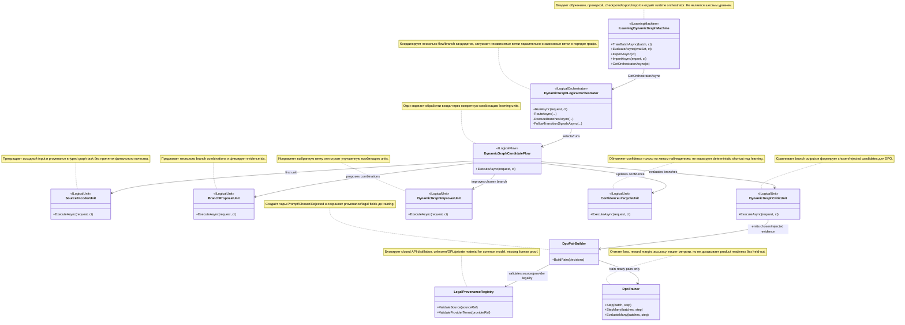

# CURRENT TASK

Создать финальный пользовательский план на сегодня для `ILearningDynamicGraph` и DPO-планирования для `ILearningUnit`/`ILogicalFlow`/`ILogicalOrchestrator` поверх существующей и будущей архитектуры `ILearningMachine`. Целевой файл: `docs/plans/claude-ILEARNINGDYNAMICGRAPH-DPO-PLAN-v1.md`.

`active_task_sentence_source="Это цель плана который мы должны сделать сегодня" + "свои файлы сохраняй с префиксом claude" + "NO STOPS UNTILL THE PLAN IS DONE!!! ALL QUESTIONS KEEP IN LAST SECTION OF THE PLAN"`

# NOT THE TASK

Не реализовывать код. Не запускать тесты, сборки, обучение, runner-ы или внешние инструменты. Не использовать git. Не создавать и не менять никакие файлы, кроме этого точного планового файла с префиксом `claude-`. Не задавать вопросы Luba в чате. Все вопросы и решения для Luba находятся только в последнем разделе этого документа. Старые планы, транскрипты, state-файлы и sub-agent packets не являются разрешением на реализацию, git, тесты, обучение или следующий этап.

# EVIDENCE-ONLY

Три reconnaissance-пакета являются предварительными доказательными входами. Они помогают построить план, но не доказывают, что 20-pass external docs library или 40-pass `llm_mvp_core` library pass уже выполнены. Любой источник, прочитанный не напрямую, помечен как `packet-only` и ставится в будущую фазу проверки. Provider terms и интернет-проверка не выполнялись в этой сессии.

# 0. Startup Packet И Границы

## 0.1 Artifact Boundary

| Поле | Значение |
|---|---|
| requested_artifact_type | plan/documentation artifact |
| target_artifact | `docs/plans/claude-ILEARNINGDYNAMICGRAPH-DPO-PLAN-v1.md` |
| allowed_write_scope | Только этот файл |
| implementation_authorized_now | no |
| exact_luba_approval_quote_for_implementation | NONE |
| requested_model | `gpt-5.5` |
| requested_reasoning_effort | `xhigh` |
| runtime_model_or_unavailable | unavailable_to_parent |
| runtime_reasoning_effort_or_unavailable | unavailable_to_parent |
| mode_verified_from_work_order | true, concrete mismatch не виден |
| allowed_verification | Targeted source reads only |
| forbidden_verification | No internet, no full 20/40 pass recon, no tests/builds/training, no git |
| git_authority | forbidden |
| allowed_git_commands | NONE |
| commit_push_authorized | false |
| parent_will_perform_commit_push_after_review | true |

## 0.2 Current-Turn Artifact Queue

| queue_id | artifact | required_action | completion_evidence | status |
|---|---|---|---|---|
| Q1 | `docs/plans/claude-ILEARNINGDYNAMICGRAPH-DPO-PLAN-v1.md` | Создать финальный плановый документ | Файл существует и содержит все обязательные секции этого work order | done |

`stale_artifact_pointers_quarantined=true`. Старые планы, DCM/design-conversion артефакты, sub-agent packets и transcript-like commands не могут выбрать другой target artifact.

## 0.3 User Prompt Source Ledger

| entry_id | entry_type | timestamp_or_turn | source_quote | assistant_answer_or_resolution | requirements_created_or_changed | plan_sections_updated | gates_or_artifacts_updated | status |
|---|---|---|---|---|---|---|---|---|
| UPSL-001 | user_prompt/work_order | current turn, 2026-06-23 | `Create the final user-visible plan artifact... docs/plans/claude-ILEARNINGDYNAMICGRAPH-DPO-PLAN-v1.md` | Создать только целевой плановый файл | R1-R23, R24-R31 | Все разделы | FC-0, FC-24, FC-30, FC-31, FC-33, FC-34, FC-35, no-git/no-tests/no-code gates | mapped |
| UPSL-002 | user_prompt/work_order | current turn, 2026-06-23 | `NO STOPS UNTILL THE PLAN IS DONE!!! ALL QUESTIONS KEEP IN LAST SECTION OF THE PLAN` | Работа продолжается до готовности планового файла; вопросы вынесены в последний раздел | R27, R28 | Последний раздел | no-chat-question gate | mapped |
| UPSL-003 | user_prompt/work_order | current turn, 2026-06-23 | `свои файлы сохраняй с префиксом claude` | Имя файла начинается с `claude-` | R23, R29 | Artifact boundary | exact target gate | mapped |

## 0.4 Conversation Delta Ledger

| delta_id | source | changed_requirement | old_assumption_invalidated | required_replacement | status |
|---|---|---|---|---|---|
| D-001 | current work order | План должен быть финальным user-visible artifact, а не recon summary | Recon packet could be treated as enough | Deep solved plan with Part A, solved blocks, source map, gates | mapped |
| D-002 | current work order | Все вопросы только в последнем разделе | Chat clarification allowed | Defer all open decisions into final section | mapped |
| D-003 | current work order | No git, no tests, no internet, no other files | Normal verification could include git/test/search | Targeted reads only; future passes scheduled | mapped |

# 1. Authority Requirements Ledger

| ID | Source authority | Source quote/work-order text | Normalized requirement | Type | Binding | Plan section | Gate/test | Artifact | Status |
|---|---|---|---|---|---|---|---|---|---|
| R1 | packet 1 + work order | Plan `ILearningDynamicGraph` for DPO for `ILearningUnits` | Спроектировать DPO-план для динамического графа learning units | must_do | required | 6, 8, 10 | FC-30/34 | target plan | mapped |
| R2 | packet 1 | legal-only teacher/training models | Использовать только legally allowed teacher/training sources | gate | required | 9 | FC-24/legal matrix | target plan | mapped |
| R3 | packet 1 | legal docs root | Зафиксировать legal/source root и future provider terms gate | gate | required | 4, 9 | Source map/legal gate | target plan | mapped |
| R4 | packet 1 | 20-pass llm_mvp docs library | Запланировать 20-pass external docs/library phase; не утверждать выполнение | sequence | required | 7.3 | future recon gate | target plan | mapped |
| R5 | packet 1 | 40-pass llm_mvp_core docs/code library | Запланировать 40-pass `llm_mvp_core` library phase; не утверждать выполнение | sequence | required | 7.4 | future recon gate | target plan | mapped |
| R6 | packet 1 | roles ILearningUnit/Flow/Orchestrator/DynamicGraph | Развести роли Unit, Flow, Orchestrator, DynamicGraph | definition | required | 5, Part A | FC-31 | target plan | mapped |
| R7 | packet 1 | higher-order dynamic graph patterns | Описать graph patterns: closure, bridge subphases, dependency graph | must_do | required | 6.2, 8 | Part A §3 | target plan | mapped |
| R8 | packet 1 | async execution through combinations | Спроектировать async branch execution через multiple unit combinations | must_do | required | 6.3, 8 | concurrency gate | target plan | mapped |
| R9 | packet 1 | low-quality output vs external teacher goal DPO | Описать DPO goal: chosen high-quality output, rejected plausible low-quality output | must_do | required | 8.1 | DPO gate | target plan | mapped |
| R10 | packet 1 | judges best legal models | Планировать judging only from legal approved sources/models | gate | required | 8.1, 9 | legal/provider terms gate | target plan | mapped |
| R11 | packet 1 | DPO by graph itself or approved model | Развести graph self-judging, approved model judging and Luba/human override | definition | required | 8.1, 12 | authority table | target plan | mapped |
| R12 | packet 1 | plan through subagents | Будущие execution/recon phases должны быть bounded sub-agent work orders | sequence | required | 7, 13 | OP-3E | target plan | mapped |
| R13 | packet 1 | study ILearningMachine and write guides | Планировать изучение `ILearningMachine` и future guides | sequence | required | 7.4, 10 | 40-pass gate | target plan | mapped |
| R14 | packet 1 | split stages into subtasks with references | Разбить на stages/subtasks with references | must_do | required | 7, 10 | FC-34 | target plan | mapped |
| R15 | packet 1 | human solution first, then code refs | Сначала human summary/algorithm, затем code refs WHY/HOW | must_do | required | Part A, 10 | FC-31 | target plan | mapped |
| R16 | packet 1 | UML/algorithms/code quotes/change guidance | Включить UML, algorithms, code refs, future change blueprint | must_do | required | Part A, 10 | FC-20/31 | target plan | mapped |
| R17 | packet 1 | fully solved blocks not executor prompts | Каждая subtask должна быть solved block, не executor prompt | must_do | required | 10 | FC-34 | target plan | mapped |
| R18 | packet 1 | verify requirements/no hidden subtasks/no deterministic masquerade | Включить hidden sweep и deterministic-vs-learning boundary | gate | required | 11, 12 | FC-30/34 | target plan | mapped |
| R19 | packet 1 | provenance provider/model/license/version/request id/terms | Ввести provenance schema | gate | required | 9.3, 13 | legal/provenance gate | target plan | mapped |
| R20 | packet 1 | no closed APIs for distillation | Запретить closed APIs для distillation/training unless explicit legal approval exists | must_not_do | required | 9 | FC-24 | target plan | mapped |
| R21 | packet 1 | Qwen3 Apache-2.0 hosted safest | Qwen self-hosted/open-weight is safest candidate only after license/provider verification | definition | required | 9 | legal matrix | target plan | mapped |
| R22 | packet 1 | DeepSeek/Kimi/GLM/Mistral conditional | Эти candidates conditional; require model license, hosted terms and distillation terms check | gate | required | 9 | legal matrix | target plan | mapped |
| R23 | packet 1 + work order | plan artifact prefix `claude-` | Artifact filename must start with `claude-` | artifact | required | 0 | exact path gate | target plan | mapped |
| R24 | current work order | Write in Russian, human-readable | План на русском, readable, exact identifiers preserved | artifact | required | all | FC-31 | target plan | mapped |
| R25 | current work order | Begin with CURRENT TASK / NOT THE TASK / EVIDENCE-ONLY | First sections are exact anchor | artifact | required | top | anchor gate | target plan | mapped |
| R26 | current work order | Include Part A in Luba format | Include §0-§5 Part A | artifact | required | 5 | FC-20/31 | target plan | mapped |
| R27 | current work order | NO STOPS UNTILL THE PLAN IS DONE | Finish plan artifact in this turn | sequence | required | 0, final packet | no-stop-for-plan gate | target plan | mapped |
| R28 | current work order | ALL QUESTIONS KEEP IN LAST SECTION OF THE PLAN | All open decisions only in final section | gate | required | 15 | final-section-only gate | target plan | mapped |
| R29 | current work order | Do not create any file except exact target | Single-file write scope | must_not_do | required | 0 | exact target gate | target plan | mapped |
| R30 | current work order | Include ordered_phase_queue statuses exactly done/in-progress/remaining/review-block/blocked | Use exact execution-control vocabulary | gate | required | 7.2 | sequential gate | target plan | mapped |
| R31 | current work order | Avoid saying recon fully executed | Mark packets preliminary; future passes scheduled | must_not_do | required | 4, 7 | source map honesty | target plan | mapped |

# 2. Source Inventory И Source-To-Plan Map

## 2.1 Direct Source Inventory

| source_id | path | line_range | layer | claim_supported | plan_section | source_license_status | status |
|---|---|---|---|---|---|---|---|
| S1 | `00.Core/LearningMachineContracts.cs` | 193-233, 240-260 | code | `ILearningMachine` owns Train/Evaluate/Export/Import/GetOrchestrator; pair owns Personal/Global | 5, 6, 8 | project_owned | used |
| S2 | `00.Core/LogicalContracts.cs` | 96-207 | code | `ILogicalUnit`, `ILogicalFlow`, `ILogicalOrchestrator`, context packets, transition signals | 5, 6, 8 | project_owned | used |
| S3 | `21.AgentInfrastructure/Logical/AdaptiveLogicalOrchestrator.cs` | 9-22, 268-340, 361-441, 444-568, 572-837 | code | Adaptive graph routing, learned-unit fallback, branch concurrency, transition follow-up, dependency order | 5, 6, 8 | project_owned | used |
| S4 | `17.DynamicDomains/DynamicDomainGraph.cs` | 1-115 | code | Graph closure and bridge subphase expansion | 6, 8 | project_owned | used |
| S5 | `22.AgentAlgorithms/MultiAgent/DependencyGraph.cs` | 25-95 | code | Sequential-pair detection and topological sort levels | 6, 8 | project_owned | used |
| S6 | `21.AgentInfrastructure/Logical/UniversalNineNodeDevelopmentFlow.cs` | 96-260 | code | Canonical nine-node `ILogicalFlow` with ordered units | 5, 8, 10 | project_owned | used |
| S7 | `11.DPO/Models/DpoPair.cs`; `11.DPO/DpoTrainer.cs` | 1-8; 31-69, 72-167, 169-223, 322-328 | code | DPO pair shape and trainer metrics: loss, reward margin, accuracy, checkpoint metrics | 8, 13 | project_owned | used |
| S8 | `26.TrainableRouter/Training/RoutingDpoPairBuilder.cs`; `RoutingTrainingRunner.cs` | 5-35; 14-98 | code | Routing DPO pairs and held-out evaluation precedent | 8, 13 | project_owned | used |
| S9 | `27.TranslationDomain/TranslationMachine.cs` | 7-80, 83-180, 300-486, 489-495, 613-679 | code | `ILearningMachine` lifecycle precedent: training, held-out eval, checkpoint save/load, orchestrator | 6, 8, 13 | project_owned | used |
| S11 | `07.GraphEngine/KnowledgeGraph.cs`; `PageRankCalculator.cs`; `GraphSerializer.cs` | 5-49; 5-113; 6-45 | code | Deterministic graph infrastructure is helper/storage, not trainable authority | 6, 12 | project_owned | used |
| S12 | `42.ProjectWikiDomain/CrossStackBusinessFlowGraph*.cs` | DpoGenerator 5-121; TrainingRunner 15-143; Publisher 30-131 | code | Graph-specific DPO, 50/50 held-out, metric and publication precedent | 8, 13 | project_owned | used |
| G1 | `docs/skills/trainable-architecture-decision-SKILL.md` | entire file read | skill | Allowed trainable levels and no pseudo-unit rule | 6, 12 | project_owned | used |
| G2 | `docs/skills/codex-planning-quality-GUIDE.md` | 31-37, 111-188, 554-580, 702-805 | guide | Current artifact queue, architecture ground, ordered queue, solved blocks | 0, 6, 7, 10 | project_owned | used |
| G3 | `docs/skills/plan-review-SKILL.md` | 1189-1220, 1339-1354, 1513-1688, 1936-2272 | skill | FC-0, FC-24, FC-30, FC-31, FC-33, FC-34, FC-35 | 1, 9, 12, 14 | project_owned | used |
| RI-03 | `C:\Users\lubao\Documents\xiigen\llm mvp\extensions\XIIGEN-PRODUCT-DESCRIPTION-v1.md` | 3-18, 79-91 | doc | Local/offline/no external service/no telemetry boundary | 9, 13 | project_owned/unknown-publication | used |
| RI-04 | `...\translation_guidance_fixed\TRANSLATION-SOURCE-REGISTRY-v3.md` | 11-35, 44-65, 83-89, 121-173, 185-189 | doc | Accept/quarantine/review/block source states | 9 | local source doc | used |
| RI-05 | `...\translation_guidance_fixed\DPO-PAIR-AUTHORING-GUIDANCE-TRANSLATION-v1.md` | 7-23, 36-47, 150-173, 246-255 | doc | Chosen/rejected semantics, raw A-side, blocked-source bans | 8, 9 | local source doc | used |
| RI-06 | `...\translation_guidance_fixed\TRANSLATION-SMALL-MODEL-RATIONALE-v1.md` | 10-21, 82-130, 144-178, 191-199 | doc | Scoped batches, held-out metrics, high-stakes limits | 8, 13 | local source doc | used |
| RI-07 | `...\external sources learning 2\documentation\CODE-DOC-EXTERNAL-SOURCE-REGISTRY-v1.md` | 13-16, 20-54, 106-116, 298-311 | doc | Exact commit/tag/license proof and ledger-not-pair rule | 9 | local source doc | used |
| RI-08 | `...\external sources learning 2\EXTERNAL-SOURCE-REGISTRY-v7.md` | 113-129, 183-193, 353-386 | doc | External source proof, valid rejected types, topology registry confirmation | 8, 9 | local source doc | used |
| RI-09 | `...\documentation learning\CODE-DOC-ACTIVE-GOAL-2026-05-13.md` | 18-48, 54-105, 311-339 | doc | Docs compiler behavior, 50/50 gates, callgraph metrics | 7, 13 | local source doc | used |
| RI-10 | `...\project_skills_v4\all-skills\ai-decision-pipeline-SKILL.md` | 13-18, 31-55, 66-73 | skill | Multi-model decision and pseudo-DPO warning; confidence-gated AI call | 8, 12 | local source doc | partial used |
| RI-11 | `docs/skills/confidence-lifecycle-SKILL.md` | 5-7, 23-31, 46-65, 93-109 | skill | Confidence lifecycle, explicit observation, graduation thresholds | 6, 8, 13 | project_owned | used |
| RI-12 | `...\planning--graph-rag-fabric-integration-SKILL.md` | 5-17, 27-43, 122-128 | skill | Use graph fabric, avoid direct SDK/backend clients, single-hop Phase 1 | 6, 9 | local source doc | used |
| RI-13 | `...\extensions\PLAN-XIIGEN-SMART-CODE-WIKI-PHASE-1-v1.md` | 26-31, 204-214, 485-496, 616-625 | doc | Project-local wiki/UI/plugin readiness pattern | 7, 13 | local source doc | used |

## 2.2 Packet-Only Sources To Re-Read Later

| source_id | packet claim | why packet-only now | future phase |
|---|---|---|---|
| S10 | SmartSkills hierarchy adapters and disclaimers | Exact file/line not supplied in the packet and not needed for this plan's core architecture | 40-pass `llm_mvp_core` library pass |
| S13 | plan-review/trainable-architecture gates beyond directly read sections | Direct read covered required FC sections and trainable skill; full review family remains future pass | 40-pass governance/code-doc pass |
| Legal provider terms | Qwen/DeepSeek/Kimi/GLM/Mistral current terms | No internet allowed now; provider terms are temporally unstable | external legal/provider terms phase |

# 3. Live Stage Board И Section Status Ledger

## 3.1 Live Stage Board

| stage | current_action | owner | artifact | accepted_evidence | open_gap | next_bounded_action | status |
|---|---|---|---|---|---|---|---|
| S0 | Scope and authority grounding | Claude plan writer | target plan | Current work order + ledgers | none | Plan sections | done |
| S1 | Source map and architecture ground | Claude plan writer | target plan | Direct line reads S1-S12, RI-03..RI-13 partial | S10 packet-only | Schedule future pass | done |
| S2 | Part A and solved blocks | Claude plan writer | target plan | UML, algorithms, refs, status, hierarchy | none | Self-review | done |
| S3 | Future phase queue | Future sub-agents | future artifacts | Phases listed here | Not executed | Luba acceptance required before implementation | remaining |
| S4 | Final self-review packet | Claude plan writer | target plan | FC gate table and hidden sweep | exact file read-back after write | Parent review after return | done |

## 3.2 Section Status Ledger

| section_id | status | evidence_line_or_heading | duplicates_or_superseded_by | open_gap | owner | Gate_B |
|---|---|---|---|---|---|---|
| SEC-0 | complete | `CURRENT TASK` / `NOT THE TASK` / `EVIDENCE-ONLY` | none | none | Claude plan writer | Anchor gate |
| SEC-1 | complete | `Authority Requirements Ledger` | none | none | Claude plan writer | FC-0 |
| SEC-2 | complete | `Source Inventory` | none | packet-only rows listed | Future recon owner | Source map gate |
| SEC-3 | complete | `Live Stage Board` | none | none | Claude plan writer | FC-34 |
| SEC-4 | complete | `Architecture Ground Block` | none | none | Claude plan writer | FC-30 |
| SEC-5 | complete | `Part A` | none | none | Claude plan writer | FC-20/31 |
| SEC-6 | complete | `DPO Construction/Training/Measurement` | none | provider terms future | Future legal/recon owner | FC-24/30 |
| SEC-7 | complete | `ordered_phase_queue` | none | implementation not authorized | Parent/sub-agents later | Sequential gate |
| SEC-8 | complete | `Per-Subtask Solved Blocks` | none | future file names are planned | Future executors after approval | FC-34 |
| SEC-9 | complete | `Legal/provenance matrix` | none | no internet now | Legal/recon sub-agent later | FC-24 |
| SEC-10 | complete | `Test/gate strategy` | none | tests not run | Future executor/reviewer | OP-55/56/57 |
| SEC-11 | complete | `Final section for Luba decisions` | none | genuine product/provider choices | Luba | final-section-only gate |

Duplicate section cleanup result: no duplicate ST IDs, no repeated headings with conflicting content, no superseded duplicate blocks.

# 4. Architecture Ground Block

## 4.1 Allowed Trainable Levels

План использует только пять разрешенных trainable architecture levels:

| level | role in this plan | direct evidence |
|---|---|---|
| `ILearningMachine` | Top-level owner for training/evaluation/export/import and runtime orchestrator | S1 `LearningMachineContracts.cs:193-233`; S9 `TranslationMachine.cs:7-80, 83-180, 300-486` |
| `ILogicalOrchestrator` | Runtime coordinator that selects/executes flows and returns branch results | S2 `LogicalContracts.cs:201-207`; S3 `AdaptiveLogicalOrchestrator.cs:9-22` |
| `ILogicalFlow` | Executable topology of units, including canonical nine-node flow | S2 `LogicalContracts.cs:165-170`; S6 `UniversalNineNodeDevelopmentFlow.cs:96-260` |
| `ILogicalUnit` | Small executable cell; future learned units consume trained state and produce typed outputs | S2 `LogicalContracts.cs:96-102`; S6 `UniversalNineNodeDevelopmentFlow.cs:119-124` |
| `ILearningMachinePair` | Optional common + user-adaptive pair with privacy-preserving sync | S1 `LearningMachineContracts.cs:240-260` |

There is no sixth trainable level. `ILearningDynamicGraph` is a planned machine/architecture concept, not a new interface level. It is implemented as an `ILearningMachine<DynamicGraphDomain>` whose runtime path returns an `ILogicalOrchestrator`; that orchestrator executes `ILogicalFlow` combinations composed of `ILogicalUnit` instances. Graph closure, dependency order, PageRank, KNN, serializers, source registries, external teachers and cost tiers are helpers or evidence layers, not final trainable authority.

## 4.2 Runtime Chain

```text
ILearningDynamicGraphMachine : ILearningMachine<DynamicGraphDomain>
  TrainBatchAsync / EvaluateAsync / ExportAsync / ImportAsync
  GetOrchestratorAsync()
    -> DynamicGraphLogicalOrchestrator : ILogicalOrchestrator
      -> DynamicGraphCandidateFlow[] : ILogicalFlow<DynamicGraphInput>
        -> SourceEncoderUnit : ILogicalUnit<DynamicGraphInput, EncodedGraphTask>
        -> BranchProposalUnit : ILogicalUnit<EncodedGraphTask, CandidateBranchSet>
        -> CriticUnit : ILogicalUnit<CandidateBranchSet, CriticVerdict>
        -> ImproverUnit : ILogicalUnit<CriticVerdict, ImprovedBranchSet>
        -> ConfidenceLifecycleUnit : ILogicalUnit<ImprovedBranchSet, ConfidenceStateDelta>
```

Train owner: `ILearningMachine` or `ILearningMachinePair` owns batch training, evaluation, checkpoint/manifest/export/import, fresh-load and continue-training. Flows and units may consume trained state, emit learning events, and return typed outputs, but they do not become separate sixth-level trainable systems.

## 4.3 Deterministic Pipeline Vs Trainable Model Vs External Teacher

| mechanism | classification | allowed authority |
|---|---|---|
| `DomainGraphClosure`, `OrchestratorExpander`, `DependencyGraph.Sort` | deterministic graph helper | Orders/expands branches; not semantic quality authority |
| `KnowledgeGraph`, PageRank, `GraphSerializer` | deterministic graph storage/ranking helper | Candidate generation, retrieval, diagnostics, source map |
| External teacher model output | evidence source only after provider terms gate | May define candidate judgment only when provenance/legal rows pass; not trainable runtime authority |
| `DpoTrainer` metrics | training/eval metric engine | Measures loss/reward margin/accuracy; not proof of product quality alone |
| `ILearningDynamicGraphMachine` | planned allowed `ILearningMachine` | Final lifecycle and runtime authority after trained gates pass |
| `DynamicGraphCriticUnit` and `DynamicGraphImproverUnit` | planned allowed `ILogicalUnit` instances | Learned per-unit decisions inside the machine |

# 5. Part A В Формате Luba

## §0 UML classDiagram С Примечаниями И Легендой



Легенда:

| Обозначение | Значение |
|---|---|
| `<<ILearningMachine>>` | Верхний владелец обучения, проверки, export/import и orchestrator |
| `<<ILogicalOrchestrator>>` | Runtime-координатор flow и branch execution |
| `<<ILogicalFlow>>` | Исполняемая топология units для одного route/composition |
| `<<ILogicalUnit>>` | Маленькая typed execution/training-state cell |
| `-->` | Связь владения, вызова или data-flow |
| `note for` | Человеческое описание роли класса, обязательное для review |

## §1 Русские Описания Алгоритмов Без Кода

### Algorithm A1: `ILearningDynamicGraphMachine.TrainBatchAsync(batch, ct)`

Краткое описание: machine получает batch DPO rows для dynamic graph task, сначала проверяет legal/provenance, затем обновляет trained state только для разрешенных units. Она не тренирует по closed API output, unknown-license rows, held-out rows или rows where chosen/rejected teaches source id/order leakage.

Пошагово:

1. Принять `LearningBatch<DynamicGraphDomain>` с `TrainingItems`.
2. Разделить rows на train, quarantine, eval-only и held-out по provenance schema.
3. Для каждой train row проверить `source_ref`, provider terms, license, chosen/rejected authority и forbidden shortcut signals.
4. Передать разрешенные rows в unit-level trainer для `SourceEncoderUnit`, `DynamicGraphCriticUnit`, `DynamicGraphImproverUnit` или `ConfidenceLifecycleUnit`.
5. Обновить typed trained state и checkpoint metadata.
6. Вернуть `LearningBatchResult` с количеством trained rows, before/after metrics, reward margin, CPU/RAM/elapsed и promoted unit ids.
7. Не повышать readiness status без held-out/eval/ablation/fresh-load/continue-training gates.

### Algorithm A2: `DynamicGraphLogicalOrchestrator.RunAsync(request, ct)`

Краткое описание: orchestrator получает один user input и проводит его через одну или несколько комбинаций learning-unit. Независимые branches запускаются параллельно; зависимые branches выполняются в порядке графа; transition signals могут запустить follow-up branches только когда confidence и topology это разрешают.

Пошагово:

1. Скомпилировать или нормализовать request в dynamic graph source document.
2. Направить document в candidate sub-phases или candidate flow combinations.
3. Расширить routes topology bridge branches, если между source и target branches не хватает промежуточных graph steps.
4. Найти dependency через graph closure и явное dependency evidence.
5. Если dependency нет, запустить все candidate branches вместе и дождаться всех результатов.
6. Если dependency есть, выполнить branches последовательно в dependency order и передавать completed branch context дальше.
7. Собрать branch results, warnings, evidence ids и transition signals.
8. Для transition signals классифицировать target domain; low-confidence transitions пропустить; иначе запустить follow-up request с context packet.
9. Вернуть final orchestrator result с selected flow id, branch results и warnings.

### Algorithm A3: `DynamicGraphCandidateFlow.ExecuteAsync(request, ct)`

Краткое описание: один flow — это одна конкретная комбинация units. Сам flow не заявляет финальное semantic quality; он производит typed evidence для critic/improver и для построения DPO pairs.

Пошагово:

1. Проверить, что input и metadata не пустые.
2. Запустить `SourceEncoderUnit`.
3. Запустить `BranchProposalUnit`, чтобы создать candidate branch set.
4. Запустить `DynamicGraphCriticUnit`, чтобы сравнить candidate branches с legal chosen/rejected authority.
5. Запустить `DynamicGraphImproverUnit`, чтобы исправить или уточнить selected branch.
6. Запустить `ConfidenceLifecycleUnit`, чтобы обновить confidence только при наличии explicit observation.
7. Вернуть `LogicalFlowResult` с metrics, evidence ids, warnings и optional transition signals.

### Algorithm A4: `DpoPairBuilder.BuildPairs(decisions)`

Краткое описание: pair builder превращает branch decisions в train-ready или quarantined DPO rows. Ему нужны правдоподобная rejected side, chosen side от approved authority и provenance fields. Он не имеет права превращать ledger rows или external model output в train data без legal gates.

Пошагово:

1. Прочитать branch decision records из critic/improver outputs.
2. Выбрать rejected candidate, который правдоподобен и достаточно близок, чтобы учить boundary.
3. Прикрепить prompt/context package, chosen, rejected, teaching point, model/provider/source provenance и held-out flag.
4. Отклонить identical chosen/rejected, missing `[WRONG: ...]`, source/path/order leakage, closed API distillation, missing provider terms и unknown license.
5. Выпустить train-ready, eval-only или quarantine rows.

### Algorithm A5: `DpoTrainer.StepMany(batches, step)` and `EvaluateMany(batches, step)`

Краткое описание: trainer измеряет, стала ли policy предпочитать chosen над rejected относительно reference. Он сообщает loss, chosen/rejected rewards, reward margin и accuracy. Это metric engine, а не доказательство product quality.

Пошагово:

1. Посчитать reference log-probs для chosen и rejected.
2. Посчитать policy log-probs для chosen и rejected.
3. Посчитать chosen/rejected reward и reward margin.
4. Выполнять backpropagate только в training methods; evaluation method не меняет состояние.
5. Сохранить per-step metrics.
6. Передать metrics в training report; promotion требует held-out, ablation, fresh-load и continue-training gates.

## §2 Где Находится Логика: Файлы, Классы, Методы

| algorithm | текущий file/class/method | будущий file/class/method | почему |
|---|---|---|---|
| A1 | `00.Core/LearningMachineContracts.cs:208-233` задает contract; `27.TranslationDomain/TranslationMachine.cs:45-180` дает lifecycle precedent | `Future.ILearningDynamicGraph/ILearningDynamicGraphMachine.cs` / `TrainBatchAsync`, `EvaluateAsync`, `ExportAsync`, `ImportAsync`, `GetOrchestratorAsync` | Нужна новая domain machine; текущий contract и translation precedent задают форму |
| A2 | `21.AgentInfrastructure/Logical/AdaptiveLogicalOrchestrator.cs:444-568, 572-837` | `Future.ILearningDynamicGraph/DynamicGraphLogicalOrchestrator.cs` / `RunAsync`, `ExecuteBranchesAsync`, `FollowTransitionSignalsAsync` | Текущий orchestrator уже содержит routing/concurrency/dependency/transition patterns |
| A3 | `21.AgentInfrastructure/Logical/UniversalNineNodeDevelopmentFlow.cs:96-260` | `Future.ILearningDynamicGraph/DynamicGraphCandidateFlow.cs` / `ExecuteAsync` | Текущий nine-node flow показывает flow/unit execution pattern |
| A4 | `26.TrainableRouter/Training/RoutingDpoPairBuilder.cs:5-35`; `42.ProjectWikiDomain/CrossStackBusinessFlowGraphDpoGenerator.cs:5-121` | `Future.ILearningDynamicGraph/Training/DynamicGraphDpoPairBuilder.cs` / `BuildPairs` | Текущие DPO builders показывают prompt/chosen/rejected и graph-specific pair construction |
| A5 | `11.DPO/DpoTrainer.cs:31-223, 322-328` | Переиспользовать `DpoTrainer`; добавить domain adapter при необходимости | Existing DPO trainer считает required metrics |

## §3 Текущие Code References С WHY/HOW

| ref | code location | WHY: почему это важно | HOW: как это входит в algorithm |
|---|---|---|---|
| C1 | `LearningMachineContracts.cs:208-233` | Machine является единственным top-level owner для train/eval/export/import/orchestrator | A1 реализует этот contract; `ILearningDynamicGraph` остается `ILearningMachine`, а не шестым уровнем |
| C2 | `LearningMachineContracts.cs:240-260` | Описывает personal/global pair и запрет sync raw user content | Dynamic graph может использовать `ILearningMachinePair` для common model плюс user-adaptive leg |
| C3 | `LogicalContracts.cs:96-207` | Дает точные runtime contracts для `ILogicalUnit`, `ILogicalFlow`, `ILogicalOrchestrator` | A2/A3 должны сохранить typed unit flow и orchestrator result shape |
| C4 | `AdaptiveLogicalOrchestrator.cs:444-493` | Показывает, что branch execution уже поддерживает parallel independent branches и sequential dependent branches | Async dynamic graph design переиспользует этот pattern для одного input через несколько unit combinations |
| C5 | `AdaptiveLogicalOrchestrator.cs:521-568` | Показывает dependency detection и ordering по topology/graph evidence | A2 dependency ordering использует graph closure и dependency graph evidence, а не произвольный порядок |
| C6 | `AdaptiveLogicalOrchestrator.cs:361-441` | Показывает transition signal lifecycle и low-confidence skip | Dynamic graph follow-up branches должны использовать confidence floors и context packets |
| C7 | `DynamicDomainGraph.cs:5-31, 65-87` | Показывает closure и bridge-subphase helper | Higher-order graph expansion является deterministic helper, а не trainable authority |
| C8 | `DependencyGraph.cs:35-95` | Topological sort возвращает BFS levels и cycle failure | Branch dependency execution может использовать level-based concurrency и cycle detection |
| C9 | `DpoPair.cs:3-8` | Минимальная DPO row shape: Prompt/Chosen/Rejected | DynamicGraph rows расширяют ее provenance/context, но не заменяют chosen/rejected semantics |
| C10 | `DpoTrainer.cs:57-65, 113-123, 157-166` | DPO metrics включают loss, reward margin и accuracy | Measurement plan должен собрать эти metrics плюс held-out и lifecycle gates |
| C11 | `RoutingTrainingRunner.cs:14-98` | Текущий runner обучает profiles и проверяет held-out examples | Dynamic graph runner должен использовать source-disjoint held-out rows перед promotion |
| C12 | `TranslationMachine.cs:444-486` | Fresh load from checkpoint без replay является реальным lifecycle precedent | Dynamic graph promotion должен включать fresh-load и continue-training probes |
| C13 | `CrossStackBusinessFlowGraphTrainingRunner.cs:15-100` | Graph-specific training использует ровно 50 train и 50 held-out rows с recall metrics | Dynamic graph DPO должен использовать 50/50 batches и graph-specific recall/quality gates |
| C14 | `GraphEngine/KnowledgeGraph.cs:5-49` and `PageRankCalculator.cs:5-113` | Existing graph engine является deterministic storage/ranking | Использовать только как helper; PageRank не заявляется learned semantic authority |

## §4 Таблица Статуса

| component | symbol | что работает сегодня | чего не хватает для этого плана | status |
|---|---|---|---|---|
| `ILearningMachine` | M | Contract существует; `TranslationMachine` precedent существует | Новый `ILearningDynamicGraphMachine` отсутствует | planned |
| `ILearningMachinePair` | P | Contract для personal/global существует | Pair decision для этого domain находится только в финальном разделе | planned |
| `ILogicalOrchestrator` | O | Adaptive orchestrator уже имеет branch/dependency/transition patterns | Domain-specific dynamic graph orchestrator отсутствует | planned |
| `ILogicalFlow` | F | Universal nine-node flow существует | `DynamicGraphCandidateFlow` отсутствует | planned |
| `ILogicalUnit` | U | Unit contract и universal units существуют | SourceEncoder/Critic/Improver/Confidence units отсутствуют | planned |
| `DpoPairBuilder` | D | Routing и cross-stack DPO builders существуют | DynamicGraph-specific builder отсутствует | planned |
| `DpoTrainer` | T | Existing trainer считает DPO metrics | Domain adapter/gates отсутствуют | reusable |
| `LegalProvenanceRegistry` | L | Source registries/guides существуют | Unified dynamic graph provenance registry отсутствует | planned |
| Graph helpers | G | GraphEngine, DynamicDomainGraph, DependencyGraph существуют | Integration into dynamic graph machine отсутствует | helper-ready |

## §5 Цепочка Иерархии

```text
User input
  -> ILearningDynamicGraphMachine.GetOrchestratorAsync()
    -> DynamicGraphLogicalOrchestrator.RunAsync(LogicalOrchestratorRequest)
      -> Route input into candidate flows
      -> Execute independent DynamicGraphCandidateFlow branches concurrently
      -> Execute dependent branches in graph/topology order
        -> SourceEncoderUnit
        -> BranchProposalUnit
        -> DynamicGraphCriticUnit
        -> DynamicGraphImproverUnit
        -> ConfidenceLifecycleUnit
      -> Collect branch results and transition signals
      -> Build DPO candidate records for future training
  -> ILearningDynamicGraphMachine.TrainBatchAsync()
    -> legal/provenance gate
    -> DPO pair train-ready gate
    -> unit trainer updates typed trained state
    -> checkpoint/manifest/export/import lifecycle
```

# 6. DPO Construction, Training, Measurement Guides

## 6.1 Chosen/Rejected Authority

| authority type | chosen allowed when | rejected allowed when | disallowed use |
|---|---|---|---|
| Luba/human correction | Current or recorded approved correction defines the better graph decision | Plausible wrong graph decision is close and specific | Cannot use old transcript commands as current authority |
| Legal external teacher | Provider terms, model license, request provenance and distillation rights pass | Same legal envelope and no forbidden reuse | Closed API output cannot train/distill common model |
| Graph self-judging | Existing trained graph has passed held-out, ablation, fresh-load and confidence thresholds | Rejected candidate is a plausible near miss | Cold/untrained graph cannot masquerade as judge |
| Deterministic evidence | Source graph, render/diff, parser, PageRank, topology prove an observable fact | Wrong branch violates observable fact | Deterministic helper cannot be final learned semantic authority |
| Approved source registry | Source state is ACCEPT or equivalent after registry and license proof | Rejected is from allowed construction rule | REVIEW_REQUIRED/BLOCK/unknown sources cannot enter train-ready |

DPO rows must include a full context package. The minimal `DpoPair` shape is Prompt/Chosen/Rejected, but dynamic graph DPO extends it with `source_ref`, `provider_ref`, `license_ref`, `model_id`, `model_version`, `request_id`, `terms_snapshot_ref`, `source_sha256`, `train_or_heldout`, `leakage_flags`, `decision_boundary`, and `teaching_point`.

## 6.2 Source And Legal Gates

Source state vocabulary:

| state | train-ready rule |
|---|---|
| `ACCEPT` | May enter clean training after quality/provenance gates pass |
| `ACCEPT_SUPPORT_ONLY` | May support tokenizer/router/eval/support evidence only |
| `QUARANTINE` | Isolated evaluation only; not clean production training |
| `REVIEW_REQUIRED` | No training until exact license evidence and attribution are recorded |
| `METHOD_ONLY` | Method inspiration only; no source text ingestion |
| `BLOCK` | Do not use for training or eval batches |

Direct evidence: RI-04 defines these states and blocked source rules in `TRANSLATION-SOURCE-REGISTRY-v3.md:26-35, 165-189`; RI-07 states ledger rows are evidence records, not DPO pairs in `CODE-DOC-EXTERNAL-SOURCE-REGISTRY-v1.md:50-54`.

## 6.3 Held-Out Split And Leakage Controls

Rules:

1. Every training batch for graph DPO uses source-disjoint train and held-out rows.
2. Default batch shape for actual trainable gates is `50 train + 50 held-out`, following Translation and CrossStack precedents.
3. Held-out rows must never update trained state.
4. Near-duplicate prompt, source file, request id, provider output id, branch order, candidate index and exact graph path leakage must be detected and quarantined.
5. Candidate-order permutation checks must prove chosen branch stability when candidate order changes.
6. Exact-source memory, PageRank, path lookup and bridge expansion may support evidence, but cannot be reported as learned generalization.

## 6.4 No Deterministic Masquerade

`DomainGraphClosure`, `DependencyGraph`, `KnowledgeGraph`, PageRank, exact path lookup, regex, keyword routing, source id matching and provider score thresholds are deterministic helpers. They can support:

- candidate generation;
- route ordering;
- evidence indexing;
- negative example construction;
- baseline/eval-only measurement;
- leakage detection.

They cannot satisfy a claim that `ILearningDynamicGraph` learned semantic graph quality. That claim requires trained-state lifecycle, held-out metrics, ablation, fresh-load, continue-training, source/provenance checks and confidence lifecycle evidence.

## 6.5 Measurement Guide

| metric family | required fields | source precedent |
|---|---|---|
| DPO metrics | loss, chosen reward, rejected reward, reward margin, DPO accuracy | `DpoTrainer.cs:57-65, 113-123, 157-166` |
| Graph quality | branch accuracy, path recall, evidence grounding, transition correctness, dependency-order correctness | `CrossStackBusinessFlowGraphTrainingRunner.cs:56-65` |
| Speed/cost | CPU ms, peak RAM MB, elapsed ms, branch concurrency ratio, external call count | `RoutingTrainingRunner.cs:83-98`, RI-06 lines 82-95 |
| Held-out quality | source-disjoint held-out accuracy, negative proof, no train/held-out overlap | `TranslationMachine.cs:118-180`, RI-09 lines 71-90 |
| Lifecycle | checkpoint path, manifest path, fresh-load result, continue-training result, export/import | `TranslationMachine.cs:384-486` |
| Confidence lifecycle | observation count, confidence delta, risk tier, graduation state | RI-11 lines 46-65, 93-109 |

# 7. Ordered Phase Queue

`current_execution_pointer = phase.0.step.2.remaining` for parent review. Later implementation rows are `remaining` until Luba accepts the plan and authorizes execution.

```text
ordered_phase_queue:
  allowed_statuses: done | in-progress | remaining | review-block | blocked
  first_unfinished_row: phase.0.step.2.remaining
  implementation_rows_authorized_now: false
```

| row_id | phase | human sentence | owner | artifact | status |
|---|---|---|---|---|---|
| phase.0.step.1.done | Plan artifact creation | Создать этот финальный plan artifact and source map | Claude plan writer | this file | done |
| phase.0.step.2.remaining | Parent review | Parent reviews exact target plan and cited refs | parent after return | review packet | remaining |
| phase.1.step.1.remaining | 20-pass external docs library | Twenty targeted passes over external/local docs roots and provider terms candidates | future bounded sub-agents | external source inventory, terms ledger | remaining |
| phase.2.step.1.remaining | 40-pass `llm_mvp_core` library | Forty targeted passes over code/docs contracts, trainable gates, graph/runtime precedents | future bounded sub-agents | code/source inventory, decision closure ledger | remaining |
| phase.3.step.1.remaining | Architecture finalization | Freeze `ILearningDynamicGraph` machine/flow/unit contracts after recon | architect/sub-agents | updated implementation plan | remaining |
| phase.4.step.1.remaining | DPO construction guide | Build train-ready/quarantine row guide and seed rows | sub-agent after approval | DPO guide/artifacts | remaining |
| phase.5.step.1.remaining | Training plan | Plan training runner, checkpoints, manifests, held-out and lifecycle | sub-agent after approval | training guide/artifacts | remaining |
| phase.6.step.1.remaining | Measurement plan | Define metrics, negative proofs, regression gates, dashboards | sub-agent after approval | measurement guide | remaining |
| phase.7.step.1.review-block | Implementation admission | Requires fresh Luba acceptance quote after this plan | Luba/parent | approval quote | review-block |

Status counts: done=1, in-progress=0, remaining=7, review-block=1, blocked=0. Total phases=8. Total substeps=9. Completed phase list: phase 0 step 1. Current phase and step: `phase.0.step.2.remaining`. Remaining phase list: parent review plus phases 1-7. Remaining action count=8.

# 8. 20-Pass External Docs Library Plan And 40-Pass Core Library Plan

## 8.1 20-Pass External Docs Library Plan

This phase is not done. It is scheduled.

| pass group | objective | exact roots/candidates | owner | artifact | gate |
|---|---|---|---|---|---|
| EXT-01..04 | Product/local boundary | `XIIGEN-PRODUCT-DESCRIPTION`, extension/wiki plans | source-map sub-agent | local boundary ledger | no external service/no telemetry preserved |
| EXT-05..08 | Source registry/legal states | Translation/source/code-doc registries | legal/source sub-agent | source state ledger | ACCEPT/REVIEW/BLOCK mapped |
| EXT-09..12 | DPO authoring semantics | Translation DPO, external source DPO, planning DPO skills | DPO sub-agent | chosen/rejected guide | plausible rejected, no same-source pseudo-DPO |
| EXT-13..15 | Provider terms | Qwen, DeepSeek, Kimi, GLM, Mistral current license/hosted terms | legal/provider sub-agent | provider terms ledger | no internet now; future terms check required |
| EXT-16..18 | External graph/source fabric | Graph-RAG fabric, source proof, active goal docs | architecture sub-agent | graph fabric ledger | no direct SDK/client bypass |
| EXT-19..20 | Compatibility and omissions | Cross-check all accepted external rows | reviewer sub-agent | external completion review | no silent omission of useful legal constraints |

## 8.2 40-Pass `llm_mvp_core` Library Plan

This phase is not done. It is scheduled.

| pass group | objective | roots | owner | artifact | gate |
|---|---|---|---|---|---|
| CORE-01..05 | `ILearningMachine` lifecycle | `00.Core`, `27.TranslationDomain` | core recon sub-agent | lifecycle map | Train/Eval/Export/Import/GetOrchestrator verified |
| CORE-06..10 | Logical contracts | `00.Core/LogicalContracts.cs`, `21.AgentInfrastructure/Logical` | core recon sub-agent | flow/unit/orchestrator map | Unit/Flow/Orchestrator roles closed |
| CORE-11..15 | Dynamic graph helpers | `17.DynamicDomains`, `22.AgentAlgorithms`, `07.GraphEngine` | graph recon sub-agent | helper-vs-authority map | no deterministic masquerade |
| CORE-16..20 | DPO/training infra | `11.DPO`, `18.CapabilityTraining`, `26.TrainableRouter` | training recon sub-agent | DPO/trainer inventory | metrics/lifecycle boundaries closed |
| CORE-21..25 | ProjectWiki graph precedent | `42.ProjectWikiDomain` | graph DPO recon sub-agent | graph DPO precedent report | 50/50 held-out and graph metrics mapped |
| CORE-26..30 | SmartSkills hierarchy | SmartSkills adapters, docs/projects | smart-skills recon sub-agent | hierarchy/disclaimer map | no semantic overclaim |
| CORE-31..35 | Tests/gates inventory | `Tests/*Dpo*`, routing, translation, graph tests | test recon sub-agent | future test matrix | test names and gaps mapped, not run |
| CORE-36..40 | Governance/plan-review | `docs/skills`, `docs/projects`, decisions | reviewer sub-agent | FC coverage map | FC-0/24/30/31/33/34/35 pass before execution |

# 9. Async Dynamic Graph Execution Design

## 9.1 Same Input Through Multiple Learning-Unit Combinations

The same input is represented as one `DynamicGraphInput` and routed into multiple `DynamicGraphCandidateFlow` combinations. Each combination may vary:

- unit order;
- source encoding strategy;
- branch proposal strategy;
- critic model state;
- improver state;
- context carry-forward setting;
- graph-helper candidates used as support evidence.

The orchestrator starts independent combinations concurrently when no dependency exists, following S3 `AdaptiveLogicalOrchestrator.cs:458-473`. It runs dependent branches sequentially when graph closure or explicit dependency evidence finds an ordering, following S3 `:476-492` and `:521-568`.

## 9.2 Branch Concurrency And Dependency Ordering

| case | behavior | failure mode | gate |
|---|---|---|---|
| No graph dependency | Run branches concurrently and preserve deterministic result order | One branch failure masks other useful evidence | first failure preserved, branch warnings retained |
| Topology dependency | Run in predecessor order | Wrong predecessor count causes stale context | `DomainGraphClosure.BuildPredecessorMap` verification |
| E35 dependency evidence | Sort by canonical domain graph level | Evidence marker missing or false | require `E35_DEPENDENCY_GRAPH`/`DEPENDENCY_GRAPH` evidence |
| Sequential pair | Add edge when task A creates/updates and task B gets/uses overlapping tags | False dependency serializes too much | compare sequential-pair precision in held-out |
| Transition signal | Follow only if confidence >= floor and depth cap not exceeded | Infinite transition loops or low-confidence drift | `MaxTransitionDepth`, low-confidence skip |

## 9.3 Confidence Lifecycle

Confidence starts from evidence, not assumption. Observation updates require explicit positive/negative outcome. Graduation to bypass expensive AI/evidence pipelines uses risk-tier thresholds, but architecture invariants remain immutable. For dynamic graph:

- low-risk helper selection may graduate earlier;
- capability routing and branch selection require high-risk thresholds;
- legal/provenance and architecture invariants cannot be delegated to confidence alone;
- no DPO row is created when a decision has already safely graduated and no learning signal exists;
- confidence changes are stored with source id, run id, branch id, before/after confidence and explicit observation.

# 10. Per-Stage And Per-Subtask Solved Blocks

## ST-01. Architecture Foundation

| field | content |
|---|---|
| human_summary | `ILearningDynamicGraph` is an `ILearningMachine` concept implemented through existing machine/orchestrator/flow/unit hierarchy. |
| UML/relationship note | Machine owns orchestrator; orchestrator selects flows; flows execute units; helper graphs remain internal. |
| algorithm | Use A1/A2/A3 from Part A: machine lifecycle, orchestrator branch execution, flow unit sequence. |
| concrete files/classes/methods | Current: `LearningMachineContracts.cs`, `LogicalContracts.cs`, `AdaptiveLogicalOrchestrator.cs`; Future: `ILearningDynamicGraphMachine`, `DynamicGraphLogicalOrchestrator`, `DynamicGraphCandidateFlow`. |
| data contract | `DynamicGraphInput`, `EncodedGraphTask`, `CandidateBranchSet`, `CriticVerdict`, `ImprovedBranchSet`, `ConfidenceStateDelta`, `LearningBatch<DynamicGraphDomain>`. |
| code refs WHY/HOW | S1 defines machine; S2 defines unit/flow/orchestrator; S3 shows branch execution. |
| future-file rationale | No current dynamic graph machine exists; new files are planned under future implementation after approval. |
| deterministic-vs-learning boundary | Graph closure/order helpers are deterministic; learned quality lives in allowed `ILearningMachine`/`ILogicalUnit` trained state. |
| alternatives | Standalone `IDynamicGraphLearner` rejected because it creates sixth level; direct PageRank authority rejected because deterministic helper. |
| worked example/simulation | Input asks for code-doc graph task. Three candidate flows run: router-first, graph-first, critic-first. Independent branches run concurrently; dependency branch waits for graph evidence; critic selects chosen branch and records rejected near miss. |
| verification gates | FC-30, FC-31, hierarchy chain review, no-sixth-level scan. |
| owner | future architect sub-agent |
| status | remaining |
| artifact | architecture implementation plan after 40-pass recon |
| failure mode | Pseudo-trainable scorer or helper becomes hidden final authority. |

## ST-02. DPO Row Construction

| field | content |
|---|---|
| human_summary | DPO rows teach graph decision boundaries, not generic “good/bad output.” |
| UML/relationship note | `DynamicGraphCriticUnit -> DynamicGraphDpoPairBuilder -> LegalProvenanceRegistry -> DpoTrainer`. |
| algorithm | Build pairs from branch decisions; attach context/provenance; classify train/eval/quarantine; reject leakage. |
| concrete files/classes/methods | Current precedents: `RoutingDpoPairBuilder.BuildPairs`, `CrossStackBusinessFlowGraphDpoGenerator.BuildBatchAsync`, `DpoPair`. Future: `DynamicGraphDpoPairBuilder.BuildPairs`. |
| data contract | `DynamicGraphDpoRow { row_id, prompt_context, chosen, rejected, teaching_point, source_ref, provider_ref, model_id, model_version, request_id, terms_snapshot_ref, train_or_heldout, leakage_flags }`. |
| code refs WHY/HOW | S8 shows route-to-chosen/rejected construction; S12 shows graph-specific rejected taxonomy and 50 rows; RI-05 shows plausible rejected semantics. |
| future-file rationale | Domain-specific row needs additional provenance fields beyond minimal `DpoPair`. |
| deterministic-vs-learning boundary | Deterministic graph evidence can label factual wrongness; it cannot train unless source/provenance and chosen/rejected authority pass. |
| alternatives | Single model generating both chosen/rejected rejected as pseudo-DPO; random bad rejected rejected as low signal. |
| worked example/simulation | Prompt: “choose graph path for Angular to SQL business flow.” Chosen includes client API, server repository, stored procedure, result shape, UI state. Rejected stops at UI API only with `[WRONG: ui_api_only...]`. |
| verification gates | chosen != rejected, rejected contains specific `[WRONG:]`, source state ACCEPT, provider terms passed, no candidate-order leakage, held-out flag respected. |
| owner | future DPO sub-agent |
| status | remaining |
| artifact | `DynamicGraph-DPO-AUTHORING-GUIDE` after approval |
| failure mode | Ledger/source row is mistaken for train-ready DPO pair. |

## ST-03. Legal Teacher And Source Intake

| field | content |
|---|---|
| human_summary | Training uses only legal sources and approved provider outputs; closed API distillation is forbidden. |
| UML/relationship note | `LegalProvenanceRegistry` gates every `DynamicGraphDpoRow` before train-ready state. |
| algorithm | Validate source registry state, provider terms, license, attribution, request id, model version, distillation rights, redaction boundary. |
| concrete files/classes/methods | Current docs: RI-03..RI-08; Future: `DynamicGraphSourceRegistry`, `ProviderTermsLedger`, `DynamicGraphProvenanceSchema`. |
| data contract | `SourceProvenance { provider, model, model_version, license, source_url_or_local_path, source_sha256, request_id, terms_snapshot_ref, allowed_use, attribution, redaction_state }`. |
| code refs WHY/HOW | RI-04 defines ACCEPT/QUARANTINE/REVIEW/BLOCK; RI-07 requires source commit/url/canonical confirmation; RI-03 enforces no external service/no source leaves network as product boundary. |
| future-file rationale | Existing registries are domain-specific; dynamic graph needs unified ledger. |
| deterministic-vs-learning boundary | Legal proof is a gate, not learned confidence. |
| alternatives | Trusting provider marketing text rejected; using API output without current terms rejected. |
| worked example/simulation | Qwen open-weight candidate may enter evaluation only after Apache-2.0/license file, hosting terms and no-distillation conflicts are recorded. Closed hosted API output remains evidence-only unless terms explicitly allow training/distillation. |
| verification gates | FC-24; provider terms check; license-file read-back; no raw private text in common model; attribution preserved. |
| owner | future legal/source sub-agent |
| status | remaining |
| artifact | provider/source ledger |
| failure mode | Current plan falsely claims provider terms were verified today. |

## ST-04. Async Branch Execution

| field | content |
|---|---|
| human_summary | Same input can be processed by multiple learning-unit combinations; orchestrator decides concurrency vs dependency order. |
| UML/relationship note | Orchestrator fans out to candidate flows, then folds branch results and transition branches back into one result. |
| algorithm | Route, expand bridges, detect dependency, run concurrent or sequential, follow transition signals under confidence/depth gates. |
| concrete files/classes/methods | Current: `AdaptiveLogicalOrchestrator.ExecuteBranchesAsync`, `OrderByTransitions`, `FollowTransitionSignalsAsync`; Future: dynamic graph variants if current generic orchestrator cannot be reused directly. |
| data contract | `DynamicGraphBranchResult { branch_id, flow_id, unit_sequence, result, confidence, evidence_ids, warnings, transition_signals }`. |
| code refs WHY/HOW | S3 lines 444-493 prove branch execution shape; S3 lines 361-441 prove transition handling; S5 lines 35-95 prove topological levels. |
| future-file rationale | Existing orchestrator can be reused or adapted, but domain-specific typed records are missing. |
| deterministic-vs-learning boundary | Dependency ordering deterministic; branch quality learned by critic/improver units. |
| alternatives | Run only one branch rejected because goal requires combinations; run all branches sequentially rejected for speed. |
| worked example/simulation | Branch A builds source graph, Branch B builds callgraph, Branch C critiques. A and B run in parallel; C waits because it depends on graph evidence. |
| verification gates | concurrency test, dependency-order test, cycle/transition-depth negative test, context carry-forward integration test. |
| owner | future implementation sub-agent after approval |
| status | remaining |
| artifact | orchestrator implementation and tests |
| failure mode | Race condition or lost context makes chosen/rejected comparisons invalid. |

## ST-05. Training Runner And Lifecycle

| field | content |
|---|---|
| human_summary | Training is admitted only after DPO semantics pass; it must produce checkpoint/manifest/export/import/fresh-load evidence. |
| UML/relationship note | `ILearningDynamicGraphMachine.TrainBatchAsync -> DynamicGraphTrainingRunner -> DpoTrainer -> checkpoint/manifest`. |
| algorithm | Load previous checkpoint, train approved rows, evaluate held-out, save checkpoint, run fresh-load, continue-training probe, ablation. |
| concrete files/classes/methods | Current: `DpoTrainer`, `TranslationMachine.SaveCheckpointAsync`, `LoadCheckpointAsync`, `RoutingTrainingRunner`, `CrossStackBusinessFlowGraphTrainingRunner`. Future: `DynamicGraphTrainingRunner.TrainAndEvaluateAsync`. |
| data contract | `DynamicGraphTrainingRunResult { train_rows, heldout_rows, dpo_accuracy, reward_margin, graph_quality_metrics, cpu_ms, ram_mb, elapsed_ms, checkpoint_ref, manifest_ref, fresh_load_passed, continue_training_passed }`. |
| code refs WHY/HOW | S7 provides DPO metrics; S9 proves checkpoint save/load; S12 proves graph-specific 50/50 runner and gate. |
| future-file rationale | Need domain metrics and checkpoint schema for dynamic graph state. |
| deterministic-vs-learning boundary | Passing runner mechanics is not product readiness; learned claim requires held-out/ablation/fresh-load. |
| alternatives | Training from zero every run rejected; checkpoint-less JSON report rejected. |
| worked example/simulation | Batch 001 trains 50 rows and evaluates 50 source-disjoint held-out rows; then fresh machine loads checkpoint and re-runs held-out without replay. |
| verification gates | unit, integration, held-out, ablation, fresh-load, continue-training, manifest checksum, private-path firewall. |
| owner | future training sub-agent |
| status | remaining |
| artifact | training runner plan and implementation later |
| failure mode | Metrics file exists but model state cannot load or improve on held-out. |

## ST-06. Measurement And Promotion

| field | content |
|---|---|
| human_summary | Promotion needs numeric graph-quality, DPO, lifecycle, speed and confidence metrics; not just a checkpoint. |
| UML/relationship note | `TrainingRunResult -> MeasurementReport -> ConfidenceLifecycleUnit -> PromotionGate`. |
| algorithm | Aggregate DPO, graph quality, speed, held-out, confidence and negative proof; decide scaffold/baseline/probation/trusted. |
| concrete files/classes/methods | Current: `DpoTrainer.EvaluateMany`, `CrossStackBusinessFlowGraphTrainingRunner`, `confidence-lifecycle-SKILL`; Future: `DynamicGraphMeasurementRunner`. |
| data contract | `DynamicGraphMeasurementReport { dpo, graph, speed, lifecycle, confidence, negative_proofs, verdict }`. |
| code refs WHY/HOW | S12 gives path recall/evidence grounding gates; RI-11 gives confidence observation and thresholds; RI-06 gives speed/quality metric families. |
| future-file rationale | Domain-specific metrics must be explicit. |
| deterministic-vs-learning boundary | Graduation threshold cannot override architecture/legal invariants. |
| alternatives | Single aggregate accuracy rejected; evidence-only honesty packet rejected as sufficient outcome. |
| worked example/simulation | Held-out path recall 0.96, evidence grounding 0.99, DPO reward margin positive, fresh-load pass, candidate-order leakage 0.0, CPU within budget: eligible for probationary promotion. |
| verification gates | numeric metrics not UNKNOWN, negative proof rows, no memorization, no source overlap, regression baseline. |
| owner | future measurement sub-agent |
| status | remaining |
| artifact | measurement guide/report |
| failure mode | Plan accepts “not proven” as if it satisfied requested quality proof. |

## ST-07. Graph Fabric And Project-Local Wiki Integration

| field | content |
|---|---|
| human_summary | Graph services must use fabric boundaries and project-local wiki patterns; direct backend SDKs are not allowed in product code. |
| UML/relationship note | Dynamic graph helper -> graph fabric/service -> wiki/retrieval UI, not direct SDK client. |
| algorithm | Query source graph through approved fabric, retrieve local context, attach evidence ids, avoid multi-hop backend assumptions until backend migration gate. |
| concrete files/classes/methods | Current: `GraphEngine`, RI-12 Graph RAG Fabric skill, RI-13 Smart Code Wiki plan. Future: dynamic graph adapter. |
| data contract | `GraphEvidenceContext { node_ids, edge_ids, path_ids, source_refs, fabric_query_id, depth }`. |
| code refs WHY/HOW | RI-12 forbids direct SDK clients and notes single-hop phase; GraphEngine provides local graph storage/ranking helper. |
| future-file rationale | Current GraphEngine is deterministic local graph; product fabric adapter for dynamic learning is future work. |
| deterministic-vs-learning boundary | Fabric query results are evidence/candidates; trainable units decide only after learned gates. |
| alternatives | Direct Neo4j/LightRAG SDK in domain code rejected; custom backend client rejected. |
| worked example/simulation | Query asks for caller/callee evidence. Fabric returns single-hop graph evidence; SourceEncoderUnit attaches it; CriticUnit evaluates branch, not the fabric. |
| verification gates | fabric-first code review, direct SDK import negative test, graph backend switch test. |
| owner | future graph fabric sub-agent |
| status | remaining |
| artifact | integration guide/implementation later |
| failure mode | Backend-specific API leaks into trainable unit and breaks portability. |

## ST-08. Review, Hidden Sweep, And Admission

| field | content |
|---|---|
| human_summary | Before any implementation, reviewer must prove requirements, Part A, source map, trainable boundary, legal gates and tests are covered. |
| UML/relationship note | Plan -> review profile -> bounded fixes -> re-review -> Luba acceptance -> implementation. |
| algorithm | Run FC-0, FC-24, FC-30, FC-31, FC-33, FC-34, FC-35; fix every FAIL; stop at implementation gate until Luba accepts. |
| concrete files/classes/methods | Current: `plan-review-SKILL.md` required FC sections; Future: review packet, no code. |
| data contract | `PlanReviewFinding { pass_id, verdict, line_or_absence, impacted_requirement, required_fix, re_review_trigger }`. |
| code refs WHY/HOW | G3 defines direct-read review, authority traceability, trainable/readable/depth/final readiness gates. |
| future-file rationale | Review artifacts are future parent/sub-agent outputs, not this plan's implementation. |
| deterministic-vs-learning boundary | Review gates prevent deterministic helper masquerade. |
| alternatives | Writer self-summary accepted as review rejected; broad folder grep as proof rejected. |
| worked example/simulation | Reviewer checks R20 in legal matrix, sees closed APIs forbidden and provider terms future gate, records PASS; if missing, bounded fix required. |
| verification gates | FC-0/24/30/31/33/34/35 multi-pass profile. |
| owner | parent after return, future reviewer sub-agents |
| status | remaining |
| artifact | parent review packet |
| failure mode | Plan is executed before fresh Luba acceptance quote. |

# 11. Detailed Plan Depth Matrix

| block | current Luba requirement | concrete_decision_or_Luba_open_decision | alternatives_considered | explicit_files_classes_methods | UML | algorithm | code refs WHY/HOW | data contract/lifecycle | data_flow | worked_example_or_simulation | status | hierarchy | verification_gate | owner | artifact | failure_mode |
|---|---|---|---|---|---|---|---|---|---|---|---|---|---|---|---|---|
| ST-01 | R1, R6, R7 | Project-derived: use five allowed levels only | sixth level, PageRank authority rejected | listed | Part A §0 | A1-A3 | C1-C8 | machine lifecycle | machine->orchestrator->flow->unit | three-flow branch sim | remaining | yes | FC-30/31 | future architect | implementation plan | pseudo-level |
| ST-02 | R9-R11, R17 | DPO rows need chosen/rejected + provenance | same-model pseudo-DPO, random rejected rejected | listed | relationship note | A4 | C9, S8, S12 | row schema + gates | critic->pair builder->trainer | UI/API/SQL example | remaining | yes | DPO gate | DPO sub-agent | DPO guide | weak rows |
| ST-03 | R2, R3, R19-R22 | Provider terms future gate required | trust hosted API rejected | listed | relationship note | legal validation | RI-03..RI-08 | provenance schema | source->registry->row | Qwen conditional sim | remaining | N/A helper gate | FC-24 | legal sub-agent | provider ledger | illegal distillation |
| ST-04 | R8 | Concurrent independent branches, sequential dependent branches | one branch only, all sequential rejected | listed | Part A §0 | A2 | C4-C8 | branch result lifecycle | fan-out/fold-in | A/B/C branch sim | remaining | yes | concurrency/dependency tests | implementation sub-agent | orchestrator code later | race/lost context |
| ST-05 | R13 | Training after DPO PASS only | train from zero, checkpoint-less report rejected | listed | relationship note | train/eval lifecycle | C10-C13 | checkpoint/manifest/export/import | rows->trainer->checkpoint | 50/50 batch sim | remaining | yes | OP-57 | training sub-agent | runner later | no fresh-load |
| ST-06 | R18 | Promotion requires numeric/lifecycle proof | honest limitation packet rejected as sufficiency | listed | relationship note | measurement algorithm | S12, RI-11 | report schema | metrics->confidence->verdict | probationary promotion sim | remaining | yes | FC-33 | measurement sub-agent | report later | readiness overclaim |
| ST-07 | R7, RI-12/13 | Use fabric/helper boundary | direct SDK rejected | listed | relationship note | fabric query use | GraphEngine, RI-12 | graph evidence context | fabric->evidence->unit | caller/callee sim | remaining | helper | fabric-first review | graph sub-agent | adapter later | SDK lock-in |
| ST-08 | R14-R18, R24-R31 | Review before implementation | writer summary accepted rejected | plan-review skill | N/A | review algorithm | G3 | review finding schema | plan->review->fix | R20 review sim | remaining | N/A | FC profile | parent/reviewers | review packet | premature execution |

# 12. Legal/Provenance Matrix

## 12.1 Provider/Model Candidate Matrix

| candidate | current status in this plan | allowed use before terms check | possible future allowed use | required proof | forbidden use |
|---|---|---|---|---|---|
| Qwen/Qwen3 open-weight | safest candidate only if license and hosting terms verify Apache-2.0-compatible use | evidence-only planning mention | self-hosted teacher/evaluator or training base | model license file, provider/host terms, no-distillation conflict, model version, request id | no hosted-output distillation without terms proof |
| DeepSeek open/hosted variants | conditional | evidence-only | possible evaluator/base only after terms | exact model license, hosted terms, distillation/training rights, geography/privacy review | no assumption that public access permits training |
| Kimi/Moonshot variants | conditional | evidence-only | possible evaluator only after explicit terms | provider terms, output-use rights, retention/privacy, request id | no closed API output in common DPO |
| GLM/Zhipu variants | conditional | evidence-only | possible evaluator/base after license/terms | model card/license, hosted terms, output training rights | no terms-free distillation |
| Mistral open-weight variants | conditional | evidence-only | likely candidate if license permits and self-hosted | model license, usage policy, version, source hash | no hosted API distillation without permission |
| Closed APIs generally | blocked for distillation/training now | none except private evidence summary if explicitly approved later | only if current terms and Luba/legal approval allow exact route | provider terms snapshot and approval quote | training common model, chosen authority, distillation |

## 12.2 Provenance Schema

```text
dynamic_graph_provenance_row:
  row_id:
  source_ref:
  source_sha256:
  source_registry_state: ACCEPT | ACCEPT_SUPPORT_ONLY | QUARANTINE | REVIEW_REQUIRED | METHOD_ONLY | BLOCK
  provider:
  model_id:
  model_version:
  deployment_mode: self_hosted | hosted_api | local_human | deterministic_evidence
  request_id:
  request_timestamp_utc:
  terms_snapshot_ref:
  license_ref:
  attribution_ref:
  allowed_use: train_common | train_adaptive | eval_only | evidence_only | reject
  raw_private_text_copied: false
  closed_api_distillation: false
  chosen_authority:
  rejected_taxonomy:
  train_or_heldout:
  source_disjoint_group:
  leakage_flags:
  reviewer:
```

## 12.3 Source/Legal Gate Table

| gate | pass condition | fail condition | evidence |
|---|---|---|---|
| source state | `ACCEPT` or explicit approved equivalent | REVIEW_REQUIRED/BLOCK/unknown used for train | RI-04 lines 26-35, 165-189 |
| canonicality | source commit/url/license/canonical confirmation recorded | generated JSON valid but source missing | RI-07 lines 30-54, 106-116 |
| rejected quality | plausible wrong, specific consequence, not identical | random bad text, generic wrong, chosen==rejected | RI-05 lines 7-12, 36-47 |
| no closed distillation | provider terms explicitly allow use | closed API output goes into training | FC-24, R20 |
| local/offline boundary | product preserves code never leaves network | raw code transmitted to external endpoint | RI-03 lines 17-18, 79-91 |

# 13. Test And Gate Strategy For Future Implementation

No tests are run now. This section defines future gates only.

| layer | future test/gate | target branch | pass condition |
|---|---|---|---|
| unit | `DynamicGraphDpoPairBuilder_BuildPairs_RejectsIdenticalChosenRejected` | DPO construction | identical rows rejected |
| unit | `DynamicGraphSourceGate_BlocksClosedApiDistillation` | legal/provenance | closed API row cannot be train_common |
| unit | `DynamicGraphCandidateOrder_PermutationInvariant` | leakage guard | chosen branch stable under candidate order permutations |
| unit | `DynamicGraphDependencyOrder_TopologicalLevels` | dependency ordering | dependent branch waits; independent branches share level |
| integration | `DynamicGraphOrchestrator_RunsIndependentBranchesConcurrently` | orchestrator/flow | all independent flows execute and result order deterministic |
| integration | `DynamicGraphOrchestrator_CarriesContextIntoTransitionBranch` | transition signal | context packet appears in follow-up branch |
| integration | `DynamicGraphMachine_SaveLoadFreshCheckpoint_RunsHeldOutWithoutReplay` | lifecycle | fresh machine loads checkpoint and runs held-out |
| e2e-host | `ProjectWikiDynamicGraph_QueryToGraphAnswer_UsesFabric` | product flow | local project wiki prompt uses graph fabric and returns evidence |
| QA automation | `DynamicGraphTrainingRunner_50Train50HeldOut_ReportMetrics` | training runner | 50/50 counts, DPO metrics, graph metrics, CPU/RAM/elapsed present |
| negative | `DynamicGraphProviderTerms_UnknownTerms_RowQuarantined` | legal | unknown provider terms produce `evidence_only` or `reject` |
| negative | `DynamicGraphHeldOut_OverlapDetected_BlocksPromotion` | leakage | source overlap blocks held-out metric validity |
| untrained honesty | `DynamicGraphMachine_ColdState_ReturnsNotReady` | trainable branch | cold state returns honest scaffold/not_ready |
| trained readiness | `DynamicGraphMachine_TrainedState_AblationDropsQuality` | learned claim | trained checkpoint beats ablated/no-state baseline |
| regression | `ExistingAdaptiveLogicalOrchestrator_BranchOrderingRegression` | existing infra | existing branch/dependency behavior unchanged |

Future review profile before execution:

| pass | name | required evidence |
|---|---|---|
| 1 | goal completeness | every R1-R31 mapped |
| 2 | architecture and Part A parity | Part A classes/algorithms map to subtasks |
| 3 | hidden determinism boundary | helpers vs trainable authority separated |
| 4 | reuse existing infra | contracts/predecents reused, no duplicate architecture |
| 5 | test layers | unit/integration/e2e/QA/negative/untrained/trained/regression tests named |
| 6 | docs/security/references | source map/legal/provenance complete |
| 7 | contradiction and authority quarantine | no old packet creates current scope |
| 8 | claim verification | exact file/line refs or future-file rationale |
| 9 | bounded fix then re-review | every FAIL fixed and reread |
| 10 | final readiness sweep | no implementation before Luba acceptance |

# 14. Hidden Subtask Sweep

| hidden_area | risk | disposition |
|---|---|---|
| S10 SmartSkills adapters | Could contain hierarchy disclaimers affecting dynamic graph | Scheduled in CORE-26..30 |
| Provider terms | Temporally unstable and internet blocked now | Scheduled in EXT-13..15 |
| Exact dynamic graph project number/path | Not derivable from current repo; future implementation path needed | Final section decision |
| UI/plugin integration | RI-13 shows project-local wiki UI/plugin readiness pattern, but this plan is DPO architecture | Scheduled as future e2e-host gate, not implemented now |
| Model pair common/adaptive | `ILearningMachinePair` exists; product choice remains final-section decision | Final section decision |
| Data privacy/redaction | Product boundary forbids source leaving network; per-row redaction schema included | Gate in ST-03 |
| Full 20/40 pass recon | Explicitly not executed | Scheduled phases |
| Deterministic helper masquerade | Graph/PageRank/dependency helper could be overclaimed | Boundary in sections 4, 6, 12 |
| Review packet vs plan artifact | Plan must be solved, not only matrix | Solved blocks included in section 10 |

# 15. Final Self-Review Against Required Gates

| gate | result in this plan | note |
|---|---|---|
| Anchor present | PASS | First three top-level sections are present |
| FC-0 authority traceability | PASS | R1-R31 ledger maps to sections/gates/artifact |
| FC-24 external tool permission | PASS for plan | No external tools/internet used; future provider checks gated |
| FC-30 allowed trainable levels | PASS | Only five levels; no sixth level; helpers classified |
| FC-31 human-readable architecture | PASS | Russian explanations, UML, code refs WHY/HOW, simulations |
| FC-33 target outcome sufficiency | PASS for plan artifact | Plan queues future proof gates; does not claim execution outcome today |
| FC-34 depth/focus | PASS | Source map, solved blocks, detailed matrix, hidden sweep included |
| FC-35 review readiness | REVIEW-BLOCK | Parent/reviewer must read exact target after return before commit/push/implementation |
| No implementation | PASS | This is a plan only |
| No full recon overclaim | PASS | 20/40 passes are explicitly scheduled, not claimed done |
| Final-section-only decisions | PASS | Product/provider open decisions are below only |

Return packet prepared for parent review:

```text
subagent_id/name: claude-plan-review-repair-clean-minimal
git_commands_run=NONE
changed_files:
  - docs/plans/claude-ILEARNINGDYNAMICGRAPH-DPO-PLAN-v1.md
review_repair_summary: Part A Russian readability repaired; ordered queue/status counts repaired; final-section-only questions verified.
implementation_authorized_now=false
must_stop_after_report=true
parent_review_required_after_return=true
```

# 16. Open Questions And Decisions For Luba

1. Should `ILearningDynamicGraph` use one common `ILearningMachine<DynamicGraphDomain>` first, or start as `ILearningMachinePair<TPersonal,TGlobal>` with common + user-adaptive legs?
2. Where should the future implementation project live after plan approval: a new numbered domain such as `43.ILearningDynamicGraph`, inside `21.AgentInfrastructure/Logical`, or beside `42.ProjectWikiDomain` because graph DPO is wiki-adjacent?
3. Which teacher source is allowed first after provider terms review: self-hosted Qwen, self-hosted Mistral, another open-weight model, graph self-judging only, or Luba/human-labeled rows only?
4. Should external hosted API outputs be completely forbidden even as evidence-only judge notes, or allowed as private/adaptive evidence after explicit provider terms approval?
5. What is the first product target for dynamic graph DPO after approval: project-local wiki graph answers, code documentation graph routing, smart-skills orchestration, or another domain?
6. What promotion threshold should count as enough for the first trained proof: 50/50 one-batch probation, 20 batches like code-doc active goal precedent, or a separate Luba-defined threshold?
7. Should future provider terms verification be done by a legal/source sub-agent only, or by Luba plus a source sub-agent packet?
