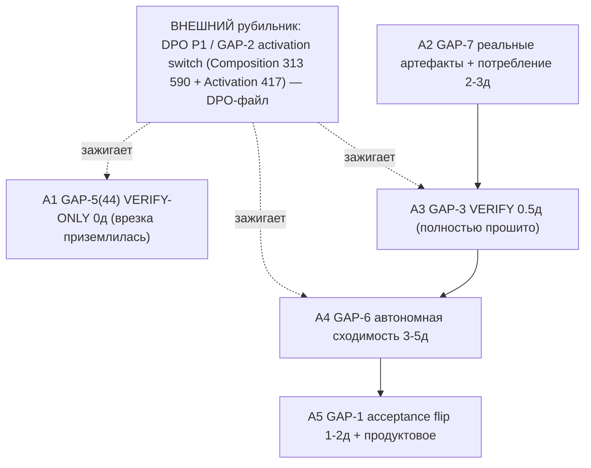

# 09.09.2026 WorkLeft DESIGN-ACTIONS-01 — действия Design-to-Code

<!-- 09.09.2026-ACTIVE-WORKLEFT-INSTRUCTION:START -->

Назначение файла: описывать Design-to-Code как пользовательский путь, а не как список внутренних файлов.

Путь продукта:

1. Пользователь даёт макет и требования.
2. Система строит представление элементов и связей: блоки, текст, размеры, цвета, иерархию, интерактивные зоны.
3. Ученик создаёт HTML/CSS-кандидат.
4. Отдельная модель-проверяющий оценивает отложенные макеты и требования: что совпало, что сломалось, какая точность.
5. Если качество ниже принятой планки 95%, Qwen пишет одну пару под конкретную ошибку; если качество уже не ниже 95%, нужна итоговая независимая проверка, а не новая пара.
6. После обучения одной пары происходит повторная оценка; ухудшение ведёт к точному возврату состояния до пары.

Ожидаемое и фактическое: DTC-код уже имеет оценку кандидата и handoff в подготовку обучения. Не подтверждён полный цикл изменения весов с моделью-проверяющим и точным откатом.

<!-- 09.09.2026-ACTIVE-WORKLEFT-INSTRUCTION:END -->

<details>
<summary>Историческое тело до правки 09.09.2026: прежние задания, статусы и цитаты сохранены; они не запускаются автоматически и не повышают текущий статус без сегодняшнего доказательства.</summary>

# 09.09.2026 WorkLeft — активная версия: 09.09.26WorkLeft-DESIGN-ACTIONS-01

> Пометка 2026-09-09 (/root/library_update): этот файл является активным носителем WorkLeft на 09.09.2026 после переименования в рабочей библиотеке. Историческое тело ниже сохранено; даты событий, исходных документов и коммитов внутри старых разделов не переписаны.
>
> Открытая работа читается первой: до сверки по опубликованным коммитам статусы кода и обучения не повышаются до «выполнено». Все старые READY/DONE/NOT_READY/BLOCKED внутри исторического тела являются историческими отметками, если рядом нет пометки 2026-09-09 или доказательства с SHA коммита.
>
> Навигация: активный префикс этого дня — 09.09.26WorkLeft-. Ссылки на текущие WorkLeft-носители синхронизированы на сегодняшний префикс; даты 23.08/24.08 и старше сохранены как архивные и исходные якоря там, где контекст является историческим.
## Историческое тело и происхождение источника

Ниже сохранён прежний текст носителя. Исторические даты, цитаты, старые статусы и строки источников не считаются сегодняшним утверждением без отдельной пометки 2026-09-09 или SHA-backed evidence.

# список действий по стороне дизайна — версия 25.08.2026 (консолидация раунда D)

- Дата консолидации: 25.08.2026 (раунд D, приказ Лубы «оставить в корне одну версию каждого вида файла, датированную 25.08.2026»).
- Вид файла: список действий по стороне дизайна.
- Собран из: LeftToWorkDesign07.08.26-actions.md (44563 байт).
- Источники перемещаются в archive\ отдельным нарядом (шаг второй); содержимое перенесено ПОЛНОСТЬЮ, без изменений и сокращений; добавлена только эта шапка и разделители частей.
- Правило чтения: однослойный вид — весь текст перенесён из одного источника целиком.
- Внутренние заголовки частей сохраняют свои исходные даты — это история, не ошибка. Править даты и текст внутри частей запрещено.
- Сдвиг номеров строк: строка N файла LeftToWorkDesign07.08.26-actions.md = строка N+13 этого файла. Ссылки по номерам строк действительны только в архивном источнике; в этом файле искать по названию секции.
- Счётная проверка: байты этого файла = сумма байтов источников (44563) + байты этой шапки и разделителей; из источников не удалено ничего.

---

# LeftToWorkDesign 07.08.26 — DESIGN-сторона (домен-44): IGNITE/VERIFY действия по re-audit @ 31b52f199

- **Дата:** 2026-08-08 (семейная дата среза **07.08.26**). Задача applied once — один файл, одно применение, оркестратор верифицирует на диске. Этот файл **аддитивно СУПЕРСЕДИТ статус** `LeftToWorkDesign02.08.26-actions.md` (не перезаписывает и не трогает его).
- **PIN:** `31b52f199f63668556e904e832ac342898d06419` — **наблюдён мной** (`git -C C:/Projects/llm_mvp_core-DpoImplementation cat-file -t 31b52f199` = **commit**; subject «Bind DPO teacher outputs to Ollama manifest identity», Tue Aug 4 22:55:38 2026 +0300). Пин **иммутабелен**; ветки движутся: наблюдённый рабочий HEAD клона ушёл за пин (циклы наблюдали `412b750de` / `0d9df72093`), пин `31b52f199` — предок HEAD, это НЕ рабочее дерево и НЕ аудит-таргет. Предок сравнения `bc03773bf` (02.08) подтверждён: `git merge-base --is-ancestor bc03773bf 31b52f199` = **0 (ANCESTOR-OK)**.
- **Владение (scope):** подсистема **`44.DesignConversionDomain`** (design-to-code), приземляется на ЕДИНУЮ ветку кода — **НЕ отдельный git-бранч**. Этот файл владеет **GAP-1 / GAP-3 / GAP-6 / GAP-7 + 44-стороной GAP-5**. **GAP-2** (прод-провайдер / активационный рубильник) и **GAP-4** (учитель Qwen/Ollama авторство preference) — у **DPO-файла** (`..\dpo legal build\LeftToWorkDPO07.08.26-actions.md` — **сиблинг, создаётся параллельной задачей**; **наблюдённое состояние на момент записи: 07.08-файл ещё НЕ существует**, в папке лежит только предшественник `LeftToWorkDPO02.08.26-actions.md`; кросс-ссылка, см. §6).
- **Источники (read-only):** `07.08.26WorkLeft-00-ИТОГ.md` (капстон-вердикт + карта GAP-1..7 + оценки, **source of truth**) + `-05-gapmap-and-estimation.md` (сводные таблицы + хребет E1-E10 + Mermaid) + `-02-acceptance-and-continuation.md` (GAP-1 + GAP-3) + `-04-convergence-and-spine.md` (GAP-6 + хребет) + `-01-provider-and-artifacts.md` (GAP-7; GAP-2 кросс-реф) + `-03-teacher-and-gate.md` (GAP-5; GAP-4 кросс-реф) + `LeftToWorkDesign02.08.26-actions.md` (формат-шаблон + supersession-база + tail-клаузы).
- **READ-ONLY оговорка.** Все код-цитаты — только `git show`/`git grep` на пине `31b52f199`. Рабочее дерево `llm_mvp_core-DpoImplementation` **НЕ читалось**; ни сборки, ни теста, ни dotnet, ни model-run **не выполнялось**. Прогоны запрещены этим срезом.
- **Правило «git-вывод главнее номеров строк».** Каждая строка ниже перепроверена `git show/grep @31b52f199` (лог — §8). **Дрейфа номеров относительно этого промпта не обнаружено** — все наблюдённые строки (Machine:305/2422/3027/3690, ModelAuthorityBoundary:12, Bridge:452/604/607/881/1004/1127/1130/2877, LocalArtifactDb:4055/4087/4097/4177/4400/8231, DpoTrainer:76/100/126/253, LlmIngredientLogicalUnits:407/409, TrainingPipeline:21/556, Contracts:67/73, DpoGenerator:1434, Composition:313/590, Activation:417, Coordinator=3016ln/0-trainer-ref) совпали дословно. Где номер расходился бы с промптом — победил бы мой git-вывод.

---

## §1. Executive summary (RU)

**Вердикт re-audit @31b52f199: фундамент — ДА (неизменно); эффект — ПРОШИТ сквозь боевой путь, но НЕ ЗАЖЖЁН.**

Домен-44 вызывает **БУКВАЛЬНО** тот же тренер `11.DPO/DpoTrainer` — не копию и не заглушку, и это **не изменилось** с 02.08: `DesignConversionDpoPolicyCheckpointBridge.cs:607`/`:1130` `trainer.StepVector(...)` входит ровно в `11.DPO/DpoTrainer.cs:253` `public DpoMetrics StepVector(...)`; та же DPO-математика `-log sigma(margin)` (`DpoTrainer.cs:126` `float loss = -MathF.Log(Sigmoid(margin) + 1e-8f);`), та же замороженная reference (`DpoTrainer.cs:76` `private readonly LlmModel _reference;`), тот же оптимизатор `AdamW(weightDecay: 0.01f)` (`DpoTrainer.cs:100`). Код **САМ** называет источник дважды: `Bridge.cs:881` перечисляет `"11.DPO:DpoTrainer", "11.DPO:DpoTrainer.StepVector"`, а `Machine.cs:3027` — `"direct-dpo-policy-score-source:11.DPO:DpoTrainer.EvaluateAverageNextTokenLogProbability"`. Это доказательство **ВЫЗОВА**, а не декоративный маркер. Байт-фундамент неизменен.

Но **эффект @31b52f199 = ПРОШИТ через боевой путь, но НЕ ЗАЖЖЁН.** За 5 дней (+39 коммитов / +11730 строк) проводка приземлилась: учитель сел на стул, легальный гейт врезан ПЕРЕД шагом тренера (`Bridge.cs:452`/`:1004` до `:607`/`:1130`), наследование от промотированного чекпойнта прошито (`LocalArtifactDb.cs:4097`/`:4400`), мультишаг разблокирован (диапазон 1..5 `LlmIngredientLogicalUnits.cs:407`/`:409`). Зажигание держат **ОДИН рубильник активации** (GAP-2 — `materialized_inactive` + `LegalEvidenceVerified:false`, **DPO-файл**) и **ОДНО продуктовое решение о приёмке** (GAP-1 — литерал `Machine.cs:3690` `bool.FalseString`, **этот файл**).

**СДВИГ ОТНОСИТЕЛЬНО 02.08 (главное).** На 02.08 действия DESIGN-стороны были **BUILD**-действиями (врезать гейт, достроить continue-from-promoted, снять кэп шага). За +39 коммитов эта проводка **ПРИЗЕМЛИЛАСЬ**. Поэтому на 07.08 действия Секции A — это **IGNITE / VERIFY / CLOSE-SPEC-NUANCE**, а НЕ build: повернуть рубильник (кросс-реф GAP-2), верифицировать прошитую врезку, дотянуть роль-ниже-спеки (учитель/сходимость/артефакты). **«тот же механизм» != «тот же эффект»**; **wired != ignited**; оценка ниже = **усилия-на-ЗАЖИГАНИЕ, НЕ обещание качества**; качество доказуемо ТОЛЬКО прогоном, который в этом срезе **запрещён** (Секция B).

---

## §2. Статус-таблица @31b52f199 (владеемые гэпы)

Ступени рунга: R1 код-существует < R2 подключён-в-вызыватель < R3 достижим-на-боевом-пути (гейты прослежены) < R4 зажжён-по-умолчанию.

| Gap | Вердикт 07.08 @31b52f199 (рунг) | Пиновая цитата (наблюдена МНОЙ) | Что это НЕ доказывает |
|-----|--------------------------------|--------------------------------|-----------------------|
| **GAP-1** приёмку держит baseline до G3 | **STILL-LOCKED** (literal false != conditional; reached=нет, blocked=приёмка) | `Machine.cs:3690` `["direct_dpo_policy_acceptance_authority"] = bool.FalseString,`; авторитет `ModelAuthorityBoundary.cs:12` `public const string TrainedModelAuthorityValue = "False";` | НЕ доказывает, что обученный score не мог бы вести приёмку — механизм ГОТОВ считать скор (`Machine.cs:3027` тот же forward-log-prob скорер 11.DPO); заперта именно приёмка литералом, не вычисление. Литерал НЕ менялся с 02.08 — только сдвиг строк 3564→3690. |
| **GAP-3** continue-from-promoted | **PARTIALLY — wired, not ignited** (класс существует И вызывается != зажжено; едет на рубильнике GAP-2) | `LocalArtifactDb.cs:4055` `RunTrainingIntakeAndPromoteLocalCoreAsync(` → `:4087` `ResolveCurrentLocalPromotionActiveState(...)` → `:4097` `await DesignConversionDpoPromotedParentContinuation` → `:4400` `MarkDpoContinuationBoundary(`; custody `:8231` `PromotionPriorMatchesCurrent(` | НЕ доказывает, что реальный журнал промоушенов существует в рантайме — это только код-проводка на пине. Первый цикл всё равно стартует fresh-from-fixed-base, пока рубильник GAP-2 (fail-closed `LocalArtifactDb.cs:4177` `if (_dpoPolicyBaseProvider is null)`) не повёрнут. |
| **GAP-5** (44-сторона) гейт учителя на боевом мосту | **MOVED-ENFORCED (R3) + CONDITIONAL** (инверсия 02.08; proven-empty legacy проходит) | `Bridge.cs:452` и `:1004` `legalTeacherAdmissionAuthority.ValidateBatch(` — ПЕРЕД `Bridge.cs:607`/`:1130` `trainer.StepVector(...)`; роль учителя `DpoGenerator.cs:1434` `["runtime_teacher_selected_preference"] = bool.FalseString,` | НЕ доказывает, что гейт зажжён — по умолчанию `Composition.cs:313` `deferredPlan is null` → Unavailable; и гейт = «legal-teacher ИЛИ proven-no-teacher», так что старые proven-empty Deterministic-строки всё ещё проходят (нужен опциональный legacy-flush — кросс-реф GAP-4/DPO). |
| **GAP-6** цикл сходимости / накопление | **PARTIALLY** (машинерия собрана R3; R4 автономная сходимость заблокирована) | диапазон `LlmIngredientLogicalUnits.cs:407` `MinimumSupportedMaxStepCount = 1;` / `:409` `MaximumSupportedMaxStepCount = 5;`; for-loops `Bridge.cs:604`/`:1127` `for (var step = 1; step <= effectiveOptions.DpoStepCount; step++)`; дефолт `Bridge.cs:224`/`:227` `DpoStepCount = 1`; измеряемый гейт `TrainingPipeline.cs:556`; carry-forward жив `Machine.cs:305`/`:2422` `CarryForwardAccuracyWithoutHeldOutMeasurement` | НЕ доказывает, что многошаг невозможен по коду — но нет автономного драйвера loop→intake→train→promote, дефолт шага=1, а accuracy переносится без измерения (`:2422`). `DesignConversionImprovementLoopCoordinator.cs` (3016 строк, **0 ссылок на trainer** — наблюдён grep exit 1) КОРМИТ интейк, но НЕ тренирует — это не драйвер. |
| **GAP-7** артефакты tokenizer/policy | **PARTIAL-vs-SPEC** (hash-триада написана, но не потребляется рантайм-путём) | hash-триада `DpoPromotionArtifactContracts.cs:67` `string PolicyCheckpointSha256,` / `:73` `string TokenizerArtifactSha256,` (+ anchor-метаданные `:539`/`:715`/`:716`); реальный `.bin` `Bridge.cs:2877` `RawPayloadPersisted: true,` | НЕ доказывает, что артефакты — плейсхолдеры: `.bin`-веса реальны. Но tokenizer = канонический-байтовый (не выучен), policy = метаданные-контракт (не сериализованные веса), и ни один рантайм-путь их не потребляет как вход (write-only + self-readback + upload-as-files). |

**Счёт зажигания владеемых гэпов:** 1 STILL-LOCKED (GAP-1), 1 MOVED-ENFORCED (GAP-5), 3 PARTIALLY/PARTIAL-vs-SPEC (GAP-3, GAP-6, GAP-7). Ни один не закрыт полностью; четыре из пяти продвинулись с «замок/absent» на «прошито, но не зажжено».

---

## §3. SUPERSESSION 02.08 (@bc03773bf) → 07.08 (@31b52f199) (обязательная секция)

Статусы владеемых гэпов в `LeftToWorkDesign02.08.26-actions.md` пиннились к пину **`bc03773bf`**. На пине **`31b52f199`** (+39 коммитов / +11730 строк) они УСТАРЕЛИ по СОСТАВУ РАБОТЫ: то, что на 02.08 было **BUILD**-действием DESIGN-стороны, за пять дней **ПРИЗЕМЛИЛОСЬ**, и остаток сместился с «прошить» на «зажечь». Маппинг «действие 02.08 → новый статус @31b52f199» (каждый со строкой, наблюдённой мной):

| Действие 02.08 @bc03773bf (BUILD) | Новый статус @31b52f199 | Пиновая опора (наблюдена мной) |
|-----------------------------------|-------------------------|-------------------------------|
| **A1 GAP-5** — врезать `ValidateBatch` на боевой мост (на 02.08 в 44 = **0 матчей**, ABSENT) | **→ LANDED / ENFORCED** (02.08-действие выполнено) | `Bridge.cs:452`/`:1004` `ValidateBatch(` стоят ПЕРЕД `:607`/`:1130` `trainer.StepVector(...)`, fail-closed. Инверсия 02.08: неподключённый = ОТКАЗ. Осталось VERIFY (§4·A1), не build. |
| **A3 GAP-3** — контракт continue-from-promoted (на 02.08 **ABSENT**, frozen-restart) | **→ WIRED battle-path** (прошито) | `LocalArtifactDb.cs:4097` continuation resolve + `:4400` `MarkDpoContinuationBoundary(` + журнал владения `:8231` `PromotionPriorMatchesCurrent(`. Осталось VERIFY + зажигание рубильником GAP-2. |
| **A4 GAP-6** — снять кэп шага=1 (на 02.08 `DpoStepCount=1` const) | **→ диапазон 1..5, но дефолт 1; НЕТ автономного драйвера** | `LlmIngredientLogicalUnits.cs:407`/`:409` (Min=1/Max=5); for-loop `Bridge.cs:604`/`:1127`; дефолт `Bridge.cs:224`/`:227`=1; CarryForward жив `Machine.cs:305`/`:2422`. Машинерия есть, автономная сходимость — нет. |
| **A2 GAP-7** — реальные артефакты (на 02.08 однострочные boundary-плейсхолдеры) | **→ плейсхолдеры УДАЛЕНЫ, hash-триада есть; НЕ потребляется** | плейсхолдеры (grep=0) удалены; hash-триада `Contracts.cs:67`/`:73` + `.bin` реален `Bridge.cs:2877`. Но tokenizer=канонический-байт, policy=метаданные, рантайм-потребления нет. |
| **A5 GAP-1** — acceptance authority G3 unlock (на 02.08 `bool.FalseString`) | **→ БЕЗ ИЗМЕНЕНИЙ** (литерал тот же, только сдвиг строк) | `Machine.cs:3690` `bool.FalseString` (дрейф 3564→3690); `ModelAuthorityBoundary.cs:12` `"False"` идентично @bc03773bf. Пути флипа «G3» в коде нет — только ярлыки `*_G3_PENDING`. |

**Явно:** файлы `LeftToWorkDesign02.08.26-actions.md` и `LeftToWorkDesign31.7.26-actions.md`, а также все `07.08.26WorkLeft-*` / `02.08.26WorkLeft-*` / RAG-корпуса **НЕ перезаписаны и не тронуты** — supersession выполнен **датированным аддитивным файлом** (этим). Старый файл остаётся пинованным к `bc03773bf`; его статусы читать как исторические @bc03773bf, актуальные — здесь @31b52f199. **Работа сместилась build → IGNITE.**

---

## §4. СЕКЦИЯ A — IGNITE / VERIFY / CLOSE-SPEC-NUANCE (по одному на владеемый гэп; НЕ build)

Каждое действие: `[диапазон инженеро-дней]` + локи `file:line @31b52f199` + **Зависит от** + **Разблокирует** + кросс-реф.
**FRAMING GUARD:** проводка BUILD-фазы (02.08) уже приземлилась. Дни ниже — усилия на **ЗАЖИГАНИЕ / ВЕРИФИКАЦИЮ / доспецификацию роли**, НЕ на постройку и НЕ сертификат эффекта. Ни один замок сам файл не переключает (`luba_flag`). `wired != ignited`; `estimate != quality`.

### A1 · GAP-5 (44-сторона) — VERIFY-ONLY: врезка гейта уже приземлилась [0д]
Врезка `ValidateBatch` легального учителя **ПЕРЕД** `StepVector` на боевом мосту 44 — **уже сделана** (02.08-действие LANDED): `Bridge.cs:452` (маршрут 1) до `:607`, `:1004` (маршрут 2) до `:1130`, fail-closed. Осталось только **верифицировать** прошитость и enforcement (не build). **Зажигание** гейта едет на рубильнике **GAP-2** (`Composition.cs:313` `deferredPlan is null` → Unavailable — **DPO-файл**), не на этом действии. Опциональный legacy-flush proven-empty Deterministic-строк = **DPO P3** (кросс-реф; здесь дни не считаются).
**Зависит от:** — (независим). **Разблокирует:** — (самостоятельный гейт). **Кросс-реф:** авторитет/контракт гейта + activation-рубильник — **DPO-файл**.

### A2 · GAP-7 — реальные артефакты + рантайм-потребление [2-3д]
hash-триада уже существует: `Contracts.cs:67` `PolicyCheckpointSha256` / `:73` `TokenizerArtifactSha256` (+ anchor-метаданные `:539`/`:715`/`:716`), реальный `.bin` `Bridge.cs:2877` `RawPayloadPersisted: true`. Осталось **НЕ build с нуля**, а: (1) **выученный** tokenizer вместо канонического-байтового; (2) **сериализованные веса** policy вместо метаданных-контракта (**C5-FLAG-8 / luba_flag** — семантика «реального» артефакта); (3) **рантайм-путь потребления** sidecar (сейчас write-only: `.Create` провайдера не принимает ни tokenizer, ни policy; тренировка грузит свой `BpeTokenizer` из env-пути).
**Зависит от:** — (независим по проводке). **Разблокирует:** **A3** (continue-from-promoted нуждается в потребляемых артефактах для fidelity).

### A3 · GAP-3 — VERIFY: continuation полностью прошита [0.5д]
Контракт continue-from-promoted **ПОЛНОСТЬЮ ПРОШИТ** в боевой promote-local (не build): `LocalArtifactDb.cs:4055` → `:4087` `ResolveCurrentLocalPromotionActiveState` → `:4097` `DesignConversionDpoPromotedParentContinuation` → `:4400` `MarkDpoContinuationBoundary`; журнал владения `:8231` `PromotionPriorMatchesCurrent`. Осталось **верифицировать** (0.5д), не строить. **Зажигание** едет на рубильнике **GAP-2** (кросс-реф **DPO P1**): пока провайдер null (`LocalArtifactDb.cs:4177`) или gateway не привязан → первый цикл fresh-from-fixed-base.
**Зависит от:** **P1 (зажигание GAP-2, DPO-файл)** + **A2** (потребляемые артефакты предыдущего цикла). **Разблокирует:** **A4**.

### A4 · GAP-6 — автономная сходимость (доспецификация, не build) [3-5д]
Машинерия многошага **присутствует** (не build): диапазон `LlmIngredientLogicalUnits.cs:407`/`:409` (1..5), for-loops `Bridge.cs:604`/`:1127`, измеряемый held-out гейт `TrainingPipeline.cs:556` (`promotionUploadAllowed = measurementGatePassed && ...`), request по дефолту null `TrainingPipeline.cs:21`. Осталось: (1) **автономный драйвер** loop→intake→train→promote (**C5-FLAG-7**); (2) **дефолт шага > 1** (**C5-FLAG-5**); (3) подать **MeasurementGateRequest** на интейк-путь (**C5-FLAG-6**); (4) **ретайр** `CarryForwardAccuracyWithoutHeldOutMeasurement` `Machine.cs:305`/`:2422` в пользу измеряемой кросс-цикловой сходимости.
**Нота:** `DesignConversionImprovementLoopCoordinator.cs` (3016 строк, **0 ссылок на trainer** — наблюдён grep exit 1) **КОРМИТ** интейк runtime-кандидатами, но **НЕ тренирует** — это фидер, НЕ драйвер.
**Зависит от:** **A3** + **P1 (GAP-2, DPO-файл)**. **Разблокирует:** **A5**.

### A5 · GAP-1 — acceptance flip [1-2д + продуктовое решение]
Право приёмки прибито литералом `Machine.cs:3690` `["direct_dpo_policy_acceptance_authority"] = bool.FalseString` + `ModelAuthorityBoundary.cs:12` `TrainedModelAuthorityValue = "False"`. **Пути флипа в коде НЕТ** — только ярлыки `*_G3_PENDING`. Осталось: (1) сделать authority **вычисляемым** + определить **маршрут/порог** приёмки; (2) **ПРОДУКТОВОЕ РЕШЕНИЕ** + значение порога = **C5-FLAG-2 / luba_flag** (когда и по какому критерию отдавать приёмку обученному score) — файл его НЕ выбирает.
**Зависит от:** **A4** (нужна накопленная, измеренная кросс-цикловая accuracy, чтобы было чем принимать). **Разблокирует:** — (финал цепочки зажигания DESIGN-стороны).

---

## §5. СЕКЦИЯ B — заблокировано / run-class [NOT-ESTIMATED, дней НЕ давать]

- **B1 · Первый сходящийся прогон** — run-class, **запрещён** этим срезом. Что A1–A5 реально сводят обучение (сдвиг весов, накопление измеренной held-out) — доказуемо только исполнением цикла, не проводкой/верификацией.
- **B2 · Значение порога приёмки (held-out)** — **число от Любы** (`luba_flag`, C5-FLAG-2). Проводка порога — в A5; само значение — продуктовая настройка, файлом не решается.
- **B3 · Верификация качества A1–A5** — **только прогоном** (запрещён). Wiring/verify кладут форму, не поведение: `wired != ignited`, посчитанный скор != право приёмки != доказанное качество.
- **B4 · Teacher-прогоны (Qwen/Ollama, GAP-4)** — B-секция **DPO-файла**; здесь не оцениваются (кросс-ссылка, авторство preference GAP-4 принадлежит DPO-стороне).

---

## §6. Граф зависимостей + сводка + критическая цепочка



**Сводная таблица владеемых действий:**

| Действие | Дни (усилие-на-зажигание) | Зависит от | Разблокирует | Тип |
|----------|---------------------------|------------|--------------|-----|
| A1 · GAP-5 гейт-на-мосту | 0 (VERIFY-only) | — | — | VERIFY (зажигание — рубильник GAP-2) |
| A2 · GAP-7 артефакты + потребление | 2-3 | — | A3 | IGNITE/доспецификация |
| A3 · GAP-3 continue-from-promoted | 0.5 (VERIFY) | P1 (GAP-2) + A2 | A4 | VERIFY (зажигание — рубильник GAP-2) |
| A4 · GAP-6 автономная сходимость | 3-5 | A3 + P1 (GAP-2) | A5 | доспецификация роли |
| A5 · GAP-1 acceptance flip | 1-2 + продуктовое | A4 | — | IGNITE + luba_flag |

**Сумма владеемых raw:** низ `0+2+0.5+3+1 = 6.5` / верх `0+3+0.5+5+2 = 10.5` → **6.5-10.5д** усилий-на-зажигание (владеемые GAP-1/3/5(44)/6/7).

**No-double-count (кросс-файловый уровень).** Программная оценка **RAW 9-18 / БАТЧИРОВАНО 8-15д** из `07.08.26WorkLeft-00/-05` (где GAP-2 + GAP-3 + GAP-5 делят **один проход активации/интейка**, зажигаются одним рубильником) существует ТОЛЬКО на уровне **всей программы обоих файлов** (GAP-2 — DPO-сторона). **Этот файл её себе НЕ присваивает:** здесь считаются только владеемые GAP-1/3/5(44)/6/7 (6.5-10.5д); **дни GAP-2 и GAP-4 — на DPO-файле** (`..\dpo legal build\LeftToWorkDPO07.08.26-actions.md`); A1/A3 (зажигание которых едет на рубильнике GAP-2) свой день на DPO-стороне не дублируют.

---

## §7. Honest scope

- **IGNITE/verify != build; wired != ignited.** Все A-действия — это ЗАЖИГАНИЕ / ВЕРИФИКАЦИЯ / доспецификация роли на пине без прогона (BUILD-проводка 02.08 уже приземлилась). Ни одно не доказывает качество обучения — границу пересекает только прогон (Секция B), а он запрещён.
- **«Default-off» — это факт конфигурации/продукта**, а не вывод о качестве: в проде базовый провайдер держит рубильник (`materialized_inactive` `Composition.cs:590` + `LegalEvidenceVerified:false` + fail-closed `LocalArtifactDb.cs:4177` — **GAP-2, DPO-файл**). **ПОЧЕМУ так / когда поворачивать — продуктовое решение** (`luba_flag`), не вывод аудита.
- **Тот же механизм != тот же эффект; estimate != quality promise.** Тот же `11.DPO/DpoTrainer` (§1) — фундамент (тот же тренер, та же математика `-log sigma(margin)`, та же frozen reference), неизменный с 02.08; горит он на проде или нет — за одним рубильником (GAP-2) + одним решением о приёмке (GAP-1) + двумя спеко-разницами (учитель аттестует-не-авторит; нет автономного драйвера) + семантикой артефактов.
- **Продуктовых решений файл не принимает.** Где нужен выбор (отдавать ли приёмку обученному score = C5-FLAG-2; шипать ли активацию = C5-FLAG-1/GAP-2; шаг>1 = C5-FLAG-5; автономный драйвер = C5-FLAG-7; семантика артефактов = C5-FLAG-8) — это `luba_flag`.

---

## §8. Верификационный блок (re-runnable, read-only)

```bash
R=C:/Projects/llm_mvp_core-DpoImplementation
P=31b52f199f63668556e904e832ac342898d06419

git -C "$R" cat-file -t $P                                                    # expect: commit
git -C "$R" merge-base --is-ancestor bc03773bf $P ; echo $?                   # expect: 0 (ANCESTOR-OK)

# GAP-1 (acceptance literal):
git -C "$R" show $P:44.DesignConversionDomain/DesignConversionMachine.cs | sed -n '3690p'
  # ["direct_dpo_policy_acceptance_authority"] = bool.FalseString,
git -C "$R" show $P:44.DesignConversionDomain/DesignConversionModelAuthorityBoundary.cs | sed -n '12p'
  # public const string TrainedModelAuthorityValue = "False";
git -C "$R" grep -n "CarryForwardAccuracyWithoutHeldOutMeasurement" $P -- 44.DesignConversionDomain/DesignConversionMachine.cs   # :305 / :2422

# GAP-3 (continuation chain + custody):
git -C "$R" show $P:44.DesignConversionDomain/DesignConversionLocalArtifactDb.cs | sed -n '4055p;4087p;4097p;4400p;8231p'
  # 4055 RunTrainingIntakeAndPromoteLocalCoreAsync( | 4087 ResolveCurrentLocalPromotionActiveState |
  # 4097 DesignConversionDpoPromotedParentContinuation | 4400 MarkDpoContinuationBoundary( | 8231 PromotionPriorMatchesCurrent(

# GAP-5 (legal gate on bridge before StepVector) + GAP-4 role cross-ref:
git -C "$R" grep -n "ValidateBatch" $P -- 44.DesignConversionDomain                       # Bridge:452 / :1004
git -C "$R" grep -n "trainer.StepVector" $P -- 44.DesignConversionDomain/DesignConversionDpoPolicyCheckpointBridge.cs   # :607 / :1130
git -C "$R" show $P:44.DesignConversionDomain/DesignConversionDpoGenerator.cs | sed -n '1434p'
  # ["runtime_teacher_selected_preference"] = bool.FalseString,   (attests-not-authors)

# GAP-6 (range, for-loops, measured gate, carry-forward, feeder-not-driver):
git -C "$R" show $P:18.CapabilityTraining/LlmIngredientLogicalUnits.cs | sed -n '407p;409p'   # Min=1 / Max=5
git -C "$R" grep -n "for (var step" $P -- 44.DesignConversionDomain/DesignConversionDpoPolicyCheckpointBridge.cs   # :604 / :1127
git -C "$R" show $P:44.DesignConversionDomain/DesignConversionTrainingPipeline.cs | sed -n '21p;556p'
  # 21 MeasurementGateRequest = null | 556 promotionUploadAllowed = measurementGatePassed && checkpointContainsRealTrainedWeights
git -C "$R" grep -c "trainer" $P -- 44.DesignConversionDomain/DesignConversionImprovementLoopCoordinator.cs   # 0 (exit 1) — feeder, not driver

# GAP-7 (hash triad + real .bin; write-only):
git -C "$R" grep -n "TokenizerArtifactSha256\|PolicyCheckpointSha256" $P -- 44.DesignConversionDomain/DesignConversionDpoPromotionArtifactContracts.cs | head   # :67 / :73 (+ anchors)
git -C "$R" show $P:44.DesignConversionDomain/DesignConversionDpoPolicyCheckpointBridge.cs | sed -n '2877p'   # RawPayloadPersisted: true,

# Same-mechanism foundation (unchanged since 02.08):
git -C "$R" show $P:11.DPO/DpoTrainer.cs | sed -n '76p;100p;126p;253p'
  # 76 _reference | 100 AdamW(weightDecay: 0.01f) | 126 loss = -MathF.Log(Sigmoid(margin)+1e-8f) | 253 public DpoMetrics StepVector(...)
git -C "$R" show $P:44.DesignConversionDomain/DesignConversionDpoPolicyCheckpointBridge.cs | sed -n '881p'   # self-naming "11.DPO:DpoTrainer.StepVector"
git -C "$R" show $P:44.DesignConversionDomain/DesignConversionMachine.cs | sed -n '3027p'                    # self-naming score source

# GAP-2 cross-ref (DPO-файл — activation switch, NOT owned here):
git -C "$R" show $P:44.DesignConversionDomain/DesignConversionLocalArtifactDb.cs | sed -n '4177p'            # if (_dpoPolicyBaseProvider is null)  fail-closed
git -C "$R" show $P:14.ContinuousLearning/Training/ContinuousLearningModelServerComposition.cs | sed -n '313p;590p'   # deferredPlan is null | materialized_inactive
git -C "$R" show $P:25.ModelServer/DesignConversion/DesignConversionRetainedDpoPolicyBaseActivation.cs | sed -n '417p'   # () => gateway.IsBound && ...

git -C "$R" status --porcelain   # footprint before + after (должны совпасть)
```

**Наблюдённый результат (2026-08-08):** `cat-file -t` = `commit`; `merge-base --is-ancestor bc03773bf 31b52f199` = `0` (ANCESTOR-OK); все `sed`/`grep`-строки совпали дословно (перечень в шапке); `ValidateBatch` в 44 = 2 матча (Bridge:452/:1004); `trainer` в `ImprovementLoopCoordinator.cs` = 0 (exit 1, фидер-не-драйвер). **Дрейфа номеров относительно этого промпта нет.**

**FOOTPRINT (репо `C:\Projects\llm_mvp_core-DpoImplementation`, READ-ONLY).** `git status --porcelain` **BEFORE** (до первой git-команды) = **пусто (чистое дерево)**; **AFTER** (после последней) = **идентично BEFORE**. Все мои git-команды read-only (`cat-file`/`rev-parse`/`log`/`merge-base`/`show`/`grep`/`status`). Ни один путь не изменён мной. **Мой вклад в код-репозиторий = 0 строк.** Циклы 1-4 наблюдали ВНЕШНИЙ churn (сборка TP1-Evaluation-Runner + teacher-файлы GAP-4 параллельным процессом) — не относится к этому пин-аудиту и на пине не цитируется; на момент этой записи дерево чистое. Правки только в папке планирования (аддитивно 1 файл — этот).

---

## ПРАВИЛО ГИГИЕНЫ ИСПОЛНИТЕЛЯ (обязательно для любого исполнения этой программы)

ПРАВИЛО ГИГИЕНЫ ИСПОЛНИТЕЛЯ (executor hygiene). Агент/исполнитель имеет право создавать файлы ТОЛЬКО внутри репозитория, который он назначен править, и в своём выделенном scratchpad-каталоге. Запрещено создавать скрытые файлы (dotfiles, .tmp, служебные артефакты) где-либо ещё — ни в чужих репозиториях, ни в planning-репо, ни в домашнем каталоге. Исполнитель НЕ имеет права оставлять после себя грязное состояние правимого репозитория: никаких брошенных/грязных веток, никаких оставшихся worktrees, никакого незакоммиченного мусора сверх намеренного изменения. По завершении задачи рабочее дерево, список веток и список worktrees должны быть НЕ грязнее, чем на входе (для read-only задач — нулевой след). Нарушение — hard violation.

Применение к этой программе:

- При исполнении code-first действий этой программы (A1–A7 DESIGN-стороны / A1–A6 DPO-стороны) исполнитель создаёт файлы ТОЛЬКО внутри `C:\Projects\llm_mvp_core-DpoImplementation` и в своём выделенном scratchpad-каталоге. Нигде больше: ни в planning-репо, ни в других `llm_mvp_core*`-репозиториях, ни в домашнем каталоге.
- Скрытые файлы (dotfiles, `.tmp`, служебные артефакты) вне этих двух мест — запрещены безусловно.
- git-финализация (Фаза 0 / M4 PART A: merge, fast-forward, retire веток) — ЕДИНСТВЕННОЕ намеренное изменение git-состояния, предусмотренное программой, и исполняется ТОЛЬКО когда Люба явно авторизует её. Любая другая задача программы обязана оставить рабочее дерево, список веток (`git branch --list`) и список worktrees (`git worktree list`) НЕ грязнее, чем на входе; для read-only задач — нулевой след.
- Гейт на выходе каждой задачи: снять `git status --porcelain` + `git branch --list` + `git worktree list` до и после; любая НОВАЯ ветка, НОВЫЙ worktree или НОВЫЙ незакоммиченный/скрытый файл сверх намеренного изменения = hard violation — исполнение останавливается, след устраняется, инцидент фиксируется в return_packet.

## ПРАВИЛО РАСПОЛОЖЕНИЯ РЕПОЗИТОРИЯ (обязательно для любого исполнения этой программы)

Canonical RU clause (repo location) — additive 2026-07-31, per Luba's directive:
ПРАВИЛО РАСПОЛОЖЕНИЯ РЕПОЗИТОРИЯ (repo location). Библиотека/репозиторий проекта, который исполнитель назначен править, ВСЕГДА находится на диске C по пути `C:\Projects\<project_name>-<branch_name>` и НИГДЕ БОЛЬШЕ: один клон = одна ветка, имя папки = `<имя-проекта>-<имя-ветки>`. Запрещено держать, искать, клонировать или править репозиторий по любому другому пути — другой диск, домашний каталог, вложенная или временная папка, второй клон под тем же именем. Перед любым код-действием исполнитель обязан убедиться, что назначенный репозиторий лежит именно по этому шаблону пути; если путь не соответствует шаблону — остановиться и эскалировать, а не создавать/клонировать/править репо в произвольном месте. Нарушение — hard violation.
EN summary (the RU clause above is canonical): the project library/repository the executor is assigned to modify ALWAYS lives on the C drive at `C:\Projects\<project_name>-<branch_name>` and nowhere else — one clone per branch, folder name = `<project>-<branch>`. Keeping, searching, cloning, or editing the repo at any other path (another drive, the home directory, a nested/temp folder, a second clone under the same name) is forbidden. Before any code action the executor must confirm the assigned repo sits exactly at this path pattern; if it does not, stop and escalate rather than creating/cloning/editing the repo in an arbitrary location. Violation = hard violation.

Применение к этой программе (расположение репозитория): единственный правимый код-репозиторий — `C:\Projects\llm_mvp_core-DpoImplementation` (проект `llm_mvp_core`), он и есть библиотека проекта по шаблону `C:\Projects\<project_name>-<branch_name>`. Все код-действия (A1–A7 DESIGN-стороны / A1–A6 DPO-стороны) — только в нём. Второй клон `C:\Projects\llm_mvp_core` (ушёл на ветку `llm_plan3`) для этой работы НЕ используется. `C:\Projects\xiigen-planning` — planning-репо, только для документов этой программы, не для код-правок. Если назначенного репозитория нет по этому пути или путь не соответствует шаблону — остановиться и эскалировать, не клонировать/создавать репо в произвольном месте.

## Применение к 02.08.26 (датированная нота)

Обе клаузы выше (гигиена исполнителя + расположение репозитория) сплайснуты **байт-идентично** из `LeftToWorkDesign31.7.26-actions.md` и действуют для этого среза **без изменений**: единственный правимый код-репозиторий при исполнении A1–A5 остаётся `C:\Projects\llm_mvp_core-DpoImplementation` (проект `llm_mvp_core`, шаблон `C:\Projects\<project_name>-<branch_name>`), пин `bc03773bf` — read-only аудит-якорь (не рабочее дерево), а сам re-audit 02.08.26 не создал ни одного файла вне planning-репо и своего scratchpad; footprint кода = 0. Второй клон `C:\Projects\llm_mvp_core` (ветка `llm_plan3`) для этой работы НЕ используется. Тайминг любого git-исполнения (Фаза 0) остаётся за Любой (`LUBA-M1-F1`); проводка A1–A5 — только правки внутри назначенного репо, run-фаза (Секция B) запрещена этим срезом.

## Применение к 07.08.26 (re-audit @ 31b52f199)

Обе клаузы выше (гигиена исполнителя + расположение репозитория) действуют для этого среза **без изменений** — они сплайснуты байт-идентично из `LeftToWorkDesign02.08.26-actions.md` (который, в свою очередь, сплайснул их из `LeftToWorkDesign31.7.26-actions.md`). Применение к re-audit 07.08.26:

- Единственный правимый код-репозиторий при исполнении A1–A5 — `C:\Projects\llm_mvp_core-DpoImplementation` (проект `llm_mvp_core`, шаблон `C:\Projects\<project_name>-<branch_name>`). Второй клон `C:\Projects\llm_mvp_core` для этой работы НЕ используется. `C:\Projects\xiigen-planning` — planning-репо, только для документов, не для код-правок.
- Пин `31b52f199` — **read-only аудит-якорь, НЕ рабочее дерево**: наблюдённый HEAD клона ушёл за пин (циклы видели `412b750de` / `0d9df72093`), все цитаты приколоты к пину через `git show 31b52f199:` / `git grep ... 31b52f199 --`; рабочее дерево и HEAD не цитировались.
- Сам re-audit 07.08.26 **не создал ни одного файла вне planning-репо и своего scratchpad**; footprint кода = 0 (BEFORE == AFTER, чистое дерево; весь наблюдённый ранее churn — внешний процесс TP1-Evaluation-Runner / teacher-файлы GAP-4, атрибутирован EXTERNAL).
- **Run-фаза (Секция B) запрещена этим срезом** — ни сборки, ни теста, ни dotnet, ни model-run.
- Тайминг любой git-финализации (Фаза 0: merge / fast-forward / retire веток) остаётся за Любой (`LUBA-M1-F1`) и исполняется ТОЛЬКО при её явной авторизации; проводка A1–A5 (при исполнении) — только правки внутри назначенного репо.
---

## 09.09.2026 — завершено структурной правкой рабочей библиотеки

- Файл переименован на месте: `26.08.26WorkLeft-DESIGN-ACTIONS-01.md` → `09.09.26WorkLeft-DESIGN-ACTIONS-01.md`.
- Добавлена текущая ревизионная пометка 2026-09-09; историческое тело сохранено без переписывания дат событий и коммитов.
- Завершение ограничено структурой документа: переименование и синхронизация ссылок выполнены для активной библиотеки, но статус кода и промышленное обучение не заявлены выполненными без отдельной сверки по SHA коммита.

</details>

## Подтверждено выполненное в коде — срез 09.09.2026

| Выполненное | Доказательство | Честная граница |
| --- | --- | --- |
| Запечатанный DPO-набор можно открыть повторно или создать один раз | `RepositoryOwnedDpoDatasetResolver.cs:155-163`, `:219-274`, `:381-384` | Это доказывает механизм хранения, но не рост качества модели. |
| Есть путь загрузки контрольной точки перед мутацией | `DesignConversionTrainingPipeline.cs:928-944`, `RetainedCheckpointBackedIncrementalTrainingSessionFactory.cs:342-368` | Наличие реальных опубликованных весов этим worker'ом не подтверждено. |
| DTC-кандидаты оцениваются и могут уйти в подготовку обучения | `DesignConversionImprovementLoopCoordinator.cs:553`, `:698`, `:2128-2310`, `:3401-3475` | Нет доказанного замкнутого цикла “одна пара → качество → точный откат/принятие”. |
| В переводе обучающие и отложенные строки разделены | `TranslationDpoTrainerBridge.cs:401-444`, `:691-776` | Отложенная оценка не заменяет отдельное удостоверение качества продукта. |
| Контрольная точка публикуется после принятого обновления | `IncrementalTrainer.cs:773-792`, `RepositoryOwnedIncrementalTrainingCheckpointPublisher.cs:80-87` | Сегодня этот worker не запускал обучение, модели, полный тестовый прогон или публикацию артефактов. |
