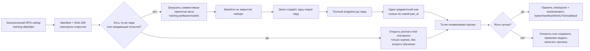
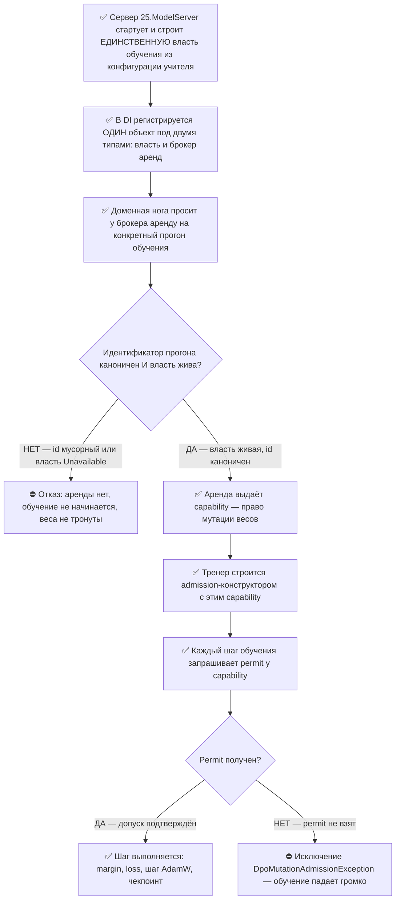
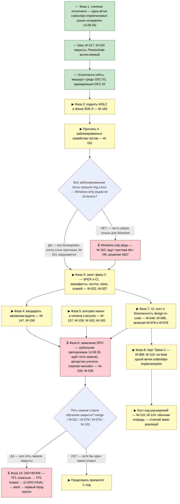

# 09.09.2026 WorkLeft PLAN-HUMAN-01 — приведёт ли план к исходному заданию

## Прямой вердикт

Исправленный план теперь описывает путь к цели раунда, но не доказывает выполнение цели и не гарантирует успешное обучение. Ближняя цель текущего раунда из `goal of the round.md` — хранить DPO-пары и веса в `llm_mvp_core` на ветке `codex/dpo-implementation`, загружать модель с диска и дообучать её, а не начинать заново. Широкий контекст из `original task.md` — обучаемый DynamicGraph с юнитами, потоками, оркестратором и асинхронными комбинациями. Эти две части связаны в плане: ближний запрос закрывается хранением и продолжением обучения, а широкий контекст остаётся отдельной проверкой графовых связей, остальных доменов и пользовательских приложений.

Что уже видно по фактам: инфраструктурная основа полезная, но результата ещё нет. В `.gitignore` нет действующего запрета на файлы внутри `training-artifacts`: последние правила наоборот возвращают весь каталог в Git, включая любые вложенные имена. LFS-правило для `weights.bin` записано, механизмы повторного открытия DPO-наборов и контрольных точек есть, оркестратор использует обученную KNN-память близких примеров. В трёх точных целевых каталогах `training-data/dpo`, `training-data/reference-corpora` и `training-artifacts/models` подтверждены только три README, без новых доменных пар и весов; это не обобщается на всё `training-data`. Значит, цель хранения/продолжения ещё не закрыта.

## Обязательная карта первого реального запуска (добавлено 10.09.2026)

Ниже единый ответ на вопрос «что именно сохранится, что будет обучаться и что ещё нельзя называть результатом».



| Обязательство | Ожидаемая логика | Фактический статус |
| --- | --- | --- |
| Повторное использование DPO | До Qwen открыть canonical dataset, сверить identity/manifest/hash и не генерировать тот же урок заново. | Частично: reopen есть; строгий gate закреплён в плане и ещё требует real-run доказательства. |
| Сохранение по каждому домену | Каждая пара и связанный manifest живут только в `C:\Projects\llm_mvp_core\training-data\dpo`. | Правило есть; реальных доменных пар пока нет. |
| Продолжение весов | До обучения загружается совместимый checkpoint из `training-artifacts\models`; скрытого fresh start нет. | Техническая опора опубликована; реальных принятых весов ещё нет. |
| Одна пара — один шаг | Durable journal запрещает второй gradient step по `pair_id`; unknown state откатывается к snapshot. | Контракт добавлен; полный durable journal и snapshot надо доказать. |
| Полный откат | Включает веса, адаптер, optimizer, scheduler/scale при наличии, RNG/seed, counters, manifest и baseline. | Открыто до реального цикла. |
| Публикация | Нужны bytes, manifest, SHA-256, Git ref и LFS pointer/backing object с удалённым readback. | `.gitignore`/LFS-маршрут готовы; публикация и readback открыты. |
| Физическая гигиена | Остаётся только canonical worktree; лишнее удаляется физически, не копируется и не карантинируется. | Правило закреплено; текущая очистка блокирована захваченным каталогом и не объявляется завершённой. |
| Качество | Улучшение подтверждено независимой оценкой на закрытом наборе, а не зелёными тестами. | Не доказано до реального доменного цикла. |

**Граница ролей.** Storage сохраняет и доказывает идентичность артефакта; learning меняет веса ровно по одной новой допустимой паре; evaluation измеряет продуктовый эффект. Нельзя заменять одну роль другой: наличие файла не равно качеству, а успешный тест загрузки не равен обучению.

## Что уже отмечено выполненным

Выполнены и не должны повторяться как новые задачи: правила видимости `training-artifacts` для Git; повторное открытие уже сохранённого DPO-набора до вызова учителя; загрузка совместимой контрольной точки; отделение папки попытки от принятой модели; возврат живого состояния тренера при сорванной записи результата; сравнение качества одного урока до публикации новой версии; сохранение и перечитывание исходной оценки до изменения весов; ускорение разбора уже существующих групп тестов из коммита `2f99de5c60`.

Не выполнено: реальная публикация новых доменных пар и весов в целевых папках, полный durable journal одной пары и полный дисковый снимок оптимизатора/счётчиков до пары, реальный доменный запуск с измерением качества, перенос того же цикла на все домены и графовые комбинации. Техническое повторное открытие пробных весов после перезапуска уже доказано опубликованным срезом `4bbb2ca...`; это не заменяет полный журнал и не является доказательством качества.


## Предпосылки первого запуска и критерии результата

Перед новым уроком сначала разбирается незавершённая попытка. Если одна пара уже была применена и осталась без решения, система загружает пробное состояние после пары, сохранённую исходную оценку и прежние условия проверки; повторно обучать той же парой вслепую нельзя. Откат всегда возвращает состояние до пары, а не пробную версию после неё.

После разбора попытки нужно найти фактически сохранённую принятую модель, проверить совместимость, разместить её в целевой ветке, закрепить отдельного проверяющего и закрытые задания. Не подменять отсутствующие веса скрытым стартом с нуля.

Затем снимается исходная оценка ученика. Если она уже 95% или выше с учётом погрешности, новую пару не создавать, а перейти к отдельному итоговому удостоверению. Если целевое качество ещё не подтверждено с учётом погрешности, учитель получает отдельное учебное задание, слабый ответ, платный ориентир из обучающей части и прежние хорошие/плохие пары как примеры; закрытые задания учителю не передаются. Одна новая пара сохраняется, затем сохраняется полный снимок состояния до неё, дообучается только эта пара, а тот же проверяющий решает: принять ясное улучшение или восстановить снимок до пары.

Готовый шаг домена — это успешный сценарий, где новая пара сохранена до обучения, исходная оценка сохранена и перечитана до изменения весов, веса действительно изменились, улучшение подтверждено, ухудшение вернуло состояние до пары, повторный запуск не применил ту же пару второй раз, а удалённая ветка содержит данные и LFS-объекты.

## Реальный порядок, который должен стоять первым

| Шаг | Что сделать | Предпосылки | Результат готовности |
| --- | --- | --- | --- |
| 1 | Подготовить один домен к реальному циклу: сначала разобрать незавершённую попытку; если пара уже применена, загрузить пробное состояние после пары, сохранённую исходную оценку и прежние условия проверки, затем оценить без повторного обучения. Если незавершённой попытки нет, найти принятую модель, проверить совместимость, закрепить отдельного проверяющего и закрытые задания, снять исходную оценку; новую пару создавать только когда целевое качество ещё не подтверждено с учётом погрешности, а при достижении 95% перейти к отдельному итоговому удостоверению. | Нельзя подменять отсутствующие веса скрытым стартом с нуля; проверяющий, закрытый набор и правило погрешности должны быть названы до запуска. | Одна доменная попытка имеет принятую стартовую модель или пробное состояние после уже применённой пары, исходную оценку, условия проверки, новую пару только при необходимости, снимок до пары, состояние после обучения, итоговую оценку, решение и причину. |
| 2 | Выполнить реальный прогон: исходная оценка, улучшение или ухудшение, возобновление после сбоя, публикация пары, весов, истории версий и результатов оценки в целевых папках канонического репозитория. | `.gitignore` и `.gitattributes` уже позволяют хранить артефакты; нужно проверить LFS-объект из удалённой ветки без копий. | В `training-data\dpo` и `training-artifacts\models` есть настоящие файлы, а не только README. |
| 3 | Перенести тот же цикл на семь предметов и на уровни unit, flow, orchestrator, graph. Отдельно решить, где меняется KNN-память, а где меняются веса модели. | Один домен прошёл шаги 1–2; для каждого предмета есть задания и эталон. | Каждый предмет имеет успешный сценарий: вход, ответ ученика, оценка, новая пара, изменение или восстановление состояния и сохранённые артефакты. |
| 4 | Добавить графовые комбинации и строитель DPO: один вход запускается несколькими комбинациями, пары оцениваются по сдвигу ученика, строитель не судит сам себя. | Есть контракты входа/выхода юнитов и правила сравнения комбинаций. | Есть успешный сценарий обучаемой связи: один вход прошёл несколькими путями, выбранный путь объяснён оценкой, а полезная пара улучшила ученика или была отклонена с восстановлением состояния. |
| 5 | Связать Design-to-Code с платформой, UI и редакторскими поверхностями: локальная индексация кода → план → пошаговое выполнение; xiigen API; рендеры разных разрешений; визуальная оценка; БД результатов; показ пары и пользы пользователю; Codex / Claude / Cursor; Visual Studio / VS Code / Continue; тарифный лимит стоимости по уровню пользователя. | Один сценарий обучения в ядре уже не ломает веса; известны внешние проекты DTC. | Пользовательский путь макет → HTML/CSS → проверка → улучшение виден за пределами ядра и имеет критерий качества вместе с лимитом стоимости. |
| 6 | Провести финальное качество, публикацию и проверку слияния. | Есть реальные пары, веса, связь версий, качество и результаты IDE/DTC. | Можно честно говорить о достижении цели; без этих данных статус остаётся открытым. |


## Диагностический набор и итоговая точность

По прочитанному коду `CodeDocumentationTrainingRunner.cs:64-124` пятьдесят отложенных примеров документационного домена затем используются для создания DPO. Их можно оставить как рабочую диагностику ошибки и источник запроса к учителю, но итоговую точность нельзя обещать на том же наборе, уже раскрытом учителю. Для финального качества нужен другой, не раскрытый учителю набор.

Критерии готовности этапа должны быть проверяемыми: новая пара сохранена до обучения; веса действительно изменились; улучшение подтверждено отдельной оценкой; ухудшение восстановило прежнее состояние; повторный запуск не применил ту же пару второй раз; удалённая ветка содержит данные и LFS-объекты.
## Семь предметов обучения и три проекта

Три проекта не смешиваются: `dpo-legal build` отвечает за собственную модель и DPO; Design-to-Code отвечает за HTML/CSS по макету и требованиям; Visual Studio / VS Code / Continue отвечают за доставку сценария в IDE.

Семь предметов обучения: перевод, оркестрация, Figma/Canva → HTML/CSS, документация C#, клиентский Angular, SQL и построение DPO-пар для каждого из шести предметов. Если подсистема из этого списка не оценена в этом пакете, в плане должно быть написано “реализация не оценена здесь; сначала проверить, чтобы не повторять уже сделанное”, а не “пробел” без проверки.

## Уровни исходной обучаемой архитектуры

1. `ILearningUnit` — принимает домен, форму входа, векторы и тип выхода; должен уметь выдавать many-to-many результаты.
2. `IlearningFlow` — связывает юниты и превращает выход одного уровня во вход другого.
3. `IlearningOrchestrator` — асинхронно превращает пользовательский запрос в план, шаги и доказательства.
4. `ILearningDynamicGraph` — запускает один вход через несколько комбинаций уровней и выбирает путь по качеству.

Современные имена классов не отменяют эти требования. Если в коде есть только хранение пары или один линейный конвейер, это полезно, но не закрывает DynamicGraph. У проверенного `15.OrchestratorModel/Logical/DynamicGraphMachine.cs:21-77` жизненный цикл обучения не активирован: `TrainBatchAsync`, `EvaluateAsync`, `ExportAsync` и `ImportAsync` возвращают “not activated”, `SemanticQualityClaimed=false`; файл был заготовкой до 26.08, поэтому другие графовые реализации нужно проверить перед работой.

## Сопоставление: исходное задание → что появилось → что нужно → приведёт ли

| Исходное требование | Что подтверждено как появившееся или полезное | Что остаток плана обязан сделать | Приведёт ли текущий план |
| --- | --- | --- | --- |
| Сохранять DPO и веса в каноническом репозитории, а не на внешнем диске. | `.gitignore` больше не отбрасывает `training-artifacts`; `.gitattributes` задаёт LFS для `weights.bin`; целевые папки сейчас подтверждены только README. | Проверить LFS-объект из удалённой ветки, затем опубликовать настоящую пару, веса, связь версий и запись качества. | Да, если публикация реальных файлов станет первым результатом, а не повторным планированием ignore-правил. |
| Загружать модель с диска и дообучать, а не начинать заново. | Есть механизмы загрузки совместимой контрольной точки и повторного открытия DPO-наборов. | В одном домене провести попытку от загруженных весов до решения сохранить или восстановить состояние. | Частично: механизм есть, цель доказывается только реальным доменным прогоном. |
| После обучения пары не публиковать веса без отдельной оценки качества. | Поздний опубликованный код по документационному домену уже требует одну новую сохранённую пару, принятую модель, исходную оценку до изменения весов, одинаковые задания до/после, того же проверяющего и прирост больше погрешности обеих оценок. `DPOReferenceModel` остаётся математической опорой, не судьёй ответов. | Связать пробные веса с применённой парой, сохранённой исходной оценкой и условиями проверки так, чтобы перезапуск продолжал оценку без повторного обучения; полный снимок оптимизатора и случайности остаётся отдельным остатком. | Частично да: порядок качества одного урока появился; цель ещё не закрыта без безопасного продолжения после сбоя и реальных опубликованных доменных артефактов. |
| Собственный DynamicGraph строит DPO для разных юнитов по слабости модели. | Есть отдельный седьмой предмет “построение DPO-пар” в программе и механизмы создания и повторного открытия. | Проверить реализацию графового строителя; если её нет, добавить путь слабость → домен → уровень → варианты пары → польза для ученика. | Не доказано здесь. Сначала нужна проверка, чтобы не повторить уже сделанное. |
| Один вход можно запускать несколькими асинхронными комбинациями. | Это есть в исходном задании и в решениях как источник пар/замера. | Сделать веер комбинаций отдельной зависимостью исполнения, с правилом выбора без самосудного короткого пути. | Не доказано здесь. Без этого граф остаётся линейным. |
| Design-to-Code должен давать пользовательский HTML/CSS через платформу. | Есть DTC-измерения, DPO-наборы и путь подготовки обучения в ядре. | Связать `xiigen-platform-dot-net-angular`, `xiigen-flows-dot-net-angular`, `FigmaToCode-design-gen`, `CanvaToCode`: HTML/CSS + дерево + скрины → API → рендеры → визуальная оценка → БД результатов → обучение → публикация весов. | Только при добавлении внешней DTC-приёмки. Один `llm_mvp_core` недостаточен. |
| Пользователь видит пары, пользу и может приказать дообучить. | Хранение пар/весов в плане описано; фактические целевые файлы ещё не подтверждены. | Добавить пользовательский сценарий: показать пару, диагноз, ожидаемую пользу, статус попытки и команду публикации. | Пока нет как проверенный продуктовый путь. |
| Расширения Visual Studio / VS Code / Continue — отдельный проект. | COVERAGE-01 возвращён к трём проектам. | Нужна отдельная приёмка расширений: автоматическая граница адаптера/ядра и локальный сценарий в установленном редакторе. | Не доказано здесь; не закрывать расширения через core-тесты. |

## Куда читать источники

- Ближняя цель хранения и продолжения: [goal of the round.md](<goal of the round.md>).
- Широкий DynamicGraph-контекст: [original task.md](<original task.md>) и [Алгоритм создания ДПО.md](<Алгоритм создания ДПО.md>).
- Runtime и расширения: [Исполнение кода без внешней модели.md](<Исполнение кода без внешней модели.md>).
- DTC HTML/CSS flow: [Обучение создания HTML CSS - 1st level.md](<Обучение создания HTML CSS - 1st level.md>).
- Порог 95%, роли и седьмой предмет: [Claude session decisions.md](<Claude session decisions.md>).
<details>
<summary>Архивное тело файла до правки 09.09.2026 — история и исходные цитаты, не новые команды</summary>

# 09.09.2026 WorkLeft — активная версия: 09.09.26WorkLeft-PLAN-HUMAN-01

> Пометка 2026-09-09 (/root/library_update): этот файл является активным носителем WorkLeft на 09.09.2026 после переименования в рабочей библиотеке. Историческое тело ниже сохранено; даты событий, исходных документов и коммитов внутри старых разделов не переписаны.
>
> Открытая работа читается первой: до сверки по опубликованным коммитам статусы кода и обучения не повышаются до «выполнено». Все старые READY/DONE/NOT_READY/BLOCKED внутри исторического тела являются историческими отметками, если рядом нет пометки 2026-09-09 или доказательства с SHA коммита.
>
> Навигация: активный префикс этого дня — 09.09.26WorkLeft-. Ссылки на текущие WorkLeft-носители синхронизированы на сегодняшний префикс; даты 23.08/24.08 и старше сохранены как архивные и исходные якоря там, где контекст является историческим.
## Историческое тело и происхождение источника

Ниже сохранён прежний текст носителя. Исторические даты, цитаты, старые статусы и строки источников не считаются сегодняшним утверждением без отдельной пометки 2026-09-09 или SHA-backed evidence.

# человеческий план — версия 25.08.2026 (консолидация раунда D)

- Дата консолидации: 25.08.2026 (раунд D, приказ Лубы «оставить в корне одну версию каждого вида файла, датированную 25.08.2026»).
- Вид файла: человеческий план.
- Собран из: 13.08.26WorkLeft-PLAN-HUMAN-01.md (113507 байт).
- Источники перемещаются в archive\ отдельным нарядом (шаг второй); содержимое перенесено ПОЛНОСТЬЮ, без изменений и сокращений; добавлена только эта шапка и разделители частей.
- Правило чтения: однослойный вид — весь текст перенесён из одного источника целиком.
- Внутренние заголовки частей сохраняют свои исходные даты — это история, не ошибка. Править даты и текст внутри частей запрещено.
- Сдвиг номеров строк: строка N файла 13.08.26WorkLeft-PLAN-HUMAN-01.md = строка N+13 этого файла. Ссылки по номерам строк действительны только в архивном источнике; в этом файле искать по названию секции.
- Счётная проверка: байты этого файла = сумма байтов источников (113507) + байты этой шапки и разделителей; из источников не удалено ничего.

---

# 13.08.26 WorkLeft — План работ в человеческом формате (PLAN-HUMAN-01)

- **Дата:** 2026-08-13. Наряд: F-PLAN-13.08-HUMAN-REPAIR (Fable 5, bounded architect sub-agent — ограниченный архитекторский суб-агент). Это переработка первой версии: факты и числа те же, формат приведён к канону скиллов читаемости (диаграммы с симуляциями, алгоритмы по-человечески, доска фаз).
- **Что это:** человеческий план работ, суммирующий весь пакет 13.08 одним читаемым документом: где мы, как устроен механизм обучения, что сделано, что делать дальше по коду и по обучению, какие решения действительно твои, и где границы честности. Документ ничего не решает и не перепроверяет заново — он пересказывает то, что уже записано и проверено в итоговых файлах пакета 13.08 (полный список источников — в машинных метках в самом конце).
- **Как читать:** §0 — картина целиком на одну страницу; §2-К — карта готовности всего плана (идёт сразу после §0, смотреть первой); §1 — архитектура механизма обучения: объяснение без кода (1.1), диаграмма классов с легендой и симуляцией по КАЖДОЙ стрелке (1.2), цепочка допуска с симуляцией КАЖДОЙ ветки (1.3), алгоритмы четырёх ключевых компонентов по-человечески (1.4); §2 — что уже сделано; §3 — доска фаз работ по коду с дорожной картой; §4 — фаза обучения (приоритет 2); §5 — дефолты и будущие гейты: ждущих тебя решений сейчас 0 из 60 (ре-аджюдикация 14.08.26); §6 — честные границы.

---

## §0. Что это и где мы

**Три задачи, одна ветка.** Вся оставшаяся работа идёт на одной ветке `codex/dpo-implementation` (ветка-канон исправлена 14.08.26; прежде ошибочно DpoImplementation) и складывается из трёх задач:

1. **dpo-legal build** — юридически чистое обучение собственной модели методом DPO (Direct Preference Optimization — «прямая оптимизация предпочтений»: модель учат на парах «лучший ответ / худший ответ», усиливая предпочтение лучшего).
2. **design-to-code** — превращение дизайн-макета (Figma/Canva) в работающий код с петлёй улучшения и визуальной проверкой.
3. **VS/VSCode extensions** — расширения для редакторов Visual Studio и Visual Studio Code (внутри пакета это называется «Трек C»).

**Что случилось 11.08–13.08.** 11.08 исполнено слияние веток: `DesignToCode-clean` влита в `DpoImplementation` (merge-коммит `63563d1544`, гигиена `cbbc85d751`, governance-гейты `69a640b3e3`) — рабочая ветка теперь одна — historical: ветка DpoImplementation была неправильной, слита в codex/dpo-implementation 14.08.26; рабочая ветка = `codex/dpo-implementation`. 13.08 коммит `3906e05d5b` закрыл четыре «шва» перевода (строки работ W-017..W-020, объяснены в §2) и добавил серверный брокер аренд обучения. На главный вопрос «механизм обучения один или два?» дан прямой проверенный ответ: **ДА, механизм один** — и design-to-code, и dpo-implementation доходят до одного и того же тренера через одну и ту же цепочку допуска на одной ветке (по-человечески это и означает машинную метку `SAME_MECHANISM_ONE_BRANCH`). Адверсарная перепроверка этого ответа: 10 из 10 несущих утверждений подтверждены чтением кода, опровержений 0. Перепроверка была именно адверсарной: атаковали подделку брокера, создание второго издателя, обходные маршруты к тренеру мимо допуска, «ложно-зелёные» тесты и legacy-остатки в тестах — ни одна атака не прошла.

**Главные числа пакета:**

| Что | Сколько | По-человечески |
|---|---|---|
| Строки работ по коду (файл 01) | **127** | весь оставшийся код: 108 строк канона 11.08 + 19 новых находок 13.08; статусная разбивка: 4 закрыто, 4 продвинуто, 100 открыто, 19 новых (тоже открытых) |
| Строки работ по обучению (файл 02) | **23** | вся дорога обучения: 22 строки канона + 1 новая про среду прогонов; статусная разбивка: 1 закрыта (инвентарь готового), 1 продвинута (конфигурация учителя), 20 открыто, 1 новая (тоже открытая) |
| Очередь решений (файл 03) | **60** | после разборов 13.08 и ре-аджюдикации 14.08 (живая инструкция): **60 из 60** закрыто/дефолтнуто/на будущих гейтах; **ждущих тебя сейчас — 0**; единственный будущий владельческий блок — внешняя публикация (§5) |
| G-карта (карта 30 разрывов механизма, ряды G-01..G-30) | 7 / 5 / 5 / 13 | 7 закрыто, 5 продвинуто, 5 устарело после слияния, 13 открыто; **блокирующих 0** |
| Коммиты 13.08 | 3 | `3906e05d5b` (швы + брокер), `8dce04d21c` (скилл-гейты), `5cfbdec062` (watchdog-governance) — вершина ветки |

**Одной фразой:** код продолжается прямо сейчас (ближайший шаг — runtime-путь через WSL2, фаза 2 в §3), обучение не стартует до пяти замков (§4), из 60 решений ждущих тебя сейчас НЕТ (0): всё закрыто требованием к продукту, дефолтами архитектора или уходит на будущий гейт публикации.

**Доказательная основа пакета** — RAG-обход четырёх папок планирования: 404 инвентарных строки = 201 (`dpo legal build`) + 140 (`design to code session`; счёт на момент инвентаря — собственные артефакты раунда добавили файлов, свежий пересчёт даст больше, это не расхождение) + 33 (`Prepare to merge` — вся папка historical после слияния) + 30 (`visual studio & visual studio code continue`). Папки почти не менялись — радикально изменился мир вокруг них (слияние). Формальный документный вердикт семейства планов обучения в папке `dpo legal build` остаётся `PLAN_NOT_READY / TWO_PHASE_ADAPTATION_QUEUE` — это вердикт о ДОКУМЕНТАХ планирования, не о текущем дереве кода: по чтению кода механизм готов (§2-К), а стейл-шапки 20 файлов размечает W-163 (фаза 5).

---

## §2-К. Карта готовности: что уже работает, что частично, что ещё нет

Это единая карта готовности всего плана — первое, что нужно смотреть. Сначала свод по трём задачам, затем главная таблица по ключевым компонентам. Статусы пересказывают уже проверенные файлы пакета 13.08 (источник каждой строки назван в квадратных скобках); новых проверок эта карта не делает.

**Свод по трём задачам одним взглядом:**

| Задача | Готовность одним предложением | Доля фаз (§3) |
|---|---|---|
| dpo-legal build | механизм обучения и контракты готовы по чтению кода (один тренер, одна цепочка допуска, обе ноги доходят до тренера) — но само обучение НЕ запускалось ни разу: ни одного прогона | свои фазы 2–6 и 10: закрыто 0 из 6; общая фаза 1 (слияние) ✅ |
| design-to-code | ядро конверсии и мост обучения есть в коде («остров»), пользовательского входа НЕТ (боевой вход, панели, cost-ledger — 0 поверхностей), судья качества — заглушка-эхо с потолком 0.60 | своя фаза 7: закрыто 0 из 1; общая фаза 1 ✅ |
| VS/VSCode extensions | план порта написан (6065 строк) и отревьюван (метод-гейт 10/10), но НИ ОДНА команда порта не исполнялась; хост-код расширений не начат | своя фаза 8: закрыто 0 из 1 — в обычной очереди по приоритетам доски (стоячий заказ = реализуй; живая инструкция 14.08.26) |

**\* = статус по статическому чтению кода; первый проверенный build+test всей ветки ещё не выполнялся (замок W-021) — runtime никого из ✅ не подтверждал.**

**Главная таблица готовности по компонентам:**

| Компонент | Файл | Статус | Что реально работает сейчас |
|---|---|---|---|
| `DpoTrainer` | `11.DPO/DpoTrainer.cs` | ✅ Полная* | `Step`/`StepMany`/`StepVector` только под permit (`:130–132`/`:176`/`:278`); без permit → `DpoMutationAdmissionException` (`:498–502`); `EvaluateMany` без permit (`:236–276`); публикация чекпоинта `SaveCheckpointToStream` (`:1524`, двухфазная с reservation — сначала резервируется место, потом атомарная запись, чтобы наружу не показался недописанный чекпоинт) [MECH-01 §1a] |
| `ServerOwnedLegalTrainingTeacherAdmissionAuthority` + брокер | `14.ContinuousLearning/Core/ServerOwnedLegalTrainingTeacherAdmissionAuthority.cs` | ✅ Полная* | единственный издатель: private ctor `:200`, internal-фабрики `:993–994/:1016/:1050`; `AcquireTranslationTrainingLease` `:745–748`, отказ на неканоничном id `:750`; ОДИН объект под двумя типами в DI (`25.ModelServer/Program.cs:198–202`) [MECH-01 §1b] |
| Нога design-to-code: `DesignConversionDpoPolicyCheckpointBridge` | `44.DesignConversionDomain/DesignConversionDpoPolicyCheckpointBridge.cs` | ✅ Полная* | `CreateDpoTrainer` `:4602–4633` (lease→capability→admission-ctor `:4613`); continue-training `LoadCheckpoint` `:2896/:3770`; связь чекпоинт→scorer через typed proof (`DesignConversionCheckpointContracts.cs:118–153`) под G3-замком [MECH-01 §1c] |
| Нога перевода: `TranslationDpoTrainEvaluateRunner` + Coordinator | `27.TranslationDomain/TranslationDpoTrainEvaluateRunner.cs`, `27.TranslationDomain.Tools/TranslationDpoModelServerCoordinator.cs` | ✅ Полная* | `CreateAdmittedTrainer` `:608–664` (lease→capability→ctor `:637–642`); in-process хост сервера, identity-сверка fail-closed `:234–243`; continue-training `:483`; НО связи чекпоинт→`TranslationMachine` НЕТ — разрыв G-15 (grep `PolicyCheckpoint` вне Runner/Tests = 0; строка W-025) [MECH-01 §1d/§2] |
| `TranslationMachine` — гейт качества | `27.TranslationDomain/TranslationMachine.cs` | ⚠️ Частичная | `PassesGate: meetsAccuracyTarget` — вычисляемый по held-out с порогом 0.75 (`:196–197`), `RewardMargin: 0.0` честно; НО обученный чекпоинт на продуктовый скоринг не влияет (G-15 / W-025) [01-code-changes W-020, статус 13.08] |
| Визуальный судья design-to-code | эхо-компаратор ноги 44 | 🔶 Скелет | судья = эхо-скор 0.40 + learned-поправка ±0.2 → потолок 0.60 НИЖЕ порогов приёмки 0.80–0.90: дообучение не может изменить приёмку; внешний облачный судья УДАЛЁН как вариант (живая инструкция 14.08.26; правило R7 — запрет внешних AI-инструментов без явного разрешения): судья качества DPO — локальная китайская модель + собственный контур; замена эхо — W-078 [01-code-changes W-078; 02-teaching W-128] |
| G3 acceptance authority (приёмка обученного) | `44.DesignConversionDomain/DesignConversionCheckpointContracts.cs` (+`...DpoPromotionArtifactContracts.cs`) | 🔶 Скелет | proof-контракты ЕСТЬ (`:118–153`; promotion требует proof `:889`); активации в коде НЕТ — пути флипа «G3» нет, только ярлыки `*_G3_PENDING` (W-062); число порога зашито дефолтом архитектора DEC-03: win-rate ≥ 0.55 (N≥200; при N≥50 — стат-значимость p<0.05), accuracy-пол 0.75 (W-129) [01-code-changes W-062; 02-teaching W-129] |
| UI/вход острова 25.ModelServer (DPO-панель, панель одобрения, cost-ledger) | `25.ModelServer` (+ отсутствующие `LocalTraining/UI/*`) | 🔶 Скелет | пользовательских поверхностей НЕ СУЩЕСТВУЕТ: боевой вход, панель одобрения, DPO-панель с показом пар, cost-ledger UI — не написаны (W-046); панель локального обучения + `DpoDatasetFilter` + `RetrainOnDemandOrchestrator` — в коде 0 реализаций (W-077) [01-code-changes W-046/W-077] |
| HTTP-вход обучения design-ноги | `25.ModelServer/DesignConversion/DesignConversionModelServerApi.cs` | ✅ Полная* | вход обучения регистрируется в `DesignConversionModelServerAspNetHostStartup.cs:1088–1090` (строка `:472` в Api-файле — guard-сообщение отказа, не точка входа) → LocalArtifactDb → мост 44; legacy-вход `Handoff.ExecuteAsync` ЗАПРЕЩЁН guard-тестом, production-вызовов 0 (W-024) [MECH-01 §1c] |
| `LogicalDpoTrainingUnit` (обучение как ILogicalUnit) | `18.CapabilityTraining/LlmIngredientLogicalUnits.cs` | ✅ Полная* | ILogicalUnit-уровень `:489`; capability → admission-ctor того же тренера `:775–784`; отказ допуска → типизированный Fail [MECH-01 §1c] |
| `ProjectWikiDpoMetricRunner` (третья нога) | `42.ProjectWikiDomain/ProjectWikiDpoMetricRunner.cs` | ✅ Полная* | тот же admission-ctor `:289–294`; мутирующий сайт `:330` — чёрного хода нет [MECH-01 §1d/O2.2] |
| Композиция сервера / env-активация обучения | `14.ContinuousLearning/Training/ContinuousLearningModelServerComposition.cs` | ⚠️ Частичная | власть строится только из admitted-конфигурации (`:663–676`, иначе `Unavailable()`); env-поверхность целиком на дереве `:1843–1868` (включая новый флаг активации `:1844–1845`); НО рубильник пока ВЫКЛ (fail-closed до пяти замков; включение обучения АВТОРИЗОВАНО живой инструкцией 14.08.26 — осталась инженерная последовательность) и активационное замыкание не закрыто (retained-чекпойнт, readiness-флаги — W-028) [MECH-01 §1b; 01-code-changes W-028/W-127] |
| Клиент учителя Qwen/Ollama | `14.ContinuousLearning/.../LocalQwenOllamaTeacherInferenceClient.cs` | ✅ Полная* | fail-closed, identity-пин через `/api/tags`+`/api/show`, permit на вызов, лимиты (W-126 CLOSED); НО роль учителя = АТТЕСТАЦИЯ, не авторство пар (`runtime_teacher_selected_preference=False`, `DpoGenerator.cs:1434` — W-030); фактические значения digests не заполнены (остаток W-127) [02-teaching W-126/W-127; 01-code-changes W-030] |
| Обучение TP1/TP2/DPO (прогоны) | дорога W-132..W-136; TP1-раннер `tools/ContinuousLearningTp1EvaluationRunner/` | 🔶 Скелет | НЕ ЗАПУСКАЛОСЬ: TP1_LOCAL / TP2_HOSTED / DPO = NOT_STARTED — ни одного прогона; из пяти замков старта закрыт 1 (слияние), W-021/W-078/W-079/W-133 открыты [02-teaching, машинные метки] |
| Seed-корпус language-translate | `27.TranslationDomain/SeedData/language-translate-seed-v1.jsonl` | 🔶 Скелет | файла НЕТ («planned seed file exists: False»); требуется схема 11 полей, ≥12 train + 4 held_out; held-out поднять до ≥50 до порого-несущих выводов (решение №43) [02-teaching W-137] — **Пометка 17.08.26: устарело — файл СУЩЕСТВУЕТ** (`git ls-files` 17.08: `27.TranslationDomain/SeedData/language-translate-seed-v1.jsonl` = 16 строк = 12 train / 4 held_out, 4 направления, 18 ключей, валидный UTF-8; W-137 → ADVANCED_1708 в `17.08.26WorkLeft-02`); остаётся held-out ≥ 50 (№43) |
| Learning-sets (именованные наборы) | маска `<domain>_<model>_<num>_<size>_<date>.json` | 🔶 Скелет | 0 файлов по маске (на 08.08); материализация + коммит наборов и `.gitattributes` — твоё действие [02-teaching W-145] |
| Порт Трека C (VS/VSCode) | `PLAN-VS-VSCODE-CONTINUE-v1.md` (папка «visual studio & visual studio code continue») | 🔶 Скелет | план 6065 строк, PLAN-ONLY; метод-гейт 10/10 закрыт леджером; исполнение — 0 команд порта (WRITTEN-NOT-EXECUTED); порт идёт на базе одной ветки `codex/dpo-implementation` (ветка-канон исправлена 14.08.26; прежде ошибочно DpoImplementation; канон «одна ветка»; №23/№37 устарели, №38 удалён); внешний publish — единственный будущий гейт (№39/№49) [RAG-MASTER-INDEX п.4; RAG-04] |
| Хост-входы расширений (.vsix / extension.ts / VSPackage) | не начаты (host-4 VS Code, host-5 Visual Studio) | 🔶 Скелет | ни одного хост-файла: activate/команды/panel/vsixmanifest/tool-window не написаны; в обычной очереди — гейт «ждать слова реализуй» снят живой инструкцией 14.08.26 (№42 закрыт); W-116 [01-code-changes W-116; RAG-MASTER-INDEX п.4] |
| CI объединённой ветки | `.github/workflows/design-to-code-focused-verification.yml` | 🔶 Скелет | на ветке `DpoImplementation` CI НЕ ЗАПУСКАЕТСЯ ВООБЩЕ: branch-фильтр `:5–6` слушает только старую `DesignToCode-clean` (MECH-W-c6, HIGH; строка W-022) — historical: ветка DpoImplementation была неправильной, слита в codex/dpo-implementation 14.08.26; на `codex/dpo-implementation` фильтр так же не слушает — W-022 чинить под именем `codex/dpo-implementation` [01-code-changes W-022, статус 13.08] |

---

## §1. Архитектура механизма обучения

### 1.1. Объяснение без кода

**Что считает тренер.** В дереве ровно один тренер — класс `DpoTrainer` (файл `11.DPO/DpoTrainer.cs`, 1977 строк). Он держит две модели: обучаемую **policy** и замороженную **reference** (замороженный снимок для сравнения). На каждой паре «лучший/худший ответ» тренер считает **margin** — насколько policy предпочитает лучший ответ сильнее, чем reference (`margin = chosenReward − rejectedReward`, строки `:145–150`). Затем штраф за слабое предпочтение: `loss = −log σ(β·margin)`, где σ — сигмоида (плавная ступенька от 0 до 1), а β — коэффициент резкости. Градиент считается вручную (`gradMargin = σ(margin) − 1`, `:152–155`) и делается шаг оптимизатора AdamW (Adam с weight decay 0.01 — «затуханием весов», `:102/:157`). Никаких внешних ML-фреймворков — вся математика собственная, на собственной тензорной базе TensorCore.

**Почему fail-closed («закрыто по умолчанию»).** Каждый вход, который МЕНЯЕТ веса модели (`Step`, `StepMany`, `StepVector`), обязан взять **permit** — разовое разрешение на мутацию. Без разрешения тренер бросает исключение `DpoMutationAdmissionException` (`:498–502`) — то есть обучение без допуска не «тихо не работает», а громко падает. Оценка (`EvaluateMany`, `:236–276`) разрешения не требует, потому что ничего не меняет.

**Кто единственный издатель власти.** Разрешения выдаёт одна-единственная «власть обучения» — класс `ServerOwnedLegalTrainingTeacherAdmissionAuthority`. Создать её со стороны нельзя: конструктор private, фабрики internal. Живой издатель — композиция сервера `ContinuousLearningModelServerStartup`, и при старте сервера `25.ModelServer` этот ОДИН объект регистрируется под двумя типами сразу: как «власть» и как «брокер аренд» `IServerOwnedDpoTrainingLeaseBroker` (`25.ModelServer/Program.cs:198–202`). Это решение называется в пакете **Decision 12A** («один издатель»).

**Почему обучение возможно только через сервер.** Цепочка одна для всех: нога домена просит у брокера **lease** (аренду на конкретный прогон обучения) → аренда выдаёт **capability** (право мутации) → тренер строится admission-конструктором с этим capability → каждый шаг берёт permit. Даже оффлайн-инструмент командной строки не обходит сервер: координатор `TranslationDpoModelServerCoordinator` сам поднимает `25.ModelServer` внутри своего процесса (in-process) и отказывает, если «власть» и «брокер» вдруг не один и тот же объект (проверка `ReferenceEquals`, `:238–243`). Бессерверного пути обучения не существует — это и закрыло бывший вопрос №12 из очереди решений.

**Известная оговорка (рабочая строка W-153, объяснена в §3, фаза 4):** заявленная граница «никто, кроме сервера» на уровне типов чуть шире — три производственные сборки (21, 14, 18) технически дружественные (friend-assemblies) и могли бы сминтить capability мимо власти. Это зафиксировано как security-строка работ: сузить friend-список или задокументировать границу. И вторая оговорка той же природы: публичный мостовой метод обучения перевода принимает тренер от вызывающего — «симметрия через брокера» обеспечивается сборкой сервера (композицией), а последним рубежом всегда остаётся permit самого тренера; это тоже записано в фазу 4.

### 1.2. Диаграмма классов механизма (Mermaid, импортируется в draw.io)

```mermaid
classDiagram
    class DpoTrainer {
        +Step()
        +StepMany()
        +StepVector()
        +EvaluateMany()
    }
    class ServerOwnedLegalTrainingTeacherAdmissionAuthority {
        -ctor()
        +AcquireTranslationTrainingLease()
    }
    class IServerOwnedDpoTrainingLeaseBroker {
        <<interface>>
        +AcquireTranslationTrainingLease()
    }
    class ContinuousLearningModelServerStartup {
        +LegalTeacherAdmissionAuthority
    }
    class ModelServerProgram {
        +CreateLocalLoopbackHost()
    }
    class DesignConversionDpoPolicyCheckpointBridge {
        +CreateDpoTrainer()
    }
    class TranslationDpoTrainEvaluateRunner {
        +CreateAdmittedTrainer()
    }
    class TranslationDpoModelServerCoordinator {
        +TrainTranslationDpo()
    }
    class ProjectWikiDpoMetricRunner {
        +RunMetric()
    }
    class LogicalDpoTrainingUnit {
        +ExecuteAsync()
    }

    ServerOwnedLegalTrainingTeacherAdmissionAuthority ..|> IServerOwnedDpoTrainingLeaseBroker : implements
    ContinuousLearningModelServerStartup --> ServerOwnedLegalTrainingTeacherAdmissionAuthority : creates
    ModelServerProgram --> ContinuousLearningModelServerStartup : hosts
    TranslationDpoModelServerCoordinator --> ModelServerProgram : in-process host
    TranslationDpoModelServerCoordinator --> TranslationDpoTrainEvaluateRunner : verified broker
    DesignConversionDpoPolicyCheckpointBridge --> IServerOwnedDpoTrainingLeaseBroker : lease
    TranslationDpoTrainEvaluateRunner --> IServerOwnedDpoTrainingLeaseBroker : lease
    ProjectWikiDpoMetricRunner --> IServerOwnedDpoTrainingLeaseBroker : lease
    DesignConversionDpoPolicyCheckpointBridge --> DpoTrainer : admission-ctor
    TranslationDpoTrainEvaluateRunner --> DpoTrainer : admission-ctor
    ProjectWikiDpoMetricRunner --> DpoTrainer : admission-ctor
    LogicalDpoTrainingUnit --> DpoTrainer : admission-ctor

    note for DpoTrainer "ПОЛНОСТЬЮ РЕАЛИЗОВАН\nЕдинственный тренер DPO: margin, loss, AdamW\nМутация только под permit, оценка без permit\n11.DPO/DpoTrainer.cs, 1977 строк"
    note for ServerOwnedLegalTrainingTeacherAdmissionAuthority "ПОЛНОСТЬЮ РЕАЛИЗОВАНА\nЕдинственная власть обучения: private ctor, internal-фабрики\nВыдаёт аренды со SHA256-провенансом\nCore/ServerOwnedLegalTrainingTeacherAdmissionAuthority.cs:151"
    note for IServerOwnedDpoTrainingLeaseBroker "КОНТРАКТ\nБрокер аренд обучения\nМинт capability закрыт internal-интерфейсами"
    note for ContinuousLearningModelServerStartup "ПОЛНОСТЬЮ РЕАЛИЗОВАНА\nКомпозиция сервера: строит власть из admitted-конфигурации\nБез конфигурации власть = Unavailable\nComposition.cs:663-676"
    note for ModelServerProgram "ПОЛНОСТЬЮ РЕАЛИЗОВАН\nРегистрирует ОДИН объект власти под двумя типами\n25.ModelServer/Program.cs:198-202 — Decision 12A"
    note for DesignConversionDpoPolicyCheckpointBridge "ПОЛНОСТЬЮ РЕАЛИЗОВАН\nНога design-to-code: lease-capability-тренер\nCheckpointBridge.cs:4602-4633"
    note for TranslationDpoTrainEvaluateRunner "ПОЛНОСТЬЮ РЕАЛИЗОВАН\nНога перевода: CreateAdmittedTrainer :608-664\nБез брокера — всегда отказ (fail-closed)"
    note for TranslationDpoModelServerCoordinator "ПОЛНОСТЬЮ РЕАЛИЗОВАН\nКоманда train-translation-dpo\nПадает при неидентичности власти и брокера :238-243"
    note for ProjectWikiDpoMetricRunner "ПОЛНОСТЬЮ РЕАЛИЗОВАН\nТретья нога ProjectWiki: тот же admission-ctor\nProjectWikiDpoMetricRunner.cs:289-294"
    note for LogicalDpoTrainingUnit "ПОЛНОСТЬЮ РЕАЛИЗОВАН\nОбучение как ILogicalUnit — допустимый уровень архитектуры\nCapability приходит от той же серверной власти\nLlmIngredientLogicalUnits.cs:775-784"
```



**Легенда:**

| Класс | Что делает | Статус |
|---|---|---|
| `DpoTrainer` | единственный градиентный тренер: margin → loss → ручной backward → AdamW; мутация только под permit | ПОЛНОСТЬЮ РЕАЛИЗОВАН |
| `ServerOwnedLegalTrainingTeacherAdmissionAuthority` | единственная власть обучения; выдаёт аренды; создать извне нельзя | ПОЛНОСТЬЮ РЕАЛИЗОВАНА |
| `IServerOwnedDpoTrainingLeaseBroker` | контракт брокера аренд; реализован тем же объектом власти | КОНТРАКТ |
| `ContinuousLearningModelServerStartup` | композиция сервера: строит власть из конфигурации учителя; без конфигурации — власть «недоступна» | ПОЛНОСТЬЮ РЕАЛИЗОВАНА |
| `ModelServerProgram` (25.ModelServer/Program.cs) | старт сервера; регистрация одного объекта под двумя типами (Decision 12A) | ПОЛНОСТЬЮ РЕАЛИЗОВАН |
| `DesignConversionDpoPolicyCheckpointBridge` | нога design-to-code: берёт lease, строит тренер | ПОЛНОСТЬЮ РЕАЛИЗОВАН |
| `TranslationDpoTrainEvaluateRunner` | нога перевода: берёт lease у брокера, строит тренер; перегрузки без брокера всегда отказывают | ПОЛНОСТЬЮ РЕАЛИЗОВАН |
| `TranslationDpoModelServerCoordinator` | оффлайн-команда обучения перевода; сама хостит сервер in-process; сверяет идентичность власти | ПОЛНОСТЬЮ РЕАЛИЗОВАН |
| `ProjectWikiDpoMetricRunner` | третья нога (ProjectWiki): тот же паттерн | ПОЛНОСТЬЮ РЕАЛИЗОВАН |
| `LogicalDpoTrainingUnit` | обучение, обёрнутое в `ILogicalUnit` (допустимый уровень трейнбл-архитектуры) | ПОЛНОСТЬЮ РЕАЛИЗОВАН |

**Симуляции по КАЖДОМУ соединению диаграммы** (что течёт по стрелке, конкретный пример входа и что получается; примеры значений — иллюстративные симуляции, не выписки из прогонов):

| Соединение (A → B) | Пример входа (симуляция) | Ожидаемый результат по этой ветке |
|---|---|---|
| Authority → IBroker (implements: один объект реализует контракт брокера) | из DI (Dependency Injection — внедрение зависимостей) запрошены отдельно «власть» и «брокер»; ссылки сравнены | это один и тот же объект — `ReferenceEquals` проходит; подмена одного из двух невозможна |
| Startup → Authority (creates) | admitted-конфигурация учителя: model id `Qwen/Qwen3.5-9B`, digests, лимит вызовов | построена единственная живая власть; без конфигурации — власть `Unavailable`, аренды не выдаются вовсе |
| Program → Startup (hosts) | старт процесса `25.ModelServer` | один объект власти зарегистрирован в DI и как власть, и как брокер (Decision 12A) |
| Coordinator → Program (in-process host) | консольная команда `train-translation-dpo` | сервер поднят внутри процесса координатора; власть взята из его DI, а не создана заново |
| Coordinator → Runner (verified broker) | сверенный брокер (`ReferenceEquals` прошёл) передан Runner-у | Runner получает право просить аренду; при подмене объекта — отказ `AuthorityIdentityMismatch` |
| Bridge → IBroker (lease) | нога design-to-code просит lease: trainingRunId=«design-conversion-run-001» | lease выдана со SHA256-провенансом (SHA256 — криптографический отпечаток данных); capability создана |
| Runner → IBroker (lease) | нога Translation просит lease: trainingRunId=«translation-batch-030», 50 пар | lease выдана, capability создана, тренер построен; неканонический id → типизированный отказ |
| Wiki → IBroker (lease) | ProjectWiki просит lease на метрический прогон со своим каноническим id | тот же паттерн: lease + capability; мимо брокера аренду взять негде |
| Bridge → DpoTrainer (admission-ctor) | capability из lease передан admission-конструктору (`:4602–4633`) | тренер построен и способен мутировать веса под permit |
| Runner → DpoTrainer (admission-ctor) | `CreateAdmittedTrainer` (`:608–664`) с capability | тренер построен; перегрузки БЕЗ брокера всегда отказывают (fail-closed) |
| Wiki → DpoTrainer (admission-ctor) | тот же admission-конструктор (`:289–294`) | тренер построен; третья нога не имеет собственного «чёрного хода» |
| LogicalDpoTrainingUnit → DpoTrainer (admission-ctor) | capability, полученный через серверную власть (сборка 18, `:775–784`) | тот же тренер; при null-власти — типизированный отказ |
| (вне диаграммы) прямой `new DpoTrainer` без capability (legacy) | старый 3-аргументный конструктор | первый же `Step` бросает исключение — fail-closed |
| (вне диаграммы) `Step` без permit | тренер есть, permit не взят | `DpoMutationAdmissionException`, веса не тронуты |

### 1.3. Цепочка допуска одного тренировочного вызова (flowchart)



**Симуляции КАЖДОЙ ветки каждого узла решения:**

| Узел решения | Вход (симуляция) | Ветка | Результат |
|---|---|---|---|
| «Идентификатор каноничен И власть жива?» | прогон trainingRunId=«translation-batch-030», власть построена из admitted-конфигурации | ДА | аренда выдана со SHA256-провенансом, тренер построен, шаги идут под permit |
| «Идентификатор каноничен И власть жива?» | прогон с мусорным id (например «foo-123-мусор») | НЕТ | типизированный отказ без каких-либо изменений весов; аренды нет |
| «Permit получен?» | тренер admitted, permit взят у capability на этот шаг | ДА | margin и loss посчитаны, сделан шаг AdamW, чекпоинт обновлён по расписанию |
| «Permit получен?» | тренер построен legacy-конструктором без capability; вызван `Step` | НЕТ | исключение `DpoMutationAdmissionException` на первом же шаге, веса не тронуты |

### 1.4. Алгоритмы ключевых компонентов по-человечески (без кода)

Примеры значений ниже — иллюстративные симуляции для понимания, не выписки из реальных прогонов (реальных прогонов ещё не было — см. §6).

#### 1.4.1. `DpoTrainer` — сам тренер

**Аналогия.** Представь репетитора с двумя тетрадями. В первой тетради — живой ученик (policy-модель), которого можно учить. Во второй — фотография знаний этого же ученика в начале обучения (reference-модель), её менять нельзя. Репетитор показывает пару ответов «лучший/худший» и смотрит: стал ли ученик предпочитать лучший ответ СИЛЬНЕЕ, чем на фотографии? Если нет — подталкивает. И главное: репетитор не имеет права открыть первую тетрадь без разового пропуска (permit) от охраны здания.

**Что хранит / инициализация.** Обучаемая policy-модель и замороженная reference-модель (обе — собственная `LlmModel` на TensorCore); оптимизатор AdamW с weight decay 0.01 (`:102`); коэффициент резкости β для сигмоиды. Файл `11.DPO/DpoTrainer.cs`, 1977 строк — единственный тренер в дереве.

**Пошаговый алгоритм одного шага обучения:**

1. **Вход:** пара «лучший/худший ответ» + permit. Пример (симуляция): chosen=«кнопка с подписью aria-label», rejected=«кнопка без подписи», permit от capability прогона «translation-batch-030».
2. **Преобразование:** policy и reference считают, насколько каждая предпочитает лучший ответ; разница — margin (`margin = chosenReward − rejectedReward`, `:145–150`). Пример: chosenReward=2.1, rejectedReward=1.4 → margin=0.7.
3. **Решение и почему:** штраф за слабое предпочтение `loss = −log σ(β·margin)`; при margin=0.7 и β=1 loss ≈ 0.40 — предпочтение есть, но слабое, штраф заметный; при большом margin штраф стремится к 0. Градиент вручную: `gradMargin = σ(margin) − 1` (`:152–155`).
4. **Выход:** шаг AdamW обновляет веса policy (`:157`); наружу — числа loss/margin; чекпоинт по расписанию. Reference не меняется никогда.

**Что НЕ делает:**
- ❌ не меняет веса без permit: `Step`/`StepMany`/`StepVector` без допуска бросают `DpoMutationAdmissionException` (`:498–502`);
- ❌ не трогает reference-модель — снимок заморожен;
- ❌ не выбирает учителя и не решает сам, какой ответ «лучший» — пары приходят извне уже размеченными;
- ❌ не использует внешние ML-фреймворки — вся математика на TensorCore;
- ❌ `EvaluateMany` (`:236–276`) не мутирует веса — поэтому и не требует permit.

**Сигнатуры и типы данных:**

```csharp
// Упрощённо, по 11.DPO/DpoTrainer.cs (точные перегрузки — в файле):
Step(pair, permit)        // один шаг обучения на одной паре — ТРЕБУЕТ permit
StepMany(pairs, permit)   // серия шагов — ТРЕБУЕТ permit
StepVector(...)           // векторный вариант шага — ТРЕБУЕТ permit
EvaluateMany(pairs)       // только оценка margin/loss — БЕЗ permit (:236–276)

// Внутри шага (симуляция значений):
// margin = chosenReward − rejectedReward     → 2.1 − 1.4 = 0.7   (:145–150)
// loss   = −log σ(β·margin)                  → ≈ 0.40 при β=1
// grad   = σ(margin) − 1                     → ≈ −0.33            (:152–155)
// AdamW, weight decay 0.01                                        (:102/:157)
```

**Статус: ✅ Полная** (реализован и является единственным тренером дерева).

#### 1.4.2. `ServerOwnedLegalTrainingTeacherAdmissionAuthority` — власть обучения (она же брокер аренд)

**Аналогия.** Представь нотариуса, который единственный в городе имеет право заверять доверенности на изменение модели. Печать нотариуса нельзя подделать (конструктор private, фабрики internal — со стороны такой объект не создать). Работает он только в здании суда (внутри сервера `25.ModelServer`). Каждая доверенность (lease — аренда) выписывается на ОДИН конкретный прогон обучения и содержит опись происхождения (SHA256-провенанс). Без доверенности склад весов не открывается.

**Что хранит / инициализация.** Admitted-конфигурация учителя из env-переменных (переменных окружения): model id (канон плана: `Qwen/Qwen3.5-9B`, лицензия Apache-2.0), digests, лимит вызовов, флаг активации. Строится ТОЛЬКО композицией сервера `ContinuousLearningModelServerStartup` (`Composition.cs:663–676`); без конфигурации власть = `Unavailable`. При старте сервера один объект регистрируется под двумя типами: «власть» + «брокер» (`Program.cs:198–202`, Decision 12A). Точка определения: `Core/ServerOwnedLegalTrainingTeacherAdmissionAuthority.cs:151`.

**Пошаговый алгоритм выдачи аренды:**

1. **Вход:** запрос аренды с идентификатором прогона. Пример (симуляция): trainingRunId=«translation-batch-030», нога перевода, 50 пар.
2. **Преобразование:** проверка каноничности идентификатора и живости власти; сборка SHA256-провенанса аренды.
3. **Решение и почему:** id каноничен И власть жива (admitted-конфигурация есть) → аренда выдаётся; иначе — типизированный отказ (fail-closed: сомнение трактуется как «нет»).
4. **Выход:** lease с провенансом → из неё capability (право мутации весов) для admission-конструктора тренера. Пример: lease выдана, capability создана, тренер построен.

**Что НЕ делает:**
- ❌ не создаётся извне — private конструктор и internal-фабрики; сминтить capability мимо власти штатно нельзя (известная оговорка про friend-сборки 21/14/18 — строка W-153, §3 фаза 4);
- ❌ не выдаёт аренды без admitted-конфигурации — власть просто `Unavailable`;
- ❌ не обучает сама — только допускает: считает и шагает тренер;
- ❌ не существует во втором экземпляре — в DI один объект под двумя типами (Decision 12A), и координатор это сверяет `ReferenceEquals`-ом.

**Сигнатуры и типы данных:**

```csharp
// Упрощённо:
AcquireTranslationTrainingLease(trainingRunId)  // → lease или типизированный отказ
// lease (симуляция полей): runId="translation-batch-030",
//                          provenance=SHA256-отпечаток источников,
//                          capability → admission-конструктор тренера
// Власть строится только сервером: Composition.cs:663-676;
// регистрация одного объекта под двумя типами: Program.cs:198-202 (Decision 12A)
```

**Статус: ✅ Полная** (власть, брокер и регистрация «один объект — два типа» реализованы).

#### 1.4.3. Нога design-to-code — `DesignConversionDpoPolicyCheckpointBridge`

**Аналогия.** Представь прораба стройки «дизайн→код», у которого нет своих ключей от склада весов. Перед каждым дообучением он идёт к нотариусу (см. 1.4.2) за доверенностью на конкретный прогон, и только с ней ему собирают тренер. Сам он ничего не заверяет и ключей не печатает.

**Что хранит / инициализация.** Мост между retained-чекпойнтом policy base ноги design-to-code и тренером; точка сборки тренера — `CheckpointBridge.cs:4602–4633`.

**Пошаговый алгоритм:**

1. **Вход:** запрос дообучения design-ноги. Пример (симуляция): trainingRunId=«design-conversion-run-001», пары «лучший/худший вариант конверсии».
2. **Преобразование:** запрос lease у брокера `IServerOwnedDpoTrainingLeaseBroker`; lease → capability.
3. **Решение и почему:** есть capability → `CreateDpoTrainer` строит тренер admission-конструктором (`:4602–4633`); нет lease → тренера нет вовсе (fail-closed).
4. **Выход:** готовый admitted-тренер, привязанный к retained-чекпойнту policy base. Пример: тренер построен, шаги пойдут под permit.

**Что НЕ делает:**
- ❌ не строит тренер без lease и не минтит capability сам;
- ❌ не включает обучение в проде сам: рубильник пока ВЫКЛ до пяти замков (включение авторизовано живой инструкцией 14.08.26; активационное замыкание — строка W-028);
- ❌ не влияет на ногу перевода — это отдельная нога того же механизма.

**Сигнатуры и типы данных:**

```csharp
// Упрощённо:
CreateDpoTrainer(...)   // внутри: lease у брокера → capability → admission-ctor
                        // CheckpointBridge.cs:4602-4633
// Вход (симуляция):  trainingRunId="design-conversion-run-001"
// Выход (симуляция): admitted DpoTrainer, привязанный к retained-чекпойнту
```

**Статус: ✅ Полная** (цепочка lease→capability→тренер реализована; обучение в проде выключено рубильником — это ожидаемое состояние «прошит, но не зажжён», §3 фаза 6).

#### 1.4.4. Нога перевода — `TranslationDpoTrainEvaluateRunner` + `TranslationDpoModelServerCoordinator`

**Аналогия.** Представь бригаду переводчиков с недоверчивым диспетчером. Диспетчер (Coordinator) не верит никакой внешней справке: он сам ставит здание суда у себя во дворе (поднимает сервер in-process) и лично сверяет паспорт нотариуса — что «власть» и «выдающий аренды» это ОДНО лицо (`ReferenceEquals`). Только после этого бригадир (Runner) идёт за доверенностью и собирает тренер.

**Что хранит / инициализация.** Coordinator реализует консольную команду `train-translation-dpo`, хостит `25.ModelServer` внутри своего процесса и берёт власть/брокера из DI сервера; сверка идентичности — `:238–243`. Runner строит admitted-тренер: `CreateAdmittedTrainer` (`:608–664`).

**Пошаговый алгоритм:**

1. **Вход:** консольная команда `train-translation-dpo`. Пример (симуляция): батч из 50 пар перевода, trainingRunId=«translation-batch-030».
2. **Преобразование:** Coordinator поднимает сервер in-process; из DI берёт «власть» и «брокера»; сверяет `ReferenceEquals` (`:238–243`).
3. **Решение и почему:** объекты идентичны → сверенный брокер передаётся Runner-у, тот просит lease и строит тренер (`:608–664`); объекты НЕ идентичны → отказ `AuthorityIdentityMismatch`; вызов Runner-перегрузок без брокера → всегда отказ (fail-closed).
4. **Выход:** admitted-тренер; шаги обучения под permit; итоги прогона. Пример: lease выдана, capability создана, тренер построен, 50 пар прошли шагами.

**Что НЕ делает:**
- ❌ не обучает без серверного хоста — бессерверного пути не существует (это закрыло вопрос №12);
- ❌ не принимает власть «на слово» — только сверка ссылок `ReferenceEquals`;
- ❌ не доводит пока обученный чекпоинт до продуктового скоринга перевода — этот разрыв (G-15) открыт и записан строкой W-025 (§3, фаза 3);
- ❌ не подделывает гейт качества: `PassesGate` вычисляемый — реальная проверка на отложенных примерах с порогом 0.75, маржа честно 0.0 (`TranslationMachine.cs:196–197`).

**Сигнатуры и типы данных:**

```csharp
// Упрощённо:
TrainTranslationDpo(...)                    // консольная команда координатора;
                                            // in-process сервер + ReferenceEquals (:238-243)
CreateAdmittedTrainer(verifiedBroker, ...)  // lease → capability → admission-ctor (:608-664)
// Вход (симуляция):  trainingRunId="translation-batch-030", 50 пар
// Выход (симуляция): admitted DpoTrainer; при подмене власти — AuthorityIdentityMismatch
```

**Статус: ✅ Полная** (обе точки реализованы), с открытой строкой связи этажей: обученный чекпойнт ещё не влияет на продуктовый скоринг (W-025 / разрыв G-15).

---

## §2. Что уже сделано (закрытия и продвижения 13.08) — содержимое закрытой фазы 1

Полная карта готовности по компонентам — §2-К выше.

| Что | Смысл одной строкой | Доказательство |
|---|---|---|
| Слияние веток | `DesignToCode-clean` влита в `DpoImplementation`; рабочая ветка одна — historical: ветка DpoImplementation была неправильной, слита в codex/dpo-implementation 14.08.26; программа слияния из 16 строк работ исполнена (живые хвосты гигиены остаются в 11.08-каноне: W-011 — CLOSED_1408: `codex/dpo-implementation` = канон, реконсиляция = merge 14.08 (WorkLeft-05); W-013 — свежий rev-parse перед любым git-действием; W-014 — финализация main, после слияния уходит под будущий гейт публикации; W-015 — незаполненный хвост MERGE-PLAN; W-016 — аудит worktree-копий на диске) | `63563d1544` / `cbbc85d751` / `69a640b3e3` |
| W-017 закрыта | компиляция ноги перевода починена: старый вызов `LoadPolicyCheckpoint` заменён новым API — по всему дереву 0 вхождений старого | `3906e05d5b` |
| W-018 закрыта | admission-шов перевода: Runner берёт аренду у брокера и строит тренер admission-конструктором; исключение допуска ловится типизированно | Runner `:608–664`, Bridge `:430` |
| W-019 закрыта | красная группа тестов допуска переписана; «ложно-зелёного» паттерна не найдено; серверную цепочку доказывает тест полного пути | `TranslationDpoTrainerBridgeTests.cs:543–557` |
| W-020 закрыта | гейт качества `PassesGate` восстановлен ВЫЧИСЛЯЕМЫМ: реальная проверка на отложенных примерах (порог 0.75), маржа честно 0.0 | `TranslationMachine.cs:196–197` |
| Ратификация №2 снята | архитекторский разбор вынес вердикт: вычисляемый гейт корректен (была рекомендация оставить false-константу — она устарела, когда появилась настоящая held-out оценка) | DEC-02 §1.1 |
| Брокер Decision 12A | «один издатель» закреплён на уровне DI: один объект под двумя типами | `Program.cs:198–202` |
| Решение №12 закрыто | «возможно ли обучение перевода вне серверного хоста?» — ответ архитектурой: только через серверную власть; оффлайн-путь сам хостит сервер | DEC-02 §1.2 |
| W-126 закрыта | инвентарь готового для обучения (клиент локального Qwen, admission-профили, конфигурация) подтверждён на текущем дереве | MECH-01 §1b/§1d |
| Продвинуты W-022 / W-023 / W-026 / W-028 / W-127 | лицензионные заголовки наблюдены; протухший ряд модели делистингован; найдена вторая маркер-поверхность «sonnet»; приехало полное семейство env-переменных активации обучения с новым флагом | файл 01/02, статусы 13.08 |
| Governance-коммиты | выравнивание скилл-гейтов (семейство OP-77) и watchdog против ложных остановок; отдельно проверено, что русские управляющие формулировки правил пережили слияние (канон и английский перевод сосуществуют); открытый ряд гигиены governance: после слияния в правилах живут ДВА архитекторских гейта-близнеца о личной приёмке архитектора — на вершине `5cfbdec062` это `AGENTS.md:263` и `AGENTS.md:414`, третий носитель `CLAUDE.md:212` (пины сверены проверкой O6) — свести в один канонический или разметить надмножество (00-ИТОГ §6.1, ряд 42) | `8dce04d21c`, `5cfbdec062` |
| Runtime-маршрут решён | среда для заблокированных тестов выбрана: WSL2 первичный, Windows dev-VM запасной (§3, фаза 2) | DEC-01 |
| Очередь решений разобрана | 60 рядов: 13.08 — аджюдикация DEC-02; 14.08 — ре-аджюдикация по живой инструкции: ждущих 0 | DEC-02 (+§4=DEC-03) |
| Перенос без потерь | 51 находка раунда размещена по файлам пакета; независимые проверки подтвердили 51/51 | 00-ИТОГ §6, O5/O6 |

---

## §3. План работ — приоритет 1: код (доска фаз)

### 3.0. Сквозная доска фаз

| Показатель | Значение |
|---|---|
| Всего фаз | **10** (фазы 1–9 — код; фаза 10 — обучение, детали в §4) |
| Закрыто | **1** — фаза 1 (слияние и послемержевые швы) ✅ |
| Текущая | **фаза 2** — runtime-путь: WSL2 и первый проверенный build/test ▶ |
| Осталось | **8 фаз**: 3–8, 10 и сквозная фаза 9 (правила, действуют всегда ∞) — арифметика: 10 всего − 1 закрыта − 1 текущая = 8 |

**Готовность каждой фазы одним символом** (✅ закрыта · ⏳ текущая/действует · ⬜ не начата, можно сейчас · 🔒 ждёт гейта — отмашки или замка):

| Фаза | 1 | 2 | 3 | 4 | 5 | 6 | 7 | 8 | 9 | 10 |
|---|---|---|---|---|---|---|---|---|---|---|
| Готовность | ✅ | ⏳ | ⬜ | ⬜ | ⬜ | ⬜ | ⬜ | ⬜ | ⏳ | 🔒 |
| Почему | закрыта | текущая: WSL2 | можно сейчас | можно сейчас | можно сейчас | код можно; флип авторизован 14.08 (№14 закрыт) — ждёт 5 замков | можно сейчас | порт на одной ветке; publish — будущий гейт | сквозная, всегда | 5 замков: закрыт 1 |

> Пометка 17.08.26: состояние фаз на 17.08 — см. `17.08.26WorkLeft-00-ИТОГ.md` §3 и `17.08.26WorkLeft-01-code-changes.md` §1/§2: фаза 1 — закрыта + канон-merge `DpoImplementation → codex/dpo-implementation` (MERGE_HEAD d2a385f75d) коммит pending у владельца дерева (W-177, шаг 0). **Историческая аннотация 18.08.26:** эта pending-строка описывает только снимок 17.08; current overlay — merge-коммит `7997ff4a55` создан и запушен, MERGE_HEAD absent, W-177 = CLOSED_1808, W-011 = CLOSED_1408 event + CLOSED_1808 publication overlay. Фаза 2 — build слитого дерева доказан чужим прогоном 09:13 (9515/360/47; W-021 ADVANCED_1708; 360 red → W-169; WSL дистрибутивов 0 → W-160; SAC-полоса `DynamicGraphCompositionLiveLocalServer.dll` → WSL2 W-170); фаза 8 — W-089..W-096 OBSOLETE (DEC-03), порт напрямую на одну ветку W-178; фаза 10 — «TP2 hosted» читать по дефолту D-02 (TP2 = локальный хост 25.ModelServer; внешний профиль OPTIONAL). Доска и диаграммы ниже не переписаны.

### 3.1. Дорожная карта (Mermaid): сделано → можно сейчас → ждёт гейта



**Симуляции КАЖДОЙ ветки каждого узла решения дорожной карты:**

| Узел решения | Вход (симуляция) | Ветка | Результат |
|---|---|---|---|
| «Windows-only рядов не осталось?» | прогон W-161: все 4 заблокированных семейства прошли под Linux | ДА | строка W-021 (первый проверенный build/test) закрывается Linux-прогоном; хвост фазы C открыт |
| «Windows-only рядов не осталось?» | координатор-тесты упали с `PlatformNotSupportedException` | НЕТ | эти ряды помечаются `WINDOWS_ONLY_RUNTIME` (это НЕ «сломано») и ждут dev-VM по триггеру решения №57 |
| «Пять замков закрыты?» | W-021 закрыт, но эхо-компаратор W-078 не заменён | НЕТ | обучение не стартует; работа продолжается по приоритету 1 (код) |
| «Пять замков закрыты?» | merge + W-021 + W-078 + W-079 + W-133 — все закрыты | ДА | старт дороги обучения (§4): TP1 → TP2 → G-DPO-FINAL → seed → первый прод-прогон |

### 3.2. Фазы работ

**Фаза 1 из 10: Слияние и послемержевые швы. Смысл фазы: собрать всю работу на одну ветку и починить то, что мешало ей компилироваться и честно тестироваться — фундамент для всего остального.**
- Статус: ЗАКРЫТА ✅.
- Сделано (14 пунктов): слияние (3 коммита), швы W-017..W-020, снятие ратификации №2, брокер Decision 12A, закрытие решения №12, W-126, продвижение 5 строк, governance-коммиты, маршрут DEC-01, аджюдикация DEC-02, перенос находок 51/51. Полная таблица с доказательствами — §2.
- В процессе: ничего — фаза закрыта.
- Осталось: 0.
- Что блокировало: ничего.
- Что дало закрытие: одна ветка, один механизм обучения (подтверждено 10/10 адверсарной перепроверкой), открыт путь к runtime-фактам.

**Фаза 2 из 10: Runtime-путь — WSL2 и первый проверенный build/test. Смысл фазы: впервые получить runtime-факты об объединённой ветке — до сих пор ВСЁ знание пакета о коде статическое (чтение кода, не запуск).**
- Статус: ТЕКУЩАЯ ▶ — ближайший шаг всего плана.
- Сделано (1): маршрут среды решён — DEC-01: WSL2 (Windows Subsystem for Linux 2 — подсистема Windows для Linux) первичный, Windows dev-VM запасной. Причина: на этом компьютере запуск блокирует Windows Smart App Control (SAC — «умный контроль приложений», отклоняет загрузку неподписанных локально собранных dll); на Linux-процессы SAC не действует. По свежей проверке дерева три из четырёх заблокированных семейств тестов кросс-платформенны и должны пройти под Linux целиком (обучающий слой спроектирован дуально-платформенным — Windows или Linux); четвёртое семейство (тесты координатора петли улучшения) — смешанное: часть тестов работает с настоящим хранилищем, чей способ записи через удерживаемый системный дескриптор каталога существует только на Windows — именно эта часть ждёт dev-VM, остальные его тесты (на фейковых хранилищах) тоже пройдут под Linux.
- В процессе: ничего не запущено (пакет статический).
- Осталось (3 строки): W-160 — поднять WSL2 + dotnet SDK 9; W-161 — прогнать 4 заблокированных семейства тестов с обязательной классификацией Windows-only падений; W-162 — Windows-only остаток на dev-VM (по триггеру решения №57).
- Что блокирует: ничего — дефолт решения №58 разрешает установку WSL2 с уведомлением тебе.
- Что будет, когда фаза закрыта: закрывается замок W-021 (за все циклы НИ РАЗУ не запускался полный `dotnet build`+`dotnet test` объединённой ветки); у пакета впервые появятся runtime-факты; проверится заявка параллельной сессии «219/219». Запрещено: закрывать прогон «зелёным через исключение тестов».

**Фаза 3 из 10: Хвост послемержевой фазы C (W-022..W-027). Смысл фазы: добить постмержевые обязательства — лицензии и CI, реестр моделей, чистка legacy, связь этажей перевода.**
- Статус: МОЖНО СЕЙЧАС ▶.
- Сделано: наблюдениями продвинуты W-022 (лицензионные заголовки наблюдены), W-023 (владелец манифестов решён: школа custody), W-026 (найдена вторая маркер-поверхность «sonnet»).
- В процессе: ничего.
- Осталось (6 строк): W-022 — полный проход лицензионных SPDX-заголовков (SPDX — стандартная машиночитаемая пометка лицензии в шапке файла) И починка фильтра CI (Continuous Integration — автосборка): сейчас CI слушает только старую ветку и на `DpoImplementation` НЕ ЗАПУСКАЕТСЯ ВООБЩЕ (высокая важность) — historical: ветка DpoImplementation была неправильной, слита в codex/dpo-implementation 14.08.26 (чинить под именем `codex/dpo-implementation`); W-023 — валидация хэшей всех рядов реестра моделей `models/index.json`; заодно карта помнит: ряда design-conversion в реестре нет вообще — обученная design-нога пока никак не экспортируется в общий реестр моделей (разрыв G-10: нужен экспортный мост); W-024 — чистка legacy: стаб-тренер и его параллельный тип-дубль обучающей пары, запрещённый guard-тестом вход Handoff, мёртвый экспериментальный runner в experiments-v2 (старый 3-аргументный конструктор — с текущим тренером он упал бы на первом же шаге; отдельная строка W-150 фазы 4) и «мост градиентов» design-ноги: интерфейс-заглушка без производственной реализации, которую надо честно пометить «не подключено, включается только явно» (разрыв G-06); W-025 — связь этажей перевода: у ноги перевода обученный чекпоинт ещё не влияет на продуктовый скоринг (разрыв G-15 — единственное крупное «ещё разное» между ногами); W-026 — карантин протухших моделей и единый реестр запрещённых идентичностей «sonnet»-маркера (маркер живёт в ДВУХ файлах, оба — запрещающий гейт, удалять нельзя) (туда же — хвост бывшей «тихой подмены» этажа рассуждений: после слияния тихости больше нет, остались прогон fail-closed состояния и карантин-процесс); W-027 — модель перевода: 4 направления против заявленных 6.
- Что блокирует: ничего — дефолт №4 действует: три исходных .md навсегда eval-only/карантин для common-обучения без аттестации; к фазе гигиены строки перестраиваются из чистых источников (W-026/W-031); твоя аттестация — добровольный unlock в любой момент, не ожидание очереди.
- Что будет, когда фаза закрыта: CI снова сторожит рабочую ветку, реестр моделей сверен, legacy-хвосты убраны, разрыв G-15 закрыт.

**Фаза 4 из 10: Кандидаты механизм-аудита (W-147..W-156). Смысл фазы: закрыть 14 конкретных слабостей механизма, найденных свежей валидацией — от тестов, которые не упадут при поломке гейта, до обманчивых публичных сигнатур.**
- Статус: МОЖНО СЕЙЧАС ▶.
- Сделано: находки валидации записаны и превращены в 10 строк работ (W-147..W-156, покрывают 14 находок).
- В процессе: ничего.
- Осталось (10 строк), главные: W-147 — mutation-тесты гейта качества (тест обязан падать против сломанной логики); W-148 — миграция content-SHA (пары, запечатанные до изменения формулы, будут отвергаться — нужно явное решение re-seal); W-153 — friend-граница минтинга capability шире декларации Decision 12A (security-класс, высокая важность); W-154 — коллизия имён двух «AdmissionAuthority» (ловушка для проверок); среди остальных строк — два честных «ещё-не-обученных» адаптера вне перевода (домен умных скиллов): они всегда отвечают «гейт не пройден» — это честная заглушка, а не тихая подмена, но ей нужен свой ряд на карте и явная пометка «честно-необученный»; и одна непроверенная передача из внешнего аудита — на пути «пустой пары» код ошибки может сплющиваться в обобщённый (требует точечной перепроверки). Сюда же входят: мёртвый экспериментальный runner со старым 3-аргументным конструктором — отдельная строка этой фазы (W-150; упомянут и в фазе 3 при чистке legacy), и дополнение карты механизма полным перечнем всех четырёх production-мест, где код реально шагает обучение — это те же четыре ноги диаграммы §1.2 (W-155).
- Что блокирует: ничего; W-147 полноценно проверяется только после W-021 (фаза 2).
- Что будет, когда фаза закрыта: тесты гейта реально падают при поломке; security-граница минтинга сужена или задокументирована.

**Фаза 5 из 10: Контракт-канон dpo legal build и гигиена статусов (W-157..W-159, W-163..W-165). Смысл фазы: контракты плана обучения должны быть непротиворечивы ДО зажигания обучения.**
- Статус: МОЖНО СЕЙЧАС ▶.
- Сделано: дизайн сентинела детерминированного судьи решён разбором №59 (реестр сентинелов + отдельное поле судьи).
- В процессе: ничего.
- Осталось (6 строк): W-157 — добавить значение `EVAL_ONLY` во все носители вердикт-перечисления (иначе оценочные строки буквально проходят в обучение — исполнимая дыра, высокая важность); W-158 — канон 8 категорий источников + обязательный негативный тест; W-159 — сентинел детерминированного судьи (исполнять после записи решения); W-163..W-165 — разметить historical 20 устаревших статус-шапок, свести расхождение пинов, трейс-ремонт счёта контрактов.
- Что блокирует: ничего — это независимые безопасные строки, исполнимы в любой момент.
- Что будет, когда фаза закрыта: оценочные строки не могут утечь в обучение; статусные шапки не врут; счёт контрактов сходится.

**Фаза 6 из 10: Зажигание DPO-стороны (W-028..W-039). Смысл фазы: продукт «прошит, но не зажжён» — вся проводка обучения есть, но выключена по умолчанию; довести так, чтобы поворот рубильника остался единственным недостающим действием.**
- Статус: ЧАСТИЧНО ЖДЁТ ГЕЙТА ⏳ (код исполним сейчас; поворот рубильника авторизован живой инструкцией 14.08.26 — ждёт только закрытия пяти замков, твоего отдельного решения не ждёт).
- Сделано: env-рубильник готов; полное семейство env-переменных активации приехало с новым флагом (наблюдение W-127).
- В процессе: ничего.
- Осталось (диапазон W-028..W-039, 12 номеров): W-028 — активационное замыкание (retained-чекпойнт на диск, readiness-флаги); W-030 — поднять роль учителя с аттестации до АВТОРСТВА предпочтений (сейчас действует дефолт №15: аттестация; триггер пересмотра — измеренное плато held-out качества, атрибутируемое слабости preference-сигнала); W-031 — согласование семантики легального гейта (сюда же фаза гигиены сетов: proven-empty строки с карантин-меткой не чистим до неё — дефолт №16); W-029 — не строить активационную проводку дважды: замыкание GAP-2 (рубильник активации обучения, по умолчанию ВЫКЛ) и соседнее design-замыкание закрываются одной общей проводкой; W-032..W-034 — code-first хвост (host-slice и платформенные швы); W-035 — доказательственный хвост B-таблицы: runtime-прогоны пар, ablation-проверки, fresh-load, continue-training, Path A/Path B — смыкается с замками обучения (§4); W-036 — допубликовать хвост слайсов репозитория flows (единственный из пяти хостов без принятой вершины); W-037 — долговой файл внешних вызовов; W-038/W-039 — довести propagation-хвост и устаревшие статус-носители до канона.
- Что блокирует: инженерная последовательность — пять замков (§4); сам поворот АВТОРИЗОВАН живой инструкцией 14.08.26 (полная имплементация включает обучение) и отдельной отмашки не ждёт.
- Что будет, когда фаза закрыта: включение обучения в проде сведено к штатному инженерному флипу после закрытия замков (строка доски, не вопрос).

**Фаза 7 из 10: Design-to-Code — UI, хост, безопасность (W-046..W-088). Смысл фазы: довести конвертацию дизайна в код от «острова» до боевого пути с пользовательскими поверхностями.**
- Статус: МОЖНО СЕЙЧАС ▶ (кроме тариф- и судья-зависимых строк).
- Сделано: состав работ разложен по смыслу (см. ниже); критический порядок зафиксирован.
- В процессе: ничего.
- Осталось (диапазон W-046..W-088, 43 номера), состав по смыслу: боевой вход сервера и панели (одобрение, пользовательская DPO-панель с показом пар, cost-ledger — журнал затрат); скачок «остров→бой» (реальный браузер Chromium, бюджеты, деньги-предохранители ДО платного судьи); девять замков хост-сценария (мёртвый submit, судья-эхо, спец-БД и т.д.); операционная безопасность (auth/tenant, идемпотентность, ротация, откат; PNG/OOM/SSRF); две отсутствующие пользовательские поверхности целиком (панель локального обучения, retrain-on-demand). Ещё четыре смысловых куска того же диапазона, которые нельзя потерять: (1) клиентская нога Figma/Canva — экспорт эталонных скринов и деревьев в интейк, чистка спящих вызывателей из Canva-клиента (W-050, W-076) и кросс-репозиторные концы исходной задачи, включая отдельный собственный API подпроекта ILearningMachine (W-087); (2) зажигание design-ноги — проверить врезку легального гейта и цепочку continue-from-promoted (W-058, W-060), реальные артефакты обучения: выученный tokenizer, сериализованные веса policy и рантайм-путь их потребления (W-059), автономный драйвер сходимости петли (W-061), import весов с боевым вызывателем (W-068), пометка происхождения весов на всех поверхностях активации (W-075) и ядра G1–G10: обученная policy реально ведёт скоринг, веса лежат в чекпойнте (W-088); (3) тест-долг и исполняемый ранбук — негативные тесты и 14 шагов verify-by-run (W-056, W-086), инфра-несовместимости хоста и гонка за порт Chromium (W-055, W-057); (4) честность и живучесть контуров — долговечность спец-БД с одобрением под auth и правом на удаление данных (W-080), просмотр одобряемого кода и картинок вместо хэшей (W-081, W-072), петля улучшения без инвертированного стимула судьи (W-082), защита от спуфов «обученности» на границах контрактов (W-083), сохранение исходного дерева дизайна с первого хопа и не-предъявительский идентификатор задачи (W-084), достижимый промоушн при реальном карантине и калибровка порога приёмки (W-085); докс-хвост — запись принятого решения в реестр, обновление устаревших сопровождающих файлов, пост-merge проход по якорям и гайды/скилы DPO задачи (W-063..W-065, часть W-066). Отдельная памятка карты: у трёх «хост-миров» (веб-сервер и два редакторных хоста) до сих пор нет назначенного владельца общего API — вопрос отложен сознательно, но разрыв G-24 остаётся открытым и виден на карте. Критический порядок не изменился: **W-078 — замена эхо-компаратора ДО любого дообучения** (пока судья — эхо с потолком 0.60 при порогах приёмки 0.80–0.90, дообучение не может изменить приёмку) и **W-079 — чистка утечки меток** (обучающий текст местами содержит сами ответы — модель училась бы подглядывать).
- Что блокирует: ничего решенческого — внешний судья удалён (14.08.26): W-078 идёт локальным судьёй; тарифные пороги — будущий гейт монетизации (№36): тариф-зависимые строки строятся конфигурируемыми.
- Что будет, когда фаза закрыта: боевой путь дизайн→код с пользовательскими поверхностями и предохранителями; сняты два замка обучения (W-078, W-079).

**Фаза 8 из 10: Порт Трека C и хост-код расширений (W-089..W-124). Смысл фазы: перенести наработки расширений на финализированную основу и написать хост-код для VS Code и Visual Studio.**
- Статус: В ОЧЕРЕДИ ▶ (порт на одной ветке; владельческое — только на внешнем publish).
- Сделано: программа порта написана (но НЕ исполнена).
- В процессе: ничего.
- Осталось (36 номеров): W-089..W-115 — порт Трека C; W-116..W-124 — хост-код расширений: сами хост-входы и .vsix (W-116..W-120), замер «экономия токенов доказана» — сейчас она заявлена расчётно, не измерена (W-121), сверка амбиции с реальностью — существуют ли реальные 50+50 DPO-пары и покрытие одиннадцати доменов (W-122), сборочный фундамент M0 — домены 43/44 в решении .sln и полный тестовый базлайн (W-123), схемные остатки реестра (W-124). Полы и порядок фазы (решения №50/№40): полы плана обязывающие — 14 подклассов advanced-wiki-вопросов и именной ряд Q6-04, сузить их может только твоя явная цитата; сперва ≥1 полный сквозной проход ОБОИХ хостов (VS Code и Visual Studio), затем ширина; пять хост-репозиториев подключаются ПОСЛЕ стабилизации ядра; выбор хост-семьи wiki-плагина — архитектурный шаг на старте Трека C.
- Что блокирует: для разработки — ничего: №23/№37 устарели каноном одной ветки, №38 удалён (v2-копия противоречит одной ветке), №42 закрыт (стоячий заказ = реализуй); будущий гейт — внешний publish (№39) и бизнес-пакет публикации (№49). Перед публикацией обязателен свежий `rev-parse` — ветка дерева менялась, старые наблюдения не переносить.
- Что будет, когда фаза закрыта: расширения VS/VSCode перенесены на финализированную основу и получили хост-код.

**Фаза 9 из 10: Постоянные правила исполнения (W-040..W-045). Смысл фазы: сквозные правила безопасной работы — эта фаза не «закрывается», она действует на каждой фазе всегда.**
- Статус: СКВОЗНАЯ ∞.
- Правила (6): файлы только в назначенном репо; единственный правимый код-репо — `C:\Projects\llm_mvp_core-DpoImplementation`; freeze общего тренера (любое изменение `11.DPO/DpoTrainer` требует координации обеих сторон); пер-слайсовая публикация; проверка мержабельности в обе базы перед коммитом; численный пол 20/40 рекон-проходов стоит (решение №60: пол binding, сузить может только твоя явная цитата).

**Фаза 10 из 10: Обучение (приоритет 2). Смысл фазы: собственно дорога обучения модели — стартует ТОЛЬКО после пяти замков. Полные детали — §4.**
- Статус: ЖДЁТ ПЯТИ ЗАМКОВ ⏳ (закрыт 1 из 5 — слияние).

---

## §4. План работ — приоритет 2: обучение (детали фазы 10 из 10)

**Доска фазы 10:** Сделано — 1 замок из 5 (слияние) + среда прогонов решена (DEC-01) + канон учителя выбран. В процессе — ничего (обучение не стартовало: `TP1_LOCAL / TP2_HOSTED / DPO = NOT_STARTED`). Осталось — 4 замка (W-021, W-078, W-079, W-133) и вся дорога D-фазы ниже (диапазоны W-127..W-146 и W-166). Порядок-оговорка (из проверки O6): три строки приоритета 2 исполняются досрочно как входы приоритета 1 — W-127 (конфигурация учителя) была входом W-018-семейства, W-133 и W-140 — входы доказательственного хвоста W-035; дедлока нет (циклов зависимостей 0, проверено O6). Это не отменяет пять замков старта обучения.

**Пять замков старта.** Обучение НЕ стартует, пока не закрыты все пять:

1. **Слияние веток** — ИСПОЛНЕНО (`63563d1544`). ✅
2. **W-021 — первый проверенный build/test** — ОТКРЫТ; среда решена (WSL2, фаза 2 в §3). Без него любой «зелёный» — слова.
3. **W-078 — замена эхо-компаратора** — ОТКРЫТ. Пока судья качества возвращает эхо-скор 0.40 с выученной поправкой ±0.2 (потолок 0.60 ниже порогов приёмки 0.80–0.90), дообучение не может изменить приёмку — учить модель до этого бессмысленно.
4. **W-079 — чистка утечки меток** — ОТКРЫТ. В обучающих текстах местами лежат сами метки/ответы; без чистки модель научится читать ответ, а не решать задачу.
5. **W-133 — G-DPO-FINAL** — ОТКРЫТ: финальный гейт-конъюнкция (обе фазы учительской оценки пройдены, все residual-вопросы закрыты, легальные/провенанс/split-гейты приняты, счётчик закрыто-проприетарного авторства = 0). До него дорога проходит семь промежуточных гейтов учительской оценки, а residual-вопросы — это конкретный список (W-136): режим первого этапа при отсутствии эталонных ответов, числовой критерий оценки старшей моделью, reference-чекпойнт и reward-margin, held-out-оценка на непересекающихся источниках, жизненный цикл весов (свежая загрузка и продолжение обучения), квантизация — все закрываются до старта обучения.

**Честная рамка D-0 (обязательна для любых отчётов): Qwen — ТОЛЬКО учитель.** «Qwen-как-trainee» не существует (в коде нет ни одного загрузчика внешних весов safetensors/gguf). Обучаемая база — собственная модель `LlmModel` на TensorCore. Формулировка «дообучаем Qwen» — запрещена как ложная. Превращение Qwen в обучаемую базу — отдельная крупная работа (W-131), только по твоему явному заказу.

**Дорога D-фазы по порядку:**

| Шаг | Что происходит | Статус / что нужно |
|---|---|---|
| Конфигурация учителя (W-127) | вся env-поверхность уже в коде: model id, digests, лимит вызовов, новый флаг активации; вариант учителя решён каноном плана (`Qwen/Qwen3.5-9B`, Apache-2.0) | остались фактические значения digests локально установленного Qwen — операционный пин при pull |
| Судья (W-128) | внешний HTTP-судья за деньги ИЛИ честная пометка «metadata-labeled, baseline-only» | внешний судья УДАЛЁН (14.08.26); судья = локальная китайская модель + собственный контур (W-128 перенацелен) |
| Активация приёмки G3 (W-129) | сделать авторитет приёмки вычисляемым: held-out ≥ порога + сквозное доказательство | форма и ЧИСЛО решены: дефолт архитектора DEC-03 (win-rate ≥0.55 / c(N) p<0.05; пол 0.75) |
| Teacher-гейт перевода (W-130) | заменить константу «no teacher» явным admission-гейтом по образцу design-ноги | дизайн принят; исполняется на активации |
| Двухфазная дорога (W-132..W-136) | TP1 (Teaching Phase 1 — локальная оценка учителем) → TP2 (hosted-оценка через Together, одобрение уже дано 07.07) → G-DPO-FINAL | TP1_LOCAL / TP2_HOSTED / DPO = NOT_STARTED; hosted-шаг — на своей фазе TP2 и ТОЛЬКО если локальной оценки недостаточно (одобрение 07.07 дано; локальная модель — канон; №53 закрыт); при реальном включении hosted-шага действуют инженерные предусловия: договор нулевого хранения данных у провайдера до первого вызова, провенанс-запись на каждый вызов, пин точной версии обслуживаемой модели, датированный архив условий сервиса |
| Seed-корпус (W-137..W-139) | seed-файл пилота language-translate: 11-польная схема, ≥12 train + 4 held_out; держится рамка «ровно один пилот»; после поднятия роли учителя до авторства и чистки утечки меток датасет пересобирается парами, сочинёнными учителем (W-139) | held-out поднять до ≥50 строк до порого-несущих выводов (решено №43) |
| Прогоны и активация (W-140..W-144) | первый реальный прод-прогон с непустыми парами → флип активации в проде → настройка чисел петли | флип авторизован (14.08.26), исполняется инженерно после пяти замков — до них всё готовится, ничего не включается |
| Наборы/LFS (W-145, W-146) | материализовать именованные обучающие наборы (LFS — Git Large File Storage, хранилище больших файлов); матрица готовности 8 типов задач: два типа пока «не готово» с условиями разблокировки — переводы иврит↔английский (сначала токенайзер студента с покрытием иврита и проверенный параллельный корпус) и HTML-CSS (сначала ремонт эхо-судьи — та же строка W-078 — и мост к общему тренеру); остальные «готово» условны до первого прогона | коммит наборов — твоё действие |
| Среда прогонов (W-166) | все run-строки при SAC=On идут маршрутом WSL2; Windows-only зоны — dev-VM | закрывать «зелёным через исключение» запрещено |

---

## §5. Дефолты, зашитые в план (ре-аджюдикация 14.08.26) + единственный будущий владельческий блок — внешняя публикация

Ждущих тебя сейчас решений НЕТ — 0 из 60. Всё, что раньше числилось «твоими 19», закрыто твоей же живой инструкцией 14.08.26, требованиями к продукту, дефолтами архитектора или уходит на свой будущий гейт.

| Группа | Решения | Что зашито |
|---|---|---|
| Закрыто требованием к продукту | №14; №10/№31/№48; №42/№53; №23/№37; №38 | №14 — обучение включено в полную имплементацию (осталась инженерная последовательность замков); №10/№31/№48 — внешний судья удалён, судья: локальная китайская модель + свой контур; №42/№53 — реализуй-гейты сняты (hosted — только если локальной оценки мало); №23/№37 — устарели каноном одной ветки; №38 — удалён (v2-копия противоречит одной ветке) |
| Дефолты архитектора (DEC-03) | №6; №4 | №6 — число G3: win-rate ≥0.55 при N≥200 / либо при N≥50 — стат-значимость p<0.05 (критерий c(N) из DEC-03); accuracy-пол 0.75; e2e proof; при N<50 приёмка невозможна (набор слишком мал); №4 — три .md навсегда eval-only, пока сама не дашь аттестацию |
| Будущие гейты (дефолт уже действует, сейчас ничего не ждёт) | №39/№41/№49/№8; №36/№52; №51; №54 | публикационный пакет №39/№41/№49/№8; монетизация №36/№52; ратификация остаточных рисков на гейте M6 — №51; preflight диска №54 |

Отдельно: **№55 (выключать ли Smart App Control) спит в дефолте** «сейчас не нужно» — проснётся только если WSL2 + dev-VM не покроют Windows-only ряды; шаг необратим (вернуть выключенный SAC можно только сбросом/переустановкой Windows), поэтому он и оставлен спящим; в список «ждут сейчас» он не входит. №56 (сертификат) закрыт — покупка технически бесполезна: Smart App Control доверяет не самой подписи, а подписи с накопленной репутацией, а каждая локальная пересборка даёт новый файл без репутации; №57 (dev-VM) отложен до точного триггера; №58 (WSL2) — дефолт «ставить с уведомлением».

---

## §6. Честные границы

1. **`dotnet` в этой сессии запрещён** — ни build, ни test, ни run не запускались ни одним циклом пакета. **W-021 (первый проверенный build/test объединённой ветки) ОТКРЫТ**; ни одна «зелёность»/«красность» нигде в пакете не является runtime-фактом — все статусы получены чтением кода/документов и read-only git.
2. **Smart App Control блокирует параллельную сессию** на неподписанных dll. Runtime-маршрут выдан решением DEC-01 (WSL2 первичный, dev-VM запасной); закрывать прогоны «зелёным через исключение тестов» запрещено инвариантом этого решения.
3. **Заявка «219/219» параллельной сессии НЕ подтверждена** — до первого проверенного build/test это слова, а не факт.
4. **Шесть живых (незакоммиченных) файлов параллельной сессии** наблюдены в дереве read-only; они не читались, не оценивались и НЕ считаются сделанными.
5. **Примеры значений в симуляциях §1 — иллюстративные**, не выписки из реальных прогонов (реальных прогонов ещё не было, см. пункт 1); строки/файлы кода при этом — реальные и проверенные пакетом.
6. **Этот документ — сводка, не проверка.** Он пересказывает уже проверенные файлы пакета 13.08 и не перепроверял ни код, ни счётчики заново; решений он не принимает. При любом расхождении первичны исходные файлы пакета (источники — ниже).

---

## Машинные метки (после человеческого текста)

```text
file_id: 13.08.26WorkLeft-PLAN-HUMAN-01
date: 2026-08-13; work_order: F-PLAN-13.08-HUMAN-REPAIR (Fable 5, bounded architect sub-agent); supersedes first draft of F-PLAN-13.08-HUMAN-READABLE (same path, format repair, facts unchanged)
format_canon: implementation-doc-uml-SKILL.md + implementation-doc-algorithms-SKILL.md + output-readability-gate-SKILL.md + docs/RUSSIAN-STATUS-AND-EXECUTION-LOG-TEMPLATE.md
role: human-readable summary plan of the 13.08 WorkLeft package; no new verdicts; no re-verification; no decisions made
sources_read_in_full: 13.08.26WorkLeft-00-ИТОГ.md(+O6); -01-code-changes.md (127 W); -02-teaching-chinese-model.md (23 W); -03-luba-decisions.md (60 decisions post-DEC-02); -DEC-01-smart-app-control-runtime-path.md; -DEC-02-architect-adjudication.md; -MECH-01-mechanism-validation-current-tree.md(+O2); -RAG-MASTER-INDEX.md(+O5)
counters_carried: W-lines 150 = 127 + 23 (20 new 13.08); decisions 60 = 23 ADJ + 3 RBE + 15 DEF + 19 re-adjudicated 14.08 (8 CLOSED + 2 ARCH_DEFAULT + 8 FUTURE_GATE + 1 DELETED); owner_pending_now 0; G-map closed 7 / advanced 5 / obsolete 5 / open 13, blocking 0
reajudication_1408: live Luba instruction 2026-08-14; record DEC-02 §4 (=DEC-03); applied by Opus executor
head_pinned_by_sources: 5cfbdec062 on DpoImplementation (not re-verified by this order)
branch_canon_correction_1408: canon = codex/dpo-implementation; DpoImplementation historical (merged 14.08.26, see WorkLeft-05)
training_state_carried: TP1_LOCAL / TP2_HOSTED / DPO = NOT_STARTED; 5 start locks: merge DONE; W-021 / W-078 / W-079 / W-133 OPEN
mermaid_diagrams: 3 (classDiagram mechanism S1.2; flowchart admission chain S1.3; flowchart roadmap S3.1); simulations: 14 connection rows S1.2; 4 branch rows S1.3; 4 branch rows S3.1
phase_board: 10 phases; closed 1; current phase 2; standing phase 9; component algorithm blocks S1.4: 4 (analogy + steps + not-does + signatures + status each)
executed_by: Fable 5 (bounded architect sub-agent), 2026-08-13; subagent_id_or_NONE: UNKNOWN_IN_SUBAGENT
coverage_repair_c1: V-PLAN-C1 applied — 12 prescriptions (G-06/G-10/G-24 made visible; O2 pins aligned; c3/c5/c9/c14 named; adversarial attacks summarized)
coverage_repair_c2: V-PLAN-C2 applied — 6 prescriptions (phase-6 tail W-029/W-035/W-036/W-038; phase-7 clusters client-leg/ignition/test-debt/integrity W-050..W-088; phase-8 W-121..W-124; W-150/W-155 named; S0 status breakdown)
coverage_repair_c3: V-PLAN-C3 applied — 9 prescriptions (S0 file-02 status breakdown; W-133 seven gates + W-136 residuals; W-135 hosted preconditions; W-139 teacher-authored rebuild; W-146 unlock verdicts; DEC-01 3-of-4 LINUX_VIABLE + Windows-only cause; №55 irreversibility; №56 reputation rationale; this service line)
coverage_repair_c4: V-PLAN-C4 applied — 8 prescriptions (phase-6 №14 status contradiction; phase-3 №4 default-not-blocker; №15 plateau trigger; phase-8 floors/order №50+№40; G3 N<50; M6 gloss; №16 hygiene default; this service line)
coverage_repair_c5: V-PLAN-C5 applied — 9 prescriptions (reading-guide §2-К + 0-of-60; phase-6 flip cell canon; phase-board 8-composition; R7/GAP-2/c(N)/ownership-block glosses; merge live tails W-011..W-016; twin architect-gate hygiene row (00 §6.1 row 42 / O6 pins); RAG basis 404=201+140+33+30 + folder-1 family verdict; O6 priority inversions; this service line)
```

---

## Пометка 26.08.2026 (наряд встраивания обучения и батчей, исполнитель E4): чем наполнилась фаза обучения и что теперь значит «фаза закрыта»

Эта дописка ничего не переписывает. Она добавляет к двум местам плана — к разделу плана работ про обучение (приоритет 2, детали фазы 10 из 10) и к сквозной доске фаз — то, что раунд встраивания 26.08 внёс в программу работ.

**Первое: фаза обучения больше не пустая внутри.** Раньше десятая фаза была названием без содержимого: «обучение состоится». Теперь у неё есть дорога из семи этапов, и это именно содержимое существующей фазы, а не новая фаза. Этапы идут так: подготовка замороженных корпусов эталонов и машинных правил сопоставления ответа ученика с эталоном (строка работ 233); нулевые отметки трёх осей и пол шума прибора по каждой клетке (строка 234) вместе с осью честности, где два числа ученика ставятся против двух пустышек-соперников (строка 235); полные кривые обучения одиночного юнита со всеми сохранёнными контрольными точками (строка 236); клетки потока с раздельным учётом валовой починки и валовой порчи (строка 238); клетки оркестратора тремя независимыми руками замера (строка 239); клетки графа против трёх контрольных групп со слепым судейством маршрута (строка 240); перенос производных клеток с обязательной пустышкой-предсказателем (строка 241). Рядом стоят опорные работы, без которых этапы не меряются: меры похожести ближайших соседей по семи предметам обучения с калибровочными горстками обманчивых двойников (строка 237) и седьмой предмет обучения — построение самих пар предпочтений как предмет, которому учат (строка 243).

**Второе: у фазы появилось правило допуска, которого не было.** Внесена каноническая схема трёх ролей с числом владельца — точность к эталону девяносто пять процентов (строка 244). Роли разделены: эталон — это записанные ответы платной модели, и в обучение они не идут; учитель — открытая китайская модель; удостоверителем платная модель становится только при точности к эталону девяносто пять процентов и выше. Рядом — предохранитель происхождения сторон пары, запрещающий эталону платной модели становиться стороной обучающей пары (строка 245), и два правила, которые записываются до любого прогона: сведение веера сочетаний к парам и выбор стороны пары (строка 246).

**Третье — главное для доски фаз: что теперь значит «фаза обучения закрыта».** Раньше это значило «прогон случился». Теперь это значит другое и проверяемое: сводная таблица клеток заполнена, и у каждой клетки проставлен сорт закрытия — измерением, переносом из первичной клетки или честной пометкой «неприменимо» (строка 242). Строк с пустым или недопустимым сортом закрытия должно быть ноль, и гипотез с ложным вердиктом «подтверждена» тоже ноль. Клеток в таблице двадцать восемь: одиннадцать первичных, пятнадцать производных и две неприменимые; значащих, стало быть, двадцать шесть.

**Четвёртое: деление проверки на батчи ускоряет второй замок обучения.** Второй из пяти замков — первая зелёная полная проверка всех тестов (строка работ 021) — сегодня открыт, а полный прогон длится от часа до трёх и в трёх попытках из четырёх обрывается, не оставив ничего. После деления проверка идёт восемнадцатью батчами по пять–пятнадцать минут, и каждый батч пишет свой файл результата сразу по завершении. Цикл починки дешевеет с целого прогона до одного батча; обрыв на девяноста семи процентах перестаёт равняться обрыву на трёх; у замка впервые появляется проверяемое условие закрытия вместо словосочетания; движение к зелёному видно по числу закрытых батчей даже в неудачный день. Носителями стали восемь строк работ: запускалка батчей с журналом прогона и атомарной записью состояния (строка 248), файл лестницы батчей с правилом самоопределения нового теста (строка 249), сводчик результатов без двойного счёта (строка 250), первый полный прогон по батчам с публикацией доказательств (строка 251), защита от зависшего теста с доказательством, что она ловит зависание (строка 252), честный статус девяноста двух невыполненных проверок (строка 253) и вывод папки доказательств прогонов из отслеживания (строка 254).

**Честная граница этой дописки.** Приоритеты не изменились: строки батчей — кодовые, первого приоритета, они стоят выше всех строк обучения, у которых приоритет четвёртый. Из пятнадцати строк обучения исполнимы сегодня семь (пять полностью, две наполовину), семь ждут замков, одна ждёт первых прогонов. Времена батчей «пять–пятнадцать минут» — честные оценки, а не измерения, до первого закрытого прогона по батчам. Батчи не чинят ни одного падения: триста девяносто упавших проверок остаются теми же.

**Где это записано:** строки работ раунда встраивания (номера 233–255) — в файле кодовой работы (`09.09.26WorkLeft-01-code-changes.md`, секция «К1»); чертёж обучения — в файле встраивания обучения в программу работ (`09.09.26WorkLeft-INTEGRATION-01-training-into-work-program.md`); чертёж батчей — в файле деления тестирования на батчи (`09.09.26WorkLeft-INTEGRATION-02-test-batching.md`); человеческие названия всех новых номеров — в словаре человеческих названий (`09.09.26WorkLeft-GLOSSARY-human-names.md`).
---

## 09.09.2026 — завершено структурной правкой рабочей библиотеки

- Файл переименован на месте: `26.08.26WorkLeft-PLAN-HUMAN-01.md` → `09.09.26WorkLeft-PLAN-HUMAN-01.md`.
- Добавлена текущая ревизионная пометка 2026-09-09; историческое тело сохранено без переписывания дат событий и коммитов.
- Завершение ограничено структурой документа: переименование и синхронизация ссылок выполнены для активной библиотеки, но статус кода и промышленное обучение не заявлены выполненными без отдельной сверки по SHA коммита.

</details>

## Подтверждённое и завершённое на 09.09.2026

В этом файле завершена правка человеческого плана: незавершённый цикл обучения стоит первым, роли разведены без самооценки ученика, 95% записано как принятое требование, старое тело сохранено целиком в архивном блоке.

Подтверждённые опоры по прежнему чтению кода: загрузчик совместимых весов, sealed dataset resolver, manifest sealing, DPO admission, batch execution и KNN-обновление оркестрации из сохранённых пар. Открытая граница: это не доказательство реального улучшения модели и не результат сегодняшнего запуска.

## Подтверждено выполненное в коде — срез 09.09.2026

| Подтверждённый слой | Доказательство | Честная граница |
| --- | --- | --- |
| Сохранённые DPO-наборы и повторное открытие | Принятый parent/root пакет по текущему срезу `bc3762f800...` | Это не доказывает self-DPO DynamicGraph и не публикует реальные новые пары этим worker'ом. |
| Checkpoint/reuse/publisher как основа продолжения | Принятый parent/root пакет по опубликованным механизмам | Это инфраструктура продолжения, не полный цикл качества после каждой пары. |
| Оркестратор обновляет KNN-память близких примеров | Root-подтверждение по `bc3762f800...` | Это обученное состояние поддержки маршрутизации, не градиентное DPO весов. |
| Текущие WorkLeft-документы получили карту исходного задания | Правка этого файла 09.09.2026 | Это документационная карта, не запуск кода, тестов или обучения. |
