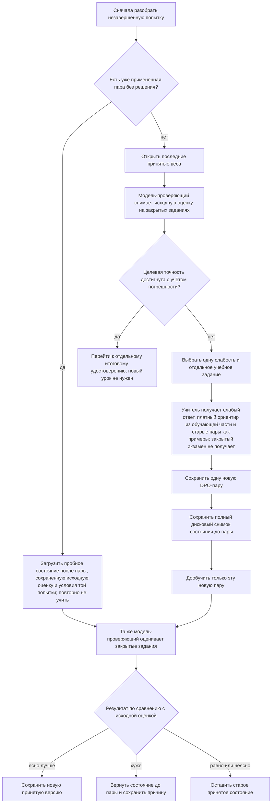
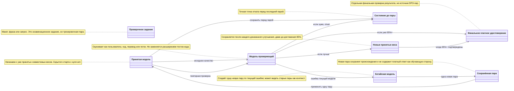
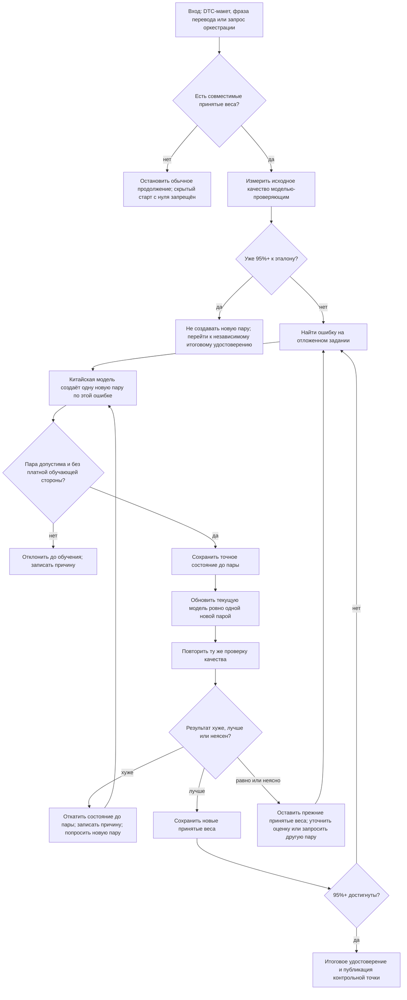

# 09.09.2026 WorkLeft — что реализовано после 26.08 и как это ведёт к исходной задаче

Программа, которая учится документировать код, теперь берёт одну новую пару, уже сохранённую в репозитории, и загружает принятую модель. Отдельный проверяющий оценивает её до и после одного урока на тех же закрытых заданиях; новая версия принимается только если прирост больше погрешности обеих оценок. Исходная оценка сохраняется на диск до изменения весов и перечитывается; если это не удалось, урок не начинается.

Следующий шаг стал проверяемой опорой: опубликованный срез `4bbb2ca622a3b589dfd3543a9af302e06f47c524` заставляет перезапущенный процесс открыть пробные веса уже применённого урока вместе с сохранённой исходной оценкой и условиями проверки, сверяет SHA-256 и продолжает оценку без повторного обучения этой пары. Состояние до урока остаётся точкой возврата. Следующая незакрытая работа — сделать этот путь частью полного durable journal и полного дискового snapshot, затем подтвердить его реальной доменной парой, весами и оценкой.

Это ещё не полный автоматический перезапуск после сбоя и не доказанные 95%. Исторический обзор с 26.08.2026 по `bc3762f800` ниже остаётся историческим обзором, а поздние опубликованные срезы `dccb486a2b` и `5d5910a902` добавляют к нему новые опоры, не расширяя старую заявленную полноту.

## Поправка к текущему статусу: хранение ≠ обучение (10.09.2026)

Опубликованный срез `4bbb2ca622a3b589dfd3543a9af302e06f47c524` добавил проверяемое продолжение после перезапуска: свежая модель открывает trial checkpoint из attempt directory, сверяет SHA-256 и при отсутствии, повреждении или несовместимости останавливается, а не начинает обучение с пустыми весами. Это доказано сборкой без ошибок и шестью целевыми тестами. Это **механизм продолжения**, а не заявление о том, что модель уже стала лучше на реальном домене.

| Граница | Что обязано быть доказано | Статус на 10.09.2026 |
| --- | --- | --- |
| Хранение DPO | Байты пары в `training-data\dpo`, manifest, SHA-256, происхождение и повторное открытие до Qwen. | Механизм есть; реальные доменные пары ещё не опубликованы. |
| Хранение модели | Байты весов/адаптера в `training-artifacts\models`, manifest, SHA-256, LFS object и независимый readback. | Загрузка/проверка кода есть; реальные опубликованные веса и remote LFS readback открыты. |
| Продолжение | Совместимые веса загружаются из диска; trial state продолжается без второго шага по той же паре. | Техническая опора опубликована в `4bbb2ca...`; durable journal и полный снимок ещё надо завершить. |
| Обучение | Одна новая пара реально изменила веса и улучшила закрытую продуктовую оценку. | Не доказано: тесты хранения и загрузки не являются метрикой качества. |

Обязательный алгоритм до первого реального запуска: `переоткрыть канонический DPO-набор → проверить manifest/SHA → не вызывать Qwen при совпадающей сохранённой паре → загрузить совместимые принятые веса → сохранить полный pre-pair snapshot → применить только новую пару один раз → оценить → принять/откатить → опубликовать bytes+manifest+SHA+LFS и сделать remote readback`.

## Что уже выполнено и что остаётся

Выполнено как кодовая основа: сохранённый DPO-набор можно открыть повторно без нового вызова Qwen; происхождение сторон пары проверяется до изменения модели; совместимая контрольная точка выбирается с диска; попытка обучения хранится отдельно от принятой версии; один урок по документации кода уже не публикуется без сравнения качества до и после; исходная оценка сохраняется и перечитывается до изменения весов. Отдельно выполнено ускорение работы с уже существующими группами тестов в коммите `2f99de5c60`; это не надо делать заново, но оно не доказывает качество обучения.

Остаётся до реального обучения: опубликовать настоящие доменные пары и веса в целевых папках канонической ветки, а не только README; научить перезапущенный процесс продолжать уже применённый урок с пробных весов и прежних условий проверки без второго обучения той же парой; сохранить полный дисковый снимок до пары, включая состояние оптимизатора и счётчики; затем провести реальный доменный цикл “оценка → новая пара → дообучение → повторная оценка → принять или откатить”. Для широкой цели отдельно остаются несколько доменов, графовые комбинации и пользовательские поверхности Design-to-Code и редакторов.

## Что сделано за период и зачем это пользователю

- Учебные пары получили происхождение и допуск. Пользователь получает защиту от обучения на безымянной строке, старом демо или платном ответе.
- DPO-наборы получили манифест, контрольные суммы и повторное открытие. Повтор той же заявки может читать сохранённый урок, а не заново просить Qwen.
- Контрольные точки получили загрузку, публикацию и восстановление после перезапуска. Следующая попытка может продолжаться от принятого состояния.
- Перевод, Design-to-Code, документация кода, отрицательный генератор, межстековый граф и оркестрация получили собственные пути к тем же учебным правилам.
- Для документации кода подтверждён технический путь изменения весов: разрешение на обучение → DPO-пары → исполнитель обучения → LoRA → новая контрольная точка.
- Оркестрация на `bc3762f800` обновляет обученную память выбора маршрута по сохранённым парам. Это меняет будущий выбор потока по близким примерам, хотя не является градиентным DPO-дообучением общей модели.
- Замороженные эталоны и калибровка дают будущей модели-проверяющему основу для честного сравнения “до/после”.
- Артефакты расширений стали повторяемее: `cc970c2204` даёт устойчивые сравнимые доказательства и изолированную проверку через API, но не доказывает живые Claude/Cursor/Codex, 54 пользовательских успеха или экономию токенов.

## Как это связано с исходным заданием

Цель текущего раунда — сохранять созданные пары и обученные веса в `llm_mvp_core` на `codex/dpo-implementation` и продолжать обучение с диска. Более широкое исходное задание — обучаемый динамический граф: разные юниты должны сами получать DPO-уроки, выбирать несколько асинхронных комбинаций “юнит / поток / оркестратор” и улучшать конкретную слабость. После 26.08 появились нужные опоры для обоих уровней: несколько обучаемых доменов, общий допуск пар, общее хранение, контрольные точки, эталоны и оркестрационная память маршрута.

Ближайший целевой цикл станет достаточным для текущего раунда, когда свяжет эти опоры в порядок “разобрать незавершённую попытку → если урок уже применён, открыть пробные веса, исходную оценку и прежние условия без повторного обучения → если незавершённой попытки нет, открыть принятую модель и снять исходную оценку → при 95% с учётом погрешности перейти к отдельному итоговому удостоверению → иначе сохранить одну новую пару и полный снимок до неё → применить только эту пару → снова проверить тем же проверяющим → принять ясное улучшение или оставить/вернуть состояние до пары”. Для полного исходного задания после этого всё ещё нужно показать работу на нескольких доменах и сочетаниях “юнит / поток / оркестратор”, с реальным улучшением конкретной слабости, а не только с проходящими проверками хранения.

Диаграмма выше описывает целевой полный цикл, а не уже закрытый автоматический перезапуск. В опубликованном коде подтверждены отдельные части этого порядка: загрузка совместимых весов, сохранение наборов, допуск пары, публикация контрольной точки, отдельная оценка сохранённой документационной модели, правило одного урока с одинаковой проверкой до/после, сохранение и перечитывание исходной оценки до изменения весов, а также возврат живого состояния тренера при сорванной записи результата. Полный шаг “после перезапуска узнать уже применённую пару, открыть пробные веса вместе с исходной оценкой и продолжить оценку без повторного обучения” ещё не подтверждён.

Человеческий порядок следующего шага описан в [PLAN-HUMAN](09.09.26WorkLeft-PLAN-HUMAN-01.md). Фактические основания корректности и границы проверки собраны в [MECH-01](09.09.26WorkLeft-MECH-01-mechanism-validation.md) и [VERIFY-05](09.09.26WorkLeft-VERIFY-05-summary-and-verdict.md).

## Что именно изменилось в кодовых путях

| Путь | Что появилось после 26.08 | Как это проверено по коду/тестам | Пользовательская польза |
| --- | --- | --- | --- |
| Допуск пары | Паспорт происхождения, авторство сторон, отказ тренера менять модель без допуска. | Читались коммиты `37ab96a8b6`, `78c24910aa`, `b4847b4d30`, `0fb0a05940`; в коде есть требование допуска перед изменением модели. | Модель не учится на запрещённом или безымянном материале. |
| Хранение DPO | Манифест, контрольные суммы, резервирование создания, повторное открытие сохранённого набора до вызова Qwen. | `a051c7d7e5`, `35b4cfe3d6`, `87cc9cb6ff`, `33080d6719`; `.gitignore` на HEAD явно не игнорирует `training-artifacts`, `.gitattributes` задаёт LFS для `weights.bin` и LF для manifest/DPO. | Повтор той же заявки не создаёт разные уроки и не уводит данные на другой диск. |
| Контрольные точки | Загрузка последней совместимой точки, продолжение с сохранённой модели, публикация следующей точки, восстановление после перезапуска. | `3cca997302`, `3b36fa9eae`, `93ffc8c223`, `1a4f757892`, `45fcf00613`; читались источники и тесты загрузчика и публикатора. | Следующая попытка может продолжаться от принятого состояния. |
| Перевод | Переводческий DPO подключён к общим правилам, командной строке и созданию пары через Qwen. | `5702f57317` … `78bb8f8e21`; проверены коммиты жизненного цикла перевода. | Перевод можно учить на конкретной смысловой ошибке с происхождением пары. |
| Design-to-Code | DesignConversion подключён к сохранённой модели, DPO-контексту и серверному приёму обучения. | `556ccc63cb`, `bdc34d3037`, `14501039f0`, `5858e3c57f`, `6dd81c80ea`. | “Макет → код” получает путь к обучению от принятой модели, а не только одиночную генерацию. |
| Документация кода | C#, Angular и SQL получили доменные профили и технический путь DPO-обновления весов. Отдельно проверяется выбор правильного обработчика для задачи документирования кода. | По прочитанному пакету источников `CodeDocumentationServerOwnedDpoTrainingExecutor.cs:1-205` ведёт к `StableDpoTrainingExecutor.ExecuteAsync`; тест `ExecuteAsync_RealTinyModelMutation...:20-70` проверяет изменение SHA модели, 1 пару, 1 шаг, непустые веса и метрики; `RefusingBroker:74-107` проверяет отказ без изменения весов. Для Angular/SQL `365b90932e` добавляет разные профили и фокус учителя; тестовые фрагменты 204 и 264–343 проверяют первые два вызова учителя и отсутствие лишних повторных вызовов. | Это уже не только запись файла: есть технический путь изменения модели для документации кода и отдельная проверка маршрута обработки. |
| Динамический граф и дополнительные юниты | Транспорт удалённых юнитов, NegativeDpoGenerator, межстековый граф и матрица дальше 50 строк. | `e6c0b259a9`, `c5948750f8`, `b13b8d04bb`, `286ecc50e9`, `825ad7393f`. | Появляются разные обучаемые единицы для будущих комбинаций “юнит / поток / оркестратор”. |
| Оркестрация | Продолжение оркестрации берёт сохранённые пары и обновляет память выбора маршрута. | `e7d9ba9e41`, `c6c3e22f29`, `08d0e35fb4`, `bc3762f800`; на HEAD это память маршрута по ближайшим примерам, не DPO-градиент общей модели. | Следующий выбор потока может учитывать прошлые принятые примеры. |
| Эталоны и калибровка | Замороженный корпус, правила сравнения перевода/документации/разметки/шагов оркестрации и результат калибровки. | `6607e012b1`, `a13df7a587`, `1f93bc5d2a`, `0763d7c1b4`, `3533c67e54`. | Будущий проверяющий может сравнивать качество модели с фиксированным эталоном. |

## Существенные несоответствия, которые ещё мешают исходной цели

1. Опубликованный код уже добавил проверку качества одного урока перед принятием новой версии: ровно одна новая сохранённая пара, принятая модель, одинаковые задания до и после, тот же проверяющий и прирост больше погрешности обеих оценок. Открытым остаётся безопасное продолжение после перезапуска: долговременно связать пробные веса с уже применённой парой, сохранённой исходной оценкой и условиями проверки, чтобы не обучать ту же пару второй раз.

2. Правила хранения зачтены, но фактическая публикация новых обученных результатов не зачтена: текущая сверка трёх точных каталогов `training-data/dpo`, `training-data/reference-corpora` и `training-artifacts/models` показывает только три README. Это не утверждение, что во всём `training-data` нет старых корпусов или материалов; их пригодность как принятой основы текущего цикла здесь не проверялась.

3. Динамический граф стал ближе к исходной цели, но ещё не доказано, что он сам выбирает несколько асинхронных комбинаций и улучшает конкретную слабость на продуктовой проверке. `2f99de5c60` — это ускорение разбора уже существующих групп тестов, а не первичное разбиение тестов и не доказательство качества модели.

## Граница выборки и полнота охвата

Период: с 26.08.2026 00:00 +03 до `bc3762f800df595710a46df1dfadb1ec94171f8f` включительно. Последний commit до границы: `fb6e4f247f03e34fdba69aeaa77d2d76e76c9d8e` от 25.08.2026 23:14:46 +03. В периоде 228 коммитов; первый — `0dc76f3ac551ed0ae88f66d8afdbadc2090498ee`, последний — `bc3762f800df595710a46df1dfadb1ec94171f8f`. Полный индекс 228 строк записан в [MATRIX-01](09.09.26WorkLeft-MATRIX-01-progress-by-dates.md#полный-индекс-228-коммитов-периода).

Диапазон `fb6e4f247f0..bc3762f800` меняет 994 файла: 154950 добавлений и 13666 удалений. Значительная часть этого объёма — проверки, доказательные артефакты, документы и переносимость, поэтому это не счёт готовых функций. Группировка построена по `git log --name-only`, заголовкам коммитов, точечному просмотру статистики выбранных commit и прочитанным пакетам исходников и проверок. Я не утверждаю, что прочитал построчно каждый diff всех 228 коммитов. Если класс существовал до 26.08, я не приписываю периоду весь класс, а только изменение, которое видно в коммитах периода.

Эта граница относится к историческому обзору до `bc3762f800`: автор обзора не запускал сборку, тесты, Qwen/Ollama, обучение, генерацию новых пар или запись весов, а репозиторий читал только в режиме чтения. История 228 коммитов ниже остаётся обзором до `bc3762f800`; она не переименовывается в новую полную проверку поздних срезов.

## Справка о поздних опубликованных срезах после обзора 228 коммитов

- Правила человеческих объяснений опубликованы в коммите `74e2bd3030`: отчёты и задания должны сначала объяснять поведение и порядок по-человечески, а технические имена оставлять справкой.
- Оркестратор в `12d5c8012a` проверяет, что изменённая память выбора маршрута записалась и снова открылась до отчёта об успехе. Это сохранность результата, не оценка качества модели.
- Документационная модель в `98b80600ee` продолжает обучение от сохранённых весов, а `1bc1fcb643` отделяет папку попытки тренера от принятой версии модели.
- Коммит `1338fcab4f` добавляет отдельную оценку сохранённой документационной модели на закрытых заданиях через Qwen-клиент только для оценки, без обучения и публикации.
- Коммит `f9e5f90e8b` возвращает прежние веса и данные оптимизатора живого DPO-тренера, если запись результата сорвалась до завершения. Это защита внутри работающего процесса, не дисковый снимок для восстановления после выключения и не решение о качестве.
- Коммит `dccb486a2b` добавляет правило одного урока перед публикацией: одна новая уже сохранённая пара, принятая модель, одинаковые задания до и после, тот же проверяющий и принятие только при приросте больше погрешности обеих оценок. Если стало хуже, равно или неясно, новая принятая версия не публикуется.
- Коммит `5d5910a902` сохраняет исходную оценку на диск до изменения весов и перечитывает её; если исходную оценку нельзя прочитать обратно, урок не начинается.
- Root сообщил свежую Windows-проверку нового кода: сборка 0 ошибок, 108 предупреждений, 1:57.47; выбранные проверки 84/84, 39.2831 секунды. Я эти команды не запускал. Маленькие учебные примеры в тестах могут проверять техническое изменение весов; это не реальное доменное обучение и не запуск Qwen/новой продуктивной пары. WSL-зелёным этот отчёт не называет: старая проверка в WSL остаётся отдельной историей с ошибками окружения `/mnt/c`.

## Ключевые commit-ссылки выполненного приложения

- Допуск пар: [`37ab96a8b6`](https://github.com/lubochka/llm_mvp_core/commit/37ab96a8b6e53f930da1b9f11a6a3edef6524258), [`78c24910aa`](https://github.com/lubochka/llm_mvp_core/commit/78c24910aad59da7af4d72b189eb6ad5a13b46e2), [`b4847b4d30`](https://github.com/lubochka/llm_mvp_core/commit/b4847b4d309dbb8b6bb158ad0dd9e3abfcd6949b), [`0fb0a05940`](https://github.com/lubochka/llm_mvp_core/commit/0fb0a059407b253c004401cf8eb1ea891dbcc226).
- DPO и контрольные точки: [`a051c7d7e5`](https://github.com/lubochka/llm_mvp_core/commit/a051c7d7e54774762a8a4adaac0066a4452dbd65), [`35b4cfe3d6`](https://github.com/lubochka/llm_mvp_core/commit/35b4cfe3d6595c0376fea523b68f1a1eee1cd4d7), [`87cc9cb6ff`](https://github.com/lubochka/llm_mvp_core/commit/87cc9cb6ff395df3050016e758b42e3a973facf9), [`3b36fa9eae`](https://github.com/lubochka/llm_mvp_core/commit/3b36fa9eae0eb2982a9a1e4f5b5b4aff8932f8c3), [`1a4f757892`](https://github.com/lubochka/llm_mvp_core/commit/1a4f757892e91429efd606265aa630df8d7d9e9c).
- Домены: [`5702f57317`](https://github.com/lubochka/llm_mvp_core/commit/5702f573172f9353ab2adb1a5b2386113f2ef3fc), [`556ccc63cb`](https://github.com/lubochka/llm_mvp_core/commit/556ccc63cb1b2ad87c59eddafecfe72621b2fb05), [`981dd21491`](https://github.com/lubochka/llm_mvp_core/commit/981dd214917cb2b005a317a31c2abcdb3a629728), [`365b90932e`](https://github.com/lubochka/llm_mvp_core/commit/365b90932e43030c22aec355a7179c558e69179b), [`286ecc50e9`](https://github.com/lubochka/llm_mvp_core/commit/286ecc50e944a0277dd0e0393c2c5756ee899f55), [`bc3762f800`](https://github.com/lubochka/llm_mvp_core/commit/bc3762f800df595710a46df1dfadb1ec94171f8f).
- Эталоны и проверяемость: [`6607e012b1`](https://github.com/lubochka/llm_mvp_core/commit/6607e012b1a6abbd0c92cb03e67110a85cadd200), [`a13df7a587`](https://github.com/lubochka/llm_mvp_core/commit/a13df7a587c3e9a8a0dda70ce0722ea17d47420b), [`0763d7c1b4`](https://github.com/lubochka/llm_mvp_core/commit/0763d7c1b43a5a92c8921cc0106f5fba2597e22a), [`3533c67e54`](https://github.com/lubochka/llm_mvp_core/commit/3533c67e54bf58ad47290446787b697aa3ef3327).

Историческое тело REPORT-01 до ревизии полной истории 26.08–09.09: сохранено как evidence-only

# 09.09.2026 WorkLeft — продуктовый отчёт по обучению, Design-to-Code, переводу и оркестрации

На 09.09.2026 стадия такая: продукт уже построил безопасный каркас для обучения — сохраняет и переоткрывает DPO-наборы, отличает допустимые пары от запрещённых, умеет продолжать работу от контрольных точек и не должен путать проверочную механику с качеством модели. Пользовательская цель следующего шага — чтобы модель улучшалась как человек ожидает от продукта: берём текущие принятые веса, находим ошибку на отдельном проверочном задании, добавляем одну новую пару от китайской модели, проверяем качество и откатываем ровно эту пару, если стало хуже. Прежние сохранённые пары можно показывать учителю как контекст, но уже принятые пары нельзя повторно применять к весам; итоговые экзаменационные задания и эталоны не превращаются в тренировочные пары.

## Следующий открытый шаг перед обучением

Нужно доказать единый путь качества: существующие принятые веса → исходная оценка моделью-проверяющим на отдельных заданиях → если уже достигнуты 95% и выше, перейти к независимому итоговому удостоверению без новой пары → если ниже, одна новая пара от китайской модели по текущей ошибке → сохранение состояния до пары → обновление модели ровно этой парой → повторная оценка → при ухудшении точный откат к состоянию до последней пары → при улучшении сохранение новых принятых весов и продолжение от них.

На закреплённом опубликованном срезе я не считаю этот цикл закрытым. Видны важные опорные части: загрузка совместимых весов, сохранённые наборы, проверка происхождения пары, публикация контрольной точки и обновление обученной памяти выбора маршрута по сохранённым парам. Но замкнутый цикл “одна пара, пользовательская проверка качества, откат перед последней парой, повторная попытка учителя” не подтверждён как готовый продуктовый путь.

## Карта оставшегося проекта

Ближайший приоритет — замкнуть цикл одной пары вокруг уже принятых весов. Это не отменяет другие открытые работы: нужно провести реальный доменный запуск с сохранёнными байтами пар и весов, оценить продуктовые задания моделью-проверяющим, отдельно довести и проверить интерфейсы и расширения. Старые пункты, которые сегодня не сверялись заново по опубликованному коду, не закрываются автоматически.

## Что получает пользователь в продукте

### Design-to-Code

Вход пользователя: макет или требование к экрану. Пример: “карточка товара: изображение, название, цена, кнопка покупки; на узком экране карточка не должна ломаться”. Ожидаемый результат — не просто файл, а структура элементов и кандидат кода: видны блок карточки, контентные зоны, кнопка, адаптивное поведение и причина, почему этот вариант лучше старого.

Что уже есть: в коде есть предметная `DesignConversionMachine`, политика предпочтений, контуры контрольных точек и проверка, что активируемая модель должна быть свежо загружена и содержать реальные обученные веса. Это полезно пользователю тем, что случайный локальный файл или пустая заготовка не должны притворяться принятой моделью.

Что ещё не доказано: что после реального обучения Design-to-Code стабильно выдаёт лучший код по пользовательским отложенным заданиям. Автоматические тесты кода проверяют границы и сохранность, но не заменяют модель-проверяющий, который смотрит на карточку, форму или экран как на продуктовую задачу.

### Перевод

Вход пользователя: исходная фраза и направление перевода. Пример: короткая неоднозначная фраза, где текущая модель выбирает неверный смысл. Ожидаемый результат — перевод-кандидат, который исправляет эту конкретную ошибку и не портит уже верные случаи.

Что уже есть: мост перевода несёт авторство сторон пары и допуск к DPO. Это значит, что выбранная/отклонённая стороны не становятся безымянными строками: сохраняется, кто написал сторону, можно ли этой стороной менять модель, и почему пара разрешена.

Что ещё не доказано: сегодняшний вызов китайской модели, новая пара по текущей ошибке перевода, улучшение качества на отложенных переводческих заданиях и точный откат при ухудшении.

### Оркестрация

Вход пользователя: запрос на работу. Пример: “разбери макет, выбери план, создай шаги проверки и не обучайся повторно на уже использованных парах”. Ожидаемый результат — выбранный поток, порядок шагов, понятные ограничения и честный запасной путь, если текущая обученная привязка потока недостаточно уверена.

Что уже есть: опубликованный `bc3762f800` использует сохранённые DPO-пары для обновления обученной памяти выбора маршрута по близким примерам. Это помогает запрос → поток/шаги: машина может изменить будущий выбор маршрута, опираясь на ближайшие обученные примеры, и не брать повторно пары, которые уже были использованы.

Что ещё не доказано: это не градиентное DPO-обучение весов общей модели и не запуск настоящего Qwen в этом срезе. Это полезное обновление маршрутизации, но не весь целевой цикл качества.

## Исправленный целевой алгоритм обучения

1. Загрузить существующие принятые совместимые веса из канонического репозитория. Если весов нет, обычное продолжение останавливается; скрытого старта с нуля быть не должно. Создание новой модели — отдельный явно разрешённый случай.

2. Прогнать исходную оценку той же моделью-проверяющим на отложенных заданиях. Эти задания не являются тренировочными ссылками и не должны совпадать с материалом, из которого строится пара. Если исходное качество уже достигло 95% и выше к зафиксированному эталону, новую пару автоматически не создавать: перейти к независимому итоговому удостоверению или остановке.

3. Найти текущую ошибку модели: в Design-to-Code это может быть потерянная кнопка или неправильная адаптация; в переводе — неверный смысл; в оркестрации — неверный поток или порядок шагов.

4. Попросить китайскую модель-учитель создать одну новую DPO-пару именно по этой ошибке. Выбранная сторона должна исправлять ошибку, отклонённая сторона должна быть близким плохим вариантом. Пара получает происхождение и допуск; платный или закрытый ответ не становится обучающей стороной.

5. Сохранить точное состояние модели до применения пары. Это состояние нужно для отката ровно “до последней пары”, а не до начала большого пакета.

6. Обновить текущую модель ровно на одной новой паре. Уже принятые идентификаторы пар исключаются из повторного обучения. Неиспользованная сохранённая пара может продолжить процесс после обрыва, но не должна сбрасывать веса и не должна запускать повторное применение всех старых пар.

Если сбой случился после применения пары, “продолжить ожидающую пару” означает продолжить её оценку; если этап или состояние сомнительны, сначала восстанавливается снимок до пары и выполняется ровно одна попытка. Это требование целевого цикла; опубликованный код целиком его ещё не доказывает.

7. Снова прогнать те же отложенные задания той же моделью-проверяющим. Здесь измеряется поведение продукта, а не факт, что контрольная точка лежит на диске.

8. Если качество ухудшилось, откатить модель точно к состоянию перед парой, записать попытку и причину, вернуть ошибку учителю и попросить новую пару.

9. Если качество улучшилось, принять новые веса, сохранить дочернюю контрольную точку с происхождением от родителя и использованной пары. Если результат равный или неопределённый, не объявлять улучшение: сохранить прежние принятые веса, уточнить оценку или запросить новую пару.

10. Если качество улучшилось, но ещё ниже порога 95% и выше, продолжать уже от новых принятых весов. Порог уже выбран: 95% и выше к зафиксированному эталону; это требование, а не полученный результат.

11. Если целевой порог достигнут, финализировать контрольную точку, манифест, происхождение, результат отложенной проверки и список принятых пар в каноническом репозитории Codex-ветки.

Протокол evaluation-only Qwen уже существует как отдельная рамка проверки, но он не равен обучению. По сохранённому решению Qwen создаёт обучающие пары и может судить урок; финальное удостоверение результата делает платная модель отдельно. Платные ответы в DPO не идут, ручной разметчик упразднён. Обучение начинается только там, где локальная модель меняет веса по допущенной паре и затем проходит пользовательскую проверку качества.

## Где проверочная механика, а где обучение

Проверочные правила обслуживают обучение: путь в репозитории, личность запроса, манифест, контрольная сумма, повторное открытие, запрет платного источника, исключение повторных идентификаторов пар, совместимость контрольной точки, карантин старых артефактов и разметка начального значения случайности. Они нужны, чтобы модель не училась из мусора, из чужого текста или из того же примера второй раз.

Обучение начинается там, где меняются веса или обучаемое состояние локальной модели по допущенной DPO-паре и затем измеряется продуктовый результат. Для общего DPO это `DpoTrainer`: он требует `DpoTrainerPairAdmission` и отказывается менять модель без допуска или при платной стороне (`DpoTrainer.cs:568-583`).

Китайская модель-учитель в целевом процессе пишет пару по ошибке текущей модели. DPO-optimizer меняет локальные веса. Модель-проверяющий после этого оценивает продуктовую задачу: карточку, перевод или выбор потока. Расширение автоматических тестов кода не доказывает стохастическое качество модели.

Оркестрация на `bc3762f800` обновляет обученную память выбора маршрута по близким примерам. Это может менять дальнейший выбор потока и шагов; граница в том, что это отдельный вид обновления, а не градиентное DPO-дообучение весов общей модели.

## UML: проектные роли будущего цикла

Легенда: эта UML показывает роли целевого продуктового цикла, а не утверждает прямые связи между конкретными классами в текущем коде. Точные существующие части кода перечислены ниже отдельными строками с файлами и ограничениями.

## Человеческая схема для одного обучающего шага

Эта схема — целевой продуктовый алгоритм. Из опубликованного кода уже есть проверка сохранённого набора, происхождения пары, части жизненного цикла контрольной точки и обновления обученной памяти маршрута оркестратора. Открыта проверка, что вся схема реально соединена как один обучающий цикл с откатом на уровне одной пары.

## Алгоритмы, которые уже видны в коде

**Открытие или создание DPO-набора.** Вход — место хранения набора и точная личность заявки. Система сначала пытается открыть уже запечатанный набор (`RepositoryOwnedDpoDatasetResolver.cs:155-162`). Если найден тот же сохранённый набор, учитель или генератор не вызывается. Если набор повреждён или записан только частично, работа останавливается с ошибкой и не перезаписывает его поверх. Новый набор создаётся только тогда, когда сохранённого набора нет: система резервирует место, вызывает генератор, запечатывает пары и снова открывает манифест (`RepositoryOwnedDpoDatasetResolver.cs:381-399`). Пользовательская польза: повтор той же заявки не тратит учителя и не создаёт разные пары для одной и той же учебной ситуации.

**Запечатывание набора.** Манифест хранит не только список файлов. В нём есть контрольные суммы платных эталонных ответов, имя открытой модели-учителя, политика создания, автор набора, контрольная сумма заявки, упорядоченный список пар и контрольная сумма самого манифеста (`RepositoryOwnedDpoDatasetManifest.cs:22-76`). Поэтому система может отличить “это тот же учебный набор” от “это похожая папка с чужими строками”.

**Отказ до обучения.** Тренер DPO требует паспорт допуска до изменения модели и останавливается, если допуска нет или одна из обучающих сторон пришла от платной внешней модели (`DpoTrainer.cs:568-583`). Набор пар читает тип автора как обязательное поле (`DpoDataset.cs:165-175`). Поэтому старые трёхполевые строки не должны тихо попасть в обучение как будто всё нормально.

**Загрузка контрольной точки.** Загрузчик идёт в каноническое дерево репозитория, открывает сохранённые кандидаты, отвергает повреждённые, отбрасывает несовместимые с текущей средой, выбирает самый поздний совместимый шаг и свежо читает веса с проверкой контрольной суммы (`RepositoryOwnedModelCheckpointLoader.cs:116-227`). Это база для требования “сначала существующие принятые веса”.

**Публикация следующей контрольной точки.** Публикатор пишет следующий номер после родительского шага для продолжения или первый номер только для явно разрешённого старта с нуля с человеческой причиной (`RepositoryOwnedIncrementalTrainingCheckpointPublisher.cs:80-148`). Это поддерживает цепочку “не начинать заново каждый раз”. Но откат на уровне одной пары и обратная связь от модели-проверяющего ещё должны быть доказаны поверх этого.

**Оркестрация на закреплённом срезе.** Команда `continue-orchestration-training` берёт новые пары из сохранённого DPO-набора, исключает уже использованные идентификаторы, передаёт пары в `OrchestrationPlanMachine` и пишет отчёт, что обновляется память маршрутизации по близким примерам, а не градиент DPO (`Program.cs:3156-3181`). Это текущая полезная функция выбора маршрута, но не полный цикл градиентного DPO-дообучения общей модели.

## Сценарии: что ожидается и что фактически доказано

| Сценарий | Ожидаемое поведение продукта | Что есть на `bc3762f800` | Статус проверки сегодня |

| --- | --- | --- | --- |

| Повтор той же заявки на DPO-набор | Второй запрос читает сохранённый запечатанный набор; учитель или генератор вызывается 0 раз. | Сначала идёт точное открытие сохранённого набора; написаны проверки `Resolver_ExistingSealedDatasetReusesDiskAndDoesNotCallCreator` и `AsyncResolver_ExistingSealedDatasetReusesDiskAndDoesNotCallCreator`. | Тест написан; сегодня не запускался. |

| Повреждённый или частичный набор пар | Система останавливается до повторной попытки учителя и до изменения модели; повреждённый материал не перезаписывается молча. | Есть проверки `OpenSealed_CorruptPairBytesFailsClosed`, `Resolver_CorruptExistingManifestFailsWithoutCallingCreator`, `Resolver_ManifestMissingButPairFilesExistFailsWithoutCallingCreator`. | Тесты найдены; сегодня не запускались. |

| Платный эталонный ответ | Платный текст не становится выбранной или отклонённой обучающей стороной; допустима только контрольная сумма и привязка для проверки. | Манифест хранит платный эталон только через контрольную сумму; README говорит, что обучающие стороны берутся из DPO-файлов; тренер запрещает платную сторону. | Тесты найдены; запуск сегодня не выполнялся. |

| Совместимая контрольная точка | Загружается свежо открытый последний совместимый шаг; повреждённый кандидат закрывает путь, несовместимый не подменяет модель. | Загрузчик выбирает самый поздний совместимый шаг и свежо читает веса; написаны проверки `PrepareStart_FailsClosedForIncompatibleOrCorruptCheckpointEvenWhenColdStartIsAuthorized`, `LoadTrainAndPublishNext_ContinuesDesignConversionFromRepositoryOwnedCheckpoint`. | Тесты написаны; сегодня не запускались. |

| Design-to-Code карточка товара | После обучения новый вариант кода лучше исходного качества по отдельным проверочным заданиям: структура, адаптация, элементы не потеряны. | Есть DTC-машина, контуры политики предпочтений и контрольных точек, а также запрет активировать модель без свежо проверенных реальных весов. | Качество моделью-проверяющим сегодня не запускалось; полный цикл открыт. |

| Перевод неоднозначной фразы | Учитель создаёт одну пару по ошибке текущего перевода; принятые веса улучшают проверочные задания, ухудшение откатывается. | Мост перевода несёт сведения об авторстве каждой стороны и допуск к DPO-набору. | Обучение и модель-проверяющий сегодня не запускались; цикл одной пары с откатом открыт. |

| Запрос оркестрации | Модель выбирает правильный поток и шаги; при низкой уверенности честно виден запасной путь. | `OrchestrationPlanMachine` использует обученную привязку потока при уверенности не ниже 0,75 и разрешённом потоке; `bc3762` обновляет обученную память выбора маршрута из сохранённых пар. | Проверки запуска сегодня не выполнялись; это не градиентное DPO-дообучение. |

## Доказательная граница этого отчёта

Срез закреплён 09.09.2026 в 09:53:06 +03:00. Проверенная опубликованная вершина совпадает с `origin/codex/dpo-implementation`: [`bc3762f800` — продолжение оркестратора на сохранённых парах](https://github.com/lubochka/llm_mvp_core/commit/bc3762f800df595710a46df1dfadb1ec94171f8f). Поздние локальные правки не включены в этот опубликованный вывод.

Рабочее дерево `C:\Projects\llm_mvp_core` во время свежей read-only проверки было нечистым: были изменены `Program.cs`, тест оркестрации, управляющие документы, навыки и README репозитория и README моделей. Я эти изменения не писал. Их нельзя считать опубликованным доказательством, даже если они двигают сохранение и повторное открытие или читаемость вперёд.

В канонических отслеживаемых Git папках на закреплённом срезе я не нашёл опубликованный новый рабочий набор пар или реальные веса для этого продолжения: основные `training-data/dpo`, `training-artifacts` и `training-data/reference-corpora` держат README-носители; отдельно есть карантин старых DPO-артефактов. Вне этих канонических папок могут существовать старые, демо или локальные модели; этот отчёт их не повышает до доказательства текущего продолжения.

Сегодня этим исполнителем не запускались сборка, тесты, Qwen/Ollama, генерация пар, запись весов или обучение. Я читал имена исходных файлов и тестов и опубликованную историю; качество в живом запуске этим отчётом не доказан.

## Дружелюбные ссылки на соседние рабочие файлы

- [Как китайская модель помогает дообучать локальную](09.09.26WorkLeft-02-teaching-chinese-model.md).

- [Как обучение входит в рабочую программу](09.09.26WorkLeft-INTEGRATION-01-training-into-work-program.md).

- [Правовая и техническая рамка DPO-наборов](09.09.26WorkLeft-RAG-01-dpo-legal-build.md).

- [Проверка алгоритмического соответствия DPO](09.09.26WorkLeft-RESEARCH-03-dpo-algorithm-conformance.md).

Эти файлы являются соседними носителями. В момент записи этого раздела я их не редактировал; текущий самостоятельный итог записан здесь и в VERIFY-05. Полный продукт также должен иметь интерфейсы и расширения для реального использования, но их проверенный запуск этим отчётом не заявлен.

## Что уже сделано и опубликовано

Сделано полезное: проект умеет сохранять учебную пару с происхождением, открывать тот же набор повторно, не брать платный ответ как обучающую сторону, выбирать совместимую контрольную точку и отделять начальное значение случайности от смыслового обучения. Пользователь получает не финальное качество модели, а проверяемую основу для первого реального обучения без подмены данных и без скрытого старта заново.

- Раскладка артефактов обучения опубликована: [`a051c7d7e5` — модельные checkpoint-адреса](https://github.com/lubochka/llm_mvp_core/commit/a051c7d7e54774762a8a4adaac0066a4452dbd65), [`3cca997302` — DPO layout и тесты](https://github.com/lubochka/llm_mvp_core/commit/3cca997302171b5121ab0998cb2e03539d61bb87).

- Resolver “сначала сохранённый набор” и жизненный цикл запечатанного набора опубликованы: [`87cc9cb6ff` — открыть сохранённый DPO-набор перед созданием](https://github.com/lubochka/llm_mvp_core/commit/87cc9cb6ff395df3050016e758b42e3a973facf9), [`044c04316b` — Design-to-Code teacher resolver](https://github.com/lubochka/llm_mvp_core/commit/044c04316bf2a8b6739a79e864d42b97c5a29923), [`7481cd021e` — повторное использование DTC набора](https://github.com/lubochka/llm_mvp_core/commit/7481cd021e0ed4e1b647664ec1c0ef970078c87e).

- Translation lifecycle опубликован в проверенной истории: [`5702f57317` — начало bridge lifecycle](https://github.com/lubochka/llm_mvp_core/commit/5702f573172f9353ab2adb1a5b2386113f2ef3fc), [`78bb8f8e21` — конец принятого диапазона translation lifecycle](https://github.com/lubochka/llm_mvp_core/commit/78bb8f8e21e3caf8f48f7711cf4f7ced3f01f6f7).

- Загрузка, сессия, публикация и восстановление контрольных точек опубликованы: [`3b36fa9eae` — loader/session](https://github.com/lubochka/llm_mvp_core/commit/3b36fa9eae0eb2982a9a1e4f5b5b4aff8932f8c3), [`93ffc8c223` — продолжение checkpoint lifecycle](https://github.com/lubochka/llm_mvp_core/commit/93ffc8c223f0e89d0e7ba1ceeeff0b68c1686405), [`a289e43377` — дополнительная загрузка/session опора](https://github.com/lubochka/llm_mvp_core/commit/a289e43377d3cbae93253ca9cf36ef4435b7d430), [`1a4f757892` — publication path](https://github.com/lubochka/llm_mvp_core/commit/1a4f757892e91429efd606265aa630df8d7d9e9c), [`061eef1317` — recovery path](https://github.com/lubochka/llm_mvp_core/commit/061eef1317789faffce1d7ae3ed8181b5d36862b), [`45fcf00613` — checkpoint recovery продолжение](https://github.com/lubochka/llm_mvp_core/commit/45fcf0061337ae425cdd6da41ea7e57897f8b87a).

- Калибровка frozen reference опубликована: [`0763d7c1b4` — frozen reference calibration](https://github.com/lubochka/llm_mvp_core/commit/0763d7c1b43a5a92c8921cc0106f5fba2597e22a), [`3533c67e54` — продолжение calibration](https://github.com/lubochka/llm_mvp_core/commit/3533c67e54bf58ad47290446787b697aa3ef3327).

- Оркестратор на сохранённых парах опубликован: [`bc3762f800` — repository-owned orchestration continuation](https://github.com/lubochka/llm_mvp_core/commit/bc3762f800df595710a46df1dfadb1ec94171f8f). Это обновляет обученную память выбора маршрута по близким примерам, не градиентное DPO-дообучение.

### Построчная карта прежних открытых строк 257–262

| Строка | Человеческое имя | Текущий вывод по опубликованной истории |

| --- | --- | --- |

| 257 | Проверка допуска обучающих пар | Кодовый механизм закрыт: паспорт допуска обязателен, тренер отказывает без допуска и при платной стороне; доказательство: [`37ab96a8b6` — допуск пары с паспортом](https://github.com/lubochka/llm_mvp_core/commit/37ab96a8b6e53f930da1b9f11a6a3edef6524258), [`dd10264d8b` — отказ старого пути до тренера](https://github.com/lubochka/llm_mvp_core/commit/dd10264d8b2a95280083c1ae951a775ca898c238), [`0fb0a05940` — изменение модели требует допуска](https://github.com/lubochka/llm_mvp_core/commit/0fb0a059407b253c004401cf8eb1ea891dbcc226). |

| 258 | Заполнение допуска в мостах | Кодовый механизм закрыт по проверенным мостам: перевод, DesignConversion, capability и wiki runner несут authorship/admission; доказательство: [`78c24910aa` — translation authorship](https://github.com/lubochka/llm_mvp_core/commit/78c24910aad59da7af4d72b189eb6ad5a13b46e2), [`b4847b4d30` — DesignConversion admission bridge](https://github.com/lubochka/llm_mvp_core/commit/b4847b4d309dbb8b6bb158ad0dd9e3abfcd6949b), [`9a165a9a3e` — capability admission](https://github.com/lubochka/llm_mvp_core/commit/9a165a9a3e185e04056da06396ff0746f7a80a04). |

| 259 | Паспорт погрешности измерения | Кодовый механизм закрыт: есть measurement noise passport, floor и gate integration; доказательство: [`0aff3293cd` — measurement noise policy](https://github.com/lubochka/llm_mvp_core/commit/0aff3293cd80cb4472de7019a8a7842b8fb5c09a). |

| 260 | Различение начального значения случайности и смысловой публикации | Кодовый механизм закрыт: начальное значение случайности не выдаётся за смысловую публикацию, скрытый `Take(50)` в рабочем пути не найден; доказательство: [`1a0f5258dd` — отказ публиковать seed как обучение](https://github.com/lubochka/llm_mvp_core/commit/1a0f5258dd46e3a8612f7bae9fecb24a2bab3de6), [`825ad7393f` — расширение матрицы до 50 строк](https://github.com/lubochka/llm_mvp_core/commit/825ad7393ff109a21e5cc0c4e2f2d9ac99ac9426). |

| 261 | Проверка состава тестовых батчей | Опубликованы batch ladder и guards: `tools/test-batches/batches.tsv`, run/verify scripts, manifest и inventory guards; доказательство: [`ec821aa82d` — checked test batch split](https://github.com/lubochka/llm_mvp_core/commit/ec821aa82dca2bc962b3c81efbc0fe7cb28745f1). |

| 262 | Карантин старых DPO-артефактов | Закрыто как hygiene/evidence boundary: старые трёхполевые наборы и seed run dirs помечены baseline-only, training/public semantic use запрещены; доказательство: [`3b5d224889` — legacy DPO quarantine](https://github.com/lubochka/llm_mvp_core/commit/3b5d22488935ce65d15b25e9d8a0d73928434788), [`1590c60ee5` — quarantine verifier cleanup](https://github.com/lubochka/llm_mvp_core/commit/1590c60ee57cdb8e4153ea7ca0d76f900226f43b). |

## Выполненное на 09.09.2026

- Отчёт переписан как человеческий продуктовый документ: сначала ближайший открытый шаг и карта оставшегося проекта, затем смысл Design-to-Code, перевода, оркестрации, целевой алгоритм обучения и UML/схема.

- Карта прежних строк 257–262 закрыта как шесть проверенных опубликованных механизмов с commit-ссылками; они больше не оставлены как “сверить потом”.

- Выполненное оставлено в конце; отчёт не заявляет запуск обучения, тестов, Qwen/Ollama, запись весов или готовность полного продукта сегодня.

## Выполненное на 09.09.2026

- REPORT-01 переписан вокруг вопроса “что реализовано после 26.08”: сначала достижения и польза, затем связь с исходной задачей, таблица кодовых путей, существенные несоответствия и граница доказательств.
- В отчёт внесён полный период 228 коммитов, факты хранения, пакет источников по документации кода и уточнение про `2f99de5c60`.
- Старое тело сохранено в свёрнутом historical/evidence-only разделе; код, тесты, навыки и исходники не менялись.
