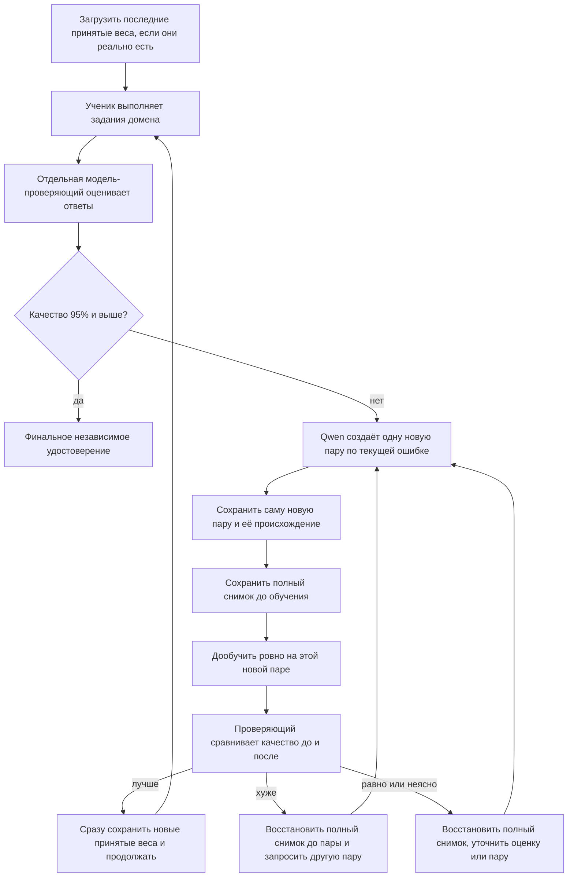

# 09.09.2026 WorkLeft — VERIFY-05: короткий вердикт по изменениям с 26.08

После 26 августа добавили сохранение и повторное чтение учебных пар, загрузку модели с диска, проверку происхождения пар, проверку изображения страницы и подключение обучения к нескольким предметным областям. Это хорошие нижние механизмы, но они ещё не являются доказательством, что модель стала лучше на пользовательских заданиях.

Узкая цель текущего раунда: сохранить пары, состояния и историю попыток в каноническом репозитории, продолжать обучение от проверенного состояния и не применять уже принятые пары второй раз как новый шаг.

Широкий контекст: исходная цель остаётся больше одного тренера — нужен динамический граф, который связывает обучающие единицы, потоки, оркестратор и асинхронные комбинации, чтобы создавать DPO по слабым местам разных доменов.

Подробности разложены в [MECH-01](09.09.26WorkLeft-MECH-01-mechanism-validation.md), плановые исправления — в [SOLUTIONS-01](09.09.26WorkLeft-SOLUTIONS-01-four-code-findings.md), общий отчёт — в [REPORT-01](09.09.26WorkLeft-REPORT-01-progress.md), человеческий план — в [PLAN-HUMAN-01](09.09.26WorkLeft-PLAN-HUMAN-01.md).

## Вердикт по группам

| Группа | Вердикт | Человеческий смысл | Исправление в плане |
|---|---|---|---|
| Учебные пары и места для весов | Правильно как механизм | Есть правила, куда класть пары, эталоны и будущие контрольные точки. Новые принятые веса этим чтением не подтверждены. | Писать: “механизм хранения есть”; не писать: “веса уже обучены и сохранены”. |
| Проверка происхождения | Правильно | Перед изменением весов проверяется, кто написал стороны пары; платный ответ не становится обучающим текстом. | Оставить платную модель для финального удостоверения 95%, не для DPO-сторон. |
| Повторное чтение уроков | Правильно как защита данных | Тот же запечатанный урок читается с диска, а учитель не вызывается заново. | Добавить отдельный журнал: какие идентификаторы пар уже применены к весам. |
| Продолжение от диска | Частично | Можно загрузить совместимое состояние и записать следующий шаг. | Добавить откат по качеству: восстановить полный снимок до пары, если стало хуже, равно или неясно. |
| Цикл одной пары | Не закрыто | Найденные пути умеют обучать набором и публиковать после инженерного успеха. Обязательной проверки качества после одной новой пары не найдено. | Сделать управляющий цикл одной пары поверх существующих механизмов. |
| Модель-проверяющий | Частично | Есть отдельный режим оценки и правила сравнения с эталонами. | Не подменять оценку отдельной модели автоматическими тестами кода или простым правилом сравнения. |
| Design-to-Code | Частично | Проверка изображения страницы появилась и полезна для сравнения макета и результата. | Связать весь маршрут: HTML/CSS, дерево, скрины, визуальный судья, пара, веса, повторная проверка, загрузка на сервер. |
| Перевод | Частично | Обучающие и проверочные строки разделены; код честно не заявляет смысловую готовность. | Добавить оценку смысла перевода до/после пары и отдельный итоговый экзамен. |
| Документация кода | Частично | C#, Angular и SQL подключены как предметы; проверяется выбор маршрута, источник, версия и передача смысла между частями кода. | Не объявлять доказанной генерацию качественной документации; добавить модельную оценку итогового текста. |
| Отрицательные пары | Частично | Появился материал “плохая сторона и причина, почему она плохая”. | Считать это уроком, а не финальной аттестацией; не смешивать внутренний порог 0.75 с требованием 95%. |
| Эталоны и правила сравнения | Правильно как сторож | Они защищают платный эталон от попадания в обучение и ловят грубые ошибки пары. | Использовать как защиту и калибровку, но не как единственную оценку человеческого смысла. |
| Оркестрация | Частично правильно | Память похожих маршрутов обновляется; старые пары исключаются; платный reference не обучает модель. | Называть это обучением памяти маршрута, не градиентным DPO и не полным динамическим графом. |
| Динамический граф | Не закрыто | Каркас верхнего слоя есть, но обучение и оценка этого слоя ещё не активированы. | План должен явно закрывать unit, flow, orchestrator, graph и async комбинации. |

## Целевой цикл, уже заданный в исправленном PLAN-HUMAN



Старые принятые пары можно показывать Qwen как контекст, но нельзя автоматически применять их к весам повторно. Рабочие диагностические задания могут породить урок; итоговые экзаменационные задания и ответы в обучение не переходят.

## Граница вердикта

Я не запускал сборку, тесты, обучение, Qwen/Ollama, браузер или сервер. Этот VERIFY основан на чтении опубликованного кода и существующих тестовых утверждений; это не проверка работы модели.

<details>
<summary>Историческое тело прежнего VERIFY-05: не текущий продуктовый вердикт</summary>
# 09.09.2026 WorkLeft — активная версия: 09.09.26WorkLeft-VERIFY-05-summary-and-verdict

> Пометка 2026-09-09 (/root/library_update): этот файл является активным носителем WorkLeft на 09.09.2026 после переименования в рабочей библиотеке. Историческое тело ниже сохранено; даты событий, исходных документов и коммитов внутри старых разделов не переписаны.
>
> Открытая работа читается первой: до сверки по опубликованным коммитам статусы кода и обучения не повышаются до «выполнено». Все старые READY/DONE/NOT_READY/BLOCKED внутри исторического тела являются историческими отметками, если рядом нет пометки 2026-09-09 или доказательства с SHA коммита.
>
> Навигация: активный префикс этого дня — 09.09.26WorkLeft-. Ссылки на текущие WorkLeft-носители синхронизированы на сегодняшний префикс; даты 23.08/24.08 и старше сохранены как архивные и исходные якоря там, где контекст является историческим.

## Историческое тело и происхождение источника

Ниже сохранён прежний текст носителя. Исторические даты, цитаты, старые статусы и строки источников не считаются сегодняшним утверждением без отдельной пометки 2026-09-09 или SHA-backed evidence.

# Сводка сверки статусов и вердикт — проход пятый из пяти

## Паспорт проверки

**Приказ владельца (дословно):** «Проверь пожалуйста что все статусы и файлы соответствуют нынешнему состоянию проекта и не противоречат тому что задокументировано в сессии — 5 проходов с opus 5 ultracode».

| Поле | Значение |
|---|---|
| Дата | 27.08.2026 (ночь; раунд 26.08-K, блок сверки статусов, проход 5 из 5, метка V5) |
| Мой предмет | не новая проверка, а **сведение четырёх проходов в один ответ владельцу**: человеческая сводка, единая таблица всех находок, готовый список исправлений и вердикт |
| Исполнитель | ограниченный архитектор-сводчик, модель Opus 5 (ultracode), максимальное усилие; вложенных агентов 0 |
| Что я делал | читал четыре файла проверки целиком; **лично перепроверил** четыре самые тяжёлые находки по диску своими измерениями (см. раздел «Что я перепроверил сам») |
| Что я НЕ делал | не запускал ничего: команд системы контроля версий 0, сборок 0, тестов 0, обучения 0, вызовов внешних моделей 0; репозиторий кода не менял; восемь исходных файлов владельца открыты только на чтение; ни одна существующая строка ни в одном файле не переписана и не удалена |
| Написано ровно в | этот один новый файл |
| Загруженные скиллы | проверки планирования (`docs/skills/plan-review-SKILL.md`, 4231 строка — **прицельно**, прочитаны дословно два раздела: устаревший носитель статуса и двойной живой канон, строки 405–428; гейт «заказанный результат должен физически существовать», строки 4164–4200); человеческого языка (`docs/skills/output-readability-gate-SKILL.md`, 904 строки — **прицельно**, прочитаны шапка и правило «внутренний номер никогда не стоит отдельно», образец 5 и тест незнакомого читателя, строки 242–310). **Честно: целиком в этом проходе не прочитан ни один файл скилла** — только названные разделы. |
| Граница честности | Я свожу результаты четырёх проходов. Там, где я не перемерил число сам, я пишу, чей это результат. Совпадение текстов не доказывает, что описанная работа сделана в коде |

**Правило чтения этого файла.** Внутренний номер никогда не стоит отдельно: сначала полное человеческое название и цель, номер — в скобках сразу после. Сокращения расшифровываются при первом употреблении: файл результатов прогона тестов (TRX — Test Results XML); обходная среда (WSL — Windows Subsystem for Linux, подсистема Linux внутри Windows); рабочая копия репозитория (worktree — отдельный каталог, привязанный к тому же хранилищу истории).

---

## Раздел 1. Человеческая сводка всей сверки — для того, кто не читал четырёх файлов

**Что проверялось.** Пять проходов подряд, одной моделью на максимальном усилии, без единого запуска чего-либо. Первый проход сверял заявленные статусы с живым кодом и диском. Второй — арифметику всех счётчиков папки и то, что за ночь построила параллельная сессия-исполнитель. Третий — не противоречит ли сегодняшний канон папки тому, что записано в журнале решений сессии и в восьми исходных файлах владельца. Четвёртый — цела ли папка после переименования всех файлов на новую дату и читаема ли новая работа. Пятый, этот, сводит всё вместе.

**Что в порядке — и это большая часть.** Смысловое ядро проекта сверку выдержало. Пять замков старта обучения описаны честно: каждый подтверждается кодом по точным ссылкам, ни один статус не приукрашен. Вся арифметика счётчиков сходится — девять независимых сложений, ни одной ошибки счёта. Битых ссылок в папке ноль: все четыреста семьдесят шесть упоминаний старых имён лечатся одним записанным правилом, ни одно имя не указывает в пустоту. Переименование сорока одного файла не потеряло и не задвоило ни одного. Решения сессии никто не переоткрыл: единственный издатель права менять веса, рубильник обучения, схема трёх ролей, порог приёмки девяносто пять процентов, седьмой предмет обучения, упразднение ручной разметки, каноническое имя ветки — всё совпадает с журналом дословно. Новые файлы раунда читаемы: голых внутренних номеров ноль, нерасшифрованных сокращений ноль.

**Что не в порядке.** Три вещи, и все три — про **отставание носителей от жизни, а не про ложь**.

Первое: проверяемая рабочая копия отстала от опубликованного состояния на двое суток и на две публикации, а доказательство красного прогона тестов физически лежит не здесь, а в параллельной рабочей копии. Человек, открывший записанный в плане путь, доказательства не найдёт.

Второе: четыре файла папки показывают мёртвые числа как живые. Владелец числа в этом же раунде объявил счёт строк работ сто семьдесят шесть историческим и поднял его до ста девяноста девяти, но по потребителям в том же шаге не прошёлся. Теперь словарь названий и путеводитель по библиотеке фактов прямым словом «живой канон» подписывают устаревшее число и указывают на имя файла, которого в папке уже нет.

Третье: сегодняшний раунд в журнале решений сессии не записан вообще — ноль совпадений строки «26.08» во всех одной тысяче ста девяноста одной строке журнала. Канон папки ушёл вперёд журнала на целый раунд.

**Насколько это серьёзно.** Данные целы, ничего не потеряно, ни одно число не выдумано. Все находки лечатся текстовыми дописками в конец файлов, без единой правки существующих строк и без единого запуска. Опасность не в сегодняшнем дне, а в завтрашнем: следующая сессия, доверившаяся слову «живой канон» или журналу сессии, будет планировать от устаревшей картины.

**Что делать.** Шестнадцать дописок, перечисленных в разделе 4, закрывают всё, кроме одного пункта: записи раунда в журнал сессии — журнал ведёт владелец, и мы в него не пишем. Отдельно заводится одна новая строка работ (номер 256) на настоящий новый дефект: параллельная сессия построила лестницу батчей тестов за ночь, и в ней три группы тестов, которым запрещено идти одновременно, разъехались по разным батчам, а целая третья сборка потеряна.

---

## Раздел 2. Что я перепроверил лично, не полагаясь на предыдущие проходы

| Что перепроверял | Мой метод | Мой результат | Совпало с проходом? |
|---|---|---|---|
| Четыре носителя мёртвых чисел | прямое чтение названных строк в четырёх файлах | все четыре **живы и не поправлены**: словарь названий несёт «Живой канон … строк работ 176, промптов пакета 86»; путеводитель по библиотеке фактов несёт слой авторитета «строк 176, промптов 86»; итог папки несёт «Строк работ — 176 … Промптов задач — 86» с указанием на файл кода 24.08; план встраивания обучения несёт «счёт строк работ остаётся 191» | ✅ да, второй проход прав дословно |
| Число файлов с устаревшим паспортом | собственный перебор всех сорока пяти текстовых файлов канона: взять первую дату в первых двенадцати строках | **35 файлов** из 45 несут первой датой 25.08 при имени 26.08. Исключений десять: два плана встраивания, два файла промптов, обзор двадцати проходов, приказ о порядке действий (18.08 — своя дата), пять файлов проверки | ⚠️ совпало с четвёртым проходом (35), **разошлось с третьим** (36 из 47) — см. находку 38 |
| Свободен ли номер новой строки работ | поиск по файлу кодовой работы по формам «номер 256», «строка 256» | **свободен**: ноль попаданий; самый старший занятый номер — 255 | ✅ да |
| Фактический счёт файлов корня | собственный листинг | **57 файлов**: 49 канонных (45 текстовых + 4 машинных зеркала) + 8 исходных владельца. Этот файл сделает **58** (50 канонных + 8) | ⚠️ записанный в указателе счёт 53/45 устарел; счёт четвёртого прохода 56/48 устарел за час |

---

## Раздел 3. Сводная таблица всех находок четырёх проходов

Находки сведены и очищены от повторов: там, где одну и ту же вещь нашли два прохода, в колонке «где нашли» стоят оба — это усиливает находку, а не удваивает её. Колонка «исполнимо ли сегодня» отвечает на один вопрос: можно ли закрыть это текстовой дописской прямо сейчас, без запуска чего-либо.

### 3.1. Высокая тяжесть — одиннадцать находок

| № | Находка | Где нашли | Что делать | Кто исполняет | Сегодня? |
|---|---|---|---|---|---|
| 1 | Проверяемая рабочая копия на **два коммита позади** опубликованного состояния: локально `e00e97449827`, опубликовано `5b5ca0dcfa` | проход 1 | синхронизировать копию отдельным нарядом; до этого в шапках статусных файлов указывать, по какому состоянию дерева посчитаны числа | исполнитель (синхронизация); дописка — наряд пересчёта счётчиков (номер 255) | дописка — да; синхронизация — нет |
| 2 | **Доказательство красного прогона лежит вне проверяемого репозитория**: по записанному пути здесь пусто, файл результата (19 МБ, 26.08 20:26) — в параллельной рабочей копии | проход 1 | дописать полный путь к параллельной копии в оба носителя числа | наряд пересчёта счётчиков (номер 255) | да |
| 3 | Словарь человеческих названий: слово **«живой канон»** стоит на мёртвых числах 176 и 86 и указывает на имя файла, которого в папке нет | проход 2, подтвердил проход 5 | датированная пометка в конец: числа исторические с 26.08; живой канон — 199 строк работ, 100 полных промптов и 10 заготовок | наряд пересчёта счётчиков (номер 255) | да |
| 4 | Путеводитель по библиотеке фактов: слово **«ЖИВОЙ канон»** на тех же мёртвых числах — притом что владелец числа назвал этот носитель поимённо и его не поправили | проход 2, подтвердил проход 5 | то же + правило чтения старых имён файлов | наряд пересчёта счётчиков (номер 255) | да |
| 5 | Итог папки: часть о счётчиках раунда C показывает 176 и 86 как текущее и ссылается на несуществующее имя файла 24.08 | проход 2, подтвердил проход 5 | датированная пометка: часть исторична относительно живого канона 26.08 | наряд пересчёта счётчиков (номер 255) | да |
| 6 | **Второй замок обучения живёт в двух видах одновременно**: файл обучения говорит «полный прогон ЖИВ, идёт прямо сейчас», итог и файл кода — «завершён красным, 390 упало» | проходы 1 и 3 | датированная пометка в файл обучения: прогон завершён, числа такие-то, прежняя формулировка историческая | наряд пересчёта счётчиков (номер 255) | да |
| 7 | **Тридцать пять файлов** носят имя с датой 26.08, а паспорт внутри говорит «версия 25.08.2026»; записанного правила чтения на этот счёт нет | проходы 3 и 4, перемерил проход 5 | одна дописка-правило в двух навигационных файлах; **шапки тридцати пяти файлов не трогать** | наряд пересчёта счётчиков (номер 255) | да |
| 8 | **Сегодняшний раунд отсутствует в журнале решений сессии**: ноль совпадений «26.08» во всех 1191 строке | проход 3 | предложить владельцу одну датированную запись; **журнал ведёт владелец, исполнитель туда не пишет** | решение владельца | требует владельца |
| 9 | Требование «промпт на каждую несделанную задачу» **сегодня неверно**: 100 полных промптов на 180 несделанных строк, и правило «заготовка — не промпт» | проход 3 | записать единое правило покрытия и честную формулировку требования | наряд пересчёта счётчиков (номер 255) | да |
| 10 | **Три группы-запрета параллельности из восьми разорваны** построенной лестницей батчей: разъехались по трём и по пяти батчам; худший случай — группа тестов, поднимающих процессы | проход 2 | новая строка работ (номер 256) | новая строка работ (номер 256) | заведение — да; починка — нет |
| 11 | **Потеряна целая третья сборка** — настольная панель наблюдения (9 проверок) не попала ни в один батч; инвариант «сумма батчей равна полному прогону» нарушен | проход 2 | та же новая строка работ (номер 256) | новая строка работ (номер 256) | заведение — да; починка — нет |

### 3.2. Средняя тяжесть — восемнадцать находок

| № | Находка | Где нашли | Что делать | Кто исполняет | Сегодня? |
|---|---|---|---|---|---|
| 12 | План встраивания обучения: «счёт строк работ остаётся 191» без оговорки, хотя владелец числа объявил 191 никогда не жившим | проход 2, подтвердил проход 5 | датированная пометка в конец файла | наряд пересчёта счётчиков (номер 255) | да |
| 13 | **Живой счёт гипотез не назначен**: прежнее число 58 объявлено историческим, наследник не назван нигде | проход 2 | назначить сложением с источниками либо записать как открытый долг | наряд пересчёта счётчиков (номер 255) | да |
| 14 | **Живой счёт файлов корня не назначен**; записанные 53 и 45 отстали от фактических 57 и 49 | проходы 2 и 4, перемерил проход 5 | назначить число и правило «счёт снимается листингом в момент чтения» | наряд пересчёта счётчиков (номер 255) | да |
| 15 | Пометки «исторический счёт» у трёх прежних чисел программы обучения (24 клетки; 8 первичных и 16 производных; 58 гипотез) объявлены обязательными и не проставлены | проход 2 | проставить пометки в носителях | наряд пересчёта счётчиков (номер 255) | да |
| 16 | **Пять строк работ имеют неверный статус**: запускалка батчей (номер 248) сделана фактически; лестница (249), сводчик (250), защита от зависания (252) и гигиена путей (254) сделаны частично | проход 2 | датированная пометка с точным перечнем недоделанного; существующие ячейки не править | наряд пересчёта счётчиков (номер 255) | да |
| 17 | **Число девяноста двух невыполненных проверок под вопросом**: пять файлов оракулов корневых возможностей — главный их источник — правились 26 августа | проход 2 | оговорка: число снято до правок и подлежит перемеру | наряд честного статуса невыполненных (номер 253) | да |
| 18 | Регистр решений **не знает о возвращении платной модели в контур**: держит её «удалённой как вариант», тогда как живая схема трёх ролей ставит её эталоном и удостоверителем | проход 3 | датированная пометка: роли разведены — судить и удостоверять можно, учить на её ответах нельзя | наряд пересчёта счётчиков (номер 255) | да |
| 19 | **«Ждущих владельца — ноль» без границы** в пяти местах регистра и в двух машинных блоках; фактически открыты два бытовых пункта вне периметра | проход 3 | добавить границу к числу везде, где оно стоит | наряд пересчёта счётчиков (номер 255) | да |
| 20 | **Три очереди «следующего действия» одновременно**: итога, плана обучения и плана батчей; приоритета между ними нет нигде | проход 3 | одна сводная очередь с приоритетами между тремя семьями | наряд пересчёта счётчиков (номер 255) | да |
| 21 | **Две несовместимые конвенции покрытия промптами**: «одна строка — один промпт» для новых строк против группового покрытия для старых; единого правила не записано | проход 3 | записать единое правило одной дописской | наряд пересчёта счётчиков (номер 255) | да |
| 22 | **Девять новых файлов раунда не зарегистрированы** ни в одной точке входа по именам; в двух главных путеводителях — ни одного | проход 4, пересчитал проход 5 | регистрация девяти имён + обновление счёта корня | наряд пересчёта счётчиков (номер 255) | да |
| 23 | **Девятьсот девяносто девять голых имён** файлов ранних дат ведут в подпапку архива, но правило чтения об архиве молчит | проход 4 | одна фраза в правило чтения ссылок | наряд пересчёта счётчиков (номер 255) | да |
| 24 | Основание строки об **отсутствии лестницы батчей устарело за ночь**: лестница построена в параллельной копии 27.08 в 00:37–00:45 | проходы 1 и 2 | пометить «основание изменилось, требуется переоценка» | наряд лестницы батчей (номер 249) | да |
| 25 | **Совпадение числа при несовпадении состава**: у плана 18 батчей и у построенного 18, но ни один батч не совпал по границам — это опаснее явного расхождения | проход 2 | записать факт рядом с проектом; план не переписывать под факт | наряд лестницы батчей (номер 249) | да |
| 26 | Имя файла обучения обещает 26.08, содержание даёт 24.08 (отпечаток дерева внутри `9d6fdba0aa`) | проход 1 | одна строка-пометка: по какому состоянию дерева посчитаны числа внутри | наряд пересчёта счётчиков (номер 255) | да |
| 27 | **Четыре обещания переносятся из отчёта в отчёт с 23.08 и не исполнены**: письменный вердикт по двум подозрительным тест-коммитам (169), судья вместо эхо-компаратора (078), человеческие комментарии в коде (198), дополнение документации (199) | проход 3 | не документное: очередь исполнителя; в итог добавить счётчик «переносится N раундов подряд» | исполнитель; счётчик — наряд пересчёта (номер 255) | счётчик — да; исполнение — нет |
| 28 | **Две объявленные колонки лестницы не работают**: «минимум строк» и «делить при повторном зависании» читаются скриптом и нигде не используются | проход 2 | внести в новую строку работ (номер 256) | новая строка работ (номер 256) | заведение — да |
| 29 | **Нет автоматического возобновления** с первого незакрытого батча: каждый запуск идёт с начала лестницы | проход 2 | внести в новую строку работ (номер 256) | новая строка работ (номер 256) | заведение — да |

### 3.3. Низкая тяжесть — одиннадцать находок

| № | Находка | Где нашли | Что делать | Кто исполняет | Сегодня? |
|---|---|---|---|---|---|
| 30 | Каркас лестницы **не отличает «сборки нет» от «фильтр ничего не нашёл»**: пустой поток вывода при коде выхода ноль назван «недействителен» | проход 2 | внести в новую строку работ (номер 256) | новая строка работ (номер 256) | заведение — да |
| 31 | Временная папка тестов снова разрослась: **437 элементов** против заявленных 349 | проход 1 | ничего сверх записанного; при исполнении строки политики очистки (номер 200) взять сегодняшнее число отправной точкой | исполнитель | нет |
| 32 | Формулировка «вся работа на одной ветке» как описание хранилища: живы 24 записи веток, зарегистрированы три рабочие копии | проходы 1 и 3 | уточнить: «одна ветка для новой работы» | наряд пересчёта счётчиков (номер 255) | да |
| 33 | Срок простоя судьи: заявлено «11 дней», фактически **16 суток** (файлы судьи не менялись с 11.08 19:45) | проходы 1 и 3 | пересчитать от даты последнего изменения, а не от даты раунда | наряд пересчёта счётчиков (номер 255) | да |
| 34 | Матрица продвижения по датам обрывается на 25.08 и не помечена «нужен дозамер» | проход 3 | дописать веху 26–27.08 | наряд пересчёта счётчиков (номер 255) | да |
| 35 | Число семнадцати тестов особенностей Windows не помечено историческим рядом с новым числом девяноста двух | проход 3 | пометить историческим | наряд честного статуса невыполненных (номер 253) | да |
| 36 | Две пары живых файлов делят номер при разном смысле: третий (реестр решений и решения владельца) и первый исследовательский (обзор двадцати проходов и программа обучения) | проход 4 | строка в словарь названий: ориентироваться по человеческому названию | наряд пересчёта счётчиков (номер 255) | да |
| 37 | Семнадцать абзацев длиннее двенадцати строк в плане встраивания обучения | проход 4 | разбить подзаголовками при следующей содержательной правке; ради этого файл не трогать | исполнитель, попутно | нет |
| 38 | **Наши собственные проходы дали разные числа устаревших паспортов**: третий говорит 36 из 47, четвёртый — 35 из 44; моя перепроверка даёт **35 из 45** | проход 5 (новая) | принять число 35 с явно названным методом измерения; расхождение объяснить разными знаменателями и моментами замера | наряд пересчёта счётчиков (номер 255) | да |
| 39 | **Записанный счёт корня устарел трижды за одну ночь**: 53 → 56 → 57 → 58 после этого файла | проход 5 (новая) | записать не число, а правило: счёт снимается листингом в момент чтения | наряд пересчёта счётчиков (номер 255) | да |
| 40 | Напряжение приоритета «код первым»: за раунд шесть документных носителей и ноль кодовых слайсов в этой папке | проход 3 | оговорить в итоге: планирование — граница архитектора, код — граница исполнителя | наряд пересчёта счётчиков (номер 255) | да |

**Итого находок: 40.** Высоких 11, средних 18, низких 11. Из них закрываются текстовой дописской сегодня — **34**; требуют работы исполнителя в коде — 5; требуют решения владельца — 1.

---

## Раздел 4. Список исправлений — точный, готовый к исполнению

Все шестнадцать — **дописки в конец файла**. Ни одна не правит и не удаляет существующую строку. Ни одна не требует запуска чего-либо. Ни одна не трогает восемь исходных файлов владельца.

| № | Файл | Место | Что дописать | Зачем |
|---|---|---|---|---|
| **Д1** | Путеводитель по библиотеке фактов (`09.09.26WorkLeft-RAG-MASTER-INDEX.md`) **и** указатель файлов (`09.09.26WorkLeft-INDEX-01-file-index-and-archive-plan.md`) | в конец пометки о переименовании канона в каждом | **Правило чтения даты внутри файла:** тридцать пять файлов носят имя с датой 26.08, а паспорт внутри — 25.08.2026; расхождение намеренное. Имя файла — про свежесть плана, паспорт — про происхождение содержимого; при расхождении датой файла считается дата в имени. Готовый текст лежит в четвёртом проходе, раздел 2.5 | закрывает находку 7: сейчас читатель видит два разных числа за первые полминуты и не знает, какое верно |
| **Д2** | Словарь человеческих названий (`09.09.26WorkLeft-GLOSSARY-human-names.md`) | в конец | Счёт «строк работ 176, промптов 86» с подписью «живой канон» — **исторический с 26.08**; живой канон — 199 строк работ, 100 полных промптов и 10 заготовок, владелец числа — секция счётчиков в файле кодовой работы 26.08 | закрывает находку 3 — самую тяжёлую, потому что там стоит прямое слово «живой» на мёртвом числе |
| **Д3** | Путеводитель по библиотеке фактов (`09.09.26WorkLeft-RAG-MASTER-INDEX.md`) | в конец | То же по смыслу **плюс**: имена вида `24.08.26WorkLeft-…` и `25.08.26WorkLeft-…` в указательных строках относятся к папке до переименования; сегодняшние имена — с приставкой `26.08.26WorkLeft-` | закрывает находку 4 и попутно снимает недоумение от ссылок на несуществующие имена |
| **Д4** | Итог папки (`09.09.26WorkLeft-00-ИТОГ.md`) | в конец | Часть о счётчиках раунда C и финальный свип того же раунда описывают состояние 25.08-C и относительно живого канона 26.08 **исторические** | закрывает находку 5: это главный обзорный файл, его открывают первым |
| **Д5** | План встраивания обучения (`09.09.26WorkLeft-INTEGRATION-01-training-into-work-program.md`) | в конец | Фраза «счёт строк работ остаётся 191» описывает промежуточное состояние проектирования; живой счёт — 199, а 191 живым не был ни минуты | закрывает находку 12 |
| **Д6** | Файл кодовой работы (`09.09.26WorkLeft-01-code-changes.md`) | в конец секции счётчиков | **Назначить живой счёт гипотез** явным сложением с указанием источника каждого слагаемого; если сложить честно нельзя — записать «живой счёт гипотез не назначен» как открытый долг со своим номером | закрывает находку 13: число объявили мёртвым, наследника не назвали |
| **Д7** | Файл кодовой работы | там же | **Назначить живой счёт файлов корня**: на 27.08 после пятого прохода — 50 канонных плюс 8 исходных владельца, всего 58, плюс подпапка архива. Числа 49, 43, 53, 54, 56 и 57 — исторические. И главное — **правило**: счёт снимается листингом в момент чтения, а не берётся из памяти | закрывает находки 14 и 39: число меняется каждым проверочным проходом, поэтому ценно правило, а не число |
| **Д8** | Файл кодовой работы | рядом с тремя прежними числами программы обучения | Проставить пометку «исторический счёт» рядом с «24 клетки», «8 первичных и 16 производных», «58 гипотез» — обязанность записана самим владельцем числа и не исполнена | закрывает находку 15: долг объявлен открыто, потерять его нельзя |
| **Д9** | Файл кодовой работы | датированная пометка в конец | **Фактическое состояние пяти строк работ**: запускалка батчей (номер 248) исполнена фактически в параллельной копии — журнал из 13 колонок и атомарная запись состояния на месте; лестница (249), сводчик (250), защита от зависания (252) и гигиена путей (254) исполнены частично, с поимённым перечнем недоделанного; оговорки к строке первого полного прогона по батчам (251) и к строке честного статуса невыполненных (253) | закрывает находку 16: сейчас пять строк зовут исполнителя делать заново то, что уже лежит на диске |
| **Д10** | Файл кодовой работы | там же | **НОВАЯ СТРОКА РАБОТ (номер 256)** — «Собрать разъехавшиеся группы-запреты параллельности обратно и вернуть потерянную сборку в лестницу батчей». Содержание: три группы из восьми разорваны по трём и пяти батчам; сборка настольной панели наблюдения с девятью проверками потеряна целиком; две объявленные колонки не работают; автоматического возобновления нет; каркас не отличает отсутствующую сборку от пустого фильтра | закрывает находки 10, 11, 28, 29, 30. **Это отдельный дефект, а не доделка лестницы**: у него своя причина и свой риск — при первом параллельном запуске батчей тесты, поднимающие процессы, столкнутся, и никто не поймёт почему |
| **Д11** | План деления тестирования на батчи (`09.09.26WorkLeft-INTEGRATION-02-test-batching.md`) | новая датированная секция в конец | **«Что построено фактически 27.08 в параллельной копии»**: три файла с путями и временем, 18 батчей, полная таблица сверки требование-за-требованием из второго прохода, пять состояний батча, две неработающие колонки, два дымовых прогона с нулевым результатом, предупреждение о совпадении числа при несовпадении состава. **Плюс оговорка к числу девяноста двух невыполненных**: пять файлов оракулов правились 26 августа, число снято до правок и подлежит перемеру. **Проект не трогать** — он остаётся тем, к чему нужно прийти | закрывает находки 17, 24, 25; факт и проект должны стоять рядом, а не вместо друг друга |
| **Д12** | Файл обучения локальной модели (`09.09.26WorkLeft-02-teaching-chinese-model.md`) | в конец | Датированная пометка: полный прогон **завершён красным** (11 059 всего, 10 577 прошло, 390 упало, 92 не выполнилось), формулировка «прогон ЖИВ, идёт прямо сейчас» — историческая; срок простоя судьи — **16 суток** от 11.08, а не 11 дней; статусы внутри файла посчитаны по состоянию дерева 24.08, более свежие числа искать в итоге и в файле кодовой работы | закрывает находки 6, 26, 33: сейчас самый важный замок — тот, что держит старт обучения — имеет два живых статуса одновременно |
| **Д13** | Итог папки **и** файл кодовой работы | в конец | Полный путь к файлу результата красного прогона в **параллельной рабочей копии** плюс честная пометка: в этой рабочей копии по записанному пути пусто, и само дерево на два коммита позади опубликованного (`e00e97449827` против `5b5ca0dcfa`) | закрывает находки 1 и 2: иначе человек откроет записанный путь, ничего не найдёт и решит, что числа выдуманы |
| **Д14** | Регистр решений (`09.09.26WorkLeft-03-decisions-register.md`) | в конец | Датированная пометка: **роли платной внешней модели разведены** — судить и удостоверять ею можно, учить на её ответах нельзя; статус «удалена как вариант» относится к боевому судье за деньги, а не к эталону измерения и удостоверителю. **Плюс граница к числу «ждущих владельца — 0»**: ноль верен для регистра шестидесяти решений и требований трёх проектов; вне периметра открыты два бытовых пункта — вопрос о переполненном диске и подтверждение замены рабочей модели (второй устарел) | закрывает находки 18 и 19: правило про границу завела сама сессия после разбора этой же ошибки |
| **Д15** | Указатель файлов (`26.08.26WorkLeft-INDEX-01-…`), путеводитель по использованию папки (`09.09.26WorkLeft-RAG-00-usage-guide.md`), путеводитель по библиотеке фактов | в конец каждого | **Зарегистрировать девять новых файлов раунда полными именами**: два плана встраивания, два файла промптов, пять файлов проверки; обновить счёт корня до фактического; **добавить в правило чтения ссылок фразу про архив**: имя файла с датой раньше 25.08 означает файл, живущий в подпапке архива под тем же именем — это история, а не пропажа | закрывает находки 22 и 23: самая свежая работа раунда сейчас невидима из точек входа, а именно её ищут первой |
| **Д16** | Файл кодовой работы **и** итог папки | в конец | Четыре мелких, но нужных пометки: **единое правило покрытия промптами** (одна строка — один промпт для новых строк 233–255; групповое покрытие для строк до 232) и честная формулировка требования владельца о промптах; **сведение трёх очередей** «следующего действия» в одну с приоритетами; **счётчик «переносится N раундов подряд»** у четырёх неисполненных обещаний; **веха 26–27.08** в матрицу продвижения по датам; уточнение «одна ветка для новой работы» вместо «вся работа на одной ветке» | закрывает находки 9, 20, 21, 27, 32, 34, 35, 36, 38, 40 |

**Не закрывается дописской — требует решения владельца (одна позиция).**

| Что | Почему не наша дописка | Что предлагается |
|---|---|---|
| Запись раунда 26.08-K в журнал решений сессии (`Claude session decisions.md`) | Журнал ведёт владелец. Это один из восьми исходных файлов владельца, и наряд прямо запрещает в них писать | Предложить владельцу одну датированную запись: шесть новых носителей, двадцать три новые строки работ (номера 233–255), два новых файла промптов, счёт строк работ 176 → 199, счёт промптов 86 → 100 полных плюс 10 заготовок, пять файлов проверки блока сверки статусов |

---

## Раздел 5. Вердикт

### 5.1. Соответствуют ли статусы и файлы нынешнему состоянию проекта

# **ДА С ОГОВОРКАМИ.**

**Основание «да».** Проверено двадцать шесть заявлений о состоянии проекта — совпало шестнадцать, разошлось семь, три остались непроверяемыми без запуска. Все пять замков старта обучения подтверждаются кодом по точным ссылкам, и ни один не приукрашен: третий замок честно объявлен нетронутым, и код это подтверждает — признак заявленности судьи жёстко выставлен в ноль. Вся арифметика счётчиков сошлась: девять независимых сложений, ноль ошибок счёта. Целостность папки после переименования сорока одного файла подтверждена: битых ссылок ноль, потерь ноль, задвоений ноль. Читаемость новой работы чистая: настоящих нарушений правила «внутренний номер не стоит отдельно» — ноль.

**Основание «с оговорками».** Носители статусов отстали от жизни на двое суток. Проверяемое дерево на два коммита позади опубликованного; доказательство красного прогона физически лежит в другой рабочей копии; четыре файла подписывают мёртвые числа словом «живой»; тридцать пять паспортов противоречат собственным именам; пять строк работ зовут делать то, что за ночь уже сделала параллельная сессия. Ни одна из этих оговорок не означает, что кто-то соврал. Все они означают одно: **работа идёт быстрее, чем обновляются носители статусов**.

### 5.2. Противоречат ли статусы и файлы тому, что задокументировано в сессии

# **ДА — в двенадцати местах, из них четыре тяжёлых.**

**Но важно, ГДЕ именно противоречат.** Смысловое ядро решений сессии сверку выдержало полностью: единственный издатель права менять веса, включённый рубильник обучения, схема трёх ролей с лицензионной границей, порог приёмки девяносто пять процентов и корректно уступившие ему прежние пороги, седьмой предмет обучения, упразднение ручной разметки, каноническое написание имени ветки — всё совпадает с журналом дословно. **Переоткрытий закрытых решений ноль.**

Противоречия сидят не в решениях, а в трёх местах: (1) в **носителях статусов**, которые не догнали живой канон; (2) в **отсутствии записи раунда в журнале** — канон папки ушёл вперёд журнала на целый раунд; (3) в **двух формулировках требований владельца**, которые звучат как закрытые, а на деле закрыты частично — промпт на каждую несделанную задачу и заявка «ждущих владельца ноль».

### 5.3. Что из найденного — дефект нашего раунда, а что унаследовано

Разделение честное: раунд, который сам себя проверяет, обязан признать свои дефекты первым.

**Дефекты нашего раунда 26.08-K — двенадцать.** Все они одного класса: раунд шагнул вперёд и не прошёлся по потребителям в том же шаге.

| Дефект | Почему наш |
|---|---|
| Четыре носителя с мёртвыми числами (находки 3, 4, 5, 12) | владелец числа объявил счёт 176 историческим **в этом раунде** и потребителей не обошёл — это ровно устаревший носитель статуса |
| Тридцать пять паспортов против имён (7) | породил наряд переименования **этого** раунда |
| Живой счёт гипотез не назначен (13) | объявили число мёртвым в этом раунде, наследника не назвали |
| Живой счёт файлов корня и его устаревание за ночь (14, 39) | наш собственный счёт, снятый и не обновлённый |
| Девять новых файлов не зарегистрированы в точках входа (22) | файлы рождены этим раундом |
| Три очереди «следующего действия» (20) | две из трёх очередей заведены этим раундом |
| Две конвенции покрытия промптами (21) | новое правило «одна строка — один промпт» ввели новые файлы этого раунда |
| Пометки «исторический счёт» объявлены и не проставлены (15) | обязанность записана в этом раунде |
| Разные числа устаревших паспортов у наших же проходов (38) | чистый дефект этого блока проверки |

**Унаследовано из раундов 23–25.08 и извне — двадцать восемь.**

Отставание дерева на два коммита, доказательство в параллельной копии, разрыв групп-запретов и потерянная сборка — это **не наши дефекты вообще**: их источник — параллельная сессия-исполнитель, работавшая ночью. Наш дефект был бы противоположный: объявить план исполненным, потому что число батчей совпало. Мы этого не сделали.

Срок простоя судьи, формулировка «одна ветка», разросшаяся временная папка, четыре неисполненных обещания, платная модель в регистре решений, «ждущих ноль» без границы, матрица дат до 25.08, число семнадцати тестов Windows, две пары файлов с одним номером — унаследованы из прежних раундов и просто дожили до сверки.

---

## Раздел 6. Честная граница — что этой сверкой НЕ проверялось

1. **Тесты не запускались.** Ни одного. Зелёное дерево или красное на сегодняшнем опубликованном состоянии — неизвестно. Самое свежее закрытое число (390 упало, 92 не выполнилось) относится к предыдущему коммиту и снято до правок пяти файлов оракулов.
2. **Коммит-состояние не смотрели.** Команд системы контроля версий выполнено ноль. Выводы о коммитах и ветках получены чтением служебных файлов каталога истории как обычных текстовых — это чтение, а не команда. Закоммичено ли построенное параллельной сессией — **неизвестно**; возможно, эти файлы существуют только в рабочем дереве.
3. **Журнал решений сессии ведёт владелец — мы в него не пишем.** Отсутствие записи раунда мы констатируем, но исправить не можем и не пытались.
4. **Сборок ноль, обучения ноль, вызовов внешних моделей ноль.** Репозиторий кода не изменён ни на байт.
5. **Я не перепроверял все находки предыдущих проходов.** Лично перемерил четыре: четыре носителя мёртвых чисел, число устаревших паспортов, свободу номера новой строки работ, счёт файлов корня. Остальное принято как доказательство соответствующего прохода с указанием, чей это результат.
6. **Три заявления первого прохода остались непроверяемыми:** строка об удалении старой загрузки контрольного состояния политики (номер 017); основание «одна метка-категория на весь проект»; содержимое двух неполученных коммитов.
7. **Отрицательные доказательства слабее положительных.** Вывод «прогонов обучения не было» опирается на отсутствие артефактов на диске. Отсутствие следа не доказывает отсутствие события.
8. **Разъезд классов по батчам вычислен вручную**, сопоставлением имён с правилами лестницы, а не запуском отбора тестов.
9. **Ни один вывод этого файла не является приёмкой работы.** Приёмку выносит родитель-архитектор личной проверкой актуального результата.

---

## Машинный блок (после человеческого текста)

```text
subagent_id_or_NONE: UNKNOWN_IN_SUBAGENT
round: 26.08-K
block: verify
pass: 5/5
marker: V5
requested_model: Opus 5 (ultracode)
requested_reasoning_effort: maximum
skill_load_status: plan-review-SKILL.md = TARGETED (4231 lines total; read verbatim :405-428 stale-status-carrier/dual-live-canon, :4164-4200 Assigned-Deliverable-Exists gate);
  output-readability-gate-SKILL.md = TARGETED (904 lines total; read verbatim :1-90 header, :242-310 Pattern 5 NO_BARE_IDENTIFIER_RULE + stranger-reader test);
  honest_note: no skill file read in full this pass; two files targeted only
files_created: 1
files_modified: 0
existing_lines_rewritten_or_deleted: 0
luba_source_files_touched: 0
repository_files_touched: 0
passes_consolidated: 4 (V1, V2, V3, V4)
findings_total: 40
high: 11
medium: 18
low: 11
findings_new_in_this_pass: 2 (38 cross-pass stale-passport count mismatch; 39 root-file count staleness within one night)
findings_closable_by_append_today: 34
findings_requiring_executor_code_work: 5
findings_requiring_owner_decision: 1 (session journal entry)
fixes_listed: 16
owner_decision_items: 1
new_work_row_proposed: 256
new_work_row_number_free_verified: true (0 hits for "номер 256"/"строка 256" in code-changes file)
personally_reverified_this_pass: 4 (four dead-number carriers; stale-passport count; free row number; root file count)
stale_passport_reconciled_count: 35 of 45 canon text files (V3 said 36/47, V4 said 35/44; method stated: first date in first 12 lines)
root_files_actual_before_this_file: 57 (49 canon + 8 owner sources)
root_files_actual_after_this_file: 58 (50 canon + 8 owner sources)
verdict_status_vs_reality: ДА С ОГОВОРКАМИ / YES_WITH_CAVEATS
verdict_vs_session_docs: ДА, противоречат в 12 местах / YES_12_CONTRADICTIONS (heavy 4, medium-heavy 1, medium 3, light 3, tension 1); decisions_reopened: 0
defects_of_this_round: 12
defects_inherited_or_external: 28
git_commands_run: NONE
dotnet_run: false
builds_run: 0
tests_run: 0
training_runs_started: 0
model_calls: 0
nested_agents: 0
nothing_executed: true
```

---

## Границы этого файла

Этот файл — пятый и последний проход блока сверки статусов раунда 26.08-K. Он не проводит новой проверки кода, счётчиков или документации — это сделали проходы с первого по четвёртый; он сводит их результат, добавляет две собственные находки и выносит вердикт. Шестнадцать перечисленных дописок этим файлом **не выполнены** — они описаны как готовые к исполнению. Ни одна существующая строка ни в одном файле папки и ни в одном файле репозитория этим проходом не изменена.
---

## 09.09.2026 — завершено структурной правкой рабочей библиотеки

- Файл переименован на месте: `26.08.26WorkLeft-VERIFY-05-summary-and-verdict.md` → `09.09.26WorkLeft-VERIFY-05-summary-and-verdict.md`.
- Добавлена текущая ревизионная пометка 2026-09-09; историческое тело сохранено без переписывания дат событий и коммитов.
- Завершение ограничено структурой документа: переименование и синхронизация ссылок выполнены для активной библиотеки, но статус кода и промышленное обучение не заявлены выполненными без отдельной сверки по SHA коммита.

### Старый хвост предыдущей активной правки

Этот раздел перенесён внутрь исторического блока при редакции 09.09.2026, чтобы снаружи оставался только текущий результат.

## Выполненное на 09.09.2026

- VERIFY-05 переписан так, чтобы первый экран показывал текущий продуктовый вердикт, а не старую машинную сводку пяти проходов.
- Старое тело сохранено как историческое свидетельство в свёрнутом разделе.
- Добавлены роли целевого цикла, три ветки результата после одной пары и точная граница: опубликованный `bc3762f800` поддерживает сохранённые пары и выбор по близким обученным примерам, но не доказывает полный цикл качества с откатом после каждой пары.
</details>

## Завершено этим языковым проходом 09.09.2026

Активный раздел переписан человеческим русским языком без первого экрана из технических ярлыков. Факты предыдущего code-reading аудита сохранены, но технические имена сведены к источникам и доказательным строкам. Историческое тело выше оставлено в свернутом разделе как evidence-only. Код, AGENTS, skills, NDJSON, исходные источники, тесты, сборка, браузер, Qwen/Ollama и обучение не запускались и не менялись.
