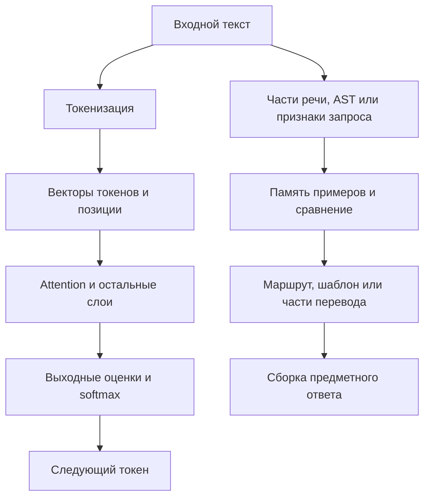

# Что именно улучшали эксперименты Xiigen и почему это работает

Дата разбора: 23 октября 2026 года. [Навигация](README.md) · [Формулы книги](BOOK-FORMULAS.md) · [Указатель документов](SOURCE-INDEX.md) · [Поиск и следующий проход](RETRIEVAL.md).

## Главный результат разбора

В сохранённых опытах есть несколько разных способов получить пользу: сохранить нужные признаки в учебном примере, переиспользовать выученные части ответа, правильно выбрать запись из памяти, сохранить историю оптимизатора и дешевле выполнить ту же арифметику. Каждый из этих механизмов действует в своей части системы. Поэтому объяснять все результаты одним изменением «матрицы вероятностей» было бы неточно.

Ниже для каждого механизма разобраны обычное устройство, изменение, результат и простая математика. **Числа взяты из сохранённых опытов; формулы книги объясняют устройство и условия, при которых механизм может помочь.** Формулы, самостоятельно выведенные из алгоритма, подписаны отдельно. Новое обучение в этом проходе не проводилось.

Снимок исходников и результатов: `llm_mvp_core@916c93cc96a674fd65d82b382c5277532fc5b717`. Книга: `xiigen-planning@d80d25515ba7e475a1cd9111d3f012e9b3805bee`; её опубликованный индекс охватывает PDF 1–600. Для этого объяснения непосредственно проверены необходимые разделы, а не заново прочитаны все 600 страниц. Реестр различает прочитанные тексты, первичные результаты, указатели Git LFS и документы, включённые только для навигации.

## 1. Где в системе вообще можно сделать изменение

В обычном нейронном пути токенизатор разбивает текст на элементы и присваивает им номера. Таблица embedding превращает номера в числовые векторы. Слои Transformer смешивают информацию между позициями, а выходная матрица превращает последнее представление в оценки возможных следующих токенов. Softmax делает из оценок вероятности. При обучении ошибка идёт назад по этой цепочке, а оптимизатор меняет разрешённые коэффициенты. Это соответствует определениям embedding, attention и выходного градиента в книге: [B01–B03](BOOK-FORMULAS.md#b01).

В проекте также есть пути, где ответ получается из структурных признаков и памяти примеров. Они могут выбирать маршрут, перевод, шаблон или готовый план. Эти операции необходимо проследить до конкретного потребителя ответа.

Это карта двух семейств механизмов, а не утверждение, что каждый эксперимент выполнял обе ветви.

| Этап | Что там хранится или вычисляется | Примеры из разобранных опытов |
|---|---|---|
| Обучение токенизатора | Словарь и правила слияния BPE | BW01, BR01 |
| Представление учебного примера | Части речи, соседство, типы узлов AST, смысловая область метода | T-TRAIN-CONTEXT-01, E25, MKSC01 |
| Правильная учебная метка | Какой совет или класс должен быть целевым | NG01, N-KU-01, FILE-STATIC-RECEIVER-01 |
| Запись и удержание памяти | Примеры, соответствия фраз, признаки маршрута | P125, RETENTION-M1-01, KH-EXT-01 |
| Чтение памяти | Допустимые кандидаты, расстояние, нормализация запроса | E18, E22, E23, IDENTITY-M1-01, KR01 |
| Порядок и сборка ответа | Применение схемы к словам или знакомым частям | E27, переводческая композиция P125 |
| Обучаемые нейронные веса | Коэффициенты небольших сетей либо LoRA-поправки | E48; RP01 и MC01 используют другие, явно названные модели |
| Оптимизатор и продолжение | История градиентов, номер шага, сохранённый старт | MC01, PARENT-ADOPTION-01 |
| Внутренняя арифметика | Умножение матриц, перестановка осей, нормировка, softmax | GRADB, AT01, RD01, MB01, SEXP01 |

### Три разных объекта, которые легко назвать одной «матрицей»

**Матрицы весов** — например, \(W_Q,W_K,W_V\). Это коэффициенты, которые задают преобразование признаков.

**Матрица внимания** вычисляется для данного входа:

\[
Q=XW_Q,\quad K=XW_K,\quad V=XW_V,
\qquad A=\operatorname{softmax}_{row}\!\left(\frac{QK^\top}{\sqrt{d_k}}\right),
\qquad Y=AV.
\]

Элемент \(A_{ij}\) показывает, сколько информации позиция \(i\) берёт у позиции \(j\). Это формулы книги, глава 2, печатные страницы 31, 33 и 38 / PDF 67, 69 и 74. [Точный источник и объяснение](BOOK-FORMULAS.md#b02).

**Выходные вероятности** отвечают на другой вопрос — какой токен выдать:

\[
p=\operatorname{softmax}(hW_{out}+b).
\]

Здесь \(h\) — представление, полученное моделью. В книге та же выходная конструкция используется в §9.3 и Theorem 9.5. KNN-память с примерами не является ни \(A\), ни \(W_{out}\). Если улучшили признаки KNN, нельзя автоматически говорить, что обучили эти нейронные матрицы.

## 2. Значение слова: сохранить контекст до того, как выбирать перевод

### Как устроено обычное сравнение

Словарь может иметь несколько переводов одного слова. Если при записи уроков оставить только само слово, обе записи выглядят одинаково. При равном расстоянии выбор определяется приоритетом или порядком хранения.

### Что сделали в T-TRAIN-CONTEXT-01

В обоих вариантах записали два урока для `book`. В первом контекст был пустым. Во втором вместе с переводом сохранили части речи соседей:

- «книга»: слева определитель, справа глагол;
- «бронировать»: слева местоимение, справа существительное.

Читатель словаря и его код не менялись. Изменился **состав информации, которую записали в обучаемую память**. До уроков оба варианта давали 0/4. После них вариант без контекста давал **2/4**, вариант с контекстом — **4/4**. Два вопроса имели одинаковый вход, поэтому отдельно правильно говорить **1/3 → 3/3 на уникальных входах**. Части речи в опыте заданы заранее; полный разбор предложений не проверялся. [Первичный отчёт][ttrain].

### Простая математика именно этого кода

Читатель выбирает запись с наименьшей суммой штрафов за левый и правый контекст. Если на непустой стороне есть хотя бы один общий POS-тег, она добавляет 0; если общих тегов нет — 1,5. Пустые контексты имеют отдельные штрафы. На проверенных входах правильная запись с контекстом получает расстояние 0, неправильная — 3. При пустом контексте обе записи получают 2, и первой остаётся «книга». Это запись алгоритма `ContextDistance`, а не формула нейронного градиента. [Код][context-code].

Общую причину можно выразить ещё проще:

\[
\phi(x_1)=\phi(x_2)\quad\Longrightarrow\quad f(\phi(x_1))=f(\phi(x_2))
\]

для одного и того же детерминированного читателя \(f\). Если представление \(\phi\) скрыло различие, читатель не может его использовать. Добавление контекста делает нужное различие видимым. Это наше логическое следствие; книга даёт близкую строгую постановку потери информации о порядке в Proposition 5.15, с её собственными условиями. [B06](BOOK-FORMULAS.md#b06).

**Что показано:** два смысла конкретного слова стали различимы после двух уроков. Токенизатор BPE, матрица attention и LoRA здесь не изменялись. Из этого опыта не следует обучение грамматическому роду или доказательство того, что конкретный продуктовый вызывающий код уже теряет контекст.

## 3. Структура предложения: сравнивать соседние части речи

В E25 исходный простой вариант выбирал схему по ограниченным признакам начала последовательности. Улучшенный классификатор сохранял учебные последовательности частей речи и для нового входа искал три ближайших примера. Близость считалась по **парам соседних частей речи**, затем побеждала наиболее частая метка среди трёх соседей. Результат выбранного сохранённого запуска: **11/32 → 28/32**. [Результат][e25-raw] · [Код классификатора][pattern-code].

Например, две разные фразы могут иметь одну структуру «существительное → глагол → существительное». Конкретные слова различаются, но часть задачи о порядке у них общая. Здесь система повторно использует схему по признакам, а не учит каждую полную фразу отдельной нейронной поправкой.

Формула из кода — коэффициент Жаккара:

\[
J(F_1,F_2)=\frac{|F_1\cap F_2|}{|F_1\cup F_2|},\qquad d=1-J.
\]

\(F_1,F_2\) — множества соседних POS-пар. Сверху число общих пар, снизу число всех различных пар. Чем больше общая структура, тем ближе примеры. После выбора соседей применяется обычное голосование по меткам. В используемом коде есть отдельная обработка пустых множеств.

**Почему математически это разумно:** часть локального порядка сохранена в признаках. В книге Proposition 5.15 объясняет, почему потерянный порядок нельзя восстановить одним обучением весов в архитектуре, которая его не различает. Это поддерживает необходимость сохранять информацию. E25 измерил пользу всей комбинации представления, памяти примеров и правила выбора; отдельный вклад POS-биграмм этим сравнением не изолирован. [B04 и B06](BOOK-FORMULAS.md#b04).

**Граница:** это синтетические шаблоны. Множество биграмм не хранит весь порядок, кратность, род или все смысловые роли. В позднем PQ01 на панели того же семейства отдельно обнаружено 26 точных учебных повторов среди 32 экзаменационных строк. В этом повторном разборе весь прирост пришёлся на знакомые последовательности: **9/26 → 26/26**; на шести новых осталось **2/6 → 2/6**. Поэтому 28/32 нельзя представлять качеством на независимо новых семействах предложений. PQ01 при этом показал другой полезный эффект: один раз строить множество запроса вместо повторной сборки — **на 41% меньше выделений памяти**, при тех же ответах. [PQ01][pq01].

## 4. Перевод новых сочетаний: выучить части и использовать их вместе

### Где было изменение

В P125 изучалась существующая переводческая единица `ExecutorUnit`. Урок содержал полный пример перевода и **уже заданные соответствия частей**, `phrase_mappings`. Эти соответствия были материалом учителя. Эксперимент не показывал, что ученик сам нашёл выравнивание частей в двух предложениях.

После восьми уроков пустая память стала правильно отвечать на **19 из 24** заданий: восемь учебных, три близких и восемь новых сочетаний знакомых частей. В отдельном сравнении загрузчика один вариант передавал полный перевод, но терял `phrase_mappings`; другой передавал и их. При тех же восьми уроках получилось **11/24 → 19/24**, а на новых сочетаниях — **0/8 → 8/8**. Это особенно ясная причинная проверка: нужные части урока начали доходить до обучаемой памяти. [P125][p125] · [Сравнение загрузчика][ingress].

### Как это работает внутри

В просмотренном теле `ExecutorUnit` порядок чтения такой: точное совпадение исходной фразы → сборка по фразовым соответствиям → сборка по словарным соответствиям → поиск KNN → резервные пути. Старый комментарий перед этим блоком описывает порядок неточно; в RAG указан исполняемый код. В P125 таблица WordMaps оставалась пустой; положительная композиция шла через фразовые соответствия. [Код][translation-code].

Краткая математическая запись этого алгоритма:

\[
T(u_1,\ldots,u_k)=g\bigl(m(u_1),\ldots,m(u_k)\bigr).
\]

\(m\) — выученные соответствия частей, \(g\) — способ их сборки. Это наша запись наблюдаемого алгоритма. Если нужные части известны и правила сборки подходят, система может получить новое сочетание без отдельного урока на всю фразу. Книга не содержит теоремы о корректности конкретного переводчика Xiigen; [B03](BOOK-FORMULAS.md#b03) объясняет похожий принцип совместного использования признаков для градиентного обучения, но данный переводческий опыт обновлял память.

**Существенная граница:** неизвестные части иногда пропускались. Реальный пример из опыта: `do not delete the file` превратилось в `удали файл`. Вопрос `did you delete the file` тоже превратился в команду. В причинном сравнении загрузчика число ошибочно принятых ответов выросло с 1 до 3. Следовательно, правильная сборка знакомых частей ещё требует сохранения отрицания, вопроса и связей между частями. [Граничные ответы P125][p125].

Отдельный P25 восстановил сохранённую память и воспроизвёл все 24 выхода, сохранив 19/24 качества. Это подтверждение сохранности приобретённого состояния при перезапуске. [P25][p25].

## 5. Код и предметные функции: дать сравнению правильный объект и правильную метку

### Структурные признаки кода

В структурных KNN-опытах код превращали в признаки синтаксического дерева: тип узла, родитель, глубина, положение среди соседей и другие явно указанные координаты. Имена переменных могут меняться, а конструкция «цикл с условием» оставаться похожей. Тогда один пример может помогать на другом коде с той же структурой.

Математика здесь та же, что в любом поиске по признакам: сравниваются \(\phi(code)\), а не исходные строки. Но качество зависит от того, что \(\phi\) сохранила. Поздний E09 содержит положительные результаты, однако часть старых сравнений считала baseline на всех позициях, а KNN только на первых 500. В документах это разобрано отдельно; сильный процент из такого сравнения нельзя выдавать за чистый эффект признаков. [Разбор E09][e09-study].

### Исправление того, чему учат

MKSC01 изменил **целевое описание следующего метода**. Прежде вложенная локальная функция или лямбда могла приписать внешнему методу свой тип поведения. В опыте признаки цели строили по области внешнего метода, не спускаясь внутрь таких функций. Входные признаки запроса, расстояние Жаккара и число соседей сохранили. После обучения правильных ответов стало **4/4 вместо 2/4**, на целевых случаях — **2/2 вместо 0/2**, два внешних контроля сохранились. В raw два целевых ответа до обучения уже были верны; табличную опечатку отчёта «0/2 до» нельзя переносить в новый разбор. [MKSC01][mksc] · [Исходные данные A][mksc-a] · [Исходные данные B][mksc-b].

NG01 исправил другой источник ложной метки: числовая проверка вида `int is > ...` учитывалась как будто она защищает обращение к объекту от `null`. После уточнения разметки правильных учебных меток стало **12/12 вместо 9/12**, целевой ответ исправился, три контроля сохранились. Менялась разметка учителя, а не формула расстояния или LoRA. [NG01][ng01].

Почему это важно математически, видно и из формулы книги:

\[
\nabla_W\ell=x^\top(p-t).
\]

\(t\) — правильная цель. Если она ошибочна, даже правильно вычисленный градиент направляет обучение к ошибочной цели. В KNN вместо градиента неверная метка сохраняется рядом с примером и затем участвует в голосовании. Это два разных способа распространить ошибку разметки. Формула нейронного случая — Theorem 9.5, печатная 282 / PDF318. [B03](BOOK-FORMULAS.md#b03).

Из этого не следует, что любое добавление признаков полезно. В N-KU-01 исправление метки do-while убрало три ложных совета добавить цикл, но ухудшило единственный случай, где цикл действительно требовался: изменилось большинство меток, а входные признаки всё ещё плохо различали эти случаи. Это полезный частичный результат с конкретной потерей. [Реестр кандидатов][required].

## 6. Выбор маршрута, набора данных и шаблона

### Маршрут по признакам задачи

В положительном E18 сравнивались простое правило по ключевым словам и KNN по размеченным предикатам запроса. На выбранном сохранённом запуске результат — **33/40 → 38/40**. Система училась выбирать предметный класс: вопрос о коде, исправление ошибки, изменение кода, оркестрация или архитектура. Улучшался выбор маршрута, а не свободная генерация решения. [E18][e18-raw] · [Прослеживание потребителей][e18-study].

Для такого KNN можно записать:

\[
\hat y(x)=\arg\max_c\sum_{i\in N_k(\phi(x))}\mathbf1[y_i=c].
\]

Из ближайших по признакам уроков выбирается самый частый класс. Это формула алгоритма голосования; сама книга не доказывает превосходство данного набора предикатов. Польза возможна, когда близость в признаках действительно соответствует близости задачи.

Поздний E22 применял похожую идею к выбору **нескольких наборов данных**. Средняя по классам F1 выросла **0,4709 → 0,5646** против выбора трёх самых частых наборов. Но TypeScript и Tests в этом запуске имели F1=0. Это измеренный общий прирост с провалами отдельных классов, а не одинаковое освоение всех тем. Панели E18/E22 построены из синтетических предикатов и заданных правил разметки; здесь не измерялось понимание произвольного реального проекта. [E22][e22-raw].

У E24 важно сохранить поздний положительный результат, даже если более ранний разбор считал опыт неуспешным: 7 мая показатель шума упал **0,4121 → 0,125**, атрибуция составила **12/16**. Но обученный в runner KNN не передавался реально вызываемому маршрутизатору. Кроме того, показатель шума зависел от длины результата и мог поощрять обрезанный ответ. Поэтому это результат конкретной обработки и метрики; причинное улучшение за счёт обученного KNN здесь не установлено. [Поздний E24][e24-raw] · [Исполняемый runner][e24-code].

E40V2 дал **14/21 → 21/21** на выборе уровня доверия. Это синтетическая задача из повторяемых заранее размеченных шаблонов источников. KNN по семи признакам источника — внутренний ли он, есть ли CI и тесты, давность обновления, популярность, официальная документация и совпадение предметной области — воспроизводит уровни HIGH/MEDIUM/LOW. Это не доказывает оценку истинности произвольного ответа. [Результат E40V2][e40-raw] · [Генератор данных и признаки][e40-code].

### Шаблон по относящимся к нему признакам

E23 фильтровал признаки до словаря доступных шаблонов и выбирал ближайший по Жаккару шаблон. В сохранённой панели совпадение с ожидаемым шаблоном выросло **6/56 → 56/56**. Сравнением был случайный выбор шаблона; ожидаемое описание строилось из тех же предикатов. Поэтому опыт проверяет конкретный способ выбора среди известных шаблонов. [E23][e23-raw] · [Код][e23-code].

Почему отбор признаков может помогать, видно прямо из дроби. Пусть \(R\) — полезные для шаблонов признаки, \(N\) — признаки вне их словаря, \(T\) — признаки шаблона. Тогда:

\[
J(R\cup N,T)=\frac{|R\cap T|}{|R\cup T|+|N|},
\qquad J(R,T)=\frac{|R\cap T|}{|R\cup T|}.
\]

Посторонние признаки увеличивали знаменатель, не увеличивая число совпадений. Удаление снимает этот штраф. Это алгебра кода E23. Она не доказывает, что порядок всех кандидатов станет правильным, и не позволяет приписать весь прирост фильтрации: A/B не изолировало только этот фактор. [B05](BOOK-FORMULAS.md#b05).

### Применение известной схемы порядка

E27 получил **2/7 → 7/7** точных результатов применения схемы. На вход уже подавались слова, их POS и `SourcePattern`. Затем известная схема переставляла элементы; одна ветвь также удаляла местоимение. Для чистой перестановки это \(Y=P_\pi X\), для всей реализации — условная функция \(Y=T_s(X)\). Польза в том, что одну известную схему можно применить к разным словам. Автоматическое распознавание схемы и общий перевод этот опыт не проверял. [E27][e27-raw] · [B07](BOOK-FORMULAS.md#b07).

## 7. Уже выученное должно сохраняться и попадать в ответ

Здесь есть три особенно наглядных случая.

**Новый урок не должен затирать старые признаки.** В RETENTION-M1-01 новый парафраз того же маршрута заменял прежние признаки целиком. В изменённом варианте для каждого входного признака оставляли максимум старого и нового веса:

\[
w_f^{new}=\max(w_f^{old},w_f^{lesson}).
\]

Это формула экспериментальной операции. Старые признаки перестают исчезать при добавлении нового словаря. На панели контроль приобрёл новый парафраз, но потерял старый; сумма осталась 3/4. Изменение сохранило старый и приобрело новый — **4/4**. Память признаков выросла с 8 до 12. Противоречащие исправления здесь не проверялись: безусловный максимум может удерживать устаревшее знание. [Первичный отчёт][retention].

**Выбранному маршруту должно соответствовать прочитанное содержимое.** В IDENTITY-M1-01 система правильно выбирала LAB-A, затем общий KNN-поиск мог достать более похожий текст LAB-B. Изменение ограничило последний поиск выбранным маршрутом:

\[
e^*=\arg\max_{e:\ route(e)=r}J(q,e).
\]

Сначала определяется допустимое множество, затем ищется ближайший элемент внутри него. Обученная память была одинаковой; качество готового ответа изменилось **2/3 → 3/3**. Если сам выбранный маршрут неверен, такой фильтр его не исправит. [Первичный отчёт][identity].

**Запись и чтение должны одинаково обозначать признак.** В KR01 обучатель сохранял `C#` как `csharp` и `.NET` как `dotnet`, а читатель только переводил запрос в нижний регистр. Две одинаковые по смыслу записи оказывались различными строками. Те же две замены добавили при чтении: **2/4 → 4/4** правильных маршрутов при совершенно одинаковой обученной памяти. [Первичный отчёт][kr01] · [Обучатель][keyword-writer] · [Читатель][keyword-reader].

Математический смысл последнего изменения: одна функция нормализации \(n\) должна давать один ключ — \(n(\text{C\#})=n(\text{csharp})\). Это операция над признаками маршрутизатора, не переобучение BPE.

В KH-EXT-01 исправляли ещё более ранний допуск: четыре метода из четырёх разных файлов не дают ни одной пригодной последовательной пары. Прежний допуск вызывал обучение, которое очищало память; новый считал именно пары и сохранял память при недостатке данных. Сохранились **4/4** прежних ответов вместо **0/4** после пустого обновления. Это удержание состояния; разнообразие классов на этой панели не доказано. [KHE][khe].

Связь с книгой — необходимость реального пути от состояния до результата. Если используемый ответ \(f\) не зависит от изменённого состояния \(\theta\), изменение \(\theta\) не может изменить этот ответ через данный путь. Цепное правило в Proposition 9.4 формализует зависимость в дифференцируемом вычислении. В памяти и маршрутизации зависимость устанавливается просмотром вызывающих методов. [B09](BOOK-FORMULAS.md#b09).

## 8. Как общие признаки могут уменьшить потребность в новых уроках

Для нейронной части есть отдельная математическая связь. В Theorem 9.5 книга выводит градиент линейного выхода с softmax и перекрёстной энтропией:

\[
\nabla_W\ell_i=x_i^\top(p_i-t_i).
\]

\(x_i\) — признаки примера, \(p_i\) — вероятности модели, \(t_i\) — правильная цель. Поправка соединяет **какие признаки были** и **в чём ошибка**.

Теперь сделаем собственный короткий вывод. Зафиксируем признаки и bias, изменим только \(W\) одним обычным шагом SGD. Для другого примера \(j\) получим:

\[
\boxed{\Delta z_j=-\eta\langle x_j,x_i\rangle(p_i-t_i)}.
\]

Здесь \(z_j\) — оценки до softmax, \(\eta\) — величина шага, а скалярное произведение измеряет общую часть признаков. Если оба примера требуют один класс и произведение положительно, исправление на первом повышает оценку этого класса и для второго. Если общих направлений нет, такой перенос через выходную матрицу отсутствует. Если признаки похожи, а правильные ответы разные, возникает конфликт. [Вывод с условиями](BOOK-FORMULAS.md#b03).

Именно здесь видна возможность учить общий способ решения, а не каждую фразу отдельно. **Это не формула полного AdamW/LoRA/DPO-шага и не доказательство заданного сокращения числа уроков.** Для памяти аналогичное переиспользование осуществляется через соседей и композицию, а не через этот градиент.

В E48 сохранён реальный ранний эффект предварительного обучения маленькой сети. После 56 новых предикатов холодный старт давал около **14%**, предварительно обученный — **34%**. К концу обе версии пришли к **30,36%**. Поэтому итоговое `passed=false` не отменяет раннюю пользу. Но warm-вариант дополнительно учился на 600 прежних предикатах: экономия новых данных не равна экономии всей работы. Это сеть `Embedding → Linear → ReLU → Linear`, а не Transformer или LoRA. В её старом backward есть отдельная оговорка о порядке обновления матриц, разобранная в источнике; переносить реализацию как образец корректного SGD не следует. [E48 raw][e48-raw] · [Сверка исходника][e48-study].

## 9. LoRA и AdamW: сохранять не только веса, но и способ продолжать обучение

### Что делает LoRA в просмотренной реализации

Вместо изменения большой базовой матрицы \(W_0\) используется компактная поправка:

\[
\Delta W=\frac{\alpha}{r}BA,
\qquad Y=XW_0^\top+\frac{\alpha}{r}XA^\top B^\top.
\]

Это запись `LoraLinear.Forward` при отключённом dropout и без выписанного смещения базового Linear. Во время training код применяет dropout к входу адаптерной ветви. Размер промежуточного пространства равен \(r\); хранится примерно \(r(d_{in}+d_{out})\) коэффициентов. В RP01 разрешены q/v-адаптеры: q влияет на сравнение позиций, v — на переносимое ими содержание. [Код LoRA][lora-code].

Книга показывает низкоранговую структуру отдельных линейных градиентов, но Remark 9.24 прямо ограничивает вывод: это не теорема об эффективности LoRA. Сумма многих разных простых поправок может иметь высокий ранг. [B08](BOOK-FORMULAS.md#b08).

Замороженный выходной слой также не означает остановку всего обучения. Для линейного выхода \(\partial L/\partial h=g_zW_{out}^\top\), где \(g_z\) — градиент потери по выходным оценкам. Theorem 9.5 даёт \(g_z=p-t\) для cross-entropy; у DPO добавляются вклад обеих сторон пары и внешний множитель. Коэффициенты выхода могут оставаться прежними, а ошибка всё равно передаётся к изменяемым внутренним слоям. В текущем RP01 сохранённые результаты показывают изменение разрешённых адаптеров. Однако полезная свободная генерация на его маленьких панелях от этого не появилась. [Разбор пути Student][student].

### Положительный опыт MC01

Здесь меняли **восстановление оптимизатора между двумя уроками**, сохраняя одинаковыми веса модели перед следующим уроком. В A история AdamW сбрасывалась. В B переносились накопленные моменты и номер шага.

AdamW хранит средний градиент \(m\), средний квадрат градиента \(v\) и номер шага \(t\):

\[
m_t=\beta_1m_{t-1}+(1-\beta_1)g_t,\quad
v_t=\beta_2v_{t-1}+(1-\beta_2)g_t^2,
\qquad \Delta w=-\eta\frac{\widehat m_t}{\sqrt{\widehat v_t}+\varepsilon}.
\]

Шляпки означают поправку на начало накопления. Это формула из кода AdamW; для этого опыта weight decay равен нулю. После полного сброса на первом шаге \(\widehat m=g\), \(\widehat v=g^2\), поэтому:

\[
\Delta w=-\eta\frac{g}{|g|+\varepsilon}.
\]

Если \(|g|\) существенно больше \(\varepsilon\), даже небольшой остаточный градиент даёт шаг, близкий по модулю к \(\eta\). Сохранённая история изменяет следующий шаг. **Одинаковые веса при разном состоянии оптимизатора не означают одинаковое продолжение обучения.** [Код AdamW][adam-code].

В MC01 после сброса ошибка NLL обеих уже выученных строк почти удвоилась; перенос сохранил прежний уровень. NLL здесь — штраф за недостаточную вероятность правильной строки; меньше значит лучше. Отступ — преимущество правильного ответа перед альтернативой — у одного задания изменился **+0,02023 → −0,04153** при сбросе и **+0,02023 → +0,02803** при переносе. L2, общая величина изменения адаптеров, — **0,22997 против 0,01792**. Это полезное удержание вероятностного навыка. Опыт менял \(m,v,t\) вместе, поэтому весь эффект нельзя приписывать одному второму моменту. Свободные ответы понятными не стали. [MC01: протокол, raw и результаты][mc01].

### Где здесь DPO

DPO меняет предпочтение между выбранным и отклонённым ответом относительно фиксированной модели сравнения. В exact-pair режиме просмотренного `DpoTrainer` log-probability суммируется по позициям ответной маски. Математическая форма потери одной пары, без внешнего веса пары:

\[
m=\beta\left[\log\frac{\pi_\theta(y_+\mid x)}{\pi_{ref}(y_+\mid x)}-
\log\frac{\pi_\theta(y_-\mid x)}{\pi_{ref}(y_-\mid x)}\right],
\qquad L=\log(1+e^{-m}).
\]

Это формула exact-pair реализации DPO, не Theorem 9.5 книги. В legacy-пути используется усреднённая log-probability и численная запись \(-\log(\sigma(m)+10^{-8})\); эти пути не следует смешивать. Полный градиент DPO включает обе стороны пары и производную внешней функции. Положительное предпочтение ещё не гарантирует хороший ответ при последовательной свободной генерации. [DpoTrainer][dpo-code].

В текущем `VectorSignal` 60 координат сведены к общему множителю по **числу активных координат**. Два вектора с разным смыслом, но одинаковым числом активных слотов дают одинаковый множитель. Значит, здесь нельзя утверждать, что каждая смысловая координата самостоятельно вошла в embedding или в расстояние KNN. [Разбор градиентной цепочки][dpo-study].

Распределение ролей в требуемом проектном конвейере: внешняя открытая китайская модель создаёт DPO-кандидаты; **роль человека при выборе и оценку качества выполняет CODEX с Astra 6 ultracode**. Это требуемый контракт ролей. Авторство конкретных исторических запусков определяется их собственными протоколами; текущий разбор не заявляет вызов этой внешней модели.

## 10. BPE: меньше повторной работы и другой выбор того, что сливать

Книга начинает с операции embedding \(E(v)=e_{\iota(v)}^\top W_E\): номер токена выбирает строку таблицы. Поэтому изменение токенизации находится **до** нейронных преобразований; после смены словаря соответствие номеров и обученных компонентов должно оставаться согласованным. Из одной этой формулы не следует, что любой новый словарь повысит качество. [B01](BOOK-FORMULAS.md#b01).

### BW01: одинаковые куски считать через кратность

Обычный цикл BPE пересчитывает пары в каждом повторении одного и того же куска. В BW01 оставили одного представителя уникального куска и число его повторений:

\[
\sum_{\text{всем экземплярам }s}n_s(a,b)
=\sum_{\text{уникальным }u}m(u)\,n_u(a,b).
\]

Это та же сумма, только сгруппированная. При сохранении порядка разрешения равенств и операций слияния выученные слияния остаются теми же. В опубликованном отчёте — **на 80,5% меньше выделений памяти** в обоих профилях при одинаковых состояниях токенизатора и выходах. Проверены отчёт и правка; численный `comparison.json` в доступном GitHub-ответе представлен LFS-указателем, поэтому новое чтение его raw здесь не заявляется. [BW01][bw01].

Это экономия стоимости обучения токенизатора. Грамматика, KNN и нейронное качество этим сравнением не улучшались.

### BR01: учитывать число неперекрывающихся замен

В серии одинаковых токенов длины \(L\) есть \(L-1\) соседних пар, но один проход слияния выполнит только \(\lfloor L/2\rfloor\) неперекрывающихся замен. BR01 выбирал пару с учётом второго числа. При маленьком бюджете словаря это сменило выбранное слияние с `//` на `=>`.

На lambda-профиле получилось **12 → 9 токенов**, но на комментариях преимущество потерялось; вся экзаменационная панель дала **21 токен против 20 у контроля**. Это удачный выбор для одного профиля с ценой на другом. Обычный BPE не становится «математически неправильным»: меняется критерий распределения ограниченного бюджета слияний. [BR01][br01].

## 11. Внутренние матрицы, attention, нормировка и обратный проход

Во многих новых опытах сохраняли математическую функцию и меняли стоимость её исполнения. Это отдельная практическая польза: можно выполнить тот же переход обучения с меньшими выделениями памяти либо меньшим временем конкретного участка.

| Где | Что меняли | Что записано в сохранённом опыте | Почему вычисление сохраняется |
|---|---|---|---|
| Обратное умножение матриц, GRADB | Обход элементов в более удобном для памяти порядке | Участок быстрее примерно на 61–63%; конечные веса побитно те же | Градиент по-прежнему \(dW=X^\top G\), суммируются те же произведения |
| Перестановка голов attention, AT01 | Адрес вычисляют арифметикой вместо массива координат на элемент | Выделения −8,67%; обучение побитно совпало | \(A\) и значения не меняются, меняются вычисления адресов |
| Суммирование в нормировке, RD01 | Последнюю ось читают подряд | Выделения −4,8%; градиенты, веса и ответы те же | Слагаемые и их порядок сохранены |
| Обратное усреднение, MB01 | Нужную строку получают делением индекса | На четыре шага −860 160 байт; обучение те же биты | Производная среднего и множитель не меняются |
| Softmax при SFT, SEXP01 | \(e^{z_j-\max z}\) сохраняют для повторного использования | Убраны 35 840 повторных экспонент; обучение побитно совпало | В знаменателе и градиенте используется то же число |
| Накопление градиента, AGC1 | Убрана лишняя копия, обязательная защитная копия сохранена | Выделения −4,65%; веса и метрики те же | Сумма вкладов градиента не меняется |
| Reference в DPO, LC-REF-CACHE | Повторно используют оценку неизменного эталона для точно того же материала | Выделения −18,013%; сохранённые endpoints совпали | Фиксированная функция на тех же входах даёт тот же результат |
| Длина стороны DPO-пары, PD01 | Не исполняют пустой правый PAD-хвост | Убраны 60 из 616 позиций; выделения −7,75% | При causal attention будущий PAD не влияет на прежние позиции, а исключённые цели не входят в loss |

Источники: [GRADB][kgb], [AT01][at01], [RD01][rd01], [MB01][mb01], [SEXP01][sexp], [AGC1][agc], [reference cache][refcache], [PD01][pd01]. Остальные локальные оптимизации присутствуют в карточках поиска и [реестре кандидатов][required].

Границы здесь разные. В PD01 веса совпадают в допуске, а не побитно. В части опытов меньшее число выделенных байтов сопровождалось большим пиком памяти или временем. Одно измерение времени не устанавливает устойчивое ускорение, а ускорение одного участка на 62% не означает ускорение всей тренировки на 62%. Равенство сохранённых весов приводится по протоколам; бинарные веса всех этих опытов заново не загружались и не сравнивались.

Математические опоры книги — умножение и взвешивание в attention, линейные градиенты и softmax Jacobian. Для softmax корректная формула \(J=\operatorname{diag}(p)-pp^\top\) находится в §9.8.1, PDF323. В Figure 9.2 есть отмеченная в библиотеке ошибка коэффициентов; она не перенесена в это объяснение. [B02, B03 и B10](BOOK-FORMULAS.md#b10).

## 12. Как сохранять смысл результатов при следующих проходах

Положительный результат нужно сохранять ровно в измеренном масштабе. Ранний эффект E48 остаётся полезным при равном финале. Исправление чтения памяти остаётся полезным, даже если веса не изменились. Сокращение выделений памяти остаётся полезным без роста точности. Одновременно значение `passed=true`, число изменённых тензоров или высокий preference сами по себе не означают качественной свободной генерации.

В RAG поэтому закреплены четыре связи: **конкретный запуск → изменённый этап → наблюдённый результат → применимая математическая опора**. У каждого результата есть границы: состав панели, сравниваемые варианты, повторяющиеся входы, отрицательные случаи и доступность первичных файлов.

Короткий E-номер не является уникальным адресом. Например, E06 в `34.Experiments` и E06 в `35.ExperimentsV2` — разные алгоритмы. В первом поле `accuracy` вычислялось из сжимаемости \(100(1-\mathrm{bpc}/7)\); число 93,50% нельзя превращать в точность предсказания кода. Ключ поиска включает репозиторий, путь, реализацию и конкретный run. [Историческая сверка][history] · [Определение метрики в E06][e06-code].

Связанные разделы для продолжения: [формулы с условиями](BOOK-FORMULAS.md), [поисковые карточки и маршруты](RETRIEVAL.md), [карта исходных документов](SOURCE-INDEX.md), [паспорт проверки](REVIEW.md).

[ttrain]: https://github.com/lubochka/llm_mvp_core/blob/916c93cc96a674fd65d82b382c5277532fc5b717/experiments-v2/RP01-MICRO/T-TRAIN-CONTEXT-01/results/report.md
[context-code]: https://github.com/lubochka/llm_mvp_core/blob/916c93cc96a674fd65d82b382c5277532fc5b717/35.ExperimentsV2/Experiments/Rp01Micro/TTrainContext/ContextualDictionary.cs#L67-L112
[e25-raw]: https://github.com/lubochka/llm_mvp_core/blob/916c93cc96a674fd65d82b382c5277532fc5b717/35.ExperimentsV2/results/E25-PATTERN-CLASSIFIER/results/run-2026-05-01-001.json
[pattern-code]: https://github.com/lubochka/llm_mvp_core/blob/916c93cc96a674fd65d82b382c5277532fc5b717/12.SemanticCompiler/Translation/PatternClassifier.cs#L22-L113
[pq01]: https://github.com/lubochka/llm_mvp_core/blob/916c93cc96a674fd65d82b382c5277532fc5b717/experiments-v2/RP01-MICRO/PQ01/results/attempt-0001/report.md
[p125]: https://github.com/lubochka/llm_mvp_core/blob/916c93cc96a674fd65d82b382c5277532fc5b717/docs/plans/replanning-possible-diffs/experimets/results/2026-10-18/P125-enru-memory-01/report.md
[ingress]: https://github.com/lubochka/llm_mvp_core/blob/916c93cc96a674fd65d82b382c5277532fc5b717/docs/plans/replanning-possible-diffs/experimets/results/2026-10-18/translation-memory-ingress-01/report.md
[p25]: https://github.com/lubochka/llm_mvp_core/blob/916c93cc96a674fd65d82b382c5277532fc5b717/docs/plans/replanning-possible-diffs/experimets/results/2026-10-18/P25-enru-cold-01/report.md
[translation-code]: https://github.com/lubochka/llm_mvp_core/blob/916c93cc96a674fd65d82b382c5277532fc5b717/27.TranslationDomain/TranslationTrainedUnits.cs#L254-L330
[e09-study]: https://github.com/lubochka/llm_mvp_core/blob/916c93cc96a674fd65d82b382c5277532fc5b717/docs/plans/replanning-possible-diffs/38-e09-transfer-labels-and-opt-in-consumer.md
[mksc]: https://github.com/lubochka/llm_mvp_core/blob/916c93cc96a674fd65d82b382c5277532fc5b717/experiments-v2/RP01-MICRO/MKSC01/results/attempt-0001/report.md
[mksc-a]: https://github.com/lubochka/llm_mvp_core/blob/916c93cc96a674fd65d82b382c5277532fc5b717/experiments-v2/RP01-MICRO/MKSC01/results/attempt-0001/A/arm.json
[mksc-b]: https://github.com/lubochka/llm_mvp_core/blob/916c93cc96a674fd65d82b382c5277532fc5b717/experiments-v2/RP01-MICRO/MKSC01/results/attempt-0001/B/arm.json
[ng01]: https://github.com/lubochka/llm_mvp_core/blob/916c93cc96a674fd65d82b382c5277532fc5b717/experiments-v2/RP01-MICRO/NG01/r/attempt-0001/report.md
[required]: https://github.com/lubochka/llm_mvp_core/blob/916c93cc96a674fd65d82b382c5277532fc5b717/docs/plans/replanning-possible-diffs/required-changes.md
[e18-raw]: https://github.com/lubochka/llm_mvp_core/blob/916c93cc96a674fd65d82b382c5277532fc5b717/35.ExperimentsV2/results/E18-DOMAIN-CLASSIFIER/results/run-2026-05-01-002.json
[e18-study]: https://github.com/lubochka/llm_mvp_core/blob/916c93cc96a674fd65d82b382c5277532fc5b717/docs/plans/replanning-possible-diffs/20-domain-routing-positive-mechanism.md
[e22-raw]: https://github.com/lubochka/llm_mvp_core/blob/916c93cc96a674fd65d82b382c5277532fc5b717/35.ExperimentsV2/results/e01-e53-tier4-20260507-190227/E22-DATASET-ROUTER/results/run-2026-05-07-002.json
[e40-raw]: https://github.com/lubochka/llm_mvp_core/blob/916c93cc96a674fd65d82b382c5277532fc5b717/35.ExperimentsV2/results/E40V2-TRUST-SCORER/results/run-2026-05-01-002.json
[e40-code]: https://github.com/lubochka/llm_mvp_core/blob/916c93cc96a674fd65d82b382c5277532fc5b717/35.ExperimentsV2/Experiments/E40TrustScorerV2.cs#L22-L140
[e24-raw]: https://github.com/lubochka/llm_mvp_core/blob/916c93cc96a674fd65d82b382c5277532fc5b717/35.ExperimentsV2/results/e01-e53-tier4-20260507-190227/E24-ATTRIBUTED-ROUTER/results/run-2026-05-07-001.json
[e24-code]: https://github.com/lubochka/llm_mvp_core/blob/916c93cc96a674fd65d82b382c5277532fc5b717/35.ExperimentsV2/Experiments/E24AttributedRouter.cs
[e06-code]: https://github.com/lubochka/llm_mvp_core/blob/916c93cc96a674fd65d82b382c5277532fc5b717/34.Experiments/Experiments/E06AstRoslyn.cs#L45-L112
[e23-raw]: https://github.com/lubochka/llm_mvp_core/blob/916c93cc96a674fd65d82b382c5277532fc5b717/35.ExperimentsV2/results/E23-BEAUTIFIER/results/run-2026-05-01-002.json
[e23-code]: https://github.com/lubochka/llm_mvp_core/blob/916c93cc96a674fd65d82b382c5277532fc5b717/35.ExperimentsV2/Experiments/E23Beautifier.cs#L88-L155
[e27-raw]: https://github.com/lubochka/llm_mvp_core/blob/916c93cc96a674fd65d82b382c5277532fc5b717/35.ExperimentsV2/results/E27-PATTERN-REORDERER/results/run-2026-05-01-001.json
[retention]: https://github.com/lubochka/llm_mvp_core/blob/916c93cc96a674fd65d82b382c5277532fc5b717/experiments-v2/RP01-MICRO/N61-MODE1/results/RETENTION-M1-01/report.md
[identity]: https://github.com/lubochka/llm_mvp_core/blob/916c93cc96a674fd65d82b382c5277532fc5b717/docs/plans/replanning-possible-diffs/experimets/results/2026-10-20/IDENTITY-M1-01/report.md
[kr01]: https://github.com/lubochka/llm_mvp_core/blob/916c93cc96a674fd65d82b382c5277532fc5b717/experiments-v2/RP01-MICRO/KR01/results/report.md
[keyword-writer]: https://github.com/lubochka/llm_mvp_core/blob/916c93cc96a674fd65d82b382c5277532fc5b717/26.TrainableRouter/Training/RoutingProfileTrainer.cs#L93-L108
[keyword-reader]: https://github.com/lubochka/llm_mvp_core/blob/916c93cc96a674fd65d82b382c5277532fc5b717/26.TrainableRouter/Training/BaselineKeywordCandidateGenerator.cs#L36-L63
[khe]: https://github.com/lubochka/llm_mvp_core/blob/916c93cc96a674fd65d82b382c5277532fc5b717/experiments-v2/RP01-MICRO/KHE/results/report.md
[e48-raw]: https://github.com/lubochka/llm_mvp_core/blob/916c93cc96a674fd65d82b382c5277532fc5b717/35.ExperimentsV2/results/E48-DOMAIN-BOOTSTRAPPER/results/run-2026-05-01-001.json
[e48-study]: https://github.com/lubochka/llm_mvp_core/blob/916c93cc96a674fd65d82b382c5277532fc5b717/docs/plans/replanning-possible-diffs/54-e48-early-learning-and-probe-gradient-boundary.md
[lora-code]: https://github.com/lubochka/llm_mvp_core/blob/916c93cc96a674fd65d82b382c5277532fc5b717/10.LoRA/LoraLinear.cs#L112-L125
[student]: https://github.com/lubochka/llm_mvp_core/blob/916c93cc96a674fd65d82b382c5277532fc5b717/docs/plans/replanning-possible-diffs/12-student-update-to-generation-path.md
[adam-code]: https://github.com/lubochka/llm_mvp_core/blob/916c93cc96a674fd65d82b382c5277532fc5b717/04.TrainingLoop/Optimizers/AdamW.cs#L72-L106
[mc01]: https://github.com/lubochka/llm_mvp_core/blob/916c93cc96a674fd65d82b382c5277532fc5b717/experiments-v2/RP01-MICRO/MC01/results/attempt-0001/report.md
[dpo-code]: https://github.com/lubochka/llm_mvp_core/blob/916c93cc96a674fd65d82b382c5277532fc5b717/11.DPO/DpoTrainer.cs#L1002-L1141
[dpo-study]: https://github.com/lubochka/llm_mvp_core/blob/916c93cc96a674fd65d82b382c5277532fc5b717/docs/plans/replanning-possible-diffs/41-current-dpo-gradient-chain-source-review.md
[bw01]: https://github.com/lubochka/llm_mvp_core/blob/916c93cc96a674fd65d82b382c5277532fc5b717/experiments-v2/RP01-MICRO/BW01/results/attempt-0001/report.md
[br01]: https://github.com/lubochka/llm_mvp_core/blob/916c93cc96a674fd65d82b382c5277532fc5b717/experiments-v2/RP01-MICRO/BR01/r/0001/report.md
[kgb]: https://github.com/lubochka/llm_mvp_core/blob/916c93cc96a674fd65d82b382c5277532fc5b717/experiments-v2/RP01-MICRO/KGB/results/report.md
[at01]: https://github.com/lubochka/llm_mvp_core/blob/916c93cc96a674fd65d82b382c5277532fc5b717/experiments-v2/RP01-MICRO/AT01/a001/results/report.md
[rd01]: https://github.com/lubochka/llm_mvp_core/blob/916c93cc96a674fd65d82b382c5277532fc5b717/experiments-v2/RP01-MICRO/RD01/a001/results/report.md
[mb01]: https://github.com/lubochka/llm_mvp_core/blob/916c93cc96a674fd65d82b382c5277532fc5b717/experiments-v2/RP01-MICRO/MB01/a001/results/report.md
[sexp]: https://github.com/lubochka/llm_mvp_core/blob/916c93cc96a674fd65d82b382c5277532fc5b717/experiments-v2/RP01-MICRO/SEXP01/results/attempt-0001/report.md
[agc]: https://github.com/lubochka/llm_mvp_core/blob/916c93cc96a674fd65d82b382c5277532fc5b717/experiments-v2/RP01-MICRO/AGC1/results/report.md
[refcache]: https://github.com/lubochka/llm_mvp_core/blob/916c93cc96a674fd65d82b382c5277532fc5b717/experiments-v2/RP01-MICRO/N61-REF-CACHE/results/report.md
[pd01]: https://github.com/lubochka/llm_mvp_core/blob/916c93cc96a674fd65d82b382c5277532fc5b717/experiments-v2/RP01-MICRO/PD01/results/attempt-0001/report.md
[history]: https://github.com/lubochka/llm_mvp_core/blob/916c93cc96a674fd65d82b382c5277532fc5b717/docs/plans/replanning-possible-diffs/01-historical-experiments-and-comparability.md
