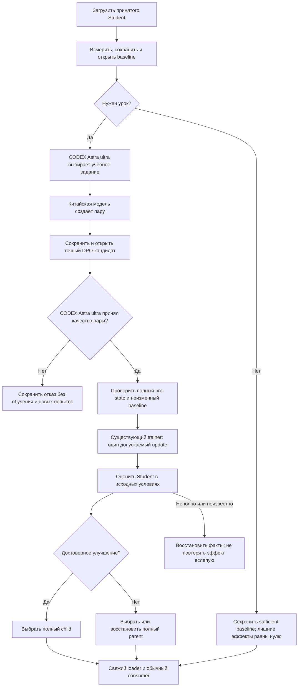
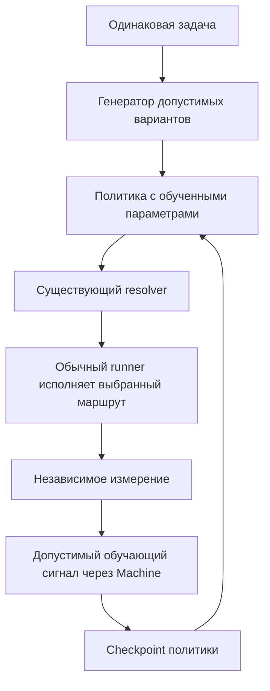

# XIIGEN Design-to-Code — человеческая карта работы по slices

**Редакция:** 8 октября 2026. Имя файла сохранено для действующих ссылок. Репозиторий `lubochka/xiigen-planning`, ветка `llm_plan3`.

Проверка актуализации всех S05–S10, исправленные обязанности и результаты проверок пакетов: [отчёт 8 октября](S05-S10-learning-role-audit-2026-10-08.md).

**Источники обновления ролей:** planning commits [`59499f45`](https://github.com/lubochka/xiigen-planning/commit/59499f459b8e5c9c714ddb475c34bf3a393b5d99) и [`12a5f6f0`](https://github.com/lubochka/xiigen-planning/commit/12a5f6f0fdbcafe3e544bb2bfe63759dc50d487a), [общая инструкция выбора и оценки](GOLDEN-RULE-S04-S10.md#2026-10-07--codex-human-role-binding-across-slices), core `a1b5acdb5a3d9ebed0380390d4cc39a94f5ee9cc`. Ранее карта опиралась на planning `aca2c7b0` и core `dec92575` от 2 октября; их статусы ниже сохраняются только как исторические. Якоря чтения не являются целями reset. Актуальный ход исполнения определяется текущими source, task records и проверками, а не датой планового документа.

Полная предыдущая карта, включая подробные таблицы всех slices, исходные требования, WorkLeft crosswalk и исторические статусы, сохранена без изменения байтов в [архиве](history/2026-10-02-before-learning-delivery/XIIGEN-human-slice-map-2026-09-24.md). Относительные ссылки внутри архива разрешаются от прежнего каталога `llm mvp/design to code session/` или указанного исходного commit. Никакое исходное продуктовое требование не отменяется сокращением навигационной таблицы. Подробные действующие IDs, зависимости и критерии остаются в каталогах пакетов.

> Главный результат — работающая обучающаяся XIIGEN. План, корректный JSON, новый checkpoint hash и зелёный инженерный тест не являются доказательством полезного обучения. Необходимо показать, какие параметры обучались, какими данными, что измерено и где выбранное состояние используется продуктом.

# 1. Что строится

Пользователь передаёт дизайн из Figma или Canva. Собственная модель XIIGEN создаёт HTML/CSS. Сервер действительно рендерит результат в изолированном браузере на нужных размерах, независимый visual judge сравнивает его с оригиналом. Система исправляет результат в пределах установленного качества и бюджета, сохраняет историю и показывает её пользователю. Разрешённые примеры могут стать материалом нового урока. Принятая модель должна использоваться следующим обычным запросом.

Исправление конкретного HTML/CSS и обучение — разные действия: первое может менять только документ; второе меняет обучаемое состояние и проверяется на отдельных заданиях. Ни сохранение файла, ни процент зелёных unit tests не называются качеством обученной модели.

# 2. Какие модели что делают

| Роль | Ответственность | Не является заменой |
|---|---|---|
| Luna / Kiro | Разрабатывает продуктовый код и выполняет допустимые проверки. | Не XIIGEN Student и не источник реальных Teacher-данных. |
| XIIGEN Student | Выполняет предметную задачу; его нейронные параметры/адаптер обучаются существующим trainer. | Не журнал, словарь или `IsTrained` flag. |
| CODEX — выбор учебного задания | **GPT-6-Astra, режим ultra** выполняет роль человека: выбирает разрешённое задание под сохранённую диагностированную слабость и объясняет выбор. | Порядок каталога разрешает только равнозначный выбор; не заменяет содержательное решение. |
| Teacher — автор DPO | **Внешняя открытая китайская модель** создаёт окончательные стороны `chosen/rejected`, связанные с её фактическим ответом. | CODEX и агент-разработчик не переписывают стороны под именем китайского автора. |
| CODEX — оценка качества DPO | **GPT-6-Astra, режим ultra** оценивает именно созданную пару; сохраняет accept/reject с привязкой к точному содержимому и контексту **до допуска optimizer**. | Структурная проверка, self-score Teacher и code review не заменяют эту оценку. |
| Evaluator Student | Измеряет ответы Student до/после на сопоставимых независимых данных по отдельному зафиксированному контракту. | Не CODEX-оценка DPO-пары и не DPO reference model. |
| Visual Judge | Сравнивает настоящие reference и browser screenshots. | Не фиктивный renderer или заранее подготовленная картинка. |
| DPO Builder | В S07 учится создавать полезные пары по допустимому downstream сигналу. | Не выдаёт себе legal admission и не доказывает полезность собственным score. |
| DynamicGraph learned policy | В S07 оценивает полезность допустимых маршрутов по входу и обученному состоянию. | Не фиксированный semantic selector под названием «нейросеть». |
| DPO Reference Model | Математическая опора существующего DPO loss. | Не независимый судья качества ответа. |

В двух операторских ролях используется одна конфигурация: **CODEX + `gpt-6-astra` + `ultra`**. Названия владельца «astra 6 ultra» и «astra 6 ultracode» означают её; отдельный preset не нужен. Для каждого запуска фиксируются заданные native настройки и доступные сведения о фактическом запуске. Неизвестная внутренняя telemetry не выдумывается и сама по себе не требует нового согласования. Модели агентов-разработчиков остаются определёнными своими пакетами.

Выбор CODEX сохраняется вместе с целью, разрешением, диагностикой, источниками, выбранным заданием и причиной. Teacher и затем CODEX-оценщик получают полный допустимый учебный контекст: задание, соответствующий слабый ответ Student на отдельную учебную задачу, разрешённый reference и предусмотренные прошлые примеры с отметкой «только контекст». Вместимость проверяется по фактическому tokenizer и конфигурации до запроса. Закрытый экзамен, платные экзаменационные ответы и ответы Student на экзамен не передаются этим ролям. Отдельный лицензированный учебный reference допустим только при действительных правах.

Оценка привязана к точной паре и контексту. Изменение содержимого делает прежнюю оценку неприменимой; отсутствие или отказ CODEX не допускает optimizer. Отказ не добавляет попыток, а повторное открытие тех же данных использует сохранённый выбор и оценку. Cache hit сам по себе не доказывает, что старую пару проверял CODEX по текущему контракту. Настоящее согласие пользователя на использование, обучение или передачу данных остаётся отдельным разрешением.

## Teacher

Для первой локальной фазы исходная постановка предлагает **Qwen3.5-9B Q4_K_M через Ollama**, профиль **`qwen35-local-v1`**. Это конкретный вариант для сверки существующей server-owned конфигурации, а не доказательство установки, допуска или успешного вызова. Установить actual model ID, endpoint, authoring profile, manifest/layer digests и действующее разрешение. Совместимый уже принятый профиль сохраняется; расхождение решается по текущим полномочиям, без молчаливой смены модели.

«Внешний учитель» означает отдельную от XIIGEN модель, не обязательно облако. `qwen3-together-v1` относится к отдельной удалённой фазе. Эта редакция не разрешает новый провайдер, скачивание весов, новый бюджет или внешнюю передачу данных.

Учитель получает отдельную разрешённую учебную задачу, разрешённый контекст и сведения о слабости, но не закрытые контрольные вопросы/ответы. Существующий S04 authoring-контракт сохраняется: окончательные `chosen/rejected` связаны с фактическим Teacher-ответом; агент-разработчик и чужой эталон не подставляются вместо него. Происхождение и hashes добавляет приложение, а не выдумывает модель.

В S04.01B конфигурация и ресурсы проверяются без inference. Недостающее соединение реализуется ответственным executor в S04.04B на synthetic данных. Настоящий запрос выполняется в S04.10A только после всех действующих real-run gates. Cache hit использует сохранённую пару без повторной генерации.

# 3. Где мы сейчас и как читать статусы

Эта карта описывает требуемые результаты и не повышает текущий статус. **Историческая опора 2 октября:** ограниченное identity-substrate доказательство и source-sync решение были записаны как закрытые; V2 capacity оставалась отдельным допуском. Эти сведения не являются новым verdict на 8 октября. Проверять актуальные bytes/evidence, не повторять работу из-за нового branch SHA при неизменной семантике.

На проверенной опоре core `a1b5acdb` обычный S04 Endpoint ещё различает отсутствие native selection operator и незавершённое продолжение после сохранённого выбора; [обе границы явно возвращают 503](https://github.com/lubochka/llm_mvp_core/blob/a1b5acdb5a3d9ebed0380390d4cc39a94f5ee9cc/25.ModelServer/ContinuousLearning/CodeDocumentationOneLessonEndpoint.cs#L317-L333). Это не доказательство реального вызова Astra, Qwen или завершённого урока. Планы S05–S10 наследуют правильную процедуру, но сохраняют свои исходные prerequisites и не объявляются допущенными этой правкой.

Сохранить текущие core S04.02A/B amendments, исходный C01–C04 scope и deferred C05. Не устанавливать старый planning scaffold поверх разрешённого source import и не превращать известное различие task cards в новую бесконечную очередь согласования.

| Slice | Требуемая поставка |
|---|---|
| S00 | Первый реальный gap в текущем коде и доказательствах. |
| S01 | Applied-but-unpublished recovery без повторного обучения той же пары. |
| S02 | Полное состояние сохраняется, восстанавливается и продолжает работу. |
| S03 | Teaching, диагностика и чистый экзамен разделены; измерение и расходы воспроизводимо связаны. |
| S04 | Один реальный безопасный урок CodeDocumentation либо достаточный baseline без лишнего обучения. |
| S05 | Разрешённый model/DPO bundle получен из remote и загружен холодным consumer. |
| S06 | Lifecycle работает в других предметах/уровнях; проведены предусмотренные кампании и learning curves. |
| S07 | Обученное состояние влияет на реально исполненный graph route; Builder проверяется через отдельного Student. |
| S08 | Реальная цепочка Figma/Canva → модель → browser/judge → история/UI → разрешённое обучение → следующий consumer. |
| S09 | Реальные IDE/integration journeys используют локальную модель и приватный semantic index. |
| S10 | Независимо проверены все исходные требования, качество, публикация и пользовательские пути. |

# 4. S00 — понять, где мы на самом деле

Прочитать текущий код, exact-candidate результаты и task records. Найти первый незакрытый продуктовый predicate. Для уже реализованного поведения использовать доказательство применимости, не создавать дублирующую реализацию ради совпадения старого имени класса. Результат S00 — конкретный следующий owner/code/test gap, не ещё один общий отчёт.

# 5. S01 — после сбоя не обучить той же парой второй раз

Если update уже применён, а процесс завершился до решения, открыть то же trial, исходный baseline, пару и условия. Продолжить лишь разрешённую оценку/выбор. Не вызывать trainer повторно и не выдавать новое имя run за новое разрешение. Полноценный отрицательный исход сохраняется; неизвестный эффект остаётся неизвестным до проверки durable фактов.

# 6. S02 — сохранить всё состояние, а не только weights

Сохранить и согласованно восстановить weights, adapters/LoRA, optimizer moments и step, RNG, counters, configuration, manifests, parent/pair lineage и необходимые composite/memory состояния. Fresh instances должны загружать согласованный bundle; rollback не соединяет parent weights с trial optimizer. Recovery и сохранение сами по себе не доказывают качества Student.

# 7. S03 — обучение, диагностика и финальный экзамен различаются

Сохраняются server-owned evaluator identity, exact case binding, неизменные условия baseline/trial, noise-aware decision, реальные calls/reservations/cancellation, восстановление без нового экзамена и separation teaching/diagnostic/certification. Закрытый материал и платные ответы не превращаются в стороны DPO. Чистота экзамена определяется происхождением и историей exposure, не флагом от клиента. Synthetic closure не является реальной сертификацией.

# 8. S04 — первый настоящий безопасный урок

## Что именно обучается

Существующий XIIGEN Student для CodeDocumentation. Перед реализацией назвать обычный generation entry, объект Student, обновляемые нейронные параметры/адаптер, владельца DPO/trainer, checkpoint loader и обычный consumer. Требуемая связь:

CODEX выбирает отдельное разрешённое учебное задание; китайская модель создаёт пару; CODEX оценивает её точное содержимое. После принятия пары существующий DPO/trainer обновляет параметры Student и полное состояние. Отдельный evaluator измеряет обычную генерацию на отложенных заданиях; обычный consumer загружает выбранное состояние. Две роли CODEX в этой связи всегда используют **GPT-6-Astra / ultra**.

Исправлять минимальный разрыв в существующих owners. Изменение журнала, KNN-записи, счётчика, `IsTrained` или hash не является доказательством neural update. Не требовать гарантированного прироста качества или изменения каждого ответа после одного шага.

Иллюстрация, не учебные данные: Student неверно описывает отмену операции. Teacher создаёт контраст на другом разрешённом примере. После обучения проверяются другие методы с соответствующим поведением через обычный продуктовый вызов. Ответы и оценки сохраняются честно, даже когда улучшения нет.

## Сквозной алгоритм

## Работа исполнителя по существующим задачам

| Задача | Конкретный результат |
|---|---|
| S04.00A/B | Source/evidence reconciliation и первый действительный gap; без нового общего аудита. |
| S04.01A | Реальный parent и полный state; не скрытый random cold start. |
| S04.01B | Конкретные Teacher/Evaluator/profile/endpoint/digests и минимальная implementation-задача при разрыве. |
| S04.01C | Разделённые synthetic CI и private live route, неизменный остаток ресурсов. |
| S04.02A/B | Existing objective/session/custody/recovery owners; отдельный реальный capacity admission до V2 effects. |
| S04.03A/B | Persist/reopen pre-authoring baseline и sufficient branch без teacher/pair/update. |
| S04.03C | Привязка пары к тем же исходным наблюдениям без повторной калибровки. |
| S04.04A/B/C | Disjoint teaching input, исправленная authoring-связь, response-bound pair, её sealing/reopen. |
| S04.05A/B | Полный pre-state, действительный neural update и согласованное полное trial state. |
| S04.06A/B | Complete quality disposition и выбранное полное состояние; invalid/incomplete не считается negative success. |
| S04.07A/B/C | Сбои до mutation, после update и после решения без повторения совершённых эффектов. |
| S04.08A | Обычный endpoint/CLI и consumer; не test-only ветка и не готовый ответ вместо Student. |
| S04.08B | Достаточный focused/impacted batch с nonzero actual cases и отдельными наблюдениями по predicates. |
| S04.08C | Полный действующий engineering/asset/authority/resource допуск, не обход V2 ради скорости. |
| S04.09A/B | Настоящий сохранённый baseline и выбор ветки. |
| S04.10A/B | Фактический запрос конкретному Teacher и сохранение пары до update. |
| S04.11A/B | Fresh/applied/unknown reconciliation и только разрешённый остаток работы. |
| S04.12 | Trial в исходных условиях; не менять экзамен и не повторять complete negative до успеха. |
| S04.13A/B | Fresh ordinary consumer и разделённые private/upload-safe evidence; точный handoff S05. |
| S04.14 | Независимые выводы о механизме, реальном уроке, качестве и использовании результата. |

Полные 33 microtasks и 146 исходных predicates остаются в [каталоге S04](Kiro-Xiigen-S04-Luna-xhigh-v2-Pack/overlay/.kiro/xiigen-slices/luna/s04/microtasks.json). [Learning delivery](Kiro-Xiigen-S04-Luna-xhigh-v2-Pack/overlay/.kiro/xiigen-slices/luna/s04/learning-delivery.json) уточняет десять выбранных задач и автоматически включается compiler для каждой из четырёх ролей. Это конечные машинные инструкции, не patch или installer. Исходные task/role bodies и common controls остаются в скомпилированном packet.

## Проверки вокруг возможностей, а не очередь ради каждой строки

Группы поставки: baseline; Teacher и сохранённая пара; update и измерение; сквозной запуск и recovery. Они не создают новых task IDs, не объединяют разрешения и не отменяют зависимости. Один E2E может подтвердить несколько условий только с отдельным наблюдением каждого нужного guard. Существующие подходящие результаты используются после проверки применимости; пересекающиеся tests не считаются независимыми доказательствами.

Новые проверки нужны для конкретного непокрытого риска. Смысловая проверка допускает разные корректные решения и не навязывает маршрут №3 или определённое оформление без такого требования. Технические guards типов, прав, памяти, происхождения, полного rollback и отсутствия повторного update сохраняются. Nonzero discovery, raw candidate-bound evidence и обязательные wider gates не удаляются.

## Что будет считаться успехом S04

| Вывод | Требуемое доказательство |
|---|---|
| Механизм работает | Реальные product owners/callers, достаточные synthetic проверки, согласованное сохранение/восстановление. |
| Реальный урок состоялся | Actual Teacher response/pair, разрешённый optimizer entry и committed update, полный state и измерения. |
| Качество изменилось | Complete independent comparison: improved/regressed/indistinguishable/допустимый identical-weights исход. |
| Результат используется | Fresh loader/ordinary consumer действительно используют выбранный checkpoint. |

Entries, committed updates и selected child — разные факты. Один шаг может дать identical weights; нельзя придумывать изменение. Полноценный отрицательный результат может завершить процедуру, но не условие доказанного улучшения. `NO_TRAINING_NEEDED` требует real sufficient baseline, сохранённого parent и нуля лишних teacher/pair/update; эта ветка не доказывает обучение.

# 9. S05 — публикация модели и DPO и воспроизводимость

S04 создаёт разрешённые локальные материалы урока. S05 отдельно доказывает разрешённую remote-публикацию полного canonical bundle: model/DPO bytes, tokenizer/config/adapters, optimizer/RNG/state dependencies, manifest и lineage. Cold consumer fetch/hydrate/verify/strict-load получает ту же версию без повторного обучения. Локальный hash и private repository не являются автоматическим разрешением раскрытия данных. Сохраняются все исходные S05 work orders и publication guards.

Для заявленного нового урока S05 проверяет также сохранённый выбор CODEX, происхождение ответа китайского автора и положительную оценку CODEX именно опубликованной пары. В разрешённый bundle входят допустимые записи либо не раскрывающие частные данные identities/pointers. S05 ничего не генерирует и не оценивает заново. Ветка достаточного baseline законно обходится без новой пары; старые материалы остаются историческими и не переименовываются в «оценённые CODEX». Отсутствующее обязательное свидетельство возвращается владельцу предыдущего этапа.

# 10. S06 — продолжение обучения и несколько предметов

Существующие S06.08B и S06.09C определяют кампании, stopping rules и learning curves. Один update S04 — предел его пилотного objective, не вечный предел архитектуры. Новые уроки выполняются в предусмотренной кампании с новыми допустимыми данными и прежним учётом затрат; старый эксперимент не повторяется до удобной оценки.

Сохраняются семь предметов и четыре уровня поведения, many-to-many Unit/Flow, async Orchestrator, DynamicGraph, направления EN↔RU, C#/Angular/SQL documentation, DTC и orchestration. 7×4 не означает обязательные 28 отдельные модели. Каждая клетка указывает owner, data, mechanism, measurement и direct/derived/N/A. KNN может быть памятью, но не заменяет требуемую neural-DPO способность. Качество, точность и learning speed считаются отдельно; donor transfer не объявляется direct measurement.

В каждой допущенной DPO-кампании CODEX Astra ultra выбирает задание и отдельно принимает либо отклоняет китайскую пару перед optimizer. Для нового предмета проверяются действительные teacher profile, права на материалы, tokenizer и границы контекста; конфигурация пилотного S04 не считается универсальным допуском. Действующий маршрут подготовки S06 — [GPT6 Luna high v2](Kiro-Xiigen-S06-GPT6-Luna-high-v2-Pack/README.md); его Phase-0 compiler/admission остаются самостоятельными prerequisites до получения предусмотренных доказательств.

# 11. S07 — настоящий DynamicGraph и DPO Builder, который учится учить

Технический слой проверяет допустимость действий, типы, реальные зависимости, безопасность и ресурсы, затем исполняет допустимый выбранный план. **Обучаемая политика** выбирает содержательно полезное решение по входу и загруженному обученному состоянию. ID lookup, позиционный приоритет, first candidate или confidence constant не должны незаметно заменять эту политику. Явно обозначенный fixed/rule-based baseline допустим как контроль или помощник.

Доказательство соединяет learning signal/данные, machine-owned trainer, параметры/checkpoint, resolver и фактический L3 вызов. Tiny-state intervention доказывает только state-to-decision wiring; для полезности и обобщения нужны предусмотренные сравнительные кампании с реально обученным состоянием. Не назначать winner заранее.

DPO Builder получает разрешённую слабость и контекст, создаёт candidate pair, проходит отдельный legal/provenance gate; полезность определяется по отдельному downstream Student. Только допустимая utility может формировать meta-preference для machine-owned Builder update. Следующий обычный Builder-вызов использует выбранное B1 либо честно сохранённое B0, не самодопуск и не self-score.

Здесь различаются учебный выбор, генерация внешнего Teacher и эксперимент над собственным Builder. CODEX Astra ultra выполняет педагогический выбор и оценку качества конкретной пары; learned policy продолжает выбирать продуктовый graph route. Явно предусмотренные Builder experiment arms сохраняют собственное авторство, controls и измерение пользы отдельному Student. Их нельзя выдавать за ответ китайской модели или использовать как скрытый fallback внешнего автора. Оценка CODEX не заменяет численное измерение utility и не назначает победителя эксперимента.

| Задача | Содержательная поставка |
|---|---|
| S07.04A | Actual trained state влияет на resolver; названы signal и update owner. |
| S07.04B | Выбранный target исполняется обычным L3 caller, не только записывается ID. |
| S07.04C | Проверена presentation-ID/order утечка без изменения семантики и реальных dependencies. |
| S07.05B/C | Реальные Builder generation и machine-owned update; отдельный допуск и оценка. |
| S07.07A | Измерена полезность пары для отдельного Student. |
| S07.08D | Реально загружен принятый B1 либо retained B0; frozen B0 control сохранён. |
| S07.10C | Cold ordinary consumer использует опубликованное состояние и выполняет маршрут. |
| S07.11A | Раздельные verdict wiring, training, completed experiments, utility, target и consumer. |

Все 44 исходные задачи, 176 scenarios, 132 predicates, пять arms, два rounds, шесть Student subjects, partitions и budgets сохранены в [каталоге S07](Kiro-Xiigen-S07-Luna-xhigh-Pack/overlay/.kiro/xiigen-slices/luna/s07/tasks.json). [Learning delivery](Kiro-Xiigen-S07-Luna-xhigh-Pack/overlay/.kiro/xiigen-slices/luna/s07/learning-delivery.json) уточняет девять задач для всех четырёх ролей через существующий compiler.

Fixed-combination, seeded random-route, ordinary-example и frozen-initial-builder controls сохраняют свою правильную training modality, matched starting state/count/text volume. Ordinary examples не симулируются испорченными DPO-парами. Не добавлять вне гранта arms, вызовы или данные. No-signal/negative/not-reached исходы сохраняются; они не являются доказательством полезного обучения.

Переименовывать в проверках только presentation metadata с явной биекцией semantic candidates. Не менять storage/security identity или реальный порядок dependencies. Для stochastic policy использовать предусмотренные согласованные random draws либо принятую distributional проверку, а не требовать совпадения независимых случайных выборок.

# 12. S08 — реальный продукт Figma/Canva

Сохраняется весь исходный путь: actual inputs и reference screenshots; tenant identity/server-owned tariff; submission/poll/cancel; фактический model selection; безопасный multiresolution browser; независимый visual judge; расходы и неизвестные исходы; correction loop; result history и UI; exact-content approval; existing training API; installed Figma/Canva journeys; publication и последующий inference. Core tests не закрывают реальные клиентские пути.

В разрешённом учебном пути после настоящего согласия на использование данных CODEX Astra ultra выбирает допустимое задание, китайская модель создаёт DPO-кандидат, CODEX Astra ultra оценивает его до обучения. UI показывает эти разные действия и точные принятые данные. Нажатие «обучить», пользовательская оценка результата или visual judge сами по себе не заменяют педагогическую оценку пары; CODEX не подменяет согласие пользователя.

# 13. S09 — редакторы и интеграции

Сохраняются trusted workspace, приватный локальный semantic index, updates/rename/restart, source-grounded context, реальные learned plan/edit stages, versioned buffers/recovery; отдельные installed VS Code, Visual Studio и Continue; отдельные Codex, Claude и Cursor integrations; English/Russian/Hebrew; исходные taxonomies, 14 wiki subclasses, 11 audit domains и два набора 50+50; actual token usage, quality-preserving savings, resource limits, export/import/upgrade/rollback. Эти количества не заменяют точные определения исходных наборов.

Клиентские интеграции не меняют роли обучения: выбор и проверку DPO выполняет CODEX Astra ultra, генерацию — допущенный китайский Teacher. Продуктовая интеграция с Claude или Cursor не превращает их в назначенного оценщика пары. Сохранённые решения и права следуют за точной задачей, контекстом и парой при resume/export/import; повторный запуск клиента не создаёт ещё один урок.

# 14. S10 — приёмка всей программы

Все FINAL outcomes остаются: row-by-row source crosswalk, clean certification/noise/exposure, полный remote bundle/cold reload, actual consumer/rollback use, Figma/Canva/IDE journeys, token/cost/quality evidence, exact-candidate CI/mergeability, безопасный cleanup без потери recovery, UML/runbook/docs и отдельная whole-program acceptance. Будущая reconciliation S08.12A/S09.12A/S10.01A/B не объявляется выполненной этой картой.

S10 проверяет непрерывность доказательств: выбор CODEX → фактическое китайское авторство → оценка CODEX точной пары → допустимый update → независимое измерение → загрузка выбранного состояния. Для отдельно разрешённого исправляющего урока действует тот же порядок и прежние лимиты. Оценка пары не заменяет закрытую независимую сертификацию, отдельный paid final evaluator или финальное решение владельца. Synthetic fixtures и успешная компиляция промптов не подтверждают эти runtime-события.

Точные будущие S08/S09/FINAL определения сохранены также в S07 `program/requirements.json` и `program/REMAINING-S08-TO-FINAL.md`; их bytes и ownership не изменены. Подробная прежняя человеческая таблица сохранена в архиве, не потеряна.

# 15. Как исполнитель получает работу

В каждом действующем пакете S05–S10 локальный `LEARNING-ROLE-CONTRACT.md` содержит полную общую процедуру. Компилятор включает её буквальный текст и SHA-256 во все четыре роли выбранной задачи вместе с конкретными обязанностями из её каталога. Потеря, обрезка или дублирование обязательного контракта останавливает подготовку пакета в прежнем лимите размера. Для S06 v2 это также явная обязанность исходной Phase-0 реализации; наличие спецификации не выдаётся за уже исполненный compiler. Адресные правки устанавливаются в фактический product overlay с сохранением совместимых live amendments; проверяется именно установленный пакет, а не только preview в planning.

Использовать текущие agent/skill/authority contracts и точные исходники. Один dependency-ready product gap получает ограниченный work order с source/test owners, наблюдаемым результатом, допускаемыми командами и falsifiers. Обычный design/code gap требует решения, а не объявления owner-only blocker. Реальные security/access/assets/budget ограничения не обходятся.

`render_packet.py` передаёт исходный task body, выбранный role body и common controls. В S04/S07 предусмотрен дополнительный конечный `learning-delivery.json`; S05 использует task cards/briefs, а S06 source compiler и S08/S09/S10 — свои каталоги, briefs и role/dispatch bodies. Эти источники читаются по фактическому контракту соответствующего пакета с source hash и прежним output cap. S06 v2 отдельно определяет будущую компиляцию с addenda и live binding. Отсутствующие обязательные инструкции не пропускаются. Packet не является доказательством чтения навыков, admission или запуска агента.

После support repair родитель продолжает разрешённую цепочку. Архитектор решает текущий конкретный design gap; отдельный reviewer проверяет; executor изменяет actual product source/tests; code reviewer проверяет факты. OP-65, фактическая занятость slot, независимость и пределы исходных задач сохраняются. Документ, JSON и evidence-only ACCEPT не являются продуктовым выполнением.

# 16. Действующие WorkLeft и пакеты

[Учитель и ученик](09.09.26WorkLeft-02-teaching-chinese-model.md), [включение обучения](09.09.26WorkLeft-INTEGRATION-01-training-into-work-program.md), [целевые проверки](09.09.26WorkLeft-INTEGRATION-02-test-batching.md), [пакет S04](Kiro-Xiigen-S04-Luna-xhigh-v2-Pack/README.md), [пакет S07](Kiro-Xiigen-S07-Luna-xhigh-Pack/README.md).

Это полные конечные документы и машинные инструкции, а не diff/patch/installer. Изменение плана не означает изменение модели. Фактические product/.NET/runtime/teacher/training/evaluation/independent-review результаты появляются при исполнении соответствующих задач и не предзаполняются этой публикацией.
