# Ещё пять экспериментов: память маршрутов, KNN, RMSNorm и softmax

**Новый разбор:** RETENTION-M1-01, KDP01, RD01, MB01 и SEXP01. Проверено 27 октября 2026 года по текущему коду на commit 7e051ca7246efde2864f2bee3a427157063d3cc6 и закреплённым историческим результатам. Новые обучающие прогоны не выполнялись.

Здесь есть два вида результата: лучшее использование обученной памяти и меньшие вычислительные расходы при том же результате нейронного обучения. Они отмечены отдельно. SEXP01 раньше упоминался кратко; теперь для него подготовлена полная карточка.

| Опыт | Этап изменения | Что полезного показано | Статус текущего кода |
|---|---|---|---|
| RETENTION-M1-01 | Обновление признаков плана | Старый запрос сохранён вместе с новым: итог 3/4 → 4/4 | Накопление через max остаётся экспериментальным |
| KDP01 | Ранжирование кандидатов из обученной KNN-памяти | RU 5/8 → 8/8, OR 5/8 → 8/8; нейтральные профили сохранены | Подключаемые правила уже перенесены |
| RD01 | Прямой проход RMSNorm, сумма по последней оси | −655 200 байт выделений, прежний численный результат | Специализированная ветвь присутствует |
| MB01 | Обратный проход операции среднего | −860 160 байт выделений, прежний численный результат | Специализированная ветвь присутствует |
| SEXP01 | Получение градиента softmax-cross-entropy | На треть меньше exp в двух измеряемых операциях | Буфер есть в экспериментальном B, в основном Trainer его ещё нет |

Для RD01/MB01 наличие кода отделено от завершения проверки переноса: актуальный аудит всё ещё отмечает открытой проверку из назначенного восстановленного H64/LoRA-состояния. Подробные источники и границы каждой строки — ниже.

## 1. RETENTION-M1-01 — новый парафраз дополняет память старого

### Где изменили работу

**Этап — обновление обучаемых признаков одного плана в памяти маршрутизатора.** Здесь учатся связи между формулировкой запроса и планом. Токенизатор, attention, LoRA и нейронный оптимизатор не изменяются.

Сравниваются две политики обновления описания одного и того же плана: заменить прежние входные признаки последним уроком или сохранить признаки обоих совместимых уроков. Во втором варианте увеличивается объём сведений, по которым план можно найти. Это изменение политики памяти; по результату не следует, что накопление пригодно для любого исправления старого знания. [Отчёт RETENTION][RET_REPORT].

### Старый способ → схема

Новый урок того же плана полностью заменяет его входные признаки. Благодаря этому новая формулировка начинает работать, но признаки прежней формулировки перестают участвовать в выборе маршрута. Сами старые пары запрос → план остаются в KNN-памяти.

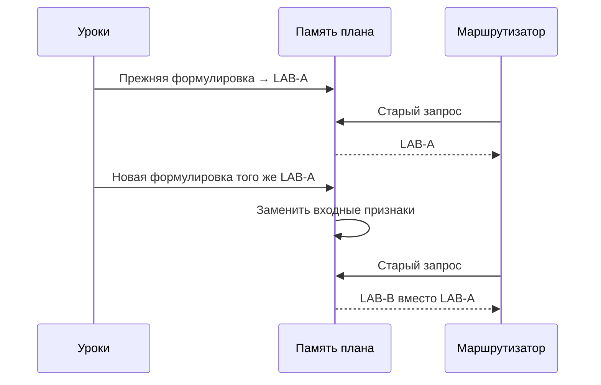

### Обновление → схема

Для входных признаков берётся поэлементный максимум старого и нового веса. Признак, которого нет в новом парафразе, не исчезает только по этой причине. Остальные поля плана обрабатываются так же, как прежде.

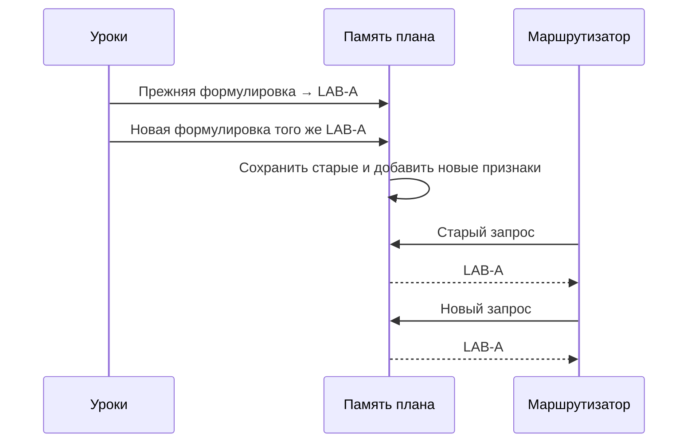

В проверочной панели старый запрос — **validate payment approval ledger audit**. После третьего урока вариант A выбирает LAB-B, а вариант B сохраняет правильный LAB-A. Пересчёт сохранённых весов объясняет выбор: InputScore плана LAB-A равен 0 у A и 4 у B; у конкурента LAB-B он равен 2. [Сохранённая панель][RET_RAW], [веса A][RET_A_STATES], [веса B][RET_B_STATES].

### Результаты и цена

| Показатель | A: замена | B: накопление |
|---|---:|---:|
| Правильные ответы до третьего урока | 3/4 | 3/4 |
| Правильные ответы после него | 3/4 | 4/4 |
| Старый запрос | Верно → неверно | Верно → верно |
| Новый запрос | Неверно → верно | Неверно → верно |
| Два остальных контрольных запроса | Сохранены | Сохранены |
| Всего входных признаков в памяти двух планов | 8 → 8 | 8 → 12 |
| Выделено байтов на третьем Train | 10 576 | 11 752 |
| Время третьего Train, мс | 0,0965 | 2,9409 |
| Время четырёх последующих чтений, мс | 1,1167 | 1,2916 |

Для четырёх последующих чтений B выделяет ещё **3 144 байта**, а дополнительная цена третьего Train — **1 176 байт**. Это небольшие абсолютные измеренные расходы; они не равны постоянному размеру всей памяти.

Особенность опыта: у A итоговые 3/4 выглядят как отсутствие изменений, но внутри произошла замена успехов — новая формулировка выучена, старая забыта. B сохраняет оба результата. На четырёх запросах это видно непосредственно. Время третьего Train у B выше на 2,8444 мс; это наблюдаемая цена данного прогона. Ещё до различающего урока одинаковые чтения занимали 48,73 и 74,27 мс. Без повторений устойчивую разницу скорости установить нельзя. [Отчёт и расходы][RET_REPORT], [расходы A][RET_A_COST], [расходы B][RET_B_COST].

### Формула и простое объяснение

Для признака t:

\[
w_{\text{new}}(t)=\max\bigl(w_{\text{old}}(t),w_{\text{lesson}}(t)\bigr).
\]

Сам текущий InputScore вычисляется как сумма весов совпавших признаков:

\[
s(q,w)=\sum_t q_t w_t,\qquad q_t\in\{0,1\}.
\]

Отсюда для фиксированного запроса:

\[
w_{\text{new}}\ge w_{\text{old}}
\quad\Longrightarrow\quad
s(q,w_{\text{new}})\ge s(q,w_{\text{old}}).
\]

**Прежние слова запроса больше не теряют свой вклад только потому, что в новом уроке использованы другие слова.** Неотрицательные индикаторы совпадения умножаются на веса, которые не уменьшились.

В книге Appendix B.1, PDF-страница 797, приводится формула **“canonical inner product”** — «канонического скалярного произведения», то есть суммы произведений координат. Это точная опора для формулы score. Правило max и вывод о его монотонности относятся к коду и приведённой алгебре; книга не заявляет универсальный рецепт памяти маршрутов. [Книжная формула][BOOK_INNER], [код подсчёта score][RET_SCORE].

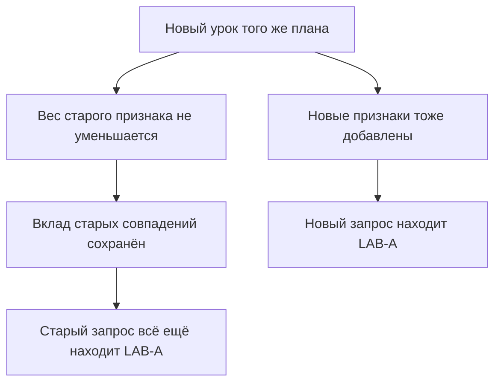

**Граница вывода.** Доказана монотонность InputScore обновлённого плана при фиксированном запросе. Это не гарантия всех решений маршрутизатора: есть конкурирующие планы и другие составляющие оценки. Противоречивые исправления не проверялись; max может сохранить устаревший признак, который следовало удалить.

**Текущий статус.** В проверенной основной функции остаётся замена входных признаков. Накопление через max показано в экспериментальном B. [Текущий код памяти][RET_CURRENT].

## 2. KDP01 — учитывать правило домена при выборе из обученной памяти

### Где изменили работу

**Этап — ранжирование уже найденных кандидатов KNN.** Учебные примеры по-прежнему сохраняются в памяти, а ответ выбирается из них. Дополнительные функции знают отдельные свойства домена: например, что «вчера» требует прошедшего времени.

Эти функции написаны явно. Модель не выучила грамматическое правило самостоятельно; эксперимент показывает пользу такого знания при чтении обученной памяти. Именно этот механизм теперь перенесён в продукт. [Исторический отчёт][KDP_REPORT], [коммит переноса][KDP_COMMIT].

### Старый способ → схема

Кандидат получает смесь трёх оценок: векторной близости, совпадения слов и совпадения шаблона. У очень похожих примеров правильное время глагола может оказаться менее важным, чем небольшая разница общих оценок.

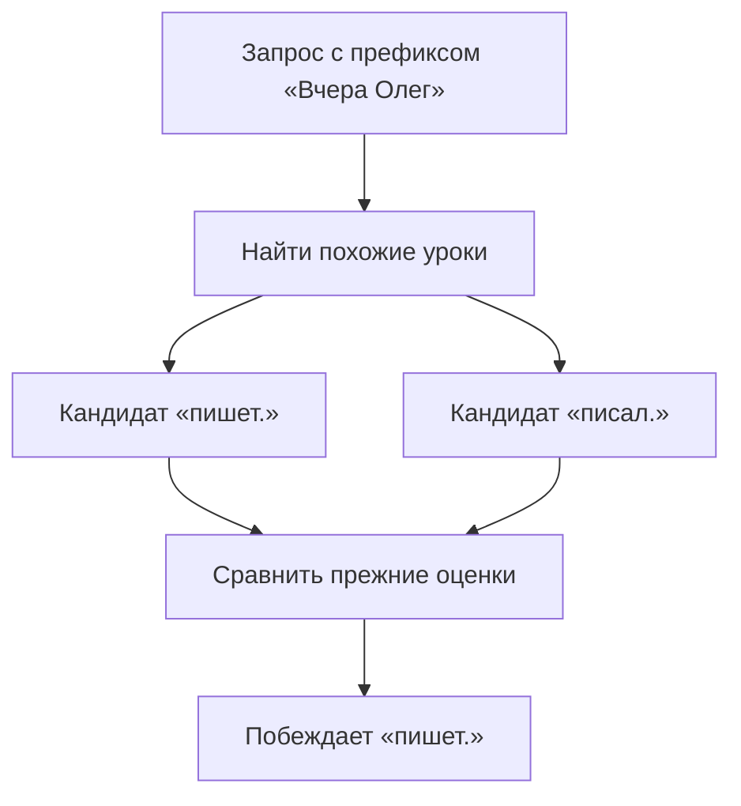

### Обновление → схема

После обычной оценки каждому кандидату добавляется ограниченная поправка от функций домена. Они не генерируют новый ответ и не меняют текст сохранённого примера.

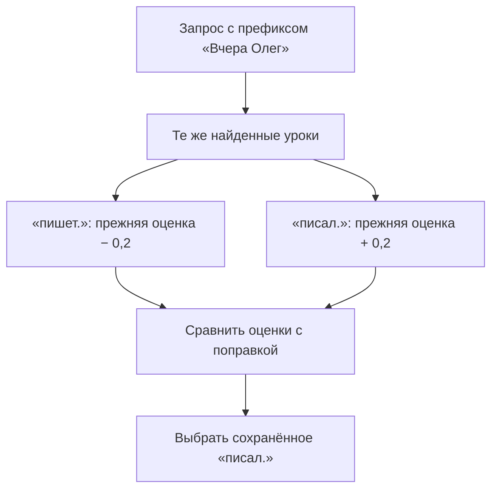

Это точный случай RU/S1/E02. Полный запрос в raw: «Задание: Продолжи глаголом писать, без дополнений, с точкой. Префикс: Вчера Олег».

До поправки «пишет.» имеет score **0,646003**, «писал.» — **0,643696**. После поправки оценки становятся **0,446003** и **0,843696**. Поэтому побеждает прошедшее время. Эти числа — оценки кандидатов, не вероятности. [Ответ A][KDP_EXAMPLE_A], [ответ B1][KDP_EXAMPLE_B].

### Результаты и цена

В состоянии S1 используются те же восемь уроков на профиль:

| Профиль | A | Вариант с полезными функциями |
|---|---:|---:|
| C# | 6/8 | 6/8 |
| English | 8/8 | 8/8 |
| Russian | 5/8 | 8/8 |
| Hebrew | 6/8 | 8/8 |
| Оркестрация | 5/8 | 8/8 |

В проверенных исторических группах новых ошибок от выбранных функций не появилось. Раздельных измерений времени, памяти и размера состояния для A/B нет: утверждать, что этот выигрыш бесплатен, нельзя. Частотная функция, действительно зависящая от накопленных префиксов, сама не изменила ни одного ответа; полезными оказались явно заданные доменные признаки. [Исторический KDP][KDP_REPORT].

### Формула и простое объяснение

Текущий базовый score:

\[
s_0=0{,}45\,v+0{,}35\,b+0{,}20\,p.
\]

Здесь v — векторная оценка, b — нормированная словесная оценка BM25, p — совпадение шаблона.

Добавка от m функций:

\[
s_1=s_0+\delta,\qquad
\delta=\frac{0{,}2}{m}
\sum_{j=1}^{m}w_j\,\operatorname{clip}(f_j,-1,1).
\]

В текущем API веса конечны и находятся в пределах \(0\le w_j\le1\). Перед подстановкой в формулу неприменимая или неконечная оценка функции заменяется нулём; такая функция остаётся в числе m. Деление идёт на число функций m, а не на сумму весов. При пустом наборе добавка равна нулю.

**Каждая функция может немного поддержать или ослабить кандидата. Сильную исходную разницу она перекрыть не может:**

\[
|\delta|\le0{,}2,
\qquad
|\delta_a-\delta_b|\le0{,}4.
\]

Если исходный отрыв победителя от любого соперника больше 0,4, эти функции не смогут сменить победителя. При маленьком отрыве, как у «пишет.» и «писал.», правило способно решить выбор. [Фактическая формула и ограничения API][KDP_CODE].

Книга в Definition 6.59, PDF-страница 221, вводит **“exterior margin”** — отрыв выбранной группы кандидатов от остальных. Для одного выбранного кандидата это его отрыв от лучшего соперника. Здесь эта идея позволяет сформулировать предел воздействия поправки. Граница 0,4 выведена из коэффициентов кода, а не является отдельной теоремой книги о KNN. [Место в книге][BOOK_MARGIN].

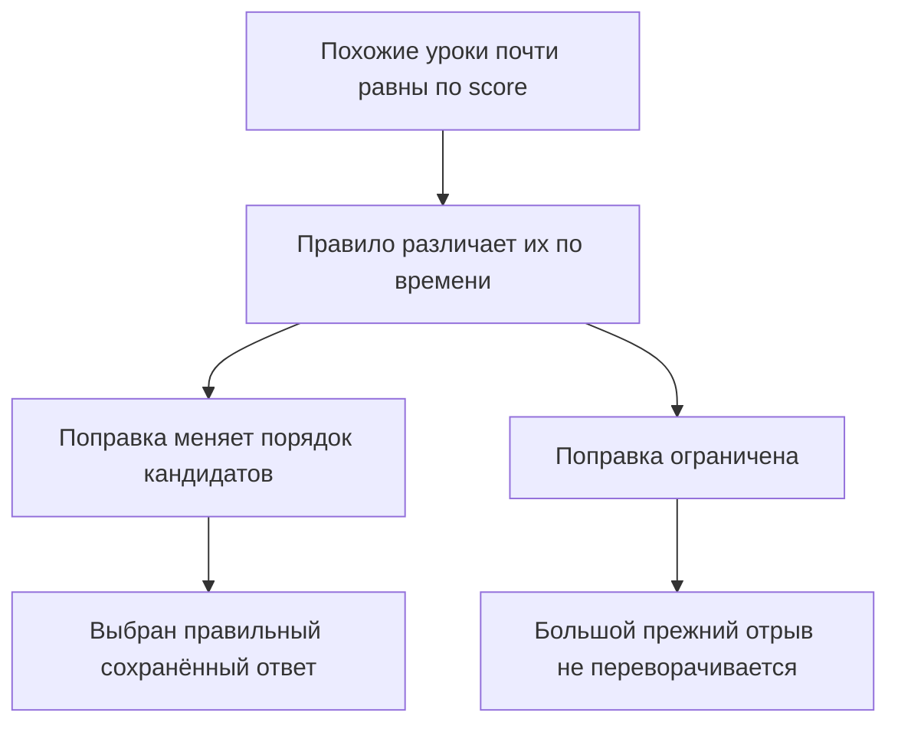

### Что уже внедрено

В текущем продукте функции подключаются явно к обученному узлу; память, индекс и сохранённые ответы используются те же. Есть готовые фабрики для русского времени и этапов оркестрации. Историческое улучшение Hebrew не означает, что его фабрика уже появилась в продукте. [Текущая интеграция][KDP_CURRENT].

В коммите переноса сообщены 27/27 новых проверок; это проверки подключения и поведения API, а не повтор всей исторической панели из восьми запросов на профиль. По затронутой области сообщены 222/223: один старый тест перечня мест создания учебных пар остаётся красным. В этом разборе тесты заново не запускались. [Коммит переноса][KDP_COMMIT].

## 3. RD01 — RMSNorm: складывать строку без временных координат

**Этап:** Прямой проход RMSNorm → Mean квадратов → SumAlongAxis по последней оси.

### Старый способ → схема

Общий корректный алгоритм находит каждый элемент через массив координат. На каждой строке он создаёт массив её координат и копию для каждого слагаемого.

В назначенной форме A вычисляет правильное среднее; B не меняет формулу и не восстанавливает потерянный градиент. Это специализация адресации для известной формы.

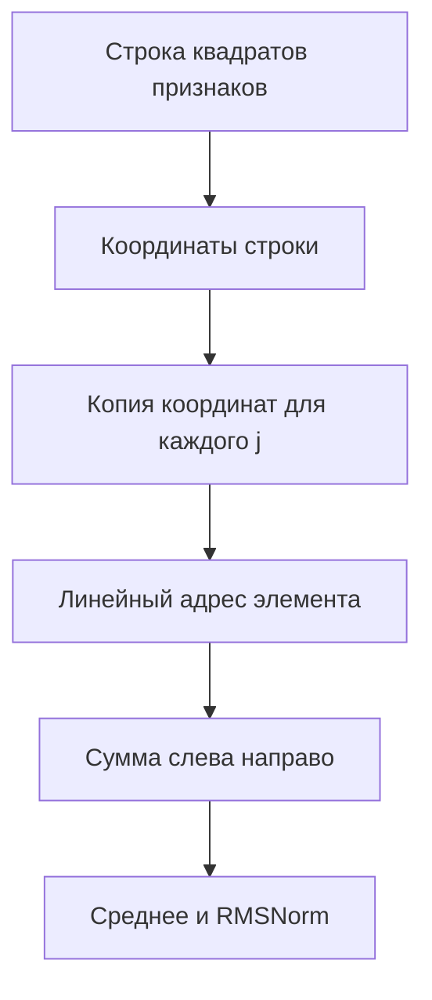

### Обновление → схема

У последней оси значения строки уже лежат подряд. Начало строки равно row × width; достаточно читать start + j, сохраняя порядок сложения.

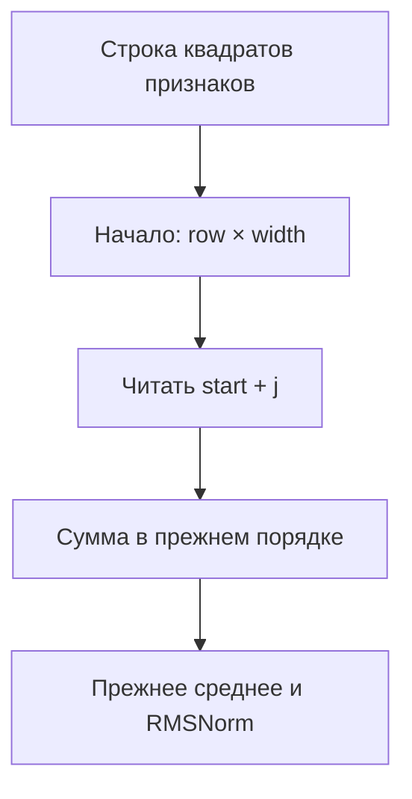

### Что действительно обучалось и что сохранилось

Маленький Transformer с LoRA и AdamW восстановлен после 400 ранее выполненных уроков. В каждом варианте выполнено по четыре SFT-обновления на тех же двух учебных строках. Сохранённые хэши обучаемых параметров меняются внутри обоих плеч, а замороженных — нет.

В обоих плечах TRAIN 1/2→1/2, EXAM 1/2→1/2. NLL меняется одинаково; освоение общего закона знака не показано.

В raw совпали четыре потери, все 16 сохранённых 256-мерных векторов logits, хэши весов и полного optimizer; по отчёту равенство побитовое. Бинарные снимки заново не исполнялись.

### Результат и цена

| Показатель | A | B | B − A |
|---|---:|---:|---:|
| Выделено байтов за обучение | 13 640 016 | 12 984 816 | -655 200 (-4.804%) |
| Время учебных шагов, мс | 156.5045 | 105.9158 | -50.5887 (-32.324%) |
| Процессорное время, мс | 140.625 | 109.375 | -31.25 (-22.222%) |
| Пик памяти процесса, байт | 41 893 888 | 42 139 648 | 245 760 (+0.587%) |

GC поколений 0/1/2: [2, 1, 0] → [2, 1, 0].

Расчёт удалённых объектов: `3 × 21 × (64 + 1) × 40 × 4 = 655200` байт — точно измеренная разница. Проценты относятся ко всем allocations четырёх учебных шагов, не к размеру модели и не к уменьшению рабочего набора.

- Экономия allocations подтверждена на одной модели и четырёх обновлениях.
- Пик процесса немного вырос; причинное постоянное ухудшение не установлено.
- Не измерялись большие длины, DPO и устойчивый throughput.
- Точность не выросла; настоящий градиентный переход и сохранение результата подтверждены.

### Простая формула и книжная опора

\[
m_r=\frac1d\sum_{j=0}^{d-1}x_{r,j}^2,\quad y_{r,j}=\gamma_j\frac{x_{r,j}}{\sqrt{m_r+\varepsilon}};\quad \mathrm{address}(r,j)=r\,d+j.
\]

Прежние квадраты читаются в прежнем порядке. Сумма и деление остаются теми же; убраны объекты, нужные только для поиска адреса.

Книга, Definition 1.23, PDF-страница 56, определяет **“coordinate mean”** — «среднее по координатам»: μ(x)=Σx/d. Применение к квадратам и формула RMSNorm взяты из кода проекта. LayerNorm из книги не выдаётся за RMSNorm. [книга: среднее по координатам][BOOK_MEAN]

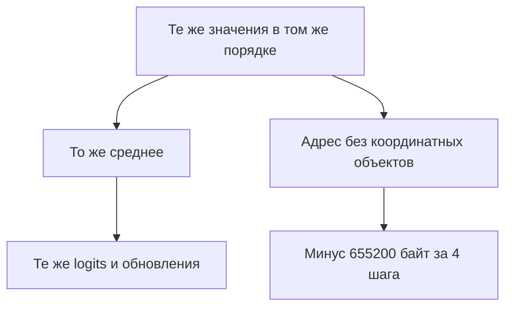

### Текущий перенос

В текущем SumAlongAxis есть специализированная ветвь последней оси с сохранённой размерностью 1. В прочитанном аудите остаётся открытым восстановление исторического H64/LoRA S0 и A/B полного состояния; наличие кода не означает, что этот перенос заново получил все исторические цифры.

**Источники:** [отчёт RD01][RD01_REPORT], [сырые результаты A][RD01_RAW_A], [сырые результаты B][RD01_RAW_B], [состояние A][RD01_STATE_A], [состояние B][RD01_STATE_B], [изменение кода][RD01_DIFF], [текущий прямой проход][CURRENT_RD], [RMSNorm проекта][CURRENT_RMS], [операция Mean][CURRENT_MEAN], [книга: среднее по координатам][BOOK_MEAN], [актуальный аудит переноса][CURRENT_QUALIFICATION]

## 4. MB01 — Среднее: возвращать градиент сразу в нужную строку

**Этап:** Обратный проход Mean внутри RMSNorm → BroadcastGradAlongAxis; это лишь часть backward RMSNorm.

### Старый способ → схема

Для каждого элемента градиента A раскладывает плоский номер на координаты, копирует массив, обнуляет последнюю координату и вновь получает плоский номер строки.

A правильно распределяет градиент среднего. Изменение удаляет два временных массива координат на элемент, не исправляет ошибку дифференцирования.

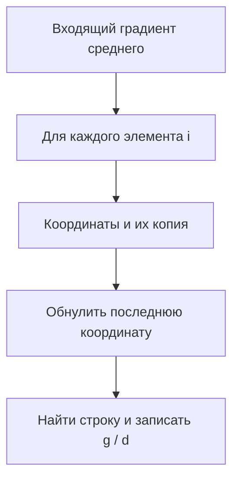

### Обновление → схема

При последней сохранённой оси номер строки равен целой части flatIndex / width. B использует этот адрес напрямую и умножает тот же градиент строки на прежний scale=1/width.

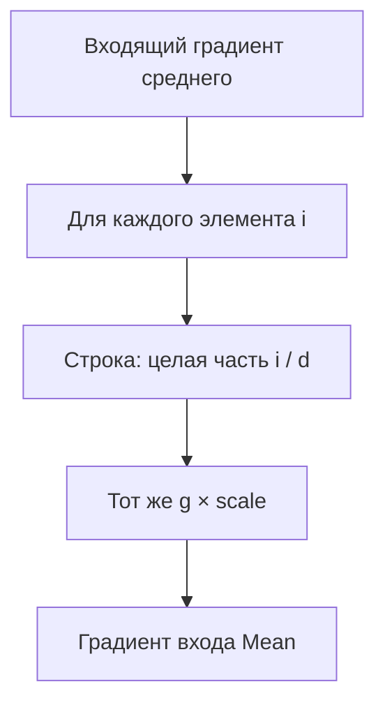

### Что действительно обучалось и что сохранилось

Использовано то же сохранённое состояние после 400 уроков; в каждом варианте выполнено по четыре настоящих SFT-обновления LoRA с AdamW. В raw все четыре обучаемых массива реально изменились; замороженные остались прежними.

В A и B ровно те же 2/4 ответа до и после; четыре потери 1.1465623, 1.2090048, 1.1422932, 1.2038769 совпали по битам.

Непосредственно сравнены before/after с logits, online_loss_bits, всё final_state с optimizer moments, восстановление и донор: равны. Бинарные снимки заново не исполнялись.

### Результат и цена

| Показатель | A | B | B − A |
|---|---:|---:|---:|
| Выделено байтов за обучение | 13 642 496 | 12 782 336 | -860 160 (-6.305%) |
| Время учебных шагов, мс | 74.0209 | 77.7742 | 3.7533 (+5.071%) |
| Процессорное время, мс | 78.125 | 78.125 | 0 (+0.000%) |
| Пик памяти процесса, байт | 48 275 456 | 48 779 264 | 503 808 (+1.044%) |

GC поколений 0/1/2: [2, 0, 0] → [2, 0, 0].

Расчёт удалённых объектов: `2 × 1 × 21 × 64 × 2 × 4 × 40 = 860160` байт — точно измеренная разница. Проценты относятся ко всем allocations четырёх учебных шагов, не к размеру модели и не к уменьшению рабочего набора.

- Измеренный wall +5,07% показывается рядом с выигрышем allocations; ускорения не заявлять.
- Форма — последняя сохранённая ось. Это не оптимизация любого broadcasting.
- RD01 и MB01 используют тот же исторический донор и панель; это разные локальные изменения, не независимые доказательства нового навыка.
- Не складывать проценты RD и MB как уже измеренный совместный эффект.

### Простая формула и книжная опора

\[
m_r=\frac1d\sum_j u_{r,j},\quad g_r=\frac{\partial L}{\partial m_r},\quad \frac{\partial L}{\partial u_{r,j}}=\frac{g_r}{d};\quad r=\lfloor i/d\rfloor.
\]

Каждое слагаемое среднего имеет коэффициент 1/d, поэтому одинаковый входящий градиент g/d получают все элементы этой строки. В RMSNorm u=x²: это градиент по входу Mean, не весь градиент по исходному x. Затем работают Square и остальные ветви.

В книге, Proposition 9.4, PDF-страница 314, используется **“chain rule”** — «цепное правило». Вместе с формулой среднего оно позволяет вывести g/d. Прямой адрес строки и экономия объектов — вывод из кода опыта, не теорема книги об эффективности. [книга: среднее по координатам][BOOK_MEAN], [книга: цепное правило][BOOK_CHAIN]

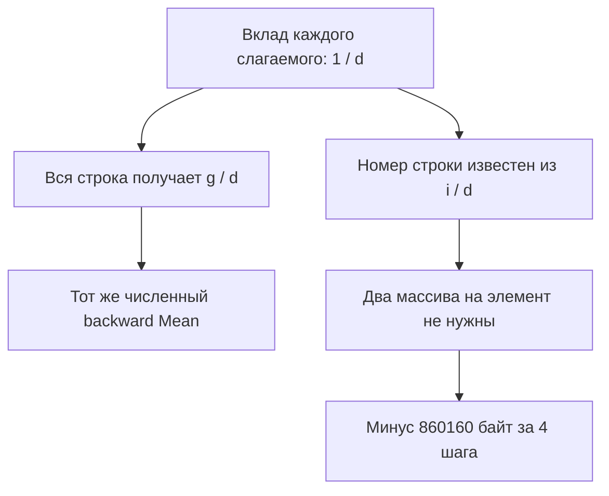

### Текущий перенос

Специализация уже находится в текущем BroadcastGradAlongAxis. Частный вызов Mean строит результат с теми же предыдущими измерениями. В историческом diff это дополнительно проверялось PrecedingDimensionsEqual; текущий caller гарантирует это построением. По прочитанному аудиту назначенная restored H64 qualification остаётся открытой.

**Источники:** [отчёт MB01][MB01_REPORT], [сырые результаты A][MB01_RAW_A], [сырые результаты B][MB01_RAW_B], [сравнение состояний][MB01_PARITY], [изменение кода][MB01_DIFF], [текущий обратный проход][CURRENT_MB], [операция Mean][CURRENT_MEAN], [книга: среднее по координатам][BOOK_MEAN], [книга: цепное правило][BOOK_CHAIN], [актуальный аудит переноса][CURRENT_QUALIFICATION]

## 5. SEXP01 — Softmax backward: вычислять экспоненту один раз

**Этап:** Trainer.BackwardLoss после logits, при вычислении градиента softmax-cross-entropy. Вероятности внимания и архитектура LoRA не меняются.

### Старый способ → схема

A правильно считает exp(z−max) сначала для знаменателя, затем повторно для числителя каждого softmax. Это корректная, но повторная работа.

В A верная формула softmax-cross-entropy. Удаление повторного вычисления не является ремонтом неверного градиента.

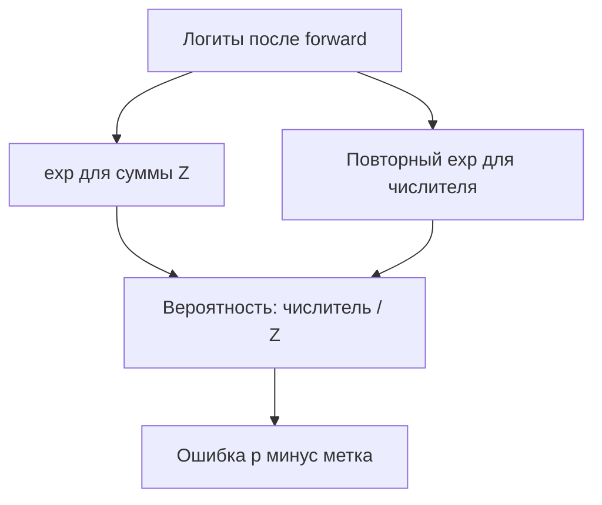

### Обновление → схема

B сохраняет первое exp в один буфер длины словаря и повторно читает его. Суммирование, деление, метка, вес, backward, clipping и AdamW остаются прежними. Буфер создаётся один раз на вызов и используется для всех строк.

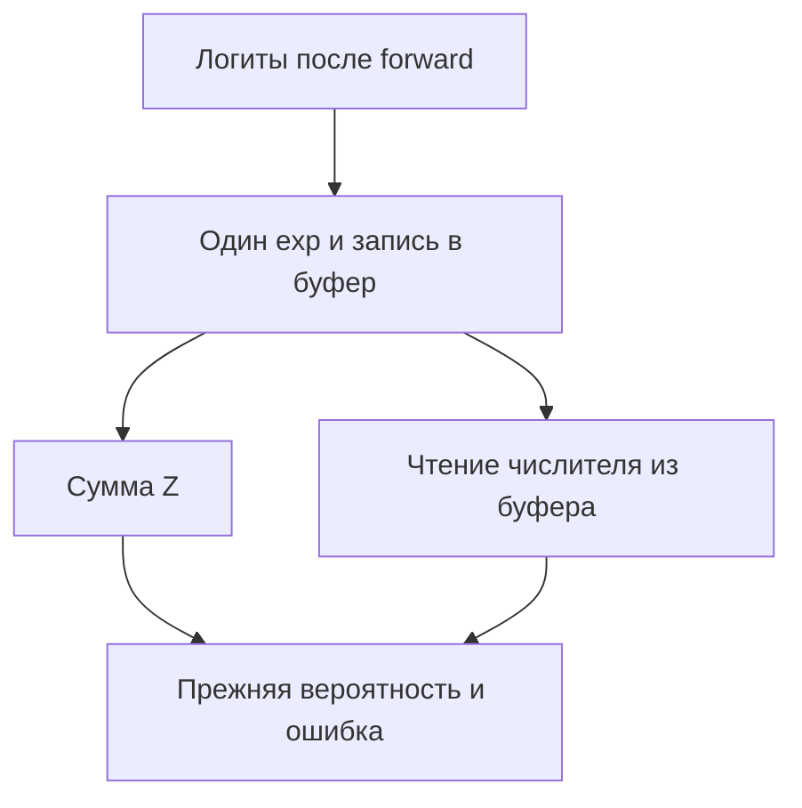

### Что действительно обучалось и что сохранилось

Нативный Transformer с q/v-LoRA, штатный SFT и AdamW; принят один и тот же исторический родитель со step1000. По4 обновления дали одинаковые новые stateHash и полное состояние optimizer step1004. Учебный старт слабый: 3/40 токенов,0/2 ответов.

Точность не выросла; параметры реально изменились, а соответствующие изменения и все сохранённые панели A/B совпали.

В raw сравнивались биты online losses, панели, хэши состояния модели и сами сохранённые optimizer entries before/after: равны. Начальный stateHash отличается от конечного в обеих руках. Бинарные снимки заново не исполнялись.

### Результат и цена

| Показатель | A | B | B − A |
|---|---:|---:|---:|
| Вызовы exp в backward loss, расчёт | 71 680 | 35 840 | -35 840 (-50.000%) |
| Вызовы exp вместе с cross-entropy, расчёт | 107 520 | 71 680 | -35 840 (-33.333%) |
| Выделено байтов за обучение | 6 230 688 | 6 238 192 | 7 504 (+0.120%) |
| Время учебных шагов, мс | 39.6467 | 27.2809 | -12.3658 (-31.190%) |
| Процессорное время, мс | 46.875 | 31.25 | -15.625 (-33.333%) |
| Пик памяти процесса, байт | 44 437 504 | 44 363 776 | -73 728 (-0.166%) |

GC поколений 0/1/2: [0, 0, 0] → [0, 0, 0].

Exp: на каждый шаг35 строк и словарь256. Счёт2NV→NV относится к backward loss; добавление неизменной CE даёт3NV→2NV. Это аналитический счёт циклов, не инструментальный счётчик всех exp Transformer. Новые буферы по расчёту занимают около4192 байт за4 вызова, а7504 байта — измеренная общая прибавка allocations; полностью приписывать её буферу нельзя.

- Сокращение exp на треть не означает треть общего времени или всех exp модели.
- Проценты времени — одно наблюдение с фиксированным порядком, не устойчивый throughput.
- Увеличение allocations показано прямо; новая цена буфера мала, но не нулевая.
- Старт после 1000 исторических обновлений не освоил учебные строки; эксперимент доказывает эквивалентность и объём работы, не качество обучения.

### Простая формула и книжная опора

\[
e_j=\exp(z_j-m),\quad m=\max_k z_k,\quad Z=\sum_k e_k,\quad p_j=e_j/Z,\quad \partial L/\partial z_j=p_j-\mathbf1[j=y].
\]

Числителю и знаменателю требуется ровно одно и то же e_j. Повторно читать сохранённое число достаточно; вероятность и обучающий сигнал остаются прежними. При учёте scale код использует (p_j−1[j=y])·scale.

В книге, раздел 2.1.4, PDF-страница 74, описана **“shift invariance”** — «инвариантность к сдвигу»: вычитание одного и того же максимума не меняет softmax. Theorem 9.5, PDF-страница 318, даёт градиент cross-entropy p−t. Сохранение exp вместо повторного вычисления и размер экономии обоснованы кодом и измерением. [книга: градиент cross-entropy][BOOK_CE], [книга: инвариантность softmax][BOOK_SHIFT]

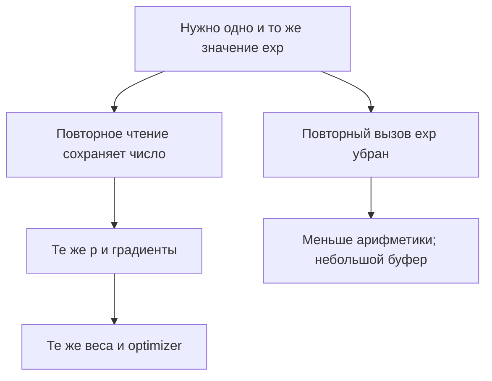

### Текущий перенос

Текущий Trainer.BackwardLoss всё ещё вызывает MathF.Exp в обоих циклах. Буфер есть в экспериментальном B, а не в прочитанном основном Trainer.

**Источники:** [отчёт SEXP01][SEXP01_REPORT], [итоговые измерения][SEXP01_RESULT], [сырые результаты A][SEXP01_RAW_A], [сырые результаты B][SEXP01_RAW_B], [код варианта B][SEXP01_CODE_B], [изменение кода][SEXP01_DIFF], [версии исходников][SEXP01_MANIFEST], [текущий Trainer][CURRENT_SEXP], [книга: градиент cross-entropy][BOOK_CE], [книга: инвариантность softmax][BOOK_SHIFT]

## Что ещё проверено, но не включено в эти пять карточек

### Новый P02: больший итоговый отступ не равен трёхкратному эффекту DPO

В свежем P02 сравниваются четыре шага DPO и четыре дополнительных SFT-урока перед теми же четырьмя шагами DPO. Последний записанный reward margin действительно выше в 3,2247 раза. Однако почти весь межплечевой разрыв есть уже в первом зарегистрированном замере:

| Показатель | A: только DPO | B: SFT, затем DPO |
|---|---:|---:|
| Первый записанный margin | 0 | 0,0027732193 |
| Последний записанный margin | 0,0012550415 | 0,0040471377 |
| Изменение между этими замерами | 0,0012550415 | 0,0012739184 |
| Всего обновлений | 4 | 8 |
| Правильные ответы до и после | 2/4 → 2/4 | 2/4 → 2/4 |

Отношение изменений между первым и последним записанными замерами — **1,0150**, а не 3,2247. Первый зарегистрированный межплечевой разрыв составляет **99,32%** последнего. Это арифметика сохранённых показателей, не новый запуск и не измерение полного эффекта всех четырёх обновлений.

Опыт показывает другой старт DPO после дополнительных уроков, но его нельзя подписывать «DPO стало учиться втрое быстрее». Цена — вдвое больше обновлений, точность прежняя, отдельное время SFT не измерено. [Сырые показатели P02][P02_METRICS].

### Ещё три полезные границы отбора

- **P125, доставка памяти перевода:** A теряет переданные PhraseMappings, B восстанавливает их передачу. Это полезное исправление доставки учебных данных. Отдельное обучение памяти не даёт сравнения нового метода с исправным обученным A, поэтому здесь P125 не заменяет методический пример. [Отчёт ingress][P125_INGRESS_REPORT].
- **PD01, удаление правого PAD-хвоста:** выделения уменьшаются примерно на 7,75%, но измеренный пик процесса растёт примерно на 27,1%; конечные состояния совпадают лишь в допуске. Причинность роста пика не установлена, но скрывать наблюдение нельзя. [Отчёт PD01][PD01_REPORT].
- **AT01, перестановка голов attention:** подтверждённая экономия выделений около 8,67%; оставлен для следующего объяснения, чтобы текущая подборка не состояла только из похожих способов убрать координатные массивы. [Отчёт AT01][AT01_REPORT].

## Как читать результаты этой подборки

RETENTION показывает удержание одного старого запроса при освоении нового. KDP показывает пользу явно заданных правил домена при выборе из обученной памяти. RD01 и MB01 снижают объём создаваемых временных объектов. SEXP01 сокращает повторные вычисления exp.

RD01 и MB01 используют один исторический донор и одну панель. Их проценты **нельзя складывать** как измеренный совместный выигрыш, а два опыта нельзя считать независимыми подтверждениями освоения навыка. Во всех трёх нейронных оптимизациях параметры действительно обновлялись; совпадение результата относится к сохранённым A/B и назначенным формам.

Успех эксперимента и состояние переноса в продукт указаны отдельно. Короткие замеры времени не превращены в утверждение об устойчивой скорости. Исторические числа и прежние разборы сохранены в навигаторе вместе с новыми уточнениями.

[AT01_REPORT]: https://github.com/lubochka/llm_mvp_core/blob/846144464a856cd3f118bcfc0165c8117b06c167/experiments-v2/RP01-MICRO/AT01/a001/results/report.md#L1-L218
[BOOK_CE]: https://github.com/lubochka/xiigen-planning/blob/ea9afbc13f5e6e8463fc74c89cfab3d2e154d62d/llm%20mvp/math-theory/giansalvo-transformer-vol1/source/0318-0324-ch09-mlm-graph-feedforward-and-softmax.md#L21-L45
[BOOK_CHAIN]: https://github.com/lubochka/xiigen-planning/blob/ea9afbc13f5e6e8463fc74c89cfab3d2e154d62d/llm%20mvp/math-theory/giansalvo-transformer-vol1/source/0312-0317-ch09-motor-taxonomy-and-related-work.md#L83-L93
[BOOK_INNER]: https://github.com/lubochka/xiigen-planning/blob/ea9afbc13f5e6e8463fc74c89cfab3d2e154d62d/llm%20mvp/math-theory/giansalvo-transformer-vol1/source/0797-0800-appendix-b-notation-summary.md#L27-L50
[BOOK_MARGIN]: https://github.com/lubochka/xiigen-planning/blob/ea9afbc13f5e6e8463fc74c89cfab3d2e154d62d/llm%20mvp/math-theory/giansalvo-transformer-vol1/source/0221-0224-ch06-margin-flatness-and-relative-emergence.md#L44-L50
[BOOK_MEAN]: https://github.com/lubochka/xiigen-planning/blob/ea9afbc13f5e6e8463fc74c89cfab3d2e154d62d/llm%20mvp/math-theory/giansalvo-transformer-vol1/source/0051-0063-ch01-geometry-normalisation-and-residuals.md#L216-L223
[BOOK_SHIFT]: https://github.com/lubochka/xiigen-planning/blob/ea9afbc13f5e6e8463fc74c89cfab3d2e154d62d/llm%20mvp/math-theory/giansalvo-transformer-vol1/source/0064-0075-ch02-single-head-and-scores.md#L339-L363
[CURRENT_MB]: https://github.com/lubochka/llm_mvp_core/blob/7e051ca7246efde2864f2bee3a427157063d3cc6/00.TensorCore/Core/TensorOps.cs#L1238-L1272
[CURRENT_MEAN]: https://github.com/lubochka/llm_mvp_core/blob/7e051ca7246efde2864f2bee3a427157063d3cc6/00.TensorCore/Core/TensorOps.cs#L535-L581
[CURRENT_QUALIFICATION]: https://github.com/lubochka/llm_mvp_core/blob/7e051ca7246efde2864f2bee3a427157063d3cc6/docs/plans/replanning-possible-diffs/fixes-based-on-experiments/67-transfer-repair-followup-audit-2026-10-27.md#L13-L28
[CURRENT_RD]: https://github.com/lubochka/llm_mvp_core/blob/7e051ca7246efde2864f2bee3a427157063d3cc6/00.TensorCore/Core/TensorOps.cs#L1176-L1236
[CURRENT_RMS]: https://github.com/lubochka/llm_mvp_core/blob/7e051ca7246efde2864f2bee3a427157063d3cc6/03.TransformerModel/Layers/RmsNorm.cs#L26-L40
[CURRENT_SEXP]: https://github.com/lubochka/llm_mvp_core/blob/7e051ca7246efde2864f2bee3a427157063d3cc6/04.TrainingLoop/Trainer.cs#L389-L426
[KDP_CODE]: https://github.com/lubochka/llm_mvp_core/blob/7e051ca7246efde2864f2bee3a427157063d3cc6/18.CapabilityTraining/KnnCandidatePrinciples.cs#L195-L316
[KDP_COMMIT]: https://github.com/lubochka/llm_mvp_core/commit/45995820648eeb7db007e79cac0dc52f0a2f6691
[KDP_CURRENT]: https://github.com/lubochka/llm_mvp_core/blob/7e051ca7246efde2864f2bee3a427157063d3cc6/18.CapabilityTraining/LlmIngredientLogicalUnits.cs#L225-L332
[KDP_EXAMPLE_A]: https://github.com/lubochka/llm_mvp_core/blob/846144464a856cd3f118bcfc0165c8117b06c167/experiments-v2/RP01-MICRO/KDP01/results/attempt-01/raw.json#L6693-L6735
[KDP_EXAMPLE_B]: https://github.com/lubochka/llm_mvp_core/blob/846144464a856cd3f118bcfc0165c8117b06c167/experiments-v2/RP01-MICRO/KDP01/results/attempt-01/raw.json#L7334-L7385
[KDP_REPORT]: https://github.com/lubochka/llm_mvp_core/blob/846144464a856cd3f118bcfc0165c8117b06c167/experiments-v2/RP01-MICRO/KDP01/results/attempt-01/report.md#L17-L220
[MB01_DIFF]: https://github.com/lubochka/llm_mvp_core/blob/846144464a856cd3f118bcfc0165c8117b06c167/experiments-v2/RP01-MICRO/MB01/a001/one-factor.diff#L1-L51
[MB01_PARITY]: https://github.com/lubochka/llm_mvp_core/blob/846144464a856cd3f118bcfc0165c8117b06c167/experiments-v2/RP01-MICRO/MB01/a001/results/result.json#L74-L173
[MB01_RAW_A]: https://github.com/lubochka/llm_mvp_core/blob/846144464a856cd3f118bcfc0165c8117b06c167/experiments-v2/RP01-MICRO/MB01/a001/results/A/code-sign.json#L408-L634
[MB01_RAW_B]: https://github.com/lubochka/llm_mvp_core/blob/846144464a856cd3f118bcfc0165c8117b06c167/experiments-v2/RP01-MICRO/MB01/a001/results/B/code-sign.json#L408-L634
[MB01_REPORT]: https://github.com/lubochka/llm_mvp_core/blob/846144464a856cd3f118bcfc0165c8117b06c167/experiments-v2/RP01-MICRO/MB01/a001/results/report.md#L1-L146
[P02_METRICS]: https://github.com/lubochka/llm_mvp_core/blob/7e051ca7246efde2864f2bee3a427157063d3cc6/experiments-v2/RP01-MICRO/P0201/results/attempt-0001/metrics.json
[P125_INGRESS_REPORT]: https://github.com/lubochka/llm_mvp_core/blob/846144464a856cd3f118bcfc0165c8117b06c167/docs/plans/replanning-possible-diffs/experimets/results/2026-10-18/translation-memory-ingress-01/report.md#L1-L80
[PD01_REPORT]: https://github.com/lubochka/llm_mvp_core/blob/846144464a856cd3f118bcfc0165c8117b06c167/experiments-v2/RP01-MICRO/PD01/results/attempt-0001/report.md#L1-L82
[RD01_DIFF]: https://github.com/lubochka/llm_mvp_core/blob/846144464a856cd3f118bcfc0165c8117b06c167/experiments-v2/RP01-MICRO/RD01/a001/results/one-factor.diff#L1-L46
[RD01_RAW_A]: https://github.com/lubochka/llm_mvp_core/blob/846144464a856cd3f118bcfc0165c8117b06c167/experiments-v2/RP01-MICRO/RD01/a001/results/A/code-sign.json#L2227-L2249
[RD01_RAW_B]: https://github.com/lubochka/llm_mvp_core/blob/846144464a856cd3f118bcfc0165c8117b06c167/experiments-v2/RP01-MICRO/RD01/a001/results/B/code-sign.json#L2227-L2249
[RD01_REPORT]: https://github.com/lubochka/llm_mvp_core/blob/846144464a856cd3f118bcfc0165c8117b06c167/experiments-v2/RP01-MICRO/RD01/a001/results/report.md#L1-L60
[RD01_STATE_A]: https://github.com/lubochka/llm_mvp_core/blob/846144464a856cd3f118bcfc0165c8117b06c167/experiments-v2/RP01-MICRO/RD01/a001/results/A/code-sign.json#L74-L82
[RD01_STATE_B]: https://github.com/lubochka/llm_mvp_core/blob/846144464a856cd3f118bcfc0165c8117b06c167/experiments-v2/RP01-MICRO/RD01/a001/results/B/code-sign.json#L74-L82
[RET_A_COST]: https://github.com/lubochka/llm_mvp_core/blob/846144464a856cd3f118bcfc0165c8117b06c167/experiments-v2/RP01-MICRO/N61-MODE1/results/RETENTION-M1-01/A/costs.json#L1-L104
[RET_A_STATES]: https://github.com/lubochka/llm_mvp_core/blob/846144464a856cd3f118bcfc0165c8117b06c167/experiments-v2/RP01-MICRO/N61-MODE1/results/RETENTION-M1-01/A/states.json#L1-L340
[RET_B_COST]: https://github.com/lubochka/llm_mvp_core/blob/846144464a856cd3f118bcfc0165c8117b06c167/experiments-v2/RP01-MICRO/N61-MODE1/results/RETENTION-M1-01/B/costs.json#L1-L104
[RET_B_STATES]: https://github.com/lubochka/llm_mvp_core/blob/846144464a856cd3f118bcfc0165c8117b06c167/experiments-v2/RP01-MICRO/N61-MODE1/results/RETENTION-M1-01/B/states.json#L1-L344
[RET_CURRENT]: https://github.com/lubochka/llm_mvp_core/blob/7e051ca7246efde2864f2bee3a427157063d3cc6/42.ProjectWikiDomain/PromptFlowGroundingModel.cs#L17-L24
[RET_RAW]: https://github.com/lubochka/llm_mvp_core/blob/846144464a856cd3f118bcfc0165c8117b06c167/experiments-v2/RP01-MICRO/N61-MODE1/results/RETENTION-M1-01/B/raw-answers.json#L191-L254
[RET_REPORT]: https://github.com/lubochka/llm_mvp_core/blob/846144464a856cd3f118bcfc0165c8117b06c167/experiments-v2/RP01-MICRO/N61-MODE1/results/RETENTION-M1-01/report.md#L16-L69
[RET_SCORE]: https://github.com/lubochka/llm_mvp_core/blob/7e051ca7246efde2864f2bee3a427157063d3cc6/42.ProjectWikiDomain/PromptFlowGroundingModel.cs#L147-L205
[SEXP01_CODE_B]: https://github.com/lubochka/llm_mvp_core/blob/846144464a856cd3f118bcfc0165c8117b06c167/experiments-v2/RP01-MICRO/SEXP01/src/B/Trainer.cs#L389-L428
[SEXP01_DIFF]: https://github.com/lubochka/llm_mvp_core/blob/846144464a856cd3f118bcfc0165c8117b06c167/experiments-v2/RP01-MICRO/SEXP01/one-factor.diff#L1-L10
[SEXP01_MANIFEST]: https://github.com/lubochka/llm_mvp_core/blob/846144464a856cd3f118bcfc0165c8117b06c167/experiments-v2/RP01-MICRO/SEXP01/source-manifest.json#L1-L6
[SEXP01_RAW_A]: https://github.com/lubochka/llm_mvp_core/blob/846144464a856cd3f118bcfc0165c8117b06c167/experiments-v2/RP01-MICRO/SEXP01/results/attempt-0001/A/arm-result.json#L18-L1338
[SEXP01_RAW_B]: https://github.com/lubochka/llm_mvp_core/blob/846144464a856cd3f118bcfc0165c8117b06c167/experiments-v2/RP01-MICRO/SEXP01/results/attempt-0001/B/arm-result.json#L18-L1338
[SEXP01_REPORT]: https://github.com/lubochka/llm_mvp_core/blob/846144464a856cd3f118bcfc0165c8117b06c167/experiments-v2/RP01-MICRO/SEXP01/results/attempt-0001/report.md#L1-L167
[SEXP01_RESULT]: https://github.com/lubochka/llm_mvp_core/blob/846144464a856cd3f118bcfc0165c8117b06c167/experiments-v2/RP01-MICRO/SEXP01/results/attempt-0001/result.json#L1-L103
