# История предыдущего отбора

Этот материал относится к предыдущему проходу. Новый разбор и выборочная проверка внедрения на7e051ca находятся вEXPLANATION.ru.md иnext_review. Старые числа иselection_review сохранены; английские книжные цитаты заменены пересказом с прежними ссылками. HCL остаётся исправлением реализации.

# Дополнительная проверка экспериментов: что поставить вместо HCL

Проверено 27 октября 2026 года. Текущий код сверялся с commit 75107af930a1d4c55d60fa8a4ef7c01643f13cb0 ветки codex/dpo-implementation. Числа взяты из закреплённых отчётов и сырых результатов; новые запуски моделей не выполнялись. Книга — снимок ea9afbc13f5e6e8463fc74c89cfab3d2e154d62d.

## Решение после повторной проверки

**HCL убран из основной подборки улучшений метода. На его место подходит T-TRAIN-CONTEXT-01. Ещё один полезный основной пример — GRADB-LOCALITY-01, если нужен выигрыш в вычислениях при сохранении результата обучения. CDG68 и SVD01 заслуживают объяснения, но с явно указанными компромиссами.**

В HCL правильно обученные таблицы читались с неверно подготовленной локальной историей: локальные номера из разных кластеров смешивались. Исправление возвращает читателю правильную историю. Положительный результат действителен, но подтверждает устранение дефекта, а не преимущество нового способа обучения над исправным прежним способом. Причину появления дефекта именно при переносе в маленькие домены эта проверка не устанавливает. [Описание фактора HCL][HCL].

Предыдущая ошибка была в отборе и названии примера. Теперь проверяется не только улучшение чисел, но и то, выполнял ли вариант A собственный заявленный алгоритм правильно.

| Эксперимент | Где меняется работа | Что подтверждено | Решение |
|---|---|---|---|
| T-TRAIN-CONTEXT-01 | Состав записи, сохраняемой при обучении контекстного словаря | 2/4 → 4/4; две ошибки исправлены, прежние правильные ответы сохранены | Основная замена HCL; тест очень мал |
| GRADB-LOCALITY-01 | Обратный проход матричного умножения | Измеряемый участок быстрее примерно на 61–63%; конечные веса совпадают побитово | Основной пример вычислительной оптимизации, ограниченный одним A/B |
| CDG68 | Распределение SFT-уроков для LoRA | При 290 обновлениях в обоих вариантах две задачи улучшились по числу правильных токенов, две сохранились | Полезный пример обучения; не объявлять отсутствием ухудшений по всем показателям |
| SVD01 | Представление направленных переходов и чтение факторов | 2/5 → 5/5; сохраняется дополнительный правый фактор | Полезный пример изменения представления; память факторов удваивается |
| SEXP01 | Повторное использование экспонент в backward softmax | Меньше вычислений при том же состоянии модели и оптимизатора | Дополнительный пример, но замер времени короткий |
| KDP01 | Дополнительные правила оценки кандидатов KNN | Улучшения в RU, HE и OR при той же памяти | Только как пример ручного знания в читателе; правила не выучены нейросетью |

Источники каждой строки, цена и границы вывода приведены в карточках ниже.

## 1. T-TRAIN-CONTEXT-01: сохранять вместе со словом контекст его употребления

### Старый способ

**Этап — подготовка учебной записи контекстного словаря перед AddEntry.** Это обучение памяти примеров. Токенизатор, нейронная матрица весов, LoRA и оптимизатор здесь не меняются.

В память записаны две правильные пары:

- book → книга;
- book → бронировать.

Но обе записи лишены признаков окружающих слов. Запрос содержит контекст, однако сравнивать его приходится с двумя одинаково неполными опорными записями. При равных расстояниях и приоритетах выбирается первая. Читатель корректно выполняет этот ограниченный способ; ошибочного адреса или сломанного сохранения в A нет. [Постановка и код опыта][TCTX_CODE], [действующий читатель][TCTX_READER].

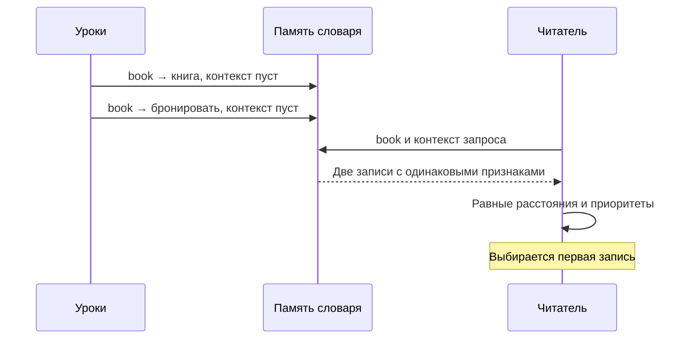

### Обновление в эксперименте

В те же две записи добавляют части речи слева и справа:

| Значение | Слева | Справа |
|---|---|---|
| книга | Определитель | Глагол |
| бронировать | Местоимение | Существительное |

Порядок записей, переводы, AddEntry и алгоритм чтения одинаковы. В уроке просто сохраняется больше полезной информации. POS-признаки заданы автором опыта; автоматическое определение частей речи здесь не проверялось. Параметр k в этом читателе не участвует в выборе: это ближайшая запись, а не голосование нескольких соседей. [Код двух вариантов][TCTX_CODE], [читатель][TCTX_READER].

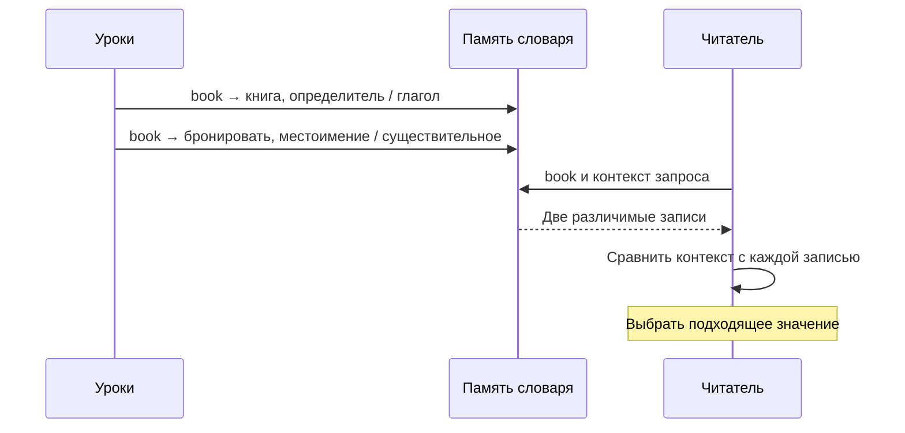

### Сравнение результатов

| Показатель | A: без контекста в уроках | B: с контекстом |
|---|---:|---:|
| Число сохранённых уроков | 2 | 2 |
| До добавления уроков | 0/4 | 0/4 |
| После добавления уроков | 2/4 | 4/4 |
| Только уникальные входы читателя | 1/3 | 3/3 |
| Выделено байтов при четырёх чтениях | 3 304 | 4 328 |
| Ошибки на ранее правильных запросах | — | 0 |

Два из четырёх запросов совпадают, поэтому 4/4 нельзя представлять как четыре независимых случая. Цена чтения выросла на **1 024 байта за четыре запроса**, или 256 байт на запрос в этом измерении. В относительных числах это около 31%; в абсолютных — малая измеренная добавка. Это allocations, а не доказанный прирост постоянного размера модели. Замер heap также не изолирует размер словаря. Скорость чтения причинно не установлена: даже одинаковое чтение до обучения заметно различалось по времени. [Отчёт][TCTX_REPORT], [сырые результаты A][TCTX_A], [сырые результаты B][TCTX_B].

Раньше я слишком строго отсеял этот опыт из-за роста allocations. Для отбора следует учитывать и абсолютную цену. При этом маленькая панель остаётся ограничением: результат не доказывает качество перевода произвольных предложений.

### Простая формула и связь с книгой

Пусть r₁ и r₂ — признаки двух сохранённых значений, q — запрос, d — расстояние:

\[
r_1=r_2 \quad\Longrightarrow\quad d(q,r_1)=d(q,r_2).
\]

**Если две записи представлены одинаково, расстояние не может объяснить читателю, какую из них выбрать.** Добавление контекста делает записи различимыми. В конкретных проверенных запросах правильная запись получает меньшее расстояние; гарантии для любого будущего предложения из этого не следует.

В книге, Remark 1.4, PDF-страница 39, статическое представление описано словами **“независимо от контекста”** — «независимо от контекста». Далее различаются статические и зависящие от последовательности представления. Это опора для принципа различимости, а не утверждение, что словарь проекта устроен как Transformer. Формула равенства расстояний выше — прямое математическое следствие одинаковых признаков. [Книга: Definition 1.2 и Remark 1.4][BOOK_CONTEXT].

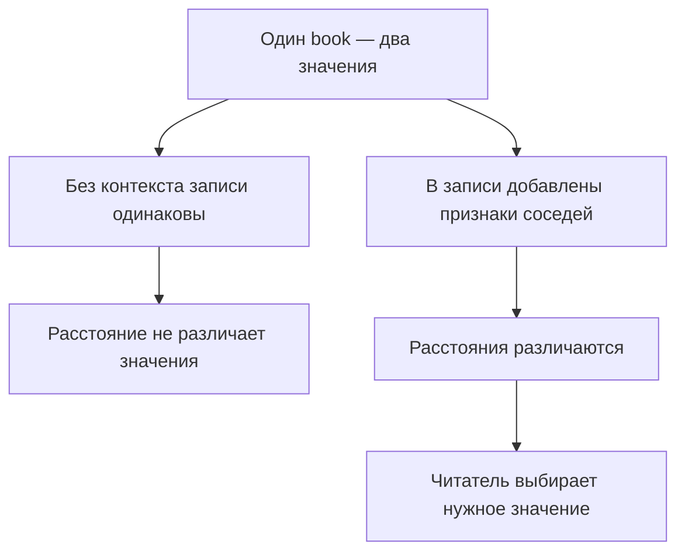

**Текущий статус.** Поддержка контекста существует в самом ContextualDictionary. Опыт не устанавливает, какой продуктовый вызывающий код раньше терял POS-признаки; поэтому я не объявляю его исправлением такого предполагаемого бага. [Текущий AddEntry и запись][TCTX_ENTRY].

## 2. GRADB-LOCALITY-01: тот же градиент, более удобный порядок чтения памяти

### Старый способ

**Этап — backward матричного умножения внутри нейронного обучения.** Меняется реализация вычисления градиента правого множителя. Формула градиента, данные, DPO-цель и состав обучаемых параметров сохраняются.

Умножение можно выполнить, обходя элементы в разном порядке. В A цикл выбирает элемент результата и проходит по строкам входа. Нужные элементы расположены с шагом в памяти. Это корректный алгоритм. По индексации видно, что он не обходит соседние элементы строк подряд; связь с эффективностью кэша — объяснение механизма, а не отдельный аппаратный замер. [Вариант A][GRAD_A_CODE].

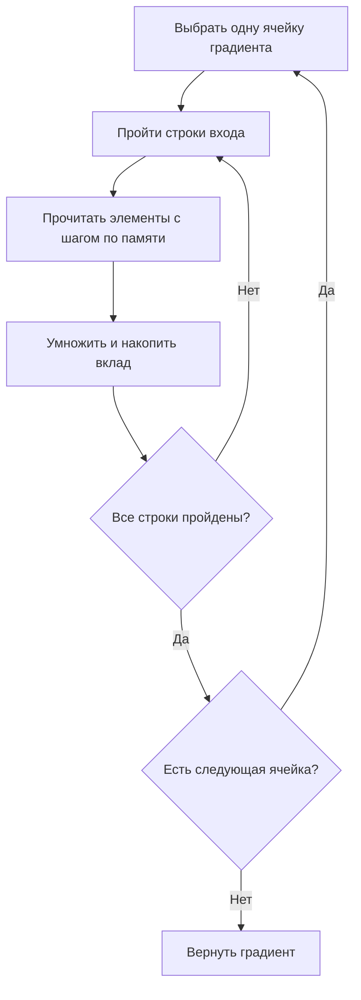

### Обновление в эксперименте

В B сначала берут строку и один скаляр входа, затем проходят соседние столбцы. Тот же скаляр используется несколько раз, а данные читаются последовательнее. Для каждой итоговой ячейки сохраняется порядок суммирования её вкладов. Проверенный diff меняет именно эту вложенность циклов. [Вариант B][GRAD_B_CODE].

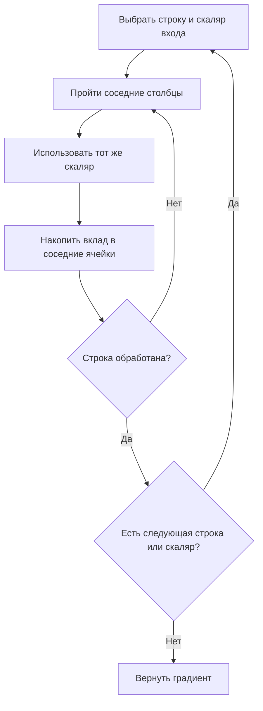

### Сравнение результатов

| Показатель | A | B |
|---|---:|---:|
| DPO-обновлений | 2 | 2 |
| Время участка gradB, шаг 1 | 558,93 мс | 209,10 мс |
| Время участка gradB, шаг 2 | 570,48 мс | 224,40 мс |
| Loss, шаг 1 | 0,3575644 | 0,3575644 |
| Loss, шаг 2 | 0,3298104 | 0,3298104 |
| Выделено байтов за обучение | 3 765 261 568 | 3 765 294 024 |
| Конечные веса и значения адаптеров | Совпадают побитово | Совпадают побитово |

Участок gradB занял примерно на **62,6% и 60,7% меньше времени**. Число вызовов участка и расчётный объём умножений-сложений одинаковы. Дополнительные allocations — **32 456 байт, около 0,00086%** измеренного объёма. Совпали loss, reward margin и хеши конечного состояния. Это сильнее, чем просто одинаковая округлённая accuracy. [Сырые результаты A][GRAD_A_RAW], [сырые результаты B][GRAD_B_RAW], [отчёт][GRAD_REPORT].

**Граница вывода:** это два шага одного A/B, а не независимые повторения. Участок занимал лишь около 3,8–4,9% исходного времени целого шага. Поэтому «всё обучение ускорилось на 61–63%» было бы неверно. Общий цикл тоже измерялся быстрее, но такое большое изменение нельзя целиком приписать перестановке этих циклов. Падение peak working set в B также не доказывает экономию памяти самим методом.

### Простая формула и связь с книгой

Если Y = XW, а G — пришедший сверху градиент, то:

\[
\frac{\partial L}{\partial W}=X^\top G,
\qquad
\left(\frac{\partial L}{\partial W}\right)_{kj}
=\sum_i X_{ik}G_{ij}.
\]

**Каждая ячейка собирается из тех же произведений. Меняется маршрут чтения элементов, а не смысл вычисления.**

Книга, Proposition 9.22, PDF-страница 334, называет элементарный вклад **“внешнее произведение”** — «внешнее произведение» — и записывает xᵀδ. Сумма таких вкладов даёт формулу выше. Книга даёт формулу градиента; равенство вычисления здесь следует из сохранения тех же произведений и порядка их сложения. Выигрыш конкретного порядка доступа к памяти подтверждает эксперимент. Кэш-промахи отдельным аппаратным счётчиком здесь не измерены. [Книга: Proposition 9.22][BOOK_GRAD].

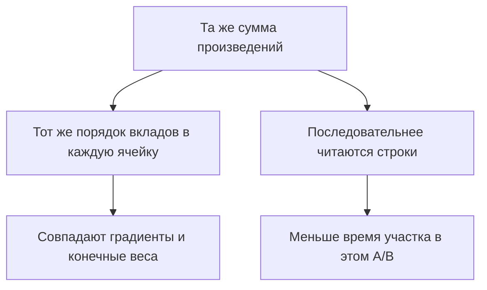

**Текущий статус.** Вариант B находится в эксперименте. Проверенный основной TensorOps сохраняет прежнюю вложенность циклов; называть эту оптимизацию уже внедрённой во всё ядро нельзя. [Текущий TensorOps][GRAD_CURRENT].

## 3. CDG68: тратить часть уроков на ещё слабую задачу

### Старый способ

**Этап — выбор примеров для SFT-обучения существующих LoRA-адаптеров.** Не меняются токенизация, формула cross-entropy, конструкция LoRA и AdamW.

После общего обученного старта один из участков восстановления тратит все 60 уроков на Abs — функцию абсолютного значения. Sign — определение знака — уже получала правильные уроки в общей части опыта, но в этом участке дополнительных уроков не получает. [Отчёт CDG68][CDG68_REPORT], [код распределения][CDG68_CODE].

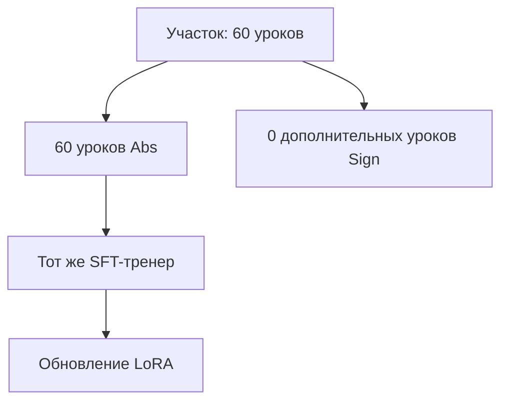

### Обновление в эксперименте

Десять из этих шестидесяти уроков передают Sign: **50 Abs + 10 Sign**. Полная доза правильных уроков Sign становится 15 против 25; сравнение 0 против 10 относится только к дополнительному участку.

Оба варианта выполняют по 290 SFT-обновлений в сравниваемой части. Один и тот же штатный тренер обновляет параметры с RequiresGrad; проверенная цепочка получателя LoRA допускает градиенты именно адаптеров. Это вывод по коду, а не новый независимый замер всех базовых тензоров. [Код LoRA-получателя][LORA_GUARD], [вызов штатного SFT][CDG68_SFT], [обновление AdamW][TRAINER].

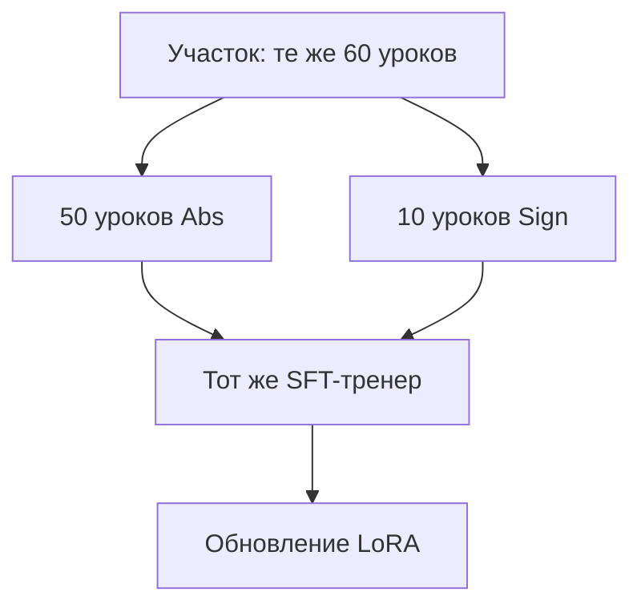

### Сравнение результатов

Здесь оценивается предсказание токенов при подставленном правильном предыдущем контексте, то есть teacher forcing. NLL — средний штраф за малую вероятность правильного токена: меньше лучше.

| Задача | Правильные токены A → B | NLL A → B |
|---|---:|---:|
| Abs | 22/23 → 22/23 | 0,5390 → 0,4889 |
| Magnitude | 6/29 → 10/29 | 3,9469 → 3,6123 |
| Sign | **14/21 → 20/21** | **1,9624 → 0,6528** |
| Negate | 16/17 → 16/17 | 0,7200 → 0,6528 |

У Sign margin меняется с −0,0858 на +0,4026. Здесь margin — разность средних log-prob правильного и ошибочного ответа, не процент уверенности. Положительный знак означает предпочтение правильной стороны. На всех 61 сохранённых точках окна 230–290 преимущество Sign есть и по доле правильных токенов, и по margin. Это устойчивость внутри одной траектории, а не 61 независимый запуск. [Сырые конечные показатели][CDG68_RAW], [кривая A][CDG68_CURVE_A], [кривая B][CDG68_CURVE_B], [определение margin в коде][CDG68_SCORE].

Однако строгий критерий «всё улучшилось без ухудшений» здесь не выполнен:

- Средний ранг правильного токена Magnitude ухудшился: **42,14 → 54,62**. Это отдельный показатель, и рост числа правильных токенов не отменяет его ухудшения.
- Margin Abs и Negate немного снизились, хотя сохранили положительный знак; их NLL улучшился и правильных токенов не стало меньше.
- Ни один из четырёх ответов не стал целиком правильным; свободная генерация не выполнялась.
- Измеренный цикл занял 170,46 и 210,99 минуты. В отчёте зафиксирована посторонняя нагрузка машины; показатели времени и allocations включают диагностику внутри цикла. Они не позволяют уверенно объявить ни ускорение, ни причинное замедление метода. Равные 290 обновлений также не доказывают равные FLOPs при разных длинах уроков. [Отчёт и ограничения][CDG68_REPORT].

### Простая формула и связь с книгой

Для softmax с cross-entropy:

\[
L=-\log p_y,\qquad
\frac{\partial L}{\partial z_j}=p_j-\mathbf1[j=y].
\]

Здесь p_j — предсказанная вероятность токена j, y — правильный токен, z_j — значение перед softmax. **Урок создаёт конкретный сигнал ошибки. Если вероятность правильного токена мала, этот урок даёт обучению сигнал поднять её.** Передать часть уроков Sign означает чаще вычислять и применять ошибки именно этой задачи.

В книге, Theorem 9.5, PDF-страница 318, этот сигнал описан как **“компактный вектор ошибки”** — «компактный вектор ошибки». Обозначения книги и формулы выше различаются: здесь z — логиты, p — вероятности. Само тождество одно. Его перенос на next-token SFT оправдан совпадением softmax-cross-entropy, хотя глава книги обсуждает MLM-голову. [Книга: Theorem 9.5][BOOK_CE].

В реальном опыте обновляет параметры AdamW; нельзя выдавать простое SGD-уравнение за его точную траекторию. Книга отдельно описывает моменты Adam. Она объясняет влияние последовательности градиентов, но не доказывает, что именно десять уроков оптимальны или что другие задачи не пострадают. [Книга: Adam, PDF 622][BOOK_ADAM].

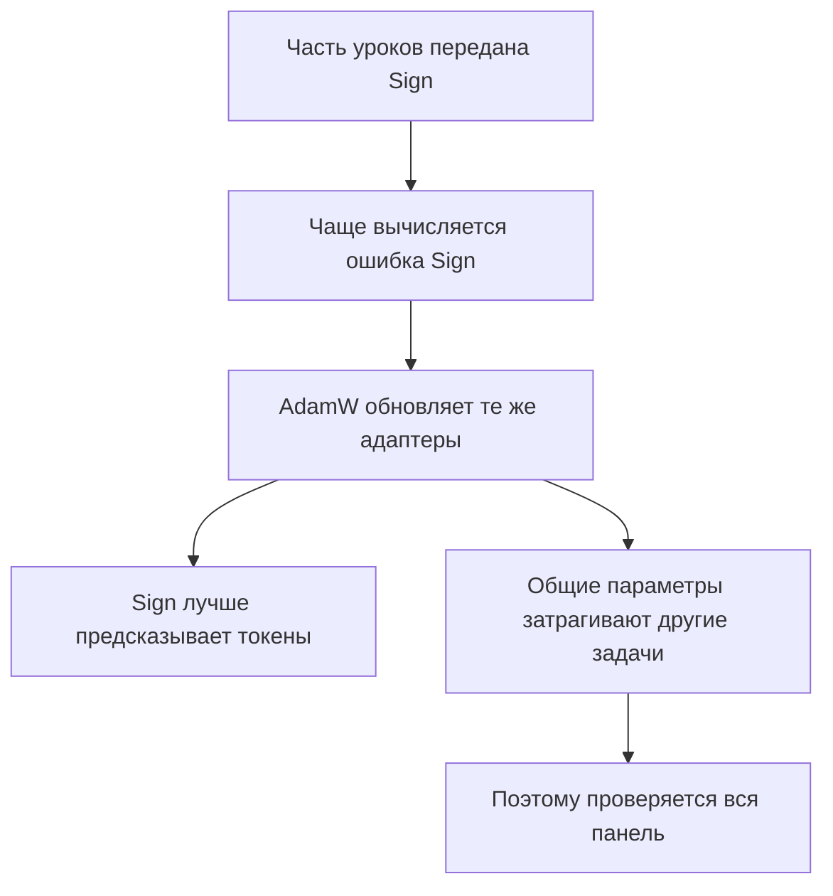

**Текущий статус.** Это проверенный эксперимент с расписанием уроков. Наличие экспериментального host не подтверждает существование готового общего планировщика обучения в продукте.

## 4. SVD01: различать похожесть и направление перехода

### Почему это отличается от HCL

Исторический E10 прямо заявлял такой метод: построить по одному SVD-вектору на токен и предсказывать следующий токен по наибольшему dot двух этих векторов. Код выполнял именно это. Поэтому сравнение с направленным представлением нельзя автоматически называть исправлением случайно потерянного правого фактора: старый контракт полного восстановления матрицы не обещал. [Историческая постановка][SVD_OLD_CONTRACT], [исторический читатель][SVD_OLD_CODE].

### Старый способ

**Этап — статистическое представление переходов и чтение факторов.** Сначала собираются направленные соседства, затем строится PPMI-матрица оценок связи, затем SVD. Это не замена softmax-матрицы вероятностей Transformer и не LoRA.

Старое чтение использует один и тот же набор векторов и для источника, и для кандидата:

\[
s_A(i,j)=L_iL_j^\top.
\]

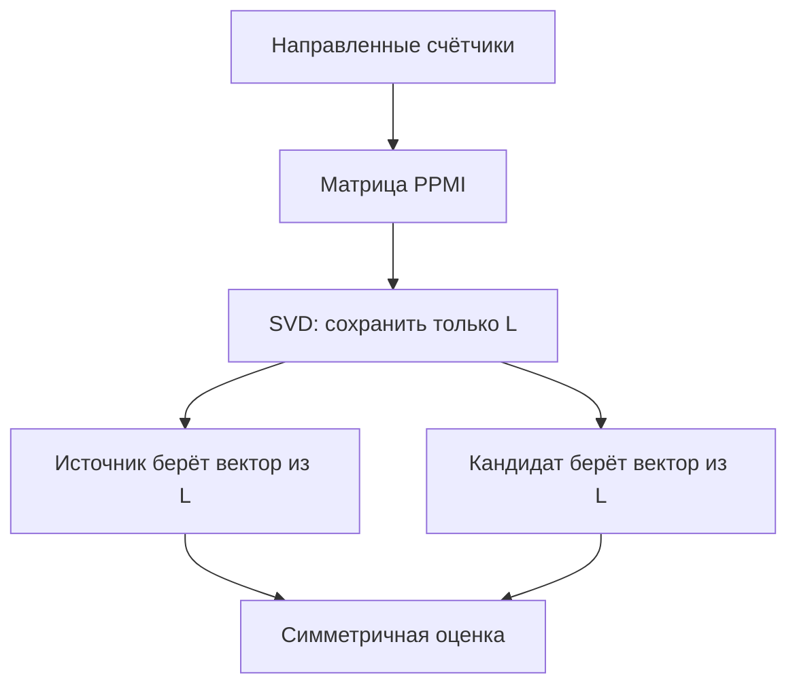

### Обновление в эксперименте

Сохраняется дополнительный правый фактор R. Источник читается из L, цель — из R:

\[
s_B(i,j)=L_iR_j^\top.
\]

Левый фактор в A и B совпадает побитово. Меняется представление цели и способ его использования. Оба читателя используют dot без нормировки: называть прежний способ cosine similarity неточно. [Факторный эксперимент][SVD_FACTOR], [текущие читатели][SVD_READERS].

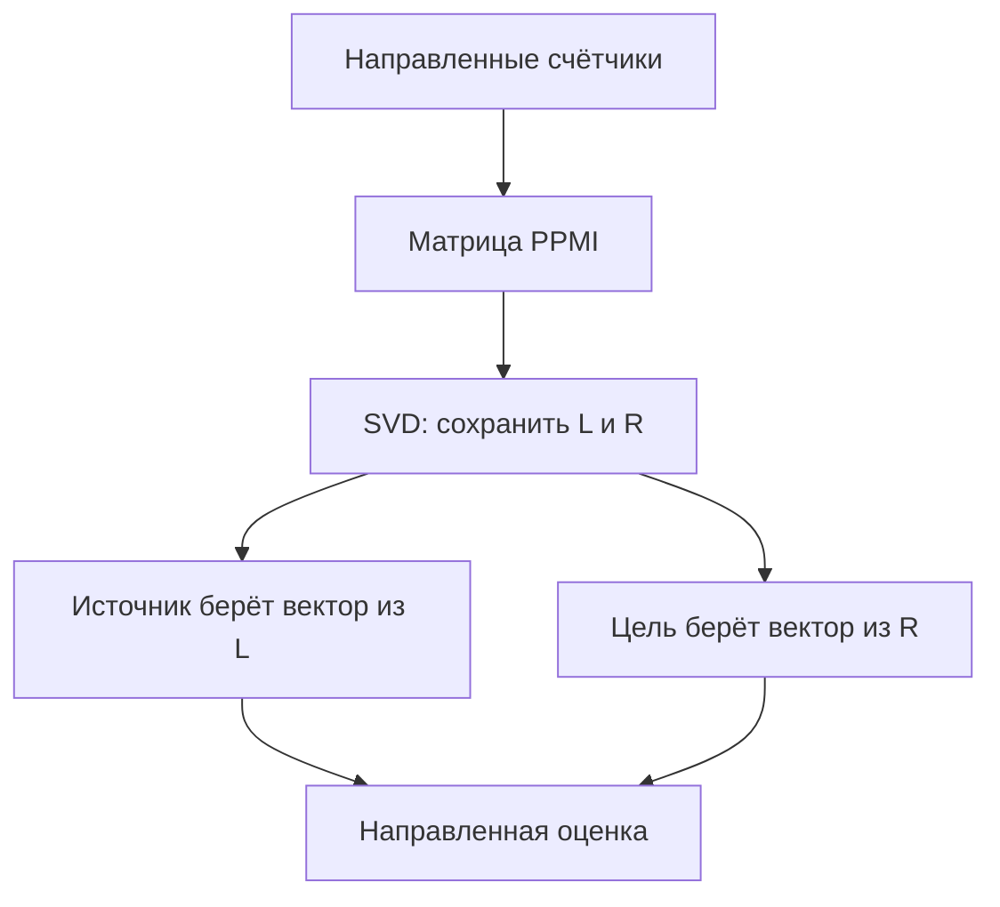

### Сравнение результатов

| Показатель после обучения | A: L·L | B: L·R |
|---|---:|---:|
| Правильные переходы | 2/5 | 5/5 |
| Три направленных перехода | 0/3 | 3/3 |
| Два контрольных самоперехода | 2/2 | 2/2 |
| Хранимые факторы | 120 000 байт | 240 000 байт |
| Выделено байтов во время fit | 7 577 464 | 7 697 488 |

Простой неизменённый bigram-счётчик тоже даёт **5/5**. Поэтому подтверждено преимущество над прежним симметричным чтением, но не превосходство над простой таблицей. Удвоение относится к памяти факторов, а не ко всему процессу; абсолютная цена — 120 000 байт, allocations fit выросли на 120 024 байта. [Результаты и цена][SVD_RESULTS].

Ошибка восстановления матрицы падает с 6,3274 примерно до 2·10⁻¹⁵. Но активных событий всего пять, а разрешённый ранг — 30. Почти точное восстановление в таком случае не доказывает, что сложную большую матрицу удастся столь же точно сжать. Пять знакомых переходов также не являются тестом обобщения. [Бюджет и диагностика][SVD_LIMITS].

### Простая формула и связь с книгой

Книга, Appendix A.1.4, Eq. A.3, PDF-страница 793:

\[
M=U\Sigma V^\top.
\]

Её короткое обозначение **“левые и правые сингулярные векторы”** — «сингулярные векторы» — относится к разным левому и правому наборам. В опыте:

\[
L=U_r\sqrt{\Sigma_r},\quad
R=V_r\sqrt{\Sigma_r},\quad
M\approx LR^\top.
\]

Принципиальное различие:

\[
LL^\top=(LL^\top)^\top,\qquad
LR^\top \text{ не обязана быть симметричной}.
\]

**Похожесть i на j симметрична в старой формуле. Переход i → j не обязан быть равен переходу j → i. Два набора векторов позволяют это выразить.** Это математическое объяснение устранённого ограничения представления, а не гарантия качества любого SVD-предсказателя. [Книга: SVD][BOOK_SVD].

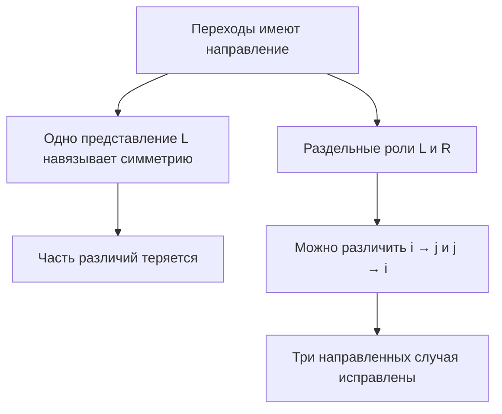

**Текущий статус.** На проверенном HEAD запуск E10 в экспериментальном модуле 34 действительно использует общий FitFixedTraining и ArgmaxDirected; старый ArgmaxSourceSimilarity сохранён отдельно. Это подтверждённое подключение в модуле 34. Перенос во все продуктовые KNN или маршрутизаторы из этого не следует. [Текущий Run][SVD_CURRENT], [оба читателя][SVD_READERS].

## 5. Что ещё можно использовать и почему не всё попало в основные карточки

### SEXP01 — сохранить уже вычисленную экспоненту

В A при вычислении softmax-gradient экспоненты считаются повторно: один раз для знаменателя, ещё раз для числителя. В B первое значение сохраняется и используется снова:

\[
e_j=\exp(z_j-z_{\max}),\qquad
p_j=e_j/\sum_k e_k.
\]

В проверенном backward расчётное число вызовов exp уменьшается 71 680 → 35 840; вместе с отдельным проходом cross-entropy — **107 520 → 71 680**, то есть на треть. Модель и оптимизатор после четырёх обновлений совпадают побитово. Цена — **+7 504 байта allocations**, около 0,12%. Это корректная оптимизация повторных вычислений. [Результат SEXP][SEXP_RESULT].

Время 39,65 → 27,28 мс нельзя считать устойчивым ускорением на всех задачах: одна короткая пара A/B чувствительна к прогреву. Сам обученный старт слаб: всего 3/40 правильных токенов, после опыта столько же. Поэтому пример подходит для объяснения уменьшения арифметической работы, но не роста качества обучения. В проверенном основном Trainer на HEAD 75107 этот буфер ещё не используется; описан вариант экспериментального плеча B. [Отчёт SEXP][SEXP_REPORT], [текущий Trainer][SEXP_CURRENT].

### KDP01 — добавлять к оценке кандидатов явно заданные правила

В состоянии S1 при одинаковых восьми уроках на профиль точность меняется:

| Профиль | A → B |
|---|---:|
| C# | 6/8 → 6/8 |
| English | 8/8 → 8/8 |
| Russian | 5/8 → 8/8 |
| Hebrew | 6/8 → 8/8 |
| OR | 5/8 → 8/8 |

Но помогли вручную заданные признаки временной формы для RU/HE и последних завершённых этапов для OR. Сам обучаемый частотный префиксный компонент не изменил ни одного ответа. Раздельного ресурсного A/B нет. Это полезное доменное знание в формуле чтения KNN, а не доказательство того, что модель сама выучила эти правила. В проверенном основном конструкторе эти массивы функций не подключены. [Отчёт KDP][KDP_REPORT], [добавочные правила][KDP_PRINCIPLES], [текущий конструктор][KDP_CURRENT].

### Кандидаты, которые я не использую как чистые доказательства улучшения

| Кандидат | Что показала дополнительная проверка | Решение |
|---|---|---|
| E25 | 26 из 32 POS-последовательностей совпадают с TRAIN. На шести невиденных случаях 2/6 → 2/6. Точный словарь для знакомых плюс прежнее правило для остальных даёт те же 28/32 | Не доказывает преимущества KNN над более сильным простым baseline |
| CDG09/results-02 | При 200/200 обновлениях правильные токены четырёх строк: [22,1,1,2] → [22,26,17,15]. Все строки входят в TRAIN; ранг Abs хуже, измеренный цикл B длиннее на 12,29% | Сильный резерв для объяснения покрытия учебного набора; не доказательство обобщения или отсутствия цены |
| CDG03 | При 100/100 обновлениях Magnitude 1/29 → 27/29, Abs 22/23 сохраняется; NLL и ранг Abs ухудшились | Резерв с более заметным компромиссом |
| CDG01 | Соседи улучшаются, но Abs теряет токен, а её margin меняет знак с положительного на отрицательный | Не проходит условие сохранения старого результата |
| CDG31 | После замены части SFT на DPO число правильных токенов всех четырёх строк прежнее; NLL трёх строк хуже | Нет нужного выигрыша |
| E48 | Ранний выигрыш покупается дополнительной подготовкой; итоговая accuracy одинакова. В backward используются уже обновлённые матрицы | Не использовать как чистое сравнение заявленного стандартного градиента |
| P01 | На TRAIN 1/2 → 2/2, на невиденных строках 1/2 → 0/2; общий итог тот же | Запоминание учебных исправлений не стало общим улучшением |

Для E25 значение 28/32 у усиленного простого baseline — **аналитический пересчёт по сохранённым строкам и ответам**, а не новый запуск модели. Правило: вернуть сохранённую метку при точном совпадении POS-последовательности, иначе применить прежний baseline. У совпадающих ключей противоречащих меток не найдено; поэтому получается 26 + 2 = 28 правильных. [Учебная память E25][E25_CODE], [сохранённая панель PQ01/E25][E25_RAW].

Источники нейронных исключений: [CDG09][CDG09_REPORT], [CDG03][CDG03_REPORT], [CDG01][CDG01_REPORT], [CDG31][CDG31_REPORT], [E48 backward][E48_CODE], [P01][P01_REPORT].

## Итоговая редакция подборки

Для строгой основной подборки я заменяю HCL на **T-TRAIN-CONTEXT-01** и добавляю **GRADB-LOCALITY-01** как отдельный пример снижения вычислительных расходов. У TCTX показан локальный выигрыш качества с небольшой абсолютной ценой чтения; у GRADB — совпадение результата обучения при ускорении измеренного участка.

**CDG68** полезнее для разговора именно об обучении нейронной модели: он показывает, как распределение уроков меняет усвоение при том же числе обновлений. Однако его показатели не позволяют подписать карточку «нет ухудшений по всем метрикам». **SVD01** хорошо объясняет ограничение симметричного представления, с заметной относительной ценой хранения факторов и без преимущества над bigram-таблицей.

HCL остаётся в истории как исправление реализации. Его цифры не удалены и не переписаны. В навигации новое решение об отборе должно стоять отдельно от исторического отчёта, чтобы последующие проходы не приняли хороший результат исправления бага за новый метод обучения.


[BOOK_ADAM]: https://github.com/lubochka/xiigen-planning/blob/ea9afbc13f5e6e8463fc74c89cfab3d2e154d62d/llm%20mvp/math-theory/giansalvo-transformer-vol1/source/0622-0624-ch16-adam-preconditioning-and-architecture-invariance.md#L24-L46
[BOOK_CE]: https://github.com/lubochka/xiigen-planning/blob/ea9afbc13f5e6e8463fc74c89cfab3d2e154d62d/llm%20mvp/math-theory/giansalvo-transformer-vol1/source/0318-0324-ch09-mlm-graph-feedforward-and-softmax.md#L21-L45
[BOOK_CONTEXT]: https://github.com/lubochka/xiigen-planning/blob/ea9afbc13f5e6e8463fc74c89cfab3d2e154d62d/llm%20mvp/math-theory/giansalvo-transformer-vol1/source/0037-0043-ch01-embeddings-and-sinusoidal.md#L69-L83
[BOOK_GRAD]: https://github.com/lubochka/xiigen-planning/blob/ea9afbc13f5e6e8463fc74c89cfab3d2e154d62d/llm%20mvp/math-theory/giansalvo-transformer-vol1/source/0330-0334-ch09-sa-maps-and-low-rank-motors.md#L159-L169
[BOOK_SVD]: https://github.com/lubochka/xiigen-planning/blob/ea9afbc13f5e6e8463fc74c89cfab3d2e154d62d/llm%20mvp/math-theory/giansalvo-transformer-vol1/source/0792-0796-appendix-a-mathematical-background.md#L72-L85
[CDG01_REPORT]: https://github.com/lubochka/llm_mvp_core/blob/75107af930a1d4c55d60fa8a4ef7c01643f13cb0/experiments-v2/RP01-MICRO/CDG01/results-01/report.md#L27-L125
[CDG03_REPORT]: https://github.com/lubochka/llm_mvp_core/blob/75107af930a1d4c55d60fa8a4ef7c01643f13cb0/experiments-v2/RP01-MICRO/CDG03/results-01/report.md#L1-L182
[CDG09_REPORT]: https://github.com/lubochka/llm_mvp_core/blob/75107af930a1d4c55d60fa8a4ef7c01643f13cb0/experiments-v2/RP01-MICRO/CDG09/results-02/report.md#L1-L164
[CDG31_REPORT]: https://github.com/lubochka/llm_mvp_core/blob/75107af930a1d4c55d60fa8a4ef7c01643f13cb0/experiments-v2/RP01-MICRO/CDG31/results-01/report.md#L117-L141
[CDG68_CODE]: https://github.com/lubochka/llm_mvp_core/blob/846144464a856cd3f118bcfc0165c8117b06c167/experiments-v2/RP01-MICRO/CDG68/host/CollisionRepairMeasureArbitrationProbe.cs#L1237-L1521
[CDG68_CURVE_A]: https://github.com/lubochka/llm_mvp_core/blob/846144464a856cd3f118bcfc0165c8117b06c167/experiments-v2/RP01-MICRO/CDG68/results-01/A_dose_zero_sign_lessons/dose-curve.json#L1-L16822
[CDG68_CURVE_B]: https://github.com/lubochka/llm_mvp_core/blob/846144464a856cd3f118bcfc0165c8117b06c167/experiments-v2/RP01-MICRO/CDG68/results-01/B_dose_ten_sign_lessons/dose-curve.json#L1-L16822
[CDG68_RAW]: https://github.com/lubochka/llm_mvp_core/blob/846144464a856cd3f118bcfc0165c8117b06c167/experiments-v2/RP01-MICRO/CDG68/results-01/n63c-probe.json#L327-L544
[CDG68_REPORT]: https://github.com/lubochka/llm_mvp_core/blob/846144464a856cd3f118bcfc0165c8117b06c167/experiments-v2/RP01-MICRO/CDG68/results-01/report.md#L1-L188
[CDG68_SCORE]: https://github.com/lubochka/llm_mvp_core/blob/846144464a856cd3f118bcfc0165c8117b06c167/experiments-v2/RP01-MICRO/CDG68/host/CollisionRepairMeasureArbitrationProbe.cs#L1686-L1747
[CDG68_SFT]: https://github.com/lubochka/llm_mvp_core/blob/846144464a856cd3f118bcfc0165c8117b06c167/experiments-v2/RP01-MICRO/CDG68/host/CollisionRepairMeasureArbitrationProbe.cs#L1515-L1521
[E25_CODE]: https://github.com/lubochka/llm_mvp_core/blob/846144464a856cd3f118bcfc0165c8117b06c167/35.ExperimentsV2/Experiments/E25PatternClassifier.cs#L20-L68
[E25_RAW]: https://github.com/lubochka/llm_mvp_core/blob/846144464a856cd3f118bcfc0165c8117b06c167/experiments-v2/RP01-MICRO/PQ01/results/attempt-0001/A/arm.json#L1-L946
[E48_CODE]: https://github.com/lubochka/llm_mvp_core/blob/846144464a856cd3f118bcfc0165c8117b06c167/35.ExperimentsV2/Core/ProbeNeuralNetwork.cs#L1-L155
[GRAD_A_CODE]: https://github.com/lubochka/llm_mvp_core/blob/75107af930a1d4c55d60fa8a4ef7c01643f13cb0/35.ExperimentsV2/Experiments/Rp01Micro/KGB/A/Core/TensorOps.cs#L674-L712
[GRAD_A_RAW]: https://github.com/lubochka/llm_mvp_core/blob/75107af930a1d4c55d60fa8a4ef7c01643f13cb0/experiments-v2/RP01-MICRO/KGB/results/A/metrics.json
[GRAD_B_CODE]: https://github.com/lubochka/llm_mvp_core/blob/75107af930a1d4c55d60fa8a4ef7c01643f13cb0/35.ExperimentsV2/Experiments/Rp01Micro/KGB/B/Core/TensorOps.cs#L674-L712
[GRAD_B_RAW]: https://github.com/lubochka/llm_mvp_core/blob/75107af930a1d4c55d60fa8a4ef7c01643f13cb0/experiments-v2/RP01-MICRO/KGB/results/B/metrics.json
[GRAD_CURRENT]: https://github.com/lubochka/llm_mvp_core/blob/75107af930a1d4c55d60fa8a4ef7c01643f13cb0/00.TensorCore/Core/TensorOps.cs#L679-L698
[GRAD_REPORT]: https://github.com/lubochka/llm_mvp_core/blob/846144464a856cd3f118bcfc0165c8117b06c167/experiments-v2/RP01-MICRO/KGB/results/report.md#L1-L44
[HCL]: https://github.com/lubochka/llm_mvp_core/blob/846144464a856cd3f118bcfc0165c8117b06c167/experiments-v2/RP01-MICRO/HCL01/results/attempt-0001/report.md#L20-L58
[KDP_CURRENT]: https://github.com/lubochka/llm_mvp_core/blob/75107af930a1d4c55d60fa8a4ef7c01643f13cb0/18.CapabilityTraining/LlmIngredientLogicalUnits.cs#L98-L168
[KDP_PRINCIPLES]: https://github.com/lubochka/llm_mvp_core/blob/846144464a856cd3f118bcfc0165c8117b06c167/experiments-v2/RP01-MICRO/KDP01/Principles.cs#L280-L337
[KDP_REPORT]: https://github.com/lubochka/llm_mvp_core/blob/846144464a856cd3f118bcfc0165c8117b06c167/experiments-v2/RP01-MICRO/KDP01/results/attempt-01/report.md#L1-L237
[LORA_GUARD]: https://github.com/lubochka/llm_mvp_core/blob/846144464a856cd3f118bcfc0165c8117b06c167/11.DPO/DpoTrainer.cs#L234-L258
[P01_REPORT]: https://github.com/lubochka/llm_mvp_core/blob/75107af930a1d4c55d60fa8a4ef7c01643f13cb0/experiments-v2/RP01-MICRO/P0101/results/attempt-0001/report.md#L1-L191
[SEXP_CURRENT]: https://github.com/lubochka/llm_mvp_core/blob/75107af930a1d4c55d60fa8a4ef7c01643f13cb0/04.TrainingLoop/Trainer.cs#L400-L425
[SEXP_REPORT]: https://github.com/lubochka/llm_mvp_core/blob/846144464a856cd3f118bcfc0165c8117b06c167/experiments-v2/RP01-MICRO/SEXP01/results/attempt-0001/report.md#L1-L167
[SEXP_RESULT]: https://github.com/lubochka/llm_mvp_core/blob/846144464a856cd3f118bcfc0165c8117b06c167/experiments-v2/RP01-MICRO/SEXP01/results/attempt-0001/result.json
[SVD_CURRENT]: https://github.com/lubochka/llm_mvp_core/blob/75107af930a1d4c55d60fa8a4ef7c01643f13cb0/34.Experiments/Experiments/E10SvdPmiEmbedding.cs#L103-L118
[SVD_FACTOR]: https://github.com/lubochka/llm_mvp_core/blob/846144464a856cd3f118bcfc0165c8117b06c167/experiments-v2/RP01-MICRO/SVD01/Native/E10FactorProbe.cs#L98-L184
[SVD_LIMITS]: https://github.com/lubochka/llm_mvp_core/blob/846144464a856cd3f118bcfc0165c8117b06c167/experiments-v2/RP01-MICRO/SVD01/results/attempt-0001/report.md#L100-L147
[SVD_OLD_CODE]: https://github.com/lubochka/llm_mvp_core/blob/26332500f76ea8345256c73ecfd44c0023b7e883/34.Experiments/Experiments/E10SvdPmiEmbedding.cs#L124-L201
[SVD_OLD_CONTRACT]: https://github.com/lubochka/llm_mvp_core/blob/26332500f76ea8345256c73ecfd44c0023b7e883/34.Experiments/Experiments/E10SvdPmiEmbedding.cs#L8-L19
[SVD_READERS]: https://github.com/lubochka/llm_mvp_core/blob/75107af930a1d4c55d60fa8a4ef7c01643f13cb0/34.Experiments/Experiments/E10SvdPmiEmbedding.cs#L203-L239
[SVD_RESULTS]: https://github.com/lubochka/llm_mvp_core/blob/846144464a856cd3f118bcfc0165c8117b06c167/experiments-v2/RP01-MICRO/SVD01/results/attempt-0001/report.md#L20-L98
[TCTX_A]: https://github.com/lubochka/llm_mvp_core/blob/846144464a856cd3f118bcfc0165c8117b06c167/experiments-v2/RP01-MICRO/T-TRAIN-CONTEXT-01/results/A/raw.json#L1-L189
[TCTX_B]: https://github.com/lubochka/llm_mvp_core/blob/846144464a856cd3f118bcfc0165c8117b06c167/experiments-v2/RP01-MICRO/T-TRAIN-CONTEXT-01/results/B/raw.json#L1-L197
[TCTX_CODE]: https://github.com/lubochka/llm_mvp_core/blob/846144464a856cd3f118bcfc0165c8117b06c167/experiments-v2/RP01-MICRO/T-TRAIN-CONTEXT-01/Program.cs#L29-L91
[TCTX_ENTRY]: https://github.com/lubochka/llm_mvp_core/blob/75107af930a1d4c55d60fa8a4ef7c01643f13cb0/12.SemanticCompiler/Translation/ContextualDictionary.cs#L13-L27
[TCTX_READER]: https://github.com/lubochka/llm_mvp_core/blob/75107af930a1d4c55d60fa8a4ef7c01643f13cb0/12.SemanticCompiler/Translation/ContextualDictionary.cs#L67-L117
[TCTX_REPORT]: https://github.com/lubochka/llm_mvp_core/blob/846144464a856cd3f118bcfc0165c8117b06c167/experiments-v2/RP01-MICRO/T-TRAIN-CONTEXT-01/results/report.md#L1-L65
[TRAINER]: https://github.com/lubochka/llm_mvp_core/blob/75107af930a1d4c55d60fa8a4ef7c01643f13cb0/04.TrainingLoop/Trainer.cs#L67-L145


# Историческая версия: решение по HCL пересмотрено

**Этот текст сохранён для истории. HCL больше не входит в подборку улучшений метода: это исправление адресации. Прежние пять примеров не отозваны сегодняшней дополнительной проверкой. Актуальный разбор — EXPLANATION.ru.md и поля selection_review.** Старые числа и схемы сохранены; английские книжные фрагменты заменены пересказом с теми же источниками. Исходная неизменённая версия находится в прежнем пакете.

# Эксперименты XIIGEN: как было, что внедрили и почему это работает

Проверенный срез `codex/dpo-implementation`: **75107af930a1d4c55d60fa8a4ef7c01643f13cb0**, 27 октября 2026 года. История эксперимента, перенос в код и позднее исправление проверены отдельно. Книга: **ea9afbc13f5e6e8463fc74c89cfab3d2e154d62d**; все 162 файла её исходной расшифровки совпадают с ранее проверенной версией.

**Основной результат:** в коде уже есть несколько полезных изменений. BW, WC, PQ, AST и LC сокращают повторную работу, сохраняя измеренный результат обучения или чтения. HCL повышает точность чтения обученной иерархической таблицы. Ниже каждый случай изложен в одной последовательности: **старый способ → UML → изменение → UML текущего способа → показатели → формула и книга → UML причины**.

Под «старым способом» здесь понимается контрольная реализация A конкретного опыта. «Сейчас» — фактический код указанного среза. Это позволяет не приписать всей LLM то, что меняли только в токенизаторе, отдельном маршрутизаторе или экспериментальном модуле.

## Где именно находятся изменения

| Опыт | Изменённый этап | Что даёт выигрыш | Состояние переноса |
|---|---|---|---|
| BW01 | Обучение словаря BPE | Обработка повторяющегося фрагмента один раз с его кратностью | В основном токенизаторе; есть поздняя ресурсная проверка |
| HCL01 | Чтение таблицы переходов внутри выбранного кластера | Выбор правильной строки уже обученной таблицы | В модуле экспериментов 34; проверен настоящий E05 Run |
| WC01 | Подготовка признаков при обучении Wiki-маршрутизатора | Готовые признаки используются во всех эпохах | В основном коде; часть проверки ответов после восстановления ещё открыта |
| PQ01 | Сравнение запроса с памятью KNN | Признаки запроса строятся один раз | В основном классификаторе; дополнены проверки ответов и выделений |
| AST01 | Извлечение структурных признаков перед обучением KNN | Дети родителя и их позиции перечисляются один раз | В основном коде; исправлен сбор памяти нескольких файлов |
| LC | Оценка замороженной опорной модели в DPO | Повторно используются её две оценки ответа | В DpoTrainer; проверка полного состояния RNG ещё открыта |

Источники текущего статуса: [код BW][BW_CODE], [HCL][HCL_CODE], [WC][WC_CODE], [PQ][PQ_CODE], [AST][AST_CODE], [LC][LC_CODE] и [повторный аудит переносов][AUDIT67].

**Как читать числа.** «Выделено байт» — суммарный объём создаваемых объектов за операцию, а не необходимая оперативная память и не размер модели. Проценты экономии ниже относятся к этой метрике. Короткий одиночный замер времени показываю как наблюдение, без обещания постоянного ускорения. «Ухудшения не обнаружены» относится только к перечисленным проверенным показателям; неизмеренные расходы отмечены рядом. Статистическая значимость этих A/B здесь не установлена. Новое обучение для этого разбора не запускалось.

## 1. BW01 — обучать BPE на повторяющихся фрагментах без повторной обработки копий

**Этап:** токенизация, именно обучение словаря и правил слияния. Матрицы нейросети и LoRA этот фактор не меняет.

### Старый способ → UML

BPE ищет часто встречающиеся соседние пары и объединяет их в новые токены. Раньше одинаковые куски текста хранились отдельными списками. Если кусок встречался много раз, во всех его копиях заново считались пары и выполнялись одинаковые слияния.

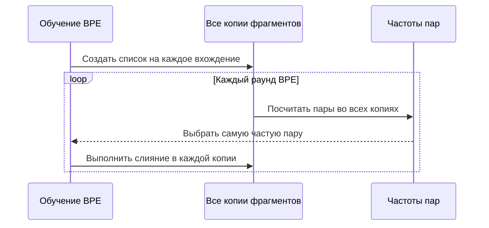

### Обновление и текущий способ → UML

Теперь одинаковые исходные фрагменты представлены **одним списком и числом повторений**. При подсчёте частоты вклад списка умножается на это число. Слияние выполняется один раз на представителя. Порядок первого появления сохраняется: он нужен, чтобы при равной частоте выбрать ту же пару. Это уже реализовано в `BpeTokenizer`, а последующие проверки закрепили независимые старые хэши словаря и поведение на повторённом корпусе. [Текущий код][BW_CODE] · [подсчёт с кратностью][BW_COUNT] · [поздняя проверка][BW_REPAIR].

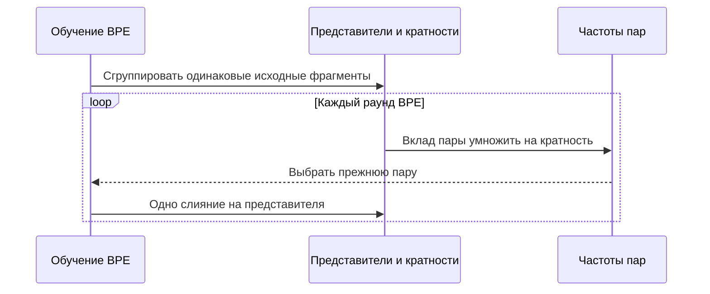

### Сравнение показателей

| Показатель | Было | Стало | Вывод |
|---|---:|---:|---|
| Выделения, исходный корпус C# / документация | 3 926 152 байта | 767 328 байт | **−80,46%** |
| Выделения, исходный корпус EN→RU | 2 907 816 байт | 567 672 байта | **−80,48%** |
| Новый замер ремонта: один блок повторён 8 раз | 515 008 байт | 355 792 байта | **−30,92%** на другой панели |
| Словарь, слияния, проверенные ID токенов | Контроль A | Совпадают с A | Результат токенизации сохранён |
| Время C# / документация, один исходный замер | 36,15 мс | 9,66 мс | Наблюдалось сокращение; устойчивый коэффициент не установлен |

Первые две строки — [исходный опыт BW01][BW_HISTORY], третья — [отдельное измерение текущего переноса][BW_REPAIR]. Эти проценты нельзя складывать. На двух исходных профилях пик памяти процесса также не вырос. На корпусе почти без повторений такой выигрыш не доказан: группирующий словарь сам требует памяти.

### Простая формула и связь с книгой

\[
\underbrace{\sum_{s\in\text{все вхождения}}n_s(a,b)}_{\text{считать каждую копию}}
=
\underbrace{\sum_{u\in\text{представители}}m_u\,n_u(a,b)}_{\text{считать один раз и умножить}}.
\]

Здесь \(n_u(a,b)\) — число соседних пар \((a,b)\) в одном фрагменте, \(m_u\) — сколько его копий было в тексте. **Сложить одинаковый вклад много раз и умножить его на число повторений — один результат.** Поэтому частоты и выбор слияний сохраняются, а работы становится меньше.

Книжный контекст в пересказе: токену сопоставляется уникальный целочисленный индекс, Definition 1.1–1.2, PDF 39. Книга связывает токен с его индексом и строкой embeddings. Это объясняет, почему сохранение ID существенно для следующего этапа модели. Равенство взвешенных частот выше — вывод из алгоритма BW; теоремы о его ускорении в книге нет. [Оригинал][BOOK_INDEX].

### UML: почему сработало

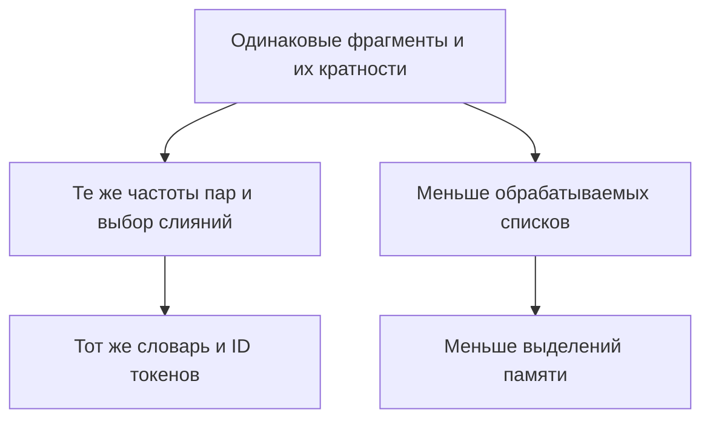

## 2. HCL01 — читать правильную строку обученной таблицы

**Этап:** чтение иерархической памяти событий. Это модель переходов в модуле экспериментов 34, а не изменение softmax Transformer или LoRA.

### Старый способ → UML

События разбиты на группы, например проверка данных и сохранение. Сначала модель выбирает следующую группу, затем её таблица предсказывает событие внутри группы. Ошибка старого читателя: в таблицу выбранной группы передавался **локальный номер события другой группы**. Но номер 0 в двух разных словарях может означать разные события.

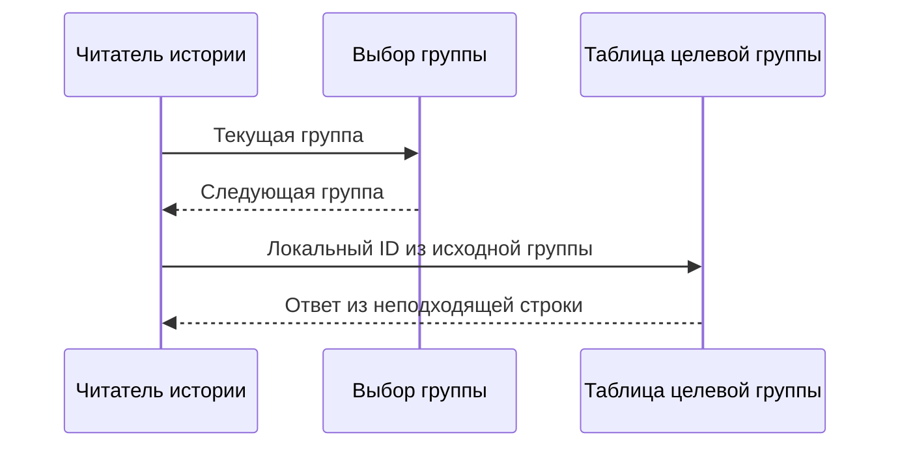

### Обновление и текущий способ → UML

Теперь читатель помнит **последнее уже наблюдавшееся событие каждой группы**. Для целевой группы берётся её собственная история и её локальный номер. Сами обученные счётчики переходов не меняются. Перенос сделан в `E05LocalHierarchy`; позднее добавлена проверка настоящего `E05HierarchicalPrediction.Run`. Если целевая группа ещё не встречалась, код сохраняет прежний запасной путь — эта ветвь исходной панелью не проверена. [Код][HCL_CODE] · [перенос][HCL_TRANSFER] · [последующая проверка][HCL_REPAIR].

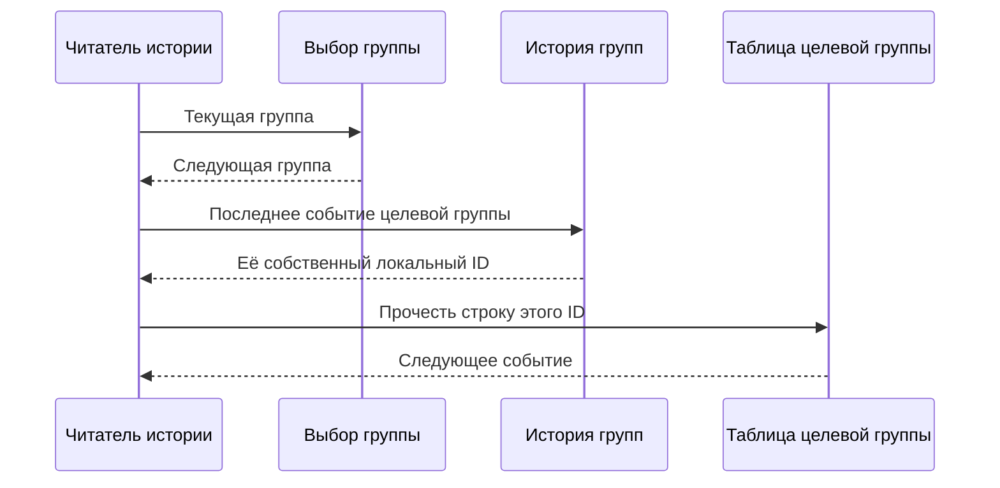

### Сравнение показателей

| Показатель исходного HCL01 | Старое чтение | Новое чтение | Вывод |
|---|---:|---:|---|
| Правильные ответы после одинакового обучения | 10/16 | **16/16** | +37,5 процентного пункта |
| Ответы при переходе между группами | 6/12 | **12/12** | Исправлен основной источник ошибок |
| Остальные четыре ответа | 4/4 | 4/4 | Сохранены |
| Обученные таблицы счётчиков | 448 байт | 448 байт | Размер одинаков |
| Выделения при обучении | 4 552 байта | 4 552 байта | Одинаковы |
| Выделения при чтении панели | 39 408 байт | 39 408 байт | Одинаковы в измеренном участке |

Источник: [отчёт HCL01][HCL_HISTORY]. В отдельной поздней проверке E05 опубликовано **73,87% → 86,93%** при замене старого иерархического читателя новым. Это сравнение двух читателей иерархии; оно не означает победу над отдельной плоской моделью. [Свидетельство ремонта][HCL_REPAIR].

Граница: исходный опыт охватывает 7 событий и 16 запросов. Проверка переноса на исходной панели 7 событий / 152 токена / 16 запросов остаётся открытой. Маленький словарь истории — дополнительное состояние; его стоимость отдельно не выделена. Время текущего E05 и пик памяти не измерены здесь. Перенос именно в модуль 34 подтверждён; общее нейронное обучение RP01 и весь пользовательский маршрут этим не проверены.

### Простая формула и связь с книгой

\[
\hat y=D_c\!\left(\arg\max_j N_c(h_c,j)\right).
\]

\(N_c(i,j)\) — число соседних переходов \(i\to j\) в последовательности, из которой оставлены только события группы \(c\). \(h_c\) — локальный номер последнего наблюдавшегося события **этой же группы**, а \(D_c\) переводит выбранный номер обратно в событие. Формула означает: «посмотри, что обычно происходило после последнего события нужной группы». Раньше вместо \(h_c\) подставляли номер из чужого словаря, выбирая другую строку.

Книжный контекст в пересказе: токену сопоставляется уникальный целочисленный индекс, Definition 1.1–1.2, PDF 39. Индекс выбирает строку в определённом словаре. Применение этого определения к локальным словарям HCL объясняет ошибку: одинаковое число не даёт одинакового смысла в разных группах. Прирост 10/16 → 16/16 установлен опытом, а не теоремой книги. [Оригинал][BOOK_INDEX].

### UML: почему сработало

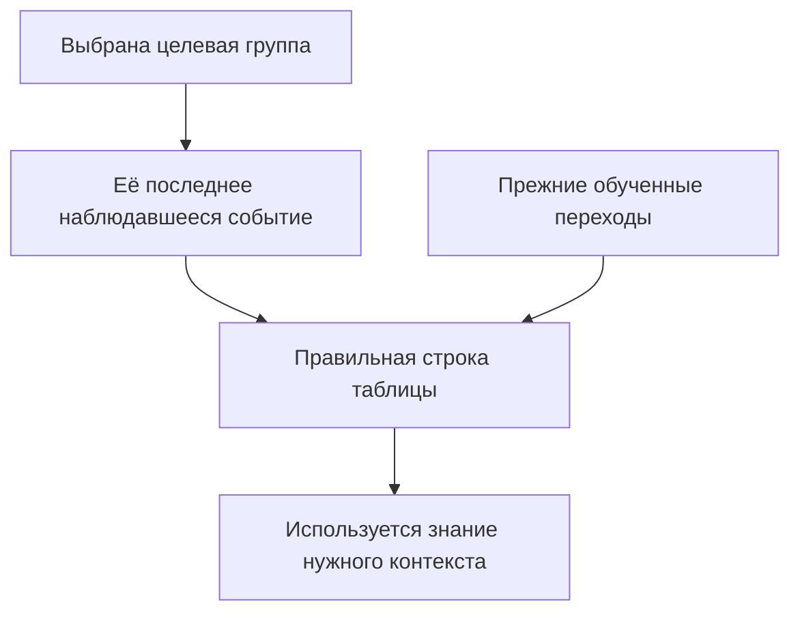

## 3. WC01 — не строить одинаковые признаки урока в каждой эпохе

**Этап:** подготовка признаков внутри обучения Wiki-маршрутизатора. Здесь обучается небольшой лексический классификатор — перцептрон. Название входного типа `DpoPair` не превращает этот алгоритм в DPO или LoRA.

### Старый способ → UML

Текст запроса превращается в набор числовых признаков. По ним классификатор выбирает действие. Если ошибся, веса правильного действия увеличиваются, ошибочного — уменьшаются. Раньше при каждом повторном предъявлении того же урока его признаки вычислялись заново: **8 уроков × 18 эпох = 144 вычисления**.

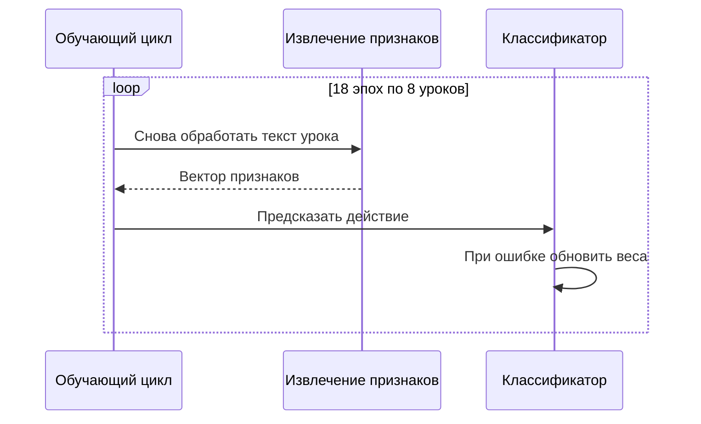

### Обновление и текущий способ → UML

Теперь перед первой эпохой готовятся признаки всех восьми строк. Все 144 предъявления и прежний порядок уроков остаются. Меняется только место вычисления признаков. Это уже есть в `ProjectWikiRequestRoutingTrainableModel.Train`. Позднее проверили совпадение сохранённого обученного состояния и его восстановление. [Код][WC_CODE] · [перенос][WC_TRANSFER] · [исправление проверок][WC_REPAIR].

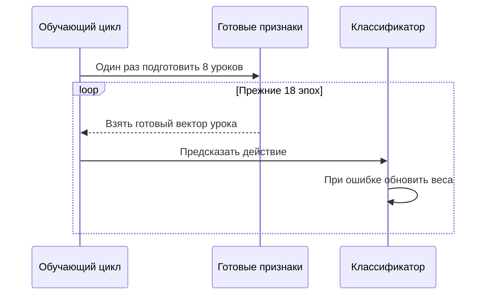

### Сравнение показателей

| Показатель исходного WC01 | Было | Стало | Вывод |
|---|---:|---:|---|
| Извлечения признаков | 144 | **8** | В 18 раз меньше именно подготовок |
| Выделено за обучение | 1 321 440 байт | **150 656 байт** | **−88,60%** |
| Предъявления уроков | 144 | 144 | Обучение не урезано |
| Обновления по ошибкам | 7 | 7 | Одинаковы |
| Ответы до → после обучения | 0/4 → 4/4 | 0/4 → 4/4 | Качество одинаково |
| Конечные веса и смещения | Контроль A | Тот же хэш | Состояние совпало |
| Время одного исходного замера | 23,22 мс | 10,54 мс | Наблюдение одной пары |

Источники: [сырые данные A][WC_HISTORY_A] и [B][WC_HISTORY_B].

**Что ещё открыто сейчас:** поздние проверки подтверждают состояние и восстановление, но не закрывают весь назначенный путь получения ответов. Поэтому 4/4 выше — результат исходного опыта, а не заявление о четырёх успешно допущенных публичных маршрутах текущего продукта. Также не измерен отдельно пик памяти удерживаемых признаков. [Аудит][AUDIT67] · [остаток проверки][WC_REPAIR].

### Простая формула и связь с книгой

\[
x_i=\phi(\text{текст}_i),\qquad
w_y\leftarrow w_y+\eta x_i,\quad
w_{\rm ошибка}\leftarrow w_{\rm ошибка}-\eta x_i.
\]

\(\phi\) превращает текст в признаки, \(\eta\) задаёт размер поправки; \(w_y\) — веса правильного действия, \(w_{\rm ошибка}\) — ошибочно выбранного. **Если текст и \(\phi\) не меняются, во всех эпохах получается тот же \(x_i\).** Поэтому можно сохранить его один раз: классификатор получает прежние входы и делает прежние обновления. Смещения также обновляются по прежним правилам. Такую экономию нельзя автоматически переносить на признаки, которые сами меняются во время обучения.

Книжный контекст в пересказе: рассматривается фиксированный вход, §8.1.1, PDF 286. Там речь о функции внимания при заданном входе; это общий математический контекст, а не доказательство кэша перцептрона. Корректность WC следует из неизменности конкретной \(\phi\) в исходнике и совпадения конечных весов. [Оригинал][BOOK_FIXED] · [проверяемое условие в коде][WC_CODE].

### UML: почему сработало

```mermaid
flowchart TD
    A["Неизменный текст и извлечение признаков"] --> B["Тот же вектор во всех эпохах"]
    B --> C["Прежние решения и обновления весов"]
    B --> D["Достаточно 8 подготовок вместо 144"]
    D --> E["Меньше выделений при том же обучении"]
```

## 4. PQ01 — признаки одного запроса строятся один раз для всей памяти KNN

**Этап:** чтение памяти KNN, определение структуры предложения по частям речи. Это оптимизация сравнения; она сама не добавляет знания в память.

### Старый способ → UML

Запрос представлен последовательностью частей речи. Из неё собираются соседние пары, например «существительное → глагол». KNN сравнивает этот набор с наборами сохранённых примеров и выбирает ближайшие. Раньше набор **одного и того же запроса** пересоздавался для каждого кандидата: для 32 запросов и 128 записей памяти — 4 096 раз.

```mermaid
sequenceDiagram
    participant Q as Запрос
    participant D as Расстояние
    participant M as Память KNN
    loop Каждый пример из памяти
        M->>D: Следующий кандидат
        Q->>D: Исходная последовательность частей речи
        D->>D: Заново собрать пары запроса
        D-->>M: Расстояние до кандидата
    end
```

### Обновление и текущий способ → UML

`Predict` собирает пары запроса до перебора памяти и передаёт готовое множество в функцию расстояния. Пары самого кандидата по-прежнему считаются при его сравнении. Сортировка, три ближайших соседа и голосование сохраняются. Позднее проверили текущий продукт на той же панели 128/32, включая ответы по каждой строке. [Код][PQ_CODE] · [перенос][PQ_TRANSFER] · [дополненная проверка][PQ_REPAIR].

```mermaid
sequenceDiagram
    participant Q as Запрос
    participant D as Расстояние
    participant M as Память KNN
    Q->>Q: Один раз собрать пары запроса
    loop Каждый пример из памяти
        M->>D: Следующий кандидат
        Q->>D: Готовое множество пар
        D-->>M: Прежнее расстояние
    end
```

### Сравнение показателей

| Показатель исходного PQ01 | Было | Стало | Вывод |
|---|---:|---:|---|
| Построения множества запроса | 4 096 | **32** | В 128 раз меньше этих построений |
| Выделено при чтении | 3 050 752 байта | **1 799 040 байт** | **−41,03%** |
| Правильные ответы после обучения памяти | 28/32 | 28/32 | Сохранены |
| Различия ответов A/B | — | **0** | Оптимизация не меняет выбор |
| Время одного исходного замера | 20,52 мс | 16,09 мс | Наблюдение одной пары |

Источник: [отчёт PQ01][PQ_HISTORY]. Рост **11/32 → 28/32** происходит после обучения памяти в обеих реализациях. Его нельзя приписывать кэшу: выигрыш PQ — выделения и число подготовок. Кроме того, 26 из 32 последовательностей совпадают с учебными; на шести невиденных осталось 2/6 → 2/6. Новая проверка текущего кода закрепляет ответы и предел выделений, но не даёт нового устойчивого процента ускорения. [Проверка текущего переноса][PQ_REPAIR].

### Простая формула и связь с книгой

\[
d(Q,M)=1-\frac{|Q\cap M|}{|Q\cup M|}.
\]

\(Q\) — набор пар запроса, \(M\) — набор пар кандидата. Чем больше доля общих пар среди всех различных пар двух наборов, тем меньше расстояние. При двух пустых наборах код задаёт расстояние 0. **Переход к следующему кандидату меняет \(M\), но не \(Q\).** Поэтому повторное построение \(Q\) не может улучшить сравнение, а его повторное использование сохраняет расстояния.

Книжный контекст в пересказе — функция фиксированного входа, §8.1.1, PDF 286, даёт только общий контекст функции от заданных данных. Конкретная формула Жаккара и доказательство повторного использования \(Q\) здесь взяты из алгоритма проекта; книга не доказывает результат PQ01. [Оригинал книги][BOOK_FIXED] · [формула в коде][PQ_CODE].

### UML: почему сработало

```mermaid
flowchart TD
    A["Один неизменный запрос"] --> B["Одно множество его пар"]
    B --> C["Прежние расстояния до всех кандидатов"]
    C --> D["Те же соседи и ответ"]
    B --> E["Убраны повторные построения множества"]
```

## 5. AST01 — один обход соседей вместо повторного обхода для каждого узла

**Этап:** получение структурных признаков кода перед обучением KNN. AST — синтаксическое дерево программы; у узла есть родитель, соседи и позиция среди них.

### Старый способ → UML

Чтобы определить позицию очередного узла, старая реализация заново получала список всех детей его родителя. При переходе к следующему ребёнку делала то же самое. У широкого узла с большим числом детей повторялось особенно много работы.

```mermaid
sequenceDiagram
    participant N as Очередной узел
    participant P as Родитель AST
    participant F as Признаки для KNN
    loop Каждый ребёнок родителя
        N->>P: Заново перечислить всех детей
        P-->>N: Полный список
        N->>N: Найти свою позицию
        N->>F: Записать признаки
    end
```

### Обновление и текущий способ → UML

Первое обращение к родителю перечисляет детей и запоминает их количество и позиции. Следующие обращения используют готовые сведения. Кэш действует в пределах одного неизменяемого дерева. При переносе дополнительно исправили обучение по нескольким файлам: их пары собираются вместе перед единственным обучением, чтобы очередной файл не затирал память предыдущего. Одиночное `PredictFromNode` сохраняет прежний путь без этого кэша. [Код][AST_CODE] · [обработка нескольких файлов][AST_FACADE] · [поздние проверки][AST_REPAIR].

```mermaid
sequenceDiagram
    participant N as Очередной узел
    participant C as Кэш детей и позиций
    participant P as Родитель AST
    alt Первое обращение к родителю
        N->>C: Запрос позиции
        C->>P: Один раз перечислить всех детей
        P-->>C: Записать позиции всех детей
    else Родитель уже обработан
        N->>C: Запрос готовой позиции
    end
    C-->>N: Прежние структурные признаки
```

### Сравнение показателей

| Показатель | Без кэша | С кэшем | Вывод |
|---|---:|---:|---|
| Исходный AST01, широкое дерево: выделения | 35 788 384 байта | 2 302 072 байта | **−93,57%** в этом большом профиле |
| Новый замер ремонта, широкое дерево | 590 480 байт | 349 336 байт | **−40,84%** в отдельном малом профиле |
| Новый замер ремонта, узкое дерево | 91 128 байт | 70 752 байта | **−22,36%** |
| Правильные ответы, исходное узкое дерево | 12/16 | 12/16 | Сохранены |
| Правильные ответы, исходное широкое дерево | 7/16 | 7/16 | Сохранены |

Источники: [исходный AST01][AST_HISTORY] и [новые измерения ремонта][AST_REPAIR]. Поздняя проверка отдельно закрепляет 16 исторических вопросов и воспроизводит ответы текущим продуктовым предиктором. **94% и 41% относятся к разным профилям:** новое число не заменяет старое и не подтверждает 94% на любом коде.

Пик живой памяти кэша отдельно не измерен. Актуальная ресурсная проверка также не устанавливает выигрыш по времени. Ответ здесь — компактный вид следующего AST-узла; это не оценка правильности целой сгенерированной программы.

### Простая формула и связь с книгой

\[
\text{старый обход: порядка }d\cdot d=d^2,
\qquad
\text{новый: порядка }d+d=2d.
\]

\(d\) — число детей одного родителя. Раньше каждый из \(d\) детей мог требовать просмотр списка длины \(d\). Теперь список перечисляется один раз, а затем читаются \(d\) сохранённых позиций. **Значения признаков те же; сокращается повторное перечисление.** Это оценка данного участка, а не обещание линейного времени всей программы.

Книжный контекст в пересказе: рассматривается фиксированный вход, §8.1.1, PDF 286. Общий принцип функции от заданного входа здесь применяется к неизменяемому дереву. Само равенство признаков и переход от повторных обходов к кэшу устанавливаются по коду AST01; отдельной теоремы об AST-кэше в книге нет. [Оригинал][BOOK_FIXED] · [реализация][AST_CODE].

### UML: почему сработало

```mermaid
flowchart TD
    A["Неизменяемое дерево"] --> B["Позиции детей сохраняются"]
    B --> C["Прежние признаки и учебные пары"]
    C --> D["Тот же результат KNN"]
    B --> E["Вместо повторных обходов один обход и чтения"]
```

## 6. LC — не пересчитывать неизменную опорную модель на повторной паре DPO

**Этап:** вычисление оценки ответа в DPO. Обучаемая модель продолжает меняться; опорная модель заморожена. Изменение находится вокруг прямого прохода опорной модели, а не в формуле обновления LoRA.

### Старый способ → UML

DPO сравнивает предпочтительный и нежелательный ответы. Для сравнения нужны оценки текущей обучаемой модели и опорной модели. Раньше при повторном предъявлении той же пары обе модели запускались заново, хотя опорная оставалась неизменной.

```mermaid
sequenceDiagram
    participant T as Шаг DPO
    participant P as Обучаемая модель
    participant R as Опорная модель
    loop Каждое предъявление пары
        T->>P: Оценить оба ответа
        T->>R: Снова оценить те же ответы
        R-->>T: Оценки эталона
        T->>P: Вычислить ошибку и обновить параметры
    end
```

### Обновление и текущий способ → UML

После первого вычисления две оценки эталона сохраняются. При точном совпадении пары и условий оценки тренер читает их из кэша. **Обучаемая модель каждый раз вычисляется заново**, потому что её параметры изменились.

В текущем `DpoTrainer` кэш ограничен двумя записями; ключ учитывает точный материал, эталон, токенизатор и версии правил оценки. После восстановления или отката кэш очищается. Поздние исправления усилили сравнение параметров, состояния оптимизатора и числа шагов. [Код тренера][LC_CODE] · [условия ключа][LC_KEY] · [устройство кэша][LC_CACHE].

```mermaid
sequenceDiagram
    participant T as Шаг DPO
    participant P as Обучаемая модель
    participant C as Кэш эталона
    participant R as Опорная модель
    T->>P: Заново оценить оба ответа
    T->>C: Запрос по точному ключу
    alt Первое предъявление
        C->>R: Вычислить оценки
        R-->>C: Сохранить два числа
    else Повторная пара
        C->>C: Прочитать сохранённые числа
    end
    C-->>T: Оценки эталона
    T->>P: Прежняя ошибка и обновление параметров
```

### Сравнение показателей

| Показатель исходного опыта LC | Без кэша | С кэшем | Вывод |
|---|---:|---:|---|
| Выделения за учебный переход | 7 331 104 632 байта | 6 010 567 464 байта | **−18,01%** |
| Время всего перехода | 23,10 с | 19,38 с | −16,11% в одной паре |
| Время опорных проходов | 6,65 с | 3,05 с | −54,13% этого участка |
| Пик рабочего набора процесса | 1,808 ГБ | 1,807 ГБ | Практически одинаков |
| Правильные токены двух учебных строк | 46/46 и 44/44 | 46/46 и 44/44 | Сохранены |
| Шаги оптимизатора | 2 | 2 | Обучение не сокращено |

Источник: [исходный отчёт LC][LC_HISTORY]. Потери и измеренный результат обучения совпали. Но отдельное время прохода обучаемой модели в том же замере выросло **6,92 → 8,22 с**. Автор относит расхождение к разбросу одиночного запуска; устойчивость этого объяснения повторами не установлена. Поэтому наиболее твёрдый вывод — экономия выделений при сохранении измеренного результата, а не гарантированное ускорение всей тренировки на 54%.

**Что осталось после исправлений:** аудит 67 обнаружил, что проверка RNG сравнивает неполное строковое представление вместо всех внутренних состояний генератора. Это пробел проверки, а не доказанная ошибка кэша. Полную эквивалентность текущего переноса по RNG объявлять закрытой пока нельзя. [Точный вывод аудита][LC_AUDIT]. При редких повторах пар польза кэша также не установлена.

### Простая формула и связь с книгой

\[
m_\theta=\beta\Big[(\ell_\theta^+-\ell_\theta^-)-c_{\rm ref}\Big],
\qquad
c_{\rm ref}=\ell_{\rm ref}^+-\ell_{\rm ref}^-=\text{const}.
\]

\(\ell\) — используемая тренером оценка ответа. В точном режиме `exact` это сумма логарифмов вероятностей целевых токенов; в старом режиме `legacy` — их среднее. Показанный кэш допускает только проверенный материал `exact`. «+» означает предпочтительный ответ, «−» — нежелательный; \(\beta\) задаёт масштаб сравнения. \(m_\theta\) показывает предпочтение хорошего ответа относительно эталона. Для одной точной пары у замороженного детерминированного эталона \(c_{\rm ref}\) неизменна. Взять ту же константу из памяти или вычислить снова — одно значение ошибки и её производной. Кэш корректен только при совпадении токенов, маски, режима оценки и версии эталона.

Книжный контекст в пересказе: вектор оценок до softmax, §9.3, PDF 317. Там описано получение числовых оценок и вероятностей. Формула DPO и условия кэша здесь взяты из проекта; специального доказательства DPO-кэширования в книге нет. [Оригинал книги][BOOK_LOGITS] · [расчёт в тренере][LC_CODE].

### UML: почему сработало

```mermaid
flowchart TD
    A["Те же пара, эталон и правила оценки"] --> B["Те же две оценки эталона"]
    B --> C["Та же ошибка и градиент DPO"]
    B --> D["Повторный проход эталона пропущен"]
    D --> E["Меньше выделений за учебный переход"]
```

## Что не следует смешивать с этими шестью карточками

У перечисленных ниже опытов есть полезные результаты. Но причина отдельного статуса существенна именно для требования «уже внедрено, заметный выигрыш, без значительного ухудшения».

| Опыт или группа | Подтверждённая польза | Почему не объявлен таким же завершённым улучшением |
|---|---|---|
| Последний P01: LoRA rank 4 → 8 | После одинаковых 400 SFT-обновлений усвоено 1/2 → 2/2 учебных строк; финальная loss 1,2143 → 0,5335 | На двух невиденных примерах 1/2 → 0/2; общий результат 2/4 → 2/4. DPO-обновлений 0. Продуктовый код этим коммитом не изменён. [Данные P01][P01_ARMS] · [отчёт][P01_REPORT] |
| [GRADB][GRADB_HISTORY], [SEXP01][SEXP_HISTORY], [AGC1][AGC_HISTORY] | Исходные опыты показывают экономию работы или выделений | В проверенных целевых участках текущего ядра остаётся старый обход GradB, повторный `Exp` и копия первого градиента. Нельзя подписать экспериментальный B как текущий продукт. [GradB][GRADB_CURRENT] · [SEXP][SEXP_CURRENT] · [AGC][AGC_CURRENT] |
| KDP01 / KDR01 | Улучшено ранжирование ответов и выбор экспериментальных исполнителей | Новые функции и фабрика есть в оболочках опытов. Их перенос в проверенного основного владельца не подтверждён. Поздний FIX-KR — другой механизм. [Эксперимент KDP][KDP_EXPERIMENT] · [основной читатель][KDP_NATIVE] · [KDR][KDR_EXPERIMENT] |
| RD / RRD | −4,80% выделений в исходном опыте при том же численном результате | Пик +0,59%; текущая квалификация должна восстановить назначенное обученное H64-состояние. Новая случайная H16-проверка его не заменяет. [Исходный опыт][RD_HISTORY] · [аудит][AUDIT67] |
| AT01 и MB01 | −8,67% и −6,31% выделений; изменения есть в коде | У AT в одном замере wall time +3,57%, CPU +33,33%; у MB wall time +5,07%, пик +1,04%. Эти изменения нельзя без повторов назвать общим ускорением без цены. [AT][AT_HISTORY] · [MB][MB_HISTORY] |
| SVD01 | На узкой панели 2/5 → 5/5 за счёт правильного направленного чтения | Память факторов удвоилась: 120 000 → 240 000 байт. Это результат с явной ценой. [Опыт SVD][SVD_HISTORY] |

Последний P01 особенно показателен: **меньшая ошибка на учебном материале сама по себе не доказывает лучшее обобщение**. Его положительный учебный результат сохраняется в разборе, но не превращается в утверждение, что rank 8 во всём лучше rank 4.

## Как пользоваться обновлённым навигатором

В приложенном пакете есть поиск по ID, этапам, понятиям и формулам. Для повторного прохода удобно начинать с `BW01`, `AST01`, `LC`, `P01`, `LoRA` или запроса `не внедрено`.

В карточке раздельно хранятся исходный результат, текущий статус внедрения, поздняя проверка, её ограничение и ссылка на оригинал книги. Исторические числа остаются привязаны к исходному запуску; свежая проверка не подменяет его.

Это локальный поисковый слой для RAG: он возвращает связанные фрагменты и адреса источников, работает без сети и не запускает модель. Для чтения полного первоисточника по ссылке нужен доступ к GitHub. Полный текст книги в пакет не включён.


[BW_CODE]: https://github.com/lubochka/llm_mvp_core/blob/75107af930a1d4c55d60fa8a4ef7c01643f13cb0/01.Tokenizer/BpeTokenizer.cs#L42-L121
[HCL_CODE]: https://github.com/lubochka/llm_mvp_core/blob/75107af930a1d4c55d60fa8a4ef7c01643f13cb0/34.Experiments/Experiments/E05LocalHierarchy.cs#L65-L174
[WC_CODE]: https://github.com/lubochka/llm_mvp_core/blob/75107af930a1d4c55d60fa8a4ef7c01643f13cb0/42.ProjectWikiDomain/ProjectWikiRequestRoutingTrainableModel.cs#L58-L108
[PQ_CODE]: https://github.com/lubochka/llm_mvp_core/blob/75107af930a1d4c55d60fa8a4ef7c01643f13cb0/12.SemanticCompiler/Translation/PatternClassifier.cs#L38-L100
[AST_CODE]: https://github.com/lubochka/llm_mvp_core/blob/75107af930a1d4c55d60fa8a4ef7c01643f13cb0/12.SemanticCompiler/Prediction/StructuralKnn.cs#L38-L155
[LC_CODE]: https://github.com/lubochka/llm_mvp_core/blob/75107af930a1d4c55d60fa8a4ef7c01643f13cb0/11.DPO/DpoTrainer.cs#L917-L1007
[AUDIT67]: https://github.com/lubochka/llm_mvp_core/blob/75107af930a1d4c55d60fa8a4ef7c01643f13cb0/docs/plans/replanning-possible-diffs/fixes-based-on-experiments/67-transfer-repair-followup-audit-2026-10-27.md#L1-L125
[BW_COUNT]: https://github.com/lubochka/llm_mvp_core/blob/75107af930a1d4c55d60fa8a4ef7c01643f13cb0/01.Tokenizer/BpeTokenizer.cs#L578-L603
[BW_REPAIR]: https://github.com/lubochka/llm_mvp_core/blob/75107af930a1d4c55d60fa8a4ef7c01643f13cb0/docs/plans/replanning-possible-diffs/fixes-based-on-experiments/66-r4-row-evidence-2026-10-27.md#L114-L170
[BW_HISTORY]: https://github.com/lubochka/llm_mvp_core/blob/846144464a856cd3f118bcfc0165c8117b06c167/experiments-v2/RP01-MICRO/BW01/results/attempt-0001/report.md#L19-L50
[BOOK_INDEX]: https://github.com/lubochka/xiigen-planning/blob/ea9afbc13f5e6e8463fc74c89cfab3d2e154d62d/llm%20mvp/math-theory/giansalvo-transformer-vol1/source/0037-0043-ch01-embeddings-and-sinusoidal.md#L63-L63
[HCL_TRANSFER]: https://github.com/lubochka/llm_mvp_core/commit/f5c5049337b0747d8cc62182e34dcb5913639f3e
[HCL_REPAIR]: https://github.com/lubochka/llm_mvp_core/blob/75107af930a1d4c55d60fa8a4ef7c01643f13cb0/docs/plans/replanning-possible-diffs/fixes-based-on-experiments/66-r4-row-evidence-2026-10-27.md#L561-L589
[HCL_HISTORY]: https://github.com/lubochka/llm_mvp_core/blob/846144464a856cd3f118bcfc0165c8117b06c167/experiments-v2/RP01-MICRO/HCL01/results/attempt-0001/report.md#L20-L116
[WC_TRANSFER]: https://github.com/lubochka/llm_mvp_core/commit/4cb23f0f7e82572a99bbebf0b3381b8bbb055c1b
[WC_REPAIR]: https://github.com/lubochka/llm_mvp_core/blob/75107af930a1d4c55d60fa8a4ef7c01643f13cb0/docs/plans/replanning-possible-diffs/fixes-based-on-experiments/66-r4-row-evidence-2026-10-27.md#L527-L559
[WC_HISTORY_A]: https://github.com/lubochka/llm_mvp_core/blob/846144464a856cd3f118bcfc0165c8117b06c167/experiments-v2/RP01-MICRO/WC01/results/attempt-001/A/report.json#L1-L329
[WC_HISTORY_B]: https://github.com/lubochka/llm_mvp_core/blob/846144464a856cd3f118bcfc0165c8117b06c167/experiments-v2/RP01-MICRO/WC01/results/attempt-001/B/report.json#L1-L329
[BOOK_FIXED]: https://github.com/lubochka/xiigen-planning/blob/ea9afbc13f5e6e8463fc74c89cfab3d2e154d62d/llm%20mvp/math-theory/giansalvo-transformer-vol1/source/0285-0292-ch08-reextraction-and-residual-algebra.md#L68-L68
[PQ_TRANSFER]: https://github.com/lubochka/llm_mvp_core/commit/4ce8bdd0dd3942a20b32c569c2b0f0c37894dd23
[PQ_REPAIR]: https://github.com/lubochka/llm_mvp_core/blob/75107af930a1d4c55d60fa8a4ef7c01643f13cb0/docs/plans/replanning-possible-diffs/fixes-based-on-experiments/66-r4-row-evidence-2026-10-27.md#L259-L330
[PQ_HISTORY]: https://github.com/lubochka/llm_mvp_core/blob/846144464a856cd3f118bcfc0165c8117b06c167/experiments-v2/RP01-MICRO/PQ01/results/attempt-0001/report.md#L1-L201
[AST_FACADE]: https://github.com/lubochka/llm_mvp_core/blob/75107af930a1d4c55d60fa8a4ef7c01643f13cb0/12.SemanticCompiler/SemanticCompilerFacade.cs#L255-L279
[AST_REPAIR]: https://github.com/lubochka/llm_mvp_core/blob/75107af930a1d4c55d60fa8a4ef7c01643f13cb0/docs/plans/replanning-possible-diffs/fixes-based-on-experiments/66-r4-row-evidence-2026-10-27.md#L174-L257
[AST_HISTORY]: https://github.com/lubochka/llm_mvp_core/blob/846144464a856cd3f118bcfc0165c8117b06c167/experiments-v2/RP01-MICRO/AST01/results/attempt-0001/report.md#L1-L36
[LC_KEY]: https://github.com/lubochka/llm_mvp_core/blob/75107af930a1d4c55d60fa8a4ef7c01643f13cb0/11.DPO/DpoTrainer.cs#L662-L688
[LC_CACHE]: https://github.com/lubochka/llm_mvp_core/blob/75107af930a1d4c55d60fa8a4ef7c01643f13cb0/11.DPO/DpoReferenceScoreCache.cs#L18-L144
[LC_HISTORY]: https://github.com/lubochka/llm_mvp_core/blob/846144464a856cd3f118bcfc0165c8117b06c167/experiments-v2/RP01-MICRO/N61-REF-CACHE/results/report.md#L24-L56
[LC_AUDIT]: https://github.com/lubochka/llm_mvp_core/blob/75107af930a1d4c55d60fa8a4ef7c01643f13cb0/docs/plans/replanning-possible-diffs/fixes-based-on-experiments/67-transfer-repair-followup-audit-2026-10-27.md#L30-L38
[BOOK_LOGITS]: https://github.com/lubochka/xiigen-planning/blob/ea9afbc13f5e6e8463fc74c89cfab3d2e154d62d/llm%20mvp/math-theory/giansalvo-transformer-vol1/source/0312-0317-ch09-motor-taxonomy-and-related-work.md#L217-L217
[P01_ARMS]: https://github.com/lubochka/llm_mvp_core/blob/75107af930a1d4c55d60fa8a4ef7c01643f13cb0/experiments-v2/RP01-MICRO/P0101/results/attempt-0001/arms.json
[P01_REPORT]: https://github.com/lubochka/llm_mvp_core/blob/75107af930a1d4c55d60fa8a4ef7c01643f13cb0/experiments-v2/RP01-MICRO/P0101/results/attempt-0001/report.md
[GRADB_HISTORY]: https://github.com/lubochka/llm_mvp_core/blob/846144464a856cd3f118bcfc0165c8117b06c167/experiments-v2/RP01-MICRO/KGB/results/report.md#L19-L44
[SEXP_HISTORY]: https://github.com/lubochka/llm_mvp_core/blob/846144464a856cd3f118bcfc0165c8117b06c167/experiments-v2/RP01-MICRO/SEXP01/results/attempt-0001/report.md#L34-L39
[AGC_HISTORY]: https://github.com/lubochka/llm_mvp_core/blob/846144464a856cd3f118bcfc0165c8117b06c167/experiments-v2/RP01-MICRO/AGC1/results/report.md#L1-L75
[GRADB_CURRENT]: https://github.com/lubochka/llm_mvp_core/blob/75107af930a1d4c55d60fa8a4ef7c01643f13cb0/00.TensorCore/Core/TensorOps.cs#L679-L698
[SEXP_CURRENT]: https://github.com/lubochka/llm_mvp_core/blob/75107af930a1d4c55d60fa8a4ef7c01643f13cb0/04.TrainingLoop/Trainer.cs#L389-L426
[AGC_CURRENT]: https://github.com/lubochka/llm_mvp_core/blob/75107af930a1d4c55d60fa8a4ef7c01643f13cb0/00.TensorCore/Core/TensorOps.cs#L1139-L1155
[KDP_EXPERIMENT]: https://github.com/lubochka/llm_mvp_core/blob/75107af930a1d4c55d60fa8a4ef7c01643f13cb0/experiments-v2/RP01-MICRO/KDP01/DomainKnnLearningModel.cs#L78-L214
[KDP_NATIVE]: https://github.com/lubochka/llm_mvp_core/blob/75107af930a1d4c55d60fa8a4ef7c01643f13cb0/18.CapabilityTraining/LlmIngredientLogicalUnits.cs#L184-L244
[KDR_EXPERIMENT]: https://github.com/lubochka/llm_mvp_core/blob/75107af930a1d4c55d60fa8a4ef7c01643f13cb0/experiments-v2/RP01-MICRO/KDR01/DomainModelFactory.cs#L93-L155
[RD_HISTORY]: https://github.com/lubochka/llm_mvp_core/blob/846144464a856cd3f118bcfc0165c8117b06c167/experiments-v2/RP01-MICRO/RD01/a001/results/report.md#L19-L57
[AT_HISTORY]: https://github.com/lubochka/llm_mvp_core/blob/846144464a856cd3f118bcfc0165c8117b06c167/experiments-v2/RP01-MICRO/AT01/a001/results/report.md#L55-L93
[MB_HISTORY]: https://github.com/lubochka/llm_mvp_core/blob/846144464a856cd3f118bcfc0165c8117b06c167/experiments-v2/RP01-MICRO/MB01/a001/results/report.md#L59-L118
[SVD_HISTORY]: https://github.com/lubochka/llm_mvp_core/blob/846144464a856cd3f118bcfc0165c8117b06c167/experiments-v2/RP01-MICRO/SVD01/results/attempt-0001/report.md#L20-L98
