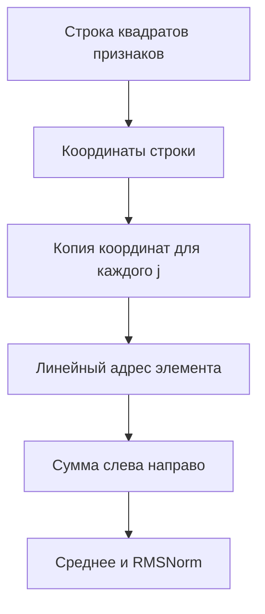
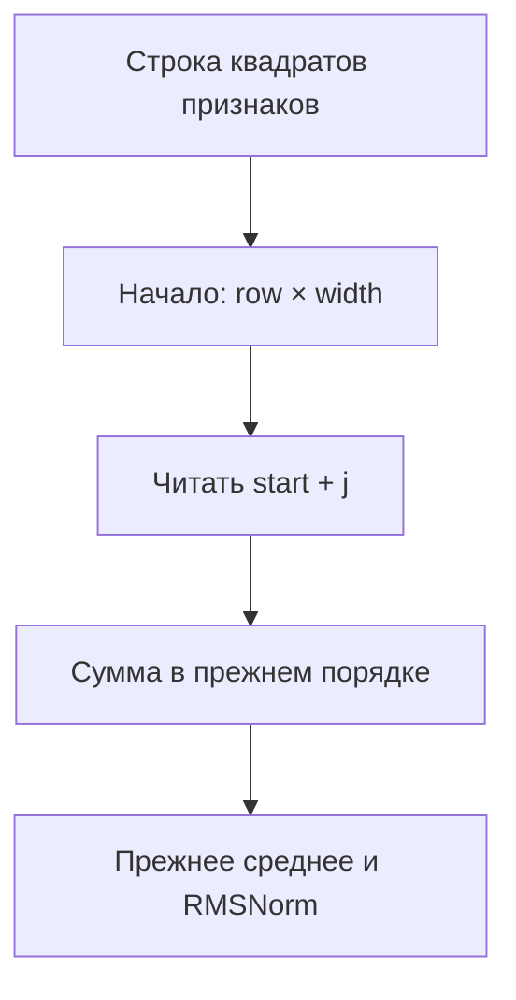
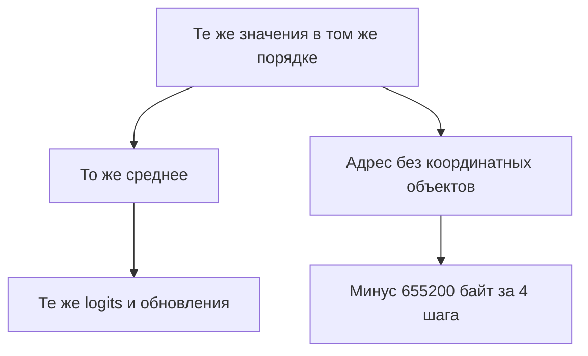
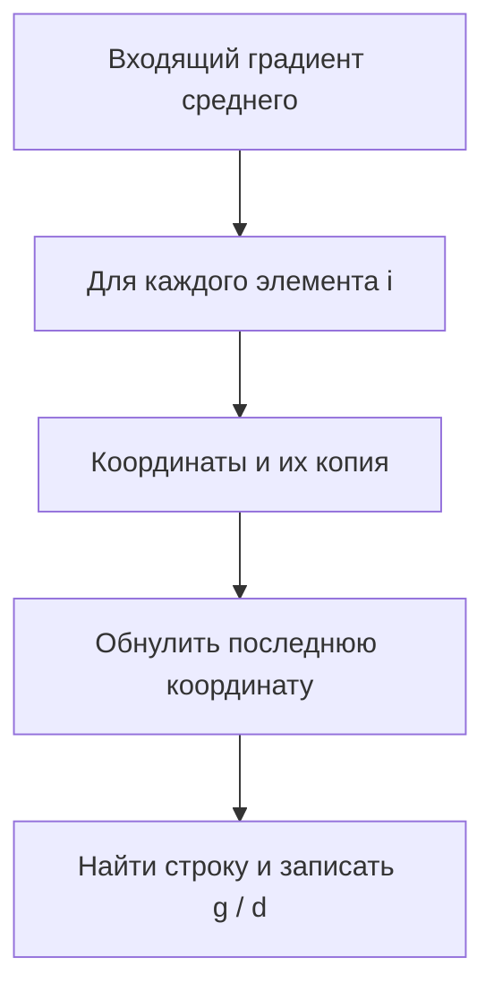
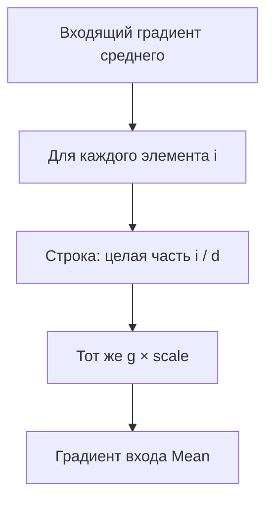
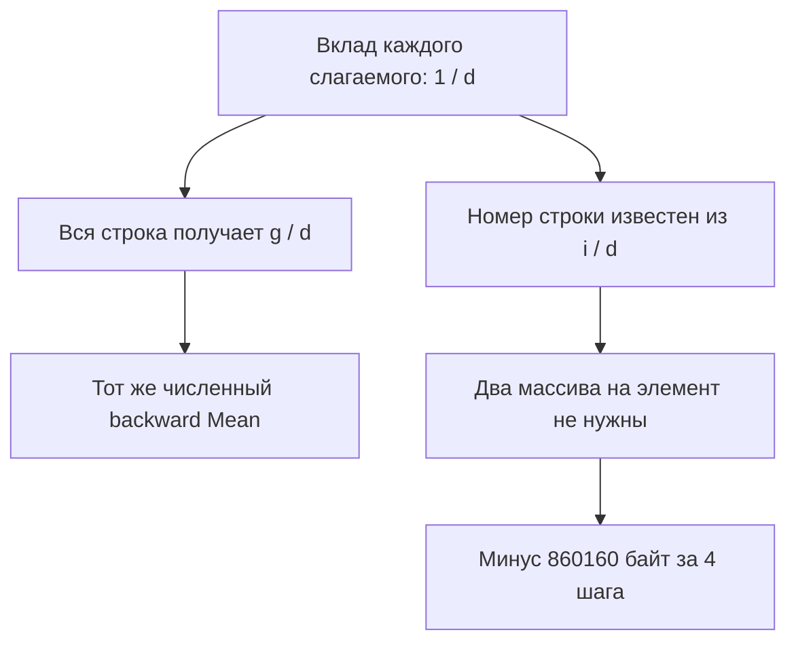
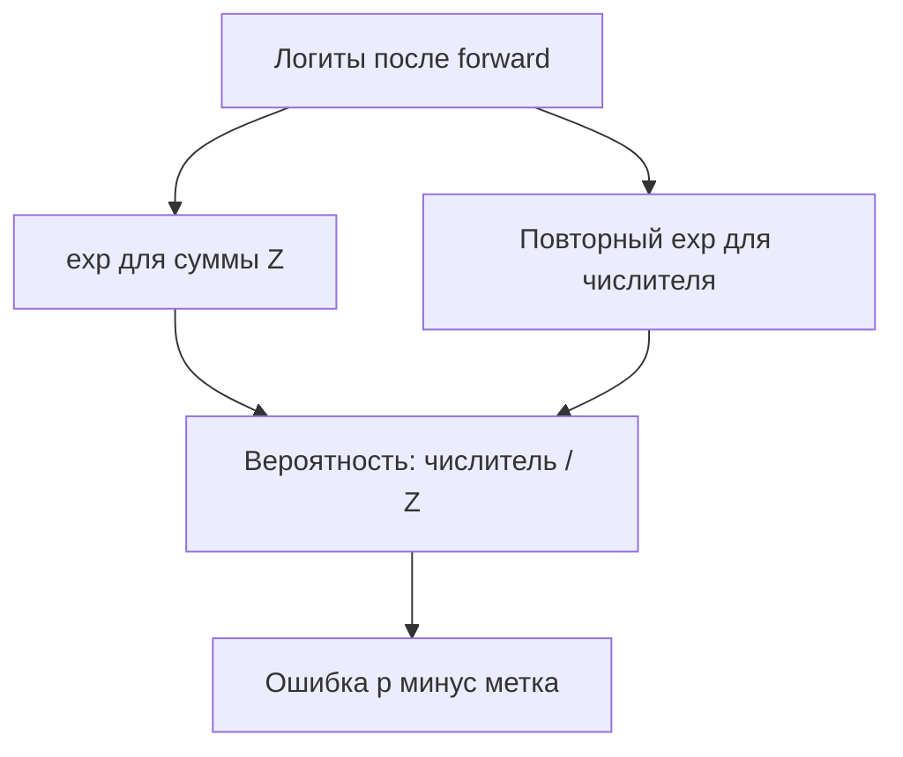
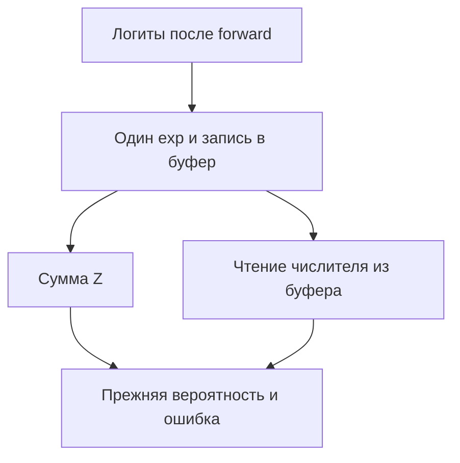
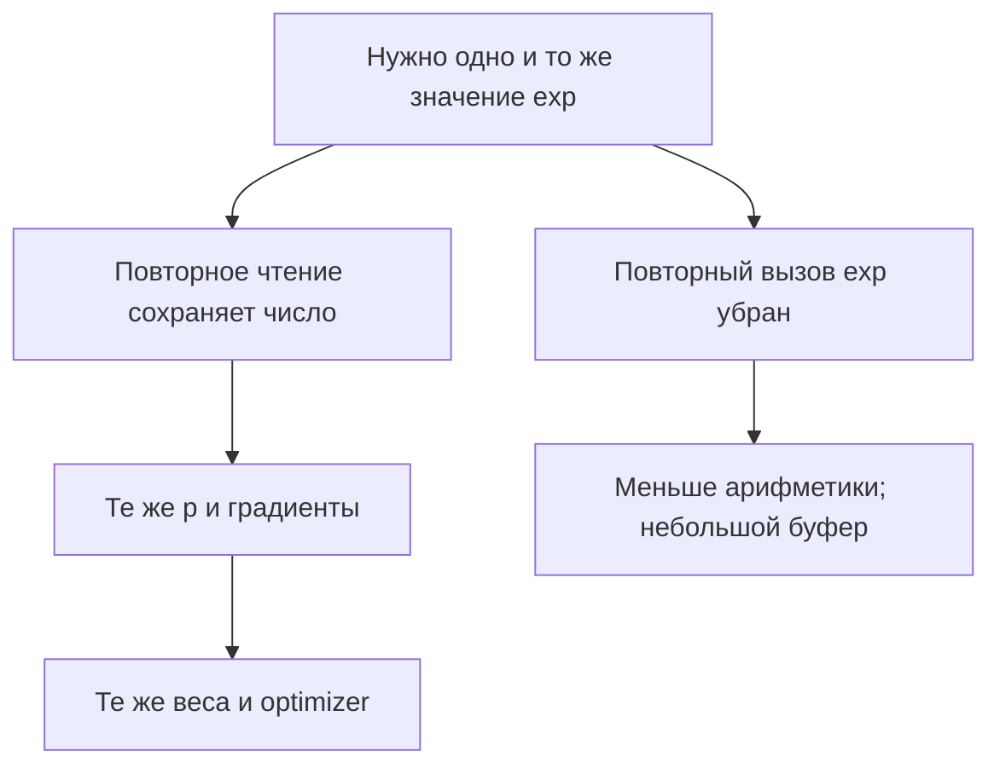

# Ещё три эксперимента: RD01, MB01, SEXP01

Проверка: 27 октября 2026. Текущий HEAD `7e051ca7246efde2864f2bee3a427157063d3cc6`; исторические результаты закреплены на `846144464a856cd3f118bcfc0165c8117b06c167`. Новых обучений, модельных вызовов, сборок и продуктовых тестов не было. Применены ранее прочитанные проектные навыки code-examination, architecture audit, plan-review и human communication.

**Рекомендация:** RD01 и MB01 показывают измеренную экономию выделяемых байтов; SEXP01 — сокращение повторных exp при прежнем результате. Во всех трёх нативное обучение реально меняло параметры. Это улучшения исполнения корректного метода, без заявления о новом навыке модели. Исторические A/B не являются новым замером текущего HEAD.

## RD01. RMSNorm: складывать строку без временных координат

**Этап:** Прямой проход RMSNorm → Mean квадратов → SumAlongAxis по последней оси.

### Старый способ

Общий корректный алгоритм находит каждый элемент через массив координат. На каждой строке он создаёт массив её координат и копию для каждого слагаемого.

В назначенной форме A вычисляет правильное среднее; B не меняет формулу и не восстанавливает потерянный градиент. Это специализация адресации для известной формы.

### Изменение

У последней оси значения строки уже лежат подряд. Начало строки равно row × width; достаточно читать start + j, сохраняя порядок сложения.

### Что действительно обучалось и что сохранилось

Штатный Transformer H64/L1/V256, q/v-LoRA rank4, четыре обучаемых массива, нативный SFT и AdamW. Общий S0: 400 ранее выполненных уроков; в опыте по 4 обновления T1,T2,T1,T2. Сохранённые хэши обучаемых параметров меняются внутри обоих плеч, а замороженных — нет.

В обоих плечах TRAIN 1/2→1/2, EXAM 1/2→1/2. NLL меняется одинаково; освоение общего закона знака не показано.

В raw совпали четыре потери, все 16 сохранённых 256-мерных векторов logits, хэши весов и полного optimizer; по отчёту равенство побитовое. Бинарные снимки заново не исполнялись.

### Результат и цена

| Показатель | A | B | B − A |
|---|---:|---:|---:|
| train_allocated_bytes (bytes; measured) | 13 640 016 | 12 984 816 | -655 200 (-4.804%) |
| train_wall (ms; measured) | 156.5045 | 105.9158 | -50.5887 (-32.324%) |
| train_cpu (ms; measured) | 140.625 | 109.375 | -31.25 (-22.222%) |
| process_peak_working_set (bytes; measured) | 41 893 888 | 42 139 648 | 245 760 (+0.587%) |

GC поколений 0/1/2: [2, 1, 0] → [2, 1, 0].

Расчёт удалённых объектов: `3 × 21 × (64 + 1) × 40 × 4 = 655200` байт — точно измеренная разница. Проценты относятся ко всем allocations четырёх учебных шагов, не к размеру модели и не к уменьшению рабочего набора.

- Экономия allocations подтверждена на одной модели и четырёх обновлениях.
- Пик процесса немного вырос; причинное постоянное ухудшение не установлено.
- Не измерялись большие длины, DPO и устойчивый throughput.
- Точность не выросла; настоящий градиентный переход и сохранение результата подтверждены.

### Простая формула и книжная опора

\[
m_r=\frac1d\sum_{j=0}^{d-1}x_{r,j}^2,\quad y_{r,j}=\gamma_j\frac{x_{r,j}}{\sqrt{m_r+\varepsilon}};\quad \mathrm{address}(r,j)=r\,d+j.
\]

Прежние квадраты читаются в прежнем порядке. Сумма и деление остаются теми же; убраны объекты, нужные только для поиска адреса.

Книжная опора в пересказе: **“среднее по координатам”** — «среднее по координатам». Книга определяет μ(x)=Σx/d. Применение к квадратам и формула RMSNorm взяты из кода проекта. LayerNorm из книги не выдаётся за RMSNorm. [BOOK_MEAN][BOOK_MEAN]

### Текущий перенос

В текущем SumAlongAxis есть специализированная ветвь последней оси с сохранённой размерностью 1. В прочитанном аудите остаётся открытым восстановление исторического H64/LoRA S0 и A/B полного состояния; наличие кода не означает, что этот перенос заново получил все исторические цифры.

**Источники:** [RD01_REPORT][RD01_REPORT], [RD01_RAW_A][RD01_RAW_A], [RD01_RAW_B][RD01_RAW_B], [RD01_STATE_A][RD01_STATE_A], [RD01_STATE_B][RD01_STATE_B], [RD01_DIFF][RD01_DIFF], [CURRENT_RD][CURRENT_RD], [CURRENT_RMS][CURRENT_RMS], [CURRENT_MEAN][CURRENT_MEAN], [BOOK_MEAN][BOOK_MEAN], [CURRENT_QUALIFICATION][CURRENT_QUALIFICATION]

## MB01. Среднее: возвращать градиент сразу в нужную строку

**Этап:** Обратный проход Mean внутри RMSNorm → BroadcastGradAlongAxis; это лишь часть backward RMSNorm.

### Старый способ

Для каждого элемента градиента A раскладывает плоский номер на координаты, копирует массив, обнуляет последнюю координату и вновь получает плоский номер строки.

A правильно распределяет градиент среднего. Изменение удаляет два временных массива координат на элемент, не исправляет ошибку дифференцирования.

### Изменение

При последней сохранённой оси номер строки равен целой части flatIndex / width. B использует этот адрес напрямую и умножает тот же градиент строки на прежний scale=1/width.

### Что действительно обучалось и что сохранилось

Тот же квалифицированный S0 h64-rms-row после 400 уроков; по 4 нативных SFT-обновления q/v-LoRA с AdamW. В raw все четыре обучаемых массива реально изменились; замороженные остались прежними.

В A и B ровно те же 2/4 ответа до и после; четыре потери 1.1465623, 1.2090048, 1.1422932, 1.2038769 совпали по битам.

Непосредственно сравнены before/after с logits, online_loss_bits, всё final_state с optimizer moments, восстановление и донор: равны. Бинарные снимки заново не исполнялись.

### Результат и цена

| Показатель | A | B | B − A |
|---|---:|---:|---:|
| train_allocated_bytes (bytes; measured) | 13 642 496 | 12 782 336 | -860 160 (-6.305%) |
| train_wall (ms; measured) | 74.0209 | 77.7742 | 3.7533 (+5.071%) |
| train_cpu (ms; measured) | 78.125 | 78.125 | 0 (+0.000%) |
| process_peak_working_set (bytes; measured) | 48 275 456 | 48 779 264 | 503 808 (+1.044%) |

GC поколений 0/1/2: [2, 0, 0] → [2, 0, 0].

Расчёт удалённых объектов: `2 × 1 × 21 × 64 × 2 × 4 × 40 = 860160` байт — точно измеренная разница. Проценты относятся ко всем allocations четырёх учебных шагов, не к размеру модели и не к уменьшению рабочего набора.

- Измеренный wall +5,07% показывается рядом с выигрышем allocations; ускорения не заявлять.
- Форма — последняя сохранённая ось. Это не оптимизация любого broadcasting.
- RD01 и MB01 используют тот же исторический донор и панель; это разные локальные изменения, не независимые доказательства нового навыка.
- Не складывать проценты RD и MB как уже измеренный совместный эффект.

### Простая формула и книжная опора

\[
m_r=\frac1d\sum_j u_{r,j},\quad g_r=\frac{\partial L}{\partial m_r},\quad \frac{\partial L}{\partial u_{r,j}}=\frac{g_r}{d};\quad r=\lfloor i/d\rfloor.
\]

Каждое слагаемое среднего имеет коэффициент 1/d, поэтому одинаковый входящий градиент g/d получают все элементы этой строки. В RMSNorm u=x²: это градиент по входу Mean, не весь градиент по исходному x. Затем работают Square и остальные ветви.

Книжная опора в пересказе: **“среднее по координатам”** — «среднее по координатам». Книжное среднее и цепное правило позволяют вывести g/d. Прямой адрес строки и экономия объектов — вывод из кода опыта, не теорема книги об эффективности. [BOOK_MEAN][BOOK_MEAN], [BOOK_CHAIN][BOOK_CHAIN]

### Текущий перенос

Специализация уже находится в текущем BroadcastGradAlongAxis. Частный вызов Mean строит результат с теми же предыдущими измерениями. В историческом diff это дополнительно проверялось PrecedingDimensionsEqual; текущий caller гарантирует это построением. По прочитанному аудиту назначенная restored H64 qualification остаётся открытой.

**Источники:** [MB01_REPORT][MB01_REPORT], [MB01_RAW_A][MB01_RAW_A], [MB01_RAW_B][MB01_RAW_B], [MB01_PARITY][MB01_PARITY], [MB01_DIFF][MB01_DIFF], [CURRENT_MB][CURRENT_MB], [CURRENT_MEAN][CURRENT_MEAN], [BOOK_MEAN][BOOK_MEAN], [BOOK_CHAIN][BOOK_CHAIN], [CURRENT_QUALIFICATION][CURRENT_QUALIFICATION]

## SEXP01. Softmax backward: вычислять экспоненту один раз

**Этап:** Trainer.BackwardLoss после logits, при вычислении градиента softmax-cross-entropy. Вероятности внимания и архитектура LoRA не меняются.

### Старый способ

A правильно считает exp(z−max) сначала для знаменателя, затем повторно для числителя каждого softmax. Это корректная, но повторная работа.

В A верная формула softmax-cross-entropy. Удаление повторного вычисления не является ремонтом неверного градиента.

### Изменение

B сохраняет первое exp в один буфер длины словаря и повторно читает его. Суммирование, деление, метка, вес, backward, clipping и AdamW остаются прежними. Буфер создаётся один раз на вызов и используется для всех строк.

### Что действительно обучалось и что сохранилось

Нативный Transformer с q/v-LoRA, штатный SFT и AdamW; принят один и тот же исторический родитель со step1000. По4 обновления дали одинаковые новые stateHash и полное состояние optimizer step1004. Учебный старт слабый: 3/40 токенов,0/2 ответов.

Точность не выросла; параметры реально изменились, а соответствующие изменения и все сохранённые панели A/B совпали.

В raw сравнивались биты online losses, панели, хэши состояния модели и сами сохранённые optimizer entries before/after: равны. Начальный stateHash отличается от конечного в обеих руках. Бинарные снимки заново не исполнялись.

### Результат и цена

| Показатель | A | B | B − A |
|---|---:|---:|---:|
| loss_backward_exp_calls (calls; analytical_code_count) | 71 680 | 35 840 | -35 840 (-50.000%) |
| loss_backward_plus_CE_exp_calls (calls; analytical_code_count) | 107 520 | 71 680 | -35 840 (-33.333%) |
| train_allocated_bytes (bytes; measured) | 6 230 688 | 6 238 192 | 7 504 (+0.120%) |
| train_wall (ms; measured) | 39.6467 | 27.2809 | -12.3658 (-31.190%) |
| train_cpu (ms; measured) | 46.875 | 31.25 | -15.625 (-33.333%) |
| process_peak_working_set (bytes; measured) | 44 437 504 | 44 363 776 | -73 728 (-0.166%) |

GC поколений 0/1/2: [0, 0, 0] → [0, 0, 0].

Exp: на каждый шаг35 строк и словарь256. Счёт2NV→NV относится к backward loss; добавление неизменной CE даёт3NV→2NV. Это аналитический счёт циклов, не инструментальный счётчик всех exp Transformer. Новые буферы по расчёту занимают около4192 байт за4 вызова, а7504 байта — измеренная общая прибавка allocations; полностью приписывать её буферу нельзя.

- Сокращение exp на треть не означает треть общего времени или всех exp модели.
- Проценты времени — одно наблюдение с фиксированным порядком, не устойчивый throughput.
- Увеличение allocations показано прямо; новая цена буфера мала, но не нулевая.
- Старт после1000 исторических обновлений не освоил учебные строки; эксперимент доказывает эквивалентность и объём работы, не качество обучения.

### Простая формула и книжная опора

\[
e_j=\exp(z_j-m),\quad m=\max_k z_k,\quad Z=\sum_k e_k,\quad p_j=e_j/Z,\quad \partial L/\partial z_j=p_j-\mathbf1[j=y].
\]

Числителю и знаменателю требуется ровно одно и то же e_j. Повторно читать сохранённое число достаточно; вероятность и обучающий сигнал остаются прежними. При учёте scale код использует (p_j−1[j=y])·scale.

Книжная опора в пересказе: **“компактный вектор ошибки”** — «компактный вектор ошибки». Книга даёт softmax-CE градиент и инвариантность к сдвигу. Главы рассматривают MLM и attention; на next-token loss переносится само тождество. Reuse exp и размер экономии обоснованы кодом и наблюдением. [BOOK_CE][BOOK_CE], [BOOK_SHIFT][BOOK_SHIFT]

### Текущий перенос

Текущий Trainer.BackwardLoss389–426 всё ещё вызывает MathF.Exp в обоих циклах. Буфер есть в экспериментальном B, а не в прочитанном основном Trainer.

**Источники:** [SEXP01_REPORT][SEXP01_REPORT], [SEXP01_RESULT][SEXP01_RESULT], [SEXP01_RAW_A][SEXP01_RAW_A], [SEXP01_RAW_B][SEXP01_RAW_B], [SEXP01_CODE_B][SEXP01_CODE_B], [SEXP01_DIFF][SEXP01_DIFF], [SEXP01_MANIFEST][SEXP01_MANIFEST], [CURRENT_SEXP][CURRENT_SEXP], [BOOK_CE][BOOK_CE], [BOOK_SHIFT][BOOK_SHIFT]

## Общая учебная панель RD01 и MB01

Эти два эксперимента используют один исторический донор, а не независимые освоения задачи. В каждом A/B равны; ниже изменение от начала четырёх уроков до их конца.

| Строка | Метка | Ответ до → после | NLL до → после | Ранг |
|---|---|---|---:|---:|
| T1: C# result sign: 9-4 = | + | + → + | 1.347864 → 1.327626 | 1 → 1 |
| T2: C# result sign: 4-9 = | - | + → + | 2.428025 → 2.403050 | 2 → 2 |
| E1: C# result sign: 8-3 = | + | - → - | 3.050160 → 3.049721 | 4 → 4 |
| E2: C# result sign: 3-8 = | - | - → - | 2.547559 → 2.526272 | 1 → 1 |

## Резерв и причины не включать в основную тройку

### PD01

616→556 позиций (−9,74%); allocations4455460456→4110381856 B(−7,75%); обе освоенные строки33/33 и69/69 сохраняются.

Пик1348935680→1714892800 B(+27,13%); конечные веса не побитово равны, только в назначенном допуске. Wall36605→17934ms — одно холодное наблюдение, причинность−51% не установлена.

Это небаговый метод устранения вычислений на хвосте, но наблюдаемый заметный рост пика надо обсуждать. Не объявлять его причинным постоянным ухудшением, и не прятать его.

Предел проверки этого прохода: report_read_this_pass; no_new_raw_equality_claim. [PD01_REPORT][PD01_REPORT]

### AT01

−1182720 B(−8,67%), веса/optimizer/logits побитово те же по отчёту;29 568 массивов×40 B совпали с измерением.

Wall119,39→123,65ms(+3,57%); CPU93,75→125ms(+33,3%, грубые тики). Один запуск не устанавливает постоянное замедление.

Сильный пример адресации rank4 swap1↔2, но RD и MB уже дают два понятных примера той же семьи устранения координатных массивов. Не отвергнут как неуспешный.

Предел проверки этого прохода: report_and_previous_code_review; fresh_current_TensorOps_content_equals_previous. [AT01_REPORT][AT01_REPORT]

### AGC1

Убрана одна из двух копий первого градиента при сохранённой защитной копии конструктора. Allocations1847691280→1761735608 B(−4,652%); учебный46/46 ответ и конечные веса равны по отчёту.

GC110/10/4→114/14/8; heap сразу после422111616→450573384 B(+28461768). После полной GC99599592→99601152 B(+1560).

Алгоритм корректен, но время жизни памяти и GC требуют явной оговорки; для простой основной подборки есть чище подтверждённые оси RD/MB/SEXP.

Предел проверки этого прохода: report_read_this_pass; no_new_raw_equality_claim. [AGC1_REPORT][AGC1_REPORT]

## Источники

[RD01_REPORT]: https://github.com/lubochka/llm_mvp_core/blob/846144464a856cd3f118bcfc0165c8117b06c167/experiments-v2/RP01-MICRO/RD01/a001/results/report.md#L1-L60
[MB01_REPORT]: https://github.com/lubochka/llm_mvp_core/blob/846144464a856cd3f118bcfc0165c8117b06c167/experiments-v2/RP01-MICRO/MB01/a001/results/report.md#L1-L146
[SEXP01_REPORT]: https://github.com/lubochka/llm_mvp_core/blob/846144464a856cd3f118bcfc0165c8117b06c167/experiments-v2/RP01-MICRO/SEXP01/results/attempt-0001/report.md#L1-L167
[PD01_REPORT]: https://github.com/lubochka/llm_mvp_core/blob/846144464a856cd3f118bcfc0165c8117b06c167/experiments-v2/RP01-MICRO/PD01/results/attempt-0001/report.md#L1-L82
[AGC1_REPORT]: https://github.com/lubochka/llm_mvp_core/blob/846144464a856cd3f118bcfc0165c8117b06c167/experiments-v2/RP01-MICRO/AGC1/results/report.md#L1-L75
[AT01_REPORT]: https://github.com/lubochka/llm_mvp_core/blob/846144464a856cd3f118bcfc0165c8117b06c167/experiments-v2/RP01-MICRO/AT01/a001/results/report.md#L1-L218
[RD01_RAW_A]: https://github.com/lubochka/llm_mvp_core/blob/846144464a856cd3f118bcfc0165c8117b06c167/experiments-v2/RP01-MICRO/RD01/a001/results/A/code-sign.json#L2227-L2249
[RD01_STATE_A]: https://github.com/lubochka/llm_mvp_core/blob/846144464a856cd3f118bcfc0165c8117b06c167/experiments-v2/RP01-MICRO/RD01/a001/results/A/code-sign.json#L74-L82
[RD01_RAW_B]: https://github.com/lubochka/llm_mvp_core/blob/846144464a856cd3f118bcfc0165c8117b06c167/experiments-v2/RP01-MICRO/RD01/a001/results/B/code-sign.json#L2227-L2249
[RD01_STATE_B]: https://github.com/lubochka/llm_mvp_core/blob/846144464a856cd3f118bcfc0165c8117b06c167/experiments-v2/RP01-MICRO/RD01/a001/results/B/code-sign.json#L74-L82
[RD01_DIFF]: https://github.com/lubochka/llm_mvp_core/blob/846144464a856cd3f118bcfc0165c8117b06c167/experiments-v2/RP01-MICRO/RD01/a001/results/one-factor.diff#L1-L46
[MB01_RAW_A]: https://github.com/lubochka/llm_mvp_core/blob/846144464a856cd3f118bcfc0165c8117b06c167/experiments-v2/RP01-MICRO/MB01/a001/results/A/code-sign.json#L408-L634
[MB01_RAW_B]: https://github.com/lubochka/llm_mvp_core/blob/846144464a856cd3f118bcfc0165c8117b06c167/experiments-v2/RP01-MICRO/MB01/a001/results/B/code-sign.json#L408-L634
[MB01_DIFF]: https://github.com/lubochka/llm_mvp_core/blob/846144464a856cd3f118bcfc0165c8117b06c167/experiments-v2/RP01-MICRO/MB01/a001/one-factor.diff#L1-L51
[MB01_PARITY]: https://github.com/lubochka/llm_mvp_core/blob/846144464a856cd3f118bcfc0165c8117b06c167/experiments-v2/RP01-MICRO/MB01/a001/results/result.json#L74-L173
[SEXP01_RESULT]: https://github.com/lubochka/llm_mvp_core/blob/846144464a856cd3f118bcfc0165c8117b06c167/experiments-v2/RP01-MICRO/SEXP01/results/attempt-0001/result.json#L1-L103
[SEXP01_RAW_A]: https://github.com/lubochka/llm_mvp_core/blob/846144464a856cd3f118bcfc0165c8117b06c167/experiments-v2/RP01-MICRO/SEXP01/results/attempt-0001/A/arm-result.json#L18-L1338
[SEXP01_RAW_B]: https://github.com/lubochka/llm_mvp_core/blob/846144464a856cd3f118bcfc0165c8117b06c167/experiments-v2/RP01-MICRO/SEXP01/results/attempt-0001/B/arm-result.json#L18-L1338
[SEXP01_CODE_B]: https://github.com/lubochka/llm_mvp_core/blob/846144464a856cd3f118bcfc0165c8117b06c167/experiments-v2/RP01-MICRO/SEXP01/src/B/Trainer.cs#L389-L428
[SEXP01_DIFF]: https://github.com/lubochka/llm_mvp_core/blob/846144464a856cd3f118bcfc0165c8117b06c167/experiments-v2/RP01-MICRO/SEXP01/one-factor.diff#L1-L10
[SEXP01_MANIFEST]: https://github.com/lubochka/llm_mvp_core/blob/846144464a856cd3f118bcfc0165c8117b06c167/experiments-v2/RP01-MICRO/SEXP01/source-manifest.json#L1-L6
[CURRENT_RD]: https://github.com/lubochka/llm_mvp_core/blob/7e051ca7246efde2864f2bee3a427157063d3cc6/00.TensorCore/Core/TensorOps.cs#L1176-L1236
[CURRENT_MB]: https://github.com/lubochka/llm_mvp_core/blob/7e051ca7246efde2864f2bee3a427157063d3cc6/00.TensorCore/Core/TensorOps.cs#L1238-L1272
[CURRENT_MEAN]: https://github.com/lubochka/llm_mvp_core/blob/7e051ca7246efde2864f2bee3a427157063d3cc6/00.TensorCore/Core/TensorOps.cs#L535-L581
[CURRENT_RMS]: https://github.com/lubochka/llm_mvp_core/blob/7e051ca7246efde2864f2bee3a427157063d3cc6/03.TransformerModel/Layers/RmsNorm.cs#L26-L40
[CURRENT_SEXP]: https://github.com/lubochka/llm_mvp_core/blob/7e051ca7246efde2864f2bee3a427157063d3cc6/04.TrainingLoop/Trainer.cs#L389-L426
[CURRENT_QUALIFICATION]: https://github.com/lubochka/llm_mvp_core/blob/7e051ca7246efde2864f2bee3a427157063d3cc6/docs/plans/replanning-possible-diffs/fixes-based-on-experiments/67-transfer-repair-followup-audit-2026-10-27.md#L13-L28
[BOOK_MEAN]: https://github.com/lubochka/xiigen-planning/blob/ea9afbc13f5e6e8463fc74c89cfab3d2e154d62d/llm%20mvp/math-theory/giansalvo-transformer-vol1/source/0051-0063-ch01-geometry-normalisation-and-residuals.md#L218-L223
[BOOK_CHAIN]: https://github.com/lubochka/xiigen-planning/blob/ea9afbc13f5e6e8463fc74c89cfab3d2e154d62d/llm%20mvp/math-theory/giansalvo-transformer-vol1/source/0312-0317-ch09-motor-taxonomy-and-related-work.md#L83-L95
[BOOK_CE]: https://github.com/lubochka/xiigen-planning/blob/ea9afbc13f5e6e8463fc74c89cfab3d2e154d62d/llm%20mvp/math-theory/giansalvo-transformer-vol1/source/0318-0324-ch09-mlm-graph-feedforward-and-softmax.md#L21-L45
[BOOK_SHIFT]: https://github.com/lubochka/xiigen-planning/blob/ea9afbc13f5e6e8463fc74c89cfab3d2e154d62d/llm%20mvp/math-theory/giansalvo-transformer-vol1/source/0064-0075-ch02-single-head-and-scores.md#L345-L363
