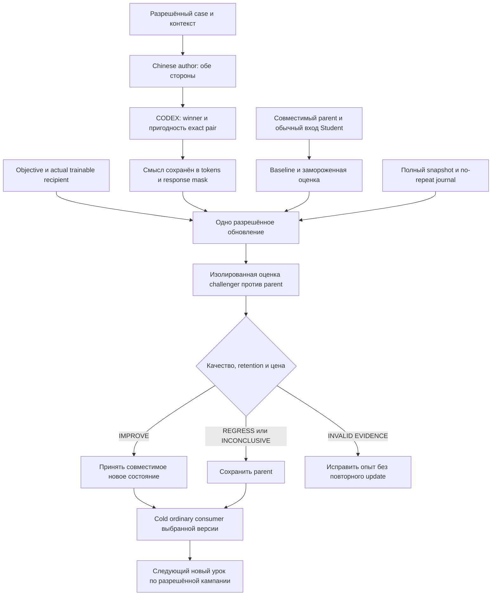
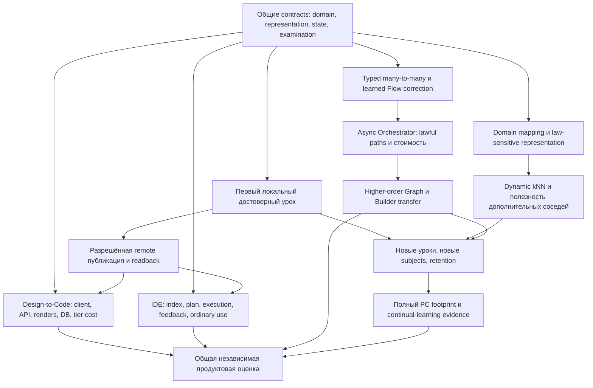

# Применение completion repair: результаты, зависимости и точные получатели

**13.10.2026. Документная интеграция по текущему запросу Лубы. Не объявляет R01–R16 завершёнными, не меняет результаты параллельных исполнителей.**

Основные содержательные артефакты:

- [ALGORITHMS](COMPLETION-REPAIR-ALGORITHMS-2026-10-13.md): прямые источники и код, исправления DPO, четыре причинных роли, конкретный kNN, LoRA/projection, решение первого пути.
- [DOMAINS](COMPLETION-REPAIR-DOMAINS-2026-10-13.md): семь заполненных предметных паспортов и E1 protocol.

Это адресные additions к существующим заданиям, а не вторая очередь и не автоматические R26+. Нумерация программы **10+5+5+5** сохраняется. Existing full prompts, bounded subparts, examples и первичные требования остаются; dispatcher прикладывает только относящиеся sections новых результатов. Публикация нового prompt не равна выполнению исследования.

## 1. Что изменилось относительно процитированного аудита

Аудит полезен как список конкретных пробелов. Но назначать работу по старому снимку без новых receipts нельзя.

| Вопрос аудита | Что теперь действительно установлено | Что не закрыто |
|---|---|---|
| LF01–LF12 ↔ U01–U14 | Current `results/R01/CHANGE-MAP.csv`, прочитанный 13.10, уже содержит LF01…LF12 с U-links; дополнительно U15 про роли экспертизы. Таблица §2 принимает эту связь, не создаёт новые IDs | Полная recursive source inventory и полнота всех three-product obligations остаются открытыми |
| Роли DPO не перенесены в действующие документы | На P1=`8d85a411d1350e933a653c0e80da8d06b051e739` напрямую прочитан updated WorkLeft-02 с R16 repair: CODEX selection, Chinese both sides, separate assessment, no-repeat, utility vs mechanism | Не доказано, что все compiled runtime packets и весь код уже применяют эти clauses |
| R07/R12 содержат преимущественно repair prompts | ALGORITHMS содержит непосредственные MECH/RESEARCH-03/original/RAG-primary reads, concrete code observations и заполненные архитектурные решения | Это адресный новый результат редактора, не повышение статусов worker R07/R12 и не полный independent code audit |
| R08 нет предметных заполнений | DOMAINS §§2–8 содержит семь отдельных law→contrast→features→kNN→state/consumer→evaluation паспортов | Actual manifests/ordinary callers/learning results для всех subjects не подтверждены; документные examples не Chinese-authored datasets |
| R09 агрегаты невоспроизводимы | В §5 сохранены original timestamps трёх jobs одного названного run и прозрачные формулы | Прежние 30 rows, median и общие минуты не восстановлены; один run не замена исходной выборке |
| R10 и R13 не наблюдались | R10 FINDINGS прочитан и содержит nine-way partial join; R13 присутствует, но current status REPAIR_REQUIRED; R15 parent review NOT_PERFORMED как независимый вызов | Наличие источника не снимает его ограничений; R13 нужен actual binding; R15 — actual separate review для такого claim |
| Нет двух dependency graphs | FIRST-LESSON и FULL-DELIVERY ниже заполнены задачами/владельцами/условиями | Реализация этих задач не выполнена |

Источники истории: `results/R01/CHANGE-MAP.csv`; P0=`ce04fcbf0f3f03d04787a801bbc78dc3fc26ba4e` relevant FINDINGS R01/R04–R16 и audit; current WorkLeft-02 на P1; `Kiro-Xiigen-Original-Slice-Queue.md`, blob `c0cb5917e0a01d67e9e447e5e27eb1a8300f9b61`; original `task prompt.md` на P1. `previous rounds thinking results.md` прочитан адресно 1170–1280 и не объявлен полностью прочитанным. Core pin и direct method spans — ALGORITHMS §2.

## 2. Принятая LF→U передача, без перенумерации

Это documentary reconciliation существующих строк, не оценка реализации.

| Existing ID | Existing U links | Принятый предметный результат / downstream адрес |
|---|---|---|
| LF01 | U08,U12 | DOMAINS §9: subject/intent/direction, predicted/oracle/mixed/unknown; R06/R08→R13/R21 |
| LF02 | U08,U05 | DOMAINS §§2–8: laws с областью/версией, false exclusions; R08→R12/R21 |
| LF03 | U08,U09 | ALGORITHMS CR-D01 и §§5,7,8: named representations, semantics/versions; R04→R05/R18 |
| LF04 | U07 | ALGORITHMS §7: concrete C# score/pool/k/consumer/index experiment; R06→R12/R22 |
| LF05 | U06,U15 | ALGORITHMS §6: winner vs pair_usable, actual authorship и независимая utility; R02/R05/R08→R13/R20 |
| LF06 | U05,U09,U10 | ALGORITHMS CR-D04/§9: actual Student family, ordinary adopter gap; R05/R07→R18 |
| LF07 | U01,U02,U03,U04 | ALGORITHMS §5: four roles, many→many IDs/edges, separate causal contrasts; R04/R07→R12/R22 |
| LF08 | U09,U08 | ALGORITHMS §8: A/B, target space, projection vs tokenization; R05→R18/R22 |
| LF09 | U05,U10 | ALGORITHMS §8 + DOMAINS §10: whole-runtime footprint, not adapter-only; R09→R23 |
| LF10 | U10 | ALGORITHMS §6: validated feedback/unique lesson/rollback/adopt; R05/R08→R23 |
| LF11 | U11 | DOMAINS §10: same-panel within bulk, family independence, retention/cost; R08/R13→R17/R22 |
| LF12 | U15,U11,U05 | §6 below: actual separate reviewer, frozen candidate, scope-bound verdict; R15→R25 |

U12 и AD02 сохраняют DTC/IDE/clients/tier-cost beyond LF rows. U13 получает актуальный concurrent-start contract §6; U14 — direct GitHub write/readback без external apply. Существующая mapping table уже имелась у R01: этот receipt не засчитывается как новое изобретение карты.

## 3. FIRST-LESSON — причинный граф первого CodeDocumentation урока

Выбор объекта — current WorkLeft-02, а не случайный ближайший endpoint. У CodeDocumentation LlmModel и graph selector разные parameter/state families. Неиспользуемый Graph loader не блокирует документный урок; ordinary document generator обязателен.



| Узел / предметная задача | Источник необходимости и владелец | Условие готовности / что не требуется |
|---|---|---|
| S — actual parent+ordinary caller | WorkLeft-02; R05+R07→R18 | Найдены version selector и реальный generator. Endpoint label/assessment reload недостаточны; нового trainer не нужно |
| B — baseline/panel | S03; R08+R13 | Rubric/family/порог/uncertainty policy заморожены до challenger; не вся матрица доменов и не 95% как gate старта |
| R/A/J — разрешённая exact pair | U06/U15; R02/R05/R08 | Actual permitted profile/контекст/байты/assessment; без model calls в текущей документной сессии |
| T — faithful input | CR-A01/CR-D01; R04/R05→R18-A | Удалена скрытая потеря смысла либо материал явно отклонён; новый universal encoder не prerequisite |
| O — objective и recipient | CR-A02/CR-D02/CR-D04; R12→R18-B | Response-only log-probs, separate public scorer, actual trainable keys; model margin не semantic admission |
| P — complete state/recovery | S01/S02; R05→R18 | Mutable state inventory, accepted/pending IDs, restore boundary; unknown update не повторяется |
| E/V — causal examination | DOMAINS §10; R13/R17 | Same-panel/no-update, comparable evidence, total cost, allowed outcomes; green CI не substitute |
| C/K/I — принятие и обычное использование | S04; R05/R07/R18 | Оценка предшествует promotion; selected version реально вызвана; local S04 не ждёт remote S05 без необходимости |
| N — дальнейшие новые уроки | S06; R21/R23 | Novelty, capacity, drift/retention; не скрытый replay |

**Достаточный first-loop набор не равен whole-program closure.** Два доказанных input/objective риска не закрывают остальные S04 admissions. Нативный Windows selection/security path становится реальной зависимостью, когда выбранный разрешённый маршрут использует его. Нельзя выключать его safeguards ради ускорения; нужно отделить обучение от unrelated native qualification только при доказанном отдельном admitted пути.

### Отдельная развилка graph/selector lesson

Для graph route вместо O используется конкретный selector policy над lawful candidate set; вместо S/I — accepted selector state→loader→trusted preload→L2 authority→selected L3 flow. Winning solver не получатель selector DPO автоматически. Пока loader/recipient не установлены, graph lesson не готов; это не блокирует независимый document lesson. Flow/Graph transfer требует held-out composition families, а не один улучшенный документ.

## 4. FULL-DELIVERY — все обязательства остаются, но не одной длинной очередью



Edges показывают **зависимость финального пользовательского claim**, не запрет заранее исследовать/реализовывать независимые части DTC/IDE. Runtime Windows/host qualification относится к фактически используемой нативной ветке D/IDE/authoring и не добавлена общим ребром перед L. Внешние расходы/авторство/данные остаются под действующим admission.

| Исходное обязательство | Сохраняемая конкретная работа | Owner и условие возврата |
|---|---|---|
| S00 | current source/role/context resolution | R01–R03/R19; при новом существенном source change читать dependent spans, не всё заново |
| S01 | applied lesson resumes evaluation without duplicate update | R05/R18/R23; при unknown/interrupted effect требуется recovery до следующей mutation |
| S02 | full mutable-state recovery | R05/R18/R23; при каждом новом state family расширить snapshot, не предполагать weights-only достаточно |
| S03 | fixed independent evaluation/certification | R08/R13/R17/R25; до efficacy/promotion claim; final unseen material не используется для authoring |
| S04 | one existing CodeDocumentation lesson | R05/R12/R13/R18; FIRST-LESSON graph выше |
| S05 | canonical artifact remote publication/LFS/readback | R14/R24; когда существуют реальные разрешённые локальные artifacts и допущена публикация |
| S06 | другое subject/level и finite campaigns | R21/R22/R23; когда имеется compatible contract одного выбранного extension, не после всех доменов |
| S07 | learned combinations и собственный DPO Builder | R07/R12/R22; после конкретного selector state+consumer и composition panel, не требует всего UI |
| S08 | DTC beyond core: API/render/DB/model/tiers | R06/R24; после инспекции external repos и соответствующего integration contract |
| S09 | editor/provider/user surfaces | R06/R24; отдельный actual host/provider scenario, retained Codex/Claude/Cursor/VS/VSCode/Continue scope |
| S10/FINAL | вся программа и реальные пользовательские пути | R14/R25; reconciled original obligations, actual independent review и evidence; не закрывается одним E1 |
| U08/U07/LF01–04 | domain mapping, representation, metric/k/neighbor consumer | R04/R06/R08/R12/R22; E2 может исследоваться параллельно E1, без полного factorial |
| U09/LF08 | adapter/projection до правильного выходного пространства | R05/R12/R22; если chosen architecture требует новый P_d, определить target+consumer и migration до update |
| U10/LF09–10 | PC/feedback, privacy, novelty, cost/retention | R09/R23; до continual-learning/PC-fit claim, точный profile и полный footprint |
| U12/AD01/AD02 | семь subjects, HE↔EN и original extras | R01/R02/R21/R24; requirement/source owner сохраняется, узкий успех не удаляет extras |

Имена target external repositories взяты из original prompt: `xiigen-platform-dot-net-angular`, `xiigen-flows-dot-net-angular`, `FigmaToCode-design-gen`, `CanvaToCode`. Их текущий код не исследован этим документом; требования не исчезают и перенос не означает существующую реализацию.

## 5. R09: воспроизводимая адресная поправка, а не новые Windows runs

Прочитаны existing GitHub records:

- run: https://api.github.com/repos/lubochka/llm_mvp_core/actions/runs/38379535495
- exact attempt jobs: https://api.github.com/repos/lubochka/llm_mvp_core/actions/runs/38379535495/attempts/1/jobs?per_page=100

**Selection rule:** намеренно выбран один representative run, уже названный R09. Это purposive one-run examination, не random sample и не восстановленная выборка30. Run=38379535495; attempt=1; branch=`codex/dpo-implementation`; head=`a5de1a893db8e44e3dce0f4f54cdae2a4d06d1a3`; event=push; status=completed; conclusion=failure. Run created/started=2026-10-13T09:53:23Z; updated=2026-10-13T10:14:31Z. Последнее completed_at job совпадает с updated_at в данном случае; updated_at не принимается универсально за finish timestamp.

```csv
run_id,attempt,job_id,name,status,conclusion,created_at,started_at,completed_at,elapsed_seconds,runner_label
38379535495,1,115236218268,push-admission,completed,success,2026-10-13T09:53:23Z,2026-10-13T09:53:26Z,2026-10-13T09:53:35Z,9,ubuntu-latest
38379535495,1,115236219234,Exact candidate native public-resource verification,completed,skipped,2026-10-13T09:53:23Z,2026-10-13T09:53:23Z,2026-10-13T09:53:23Z,0,windows-2022
38379535495,1,115236293190,Candidate-matched Windows verification,completed,failure,2026-10-13T09:53:35Z,2026-10-13T09:53:38Z,2026-10-13T10:14:31Z,1253,windows-2022
```

Формулы/расчёт по timestamps: windows job elapsed=1253s=20m53s; sum non-skipped job elapsed=1262s=21m02s; workflow created→last job completed=1268s=21m08s. Здесь два активных job intervals не перекрываются. Created→started каждого active job=3s; это наблюдаемый scheduler/start delay, не обязательно чистое ожидание runner, и не пользовательские трудозатраты. Skipped job не получает runner cost по имени windows-2022.

Windows step breakdown: checkout 09:53:44→09:55:52=128s; restore 09:57:02→09:57:27=25s; build 09:57:27→10:00:52=205s; focused wrapper 10:00:59→10:14:22=803s; impacted gate skipped. Wrapper step имеет conclusion=success, тогда как final validation job=failure: step label не доказывает успешность всех underlying assertions. Это ещё одна причина не сводить результаты к зелёному имени шага. Содержимое TRX/конкретная failed assertion в этой адресной проверке не перечитывались.

**Старые цифры R09 (30 runs, 368.3/114.2 минут, median38.1/6.9) остаются историческими агрегатами, не подтверждёнными этим ремонтом.** Их нельзя далее называть измеренным runner occupation или использовать для обещания экономии, пока не восстановлены 30 IDs+attempts+jobs и selection cutoff. Эта новая таблица не заменяет исходную молча. Гипотеза global test-fitting остаётся INCONCLUSIVE; требуется exact requirement/assertion/diff/behavior episode. Новые Actions не запущены; workflows/tests не изменены.

**Решение для R11/R17/R23:** причинное исключение unrelated Windows gate обосновывать actual dependency graph, а не неподтверждённым коэффициентом ускорения. Реальная native безопасность остаётся обязательством нужного runtime пути.

## 6. R01–R16 можно начать параллельно; финализация и запись не равны старту

Текущий прямой запрос Лубы допускает одновременные R01–R16. Старое ограничение «только девять входов» уточняется так:

| Runs | Разрешённый параллельный старт | Что ограничено зависимостями |
|---|---|---|
| R01–R09 | собственные direct sources, сохранённые checkpoints, bounded research | full verdict только по собственным доказательствам; не ждать sibling DONE для доступного независимого вопроса |
| R10 | partial join уже опубликованных individual snapshots | final completeness нельзя вывести из наличия девяти файлов; semantic deltas принимаются адресно |
| R11–R14 | анализ по достаточным current evidence/primaries, provisional candidate и две DAG | source changes принимаются для затронутых выводов; final exact-binding readiness только после разрешения причинных стыков |
| R15 | чтение exact candidate, counterexamples и подготовка adversarial review | independent verdict только при actual separate invocation; self-check не переименовывается Astra-review |
| R16 | оценка preimages, requirement mapping, resolved source-bound delta | запись в shared live files сериализована; unresolved architecture не переносится как approved/implemented |

Каждый worker по-прежнему пишет только собственные carriers; редактор правит entrypoints/packets по текущему запросу. Нет shared mutable ledger для шестнадцати writers. Перед записью current blob, при конфликте read/reconcile, после записи readback. **16 concurrent research sessions не 16 GPU trainings**, и START не запускает их автоматически.

R07 latest work order A–J, R12 A–F, R13/R14/R15 repair contracts сохраняются в полном предметном объёме. Дополнение не требует повторять уже прочитанные источники без изменения. Подзадачи A/B — единицы работы, не автоматически отдельные calls. Дополнительный действительный вызов имеет named gap, source budget, owner и full return contract, а не новую круговую очередь.

## 7. Адресное принятие по раундам — конкретные изменения вместо нового полного rerun

| Run | Что принять в свою existing task/result | Проверка результата и точный оставшийся шаг |
|---|---|---|
| R01 | §2 existing LF→U mapping; corrected -v1 arbiter locator; original slices queue §4 | Не исследовать карту заново. Закончить recursive source inventory/ownership; unresolved LOGICAL-ARCHITECTURE-REPOSITORY-MAP/E50 locators остаются отдельными вопросами |
| R02 | ALGORITHMS §4 authority reconciliation; actual R16 WorkLeft-02 adoption, §1 | Обновить только затронутые из 52 requirement receipts; авторство обеих final sides не переоткрывать; source→decision→current consumer проверять по bytes |
| R03 | ALGORITHMS A04 actual RAG-06→arbiter/locked-decision chain; correct namespace | Сохранить visited set/IDs; закончить другие обязательные DPO/DTC/merge/IDE primary questions. Нельзя считать этот один traversal полным обходом404 |
| R04 | ALGORITHMS CR-D01/§5 many→many/§8 separate projection; DOMAINS features | Trace real OutputRefs resolver и segments.Zip association, не просто выдать ещё один payload schema. Raw elsewhere не доказывает actual consumer |
| R05 | CR-A01…04 и CR-D01…04 непосредственно подтверждены; no-new-trainer | Добрать actual trainable keys, LOW_CONTRAST receiver и accepted→ordinary generation. Default-branch search без результатов не доказательство отсутствия branch code |
| R06 | ALGORITHMS §7 filled C# dynamic-kNN family и §4 authority | Принять concrete feature/pool/state/neighbor consumer; trace оставшихся S07–S10 owners без превращения всех их в gate E1 |
| R07 | ALGORITHMS §§2–8 и DOMAINS: primary inputs+four-role causal content, не новый A–J prompt | Согласовать full assigned work order; current accepted selector preload и ordinary data links остаются runtime research. Старые F01–03 сохранить |
| R08 | DOMAINS §§2–9 вместо пустых форм, separate winner/pair_usable | Дочитать actual critical domain consumers и unique historical RESEARCH review material; не повторять всю R04–R07 библиотеку |
| R09 | §5 original three-job rows, definitions/limits и causal cost policy | Старые агрегаты не новые измерения; восстановить original30 или оставить явно unverified. Для test-fitting нужен конкретный assertion episode |
| R10 | §1 delta join, §2 functional receipts, R13/R15 current limitation | Принять additions как SOURCE_READ/CODE_READ/DESIGN_DECISION, не EXPERIMENT_RUN; не повышать sibling statuses |
| R11 | §3 FIRST-LESSON и §4 FULL-DELIVERY с owners/triggers | Принять текущий R10; убрать порядок promotion-before-evaluation; native dependency только когда действительно используется |
| R12 | ALGORITHMS §§4–9 — заполненный A–F content и current WorkLeft target | Согласовать source conflicts/ordinary owner, принять или предметно опровергнуть выбранные designs. Не назвать это независимым review или full code closure |
| R13 | DOMAINS §10 concrete protocol для current Student | Заполнить actual IDs/entry/threshold/calibration/approved context; до этого RUNTIME_BINDING_OPEN, не PROTOCOL COMPLETE=launch ready |
| R14 | §4 все S00–S10/extras, E1 primary learner + E2 parallel research | Сохранить capability DAG, а не M0→M7 общий стоп; information/cost численно не выдумывать |
| R15 | новые exact artifact bytes + current R12/R13 ограничения | Реальный independent review либо NOT_PERFORMED; previous parent findings не применять как approval |
| R16 | подтвердить собственный новый WorkLeft repair, текущий §6 | Не повторять уже применённые role clauses и не ссылаться на R12/R13 как завершённую architecture. Только resolved deltas |
| R17 | DOMAINS §10 и §5 здесь | Исправить evidence-policy actual live clauses, не запускать новую coverage кампанию |
| R18 | ALGORITHMS CR-D01/02/04 + DOMAINS §10 + FIRST-LESSON | Complete bounded implementation packet по существующим владельцам; code/commands только после current binding; не второй trainer |
| R19 | concurrent starts §6 и адресная таблица §7 | Один effective prompt, этот receipt встроен в selected task; shared updates сериализованы |
| R20 | поля §8 и subject-specific sources/examples | Cold-start packet содержит задачу и evidence, а не ссылки на десяток книг; old unique clauses не теряются |
| R21 | семь паспортов + extras | Curriculum extension по independent families; второй предмет не evidence первого, и наоборот |
| R22 | four-role contrasts, fixed/dynamic kNN, projection/adapter controls | One factor/declared interaction, no hidden pair replay, ordinary utility+cost |
| R23 | whole-PC state/cost и feedback §6 ALGORITHMS | Actual hardware/profile measurement, accepted/pending safety, resource growth; adapter size не PC-fit |
| R24 | full DTC/IDE obligations §4 | Actual client→server→trained state→ordinary result и source version; copied package не поставка |
| R25 | frozen final artifacts, exact open residues | Independent review только фактический; handoff не начинает automatic R26 и не скрывает runtime gaps |

## 8. Как model worker исполняет именно продолжение

В effective prompt входят COMMON + existing Rxx card + current own checkpoint + **только строка §7 и указанные sections ALGORITHMS/DOMAINS**. Названия skills разрешаются в actual `K/docs/skills`; читать relevant sections, не все historical routines. Передавать source excerpts и refs, а не только список книг.

**Задача:** исполнить конкретный оставшийся смысловой вопрос своей строки, использовать уже полученный результат, не переписывать поручение вместо исследования. **Не задача:** выполнить25 runs, поменять code/tests/workflows/weights/данные, запускать Windows/training/paid calls, повышать чужие статусы.

**Обязательные outputs:** human finding; exact source/code/observation status; выбранное решение/отвергнутая альтернатива; input→state→consumer; new vs inherited IDs; good/bad/edge walkthrough; current documentary acceptance; future functional examination отдельно; known remaining gap с named owner/return trigger. Каждый реально делегируемый child получает те же explicit scope, skills, contexts, sources, allowed actions, examples, acceptance и return-only права.

**Хороший return для R05:** найден фактический caller, он выбирает model version X и вызывает generator Y; передано в R18 точное место/исходная цитата/что меняется; если tracing оборвался — указан ближайший caller и ограничение. **Плохой:** «checkpoint сохраняется, значит inference обучился» или «нужно проверить consumer» без нового чтения. **Edge:** current source изменился параллельно — перечитать затронутые methods, сохранить старый receipt как historical, не сбрасывать весь run.

**Хороший return для R08:** собственный filled passport source→law→negative→feature→state→ordinary result, с отдельным observed/proposed. **Плохой:** «добавить поля закона, tokenization и kNN». **Edge:** A/B оба правильные — сохранить tie, а не выдумать winner ради количества пар.

**Хороший return для R11/R12:** два dependency graphs/выбранный causal contract с фактическими prerequisites и точным implementation recipient. **Плохой:** «Windows позже», «Graph потом», «надо принять архитектурное решение» без аргумента/владельца/условия возврата. **Edge:** E1 blocker не делает E2 S04 DPO; отдельный research может продолжаться без ложного completion claim.

**Проверка результата сейчас:** reviewer может восстановить каждое существенное решение по exact sources и объяснить, какой обычный эффект будущий experiment должен различить. Этот документный review не product tests и не внешняя Astra экспертиза. Empirical gain, best domain policy, PC fit и full project completion остаются NOT_MEASURED/OPEN до соответствующего evidence.
