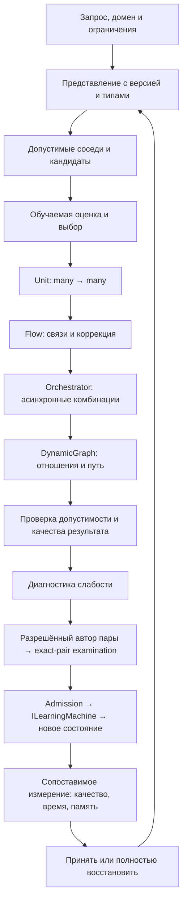

# Гибридное обучение XIIGEN: алгоритмы, связи и предметные поручения

**Редакция 8 · 13.10.2026 · проектирование работы, не выполненное обучение.** Этот файл задаёт недостающую алгоритмическую часть существующих R01–R25. Это не вторая очередь и не поручение каждому исполнителю прочитать всё. START собирает общий контракт, один исходный Rxx и только назначенные ниже предметные части в **один эффективный промпт**. Уже выполненное подтверждённое чтение переиспользуется. Параллельность и единственный дополнительный J03 регулирует [PARALLEL-R01-R03-JOIN.md](PARALLEL-R01-R03-JOIN.md).

## 1. Что восстановлено и на что опираться

D = `llm mvp/design to code session` в `lubochka/xiigen-planning:llm_plan3`. K = `lubochka/llm_mvp_core:codex/dpo-implementation`. Перед исполнением закрепить свежие commit refs. Приведённые blob SHA идентифицируют прочитанные тела, **не являются commit SHA**.

| Опора | Прочитанная при этой редакции область | Значение и предел |
|---|---|---|
| `D/original task.md` | 1–80; blob `10b9c752ec740d439b46e0730f4cde2562ebe033` | Первичное описание четырёх уровней, many→many и одного входа через разные асинхронные комбинации. Старый shortlist моделей не является сегодняшним лицензионным допуском. |
| `replanning/results/R01/FINDINGS.md` | Полное возвращённое тело | Инвентарь ещё IN_PROGRESS в прочитанном checkpoint; огромные WorkLeft нужно читать по вопросам/диапазонам. |
| `replanning/results/R02/FINDINGS.md`, `DECISIONS.md` | Начальные содержательные разделы, запросы 1–100 | Восстановлены требования и code anchors, роли, server admission и training owner; итоговое объединение с R01/R03 открыто. Дочитывать относящиеся строки CHANGE-MAP/SOURCES, а не считать этот пересказ доказательством всех требований. |
| `replanning/results/R03/FINDINGS.md` | Начальные содержательные разделы, запрос 1–100, CP02 | Восстановлены вложенный `llm dynamic flow`, signed kNN memory, post-generation arbiter, конфликт replay и разные таксономии. Это primary-route findings, не выполненный runtime. |
| `K/00.Core/DynamicGraphContracts.cs` | 1–160; blob `987c29396fab838db0eecd8060837d5e5e33bce4` | Typed ExecuteAsync возвращает IQueryable кандидатов; descriptor/input/output/domain; пять видов рёбер; baseline и authority отделены. Сигнатура не доказывает качество исполнения. |
| `K/21.AgentInfrastructure/Logical/DynamicGraphEdgeAuthorityContracts.cs` | 1–140; blob `51e04cdb350aeaefdcbe8cf88c9105918f3ccac2` | Propose детерминированных кандидатов, bounded materializer, learned decision и diagnostics разделены. Advisory decision ещё не окончательный результат/допуск. |
| `K/10.LoRA/LoraLinear.cs` | 1–140; blob `1b321e99408c961b896896983d002e3b26425b85` | Forward действительно складывает base projection и вклад A/B. Подключение к конкретному доменному consumer и польза требуют отдельной трассы/опыта. |
| `replanning/previous rounds thinking results.md` | Начало, а также 700–800 и 1100–1190; не весь файл | Сохранены прежние полезные методики; найдено предупреждение о неоднозначной recovery/retry политике. Не считать прежние предложения исполненными сессиями. |

Вложенный маршрут R03 для обязательного сохранения: `D/09.09.26WorkLeft-RAG-04-vs-vscode-continue.ndjson` → `llm mvp/visual studio & visual studio code continue/RAG-06-llm-dynamic-flow.md` → `llm mvp/llm dynamic flow/ARBITER-KNN-AUTHORITY-AMENDMENT-v1.md` → `DECISIONS-LOCKED.md`. В этой редакции его сведения прочитаны через отчёт R03; первичные тела и их диапазоны подтверждает назначенный исполнитель по SOURCES R03. Такой статус нельзя молча повысить до собственного primary trace.

Другие обязательные первичные маршруты: `dpo legal build/active-codex-execution-original-task.md`, `active-codex-execution-plan-12-no-hidden-determinism.md`; WorkLeft RESEARCH-01/02/03, MECH-01, решения владельца, все исходные DTC/IDE prompts. SOURCE-ROUTES остаётся владельцем полного инвентаря; приведённые опоры не закрывают всю библиотеку.

## 2. Четыре уровня — не четыре названия одного метода

| Уровень исходного замысла | Вход и наблюдаемый выход | Детерминированная часть | Что должно быть обучаемым или исследоваться как обучаемое |
|---|---|---|---|
| **ILearningUnit** | Домен, тип/структура входного вектора и требуемого выхода → несколько различимых полезных результатов нужного типа для нескольких входов | Парсинг, формы, допустимость, materialization, технические операции | Преобразование/проекция и выбор кандидатов в той части, которую проект заявляет обучаемой |
| **ILearningFlow** | Связанные Unit inputs/outputs → исправленный или составной результат | Типизированная передача, fan-in/fan-out, допустимые зависимости | Отношения, полезный выбор связи, корректирующий сигнал; не механическое соединение по ID |
| **ILearningOrchestrator** | Один запрос и ограничения → результат нескольких асинхронных допустимых комбинаций | Планирование исполнения, лимиты, cancellation, учёт всех ветвей | Политика запуска/выбора подходящей комбинации и, где предусмотрено, остановки |
| **ILearningDynamicGraph** | Контекст и паттерны нескольких порядков → подходящий путь/композиция и материал для улучшения отдельных units | Хранение топологии, перечисление допустимых кандидатов, структурные ограничения | Отношения паттернов, learned authority рёбер, композиционное обобщение и способность собственного Builder |

Исторические написания `IlearnyngFlow`, `IlearningOrchestrator`, `Iquearable` — aliases исходного замысла, не команда создать дублирующие C# interfaces. Сопоставлять их с текущими Logical/DynamicGraph contracts.

**Обучение не переносится в каждый исполнительный интерфейс.** Восстановленный training owner — ILearningMachine; разрешение обновления — отдельная server-owned admission-цепь 25.ModelServer. Current train-ready GraphDpoPair остаётся unit-level с UnitId до явно принятой миграции. Уровень, на котором наблюдают ошибку графа, не определяет автоматически уровень training payload.

Схема показывает обязанности, **не навязывает линейный runtime**: граф может содержать несколько Unit/Flow/Orchestrator, возвраты и разветвления. R07 обязан отразить настоящую топологию. Нарисованная стрелка не считается найденным вызовом.

Каждый исследуемый механизм получает один паспорт: `purpose; domain/intent/level; input/output/types; state/version; deterministic helper; learned authority; actual update rule/owner; producer→mutation→consumer; legal/data scope; cost; fallback; failure; baseline/challenger; falsifier; next implementation seam`. Поля с неизвестным значением остаются точным вопросом, а не вымышленным проектным фактом.

## 3. Общий контракт для всех предметных подзадач

Роли: архитектор реконструирует и обосновывает; исследователь кода прослеживает реальные вызовы; автор меняет только разрешённые документы; независимый reviewer вызывается отдельно в R15/R25. Одна модель, переключившая роль, не становится независимой проверкой.

Применимые skills действительно читать в K/docs/skills: `architect-behavior-classifier-SKILL.md`, `phase-planning-SKILL.md`, `plan-review-SKILL.md`, `generated-code-review-SKILL.md`, `trainable-architecture-decision-SKILL.md`, `prompt-patch-authoring-SKILL.md`, `output-readability-gate-SKILL.md`, `reference-inventory-and-source-map-SKILL.md`; дополнительные тематические навыки брать по действующему Rxx. При подготовке этой редакции первые семь применены выборочно: соответственно 1–95, 1–95, 90–190, 1–110, 125–225, 1–105, 1–110. Полная загрузка библиотеки не заявляется. Исторические 30/50 ревью и product-test команды из навыка не переопределяют сегодняшний документный scope.

Для дочернего исполнения родитель передаёт **заполненный** пакет: текущий вопрос; не-задача; закреплённые refs/смысловые выдержки/доступные пути; относящийся исходный Rxx; один H-блок ниже; разрешённые записи; результат; good/bad; edge cases; документная приёмка; будущий опыт; ограничение и handoff. Слова «прочитай контекст выше» и пустая форма не являются передачей.

Разрешены чтение/поиск, анализ имеющихся artifacts, формул и call chains, documentary walkthrough, проверка ссылок/diff и GitHub запись документов. Не разрешены product coverage/tests/build/trainer/Windows/Actions, новая teacher campaign, изменения code/tests/workflows/weights/datasets или core skills. Описанные ниже опыты **проектируются сейчас, исполняются отдельной разрешённой реализацией позже**. В существующих tests ничего не удалять и не ослаблять. Формальные доменные проверки могут быть частью будущего inference/evaluation, но не подменяют learning gain процентом test coverage.

Общий возврат каждой подзадачи — заполненный паспорт механизма, 1 нормальный и 1 контрпример, точные evidence, минимальная недостающая связь, сравнение, которое различит гипотезу, и предел вывода. Писать в carriers своего Rxx; отдельный журнал H не создавать. Техническое заполнение без человеческого объяснения результата не принимается.

## H01 — Unit, доменное представление и many→many

**Основной владелец:** R04. **Контекст:** R02 requirements/CHANGE-MAP по Unit и representation; R03 primary routes; K/00.Core/LogicalContracts.cs и DynamicGraphContracts.cs; реальные producers и consumers найденных typed requests; S00–S03. **Skills:** архитектура, code review, источники, читаемость.

**Промпт:** проследи выбранный production вход от raw input до materialized результата запрошенного типа: parser/tokenizer → структурные признаки/embedding → projection → versioned vector → candidate → output consumer. Отдельно покажи domain, intent, язык/направление и уровень. Не объединяй SQL и BUG в одну взаимоисключающую категорию. Найди, где задаются структуры входа/выхода и смысл каждого значимого признака. Раздели learned mapping и детерминированный codec. Проверь по исходникам, не превращается ли IQueryable в один constant/первый результат и не теряется ли соответствие нескольким входам. Не требуй произвольного числа кандидатов там, где законен один: кардинальность зависит от задачи. Назови предел candidate explosion и способ сохранить provenance.

**Разбиение:** H01.A — только raw→vector, версии/признаки; входы — parser/encoder/projection spans, выход — representation passport. H01.B — только vector→typed candidates→consumer; входы — passport A и candidate/consumer spans, выход — cardinality/materialization trace. Обе части наследуют этот промпт и общий контракт, но получают собственные точные файлы; B не пересматривает tokenizer A без обнаруженного стыкового дефекта.

**Хорошо:** «не разрешать удаление» и «разрешать удаление» имеют различимую семантику; SQL JOIN для разных ключей сохраняет нужную структуру; возвращённые кандидаты связаны с исходными входами. **Плохо:** совпала размерность — значит пространства совместимы; одинаковые строки с разными CandidateId названы many→many.

**Границы:** неизвестный/смешанный домен, пустой допустимый результат, несколько корректных ответов, OOV/новые symbols, изменение schema/codebook, одинаковая поверхность с иным смыслом. **Приёмка сейчас:** реальные producer/consumer spans либо конкретный разрыв; таблица свойств, которые нельзя потерять; owner R05 для adapter/state, R06 для retrieval. **Будущий опыт:** общий набор semantic contrasts и новых семейств, frozen representation против одного изменения; сохранение смысла/структуры, полезность кандидатов и downstream качество. Ближайший сосед сам по себе не доказательство понимания.

## H02 — LoRA должна менять полезную проекцию, а не только файл весов

**Основной владелец:** R05; форма из H01, экспериментальная спецификация R12/R13. **Контекст:** K/10.LoRA/LoraLinear.cs, реальные adapter registration/optimizer/consumer, current manifests; WorkLeft TRAINING и S04–S06. **Skills:** code review, trainable architecture, experiment design.

**Промпт:** назови конкретную матрицу W, входную/выходную формы, rank, A/B, масштаб, frozen/trainable параметры и домен владельца. Проследи регистрацию параметров, вычисление loss, доступность градиента, optimizer mutation, сохранение/загрузку и следующий inference consumer. Прочитанный Forward имеет `base(x) + scaling * (dropout(x) @ A^T) @ B^T`; не делай из него самостоятельный tokenizer или доказательство обученности. Отдельно установи, проецируется ли input embedding, hidden state, logits или иной вектор. «Transpose результата в vector token» раскрой как конкретный encoding/projection/materialization путь; математическая операция transpose не тождественна смысловому преобразованию.

**Разбиение:** H02.A — gradient/update до нужных A/B; H02.B — версия projection→retrieval/output. B получает формы и state identity A, проверяет необходимость reindex и соответствие consumer. Никакого обучения в этой сессии.

**Хорошо:** frozen/adapted projection сравнивается при одном decoder и совместимом индексе; записана полная цена обновления индекса. **Плохо:** A/B изменились — домен изучен; старые vectors смешаны с новым пространством одинаковой размерности.

**Границы:** нулевой/неиспользуемый adapter, слишком малый/большой rank, несколько доменных adapters, concurrent reload, несовместимый checkpoint, dropout/RNG recovery. **Приёмка:** реальный trainable parameter→consumer путь, либо точный минимальный seam; выводы о качестве NOT_MEASURED. **Будущий опыт:** frozen base / тот же base + выбранный adapter; downstream качество, удержание различий H01, качество retrieval, старые домены, latency/RAM/VRAM и пик reindex. Rank — выбранная исследуемая величина, не заранее найденный оптимум.

## H03.A — построить содержательную положительную/отрицательную пару

**Основной владелец:** R08; R02 задаёт роли, R05 потребляет contract. **Контекст:** `Алгоритм создания ДПО.md`; WorkLeft RESEARCH-01/02/03; R02 decisions; реальные comparison-event/Builder/GraphDpoPair producer и validators, найденные по R03. **Skills:** trainable architecture, prompt authoring, источники, экспериментальный дизайн.

**Промпт:** определи единицу предпочтения: один и тот же запрос, допустимый контекст, условия и тип результата. Для каждой пары потребуй источник обеих сторон, причину предпочтения, домен/intent, target UnitId, различающий дефект rejected и доступные автору данные. Раздели: неверный домен; неверное представление; ошибочный сосед; неправильная связь/путь; ошибочный ответ; корректный, но ненужно дорогой ответ. Стоимостная пара допустима лишь после выполнения одинаковых условий правильности. Хороший Student не проигрывает автоматически teacher. Both-bad, tie, несопоставимые задачи, простой маркер preferred/rejected и тривиальный мусорный negative не превращать в полезную учебную пару.

Сохрани роли: допущенная открытая китайская модель — автор материала, CODEX/Astra Ultra в действующей выбранной конфигурации — выбор слабости и examination exact pair, XIIGEN — Student. Собственный Builder оценивается отдельной способностью. Requested role не означает реально выполненный вызов. Закрытые ответы/тексты judge нельзя передать teacher для перефразирования и объявить новым легальным происхождением.

**Хороший пример:** в переводе preferred сохраняет отрицание и `{count}`, rejected правдоподобен, но меняет отрицание; оба отвечают на один запрос. В SQL preferred сохраняет необходимую кратность JOIN, negative теряет строки из-за неверного ключа. **Плохой:** preferred содержит дополнительный скрытый контекст; negative — случайный текст; судья видит метку победителя.

**Границы:** два корректных разных пути, ошибочный teacher, неоднозначный запрос, противоречивая обратная связь, устаревший domain law, приватный источник, дубликат под новым ID, ошибка промежуточного unit при правильном финальном ответе. **Приёмка:** готовая форма comparison→admission→unit-pair, явные правила rejection и источники; не созданные реальные datasets. **Будущий опыт:** exact-pair validity и recipient learning utility измеряются отдельно; учитывать все попытки генерации, reject rate, время и downstream gain по доменам, а не только среднюю оценку Builder.

## H03.B — доказать правило обновления и адресовать правильный unit

**Основной владелец:** R05; решение неоднозначностей R12/R16. **Контекст:** H03.A contract, K/00.Core/LearningMachineContracts.cs, фактические trainer/loss/admission/checkpoint consumers, WorkLeft RESEARCH-03 и RESEARCH-01 recovery sections. **Skills:** code review, trainable architecture, plan review.

**Промпт:** проследи exact pair → разрешение применения → правильное состояние → loss → нужные trainable параметры → optimizer → оценка → accept/full rollback → новый consumer. Найди первичные declaration/validator GraphDpoPair, а не повтори вторичную фразу R02. При текущем unit-level contract graph/path/edge/order остаются provenance/context; сравнение путей ещё не разрешает обучать весь граф как один иной payload. Для ошибки композиции покажи, как выделяется ответственный unit и что происходит при неоднозначном credit assignment. Не применять одну пару ко всем units на пути «на всякий случай».

Если реализация названа DPO, сопоставь её с вероятностным objective:

`loss = -log sigmoid(beta * ((log pi_theta(y+|x) - log pi_ref(y+|x)) - (log pi_theta(y-|x) - log pi_ref(y-|x))))`.

Установи, что именно такое pi для данного выхода, на каких событиях она нормирована, как закреплён reference, где completion mask/EOS/padding, направление знака и какая длина/нормировка применяется. Для структурированных candidates допускается исследовать явно заданную вероятностную policy; произвольный cosine score нельзя молча назвать log-probability. При другом objective честно назвать preference/ranking learner и объяснить отличия, а не навязать переписывание работающего алгоритма ради имени DPO. [Методическая опора: Rafailov et al.](https://arxiv.org/abs/2305.18290)

**Разбиение:** H03.B1 — pair/admission/objective→mutation; H03.B2 — applied/pending/accepted/restored/unknown→recovery→consumer. Каждая часть получает свои точные spans и общий контракт; B2 не повторяет вывод objective B1 без нового дефекта.

**Крайние случаи восстановления:** пара не применена; применена и ждёт оценки; принята; полностью восстановлено pre-pair state; неизвестно, была ли мутация. Не разрешать retry в неизвестном состоянии. Старые документы расходятся по повтору после полного отката: зафиксировать обе первичные формулировки и выбранного владельца решения. До явной миграции действует one-pair/no-repeat; переименование пары не создаёт новый урок. Bulk — отчётная группа новых уроков, не replay 70/30 и не minibatch promotion.

**Хорошо:** найден реальный target unit и его изменённое состояние используется следующим запросом. **Плохо:** loss уменьшился/Train вернул success/hash изменился — значит улучшилось обучение. **Приёмка:** source→mutation→consumer trace и таблица recovery состояний, отдельные admission/training/evaluation полномочия. **Будущий опыт:** одинаковые unseen задачи для frozen и updated состояния, retention и полные затраты; actual update без gain остаётся update, не успех обучения.

## H04 — доменный router и динамическая kNN-функция

**Основной владелец:** R06; H01/H02 дают версии представления, H03.A — причины положительных/отрицательных исходов. **Контекст:** R03 вложенный маршрут к `ARBITER-KNN-AUTHORITY-AMENDMENT-v1.md` и `DECISIONS-LOCKED.md`; текущие domain registry/router/index/memory/selector; S07–S10 consumer seams. **Skills:** code review, trainable architecture, экспериментальный дизайн.

**Промпт:** разложи выбор на отдельные решения: предметный домен, intent, совместимое пространство, допустимый neighbor pool, метрика, число k, использование памяти, learned authority и post-generation допустимость. Зафиксируй, какой параметр действительно обучается, какой является детерминированной адаптацией к запросу, а какой просто вручную настроен. Сохрани domain-first pool и signed memory: одобренные, отклонённые, предупреждающие примеры имеют разные назначения. Их близость не отменяет независимый арбитраж допустимости результата.

Построй исследуемого кандидата, не объявляя оптимумом: сначала `C_d(q)` из совместимых domain/space/schema/source-scope; затем `D_d(q,z)=sum_j w_j(d,q)*delta_j(q,z)` для нормированных смысловых/структурных признаков, где веса неотрицательны и нормированы; затем ограниченный выбор k по density/gap/uncertainty/budget. Невозможный тип или запрещённый источник исключается, а не штрафуется весом, который другие признаки могут перевесить. Уточни, является ли выбранная функция настоящей метрикой: если нет, не опирай индекс на неверные метрические предпосылки. Отдельно оцени retrieval approximation на ограниченной frozen выборке с точным поиском как reference.

Не смешивай несовместимые пространства/домены ради ближайшего текста. Неизвестный или смешанный domain получает явный маршрут abstain/clarify/разрешённого decomposition; не принудительно первый enum. Возможное смешение отдельных доменных pools требует выбранного контракта R12, а не неявного обхода domain-first. Adaptive kNN-MT — полезная [первичная методическая опора](https://aclanthology.org/2021.acl-short.47/), но её результат в переводе не доказывает лучший k для SQL/графа XIIGEN.

**Разбиение:** H04.A — router/pool/representation compatibility; H04.B — distance/k/memory→actual selector/arbiter. B получает зафиксированное C_d от A. **Хорошо:** SQL+BUG остаются разными координатами; ближайшая «регистрация» с историческим отказом не разрешает создать дубликат аккаунта. **Плохо:** k меняется в config, значит policy обучилась; high cosine заменяет domain law.

**Границы:** пустой pool, редкий домен, noisy negative, density shift, растущая память, новый adapter и старый индекс, несколько равных соседей, candidate-order leakage. **Приёмка:** паспорт каждого параметра и полный путь до результата; исторический threshold 0.50 не выдан за выбранную константу. **Будущий опыт:** predicted-domain против известного правильного domain; fixed k против adaptive k при той же метрике; затем отдельно изменение расстояния; затем только обоснованное interaction сравнение. Метрики — domain confusion/abstention, neighbor utility, downstream качество/время и полная память. Улучшившийся solver при неправильном router не подтверждает learned domain mapping.

## H05 — Flow: связи, коррекция и вклад конкретного ребра

**Основной владелец:** R07 как адресная стыковая работа, не новый аудит всей библиотеки. **Вход:** уже прослеженные Unit/representation R04, update R05, candidate/authority map R06; primary four-level task; K DynamicGraphContracts и EdgeAuthorityContracts. **Skills:** trainable architecture, code review, читаемая архитектура.

**Промпт:** для каждого используемого в ближайшем сценарии вида связи опиши producer result→input mapping→learned authority→consumer и отдельно технический merge. Сохрани FanOut, FanIn, ManyToMany, MultiOutput, ReturnLoop; асинхронность — режим, не шестой вид ребра. Для fan-in установи, как совмещаются результаты и не выбирает ли deterministic merger семантического победителя скрытно. Для return loop — полезный коррекционный сигнал, остановка и верхняя граница, без бесконечного «ещё раз улучшить». Трассируй недостающие seams, используя уже прочитанные R04–R06 anchors, не повторяя их целиком.

**Хороший сценарий:** два units дали типизированные кандидаты; Flow сохраняет их происхождение, применяет содержательно подходящую коррекцию и даёт нужный выход. **Плохой:** соединение по порядку массива названо обученной связью; ошибка раннего unit обучает все дальнейшие units без attribution.

**Границы:** отсутствующий upstream, несовместимый output schema, частичный fan-in, два равноценных пути, цикл коррекции, ошибочный arbiter signal. **Приёмка:** карта связей с authority на каждом стыке и конкретный недостающий producer/consumer; все пять видов сохранены в общей модели, применимость к первому сценарию обозначена. **Будущий опыт:** одинаковый вход/состояние, фиксированные upstream candidates; learned correction против выбранной fixed/no-correction reference. Не требовать, чтобы удаление любой связи всегда ухудшало качество. Измерять полезное downstream изменение и цену; правильный final answer может скрывать ошибочный intermediate и наоборот. **Передача:** R12 выбирает минимальную исправляемую связь, R18 пишет соответствующий implementation order.

## H06 — Orchestrator: сравнить комбинации, а не скорость первого ответа

**Основной владелец:** R07, только стыки композиции после R06. **Контекст:** действующий Orchestrator/combination/scheduler/result collector, async carriers в core, original task «один input через несколько combinations», бюджеты из R02. **Skills:** trainable architecture, code review, experiment design.

**Промпт:** восстанови candidate plan→admission→schedule→branch results→selection→final outcome. Для каждого действия назови технического и семантического владельца. Опиши fixed budget, полезную параллельность, fan-out limit, cancellation, late result и исключение дублирующего применения урока. Найди, не становится ли first-completed или минимальный baseline score скрытой final authority. Участки scheduler не обязаны учиться; выбор полезной композиции, заявленный learned, обязан иметь обучаемое состояние и путь обратной связи.

**Хорошо:** быстрый неверный путь отвергнут; более дорогой допустимый путь сравнивается с другими в одинаковом resource envelope. **Плохо:** учитывается latency только победившей ветви, а остальные потраченные ресурсы исчезают.

**Границы:** race completion, timeout, все ветви неверны, нет допустимого пути, cancellation после частичного результата, shared mutable state, разные случайные seeds. **Приёмка:** схема состояния и полный учёт результата/отказа; unsupported concurrency claims отмечены, не проверяются новым Windows job. **Будущий опыт:** same-input/same-budget комбинации, качество итогового ответа, feasible-path rate, p50/p95 wall time и суммарное compute всех ветвей/отмен; arrival-order perturbation как диагностическое сравнение. Это runtime examination после реализации, не новая coverage-suite. **Передача:** R12/R14 — минимальная работа для осмысленного выбора, R23 — PC concurrency cap.

## H07 — DynamicGraph: отношения высших порядков и собственный Builder

**Основной владелец:** R07; использует результаты H05/H06, не повторяет их. **Контекст:** original task, no-hidden-determinism primary route, actual graph topology/edge authority/path consumer, R03 signed-memory findings, H03 pair contract. **Skills:** trainable architecture, code review, prompt authoring.

**Промпт:** покажи, какие паттерны считаются first/higher order в проекте и как их композиция влияет на путь. Отдели topology storage/enumeration от learned selection; advisory EdgeAuthorityDecision — от final authority и post-generation arbiter. Укажи, какая часть решения использует semantic tokens/predicates/context и какие leakage-сигналы исключены. Graph/path IDs не должны становиться ответом, спрятанным в признаках. Пройди weak outcome→причина→target unit→comparison→допустимая пара→обновлённое решение. При невозможном credit assignment не выдумывай single-unit teaching target; предложи один различающий диагностический опыт и владельца.

**Хорошо:** новая комбинация знакомых операций решена лучше при сохранённых ограничениях; Builder создаёт полезный near-miss для установленной слабости unit. **Плохо:** запомнен PathId или порядок candidates; graph JSON стал сложнее, но consumer пользуется старым fixed route; успех pair validator назван обучением Builder.

**Границы:** unseen combination, смена порядка кандидатов, рост graph state, цикл/неразрешимые ограничения, несколько допустимых объяснений, negative из другого domain, feedback без достоверного источника. **Приёмка:** архитектурная схема узлов/рёбер/версий и минимум один полный feedback route либо его точный разрыв, плюс сопоставление с четырьмя исходными уровнями. **Будущий опыт:** удержанные семейства комбинаций, deterministic candidate baseline / learned selection / разрешённый hybrid. Сначала сравнить selection на одном candidate pool; отдельно end-to-end, когда сам pool меняется. Улучшение стоимости среди исследованных допустимых путей — не доказательство глобально оптимального пути во всём графе. **Передача:** R12 solved design, R13 attribution experiments, R18 минимальный production seam.

## H08 — доменные законы, представления и различающие примеры

**Первичный сбор:** R08. **Фиксация метода:** R13. **Применение curriculum:** R21. Они не повторяют одну работу: R08 добывает источники, R13 выбирает измерение, R21 заполняет расписание семейств/уроков. **Skills:** источники, experiment design, improvement measurement, prompt authoring.

**Промпт:** для каждой строки ниже и каждого дополнительного домена R02/R03 подготовь domain passport: реальный источник и версия, intent/subdomain, структура input/output, hard law и мягкая предпочтительная характеристика, представление, допустимое соседство, plausible negative, независимое семейство, metric, cost, rule of failure. Законы не придумывай по здравому смыслу и не превращай стиль в hard constraint. Спецификации языка/схемы/дизайна и предметные источники читать адресно. Не зафиксировать неизвестные пороги/метрики как уже выбранные.

| Домен | Что представлять и различать | Хороший/плохой контраст для examination | Основная функциональная оценка |
|---|---|---|---|
| EN↔RU | Направление, смысл, отрицание, сущности, числа, placeholders, неоднозначность | Корректный смысл при другой формулировке / правдоподобный перевод с потерянным отрицанием | Смысловая верность и перенос на новые источники, ошибки entities/constraints; не exact string match |
| Оркестрация | Цель, preconditions, dependencies, ресурсы, эффекты и порядок | Допустимый экономный план / короткий план с пропущенной зависимостью | Достижение цели, допустимость пути и полная стоимость |
| Figma→HTML+CSS | Дерево, геометрия, отношения parent/child, units, constraints, breakpoint | Сохранены структура и смысл на разных разрешениях / похожий один screenshot со сломанным responsive | Функциональность/структура/визуальное соответствие по семействам дизайнов и разрешениям |
| Документация C# | AST/symbols, типы, договор входа/выхода, исключения/nullability согласно конкретному коду | Документация объясняет реальный контракт / уверенно выдумывает поведение | Grounded correctness, существенные пропуски и неподтверждённые утверждения |
| Документация Angular | Component/template bindings, lifecycle, reactive ownership и версия | Верно отражены связи / описание теряет binding или неверно приписывает lifecycle effect | Соответствие фактическому компоненту и inter-file отношениям |
| Документация SQL | AST, schema, ключи, кратность, NULL и операции | Верно объяснён результат JOIN / похожее объяснение теряет строки или дубликаты | Семантика запроса относительно заданной схемы, не сходство SQL-текста |
| DPO Builder | Домен получателя, target unit, контекст, контраст, lineage; не скрытый winning label | Различающий near-miss / обе стороны неверны или преимущество утекает из метки | Validity отдельно; реальная полезность получателю отдельно, время/число отклонений |

Примеры — иллюстрации дизайна, не созданный train/certification dataset и не измеренные результаты. Несколько renders одного дизайна, версии одного исходника и парафразы одной задачи — одна lineage family для разделения train/evaluation. Новые языковые направления и восстановленный каталог дополнительных типов не исключаются, а адресно дополняются из R02 CHANGE-MAP/R03 SOURCES.

**Хорошо:** SQL+BUG и SQL+EXPLAIN отличаются intent, сохраняя domain; известный domain с новой комбинацией проверяет перенос, а не запоминание. **Плохо:** семь названий при фактическом обучении одного CodeDocumentation; сто парафраз одного примера названы широким охватом.

**Границы:** rare/unknown/mixed, противоречивые источники/версии law, несколько правильных ответов, нет достоверного эталона, licensed/private data, новые schemas. **Приёмка:** источник и критерий смысла для каждой карточки либо точный пробел, запрет leakage, владелец дополнительного домена. **Будущий опыт:** новые исходные семейства и композиции; отдельно router, retrieval и solver; per-domain и worst protected-domain результаты. Не «пройдено N тестов».

## H09 — bulk-to-bulk: отделить полезное обучение от видимости улучшения

**Основной владелец:** R13; реализационная постановка R22; предметные входы H01–H08 и WorkLeft RESEARCH-01/03. **Skills:** experiment design, improvement measurement, plan review.

**Промпт:** зафиксируй до опытов первичные hypotheses и показатели, baseline B0, предыдущее принятое Bt и candidate Bt+1, одинаковые условия и общую панель запросов для сравниваемых версий. Более лёгкий следующий bulk не доказывает gain: обе версии оцениваются на одной панели. Раздели operational selection panel, которая влияет на принятие обновлений, и закрытый confirmation exam, который не доступен teacher/Builder/retrieval и не используется для выбора настроек. Повторное адаптивное использование holdout связано с риском подгонки; не называй такую панель нетронутой. [Методическая опора](https://arxiv.org/abs/1506.02629)

Bulk группирует новые разрешённые уроки. Измерять inference повторно для оценки stochastic variance можно без превращения этого в разрешение повторных gradient updates старых пар. Если независимых training replicates нет, явно ограничь вывод о вариативности самого обучения.

Для каждого алгоритма составь treatment: что меняется, что фиксировано, какая семейная единица независимости, что опровергнет гипотезу. Сначала простые различающие сравнения: known/predicted domain; static/adaptive k при одной метрике; frozen/LoRA projection; fixed/learned edge selection на одном pool; no-update/allowed-update. Только после этого малое совместное сравнение полезных факторов. Не требовать полный декартов перебор.

**Поля одного измерительного результата:** domain/subdomain/intent/level; source-family/split; state/representation/index/graph/adapter versions; treatment; requested/actual model и параметры sampling; raw outcomes и ошибки; quality scale/denominator; valid path; wall time p50/p95; total branch/teacher/judge/update cost; peak RAM/VRAM; total state and growth; old-domain retention; uncertainty; verdict; limitations. Личные исходные данные не должны автоматически публиковаться.

**Правило решения:** правильность и hard laws прежде экономии; затем заранее выбранный минимально полезный gain и ограничение регресса защищённых навыков. 95%+ остаётся конечной владельческой целью с определённой рубрикой, не confidence и не условие запретить первый слабый baseline. Порог, размер панели и правило остановки выбираются R13 до основного сравнения по источнику/pilot с явной маркировкой проектного выбора. Нельзя каждый раз расширять выборку, пока не получится желаемая значимость.

IMPROVE, REGRESS, INCONCLUSIVE и INVALID_EVIDENCE различаются. Последнее означает непригодное сравнение, не отсутствие эффекта. При отсутствии ясного разрешённого улучшения принятое состояние не заменяется; материал для диагностики сохраняется без скрытого повторного обучения. Оценщик не меняет rubric или targets, чтобы одобрить новый ответ.

**Хорошо:** качество выросло в переводе, но SQL ухудшился — это видно, средний score не легализует скрытый регресс. **Плохо:** уменьшились loss/размер adapter/число вызовов, значит весь hybrid лучше. **Границы:** judges disagree, шумная малочисленная выборка, сложность следующей партии иная, изменения environment, invalid lineage, неучтённая отменённая ветвь. **Приёмка:** другой исполнитель может воспроизвести план сравнения и правило вывода, чисел NOT_MEASURED никто не заполняет. **Передача:** R22 одна первая recipe, не новая инфраструктура тестового покрытия.

## H10 — компактность на ПК и продолжение обучения от пользователя

**Основной владелец:** R23; R14/R18 получают минимальные предпосылки раньше. **Контекст:** измерительный contract H09, H02/H03 state lifecycle, текущие hardware evidence и personal/global contracts из R02; реальные inference/update/import/export consumers. **Skills:** architecture, code review, experiment design, human communication.

**Промпт:** рассчитай ресурсную модель всей системы, а не только адаптера: base weights, adapters, gradients/optimizer, activations/cache, vectors/index, graph, pair metadata, snapshots, временный reindex и параллельные ветви. Используй фактическую конфигурацию машины из доступных свежих источников; старое описание RTX/RAM не подтверждает сегодняшнюю конфигурацию. Когда измерений нет, обозначь formula/assumption/NOT_MEASURED, не обещай «точно помещается».

Опиши prequential цикл: вход пользователя → ответ текущей версии и его условия сохраняются **до обучения на этом входе** → feedback достоверность/полномочия/consent → diagnosis → допустимая новая пара → update → независимое before/after/retention → принять либо восстановить → следующий запрос. Личная correction не становится глобальной истиной автоматически. Раздели personal и global state, право синхронизации и запрет публикации raw private inputs в canonical GitHub campaign.

Выбери ограничение роста memory/graph и способ удаления/компактизации с сохранением нужного lineage; eviction/reindex не объявляй нейтральным без последующего examination. Полный rollback включает все затронутые версии, RNG/optimizer/index/graph/admission state, насколько они входят в фактическую транзакцию. Не смешивай откат projection с новым индексом. Учти сохранение/reload при power loss и неизвестной applied попытке из H03.B.

**Хорошо:** измерены пиковые ресурсы полного урока и следующего inference, а не только спокойной генерации. **Плохо:** 8GB adapter limit назван 8GB VRAM limit всей системы; feedback сразу переобучает общий Student.

**Границы:** out-of-memory, растущая история, offline/no teacher, conflicting/malicious correction, приватный domain, interrupted update, нехватка disk snapshot space. **Приёмка:** реализуемый resource envelope, модель роста и точная последовательность recovery с владельцами; непроверенный PC fit остаётся гипотезой. **Будущий опыт:** cold/warm inference, один разрешённый урок, reload/continue и длительная серия новых уроков с p95 и peak budgets; time-to-quality и retention вместо test count.

## 4. Привязка к каждому из 25 запусков

Полные исходные Rxx в четырёх LEARNING-WORK-ORDERS файлах сохраняются. Ниже указана **обязательная конкретизация результата**, которую dispatcher встраивает в тот же промпт; строка не заменяет его. Если требуется делегирование, соответствующий H-блок выше вместе с общей частью и точными исходными spans составляет готовую предметную подзадачу.

| Запуск | Встроить/переиспользовать | Что предъявить сверх общих формулировок |
|---|---|---|
| R01 | Источники раздела 1; parallel contract | Включить найденный `llm dynamic flow`, дополнительные domain/language roots, все WorkLeft/RAG/slices; распределить actual spans без повторов |
| R02 | Раздел 2; H03 policy boundaries | Сохранить четыре роли, server admission vs Machine training, unit payload vs graph evaluation, domain vs intent; назначить владельца recovery конфликта |
| R03 | Раздел 1; J03 inputs | Дойти по вложенному RAG до signed-memory/arbiter/replay первоисточников; не повышать старый READY до runtime |
| R04 | H01; input/output seam H02 | Unit и raw→vector→typed many→many trace плюс S00–S03; не заново trainer |
| R05 | H02, H03.B | Точная LoRA матрица, objective/update target, полный lifecycle/recovery и S04–S06 |
| R06 | H04; producer maps для H05–H07 | Router/kNN/authority; осмысленные S07–S10 карточки и DTC/IDE consumers. Не выполнять за R07 полное исследование композиционных стыков |
| R07 | H05, H06, H07 | Три ограниченных стыковых подпоручения Flow/Orchestrator/Graph; объединить паспорта R04–R06, не перечитывать их механизмы |
| R08 | H03.A, H08 | Качество пар, hard negatives, domain laws/source families и reusable WorkLeft research |
| R09 | H09 cost fields | Цена реальной работы/ожидания, повторов и релизных ограничений; конкретные evidence подозрения test fitting, без новых runs |
| R10 | J03 и адресные deltas R04–R09 | Не потерян ни один подтверждённый requirement; каждый remaining question имеет источник, влияние, владельца и ёмкость, не «прочитать всё потом» |
| R11 | Результаты R09/H09 | Stop/defer/reuse/do-now по причинной связи с достоверным уроком, а не по раздражению от тестов |
| R12 | Паспорта H01–H07 | Выбрать один минимальный hybrid, конкретную policy/objective, version contracts и attribution; rejected alternatives и условие пересмотра |
| R13 | H08/H09 | Per-domain measurable protocol, одинаковые панели, исходная 95% цель, uncertainty/thresholds/stop до опыта, privacy |
| R14 | H02/H03/H10 dependencies | Критический путь к первому уроку: только реально нужные seams; остальная DTC/IDE поставка имеет свой return milestone |
| R15 | H01–H10 только выбранного candidate | Независимый Astra examination конкретной архитектуры и первой recipe: искать shortcut, leakage, неверный DPO, нереальный PC fit; не требовать готовых результатов ещё не проведённого опыта |
| R16 | Решения R12/R15 и requirements R02 | Применить изменения live требований D, сохранить lineage и явно разрешить policy conflicts; не переписать исторические оригиналы |
| R17 | H09 и выводы R09/R11 | Приёмка learning-first в live плане; не использовать coverage/Windows pass как доказательство gain; существующие workflows не отключать |
| R18 | Выбранные seams H01–H07 | Небольшие implementation orders: существующий файл/метод, фактическая дельта, producer/consumer, state, опыт и rollback; ни один placeholder не делегируется как готовая задача |
| R19 | R14, H08/H10 | Применить весь roadmap: ранний сквозной урок, расширение семейств/доменов/композиций, затем необходимые интеграции; ничего не вычёркивать молча |
| R20 | START/AGENTS и role/source bindings | Мигрировать реальные запускающие prompts, удалить конфликтующие зависимости из активного входа, не ограничиться соседней рекомендацией |
| R21 | H08 и protocol R13 | Заполнить curriculum семейств и positive/negative contrasts для всех базовых и найденных доменов; разные уровни графа не назвать разными доменами |
| R22 | H09, actual R18 seam | Одна первая executable recipe: B0/Bt/Bt+1, новая допустимая пара, fixed panel, показатели, решение; затем очередь одного следующего фактора |
| R23 | H10 | PC envelope, privacy, рост state, user-input continual cycle, crash recovery; не ограничиться размером LoRA |
| R24 | H05–H08 + исходные product prompts | Реальный пользовательский эффект в DPO/Graph, DTC API/render/DB/publish и IDE consumer; algorithm experiment не выдаётся за поставленный UI |
| R25 | Exact финальные R18/R22 и source map | Отдельный reviewer подтверждает пригодность следующего implementation order и измерения; не объявляет 95%/learning gain до опыта и не открывает автоматический новый круг |

## 5. Нагрузка, независимость и выход в реализацию

Для R07 H05/H06/H07 — три ограниченных вопроса стыков, а не три повторных whole-repo audits. Каждый дочерний packet получает только producers/consumers своего стыка и принятую общую карту. Если конкретный packet не помещается, разделить по указанным входам/выходам с теми же полями промпта и учесть реальные дополнительные вызовы. Не считать больше выполненных сессий, чем действительно было, и не прятать новый объём в R10/R25. Обнаруженный крупный нераспределённый блок требует адресной коррекции нагрузки; «всё покрыто за 26» без evidence запрещено.

Числовые бюджеты/константы метрики, k, LoRA rank и порог gain не назначены этой редакцией оптимальными. R12/R13 выбирают первую проверяемую конфигурацию. Неопределённость пользы с хорошим различающим опытом — нормальная причина начать исследовательское обучение после реализации, не причина бесконечно дописывать planning.

R15/R25 используют фактическую отдельную сессию Astra Ultra по выбранному project role contract. Prompt reviewer: прочитать exact candidate и primary spans; предъявить контрпример на смысл, provenance, target attribution, authority, статистику и ресурсы; разделить блокирующую ошибку дизайна и измеряемую гипотезу; вернуть исправление с точным владельцем, не дополнительный общий аудит. Перемешивать порядок сравниваемых ответов, скрывать подсказки о победителе; при неуверенности предъявить disagreement. Записать requested/actual model, effort, identity, scope и reviewed commit. Недоступный reviewer — NOT_PERFORMED, не самостоятельный PASS автора. Judge opinion не заменяет measurements и предметный источник истины.

**Непосредственный итог программы:** один минимальный implementation work order вокруг существующего кода и один первый learning experiment, затем расширение на структурно другой домен и новые комбинации. Первые два домена — ступень исследования, не завершение программы семи доменов. Первый полезный урок не зависит от полной Windows/IDE release-поставки, если R09/R14 не установили прямой технической зависимости. Однако отсутствие проверенного inference/update/rollback пути — реальный локальный blocker, его нельзя заменить красивым отчётом.

**Границы этой публикации:** использованы первичные архитектурные/code anchors и опубликованные R01–R03 findings, выборочно прочитаны прошлые редакции и skills. Не выполнены все R01–R25/J03, полный обход всех RAG/WorkLeft, обучение, замеры или независимая Astra Ultra экспертиза. Новые продуктовые тесты, Windows/Actions, code/weights/data/workflow changes не выполнялись.
