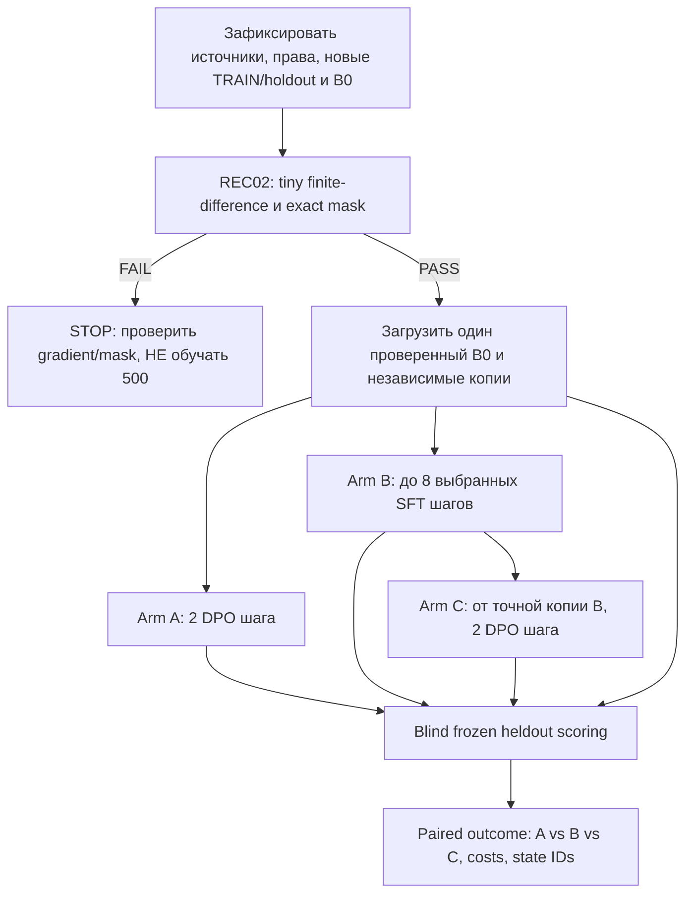

# MINI-01 — влияет ли отсутствие предварительного обучения B0 на качество DPO?

**16.10.2026 · статус: ГОТОВЫЙ ПЛАН ЭКСПЕРИМЕНТА / NOT_RUN.** Это короткий причинный опыт внутри существующих `REC02 и `REC03 RP01, **не новая очередь, не новый trainer и не разрешение автоматически учить production Student**. Он проверяет одну гипотезу: *случайная B0 с LoRA q/v умеет менять веса/предпочтения, но без предварительного освоения языка не даёт качественного свободного ответа*. Исторические C#500 (0/3→0/3) и EN→RU500 (0/4→0/4) сохраняются неизменными, повторять их не требуется.

**Что можно доказать:** наблюдаемое влияние короткого supervised warm-up на конкретные новые задачи после идентичного DPO-stage; отдельно — добавочный эффект DPO поверх warmed состояния. **Чего нельзя доказать одной малой панелью:** что все ошибки RP01 объясняются именно cold start, что настоящий pretraining заменяется восемью уроками, что модель обобщает на семь доменов, или что работающий Student автоматически подключён к обычному продукту.

## 1. Четыре измеряемых состояния, одно вмешательство

| State | Источник состояния | Обучающие действия | Reference для DPO | Назначение |
|---|---|---|---|---|
| **B0, контроль без обучения** | Тот же точный saved B0 SHA | **0** | N/A | Исходный уровень генерации |
| **A: DPO-only** | Свежая идентичная копия B0 | Не более **2 DPO optimizer updates** на 12 новых pairs, batch 6 | Независимая замороженная B0 | Текущий подход RP01 |
| **B: SFT-only** | Свежая идентичная копия B0 | До **8 supervised next-token updates** по 8 проверенным chosen (2 из каждой train-family); **0 DPO** | N/A | Появилась ли базовая компетенция от короткого supervised сигнала? |
| **C: SFT→DPO** | **Точная копия сохранённого B** (не второй независимо обученный SFT) | Те же **2 DPO updates**, те же 12 pairs и порядок, что в A | Отдельная замороженная копия состояния **B** | Усиливает ли DPO уже выученную способность? |

Параметры всех состояний: **один и тот же tokenizer629**, prompt framing, B0 model config (hidden512, layers4), LoRA rank8/alpha16/dropout0, q_proj/v_proj, decoding `temperature=0, `topK=0, `topP=1, одинаковый maxNewTokens и произвольный не меняющий данных seed, закреплённый до запуска. Внутри A и C нельзя менять beta, LR, optimizer algorithm, clipping, порядок DPO batches, corpus или иную гиперпараметризацию. SFT использует **действующий** `TrainingLoop.Trainer.TrainSupervisedNextTokenStep`, а не новый нейронный trainer. **Важная граница:** этот API учит все next-token targets последовательности (включая prompt), а не response-only; это надо явно указать и отдельно измерять response-region utility. Для DPO использовать existing **exact-v2 response-only** путь, а не legacy `Compact`/mean full-sequence.

Исследование сравнивает A против C при равном числе **DPO** шагов, но C потратил дополнительные SFT шаги: это честная проверка влияния подготовки, **не сравнение равного общего compute**. Если C > A, перед сильным причинным выводом потребуется дополнительный budget-matched control (не включать его автоматически в первый маленький запуск).

## 2. Данные — минимальный новый набор, без утечки в тест

- **TRAIN: 12 новых пар** = 4 конкретных семейства закона C# × 3 варианта; все prompt/chosen/rejected byte-exact и разные. Пример семейства: postfix increment в коротком C# выражении. Пример иллюстрации (НЕ автоматически admitted pair): `int x=2; Console.Write(x++);` → chosen «печатает 2», rejected «печатает 3». Не принимать описание как truth без отдельного C# oracle/ручной проверки.
- **SFT warm-up:** 8 из этих 12 *chosen-only*, ровно 2 из каждого семейства, максимум одно обновление на каждое выбранное train-наблюдение. B и C используют **один** materialized SFT checkpoint; A использует весь одинаковый DPO набор.
- **ОТЛОЖЕННАЯ ОЦЕНКА:** 8 новых near-transfer prompts (2 на каждое train-семейство, но другие исходники/контекст/значения) **плюс** 4 новых prompts из **2 вообще не использованных в TRAIN семейств**. Нельзя называть near-transfer «новыми законами»; результаты показывать раздельно.
- Все оценки и предметные ответы фиксируются **до мутации**, hash и family IDs сохраняются. Нет копирования прежних раскрытых C# 0/3 и ENRU 0/4 panels, закрытых экзаменов или test gold в teacher/DPO. Слова/длины/AST/версия C# и ответный budget закрепляются; пары с двусмысленным смыслом получают TIE/UNJUDGEABLE и не проходят admission. Проверить ответ oracle для разрешённых безопасных C# snippets без произвольного запуска непроверенного teacher-кода.

**Роли неизменны:** (1) человеческую функцию выбора случая и учебного закона выполняет **CODEX, Astra 6 UltraCode**; (2) финальные **chosen и rejected** создаёт **разрешённая внешняя открытая китайская модель**, actual provider/model/license/receipt должны быть подтверждены; (3) качество точной пары отдельно оценивает **CODEX, Astra 6 UltraCode** с `VALID/TIE/BOTH_BAD/UNJUDGEABLE` и hash binding; (4) отдельно, вслепую относительно названий arms, оценивают **качество ответов Student** на новых prompts. Эти назначения не выполнены при написании документа. Если новые Chinese-authored пары и их verdict недоступны, можно выполнить только read-only арифметические/mechanism probes; синтетический surrogate допускается **только** как явно обозначенный `SIMULATION_ONLY` с отдельным научным разрешением, не как доказательство правильного внешнего DPO-контура.

## 3. Последовательность выполнения (короткая)



**0. Предварительная проверка, без обучения:** зафиксировать core SHA, planning SHA, exact сохранённый B0 + tokenizer SHA, происхождение 12 pairs, family-disjoint holdout, budget/settings; проверить response masks, sign/frozen-reference на одной **отдельной невносимой** synthetic gradient probe (finite-difference vs analytic). Если расходятся — `STOP_GRADIENT_MISMATCH`; новый DPO запуск не нужен.

**1. Снять контроль B0:** оценить все 12 heldout inputs в режиме `GenerateDetailed` с одними settings, сохранить raw outputs и ответный likelihood на TRAIN **до обучения**. Декодирование `verifiedEosToken=null` оставить тем же, что у actual RP01; нельзя менять EOS и SFT одновременно.

**2. Построить A и B из B0:** A делает ровно 2 разрешённых DPO updates на 12 pairs (batch 6). B — до 8 SFT updates на 8 выбранных chosen; после 4-го SFT шага посчитать TRAIN next-token CE и response-only readout. При отсутствии устойчивого снижения TRAIN CE **не увеличивать бюджет самовольно**: вернуть `WARMUP_LEARNABILITY_NOT_SHOWN` и остановить до C. Не называть это опровержением холодного старта; сначала проверить Grad/LR/LoRA activation.

**3. Получить C только из B:** проверить hash B readback и отделить frozen reference B от trainable C; DPO у C = **такие же** пары, microbatch order, 2 updates и настройки, что у A. Записывать отдельно параметры policy/reference до и после, параметры base, LoRA и AdamW. C не публикуется в product.

**4. Blind heldout:** 12 фиксированных заданий прогнать на `B0, A, B, C`: одинаковые 12 raw inputs, tokenizer, context и greedy settings. Независимый предметный эксперт видит ответы без имени arm. Для каждого установить `correct/partial/critical/invalid/abstain` и конкретный закон. Отдельно обязательны ответ на TRAIN (train overfit), new near-family, unseen-family, их не усреднять в одну «точность» без таблицы.

**5. Действие при signal:** при C>A и C>B на новых near-family считать `PRELIMINARY_WARMUP_EFFECT` **только для измеренной панели** и при необходимости провести вторую заранее подготовленную family-disjoint mini-панель/отдельный seed + budget-matched comparison. Если прирост только на TRAIN, не заявлять полезное обучение. Если B>A, но C≈B, то SFT помог, **добавочная полезность DPO не установлена**.

## 4. Реализация в существующем core, без ложных команд

Текущий `tools/Rp01SimulationDpo/Program.cs`/`CodeDocumentationSimulationDpoExperiment.ValidOptions` не разрешает произвольную 12-парную кампанию: `calibrate` = 1 pair/1 update, `main` = 500 записей. Поэтому команда `train 12` **сейчас НЕ существует**.

**Минимальное изменение для executor:** один ограниченный исследовательский selector `diagnose-small` (имя предлагается, **не реализовано**) в `tools/Rp01SimulationDpo/Program.cs` с маленьким experiment driver/admission внутри `14.ContinuousLearning/Training` и без изменения `main`/`calibration`. Для SFT использовать `04.TrainingLoop/Trainer.cs:TrainSupervisedNextTokenStep` (с настоящим q/v LoRA recipient); для A/C существующие `DpoTrainer.StepVector`, `DpoExactPairMaterial.Version`, masked logP, permit, transaction/publish/reload; для оценки existing `CodeDocumentationStudentGeneration`/`TextGenerator.GenerateDetailed`. Предложенный CLI только после реализации, **НЕ запускать как существующую команду**:

```powershell
# ПРОЕКТИРУЕМЫЙ ИНТЕРФЕЙС, NOT IMPLEMENTED:
dotnet run --project tools/Rp01SimulationDpo -c Release -- diagnose-small --spec <private-frozen-mini01-spec.json> --run-id <new-unique-id>
```

Не делать общий `ValidOptions`, разрешающий любые незакреплённые корпуса, не добавлять новый независимый DPO trainer, не отключать source/legal/admission, source-root custody, exact pair-id one-time use, parent/frozen reference, save/reload и rollback. **Одна и та же исходная пара должна участвовать в A/C как явно разрешённая matched scientific ablation**, с неизменным `source_pair_id` и отдельным `arm_id` в изолированной неканонической experiment custody; **нельзя обходить applied-once переименованием pair_id**, нельзя повторно применять исторические уже consumed пары. Если current grant такой ablation не допускает — `BLOCKED_ADMISSION`, никакого обходного trainer/публикации.

Файлы исполнителя: existing `tools/Rp01SimulationDpo/Program.cs` и при необходимости один private scoped research driver в `14.ContinuousLearning/Training`. Не менять `DpoTrainer.cs`, `LoraLinear.cs`, production checkpoint resolver, старые datasets и ранее опубликованные результаты без отдельно доказанного баг-фикса. Engineering gate: успешный `dotnet build` затронутого CLI и 1–3 focused checks (12 pairs max, illegal replay rejection, frozen reference/restore); никаких длинных Windows GitHub runs, никакой квоты на coverage. Отчёт об обучении — только после настоящего local run.

## 5. Что считать качеством и что действительно опровергает гипотезу

| Измерение | Зачем | Решение |
|---|---|---|
| TRAIN chosen/rejected masked likelihood, loss, preference margin, SFT CE | Дошёл ли учебный сигнал до параметров? | Положительное изменение само по себе **не** semantic improvement |
| **Near-family heldout**: пары `A vs C` и `B vs C` на тех же 8 задачах | Primary observable полезности подготовки + DPO | Считать на уровне **семейств**, показывать wins/losses/ties, критические ошибки |
| **Unseen-family heldout**: отдельно 4 задачи из 2 других законов | Проверить хотя бы намёк на перенос | Нулевая точность не скрывается общим TRAIN успехом |
| Baseline B0 и SFT-only B | Выделить вклад warm-up и добавочную пользу DPO | C>A, C≈B = SFT gain, **не доказанная DPO gain** |
| Reopened checkpoint identity, selected actual logits/greedy, reference immutability | Исключить ошибку доставки/restore | Если другой consumer/state — `INVALID_COMPARISON` |
| Время каждой фазы, RAM peak процесса, число действительно applied optimizer steps, token count | Качество на единицу вычислительных затрат | Никакого PC-ready по размеру LoRA или microbenchmark |

**Предварительно зафиксированное правило:** первичный положительный сигнал — больше исправленных, чем ухудшенных **heldout** ответов у C против A **и** положительный вклад C против B на как минимум двух представленных near-family при отсутствии новых критических нарушений на всей зафиксированной панели. Это `PRELIMINARY_EFFECT_ON_THIS_PANEL`, не статистическая гарантия и не критерий production promotion. Один положительный кейс/метрика margin не достаточны. Для сильного `REPLICATED_BOUNDED_EFFECT` нужна **следующая** независимо зафиксированная mini-панель либо репликация со вторым precommitted seed и budget-matched контроль, без редактирования исходного score.

**Отрицательные исходы значимы:** 
- gradient/sign/mask fails → `OBJECTIVE_BUG_SUSPECTED`, STOP;
- SFT не снижает TRAIN CE → `NO_SFT_TRAIN_SIGNAL`, искать проходимость LoRA/optimizer;
- A и C повышают chosen margin, но не улучшают raw ответы → `PREFERENCE_NOT_FREE_SKILL`, проверить cold start, framing, decoder, capacity;
- B и C полезнее A, но C≈B → `SFT_ONLY_EFFECT`, DPO не показал добавочного эффекта;
- C и A одинаковы при работоспособном SFT и сопоставимых budgets → `COLD_START_HYPOTHESIS_NOT_SUPPORTED_ON_PANEL`, не объявлять окончательно опровергнутой;
- C хорош на TRAIN, плох на heldout → `MEMORIZATION_ONLY`;
- разные tokenizer/reference/model IDs, утечка holdout, неразрешённое повторное применение пары → `INVALID_EVIDENCE`, не считать эксперимент выполненной проверкой.

## 6. Файл результата, который должен вернуть CODEX

Создать после реального исполнения только один `MINI01-RESULT.md` (+ машинный `MINI01-RESULT.json` при наличии), привязанный к SHA и хешам. Пример формата **пустой, а не фактический результат**:

```text
experiment_id: RP01-MINI-01
status: NOT_RUN
code_sha: PENDING
source_b0_sha: PENDING
tokenizer_sha: PENDING
train_12_hash: PENDING
holdout_12_hash: PENDING_PRIVATE
teacher_provider_model_license_receipt: PENDING
selection_actor: CODEX / Astra 6 UltraCode — REQUIRED, ACTUAL UNKNOWN
pair_quality_actor: CODEX / Astra 6 UltraCode — REQUIRED, ACTUAL UNKNOWN
dpo_chosen_rejected_author: external allowed open Chinese model — REQUIRED, ACTUAL UNKNOWN
actual_gradient_checks: NOT_RUN
SFT_updates_B: NOT_RUN
DPO_updates_A_C: NOT_RUN
masked_preference_delta_A_C: NOT_MEASURED
semantic_near_family_B0_A_B_C: NOT_MEASURED
semantic_unseen_family_B0_A_B_C: NOT_MEASURED
critical_regressions: NOT_MEASURED
runtime_seconds_and_peak_process_ram: NOT_MEASURED
source_and_checkpoint_readback: NOT_RUN
independent_student_exam: NOT_RUN
verdict: NO_CAUSAL_RESULT_YET
```

Для каждого ID: `prompt_hash, train_family_id, law, baseline_answer_hash, A_answer_hash, B_answer_hash, C_answer_hash, blind_grade, raw_output_ref, candidate_checkpoint_sha, actual_consumer, free_answer_valid, loss, length, latency`. Не хранить hidden exam gold в TRAIN/public docs.

## 7. Точные первоисточники и уже существующие задания

- [RP01 recovery: проверенный отрицательный итог, cold start и LoRA](../Kiro-Xiigen-RP01-Learning-First-Slice-Pack/RP01-2026-10-16-LEARNING-RECOVERY-AND-CODE-AUDIT.md#L7-L42) — исторические результаты, не новое исполнение.
- [REC02: численная проверка градиента и 8–32 pairs](../Kiro-Xiigen-RP01-Learning-First-Slice-Pack/tasks/recovery/RP01.REC02-DPO-GRADIENT.md), [REC03: cold start и SFT](../Kiro-Xiigen-RP01-Learning-First-Slice-Pack/tasks/recovery/RP01.REC03-CAPABILITY.md). **Именно они являются активными владельцами**, MINI-01 — вложенная форма экспериментального задания.
- [Конфигурация B0/LoRA](https://github.com/lubochka/llm_mvp_core/blob/83590a462b2f8aedc9d3ab4cb775193eb9c25ce5/config/code-documentation/generation-v1.json#L1-L50).
- [Нынешний RP01 frozen runner](https://github.com/lubochka/llm_mvp_core/blob/83590a462b2f8aedc9d3ab4cb775193eb9c25ce5/tools/Rp01SimulationDpo/README.md#L95-L143) и [CLI entry](https://github.com/lubochka/llm_mvp_core/blob/83590a462b2f8aedc9d3ab4cb775193eb9c25ce5/tools/Rp01SimulationDpo/Program.cs).
- [Supervised next-token train step: все токены, обновление trainable parameters](https://github.com/lubochka/llm_mvp_core/blob/83590a462b2f8aedc9d3ab4cb775193eb9c25ce5/04.TrainingLoop/Trainer.cs#L62-L147); [DPO exact response-only masks/gradient/optimizer](https://github.com/lubochka/llm_mvp_core/blob/83590a462b2f8aedc9d3ab4cb775193eb9c25ce5/11.DPO/DpoTrainer.cs#L832-L930).
- [Teacher/CODEX действующее разделение обязанностей](../../09.09.26WorkLeft-02-teaching-chinese-model.md#L6-L18). Skills для исполнителя: `docs/skills/trainable-architecture-decision-SKILL.md`, `phase-planning-SKILL.md`, `plan-review-SKILL.md`, `generated-code-review-SKILL.md`, `experiment-design-SKILL.md`, `prompt-patch-authoring-SKILL.md`, `human-readable-architecture-audit-SKILL.md`, `data-flow-integrity-SKILL.md`, `root-cause-tracing-SKILL.md` из `llm_mvp_core@codex/dpo-implementation`. Проверка objective раньше оптимизации, искажение одного фактора за опыт, actual code→consumer и readback прежде PASS.

**Текущее состояние:** документ опубликован как экспериментальная спецификация, но сам эксперимент **не реализован и не выполнялся**; CODEX/Astra/external Chinese model не вызывались в этой редакции. При unsupported admission результат `BLOCKED`, не обход gate и не заявление о качестве обучения.
