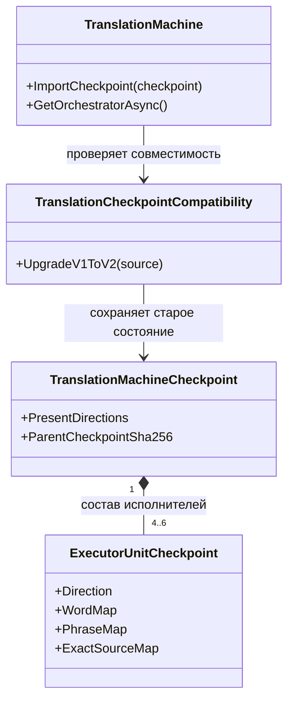

# Восстановление TranslationMachine и новые стыки происхождения Unit-урока

18 октября 2026. Исследование исходников и сохранённых результатов. **Новые конкретные случаи:** U-R2 и U-N3. **U-R1 — независимое подтверждение:** до публикации появился параллельный [N41-T1](https://github.com/lubochka/xiigen-planning/blob/a4a3e709f8fb5310baab6daa16501b5d4394bd72/llm%20mvp/design%20to%20code%20session/replanning/possibleDifs/41-FOUR-VS-SIX-TRANSLATION-CHECKPOINT-MIGRATION-2026-10-18.md); это совпадение учтено, механизм не считается новым повторно. Соседние известные проблемы отмечены отдельно. Эксперименты описаны для будущей реализации и имеют статус **NOT_RUN**.

[Порядок работ и весь пакет](README.md) · [Нейронный путь и LoRA](02-neural-and-lora.md) · [История KNN и предметные эксперименты](03-historical-knn-and-domain-experiments.md)

Все названные ниже новые классы, поля и миграции — **предложенный дизайн**, отсутствующий в проверенной версии продукта.
## Что поставить в начало общего списка

**U-R1: восстановление прежней TranslationMachine после расширения четырёх направлений до шести.** В PrepareToGPL машина создавала четыре исполнителя. Нынешний runtime создаёт шесть, но сохранённый checkpoint по-прежнему содержит четыре. Проверка требует полного набора нынешнего runtime. Для этого конкретного прежнего файла исходник предсказывает отказ EXECUTOR_DIRECTIONS_INCOMPLETE до загрузки learned maps. Это проверяемая утрата совместимости с прежней конфигурацией, для проверки которой не нужно повторять обучение.

**U-R2: новая обязательная evidence в manifest без миграции старого asset.** Нынешний контракт требует поле доказательства происхождения корпуса; старый сохранённый manifest его не содержит, а номер схемы остался прежним. Это другой отказ — в typed API повторной публикации. CLI продолжения этот gate не использует и непосредственно попадает в U-R1.

**U-N3: исходная DPO-пара и три производных Unit-урока сравниваются как один тип ID.** Builder сохраняет P:semantic, P:executor, P:verifier, а continuation сравнивает их с исходным P. Составной путь может повторно допустить прежнюю пару и назвать её новой. Механизм унаследован уже от PrepareToGPL; это не новая регрессия RP01.

Первые два пункта входят в приоритетную главу восстановления PrepareToGPL. Третий — дополнительная проверка продолжения обучения. Это три механизма/контракта, а не три доказанные причины падения качества и не три домена.

| Поле | Проверенный смысл |
|---|---|
| Тема обучения | Перевод |
| Профили | RU→EN, EN→RU, HE→EN, EN→HE; новые ES→EN и EN→ES |
| Получатель | TranslationMachine, общий KnnStore, SemanticTokenizerUnit, ExecutorUnit, QualityVerifierUnit |
| Архитектурный уровень | ILearningMachine, её Units и соединяющий их Flow |
| Сохраняемое знание | Карты слов/фраз, точные ответы, сигнатурная память, правила проверки |
| Слои нейронной модели / LoRA | Изменяемых слоёв в этих трёх механизмах — 0; RP01 Student является другим потребителем |
| Будущая подготовка DPO | Внешняя открытая китайская модель создаёт обе стороны chosen/rejected; CODEX (запрошенный `astra 6 ultracode`) выбирает задания и независимо оценивает качество. В этом исследовании новые DPO не генерировались |

Сравнение фиксировано: PrepareToGPL **31346d8928be4469b01aaf313780e8f950ff91e2**, current codex/dpo-implementation **a392b6be8f8dec1e2375e2eb4fe21c2f6e8950c6**. Ссылки ниже ведут на эти SHA.

## 1. Что сохранилось в коде и в результатах прежнего обучения

У TranslationTrainedUnits.cs в обеих версиях одинаковый Git blob **1742abfc9fb617dfc66e4d618e0c169da01a6ccc**; у TranslationSemanticTokenizer.cs — одинаковый blob **ee6d81c7933fa33a9c57a2111990019ec55e5dab**. Это прямое контрдоказательство формулировке «при переходе переписали внутренний алгоритм этих Units/этого tokenizer». [Старые Units][gpl-units], [нынешние Units][core-units]; [старый tokenizer][gpl-tokenizer], [нынешний tokenizer][core-tokenizer].

TranslationStructuredBatchBuilder.cs отличается только добавлением вариантов source language для ES_EN/EN_ES. Разложение пары в три учебные записи сохранилось. [До][gpl-builder], [после][core-builder].

Состояние старой машины, однако, может не попасть в сохранившиеся Units из-за несовместимости loader. Отдельно нынешний DPO runner обучает нейронную policy через StepMany: его call paths называют LlmModel.LoadCheckpoint и DpoTrainer, а не восстановление структурированного KnnStore. [Нынешние DPO call paths][core-stepmany]. Это различие адресатов. Из него нельзя заключать, что прежнего нейронного обучения не было или что следует откатить всю нынешнюю математику.

### Сохранённый положительный эпизод продолжения памяти

В PrepareToGPL есть phase38 continue-report, состояния до/после и сохранённый stdout. [Отчёт][gpl-continue-report], [исходный checkpoint][gpl-checkpoint], [продолженный checkpoint][gpl-continued], [stdout][gpl-stdout].

Сохранённая версия меняется 0.1.1→0.1.2, identities — 1→2, KNN entries — 3→6. Прежний урок «add null check ValidateToken» сохраняется, добавляется «launch worker thread». Это две пары с тремя индексными представлениями каждой, а не шесть независимых уроков.

| Source из сохранённого report | Маршрут | Ответ |
|---|---|---|
| add null check ValidateToken | executor-ru_en-exact-source | Add a null check to ValidateToken. |
| add a null check before ValidateToken | executor-ru_en-knn | Add a null check to ValidateToken. |

Этот след подтверждает сохранённое продолжение памяти и использование старой памяти на неидентичной строке. Граница качества узкая: обе probes относятся к старому уроку; source/target английские несмотря на RU_EN; отсутствует парный прирост качества нового урока. Поле non_exact_probe_proves_generalization не доказывает независимость смыслового семейства. Score1/3 исходного [модельного отчёта][gpl-report] также нельзя считать универсальной точностью перевода.

Artifact используется как конкретный specimen совместимости, не как замена всех прежних успешных обучений пользователя. Ранее сам эпизод разобран в core78; новая находка здесь — его связь с нынешним отказом загрузки. Исполнявшийся исторический binary отдельным hash в прочитанном report не аттестован.

## 2. U-R1 — расширение runtime 4→6 сделало прежний checkpoint неполным

### Где именно возникает конфликт

PrepareToGPL CreateRuntime создаёт RU_EN, EN_RU, HE_EN, EN_HE. Current добавил ES_EN и EN_ES в adapters, trainers и Executors. [До][gpl-runtime], [после][core-runtime].

Требование полноты было и прежде; расширение runtime изменило множество обязательных направлений. Прежний код выполнял часть мутаций до проверки, нынешний проверяет всю структуру заранее. Этот новый preflight полезен и должен сохраниться. [Старая проверка][gpl-guard], [новый preflight][core-preflight].

Критический код:

> _runtime.Executors.Keys.Except(checkpoint.Executors.Select(executor => executor.Direction))

Если остаток непустой, возвращается EXECUTOR_DIRECTIONS_INCOMPLETE. [Точная проверка][core-guard].

Сохранённый models/translation/translation-v1/translation-v1-checkpoint.json на обеих ветках имеет один blob **a4cf054ba3f8a6ee6aa9818edc6c5705e3456c25**, schema_version1 и только четыре executor-записи. Продолженный phase38 checkpoint также не изменился: blob **11a19a5f49d27ef75043a252f255a2bb5c44a389**, четыре направления. [Нынешний исходный asset][core-checkpoint], [нынешний продолженный asset][core-continued].

Loader не мигрирует топологию: десериализует JSON, создаёт new TranslationMachine(), вызывает ImportCheckpoint и возвращает его ошибку. [LoadCheckpointAsync][core-load]. CLI continue-translation-training вызывает loader до отбора и обучения новых строк. [Потребитель][core-cli-load].

**Следствие по исходнику:** missing={ES_EN,EN_ES}; старые learned maps не загружаются. Это статический конфликт данных и предусловия метода, не выполненный runtime-result. Не доказано, что конкретный провал RP01 использовал этот checkpoint. Современный checkpoint с шестью направлениями не подпадает под данное условие.

### Конкретный способ восстановления

Предлагаемый lifecycle helper — TranslationCheckpointCompatibility.UpgradeV1ToV2(TranslationMachineCheckpoint source), владелец TranslationMachine : ILearningMachine<TranslationDomain>. Одновременно обновить распознавание схемы в ImportCheckpoint: нынешний gate принимает только SchemaVersion=1, поэтому одной записи v2 недостаточно. В TranslationCheckpointContracts.cs новая версия явно хранит RuntimeTopologyVersion, PresentDirections, DirectionTrainingStatus, ParentCheckpointSha256, MigrationId. Learned state остаётся в существующих typed records TranslationKnnStoreCheckpoint, SemanticTokenizerUnitCheckpoint, ExecutorUnitCheckpoint, QualityVerifierUnitCheckpoint.

Для точно известной полной legacy-топологии4 переносить все прежние записи без изменения; добавить только пустые ExecutorUnitCheckpoint ES_EN/EN_ES, явно untrained. Общую память, порядок внутри bucket, старые word/surface/phrase/exact maps, verifier rules, identities и Tatoeba cursor сохранить. Исходную training history оставить в архивном parent-v1. Нынешний ImportCheckpoint уже переводит недоказанный исторический reward_margin=0.03 в 0.0; оба проверенных старых history содержат 0.03. Это изменение отчётной метрики явно записать в migration report, сохранив исходную запись; его не следует откатывать или считать потерей learned maps. [Текущая нормализация][core-history-normalization]. Потеря одного из старых четырёх направлений, дубликаты, неизвестный enum и nonfinite state остаются ошибками. Мигрированный v2 сохраняется отдельно с parent hash; v1 остаётся источником rollback.

Это детерминированная миграция состояния, не новая обучаемая Unit и не изменение выбора перевода. KNN остаётся прежним memory-компонентом. Альтернативы «выключить completeness» и «обучить всё заново» не подходят: первая допускает повреждённые файлы, вторая не проверяет сохранение уже приобретённого знания.

Симуляция: полный old4 → распознана legacy topology → добавлены только пустые ES Units → preflight6 → импорт прежних maps → обычный Flow. Неполный old3 → отказ до изменения машины. Так эволюция схемы отделена от повреждения.

### Малый будущий эксперимент RESTORE-GPL-TRANSLATION-01 — NOT_RUN

Тема — перевод. A: PrepareToGPL loader и зафиксированный continued phase38 checkpoint `artifacts/phase38/translation-v1-continued-probe/translation-v1-continued-checkpoint.json` (schema_version=1, model version0.1.2, два урока). Исходный translation-v1 asset с одним уроком остаётся дополнительным compatibility specimen. B: нынешний loader с теми же bytes. C: нынешний loader с одной предложенной миграцией. Обучение не вызывается.

Сначала сравнить код возврата и канонический hash learned-полей. Общий file hash изменится из-за новых метаданных и не заменяет проверку сохранности знания. Затем на двух исторических probes и четырёх заранее подготовленных запросах к двум исходным урокам сравнить route, текст и смысл A/C. Новый урок safe-002 требует своих expected: архивная probe его не оценивает. Один контраст меняет действие или объект и запрещает безусловную выдачу прежнего ответа. Два запроса ES_EN/EN_ES выполнить только на варианте C: статус новых executor maps должен оставаться untrained, но общая KNN-память может дать ответ. Записать действительный источник ответа; пустые новые maps сами по себе не гарантируют отказа или изоляции направлений.

Бюджет: три основных load attempts, до восьми ответов на успешно загруженный вариант, три malformed checkpoint-контроля без inference. Критерий восстановления — A/C сохраняют прежние learned-поля и поведение. Если после равного состояния A/C отвечают по-разному, исследовать runtime policy. Предметный score новых вопросов измеряется отдельно; learning lift этим опытом не заявляется. Backup/export/import/continue проверяют отдельно сохранение lineage, не перезаписывая old specimen.

## 3. U-R2 — новое обязательное поле manifest без версии миграции старого asset

### Что было и что стало

В старом TranslationModelManifest не было TrainingDataEvidence, а старый IsValidSharedAssetManifest не требовал его. [До][gpl-manifest-contract]. Current добавил поле в record, требует evidence predicate, но SchemaVersion остаётся1. [Новый record][core-manifest-record], [новое предусловие][core-manifest-check].

Критическая строка:

> IsValidTrainingDataEvidence(manifest.TrainingDataEvidence)

Helper начинается с evidence is not null. [Helper][core-evidence-check].

Сохранённый manifest поныне имеет blob **9c79956c7c8bddbbc7afba37112c94f11648797b**. В нём есть training_data_ref, но отсутствует training_data_evidence. [Весь короткий manifest][core-manifest].

LoadAndValidateManifestForPublishAsync сначала проверяет переданный корпус, затем десериализует manifest и вызывает новый predicate. При прошедшем corpus admission и стандартной десериализации этого файла предсказывается TRANSLATION_MODEL_MANIFEST_INVALID. При невалидном корпусе возможен более ранний отказ — его нельзя выдавать за evidence-gate. [Потребитель][core-publish].

**Граница:** CLI continuation читает manifest как Dictionary и использует checkpoint_filename; typed evidence-gate там не вызывается. Поэтому U-R1 и U-R2 независимы: исправление manifest не добавляет executor-направления, миграция executor-state не добавляет provenance evidence. Прямая связь с низким качеством neural RP01 не установлена.

### Конкретный способ восстановления

Предлагается TranslationModelManifestMigration.BuildV2(legacyManifest, checkpointEvidence, originalTrainingEvidence). Отдельная schema v2 и распознавание legacy-v1. Evidence реконструируется только по исходному корпусу и identities данного checkpoint; хранит repository/ref/path/hash первоначального корпуса, реально применённые pair ids, parent checkpoint hash и migration id. Нынешний расширенный корпус не объявляется задним числом источником старого состояния.

При отсутствии исходного корпуса/доказательства происхождения — LegacyEvidenceIncomplete; исследовательское восстановление файла допустимо как отдельная операция, а common publication по новому контракту остаётся закрытой. Удалять новый provenance guard не требуется. Историческое авторство сохранённых строк не переименовывается; для новых DPO внешняя открытая китайская модель создаёт chosen и rejected; CODEX выполняет выбор заданий и независимую оценку качества.

Будущие файлы: TranslationModelManifestContract.cs, отдельный TranslationModelManifestMigration.cs, вызов из TranslationModelAssetStore.cs. Мигратор не вызывает Train/StepMany, не меняет maps/weights. Export/import/share несут manifest вместе с exact checkpoint и оригинальными refs; backup сохраняет v1; продолжение создаёт дочерний manifest.

### Малый будущий эксперимент RESTORE-GPL-MANIFEST-02 — NOT_RUN

A: прежний manifest через прежний predicate. B: те же поля через нынешний predicate. C: v2 migration с независимо подтверждённым исходным corpus hash. C_bad меняет только corpus hash/identity и должен быть отклонён. Затем отдельно проверить настоящий LoadAndValidateManifestForPublishAsync с совпадающим и несовпадающим frozen bundle, не обновляя общий index.

Бюджет: четыре predicate-проверки и два read/validation-вызова; training/inference0. Положительный исход — восстановленный lifecycle без ослабления admission, не улучшение семантики. Только обнаруженный caller, которому этот барьер реально мешает, связывает несовместимость с утратой доступности старого знания.

## 4. U-N3 — raw PairId и производные Unit ExampleId смешаны в no-replay

### Точная цепочка

BuildGeneralBatch разворачивает исходный P в P:semantic, P:executor, P:verifier. TrainStructuredBatchAsync сохраняет именно example.ExampleId и UnitId в checkpoint identities. [Fan-out][core-builder], [сохранение identities][core-identity].

Continuation сначала берёт:

> beforeIdentities.Select(identity => identity.ExampleId)

а отбор «новых» строк и noReplayProven основывает на:

> !oldPairIdSet.Contains(row.PairId)

[Точный участок][core-continue-filter]. Новая continuation-запись получает уже ExampleId: row.PairId, без Unit-суффикса. [Построение continuation lesson][core-continue-row].

**Прогноз для составного caller:** checkpoint после general builder имеет {P:semantic,P:executor,P:verifier}; corpus содержит уже обученную исходную пару P. P отсутствует в множестве производных IDs, поэтому строка повторно допускается и может быть объявлена новой. Executor.TrainOnExample снова добавит chosen в память. [Запись памяти][core-knn-write].

Это не новая регрессия: тот же raw/derived mismatch есть в PrepareToGPL. [Старый фильтр][gpl-continue-filter], [старый builder][gpl-builder]. Сохранённый phase38 specimen использовал raw IDs с самого начала и потому не доказывает этот дефект в своём историческом запуске. Для реализации условия нужен checkpoint general builder; частота такой композиции в production пока не установлена.

Новизна — конкретный upstream обход no-replay из-за различного типа IDs. Ранее уже разобраны повторная mutation при одном ExampleId и alias нескольких signatures в bucket. Их не следует считать новыми независимыми причинами повторно. Здесь надо связать новую причину с прежними 16-INDEPENDENT-TRANSLATION-UNIT-AND-KNN-LEARNING-GAPS и core60.

### Конкретная lineage от source до checkpoint

Добавить typed TranslationLessonIdentity(SourcePairId, UnitExampleId, UnitId, SourceContentSha256, TransformationVersion) в TranslationLearningExample и checkpoint identity. Builder передаёт P в SourcePairId неизменным, а UnitExampleId сохраняет свои роли. Continuation сравнивает SourcePairId+SourceContentSha256; Unit ledger отдельно учитывает UnitId+UnitExampleId.

Это учёт происхождения внутри TranslationMachine, не признак для выбора перевода. Безусловно отрезать :executor у старого ID нельзя: авторский ID сам может иметь такой суффикс. Мигратор проверяет transformation family и corpus row. Неоднозначный legacy ID даёт unresolved lineage, не no-replay=true.

Совпали ID+содержание → AlreadyApplied; ID совпал, но changed chosen/rejected → RevisionConflict и отдельное решение CODEX; новый ID при прежнем содержании связывается с существующим source identity. SourceId не заменяет этот контракт: builder может записать туда общий pair.Source для нескольких исходных пар. [SourceId перед fan-out][core-builder].

Новая допущенная пара по-прежнему обучает прежние Units; shape learned maps не меняется. Lineage сохраняется при export/import/backup и в child checkpoint. Схема отличает число исходных пар, число производных уроков и число индексных представлений.

### Малый будущий эксперимент CONTINUE-SOURCE-ID-03 — NOT_RUN

Тема — перевод. Один новый checkpoint с шестью направлениями получают из пары P через general builder, чтобы U-R1 не блокировал именно этот опыт. Continuation-корпус: прежний P и новый Q. A — нынешнее сравнение IDs; B — только typed source identity. Предсказание: A выбирает P,Q; B выбирает Q. Counts записываются отдельно для source pairs, Unit lessons, KNN representations.

Контроли: raw-ID legacy checkpoint; полностью новый Q; P с changed chosen; авторский ID с буквальным :executor. Для причинного качества отдельный retrieval-контраст добавляет конкурирующую правильную память и четыре новых source-варианта, сохраняя все обычные exact/phrase/word/KNN ветви. Записывать реальную ветвь. Если ответы A/B одинаково правильны, вывод ограничен исправлением ложного no-replay и расхода памяти; качество не улучшилось.

Бюджет основной проверки: один parent checkpoint, два continuation-варианта с двумя исходными rows; без LoRA и изменения ranking/similarity. Gold и содержательные контрасты фиксируются CODEX до ответов. Применение того же инварианта к документации возможно только после нахождения её реального fan-out consumer; это не ещё один домен, уже проверенный данным опытом.

## 5. Новизна и границы выводов

U-R2 — новое точное условие в известном семействе восстановления. U-R1 совпал с опубликованным за время исследования N41-T1; добавлены exact artifact proof и уточнённый протокол, новизна механизма не заявляется. Для U-N3 новым является **стык исходного PairId с производными ExampleId**, а не общая идея повторного обучения или дублирования KNN. Ближайшие предшественники и объём поиска указаны в [журнале доказательств](05-sources-novelty-review.md).

| Находка | Что подтверждено исходниками | Что остаётся проверить |
|---|---|---|
| U-R1 | Четыре направления в обоих сохранённых checkpoint против шести обязательных в нынешнем runtime | Реальный результат трёх загрузчиков и качество ответов после миграции; участие этого пути в наблюдаемом пользователем ухудшении |
| U-R2 | Отсутствующее поле старого manifest против нового обязательного predicate | Отказ конкретного publish caller и возможность восстановить исходное происхождение asset |
| U-N3 | Несопоставимые пространства IDs при композиции general builder и continuation | Частота такой композиции, фактическая повторная запись и её причинное влияние на ответы |

Сохранённый phase38 эпизод ранее исследован в [core78][prior-core78]. Сами Unit-алгоритмы и tokenizer одинаковы по blob SHA; это сужает область регрессии до состояния, маршрута, данных и контрактов. Нейронные параметры и остальные графовые Units этим документом не охвачены; их место в общем аудите — в [карте всех осей](04-learning-path-crosswalk.md).

[prior-core78]: https://github.com/lubochka/llm_mvp_core/blob/a392b6be8f8dec1e2375e2eb4fe21c2f6e8950c6/docs/plans/replanning-possible-diffs/78-translation-restored-memory-positive-receipt.md

[gpl-units]: https://github.com/lubochka/llm_mvp_core/blob/31346d8928be4469b01aaf313780e8f950ff91e2/27.TranslationDomain/TranslationTrainedUnits.cs
[core-units]: https://github.com/lubochka/llm_mvp_core/blob/a392b6be8f8dec1e2375e2eb4fe21c2f6e8950c6/27.TranslationDomain/TranslationTrainedUnits.cs
[gpl-tokenizer]: https://github.com/lubochka/llm_mvp_core/blob/31346d8928be4469b01aaf313780e8f950ff91e2/27.TranslationDomain/TranslationSemanticTokenizer.cs
[core-tokenizer]: https://github.com/lubochka/llm_mvp_core/blob/a392b6be8f8dec1e2375e2eb4fe21c2f6e8950c6/27.TranslationDomain/TranslationSemanticTokenizer.cs
[gpl-runtime]: https://github.com/lubochka/llm_mvp_core/blob/31346d8928be4469b01aaf313780e8f950ff91e2/27.TranslationDomain/TranslationMachine.cs#L555-L606
[core-runtime]: https://github.com/lubochka/llm_mvp_core/blob/a392b6be8f8dec1e2375e2eb4fe21c2f6e8950c6/27.TranslationDomain/TranslationMachine.cs#L714-L780
[gpl-guard]: https://github.com/lubochka/llm_mvp_core/blob/31346d8928be4469b01aaf313780e8f950ff91e2/27.TranslationDomain/TranslationMachine.cs#L327-L362
[core-preflight]: https://github.com/lubochka/llm_mvp_core/blob/a392b6be8f8dec1e2375e2eb4fe21c2f6e8950c6/27.TranslationDomain/TranslationMachine.cs#L304-L354
[core-guard]: https://github.com/lubochka/llm_mvp_core/blob/a392b6be8f8dec1e2375e2eb4fe21c2f6e8950c6/27.TranslationDomain/TranslationMachine.cs#L423-L430
[core-history-normalization]: https://github.com/lubochka/llm_mvp_core/blob/a392b6be8f8dec1e2375e2eb4fe21c2f6e8950c6/27.TranslationDomain/TranslationMachine.cs#L359-L373
[core-load]: https://github.com/lubochka/llm_mvp_core/blob/a392b6be8f8dec1e2375e2eb4fe21c2f6e8950c6/27.TranslationDomain/TranslationMachine.cs#L608-L650
[core-cli-load]: https://github.com/lubochka/llm_mvp_core/blob/a392b6be8f8dec1e2375e2eb4fe21c2f6e8950c6/27.TranslationDomain.Tools/Program.cs#L4073-L4098
[gpl-checkpoint]: https://github.com/lubochka/llm_mvp_core/blob/31346d8928be4469b01aaf313780e8f950ff91e2/models/translation/translation-v1/translation-v1-checkpoint.json
[core-checkpoint]: https://github.com/lubochka/llm_mvp_core/blob/a392b6be8f8dec1e2375e2eb4fe21c2f6e8950c6/models/translation/translation-v1/translation-v1-checkpoint.json
[gpl-continued]: https://github.com/lubochka/llm_mvp_core/blob/31346d8928be4469b01aaf313780e8f950ff91e2/artifacts/phase38/translation-v1-continued-probe/translation-v1-continued-checkpoint.json
[core-continued]: https://github.com/lubochka/llm_mvp_core/blob/a392b6be8f8dec1e2375e2eb4fe21c2f6e8950c6/artifacts/phase38/translation-v1-continued-probe/translation-v1-continued-checkpoint.json
[gpl-continue-report]: https://github.com/lubochka/llm_mvp_core/blob/31346d8928be4469b01aaf313780e8f950ff91e2/artifacts/phase38/translation-v1-continued-probe/continue-report.json#L1-L63
[gpl-stdout]: https://github.com/lubochka/llm_mvp_core/blob/31346d8928be4469b01aaf313780e8f950ff91e2/artifacts/phase38/p38-wo-04c-mini-03b/continue-translation-training.stdout.log
[gpl-report]: https://github.com/lubochka/llm_mvp_core/blob/31346d8928be4469b01aaf313780e8f950ff91e2/models/translation/translation-v1/runner-report.json
[gpl-manifest-contract]: https://github.com/lubochka/llm_mvp_core/blob/31346d8928be4469b01aaf313780e8f950ff91e2/27.TranslationDomain/TranslationModelManifestContract.cs#L8-L68
[core-manifest-record]: https://github.com/lubochka/llm_mvp_core/blob/a392b6be8f8dec1e2375e2eb4fe21c2f6e8950c6/27.TranslationDomain/TranslationModelManifestContract.cs#L30-L55
[core-manifest-check]: https://github.com/lubochka/llm_mvp_core/blob/a392b6be8f8dec1e2375e2eb4fe21c2f6e8950c6/27.TranslationDomain/TranslationModelManifestContract.cs#L102-L117
[core-evidence-check]: https://github.com/lubochka/llm_mvp_core/blob/a392b6be8f8dec1e2375e2eb4fe21c2f6e8950c6/27.TranslationDomain/TranslationModelManifestContract.cs#L166-L189
[core-manifest]: https://github.com/lubochka/llm_mvp_core/blob/a392b6be8f8dec1e2375e2eb4fe21c2f6e8950c6/models/translation/translation-v1/manifest.json#L1-L15
[core-publish]: https://github.com/lubochka/llm_mvp_core/blob/a392b6be8f8dec1e2375e2eb4fe21c2f6e8950c6/27.TranslationDomain/TranslationModelAssetStore.cs#L128-L175
[core-builder]: https://github.com/lubochka/llm_mvp_core/blob/a392b6be8f8dec1e2375e2eb4fe21c2f6e8950c6/27.TranslationDomain/TranslationStructuredBatchBuilder.cs#L91-L178
[gpl-builder]: https://github.com/lubochka/llm_mvp_core/blob/31346d8928be4469b01aaf313780e8f950ff91e2/27.TranslationDomain/TranslationStructuredBatchBuilder.cs#L91-L178
[core-identity]: https://github.com/lubochka/llm_mvp_core/blob/a392b6be8f8dec1e2375e2eb4fe21c2f6e8950c6/27.TranslationDomain/TranslationMachine.cs#L107-L121
[core-continue-filter]: https://github.com/lubochka/llm_mvp_core/blob/a392b6be8f8dec1e2375e2eb4fe21c2f6e8950c6/27.TranslationDomain.Tools/Program.cs#L4102-L4125
[gpl-continue-filter]: https://github.com/lubochka/llm_mvp_core/blob/31346d8928be4469b01aaf313780e8f950ff91e2/27.TranslationDomain.Tools/Program.cs#L2811-L2834
[core-continue-row]: https://github.com/lubochka/llm_mvp_core/blob/a392b6be8f8dec1e2375e2eb4fe21c2f6e8950c6/27.TranslationDomain.Tools/Program.cs#L4682-L4699
[core-knn-write]: https://github.com/lubochka/llm_mvp_core/blob/a392b6be8f8dec1e2375e2eb4fe21c2f6e8950c6/27.TranslationDomain/TranslationTrainedUnits.cs#L401-L423
[core-stepmany]: https://github.com/lubochka/llm_mvp_core/blob/a392b6be8f8dec1e2375e2eb4fe21c2f6e8950c6/27.TranslationDomain/TranslationDpoTrainEvaluateRunner.cs#L265-L287

