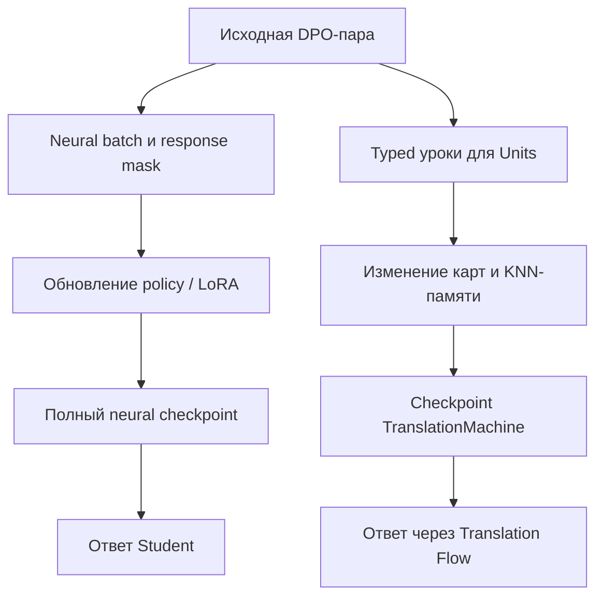

# Карта различий по всей цепочке обучения

18 октября 2026. [Приоритеты восстановления PrepareToGPL](README.md) · [Новые разрывы восстановления и Unit lineage](01-translation-restore-and-unit-lineage.md) · [DPO/LoRA](02-neural-and-lora.md) · [История KNN](03-historical-knn-and-domain-experiments.md).

**Задача карты — не потерять ни одну ось запроса пользователя, сохранив разницу между доказанным механизмом и предположением о его вреде.** Полные прежние каталоги остаются источниками подробных разборов. В этой главе новые находки привязаны к ним, а повторно используемые известные гипотезы не получают новые номера «ошибок».

## 1. Сопоставлять нужно получателя урока и получателя пользовательского запроса

Одна исходная DPO-пара может превратиться в разные объекты обучения. В проверенных путях встречаются как neural policy с LoRA, так и typed уроки для memory Units. [DpoTrainer][dpo] и [TranslationStructuredBatchBuilder][builder] реализуют разные операции. Успех одного такого пути не переносится автоматически на другой; он остаётся важным свидетельством способности соответствующего механизма учиться.

На любой из этих ветвей проверяются конкретные **вход, изменение состояния, сохранение, загрузка, обычный consumer и ответ**. Детерминированный расчёт расстояния, сериализация или полезное правило не обесценивают обучение памяти. В то же время score правила и score изменившейся policy должны иметь разные названия и доказательства.

У RP01 [сохранённый ENRU receipt][enru-result] подтверждает изменения 16 LoRA tensors при неизменных 39 base tensors и успешном повторном открытии full state; собственные ответы остаются 0/4. Это исключает универсальный диагноз «вообще ничего не обновлялось/ничего не загрузилось» для этого запуска. Старый translation checkpoint с четырьмя направлениями представляет **другую** ветвь схемы; U-R1 не объявляется причиной RP01 без обнаруженного общего caller.

## 2. Сводная карта осей, фактов и различающих проверок

Обозначения: **новое** — новый конкретный случай этого исследования; **известное** — уже присутствует в каталогах; **ремонт** — нынешнее полезное отличие, которое нельзя откатывать; **условие** — путь возможен по исходнику, участие в наблюдаемом ухудшении ещё надо доказать.

| Ось | Различие или риск | Доказательства и ограничение | Небольшая различающая проверка |
|---|---|---|---|
| Качество исходного DPO | 500 строк не означают 500 независимых законов; «chosen лучше rejected» требует предметной проверки | Известное: [DIF-04/18/19/20][prior-map], [RP01 audit][rp01-audit]; 25 C# шаблонов и 20 ENRU категорий. Полная новая экспертиза 1 000 строк здесь не выполнялась | E-DATA ниже: 12 пар на разные законы, проверка обоих ответов и содержательной разницы; затем один 8–16-pair контраст |
| Авторство и роли | Симуляционные пары не становятся ответами китайской модели из-за смены metadata | Известное: поле provenance=simulation в [receipt][enru-result]; фактическое авторство сохраняется | Новые chosen/rejected создаёт внешняя открытая китайская модель; CODEX выбирает задания и независимо оценивает пары |
| DPO objective | Историческое усреднение log-prob и нынешний exact summed objective имеют разные масштабы и зависимость от длины | [Нейронная глава](02-neural-and-lora.md); перенос старого margin без одинаковых raw/token pairs некорректен | Один B0/reference, одинаковые пары и маски; измерять chosen CE, pair preference и свободный ответ отдельно |
| Backward и autograd | Старый знак производной log-softmax и detached RmsNorm нельзя возвращать ради старого процента | **Ремонт**, source before/after в [нейронной главе](02-neural-and-lora.md) | При переносе recipient сохранять исправленный graph; адресная tiny derivative-проверка относится к будущему исполнению |
| LoRA wiring и target | Встроенные q/v adapters, их rank и frozen head — другой режим адаптации, чем старые общие Parameters | Известное: [core25][prior-neural]; текущие q/v tensors действительно меняются | E-HEAD: один baseline и один target-factor; число разрешённых параметров уравнять либо учитывать явно |
| Исходная компетенция B0 | Random B0 + маленькая адаптация может не освоить генерацию, даже меняя preference | Сильная известная гипотеза, а не доказанная единственная причина: [RP01 audit][rp01-audit] | E-BASE: tiny DPO-only / chosen-only warmup→DPO на одном ресурсе; отрицательный опыт не обобщать на все базы |
| Teaching vector | В StepVector содержимое сводится к числу active slots и scalar multiplier; координаты и знак сверх порога не задают самостоятельный закон | [VectorSignal][vector-signal], [потребитель][vector-consumer]; известное DIF-02/03/24 | На одном native caller переставить/поменять знак координат без изменения active count; затем один согласованный encoding-factor |
| Tokenization / embedding coordinates | BPE IDs, semantic signatures и teaching vectors — разные пространства; их нельзя сравнивать как один «вектор» | Известное: [DIF-03/10/16/22][prior-map]; current/GPL tokenizer before/after в [нейронной главе](02-neural-and-lora.md) | Заморозить vocab+merges+config; считать tokens/word и смысловые коллизии отдельно для C# и EN↔RU; не менять IDs под уже обученными embeddings |
| Unicode / порядок / операторы | Roundtrip исключает потерю байтов только в проверенном tokenizer path; root-normalization может терять другое | Известное: [core62][prior-utf8], DIF-16. Нельзя объявлять «вся кириллица потеряна» | Контрасты отрицания, ролей, порядка, операторов; трасса raw→feature→actual candidate, а не только красивый decode |
| DPO→подуроки | Builder создаёт semantic/executor/verifier lessons, включая производные rejected targets | [Builder][builder]. Это не побайтовая передача исходного rejected | E-FANOUT ниже: один source law, три typed пары, проверка различимости и фактических Unit mutations |
| Идентичность урока | P сравнивается с P:semantic/P:executor/P:verifier | **Новое U-N3**, унаследованное от GPL; [точная цепочка](01-translation-restore-and-unit-lineage.md) | General-builder checkpoint + continuation с P,Q; source pairs / Unit lessons / index entries считать отдельно |
| Translation restore | В runtime стало шесть направлений, old checkpoint содержит четыре | **Подтверждение U-R1/N41-T1**, source/data conflict; [before/after](01-translation-restore-and-unit-lineage.md) | Old loader / current / миграция; ноль training, равенство прежних learned maps и ответов |
| Manifest lifecycle | Новое обязательное TrainingDataEvidence при старом schema_version=1 | **Новое U-R2**, отдельный typed publish path; [before/after](01-translation-restore-and-unit-lineage.md) | Legacy / versioned migration / неверное происхождение; без публикации модели и без inference |
| Neural restore intent | Legacy base-import сохраняет attached LoRA намеренно; caller может ожидать полный restore | **Новый условный стык N-L1**, не дефект codec; [контракт и существующий тест](02-neural-and-lora.md) | Base-import и full-restore явно различаются; fresh/preloaded receiver и strict full gate |
| KNN retrieve→select | Top-k найденных соседей не означает, что ответ учитывает больше первого; warning не всегда запрещает ответ | Известное: [DIF-07/13/14/15][prior-map]. Не переносить на все KNN-классы | Один пул с конкурирующими правильным/неправильным соседями, тот же cutoff; сравнить actual selection и точность вместе с coverage |
| AST / синтаксический порядок | E09 structural port реален; E25 learner и production rules различаются | Повторно проверенные первичные источники в [исторической главе](03-historical-knn-and-domain-experiments.md) | E-AST-ROUTE, E-MATRIX-KNN, E-POS; отдельные цели для C# AST и языка |
| Context dictionary | Левый/правый POS-контекст E26 заменён другой lexical таблицей в одноимённом классе | Известное core17; [source before/after](03-historical-knn-and-domain-experiments.md) | E-CONTEXT: одна таблица значений, затем отдельное добавление нового значения |
| KNN identity / cache / ANN | Повторный ExampleId, разные representations, stale cache/index и общий direction store могут менять выбор | Известные семейства из обоих каталогов; это не новые independent findings | Один old state, одна insert/update/delete или save/load операция, exact-search oracle того же candidate set; менять один контракт |
| Flow / orchestration / graph Units | Many→many и несколько комбинаций не эквивалентны копированию ближайшего TOutput; обновление Unit не гарантирует использования Flow | Известные DIF-25…29 и родительский [lifecycle plan][lifecycle]. Весь host графа заново не трассирован | Одна конкретная пара Unit→Flow: неизменные Units, изменённый learned route; затем actual output и выбранная ветвь |
| Continue / replay | Полезный объявленный replay отличается от случайного дубля; отсутствие компетенции до опыта не позволяет измерить её retention | E43, phase38; [протоколы](03-historical-knn-and-domain-experiments.md), U-N3 | E-RETENTION после восстановления parent; старые и новые запросы на одной панели |
| Scoring / adoption | Margin, coverage, fixed confidence, exact lookup и предметная correctness имеют разные значения | [ENRU receipt][enru-result], [RP01 audit][rp01-audit], прежние DIF-11/30/38/44 | Записать raw output, route, score meaning, source family, correct/wrong/abstain; adoption только по реальному выбранному состоянию |

Карточки прежних [DIF-01…44][prior-probes] уже содержат собственные микроопыты. Эта таблица связывает их с новыми условиями и нужным получателем; она не является поручением одновременно запустить десятки кампаний.

## 3. Два коротких опыта для качества DPO и разложения в Units

### E-DATA — качество source pair до изменения optimizer; NOT_RUN

**Домены:** программирование (C#) и перевод (EN↔RU — профили одного домена). Начать с 6 пар на домен: по две пары на три разных закона. Для кода — например, область null-check, условие исключения и порядок изменения состояния; для перевода — отрицание, действующий участник/получатель и временной порядок.

CODEX заранее задаёт точную задачу и критерий ошибки. Внешняя открытая китайская модель независимо создаёт chosen/rejected по заданию. CODEX оценивает обе стороны, фиксирует конкретную разницу и исключает пары, где оба ответа верны, оба неверны, задача неоднозначна или preference выводится только по длине/шаблону. Для кода будущая проверка может использовать реальный компилятор/исполнение малого случая; в текущем аудите compiler не запускался.

Результат первой стадии — 12 проверенных карточек с source law, target answer и ошибкой альтернативы. **Она не доказывает улучшения модели.** Если требуется проверить эффект исправленного DPO, на одном baseline провести A/B: исходные 8–16 пар против исправленной версии **только одного** дефекта пары, одинаковые update budget, reference, tokenizer, LoRA и decoder. Gold по новым family-disjoint запросам закрыт до ответов. Общее улучшение после одновременной смены модели-учителя, тем и количества шагов нельзя приписать одному дефекту.

Это быстрый способ проверить содержательную причину прежде, чем повторять 500 строк. Если качественные пары не меняют ни train preference, ни ответ, следующий адрес — math/recipient/base, а не бесконечная генерация нового корпуса.

### E-FANOUT — сохранение закона после DPO→Unit; NOT_RUN

**Домен:** перевод. Взять 4 source pairs с разными содержательными ошибками rejected: неверное отрицание, переставленные участники, потерянное условие, неверное значение многозначного слова. Получатель — реальный `BuildGeneralBatch → TrainStructuredBatchAsync → Unit → Flow`.

Для каждой пары показать три произведённые typed lessons и сопоставить:

| Проверка | Зачем нужна |
|---|---|
| SourcePairId и UnitExampleId различаются явно | Одна пара не превращается в три независимых источника и не теряет защиту от повтора |
| Chosen и rejected выражают один и тот же исходный закон | Производный near-miss не заменяет смысловую ошибку ложным marker/score |
| JSON действительно десериализуется целевой Unit | Успешный внешний batch не маскирует пропущенный тип |
| Изменяется ожидаемая карта/правило, rejected влияет там, где это требует алгоритм | Копирование chosen и обучение preference имеют разные эффекты |
| Обычный Flow использует это изменение | Состояние внутри Unit должно доходить до пользовательского ответа |

A — нынешнее разложение; B — исправление **одного** конкретно обнаруженного искажения закона. Остальные source pairs, память, caller и порядок остаются теми же. Бюджет — 4 пары × 3 Unit lessons и 8 контрольных запросов на вариант. Сохранить parent и children, открыть отдельно. Если ошибка только в identity, использовать U-N3, а не считать тот же эффект вторым новым успехом.

Авторство производного материала отмечается отдельно: deterministic builder не может приписать свои сгенерированные rejected китайской модели. Для новой typed пары, где требуется новый содержательный отрицательный ответ, его получает внешний генератор; CODEX проверяет соответствие исходному закону.

## 4. Параметры общего протокола без разрастания тестовой матрицы

Для каждого будущего опыта достаточно одной небольшой карточки с предметом обучения, профилем, получателем и одним изменяемым фактором. На старте фиксируются:

- commit, checkpoint bytes/hash, tokenizer/config, сохранённое reference и trainable tensor/map allowlist;
- исходные пары и их provenance, source/semantic families, преобразование в подуроки;
- одинаковые optimizer/decoder/candidate settings и явные различия бюджета;
- raw ответ, actual route, changed state, frozen-state equality и предметная оценка;
- наблюдение, которое опровергнет гипотезу или сузит её до стоимости/совместимости без качества.

Для восстановления checkpoint достаточно нуля тренировочных шагов. Для компонентной функции не требуется запуск полного RP01. Для нейронного эффекта маленький отрицательный результат остаётся ограниченным данным baseline и budget; он не является вердиктом обо всех доменах. Сигнал одного исправленного ответа требует сохранённого контрпримера и отсутствия скрытой смены условий, а не произвольного обещанного процента.

Роли по текущему заданию: **CODEX (запрошенный `astra 6 ultracode`) выбирает, чему учить, и независимо оценивает DPO; внешняя открытая китайская модель создаёт chosen и rejected.** В этом исследовании такие модельные вызовы не выполнялись. Исследовательские документы не аттестуют доступность точного model ID или провайдера для будущего исполнения.

## 5. Связь с RAG и родительскими планами

Прочитаны индексы RAG-01 (DPO lifecycle), RAG-02 (design-to-code), RAG-03 (merge/branches), [branch-comparison manifest][branch-manifest] и относящиеся к persistence/continue фрагменты [родительского lifecycle plan][lifecycle]. Индекс используется как указатель на источник, а не как доказательство выполненного обучения.

В родительском плане уже различаются metadata import и восстановление state, требуется продолжение от прежнего checkpoint и проверка rollback. Пункты U-R1/U-R2/U-N3 конкретизируют, где эта цепочка расходится в нынешних APIs. Старые статусы planning readiness, quoted execution orders и общие требования не приписываются выполненному runtime. Для нынешнего задания полномочие на документы и место публикации задаёт пользователь: planning/possibleDifs, с чтением второго каталога для дедупликации.

Полный перечень загруженных текстов и выбранных первичных чтений описан в [журнале источников](05-sources-novelty-review.md). Остальные домены и графовые hosts не объявляются полностью обследованными только потому, что их названия присутствуют в RAG.

[dpo]: https://github.com/lubochka/llm_mvp_core/blob/a392b6be8f8dec1e2375e2eb4fe21c2f6e8950c6/11.DPO/DpoTrainer.cs
[builder]: https://github.com/lubochka/llm_mvp_core/blob/a392b6be8f8dec1e2375e2eb4fe21c2f6e8950c6/27.TranslationDomain/TranslationStructuredBatchBuilder.cs#L91-L178
[enru-result]: https://github.com/lubochka/llm_mvp_core/blob/a392b6be8f8dec1e2375e2eb4fe21c2f6e8950c6/.kiro/xiigen-slices/work/results/RP01-enru-continuation-20261016/runtime-20261016-01/analysis-20261016-01/scientific-result.json
[prior-map]: ../01-PRIORITIZED-DIFFERENCES.md
[prior-probes]: ../12-DIF-01-44-CHEAP-CAUSAL-PROBES.md
[rp01-audit]: https://github.com/lubochka/xiigen-planning/blob/a10bbde116515b1453d9ec6bfb103725ad99d477/llm%20mvp/design%20to%20code%20session/replanning/Kiro-Xiigen-RP01-Learning-First-Slice-Pack/RP01-2026-10-16-LEARNING-RECOVERY-AND-CODE-AUDIT.md
[prior-neural]: https://github.com/lubochka/llm_mvp_core/blob/a392b6be8f8dec1e2375e2eb4fe21c2f6e8950c6/docs/plans/replanning-possible-diffs/25-historical-neural-learning-donor.md
[prior-utf8]: https://github.com/lubochka/llm_mvp_core/blob/a392b6be8f8dec1e2375e2eb4fe21c2f6e8950c6/docs/plans/replanning-possible-diffs/62-utf8-tail-hypothesis-and-retained-student-answers.md
[vector-signal]: https://github.com/lubochka/llm_mvp_core/blob/a392b6be8f8dec1e2375e2eb4fe21c2f6e8950c6/11.DPO/DpoTrainer.cs#L1160-L1167
[vector-consumer]: https://github.com/lubochka/llm_mvp_core/blob/a392b6be8f8dec1e2375e2eb4fe21c2f6e8950c6/11.DPO/DpoTrainer.cs#L859-L902
[lifecycle]: https://github.com/lubochka/xiigen-planning/blob/a10bbde116515b1453d9ec6bfb103725ad99d477/llm%20mvp/dpo%20legal%20build/active-codex-execution-plan-10-training-lifecycle.md
[branch-manifest]: https://github.com/lubochka/xiigen-planning/blob/a10bbde116515b1453d9ec6bfb103725ad99d477/llm%20mvp/Prepare%20to%20merge/BRANCH-COMPARISON-MANIFEST-20260722.md

