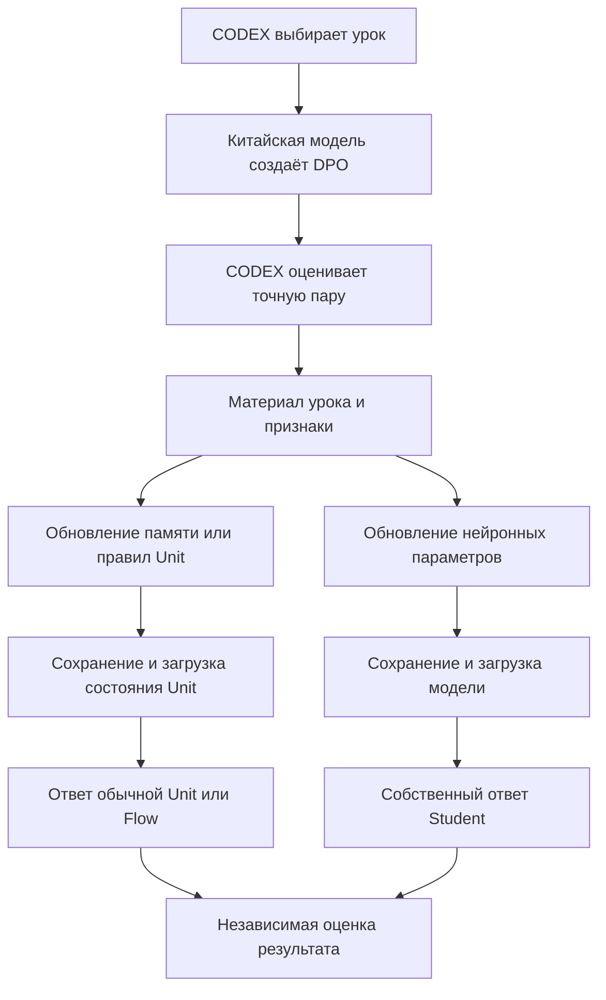

# Первая глава: вернуть обучение и применение состояния из DesignToCode-clean

## 1. Что именно восстанавливать

Рабочий донор пользователя — **`DesignToCode-clean@e346b88a3cc1fcce48aefa626bfc7b00509eefd6`**. Сопоставляем с **`codex/dpo-implementation@358af351e22a92a3f7938d1f9221d5aeb7ddb053`**. Это зафиксированные срезы, а не обещание, что ветки больше не изменятся. GitHub compare сообщает разошедшуюся историю и возвращает только 300 changed-file записей; он не использован как доказательство полного diff. Проверки равенства выполнены по отдельным файлам и деревьям.

Восстановление означает: тот же вид учебного материала достигает того же обучаемого получателя; после изменения его состояния обычный путь ответа использует это состояние; после загрузки сохранённого состояния способность сохраняется. Простое копирование старых классов или увеличение числа DPO этого не устанавливает. Наличие детерминированного вычисления не опровергает обучение, если оно использует состояние, изменяемое уроком.

Для понимания нынешнего провала важен [действующий RP01 README](https://github.com/lubochka/xiigen-planning/blob/b0308fbaa783758104987e6544d057062ccf6fc3/llm%20mvp/design%20to%20code%20session/replanning/Kiro-Xiigen-RP01-Learning-First-Slice-Pack/README.md): C#500 дал `0/3 → 0/3`, ENRU500 — `0/4 → 0/4`, при реальных изменениях LoRA и исходном случайном B0. Успешный kNN-перевод или распознавание структуры не превращает эти свободные ответы Student в правильные. Вопрос к нейронному пути остаётся самостоятельным.

### Два отдельных маршрута урока

Схема показывает разделение получателей; она не предписывает каждому домену отдельную модель. Выбор конкретных Units определяется существующим контрактом. В первичных источниках нужно проверить обе стрелки: как изменилось состояние и кто затем прочитал его.

## 2. Положительные источники и их точные границы

| Источник в DesignToCode-clean | Сохранённое наблюдение | Что можно восстанавливать | Что этим не доказано |
|---|---|---|---|
| [Структурный контекст E07](https://github.com/lubochka/llm_mvp_core/blob/e346b88a3cc1fcce48aefa626bfc7b00509eefd6/35.ExperimentsV2/results/E07-STRUCTURAL-CONTEXT-TOKEN/results/run-2026-05-01-001.json) и [структурный kNN E09](https://github.com/lubochka/llm_mvp_core/blob/e346b88a3cc1fcce48aefa626bfc7b00509eefd6/35.ExperimentsV2/results/E09-STRUCTURAL-KNN/results/run-2026-05-01-001.json) | E07: 0,1531 → 0,1462. E09: 0,2413 → 0,3507, 4 492 учебных перехода | Проверить структурные признаки в функции поиска отдельно от нейронного добавления тех же признаков | Это разные представления и разный объём экзамена; рост E09 не является чистым A/B переноса одной матрицы |
| [Обучаемый классификатор шаблонов E25](https://github.com/lubochka/llm_mvp_core/blob/e346b88a3cc1fcce48aefa626bfc7b00509eefd6/35.ExperimentsV2/results/E25-PATTERN-CLASSIFIER/results/run-2026-05-01-001.json) | Top-1 0,3438 → 0,875 на 32 validation случаях; всего 160 примеров; accuracy трудных шаблонов 0,8571 на 28 случаях | Восстановить обучение памяти шаблонов и использование структурных признаков в kNN classifier | Это точность класса структуры, не качество полного перевода и не свободная генерация Student |
| [Контекстный словарь E26](https://github.com/lubochka/llm_mvp_core/blob/e346b88a3cc1fcce48aefa626bfc7b00509eefd6/35.ExperimentsV2/results/E26-CONTEXTUAL-DICTIONARY/results/run-2026-05-01-001.json) | 0,40 → 1,00 на 15 случаях, включая 6 трудных | Передавать в словарный поиск признаки контекста и сравнивать значения слова в разных окружениях | Таблица значений в этом опыте заполнена заранее; это не новое обучение нейронного переводчика |
| [Перестановка структуры E27](https://github.com/lubochka/llm_mvp_core/blob/e346b88a3cc1fcce48aefa626bfc7b00509eefd6/35.ExperimentsV2/results/E27-PATTERN-REORDERER/results/run-2026-05-01-001.json) | Exact match 0,2857 → 1,00 на 7 случаях; отдельный IsSVO = 0,5714 | Сохранить способность структурной перестановки на тех условиях, где она полезна | Шаблон и POS уже даны; семь случаев не доказывают распознавание произвольной структуры или универсальность SVO |
| [Повтор старых примеров E43](https://github.com/lubochka/llm_mvp_core/blob/e346b88a3cc1fcce48aefa626bfc7b00509eefd6/35.ExperimentsV2/results/E43-REPLAY-BUFFER/results/run-2026-05-01-001.json) | Retention 0,3226 → 0,3978; 465 старых, 414 новых и 177 replay переходов | Проверить сохранение старых ответов при добавлении нового материала | Runner заново строит bigram dictionaries; это не восстановление AdamW и не доказанное neural continual learning |
| [Neural V210](https://github.com/lubochka/llm_mvp_core/blob/e346b88a3cc1fcce48aefa626bfc7b00509eefd6/experiments-v2/INTERNAL-TRAIN-READY-V191/results/train-ready-v210-good-external-plus-internal-guide-full-20260511-014712/internal-train-ready-dpo-summary.json) и [base-wiki repeat10](https://github.com/lubochka/llm_mvp_core/blob/e346b88a3cc1fcce48aefa626bfc7b00509eefd6/experiments-v2/INTERNAL-TRAIN-READY-V191/results/base-wiki-session-01-batch-004-repeat10-500-20260515-1100/internal-train-ready-dpo-summary.md) | Сохранённая последняя train-пачка V210: 5/6; repeat10: 4/4 | Воспроизвести точную policy/reference preference-метрику соответствующего learner, затем отдельно его собственный ответ | Это метрика последнего minibatch до его update; не 83,3% из 134, не 100% из 500 и не heldout свободных ответов |

Точная первичная сверка E25, E27 и связанных KNN-преобразований приведена в [новой языковой главе](01-NEW-LANGUAGE-AND-KNN.md). Исторический результат берётся с указанной ветки, а не из одноимённого файла другой серии. Противоречивые ранний FAIL и поздний PASS сохраняются вместе; номер эксперимента не доказывает тождество алгоритма.

У E09 [сам runner](https://github.com/lubochka/llm_mvp_core/blob/e346b88a3cc1fcce48aefa626bfc7b00509eefd6/35.ExperimentsV2/Experiments/E09StructuralKnn.cs) использует полный baseline validation, но `Take(500)` у структурного kNN. Поэтому чистый восстановительный A/B ниже фиксирует один и тот же экзамен. У E43 [runner](https://github.com/lubochka/llm_mvp_core/blob/e346b88a3cc1fcce48aefa626bfc7b00509eefd6/35.ExperimentsV2/Experiments/E43ReplayBuffer.cs) задаёт конкретный опыт перестройки памяти; старые и новые половины материала сами по себе не доказывают смену предметного домена.

### Дополнительные исторические свидетельства и родословная

[Существующее исследование продолжения переводческой памяти](https://github.com/lubochka/llm_mvp_core/blob/358af351e22a92a3f7938d1f9221d5aeb7ddb053/docs/plans/replanning-possible-diffs/78-translation-restored-memory-positive-receipt.md) подтверждает добавление урока после load, сохранение старых записей и неточный kNN-ответ старого урока. Его исторический baseline — другой commit; сам этот документ не аттестует исполнение закреплённого clean binary. Парного прироста качества по новому уроку там нет, а английскому входу в старой пробе выставлена метка RU→EN. Это полезный контроль продолжения, с отдельным происхождением.

[Исторический neural donor](https://github.com/lubochka/llm_mvp_core/blob/358af351e22a92a3f7938d1f9221d5aeb7ddb053/docs/plans/replanning-possible-diffs/25-historical-neural-learning-donor.md) помогает восстановить конфигурацию и место изменения параметров, но наличие старых артефактов в ветке не доказывает SHA исполнявшейся сборки. В [главе03](03-NEW-NUMERICAL-DELTA.md) заново сверены первичные файлы clean: у Wiki023→025 совпали все 50 raw triples, положительных предпочтений осталось 49/50, средний margin немного вырос, новых положительных пар нет. Эта метрика не заменяет экзамен собственных планов.

## 3. Восстановительные эксперименты — в начале очереди выбора

Эти опыты выбираются по вопросу, на который нужен ответ. Это **не последовательность обязательных ворот** перед первым нейронным уроком. Начать можно с одной темы и одного получателя. Для жалобы именно на neural RP01 выбирать ДР-Н; для старого положительного kNN-механизма — ДР-С; для памяти перевода — ДР-П.

Для обучения исправлениям интерфейса отдельно важен **ДР-Д: точная пара → локальный DesignConversion learner**. В [обновлённом прежнем N54](https://github.com/lubochka/xiigen-planning/blob/b95278b25a6697b42ef7025e6965a9f2837a34b7/llm%20mvp/design%20to%20code%20session/replanning/possibleDifs/00-DESIGNTOCODE-CLEAN-GOLDEN-RECOVERY-FIRST-2026-10-19.md) описана потеря `visual_score`/категорий в canonical HTML/CSS-проекции. Это чужая находка, её самостоятельная новизна здесь не заявлена. На двух разрешённых уроках сначала снять фактические typed inputs, category deltas и ordinary output; при наличии нужного recipient — четыре новых макета. Возвращение одного `visual_score` изменяет отчёт или условие допуска, но само по себе не восстанавливает signed feature update: в обеих ветках margin не множитель local delta. Передавать оценки/категории допустимым текущим контрактом отдельно от текста Student; произвольная инверсия оценки допускается только в диагностике, не как заведомо неверный учебный урок. Сравнение нейронной q/v-LoRA вести отдельно.

| Опыт | Единственное различие и маленькая панель | Что считается восстановлением | Чем опровергнуть гипотезу |
|---|---|---|---|
| **ДР-Н. Собственный нейронный ответ** | Один точно зафиксированный B0/токенизатор; 2 DPO-урока о порядке действий и 4 новых задания. Сначала сравнить неизменяемый контроль и 2 updates текущего learner. Если учёба не проявляется, выбрать отдельно старое место адаптации или численную свёртку из главы03 | Изменилось нужное поведение именно Student, сохранены смысл/отрицание, результат удержан после загрузки | Сдвинулись только loss/margin/веса, а предметные ответы не изменились; либо source показывает, что сравниваются разные модели/токены |
| **ДР-С. Структурная функция в kNN** | На одном корпусе C# и одних 4 новых AST-контекстах: 2 обучающих перехода; неизменные labels, split и k; меняется только использование структурных признаков в поиске | Больше правильных прогнозов требуемой структуры/действия у того же consumer; время и число возвращённых ответов видны | Выигрыш исчез при одинаковом экзамене, правильный ответ задан метаданными запроса или использована последующая программа вместо исходного контекста |
| **ДР-Ш. Обучение памяти шаблонов E25** | Один и тот же classifier, 2 урока с разной структурой, 4 новых размеченных предложения; менять только включение полезных направленных структурных признаков | Класс шаблона на новых словах стал точнее у обученного classifier, затем перестановка сохранила смысл | Класс дан заранее в EXAM, изменены labels либо измеряется только E27 с готовым pattern |
| **ДР-П. Доставка частей урока перевода** | 2 урока с одними и теми же исходными phrase mappings, 4 новые комбинации знакомых частей; менять только reader/builder старого и текущего пути | Обученная память принимает части и правильно сочетает их в обычном Flow | Ответ выдаётся готовым lookup исходной целой строки; mappings менялись между плечами; новые сочетания уже встречались в обучении |
| **ДР-К. Контекст значения и порядок фразы** | 2 контрастных урока об одном слове/шаблоне, 4 новых контекста. Менять по одному: контекст при поиске либо структурную перестановку; gold POS отделён от настоящего parser | Правильный смысл и роли участников, без удаления объекта/модификатора | Улучшение есть только с заранее данным gold pattern; новое правило ломает обычный правильный вариант |
| **ДР-В. Возобновление того же learner** | 2 урока; один процесс учится без перезапуска, второй сохраняет/загружает состояние между уроками; одинаковые 4 запроса после второго | Совпадают полезное состояние и ответы, оба удерживают первый урок и усваивают второй | Восстановлен другой tokenizer/state или счётчик вырос без изменения доступного ответа. Для Design-to-Code адресная проверка округления — глава02 |
| **ДР-О. Обычный получатель trained state** | На одном сохранённом состоянии 4 новых запроса через исторический и текущий обычный вход; наблюдать выбранные Unit/Flow и необходимые метаданные | Текущий путь использует то же полезное состояние, которое дало исторический положительный ответ | Source/trace показывает другой consumer, scaffold или отсутствующие требуемые входные признаки; успешный private helper не достигается обычным входом |

При едином доказанном baseline можно переиспользовать четыре контрольных ответа, явно указав это. Иначе обычный A/B включает `A до`, `A после`, `B до`, `B после`: 16 ответов. Повтор тех же четырёх запросов после cold restore в обоих плечах добавляет 8 ответов; отдельные retention-запросы считаются дополнительно. Отсутствие улучшения на двух updates также ограничено этим бюджетом и исходным состоянием. Один маленький выигрыш — локальный сигнал, а не оценка качества всей системы. Если исходный checkpoint недоступен, написать это и выбрать другую проверяемую гипотезу; не создавать случайную модель под названием «восстановленная».

**Особый контроль ДР-О для Design-to-Code:** current direct policy scorer требует реальные generated/incumbent HTML/CSS и внутреннюю runtime pair. [Прослеженная цепочка в главе02](02-NEW-LEARNED-DESIGN-STATE.md#6-дополнение-для-главы-восстановления-designtocode-clean-прямой-policy-scorer-сменил-вход) показывает, что load policy и actual policy forward — разные события; без pair возвращается baseline. Проверить подачу валидной pair через действующий coordinator и окончательное принятие кандидата. Возврат старого synthetic score=1 не восстанавливает содержательное сравнение. Этот readout не требует нового обучения.

## 4. Какие улучшения current необходимо сохранить

Откат всей успешной ветки в нынешнее ядро — плохой эксперимент: меняется слишком много факторов и теряются уже исправленные пути градиента. Ниже указаны проверенные существующие результаты, а не заново открытые ошибки.

* [Доставка `phrase_mappings`](https://github.com/lubochka/llm_mvp_core/blob/358af351e22a92a3f7938d1f9221d5aeb7ddb053/docs/plans/replanning-possible-diffs/experimets/results/2026-10-18/translation-memory-ingress-01/report.md) уже изменила правильность **11/24 → 19/24**. Существующая Unit получила 16 частей из тех же 8 уроков. Все 8 новых сочетаний стали правильными; крайние ошибки остались. Число принятых неверных ответов выросло с 1 до 3 — это также часть результата. Этот ремонт использовать как current-контроль, а не выдавать за новую находку.
* [Embedding, bias и дробная DPO mask](https://github.com/lubochka/llm_mvp_core/blob/358af351e22a92a3f7938d1f9221d5aeb7ddb053/docs/plans/replanning-possible-diffs/experimets/results/2026-10-18/human-summary.md): embedding и дробная mask исправили реально достигнутые градиенты/обновления, но предметные neural результаты остались **0/24**. Bias в C50 выключен: соответствующий живой опыт был контролем отсутствия регрессии, а не демонстрацией нового bias-update. Сохранить исправленные производные; не считать отсутствие gain разрешением вернуть неверную производную.
* Exact DPO-тройка, различие policy/reference, применяемая q/v-LoRA и авторизованный путь обновления сохраняются. Старые hash-IDs, label markers и иной train metric нельзя переносить автоматически ради воспроизведения старой цифры. [Разбор текущего градиентного пути](https://github.com/lubochka/llm_mvp_core/blob/358af351e22a92a3f7938d1f9221d5aeb7ddb053/docs/plans/replanning-possible-diffs/41-current-dpo-gradient-chain-source-review.md) и [предыдущая карта сохранённых исправлений](https://github.com/lubochka/xiigen-planning/blob/b0308fbaa783758104987e6544d057062ccf6fc3/llm%20mvp/design%20to%20code%20session/replanning/possibleDifs/50-LOCAL-WIKI-FEEDBACK-AND-BPE-BUDGET-2026-10-19/03-MECHANISM-COVERAGE-AND-KEPT-FIXES.md).

## 5. Новые гипотезы и восстановление — разные утверждения

Большая часть новых языковых и Design-to-Code механизмов этого пакета существовала уже в `DesignToCode-clean`. Они помогают найти скрытое условие прежнего успеха и защитить расширение на новые предметные случаи. Они **не объявлены причиной, появившейся в RP01**. Точное изменение scalar→SIMD backward выделено отдельно и требует измерения, поскольку изменение порядка FP32-сложения само по себе не ошибка.

Для каждой новой карточки зафиксированы текущая формула/потребитель, предполагаемое исправление, одинаковые входы A/B, предметная область, отрицательный контроль и условие отказа от гипотезы. Глава05 содержит поручение на один выбранный опыт; оно не требует повторного Windows CI или прогона всей матрицы доменов.
