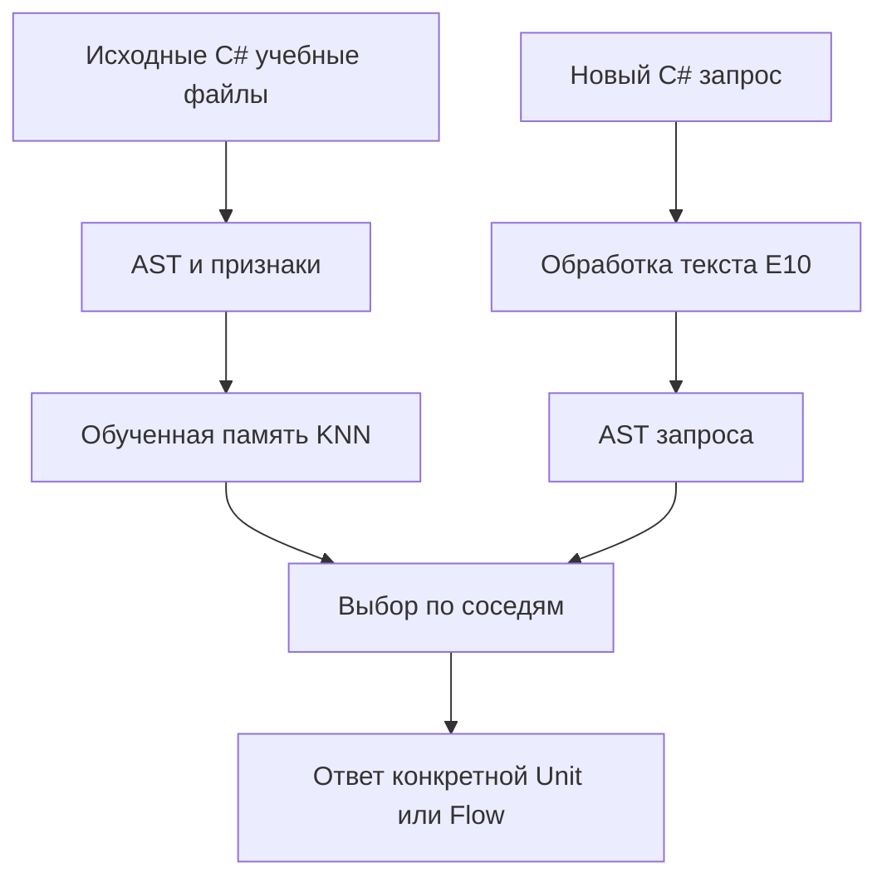

# Глава 0. Сначала вернуть конкретное рабочее поведение external_domains

## Что именно восстанавливать

Рабочая ветка пользователя — `external_domains`. Восстановительная единица сравнения состоит из **входа, его представления, учебной операции, состояния и конечного потребителя**. Перенос одного класса с названием KNN либо файла весов сохраняет только часть этой цепочки.

В этом исследовании первично прочитаны исходники и результаты `external_domains@3036a01acec938f0b83fa4ffbda26202cc35d639`, нынешний код закреплён за `44507823fc5aaeab4c3f0fe4e9da9ce924c6ec76`. Для шести производственных C# файлов проверено равенство тел после удаления добавленного пятистрочного лицензионного заголовка: [машиночитаемое сравнение](evidence/source_parity.json). Среди них `RegexPreprocessor`, `SemanticCompilerFacade`, `SemanticCompilerOptions`, `MethodFrequencyTable`, `MethodKnn` и `FileActionKnn`.

**Следствие:** возврат старой копии этих файлов даст тот же алгоритм. Восстановительный опыт должен сначала установить, совпадают ли данные, опции, способ наполнения памяти и вызов потребителя. Новые C# находки ниже объясняют, на каких входах даже сохранённый алгоритм теряет информацию.

## Список восстановления — выполнять сверху вниз

| Приоритет | Рабочий механизм и предмет | Что сравнить первым | Что считать восстановлением |
|---|---|---|---|
| **G0** | Один и тот же получатель старого и нынешнего урока | Зафиксировать source IDs, точный текст до обработки, настройки, сохранённое состояние и публичный метод; повторить один положительный и один трудный пример | Тот же предметный результат достигается по названной цепочке и остаётся после загрузки состояния |
| **G1** | **E09: C# AST-признаки внутри KNN** | Одинаковые файлы, единые метки SyntaxKind, одинаковые пары train/test и raw AST; включённый/выключенный structural signal при общем candidate pool | На новых C# примерах обученный KNN использует структурный признак; затем результат доходит до нужной Unit/Flow. E10 отдельно меняется в C1/C2 |
| **G2a** | **E25: обученная память порядка слов по POS** | Внутри проекта 12: один TRAIN и те же POS-последовательности, `PredictByRules` / trained `Predict`. Затем отдельный опыт интеграции с явным соответствием меток | Обученная память проекта 12 достигает обычного потребителя и после восстановления правильно различает порядок слов |
| **G2b** | **E26: выбор значения слова по соседнему контексту** | Те же source word и POS-контексты; затем новые неоднозначные случаи через обучаемого переводческого получателя | Соседний контекст меняет правильный выбор; новая выученная связь применяется после холодной загрузки |
| **G3** | **E43: удержание старого при добавлении нового материала** | Один получатель, один родительский checkpoint, одинаковый бюджет; новое без replay / новое с адресным replay | Старые предметные навыки сохраняются, новые приобретаются; обе панели оцениваются до и после загрузки |
| **G4** | Полный DPO → нужные Units → состояние → обычный ответ | Сохраняются исходные `prompt/chosen/rejected`, семантический контраст и получатель; сравниваются raw Student и соответствующая память Unit отдельно | Урок меняет ответ правильного потребителя на новых случаях; сохранение файла и снижение loss служат дополнительными измерениями |

G0 — короткий протокол локализации, а G1–G4 — восстановительные направления. После G0 raw Student направляется в G4; C# semantic compiler — в G1; переводческие Units — в G2. G3 проверяет продолжение обучения выбранного получателя. Все направления подряд одному получателю не назначаются. Новые эксперименты C1–C3 из [главы 3](03-MICRO-EXPERIMENTS-BY-DOMAIN.md) уточняют G1 и предметное ранжирование C#. Их унаследованные дефекты не следует записывать как появившиеся при переносе из `external_domains`.

## Положительные исторические доказательства и точные границы

| Архив | Записанный результат | Что действительно делает исходный код | Вывод для восстановления |
|---|---|---|---|
| E09, 01.05.2026, tier 2 | top-1 **0.2413 → 0.3507**, `k=5`, 4 492 обучающих перехода | Обучает KNN парам «структурный вектор текущего AST-узла → метка следующего узла»; baseline считает частотные переходы | Структурный признак полезно проверять внутри поиска соседей в C#; нужен повтор на общей панели |
| E25, 01.05.2026, tier 1 | top-1 **0.3438 → 0.875**, 160 примеров, 32 validation | `Train` записывает 128 POS-последовательностей в KNN; `k=3`, Jaccard по биграммам POS, голосование по label | Вернуть обученное различение порядка слов и проверить его результат на нынешнем переводческом потребителе |
| E26, 01.05.2026, tier 1 | disambiguation **0.40 → 1.00**, 15 случаев | Выбирает из заранее заполненного `ContextualDictionary.BuildDefault()` с использованием соседних POS | Сохраняется конкретная полезная функция контекстного выбора; для приобретения нового знания нужен отдельный учебный шаг и его сохранение |
| E43, 01.05.2026, tier 2 | retention accuracy **0.3226 → 0.3978**, 177 replay-переходов | Строит отдельные частотные bigram-модели на новом материале и на смеси нового со старым | Положительный replay переносится как проверяемый принцип смешения материала; пропорция и эффект проверяются заново на том же нынешнем получателе |

Первоисточники результатов: [E09 JSON, строки 7–17](https://github.com/lubochka/llm_mvp_core/blob/3036a01acec938f0b83fa4ffbda26202cc35d639/35.ExperimentsV2/results/E09-STRUCTURAL-KNN/results/run-2026-05-01-001.json#L7-L17), [E25 JSON](https://github.com/lubochka/llm_mvp_core/blob/3036a01acec938f0b83fa4ffbda26202cc35d639/35.ExperimentsV2/results/E25-PATTERN-CLASSIFIER/results/run-2026-05-01-001.json), [E26 JSON, строки 7–17](https://github.com/lubochka/llm_mvp_core/blob/3036a01acec938f0b83fa4ffbda26202cc35d639/35.ExperimentsV2/results/E26-CONTEXTUAL-DICTIONARY/results/run-2026-05-01-001.json#L7-L17), [E43 JSON, строки 7–17](https://github.com/lubochka/llm_mvp_core/blob/3036a01acec938f0b83fa4ffbda26202cc35d639/35.ExperimentsV2/results/E43-REPLAY-BUFFER/results/run-2026-05-01-001.json#L7-L17).

E25 действительно вызывает `Train` и сравнивает правила с выученной памятью на одних 32 validation: [runner, строки 17–35](https://github.com/lubochka/llm_mvp_core/blob/3036a01acec938f0b83fa4ffbda26202cc35d639/35.ExperimentsV2/Experiments/E25PatternClassifier.cs#L17-L35). Его `SentencePatternClassifier` привязан к `SemanticCompiler.PatternClassifier` проекта 12: [GlobalUsings, строка 6](https://github.com/lubochka/llm_mvp_core/blob/3036a01acec938f0b83fa4ffbda26202cc35d639/35.ExperimentsV2/GlobalUsings.cs#L6). Это положительный результат обучения дискретной памяти на синтетических POS-последовательностях; свободный перевод и сохранение LoRA данный runner не измеряет.

В родительском плане E25 назначен helper из проекта 29 и фиксированная доля `0.20` в смеси оценок, причём веса названы первоначальными: [integration plan, строки 312–328](https://github.com/lubochka/xiigen-planning/blob/a90350f33955f9c4b15707a4619eeeba5d42e863/llm%20mvp/orchestrator%20implementation/PLAN-KNN-MATRIX-INTEGRATION-v3.md#L312-L328), [A64, строка 489](https://github.com/lubochka/xiigen-planning/blob/a90350f33955f9c4b15707a4619eeeba5d42e863/llm%20mvp/orchestrator%20implementation/PLAN-KNN-MATRIX-INTEGRATION-v3.md#L489). Совпадение названия E25 и прежнего процента не устанавливает тождество этих алгоритмов. G2a отдельно сравнивает результат обученной памяти с результатом helper и прослеживает их до ответа. Это восстановление уже известной семьи расхождений, а не четвёртая новая находка.

Прямой A/B между helper 29 и памятью 12 смешивает вход и пространство меток: helper принимает слова и сам выводит POS, тогда как E25 использует готовые POS и восемь классов. Поэтому первый опыт выполняется только внутри проекта 12: `PredictByRules` против обученного `Predict` при одинаковых POS. Интеграция в нынешний путь — отдельный опыт с явным encoder и соответствием меток; её эффект не приписывается одному алгоритму поиска соседей. [Helper 29](https://github.com/lubochka/llm_mvp_core/blob/44507823fc5aaeab4c3f0fe4e9da9ce924c6ec76/29.SemanticCompiler/Translation/PatternClassifier.cs), [обучаемый classifier 12](https://github.com/lubochka/llm_mvp_core/blob/3036a01acec938f0b83fa4ffbda26202cc35d639/12.SemanticCompiler/Translation/PatternClassifier.cs#L8-L81).

У E09 baseline берёт всю validation-последовательность, а KNN — первые 500 узлов; `kindMap` строится отдельно по файлу. Поэтому числа сохранены как архивные, а новый A/B должен устранить различие панелей и значений меток. Это уже разобранное ограничение, а не новая находка: [исходный E09, строки 45–72 и 97–115](https://github.com/lubochka/llm_mvp_core/blob/3036a01acec938f0b83fa4ffbda26202cc35d639/35.ExperimentsV2/Experiments/E09StructuralKnn.cs#L45-L115), [прежний разбор сопоставимости](../09-HISTORICAL-EXPERIMENT-VALIDITY-AND-FUSION-DRIFT.md).

У E26 нет optimizer update: [создание словаря и оценка, строки 15–42](https://github.com/lubochka/llm_mvp_core/blob/3036a01acec938f0b83fa4ffbda26202cc35d639/35.ExperimentsV2/Experiments/E26ContextualDictionary.cs#L15-L42). У E43 модели `baseModel`, `noReplayModel` и `replayModel` создаются отдельно: [строки 29–50](https://github.com/lubochka/llm_mvp_core/blob/3036a01acec938f0b83fa4ffbda26202cc35d639/35.ExperimentsV2/Experiments/E43ReplayBuffer.cs#L29-L50). Эти различия определяют подходящий эксперимент и тип состояния; они не отменяют других успешных обучений в ветке.

## Где должна находиться полезная функция

Для C# данные проходят в AST, затем в признаки, затем в обученную память соседей. Вызовы `TrainMethodKnn`, `TrainFileActionKnn`, `TrainStructuralKnn` принимают исходный текст; `Compile` при распознанном C# и включённом E10 предварительно меняет этот текст. Сейчас это конкретная проверяемая точка различия между учебным и рабочим входом: [Facade, строки 122–159](https://github.com/lubochka/llm_mvp_core/blob/44507823fc5aaeab4c3f0fe4e9da9ce924c6ec76/12.SemanticCompiler/SemanticCompilerFacade.cs#L122-L159), [учебные методы, строки 178–225](https://github.com/lubochka/llm_mvp_core/blob/44507823fc5aaeab4c3f0fe4e9da9ce924c6ec76/12.SemanticCompiler/SemanticCompilerFacade.cs#L178-L225).

По умолчанию `UseRegexPreprocessor=true`, `UseMethodKnn=true`, а `UseStructuralKnn=false` и `UseFileActionKnn=false`. Эти же значения находятся в эталонной ветке. Для G1 нужно явно записать выбранный профиль и выполнить обучение соответствующего predictor: включённый флаг сам по себе не наполняет память. [Текущие опции](https://github.com/lubochka/llm_mvp_core/blob/44507823fc5aaeab4c3f0fe4e9da9ce924c6ec76/12.SemanticCompiler/SemanticCompilerOptions.cs#L8-L30).

Симуляция: в учебном коде `$"{user.Length}"` содержит обращение к свойству. Запрос с `$"{account.Length}"` после E10 превращается в `$""`; имя переменной несущественно, но само вычисление исчезло. Новый C2 проверяет восстановление этого предметного признака при тех же обученных соседях. Контроль с обычной строкой `"fixed"` не должен приобрести отсутствующее вычисление.

Для перевода нужны признаки контекста, порядка и ролей слов. AST C# не переносится на обычное предложение EN→RU. Для SQL требуется собственное представление SQL; проверка SQL отдельно от C# выявляет чрезмерно широкую активацию C# обработки. Для оркестрации важны зависимости и порядок действий, а не название механизма в файле.

## Состояние и конечный потребитель

В `18.CapabilityTraining` раньше при продолжении можно было взять живой cached policy/tokenizer; теперь путь строится из parent manifest и проверенных checkpoint/tokenizer. При восстановлении generated capability нынешний код читает связанные `KnnExamples`, создаёт модель, применяет LoRA, загружает checkpoint и переобучает индекс на записанных примерах. [Старый BuildTeachingStack](https://github.com/lubochka/llm_mvp_core/blob/3036a01acec938f0b83fa4ffbda26202cc35d639/18.CapabilityTraining/DefaultLogicalCapabilityTrainer.cs#L463-L518), [нынешний BuildTeachingStack](https://github.com/lubochka/llm_mvp_core/blob/44507823fc5aaeab4c3f0fe4e9da9ce924c6ec76/18.CapabilityTraining/DefaultLogicalCapabilityTrainer.cs#L2314-L2379), [нынешний loader](https://github.com/lubochka/llm_mvp_core/blob/44507823fc5aaeab4c3f0fe4e9da9ce924c6ec76/18.CapabilityTraining/TeachingRegistryPersistence.cs#L1620-L1742).

Это существенное изменение пути восстановления. Его исследовательский владелец уже есть: [прежний разбор доменных функций и памяти](https://github.com/lubochka/llm_mvp_core/blob/44507823fc5aaeab4c3f0fe4e9da9ce924c6ec76/docs/plans/replanning-possible-diffs/09-domain-functions-and-sibling-branches.md). Наш G0 проверяет полноту состояния через ответы одного получателя при одинаковом corpus, а не объявляет новую ошибку только по различию loader.

У raw Student RP01 свой путь: `CodeDocumentationStudentGeneration.Generate` кодирует точный `OwnerInput` через BPE и вызывает `TextGenerator` с моделью. В прочитанном методе preprocessing E10 и C# KNN отсутствуют. Поэтому C1–C3 относятся к semantic compiler/его потребителям; их попадание в RP01 через другой составной маршрут должно быть показано отдельно. [Реальный метод генерации, строки 62–77](https://github.com/lubochka/llm_mvp_core/blob/44507823fc5aaeab4c3f0fe4e9da9ce924c6ec76/14.ContinuousLearning/Training/CodeDocumentationStudentGeneration.cs#L62-L77).

Первичные RP01 итоги показывают границу механической успешности: [C# main500 scientific result](https://github.com/lubochka/llm_mvp_core/blob/44507823fc5aaeab4c3f0fe4e9da9ce924c6ec76/.kiro/xiigen-slices/work/results/RP01-simulation-main500-execution-20261015/scientific-result.json#L8-L53) записывает изменение 16 разрешённых adapter tensors и восстановление состояния при **0/3 → 0/3** правильных свободных ответов. [EN→RU continuation](https://github.com/lubochka/llm_mvp_core/blob/44507823fc5aaeab4c3f0fe4e9da9ce924c6ec76/.kiro/xiigen-slices/work/results/RP01-enru-continuation-20261016/runtime-20261016-01/analysis-20261016-01/scientific-result.json#L11-L55) записывает 53 248 изменённых LoRA scalars, reopened state и **0/4 → 0/4**. Эти маленькие панели не доказывают единственную причину, но уже показывают: проверка записи весов не заменяет приобретение полезного ответа. Для G4 отдельно сравниваются пригодность исходной модели, целостность DPO и результат именно её генератора.

## Что сохранить при восстановлении

Сохранить нынешние исправления DPO response masks, реального LoRA forward/backward и связанных tensor gradients. Старый полезный KNN и старый дефект нейронной производной — разные части системы. Полный откат нейронного ядра не является предложенным опытом. [Подробности и исходники](01-LEARNING-INTERNALS-AND-EXISTING-GAPS.md).

В исходном planning [RP01 SOURCE-AND-ARCHITECTURE](https://github.com/lubochka/xiigen-planning/blob/a90350f33955f9c4b15707a4619eeeba5d42e863/llm%20mvp/design%20to%20code%20session/replanning/Kiro-Xiigen-RP01-Learning-First-Slice-Pack/SOURCE-AND-ARCHITECTURE.md) уже требуется проверять domain-law результат, память, самостоятельную оценку и обычного потребителя. Первичный [ARBITER-KNN-AUTHORITY-AMENDMENT-v1](https://github.com/lubochka/xiigen-planning/blob/a90350f33955f9c4b15707a4619eeeba5d42e863/llm%20mvp/llm%20dynamic%20flow/ARBITER-KNN-AUTHORITY-AMENDMENT-v1.md#L10-L96) требует сохранять роли положительных, отрицательных и предупреждающих соседей. Исторический неуспех матричной операции не исключает пользу её предметного признака в другом месте этой цепочки.

**Текущий итог главы:** определён порядок восстановительных опытов и фактические точки сравнения. Выполнены чтение первоисточников и сравнение исходников. Новые результаты обучения G0–G4 находятся в статусе `NOT_RUN`.
