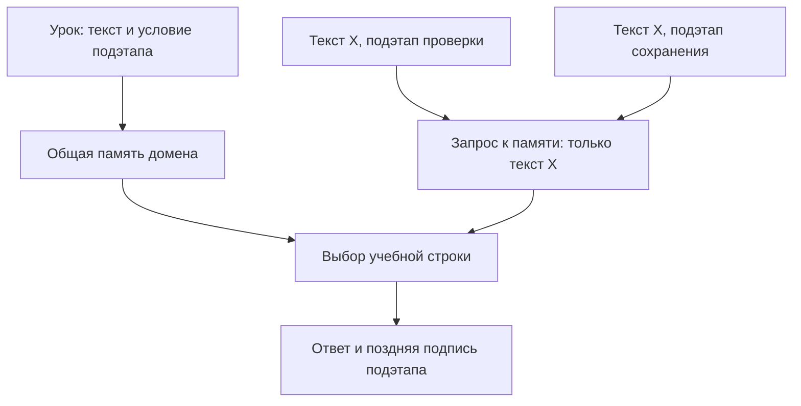

# LT19-C1. Подэтап присутствует в уроке, но исчезает из запроса к общей памяти

Дата: 19 октября 2026. Состояние: **расхождение прослежено по коду; влияние на предметное качество ещё не измерено**. Это подтверждение существующей U-N1/U-N2 с проверкой происхождения в `language_translate`, а не новая гипотеза и не установленная причина результата RP01. Новых запусков, обучения и изменений продукта в этом исследовании нет.

## Что именно может мешать обучению

Одна пользовательская задача может требовать разных результатов на разных подэтапах: например, сначала сформировать условия проверки данных, затем способ их сохранения. В исследованном пути несколько таких подэтапов одного домена выбирают одну и ту же последнюю зарегистрированную память. При одинаковом исходном тексте они передают ей одинаковый запрос. Номер подэтапа и его предикаты появляются в итоговых пояснениях уже после выбора ответа.

При фиксированных модели, индексе и настройках память не получает признака, по которому должна различить эти вызовы. Дополнительное обучение LoRA само по себе не может восстановить отсутствующее условие вызова. Это проверяемое ограничение входного контракта; оно не означает, что весь оркестратор или все Unit работают таким образом.

**Граница исторического вывода:** такая развилка есть и в `language_translate`. Поэтому это не новая регрессия между двумя ветками. Это существующее ограничение, которое нельзя переносить без проверки вместе с полезными частями старого механизма.

## Доказательства: обучение → разрешение Unit → запрос → выбранный ответ

Текущий код закреплён на `a392b6be8f8dec1e2375e2eb4fe21c2f6e8950c6`; исторический — на `f6032aff81f1f83de7c09cf9b9efe6b058dd12b9`.

1. **Условие есть на учебной стороне.** [LogicalCapabilityTrainingPreferenceProjector.ProjectCurrent, строки 118–146](https://github.com/lubochka/llm_mvp_core/blob/a392b6be8f8dec1e2375e2eb4fe21c2f6e8950c6/21.AgentInfrastructure/Logical/LogicalCapabilityTrainingPreferenceProjector.cs#L118-L146) соединяет `semantic_prompt`, `branch_result`, `sub_phase`, `SubPhaseId`, имя, назначение и предикаты. `BuildChosen` в [строках 356–361](https://github.com/lubochka/llm_mvp_core/blob/a392b6be8f8dec1e2375e2eb4fe21c2f6e8950c6/21.AgentInfrastructure/Logical/LogicalCapabilityTrainingPreferenceProjector.cs#L356-L361) также называет конкретный подэтап. Это нынешний **synthetic capability** путь, а не авторство реальной китайской модели.

2. **Память общая для нескольких ветвей домена.** [BuildKnnTrainingCorpus, строки 3467–3510](https://github.com/lubochka/llm_mvp_core/blob/a392b6be8f8dec1e2375e2eb4fe21c2f6e8950c6/18.CapabilityTraining/DefaultLogicalCapabilityTrainer.cs#L3467-L3510) объединяет выбранные replay-строки и `branchPlans`. Для этой гипотезы проблема не в числе replay-строк: она сохраняется и с полной корректной памятью.

3. **Выбор экземпляра не обусловлен подэтапом.** [GeneratedCapabilityFlowFactory.Create, строки 7312–7336](https://github.com/lubochka/llm_mvp_core/blob/a392b6be8f8dec1e2375e2eb4fe21c2f6e8950c6/18.CapabilityTraining/DefaultLogicalCapabilityTrainer.cs#L7312-L7336) вызывает `ResolveLatest<string,string>(GeneratedCapabilityUnitRole, _unitDomainTag, Probationary)`. [Registry, строки 244–290](https://github.com/lubochka/llm_mvp_core/blob/a392b6be8f8dec1e2375e2eb4fe21c2f6e8950c6/21.AgentInfrastructure/Logical/InMemoryLogicalUnitRegistry.cs#L244-L290) фильтрует роль, домен, типы и доверие, затем выбирает максимальный `RegistrationOrder`. Подэтап не является частью этого разрешения. Разные домены и разные состояния registry не входят в утверждение об одинаковом Unit.

4. **После выбора экземпляра условие не доходит до поиска.** [GeneratedCapabilityFlow.ExecuteAsync, строки 7374–7401](https://github.com/lubochka/llm_mvp_core/blob/a392b6be8f8dec1e2375e2eb4fe21c2f6e8950c6/18.CapabilityTraining/DefaultLogicalCapabilityTrainer.cs#L7374-L7401) компилирует только `request.Input` и передаёт `CanonicalText` в Unit. Метаданные передаются, но [TransformerEmbeddingKnnLogicalUnit.ExecuteAsync/ScoreCandidates, строки 165–244](https://github.com/lubochka/llm_mvp_core/blob/a392b6be8f8dec1e2375e2eb4fe21c2f6e8950c6/18.CapabilityTraining/LlmIngredientLogicalUnits.cs#L165-L244) извлекают embedding и считают lexical/pattern scores только из `request.Input`. Этот scorer не использует метаданные подэтапа или его предикаты как условие выбора.

5. **Поздняя подпись не исправляет ранний выбор.** [CapabilityResultTranslator, строки 56–86](https://github.com/lubochka/llm_mvp_core/blob/a392b6be8f8dec1e2375e2eb4fe21c2f6e8950c6/18.CapabilityTraining/CapabilityResultTranslator.cs#L56-L86) дописывает `Sub-phase` и `Focus areas`. [AppendAnnotations, строки 118–141](https://github.com/lubochka/llm_mvp_core/blob/a392b6be8f8dec1e2375e2eb4fe21c2f6e8950c6/18.CapabilityTraining/CapabilityResultTranslator.cs#L118-L141) сохраняет текст выбранного ответа. Поэтому нельзя утверждать, что translator целиком заменяет ответ; однако разные подписи могут создавать впечатление разных результатов при одной и той же извлечённой учебной строке.

Историческая пара: [language_translate — обучение с подэтапом, строки 648–682](https://github.com/lubochka/llm_mvp_core/blob/f6032aff81f1f83de7c09cf9b9efe6b058dd12b9/18.CapabilityTraining/DefaultLogicalCapabilityTrainer.cs#L648-L682), [общий ResolveLatest, строки 985–1009](https://github.com/lubochka/llm_mvp_core/blob/f6032aff81f1f83de7c09cf9b9efe6b058dd12b9/18.CapabilityTraining/DefaultLogicalCapabilityTrainer.cs#L985-L1009), [запрос после компиляции, строки 1049–1071](https://github.com/lubochka/llm_mvp_core/blob/f6032aff81f1f83de7c09cf9b9efe6b058dd12b9/18.CapabilityTraining/DefaultLogicalCapabilityTrainer.cs#L1049-L1071). Наличие ограничения в успешной ветке не отменяет успех других её задач; оно ограничивает вывод о many-to-many композиции.

## Пример механизма без исполнения

Вызов A: «Проверь данные и сохрани заявку», подэтап «проверка». Вызов B: тот же текст, подэтап «сохранение». Registry между вызовами неизменен, домен и роль одинаковы. В обоих случаях поиск получает один и тот же `CanonicalText` и одну и ту же память. При детерминированном inference он выберет ту же учебную строку; если inference имеет случайность, распределение выбора всё равно не обусловлено различающим подэтапом. Внешний Flow затем добавит разные подписи.

Это вывод из передачи данных, **не результат выполненной пробы**. Если реальный вызывающий оркестратор уже меняет сам `request.Input` для каждого подэтапа, совпадение входов не возникает: это обязательный проверяемый контраргумент.

## Точный предшественник и что добавляет этот аудит

[U-N1 в PREPARETOGPL-UNITS-RESTORE-2026-10-18, строки 73–110](https://github.com/lubochka/xiigen-planning/blob/9cea3930067f216ccb812ecc5e412aec673f5058/llm%20mvp/design%20to%20code%20session/replanning/possibleDifs/PREPARETOGPL-UNITS-RESTORE-2026-10-18.md#L73-L110) уже содержит тот же механизм: одинаковый запрос в двух подэтапах, общий последний Unit, отсутствие условия в scorer и поздние annotations. Там уже предложен scoped-memory contrast. U-N2 отдельно разбирает объединение branch plans. Поэтому первоначальная предварительная маркировка этой идеи как новой отозвана после полной сверки корпуса.

Добавлены точное сопоставление с `language_translate`, актуальные исходники и два ограничения эксперимента: условие должно применяться до ограничения кандидатов, а первый тест с одним ID на урок не доказывает пригодность жёсткого фильтра для общих и неоднозначных уроков. [Прежний разбор 26](https://github.com/lubochka/llm_mvp_core/blob/a392b6be8f8dec1e2375e2eb4fe21c2f6e8950c6/docs/plans/replanning-possible-diffs/26-routing-profiles-and-generated-flow-boundary.md) и [P92](https://github.com/lubochka/llm_mvp_core/blob/a392b6be8f8dec1e2375e2eb4fe21c2f6e8950c6/docs/plans/replanning-possible-diffs/experimets/cards/P92-dpo-memory-flow-bridge.md) остаются соседними, более общими проверками consumer. Полный результат сверки приведён в [реестре источников и новизны](06-source-and-novelty-ledger.md).

## Малый эксперимент LT19-C1: передать условие до выбора

**Тема обучения:** оркестрация. Первый профиль — проверка и сохранение заявки; второй — подготовка документации и проверка описанного поведения кода. Unit/Flow являются получателями, а не дополнительными доменами.

**Подготовка:** выбрать 4 учебных запроса с двумя подэтапами каждый — 8 исходных branch-строк. Это **не обещание 8 записей итоговой памяти**: [BuildRegistrationPlans, строки 3994–4043](https://github.com/lubochka/llm_mvp_core/blob/a392b6be8f8dec1e2375e2eb4fe21c2f6e8950c6/18.CapabilityTraining/DefaultLogicalCapabilityTrainer.cs#L3994-L4043) группирует по `SubPhaseId`, а [caller, строки 952–954](https://github.com/lubochka/llm_mvp_core/blob/a392b6be8f8dec1e2375e2eb4fe21c2f6e8950c6/18.CapabilityTraining/DefaultLogicalCapabilityTrainer.cs#L952-L954) передаёт именно registration plans в corpus builder. Без replay такой исходный batch может дать лишь 2 сгруппированные строки. Зафиксировать реально материализованный corpus, его N, IDs и выходы; grouping в этом опыте не менять. Для каждого подэтапа заранее определить требуемый полезный выход: перечень проверяемых условий либо конкретную последовательность сохранения. Шесть новых формулировок из других исходных задач дадут 12 оценочных вызовов. Код evaluator, ожидаемые ответы и список подэтапов фиксируются до вариантов. Для новых содержательных DPO внешняя открытая китайская модель создаёт обе стороны; CODEX с `astra 6 ultracode` выбирает урок и отдельным вызовом оценивает неизменённую пару. Синтетические строки старого capability producer нельзя объявлять её выводом.

**Нулевая стадия, без нового обучения:** на уже допустимой памяти записать фактические `UnitId`, `RegistrationOrder`, исходный и канонический запрос, requested `SubPhaseId`, выбранный `ExampleId`, ответ Unit до annotations и итог Flow. Проверить 2 пары вызовов с одним текстом/разными подэтапами. Если ordinary caller всегда подаёт разные достаточные тексты и выбирает правильные строки, гипотеза для этого consumer не подтверждена — расширять обучение не требуется.

Если нынешний producer допускает только свои общие synthetic capability-строки и не умеет принимать необходимые содержательные выходы, нулевая стадия всё равно проверяет передачу условия. Панель с полезными предметными выходами тогда является явно названной нижнеуровневой проверкой scorer/Flow, а не доказательством полного production admission китайских DPO. Обходить существующее принятие уроков или объявлять fixture обычным production-уроком нельзя; исправление admission, если оно понадобится, выделяется в отдельное изменение.

**Вариант A:** текущие factory, общий corpus и scorer. **Вариант B:** та же общая память, модель, tokenizer, исходные уроки и функция ранжирования; до ранжирования добавлено только явное условие допустимого подэтапа. В небольшой проверке это точное соответствие `SubPhaseId` учебной строки и запроса. Оба варианта рассматривают полный фиксированный pool всех N фактически материализованных записей; в B условие применяется до ограничения кандидатов. Фильтрация после общего HNSW top-K могла бы случайно удалить все нужные строки и смешать проверку условия с полнотой поиска. Выбор ответа внутри допустимого подмножества по-прежнему выполняет прежняя память. Условие не содержит gold ответа и не создаёт отдельную модель для каждого подэтапа. Отдельная fixture из 8 негруппированных записей, если понадобится, маркируется только как нижнеуровневый тест и не смешивается с обычным producer.

**Конкретная будущая правка для B:** сохранять `PhaseId`/`SubPhaseId` как типизированное условие в строке `GeneratedCapabilityKnnExample`; передать то же условие из `GeneratedCapabilityFlow` до `_unit.ExecuteAsync`; в `TransformerEmbeddingKnnLogicalUnit` применить его при формировании кандидатов. Новая версия corpus/manifest должна включать эти поля в identity; существующие подписанные манифесты не менять. При отсутствии условия старый corpus исполняется в явно названном режиме совместимости либо пересобирается из исходных branch records. Вводить fallback на чужой подэтап при пустом допустимом наборе в этом A/B нельзя — это второй фактор.

**Обучаемое состояние:** существующие исходные/выходные строки памяти и соответствия; θ/LoRA в этом первом опыте не меняются. Детерминированная часть — передача условия и проверка допустимости; она позволяет обратиться к нужному выученному соответствию. Полноценное обучение закона совместимости подэтапов является отдельной последующей гипотезой и не заявляется выполненным. Пересборка версии manifest и индекса для новых метаданных служит сохранению контракта и сама по себе не считается эффектом обучения.

**Измерение:** правильность выбранного подэтапа и полезность ответа Unit до annotations; затем правильность обоих выходов задачи целиком, доля отказов, ошибки перестановки проверки/сохранения, latency и размер состояния. Смена подписи, `PASS`, similarity или количества Unit не является выигрышем.

**Контроли:** один подэтап; два подэтапа с намеренно одинаковым корректным ответом; перестановка порядка регистрации при тех же данных; неизвестный подэтап; одинаковое условие при иной формулировке. Первый A/B ограничен уроками с одним явным подэтапом. Отдельно включить диагностический неоднозначный урок и общий урок, применимый к двум подэтапам: жёсткое равенство одного ID может необоснованно исключить их. Результат первого опыта не является обещанием улучшения таких случаев. После одного сохранения/загрузки оба варианта должны удержать свои ответы и условия. Исторический положительный P25 для EN→RU не доказывает этот иной формат capability corpus.

**Когда отличие подтверждено:** A теряет различимость или выбирает чужой подэтап, B при тех же уроках восстанавливает правильные два выхода на заранее заданных случаях. Для малой панели публикуются все 12 парных исходов; общего статистического обещания улучшения нет. Если меняется лишь метка или доля отказов без роста полезного покрытия, эффект на обучение не доказан. Если B не помогает, следующий вопрос — достаточен ли сам выученный выход, а не увеличение LoRA-шагов.

**Цена и завершение:** первая стадия — 4 ordinary вызова, основная — 24 оценочных вызова A/B и один round-trip на вариант; дополнительные диагностические controls выше учитываются отдельно; новых neural updates в этом опыте 0. Это граница работы, а не измеренная длительность. Измерять время каждого этапа и пик фактического процесса; сохранить все неудачные попытки. Дальнейшее обучение допускается отдельным заданием, а текущий документ только описывает эксперимент.

## Область результата

Проверены прямой capability producer, registry, factory, scorer и поздняя аннотация в обеих ветках. Не прослежены все внешние вызывающие программы и все способы формирования `request.Input`. Прямой RP01 `TextGenerator` не является данным consumer. Гипотеза относится к полноте композиции и передачи учебного условия; причина нулевых свободных ответов нейросети из неё не следует.
