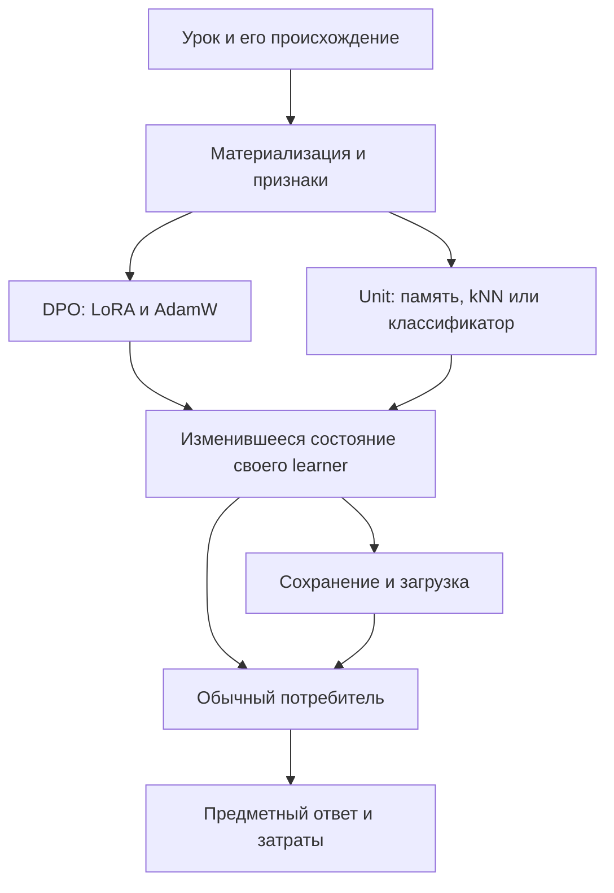

# Где может теряться обучение и что проверять первым

## Вывод

Архив не поддерживает общий вывод «обучение не работает». В нём одновременно есть изменение нейронных параметров без наблюдаемого текстового навыка, успешное приобретение памяти/композиции, предметные успехи kNN и отдельные потери материала на пути в Unit. Сравнение должно называть получателя изменения, записанное состояние и реального читателя этого состояния. Иначе восстановленный kNN-результат ошибочно сравнивается со свободным ответом сырого нейронного Student. Основания: [действующий RP01 README](https://github.com/lubochka/xiigen-planning/blob/f73d229c2810219e6b8e7b9cb4d4ec7565a6f0c9/llm%20mvp/design%20to%20code%20session/replanning/Kiro-Xiigen-RP01-Learning-First-Slice-Pack/README.md); [пересчитанные сохранённые результаты](02-retained-results-and-candidates.md); [история по доменам](wiki/01-findings.md).

Узел «состояние» означает состояние соответствующего learner, а не общие веса двух ветвей. BPE отдельно обучает словарь слияний, который затем определяет вход нейронного обучения. Подготовка данных и restore допустимы, когда показана эта связь; произвольная проверка сборки, отчёта или hash не становится экспериментом об обучении.

## Карта запрошенных направлений

Это навигация по существующим экспериментальным семействам и новые адресные дополнения. Она не выдаёт готовность всех старых шаблонов за доказанный PASS. Полные строки и ссылки находятся в [реестре 470 подслучаев](experiment-audit/per-subcase-coverage.csv).

| Направление | Возможный пробел и его причинная связь | Уже имеющееся покрытие | Решение в этом дополнении |
|---|---|---|---|
| Качество DPO | Chosen/rejected могут не отличаться после материализации; служебный marker может заменить содержание; ошибочный gold меняет учебный сигнал | P04, P05, P07, P08, P14, P106, P109, P112 | Сохранить проверку реального prompt→tokens→mask→update; не приписывать новую гипотезу уже известному marker-loss |
| Получатель обучения | Random B0, доступные q/v-LoRA и полный SFT — разные условия; обновление адаптера само по себе не доказывает исходную языковую способность | P01, P02, P49, P68 | SFT8 зарегистрирован как полезный loss-результат в своём режиме; не переносить его автоматически на frozen-base RP01 |
| Градиенты, LoRA и optimizer | Неподключённый backward, другая нормировка mask, замена optimizer/reference между уроками могут менять обучение | P09–P12, P86, P87, P105 | Сохранённый DPO8 имеет настоящие шаги 1…8 и frozen base/reference; уже исправленный fractional-mask не выдавать за новый current дефект |
| Токенизация | Capacity, контекст, OOV, UTF-8, повторное обучение словаря или смена ID могут потерять учебный контраст | P17, P71, P76, P98, P99 | Новый BPE-WEIGHTED-CHUNKS сохраняет статистику и IDs; новый DPO-TOKENIZER-SNAPSHOT уменьшает повторную подготовку, не меняя токенизацию |
| Семантические векторы | Bag-признаки могут терять порядок/роль; AST и аргументные позиции нужны для кода, POS/порядок — для языка | P16, P26–P28, P43–P45, P51, P103, P113, P122 | Wiki typed keys — отдельная коллизия типов признаков, не универсальное требование Roslyn AST для текста |
| kNN и выбор соседей | Fixed k, top1, ложные соседи, разные веса классов, duplicate IDs и фильтрация после topk меняют выученный ответ | P20–P23, P30, P35, P47, P60–P64, P77, P90, P93, P100, P107 | Учтена успешная история; N-KU сохраняется как узкий полезный результат, с majority-эффектом и регрессией |
| DPO→подуроки→Units | Потеря phrase mappings/context/типов выходов лишает конкретный Unit материала, хотя исходная пара валидна | P52–P54, P58, P88, P92, P94, P106, P118, P125 | Ingress11/24→19/24 подтверждён обычным consumer; новые N63 не дублируются |
| Детерминированные алгоритмы | Ручное правило может помогать обученной памяти или подменять её; marker/verifier может скрывать неверный ответ | P39, P42, P55–P59, P79, P80, P109, P124 | Принимать полезный измеренный эффект, но фиксировать writer/state/reader; отсутствие Train у helper не дисквалифицирует зависимый учебный путь |
| Restore и идентичность | Weights без tokenizer/schema/Unit memory/optimizer/RNG могут восстановить другое состояние | P18, P22, P25, P53, P59, P117 | P25 подтверждает конкретную TranslationMachine память. Это не сертификат всех LoRA/optimizer restore |
| Replay и забывание | Replacement Train, eviction, источник/порядок replay могут удалить выученное | P15, P24, P36, P48, P67, P74, P116, P119; поздний N63-replay | Сохранить прежние успешные donor-результаты и проверять собственный learner, не общий PASS по названию E43 |
| Flow и оркестрация | Много входов/выходов, порядок graph edges, контекст и асинхронность могут не потреблять обученное состояние | P32–P42, P50, P69, P70, P88, P92, P94–P97 | Только причинно связанный consumer; отдельного широкого orchestration прогона здесь нет |
| Стоимость обучения | Повторное вычисление признаков, копирование и frozen-state подготовка входят в фактический TRAIN/PREPARE | P101, P110, P115, N61, N62, BPE-NO-MATCH-COPY | Три новые однофакторные cost-гипотезы: weighted chunks, private tokenizer snapshot, Wiki features once |

Ссылки на соседние уже опубликованные source findings и positive candidates также сохранены в [позднем общем аудите](https://github.com/lubochka/xiigen-planning/blob/a868f46ee3695728406173f8cd945e278ddb0def/llm%20mvp/design%20to%20code%20session/replanning/possibleDifs/2026-10-20-learning-candidates-and-causal-gaps/01-axes-and-neighbor-evidence.md). Они используются как навигация к первичным источникам, не как новые результаты нашей сессии.

## Порядок действий без подмены назначения

1. **Сохранить уже доказанные полезные результаты и точно назвать показатели.** N-KU, SFT8, память перевода и restore не требуют нового запуска, чтобы считаться кандидатами. Ошибки и расходы рядом не стирают полезный выигрыш.
2. **Закрыть технические препятствия назначенного обучающего опыта.** Для BPE учтены сообщение пользователя о длинном Windows-пути и новая карточка с коротким workspace. Статус прежней попытки — до начала обучения, а не «нулевое качество». Не стирать её файлы; не возвращаться к N-KU после команды перейти.
3. **Разрешить конфликты карточек до передачи исполнителю.** Default model, точные входы/путь/output, единый смысл before/after и запрет самостоятельного расширения должны быть в адресном поручении. См. [аудит и поздние исправления](experiment-audit/README.md).
4. **Новые обновления сначала проверять как один небольшой опыт на копии native кода.** Четыре карточки этого пакета не связаны в обязательный конвейер. Их нельзя автоматически поставить перед уже выбранным пользователем экспериментом; зависимости между ними отсутствуют.
5. **Косвенные темы — только при доказанной связи с обученным состоянием.** Restore обученной памяти подходит; оформление отчёта или обычная инфраструктурная проверка без влияния на обучение — не самостоятельный опыт. Продуктовые тесты и внедрение остаются после решения пользователя.

## Граница доменов

Для C# структурные признаки используют синтаксические роли и положение узлов. Для естественного языка важны порядок, POS, отрицание и грамматические связи. Wiki-route — предмет документации проекта; исправление маршрутизации не равно улучшению содержания документа. BPE-панель EN→RU не доказывает переводческую способность LLM. Однотипное слово «точность» в этих задачах обозначает разные gold и знаменатели; проценты нельзя суммировать.

Сравнение соседних веток в [историческом разделе](wiki/01-findings.md) отделяет прежний обучаемый механизм от его применения как матрицы. Отрицательный matrix-опыт не отменяет положительный kNN-результат, но разные targets/splits не дают чистого A/B переноса. Совпадающий исходный файл также нельзя объявить новой регрессией текущей ветки.

**Управление задачей:** при «следующий» сразу оставить текущую задачу и перейти только к назначенной следующей; при «стоп» остановить работу. Ни незавершённый отчёт, ни этот приоритетный список не разрешают продолжение старого опыта. Модель исполнителя по умолчанию, отчёт русский; перенос кандидата в продукт — решение пользователя.
