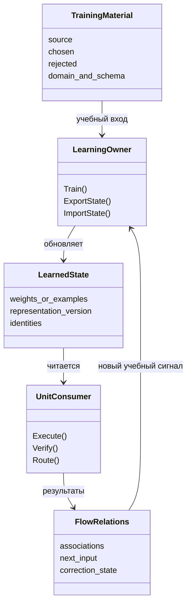

# Действительный путь обучения и карта возможных потерь

> **Окончательный срез аудита:** native code совпадает с прочитанным `62bcc8f`; адресная документная сверка доведена до core `ce890a48efda7f00d0ee040f2383cc2d06428ea6` и planning `3b625a83ee878906d42544516741849a16c04689`. В protected **291 Markdown / 128 файлов карточек**. N61 уже покрывают Mode1 и reference reuse; N-KU имеет опубликованную узкую таблицу ответов; N60-E2 конкретизировал writer/state/reader, но host не завершён. Числа 286/126/577 ниже — исходный воспроизводимый срез. [Поздние изменения и приоритет версий](06-CONCURRENT-UPDATES.md), [последняя дельта core](coverage/06-FINAL-CORE-DELTA-ce890a.md).

## Как отличать приобретённое умение от внешнего признака успеха

Для каждой гипотезы ищутся четыре вещи: точный учебный вход; метод, меняющий состояние; сохранённое состояние; метод, который затем использует его для собственного ответа или следующего update. Детерминированное исполнение само по себе допустимо. Обученный kNN, таблица фраз или perceptron могут приобретать знание. Детерминированный шаблон с неизменными правилами может давать правильный ответ, но этот ответ ещё не доказывает эффект обучения.

Первичные [ILearningMachine notes][machine-notes] и [RP01 source map][rp01] различают owner обучения, Unit, Flow, orchestration и graph. Train размещён на ILearningMachine; из отсутствия одноимённого метода на каждом Unit нельзя выводить отсутствие всей учебной архитектуры. С другой стороны, фиксация набора Units не доказывает обучение отношений Flow.

Это схема проверки причинной связи, а не утверждение, что все указанные методы уже существуют в одном классе. В ней названные в карточке source methods заменяют общие роли. «Домен» — предмет задачи; EN→RU — профиль перевода; LoRA/kNN — механизм, Unit/Flow — уровень организации.

## Полная карта запрошенных направлений

Таблица указывает **покрытие и риск**, не объявляет каждую историческую проблему текущим дефектом. Все ссылки P ведут к защищённому срезу от 20 октября. Их 470 подслучаев сохранены в [реестре](coverage/subcases.tsv); для запуска выбирается один конкретный фактор.

| Направление пользователя | Что требуется сохранить и где возможна потеря | Уже описанные опыты | Текущий вывод и ограничение |
|---|---|---|---|
| Качество DPO | Реальные prompt/chosen/rejected; смысловой контраст после materializer; происхождение gold; независимость EXAM | [P04][p04], [P07][p07], [P14][p14], [P46][p46], [P91][p91], [P109][p109] | Разные JSON не гарантируют разные model-visible targets. ProjectWiki pipeline преобразует CodeTrace DPO в фиксированные PREFERRED/REJECTED markers: известный N49, не новое открытие |
| Механизм LoRA | Нужный recipient, q/v topology, rank/alpha/dropout, frozen base и reference | [P01][p01], [P02][p02], [P06][p06], [P105][p105], [P121][p121] | В текущем DpoTrainer есть фактические q/v-LoRA bindings и optimizer. «LoRA не учится вообще» по имени pipeline утверждать нельзя. Новая transpose-гипотеза касается цены реальных updates |
| Численный update | Знак/масштаб производной; mask; сумма/среднее; token weights; clipping/LR/optimizer | [P05][p05], [P10][p10], [P11][p11], [P12][p12], [P86][p86], [P87][p87], [P119][p119] | Текущий backward log-softmax использует `(oh-sm)*targetScale`; старый противоположный знак не заявляется текущим. SFT scheduler нельзя без caller приписывать DPO |
| Вектор и tokenizer | Координаты, версия vocab, Unicode/числа/операторы, refit при старом индексе, длина/порядок/роли | [P16][p16], [P17][p17], [P27][p27], [P71][p71], [P98][p98], [P99][p99], [P113][p113], [P122][p122] | `VectorSignal` в текущем StepVector учитывает число ненулевых слотов, а не их предметный смысл. Это известная ось. BPE no-match copy — отдельная новая гипотеза стоимости Train |
| kNN | Допустимость соседей, полнота индекса, число реально используемых hits, votes, fusion, negative memory | [P20][p20]–[P24][p24], [P26][p26]–[P30][p30], [P35][p35], [P43][p43]–[P45][p45], [P55][p55], [P64][p64], [P107][p107] | Generic KnnLogicalUnit возвращает output первого hit, другие идут в evidence. Это уже известно; нельзя усреднять произвольный TOutput без его контракта. AST/POS/порядок применяются предметно |
| Восстановление модели | Model/tokenizer/adapter, optimizer/RNG, state identity, индекс и representation | [P18][p18], [P22][p22], [P25][p25], [P59][p59], [P105][p105], [P121][p121] | P25 уже подтвердил сохранность конкретной EN→RU памяти. Это не доказательство resume нейронного optimizer и не разрешение игнорировать новые label dimensions |
| DPO → под-Units | Смысл выбранной/отвергнутой стороны должен попасть в адресного learner и ordinary reader | [P52][p52], [P53][p53], [P70][p70], [P92][p92], [P106][p106], [P118][p118] | Translation builder разлагает пару на semantic/executor/verifier; их targets различны. У Executor rejected не играет роль DPO-loss. Обучение kNN-памяти нельзя выдавать за генеративный Student |
| Сами Units | Typed outputs/associations, schema, learned/static branches, classifier labels, ambiguity | [P33][p33]–[P39][p39], [P53][p53], [P94][p94] | Новые WIKI-TAXONOMY и WIKI-MARGIN имеют конкретный native writer и reader. Они не заменяют известный KN-ROUTER keyword fix: другой класс и другой механизм |
| Flow и graph | Меняются ли отношения output→input; сохранена ли адресность pair/Flow; может ли новый сигнал дойти до следующего выбора | [P40][p40]–[P42][p42], [P88][p88], [P95][p95]–[P97][p97], [P111][p111], [P123][p123], [P124][p124] | Число edges/toposort/PageRank само по себе не доказывает обучение. Две прежние Mode1-гипотезы уже добавлены в protected новой N61; см. позднюю сверку. Исполнение не доказано одним наличием текста |
| Curriculum/retention | Выбранные уроки и реальный feedback; replay исходного state; время оценки | [P15][p15], [P24][p24], [P40][p40], [P48][p48], [P58][p58], [P119][p119] | E43 — полезный исторический результат счётчиков с replay, не доказанный resume нейронного состояния. H60-A/B требуют реальной истории, не подставленных .9/.5 |
| Метрики | Тот же EXAM/знаменатель/decoder и интервалы измерения; собственный ответ, отказ и false acceptance раздельно | [P57][p57], [P66][p66], [P71][p71], [P77][p77], [P80][p80], [P82][p82], [P93][p93], [P102][p102], [P112][p112] | Метрика контроля обучения допустима при доказанной роли. Красивый PASS, loss, margin или hash по отдельности не доказывают новое предметное умение |

## Что прочитано в actual native code

### 1. Нейронный путь действительно делает update, но его receipt уже предметного результата

[DpoTrainer][dpo] связывает q/v-LoRA recipient (190–245), выполняет StepVector (845–935), reference и policy forwards, противоположные backward для chosen/rejected, optimizer step и ZeroGrad. Это не пустая обёртка. Текущий lower clamp веса до 0.01 и active-slot VectorSignal — предметы существующих P114/P06, а не четыре новых гипотезы только от повторного чтения.

[CodeDocumentationSimulationDpoExperiment][simulation] вызывает тот же StepVector и фиксирует реальные обновления. В его simulation не надо придумывать внешний teacher; источник материала и статус simulation сохраняются. Нужные ресурсы считаются на whole update, а качество собственных ответов требует своего измерителя. Нельзя заменить маленький native эксперимент формулой логистической регрессии только потому, что она удобнее запускается.

Новое ресурсное изменение [transpose](experiments/linear-transpose/README.md) не меняет objective: [Linear.Forward][linear] копирует базовую матрицу при каждом вызове; [LoraLinear][lora] вызывает `_base.Forward`, затем использует актуальные обучаемые A/B. Кэш относится только к базе с доказанной неизменностью. A/B не кэшируются. Цена первого заполнения и память кэша входят в результат.

### 2. Одна Translation DPO-пара превращается в разные виды уроков

[BuildGeneralBatch][translation-builder] (77–145) извлекает tags/mappings и создаёт semantic, executor и verifier rows. В [TranslationMachine.TrainStructuredBatchAsync][translation-machine] (92–137) строки отправляются адресным `TrainOnExample`. В [ExecutorUnit][translation-units] (403–457) chosen записывается в exact, kNN, word/phrase memories. Прочитанный код не использует отвергнутую сторону как pairwise neural objective. Поэтому опыт «изменить только rejected и ждать иной Executor exact-store» без достигающего механизма неверно поставлен.

При одинаковых chosen/rejected builder способен создать противоречивый verifier fail-урок. Это известный N60-E1. В конкретном текущем материале есть дополнительная проблема достижения marker writer; [overlay](corrections/02-N60-E1-fixture-correction.md) задаёт различающие данные, а не одновременно чинит tokenizer и admission. Снижение false rejection при росте false acceptance — две разные измеренные оси, допустимый успех первой не прячет ухудшение второй.

### 3. Новые классы ProjectWiki отсутствуют именно в обучаемом отображении

[Enum][wiki-enum] содержит новые `SystemBoundaryMapperTraining` и `CrossStackBusinessFlowGraphTraining`; [static routing][wiki-router] распознаёт их. Но [learner][wiki-model] `Labels` 25–42 содержит старые 15, `LabelIndex` 295–303 подменяет незнакомую целевую метку `NotProjectWiki`, а learned switch не выдаёт новые маршруты. Это даёт проверяемое искажение учебного target. У стандартных seeds/оценки нет достаточного покрытия новых типов, поэтому прежний aggregate score его может не показать.

Кандидат taxonomy в эксперименте дописывает две метки **после** старых 15 и согласует learned decision. Автоматическое `Enum.GetValues` не используется: оно сдвинуло бы позиционные значения старого state. Проверка свежего Train не означает, что миграция прежних snapshots доказана. Эта отдельная граница сохранена.

Отдельный [margin-кандидат](experiments/wiki-margin/README.md) не меняет taxonomy, gate или features. Он обновляет ожидаемый класс против лучшего **другого** класса, если разрыв мал. При правильном argmax нельзя прибавить и вычесть один и тот же класс: эффект занулится. Четыре контрольных запроса включают OOD, чтобы рост уверенности не выдавался за безусловное улучшение маршрутизации.

### 4. У Design Conversion фиксированный код и learned state должны оцениваться вместе

В [BuildLocalImprovementPlan][design-units] без положительных обученных weights выбираются все доступные rules; после ранжирования может выбираться только один. Поэтому увеличение отдельного learned weight не гарантирует лучшее исправление многофакторного дефекта. В [DesignConversionMachine][design-machine] 2752–2798 staging отвергает checkpoint при invalid feature, а 2965–2988 margin может опираться на заданные scores или default. Это уже известные GDC/CLEANCP вопросы. Они помещены в карту как зависимости обучения; повторно за новые не выдаются.

### 5. Детерминированность — свойство выполнения, а не диагноз отсутствия обучения

Перцептрон выполняет детерминированный argmax над обученными весами; kNN детерминированно ищет соседей в выученной памяти; Executor собирает фразу из приобретённых mappings. Все три могут улучшать полезный результат вследствие Train. Проблема возникает, когда собственный результат берётся из fixed template/gold/fallback и не зависит от обновлённого state, либо когда materializer уничтожил полезный контраст. Старое [руководство оценки][old-quality-guide] местами исключает kNN/словари по типу механизма; это правило не применяется к текущему поручению. Нужна конкретная причинная цепочка.

## Статусы покрытия, которые нельзя смешивать

**Описан** — механизм присутствует в каталоге. **Подготовлен** — есть точные источники, материал, одно изменение и caller. **Собран** — compiler подтвердил host. **Выполнен** — есть raw results с фактическим Train/reader. **Подтверждён в данном домене** — измерен полезный выигрыш именно на заявленном показателе. Ни один статус не превращается в следующий автоматически.

Здесь полный файловый census и семейная карта; адресная code validation выполнена для приведённых механизмов. Нельзя назвать 470 строк реестра 470 независимо проверенными программами. Все обнаруженные пробелы представлены как добавочные карточки/исправления либо явно незавершённый контракт, а не скрыты статусом «покрыто».

[design-machine]: https://github.com/lubochka/llm_mvp_core/blob/62bcc8f2368840e22d2ea98ef16d9bd526ad9a39/44.DesignConversionDomain/DesignConversionMachine.cs
[design-units]: https://github.com/lubochka/llm_mvp_core/blob/62bcc8f2368840e22d2ea98ef16d9bd526ad9a39/44.DesignConversionDomain/DesignConversionTrainedUnits.cs#L300-L355
[dpo]: https://github.com/lubochka/llm_mvp_core/blob/62bcc8f2368840e22d2ea98ef16d9bd526ad9a39/11.DPO/DpoTrainer.cs
[linear]: https://github.com/lubochka/llm_mvp_core/blob/62bcc8f2368840e22d2ea98ef16d9bd526ad9a39/00.TensorCore/Layers/Linear.cs#L44-L50
[lora]: https://github.com/lubochka/llm_mvp_core/blob/62bcc8f2368840e22d2ea98ef16d9bd526ad9a39/10.LoRA/LoraLinear.cs
[machine-notes]: https://github.com/lubochka/xiigen-planning/blob/fb9aadf69e0669d36b820d61f76fe3ecc8697a7d/llm%20mvp/dpo%20legal%20build/03-ilearningmachine-pattern-notes.md
[old-quality-guide]: https://github.com/lubochka/xiigen-planning/blob/fb9aadf69e0669d36b820d61f76fe3ecc8697a7d/llm%20mvp/dpo%20legal%20build/active-codex-execution-guide-03-how-to-measure-quality.md
[p01]: https://github.com/lubochka/llm_mvp_core/blob/62bcc8f2368840e22d2ea98ef16d9bd526ad9a39/docs/plans/replanning-possible-diffs/experimets/cards/P01-trainable-recipient.md
[p02]: https://github.com/lubochka/llm_mvp_core/blob/62bcc8f2368840e22d2ea98ef16d9bd526ad9a39/docs/plans/replanning-possible-diffs/experimets/cards/P02-warm-base.md
[p04]: https://github.com/lubochka/llm_mvp_core/blob/62bcc8f2368840e22d2ea98ef16d9bd526ad9a39/docs/plans/replanning-possible-diffs/experimets/cards/P04-preference-contrast.md
[p05]: https://github.com/lubochka/llm_mvp_core/blob/62bcc8f2368840e22d2ea98ef16d9bd526ad9a39/docs/plans/replanning-possible-diffs/experimets/cards/P05-response-length-objective.md
[p06]: https://github.com/lubochka/llm_mvp_core/blob/62bcc8f2368840e22d2ea98ef16d9bd526ad9a39/docs/plans/replanning-possible-diffs/experimets/cards/P06-teaching-vector-adamw.md
[p07]: https://github.com/lubochka/llm_mvp_core/blob/62bcc8f2368840e22d2ea98ef16d9bd526ad9a39/docs/plans/replanning-possible-diffs/experimets/cards/P07-materialized-token-contrast.md
[p10]: https://github.com/lubochka/llm_mvp_core/blob/62bcc8f2368840e22d2ea98ef16d9bd526ad9a39/docs/plans/replanning-possible-diffs/experimets/cards/P10-composed-gradient.md
[p102]: https://github.com/lubochka/llm_mvp_core/blob/62bcc8f2368840e22d2ea98ef16d9bd526ad9a39/docs/plans/replanning-possible-diffs/experimets/cards/P102-teacher-forced-decoding.md
[p105]: https://github.com/lubochka/llm_mvp_core/blob/62bcc8f2368840e22d2ea98ef16d9bd526ad9a39/docs/plans/replanning-possible-diffs/experimets/cards/P105-frozen-reference.md
[p106]: https://github.com/lubochka/llm_mvp_core/blob/62bcc8f2368840e22d2ea98ef16d9bd526ad9a39/docs/plans/replanning-possible-diffs/experimets/cards/P106-corrected-semantic-target.md
[p107]: https://github.com/lubochka/llm_mvp_core/blob/62bcc8f2368840e22d2ea98ef16d9bd526ad9a39/docs/plans/replanning-possible-diffs/experimets/cards/P107-lawful-neighbor-aggregation.md
[p109]: https://github.com/lubochka/llm_mvp_core/blob/62bcc8f2368840e22d2ea98ef16d9bd526ad9a39/docs/plans/replanning-possible-diffs/experimets/cards/P109-gold-validity.md
[p11]: https://github.com/lubochka/llm_mvp_core/blob/62bcc8f2368840e22d2ea98ef16d9bd526ad9a39/docs/plans/replanning-possible-diffs/experimets/cards/P11-autograd-reachability.md
[p111]: https://github.com/lubochka/llm_mvp_core/blob/62bcc8f2368840e22d2ea98ef16d9bd526ad9a39/docs/plans/replanning-possible-diffs/experimets/cards/P111-reward-credit.md
[p112]: https://github.com/lubochka/llm_mvp_core/blob/62bcc8f2368840e22d2ea98ef16d9bd526ad9a39/docs/plans/replanning-possible-diffs/experimets/cards/P112-family-disjoint-evaluation.md
[p113]: https://github.com/lubochka/llm_mvp_core/blob/62bcc8f2368840e22d2ea98ef16d9bd526ad9a39/docs/plans/replanning-possible-diffs/experimets/cards/P113-feature-energy.md
[p118]: https://github.com/lubochka/llm_mvp_core/blob/62bcc8f2368840e22d2ea98ef16d9bd526ad9a39/docs/plans/replanning-possible-diffs/experimets/cards/P118-projectwiki-content.md
[p119]: https://github.com/lubochka/llm_mvp_core/blob/62bcc8f2368840e22d2ea98ef16d9bd526ad9a39/docs/plans/replanning-possible-diffs/experimets/cards/P119-learning-dynamics.md
[p12]: https://github.com/lubochka/llm_mvp_core/blob/62bcc8f2368840e22d2ea98ef16d9bd526ad9a39/docs/plans/replanning-possible-diffs/experimets/cards/P12-optimizer-boundaries.md
[p121]: https://github.com/lubochka/llm_mvp_core/blob/62bcc8f2368840e22d2ea98ef16d9bd526ad9a39/docs/plans/replanning-possible-diffs/experimets/cards/P121-project-adapter-selection.md
[p122]: https://github.com/lubochka/llm_mvp_core/blob/62bcc8f2368840e22d2ea98ef16d9bd526ad9a39/docs/plans/replanning-possible-diffs/experimets/cards/P122-root-channel-unicode-digits-operators.md
[p123]: https://github.com/lubochka/llm_mvp_core/blob/62bcc8f2368840e22d2ea98ef16d9bd526ad9a39/docs/plans/replanning-possible-diffs/experimets/cards/P123-design-conversion-critic-evidence.md
[p124]: https://github.com/lubochka/llm_mvp_core/blob/62bcc8f2368840e22d2ea98ef16d9bd526ad9a39/docs/plans/replanning-possible-diffs/experimets/cards/P124-p3-fixed-discriminator-contract.md
[p14]: https://github.com/lubochka/llm_mvp_core/blob/62bcc8f2368840e22d2ea98ef16d9bd526ad9a39/docs/plans/replanning-possible-diffs/experimets/cards/P14-teacher-provenance.md
[p15]: https://github.com/lubochka/llm_mvp_core/blob/62bcc8f2368840e22d2ea98ef16d9bd526ad9a39/docs/plans/replanning-possible-diffs/experimets/cards/P15-retention-replay.md
[p16]: https://github.com/lubochka/llm_mvp_core/blob/62bcc8f2368840e22d2ea98ef16d9bd526ad9a39/docs/plans/replanning-possible-diffs/experimets/cards/P16-semantic-order-roles.md
[p17]: https://github.com/lubochka/llm_mvp_core/blob/62bcc8f2368840e22d2ea98ef16d9bd526ad9a39/docs/plans/replanning-possible-diffs/experimets/cards/P17-tokenizer-refit.md
[p18]: https://github.com/lubochka/llm_mvp_core/blob/62bcc8f2368840e22d2ea98ef16d9bd526ad9a39/docs/plans/replanning-possible-diffs/experimets/cards/P18-state-identity.md
[p20]: https://github.com/lubochka/llm_mvp_core/blob/62bcc8f2368840e22d2ea98ef16d9bd526ad9a39/docs/plans/replanning-possible-diffs/experimets/cards/P20-hnsw-reachability.md
[p22]: https://github.com/lubochka/llm_mvp_core/blob/62bcc8f2368840e22d2ea98ef16d9bd526ad9a39/docs/plans/replanning-possible-diffs/experimets/cards/P22-hnsw-rng-continuation.md
[p24]: https://github.com/lubochka/llm_mvp_core/blob/62bcc8f2368840e22d2ea98ef16d9bd526ad9a39/docs/plans/replanning-possible-diffs/experimets/cards/P24-replay-selection.md
[p25]: https://github.com/lubochka/llm_mvp_core/blob/62bcc8f2368840e22d2ea98ef16d9bd526ad9a39/docs/plans/replanning-possible-diffs/experimets/cards/P25-cold-restore.md
[p26]: https://github.com/lubochka/llm_mvp_core/blob/62bcc8f2368840e22d2ea98ef16d9bd526ad9a39/docs/plans/replanning-possible-diffs/experimets/cards/P26-structural-features.md
[p27]: https://github.com/lubochka/llm_mvp_core/blob/62bcc8f2368840e22d2ea98ef16d9bd526ad9a39/docs/plans/replanning-possible-diffs/experimets/cards/P27-structural-codec.md
[p30]: https://github.com/lubochka/llm_mvp_core/blob/62bcc8f2368840e22d2ea98ef16d9bd526ad9a39/docs/plans/replanning-possible-diffs/experimets/cards/P30-learned-fusion-alpha.md
[p33]: https://github.com/lubochka/llm_mvp_core/blob/62bcc8f2368840e22d2ea98ef16d9bd526ad9a39/docs/plans/replanning-possible-diffs/experimets/cards/P33-domain-classifier.md
[p35]: https://github.com/lubochka/llm_mvp_core/blob/62bcc8f2368840e22d2ea98ef16d9bd526ad9a39/docs/plans/replanning-possible-diffs/experimets/cards/P35-actual-neighbor-votes.md
[p39]: https://github.com/lubochka/llm_mvp_core/blob/62bcc8f2368840e22d2ea98ef16d9bd526ad9a39/docs/plans/replanning-possible-diffs/experimets/cards/P39-oracle-output-separation.md
[p40]: https://github.com/lubochka/llm_mvp_core/blob/62bcc8f2368840e22d2ea98ef16d9bd526ad9a39/docs/plans/replanning-possible-diffs/experimets/cards/P40-router-feedback.md
[p42]: https://github.com/lubochka/llm_mvp_core/blob/62bcc8f2368840e22d2ea98ef16d9bd526ad9a39/docs/plans/replanning-possible-diffs/experimets/cards/P42-checker-arbiter.md
[p43]: https://github.com/lubochka/llm_mvp_core/blob/62bcc8f2368840e22d2ea98ef16d9bd526ad9a39/docs/plans/replanning-possible-diffs/experimets/cards/P43-contextual-pos.md
[p45]: https://github.com/lubochka/llm_mvp_core/blob/62bcc8f2368840e22d2ea98ef16d9bd526ad9a39/docs/plans/replanning-possible-diffs/experimets/cards/P45-learned-reordering.md
[p46]: https://github.com/lubochka/llm_mvp_core/blob/62bcc8f2368840e22d2ea98ef16d9bd526ad9a39/docs/plans/replanning-possible-diffs/experimets/cards/P46-pair-value.md
[p48]: https://github.com/lubochka/llm_mvp_core/blob/62bcc8f2368840e22d2ea98ef16d9bd526ad9a39/docs/plans/replanning-possible-diffs/experimets/cards/P48-weighting-curriculum.md
[p52]: https://github.com/lubochka/llm_mvp_core/blob/62bcc8f2368840e22d2ea98ef16d9bd526ad9a39/docs/plans/replanning-possible-diffs/experimets/cards/P52-semantic-annotation.md
[p53]: https://github.com/lubochka/llm_mvp_core/blob/62bcc8f2368840e22d2ea98ef16d9bd526ad9a39/docs/plans/replanning-possible-diffs/experimets/cards/P53-batch-atomicity.md
[p55]: https://github.com/lubochka/llm_mvp_core/blob/62bcc8f2368840e22d2ea98ef16d9bd526ad9a39/docs/plans/replanning-possible-diffs/experimets/cards/P55-translation-laws.md
[p57]: https://github.com/lubochka/llm_mvp_core/blob/62bcc8f2368840e22d2ea98ef16d9bd526ad9a39/docs/plans/replanning-possible-diffs/experimets/cards/P57-semantic-measurement.md
[p58]: https://github.com/lubochka/llm_mvp_core/blob/62bcc8f2368840e22d2ea98ef16d9bd526ad9a39/docs/plans/replanning-possible-diffs/experimets/cards/P58-feedback-learning.md
[p59]: https://github.com/lubochka/llm_mvp_core/blob/62bcc8f2368840e22d2ea98ef16d9bd526ad9a39/docs/plans/replanning-possible-diffs/experimets/cards/P59-correction-visibility.md
[p64]: https://github.com/lubochka/llm_mvp_core/blob/62bcc8f2368840e22d2ea98ef16d9bd526ad9a39/docs/plans/replanning-possible-diffs/experimets/cards/P64-tier-postfilter.md
[p66]: https://github.com/lubochka/llm_mvp_core/blob/62bcc8f2368840e22d2ea98ef16d9bd526ad9a39/docs/plans/replanning-possible-diffs/experimets/cards/P66-heldout-contrast.md
[p70]: https://github.com/lubochka/llm_mvp_core/blob/62bcc8f2368840e22d2ea98ef16d9bd526ad9a39/docs/plans/replanning-possible-diffs/experimets/cards/P70-wikitrace-context.md
[p71]: https://github.com/lubochka/llm_mvp_core/blob/62bcc8f2368840e22d2ea98ef16d9bd526ad9a39/docs/plans/replanning-possible-diffs/experimets/cards/P71-perplexity-alphabet.md
[p77]: https://github.com/lubochka/llm_mvp_core/blob/62bcc8f2368840e22d2ea98ef16d9bd526ad9a39/docs/plans/replanning-possible-diffs/experimets/cards/P77-rare-class-support.md
[p80]: https://github.com/lubochka/llm_mvp_core/blob/62bcc8f2368840e22d2ea98ef16d9bd526ad9a39/docs/plans/replanning-possible-diffs/experimets/cards/P80-marker-denominator.md
[p82]: https://github.com/lubochka/llm_mvp_core/blob/62bcc8f2368840e22d2ea98ef16d9bd526ad9a39/docs/plans/replanning-possible-diffs/experimets/cards/P82-file-split.md
[p86]: https://github.com/lubochka/llm_mvp_core/blob/62bcc8f2368840e22d2ea98ef16d9bd526ad9a39/docs/plans/replanning-possible-diffs/experimets/cards/P86-fractional-response-mask.md
[p87]: https://github.com/lubochka/llm_mvp_core/blob/62bcc8f2368840e22d2ea98ef16d9bd526ad9a39/docs/plans/replanning-possible-diffs/experimets/cards/P87-mixed-objectives.md
[p88]: https://github.com/lubochka/llm_mvp_core/blob/62bcc8f2368840e22d2ea98ef16d9bd526ad9a39/docs/plans/replanning-possible-diffs/experimets/cards/P88-unit-context-consumption.md
[p91]: https://github.com/lubochka/llm_mvp_core/blob/62bcc8f2368840e22d2ea98ef16d9bd526ad9a39/docs/plans/replanning-possible-diffs/experimets/cards/P91-method-pair-split.md
[p92]: https://github.com/lubochka/llm_mvp_core/blob/62bcc8f2368840e22d2ea98ef16d9bd526ad9a39/docs/plans/replanning-possible-diffs/experimets/cards/P92-dpo-memory-flow-bridge.md
[p93]: https://github.com/lubochka/llm_mvp_core/blob/62bcc8f2368840e22d2ea98ef16d9bd526ad9a39/docs/plans/replanning-possible-diffs/experimets/cards/P93-confidence-abstention.md
[p94]: https://github.com/lubochka/llm_mvp_core/blob/62bcc8f2368840e22d2ea98ef16d9bd526ad9a39/docs/plans/replanning-possible-diffs/experimets/cards/P94-typed-many-results.md
[p95]: https://github.com/lubochka/llm_mvp_core/blob/62bcc8f2368840e22d2ea98ef16d9bd526ad9a39/docs/plans/replanning-possible-diffs/experimets/cards/P95-learned-flow-edge.md
[p97]: https://github.com/lubochka/llm_mvp_core/blob/62bcc8f2368840e22d2ea98ef16d9bd526ad9a39/docs/plans/replanning-possible-diffs/experimets/cards/P97-learned-graph-order.md
[p98]: https://github.com/lubochka/llm_mvp_core/blob/62bcc8f2368840e22d2ea98ef16d9bd526ad9a39/docs/plans/replanning-possible-diffs/experimets/cards/P98-tokenizer-capacity.md
[p99]: https://github.com/lubochka/llm_mvp_core/blob/62bcc8f2368840e22d2ea98ef16d9bd526ad9a39/docs/plans/replanning-possible-diffs/experimets/cards/P99-unknown-token-id.md
[rp01]: https://github.com/lubochka/xiigen-planning/blob/fb9aadf69e0669d36b820d61f76fe3ecc8697a7d/llm%20mvp/design%20to%20code%20session/replanning/Kiro-Xiigen-RP01-Learning-First-Slice-Pack/SOURCE-AND-ARCHITECTURE.md
[simulation]: https://github.com/lubochka/llm_mvp_core/blob/62bcc8f2368840e22d2ea98ef16d9bd526ad9a39/14.ContinuousLearning/Training/CodeDocumentationSimulationDpoExperiment.cs
[translation-builder]: https://github.com/lubochka/llm_mvp_core/blob/62bcc8f2368840e22d2ea98ef16d9bd526ad9a39/27.TranslationDomain/TranslationStructuredBatchBuilder.cs
[translation-machine]: https://github.com/lubochka/llm_mvp_core/blob/62bcc8f2368840e22d2ea98ef16d9bd526ad9a39/27.TranslationDomain/TranslationMachine.cs
[translation-units]: https://github.com/lubochka/llm_mvp_core/blob/62bcc8f2368840e22d2ea98ef16d9bd526ad9a39/27.TranslationDomain/TranslationTrainedUnits.cs
[wiki-enum]: https://github.com/lubochka/llm_mvp_core/blob/62bcc8f2368840e22d2ea98ef16d9bd526ad9a39/42.ProjectWikiDomain/ProjectWikiDomainModels.cs#L473-L492
[wiki-model]: https://github.com/lubochka/llm_mvp_core/blob/62bcc8f2368840e22d2ea98ef16d9bd526ad9a39/42.ProjectWikiDomain/ProjectWikiRequestRoutingTrainableModel.cs
[wiki-router]: https://github.com/lubochka/llm_mvp_core/blob/62bcc8f2368840e22d2ea98ef16d9bd526ad9a39/42.ProjectWikiDomain/ProjectWikiRequestRouterUnit.cs#L55-L68
