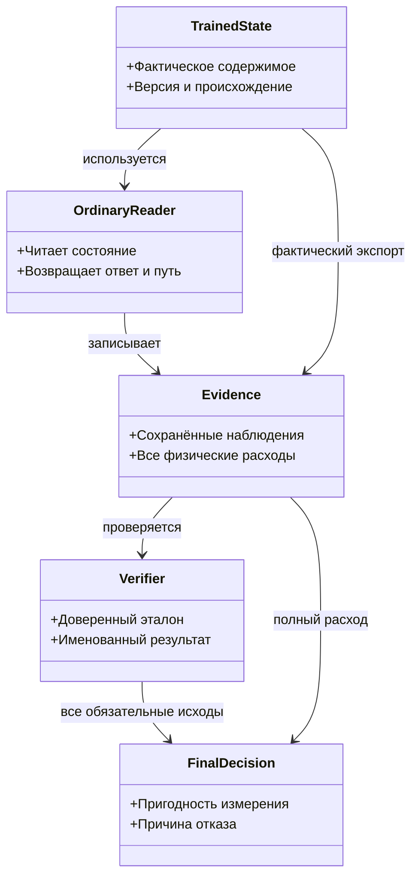

# После P117: что перенесено в код, что доказано опытом и что надо исправить

**Проверенные снимки:** core `879a07bcd4dd747b3672f9ab32492bd23d14b5ea`, planning `66c53bbb654f4e297e611767cd10298a6f4567bb`. Это текущая адресная сверка после [POST113](codex-2026-11-02-POST113-TRANSFER-AND-EXPERIMENT-AUDIT.md). Старые отчёты и результаты сохраняют дату и предел своего доказательства. Этот проход прочитал исходники и сохранённые данные, пересчитал арифметику и текстовые отпечатки; новые сборки, нативные тесты, обучение и обращения к модели не выполнялись.

## Главный вывод

**Следующая публикационная дельта918765f.** В [routing helper:365–426](https://github.com/lubochka/llm_mvp_core/blob/918765f8ad4e486fab9629b9abb43b0e4c1f6651/42.ProjectWikiDomain/ProjectWikiRequestRoutingTrainableModel.cs#L365-L426) finite-проверки трёх observations и сравнение с доверенными0.95/1.0/0.85 уже написаны; сохранённые thresholds должны совпасть с этой policy. [Orchestration gate:580–618](https://github.com/lubochka/llm_mvp_core/blob/918765f8ad4e486fab9629b9abb43b0e4c1f6651/42.ProjectWikiDomain/OrchestrationPlanMachine.cs#L580-L618) проверяет finite, диапазон[0,1] и.75; оба import-входа вызывают его до mutation. Противоречащий passed-checkpoint теперь даёт typed отказ. S03/S06 нельзя назначать как полностью отсутствующие механизмы. Открыты routing upper ranges и binding evidence к фактически оценённому snapshot, явное различие legacy unknown count и measured0, а также оставшаяся приёмка. Девять новых тестов присутствуют в исходнике и UNRUN: четыре ordinary routing, три direct ImportCheckpoint, два ImportAsync. File bytes→LoadCheckpoint и обученные state/ответы после отказа ими не проверяются; routing positive ограничен отсутствием gate warnings.

В этом же pin появились [P118 status](https://github.com/lubochka/llm_mvp_core/blob/918765f8ad4e486fab9629b9abb43b0e4c1f6651/experiments-v2/RP01-MICRO/P11801/results/attempt-0001/status.json) COMPLETED с объявленными VALID_FOR_NAMED_UNIT, 8 presentations/10 GeneratePlanAsync и [terminal outcome](https://github.com/lubochka/llm_mvp_core/blob/918765f8ad4e486fab9629b9abb43b0e4c1f6651/experiments-v2/RP01-MICRO/P11801/results/attempt-0001/outcome.receipt.json) с exit0. В научном дополнении прочитаны только эти два файла; правильность P118, полный расход и его новые rubric/rescore не аттестуются. report.md отсутствовал на 918, карточка и индекс самим коммитом 918 не изменены. Последующая публикационная сверка установила, что на [84fcd8e](https://github.com/lubochka/llm_mvp_core/commit/84fcd8e43550d4fc23ed83c41f304c4d4b7a761d) отчёт уже опубликован и Q118 учтена. Научная приёмка этого опыта остаётся UNREVIEWED; актуальный этап — сверить существующие report/raw без Train, а не создавать отсутствующий отчёт. В очереди 118 записанных и 12 будущих из 130, Q119 — навигация, не разрешение запуска. Старый DESIGNED_NOT_RUN/Q118 не разрешает повтор. Счёт 117/13 относится к прежнему 879a07b, не доказывает отсутствие поздних результатов. Новый ClaimCorrectionReader этой узкой сверкой не аудировался.

**Публикационная дельта c257523, после основного научного среза.** В [новом коммите](https://github.com/lubochka/llm_mvp_core/commit/c25752314f4c02512236c5c51284bc714d2e3f6c) реальные finalPreferences и combinedTrainingText проходят через закрытый носитель до первого разрешения на изменение; стек и DPO читают именно его. Расписка теперь используется диагностическим trace. Прежнее утверждение о полном отсутствии связи этих текстовых входов больше не описывает новую вершину. Связь отрицательная: не найдено содержание отложенных строк замороженного источника. Положительное покрытие всех consumed bytes разрешённым TRAIN, KNN-корпус и сохранение receipt в результате/checkpoint остаются открыты; P112 experimental checker не изменён. Шесть новых тестовых случаев присутствуют в исходнике; они не запускались.

В этой же дельте найдены два узких остатка. [ComputeConsumedDigest:636–653](https://github.com/lubochka/llm_mvp_core/blob/c25752314f4c02512236c5c51284bc714d2e3f6c/18.CapabilityTraining/CapabilityMaterialLineageGuard.cs#L636-L653) снова использует неоднозначное сцепление newline: Prompt=`alpha\nbeta`, Chosen=`gamma` и Prompt=`alpha`, Chosen=`beta\ngamma` при остальных одинаковых полях дают одинаковые bytes/hash. Сам heldout-filter этим примером не обойдён. [Копии carrier:455–482](https://github.com/lubochka/llm_mvp_core/blob/c25752314f4c02512236c5c51284bc714d2e3f6c/18.CapabilityTraining/CapabilityMaterialLineageGuard.cs#L455-L482) поверхностны для mutable TeachingVector; тексты неизменяемы, а upstream SnapshotPreferences уже копирует вектор перед нынешним product вызовом. Поэтому нужно уточнить общий immutable-контракт носителя, не объявляя доказанной подмену текущего runtime. Научные числа P114–P117 ниже по-прежнему относятся к879a07b.

В коде появились полезные исправления: условная публикация версии перевода, более строгий разбор уроков, исключение нулевых DPO-пар и однократная статистика корпуса. Поэтому старые требования «реализовать отсутствующий механизм» в этих местах уже неточны. Оставшаяся работа — проверить настоящий сценарий потребления, восстановление и отказ, а также исправить отдельные дефекты самих свидетельств. Наличие метода или исходника теста не означает выполненной приёмки.

У новых опытов есть сохраняемые положительные результаты. P115 уменьшил число повторных разборов корпуса при тех же ответах. P116 убрал вымышленные переходы через границы файлов. P117 дал русско-английскому запросу доступ к выученной памяти. Эти три наблюдения не равны улучшению предметной точности: в сохранённых панелях она соответственно 2/4→2/4, 3/4→3/4 и 3/5→3/5. Проблемы происхождения данных, полноты счётчиков и итоговых проверок не дают повысить эти узкие результаты до полной продуктовой приёмки.

Материалы адресного ремонта: [аудит 138](https://github.com/lubochka/llm_mvp_core/blob/codex/dpo-implementation/docs/plans/replanning-possible-diffs/fixes-based-on-experiments/codex-138-post117-transfer-and-experiment-audit-2026-11-03.md), [адресный план 139](https://github.com/lubochka/llm_mvp_core/blob/codex/dpo-implementation/docs/plans/replanning-possible-diffs/fixes-based-on-experiments/codex-139-post117-addressed-repair-plan-2026-11-03.md), [покрытие 140](https://github.com/lubochka/llm_mvp_core/blob/codex/dpo-implementation/docs/plans/replanning-possible-diffs/fixes-based-on-experiments/codex-140-post117-card-coverage-2026-11-03.md). Общий вход в новые и существующие задания: [контракт 44 — сохранённые доказательства и итоговые проверки](https://github.com/lubochka/llm_mvp_core/blob/codex/dpo-implementation/docs/plans/replanning-possible-diffs/experimets/codex-44-post117-saved-evidence-and-finalizer-contract-2026-11-03.md). R117 — адресные уточнения существующих владельцев [единого registry](https://github.com/lubochka/llm_mvp_core/blob/codex/dpo-implementation/docs/plans/replanning-possible-diffs/fixes-based-on-experiments/01-registry.md), не новая самостоятельная очередь. Обновлённый registry сохраняется основой назначения; номера уточнений не создают параллельных работ.

## 1. Как свидетельство должно доходить до решения

Обучающий код изменяет фактическое состояние. Обычный читатель использует именно его; проверяющий получает реальные наблюдения и независимо известный эталон. Решение о пригодности принимает результат всех обязательных проверок и общий расход. Сейчас ошибки возникают там, где ожидаемый журнал подменяет фактическое состояние, флаг лишь печатается, а удачное завершение процесса становится научным вердиктом.

Это схема ответственности проверяемых существующих компонентов, не проект нового обучаемого уровня. Статистический снимок, parser квитанций и арифметический проверяющий — внутренние или проверочные механизмы. Они не становятся самостоятельной семантически обучаемой машиной. Продуктовый P115 работает внутри `ILogicalUnit`; P117 проверяет `ExecutorUnit`; P116 — копию счётного механизма исторического E43.

**Пример правильного отказа:** снимок заявляет прежний корпус, но один документ содержит другой текст; проверяющий пересчитывает идентичность из фактического содержимого и отклоняет его, даже если число документов то же. **Пример недостаточного контроля:** экспорт содержит девять ожидаемых записей, живая память тоже содержит девять, но одна цель отличается. Равенство количества не доказывает равенства памяти; нужна сверка реального экспорта. Оба примера относятся к проверке, не требуют нового обучения.

## 2. Какие старые находки уточнены

| Область | Что есть на текущем срезе | Что ещё требуется |
|---|---|---|
| R01, версия состояния перевода | Условная публикация по прочитанной версии и привязка измерения к версии реализованы | Два уже подготовленных писателя от одной базы и измерение в полёте; сохранение отклонённого обученного кандидата. Последовательный stale-version тест не проверяет эту ветвь |
| M03, ключ урока | Версия схемы, проверка кандидата и отказ на JSON неподходящего вида исправлены в исходнике | Нативная проверка читателя, старого/нового импорта и поведения RULE; старые source-причины N15–N18 не повторяются как неизменные |
| P114, нулевой вес | Нулевые пары исключены; all-zero возвращается до разрешения на шаг | Нативная приёмка ещё не исполнена. R08 самого опыта: finite/blind/finalizer, дополнительные расходы и timeout остаются самостоятельными |
| P112, происхождение материала | Продуктовый guard пересчитывает фактический Content и проверяет семейства | Экспериментальный проверяющий всё ещё не связывает raw Content с hash; интеграционная связь с окончательными preferences требует отдельного доказательства |
| P115, стоимость корпуса | Статистика строится один раз на версию и читается при оценке кандидатов | Однозначное кодирование содержимого для hash, отказ на чужой снимок, native parity и consumer приёмка |
| P117, сборка | Две ранние build-ошибки сохранены как исторические; поздние commits исправляют найденные причины в исходнике | Текущая полная сборка и тесты данным аудитом не запускались. Изолированный source-linked host не аттестует весь продуктовый проект |

Детали и точные исходники — в 138/139. Важное уточнение R01: при настоящем отказе публикации код сообщает, что кандидат сохранён, но ссылка на подготовленный runtime не возвращается и не сохраняется. Выбранный ремонт требует фактического долговечного артефакта кандидата: BuildCheckpoint(candidateVersion, stagedRuntime) и атомарной записи этого готового payload. Обычный SaveCheckpointAsync текущей машины после конфликта сохранил бы победителя. Ошибка сохранения даёт отдельный persistence failure и оставляет требование незакрытым; честное сообщение о потере кандидата само по себе не является выполненным ремонтом. Hash записанных bytes отделяется от сравнения состояния, поскольку новый export меняет ExportedAtUtc.

## 3. P115: стоимость подтверждена, независимость экзамена и защиту надо сузить

В [сохранённых arms](https://github.com/lubochka/llm_mvp_core/blob/879a07bcd4dd747b3672f9ab32492bd23d14b5ea/experiments-v2/RP01-MICRO/P11501/results/attempt-0001/arms.json) совпадают все четыре строки, шестнадцать оценённых кандидатов, выбранные документы, полные ответы и уверенность. Число лексических токенизаций 156→4, просмотренных символов 1988→88, выделенных байт 159344→28336, снижение 82,217%. Разовая подготовка снимка отдельно стоит 4 токенизации и 6800 байт. Короткое измерение времени не отделяет порядок и прогрев; вывод о 39-кратном уменьшении **числа вызовов** точнее общего обещания 39-кратного ускорения.

Однако [Program.cs:278–360](https://github.com/lubochka/llm_mvp_core/blob/879a07bcd4dd747b3672f9ab32492bd23d14b5ea/experiments-v2/RP01-MICRO/P11501/Program.cs#L278-L360) добавляет в обучение токенизатора четыре `TrainingAlias`, дословно совпадающих с экзаменационными вопросами. Поэтому фраза «экзамен словарю не показан» неверна. Это ограничивает claim независимости heldout, но не отменяет сравнение одинакового scorer и стоимости двух плеч.

[Проверяющий статистики:117–205](https://github.com/lubochka/llm_mvp_core/blob/879a07bcd4dd747b3672f9ab32492bd23d14b5ea/experiments-v2/RP01-MICRO/P11501/src/BlindEvaluator.cs#L117-L205) берёт expected revision из проверяемой расписки, не отвергает NaN среднего/допуска и лишний document ID. Частоты слов уже проверяются в обе стороны. [Program.cs:640–751](https://github.com/lubochka/llm_mvp_core/blob/879a07bcd4dd747b3672f9ab32492bd23d14b5ea/experiments-v2/RP01-MICRO/P11501/Program.cs#L640-L751) записывает пригодность константой; изменение замороженных весов становится warning. [Compare:854–910](https://github.com/lubochka/llm_mvp_core/blob/879a07bcd4dd747b3672f9ab32492bd23d14b5ea/experiments-v2/RP01-MICRO/P11501/Program.cs#L854-L910) не отвергает сокращение панели и не сравнивает полный output. Сохранённый паритет дополнительно пересчитан этим аудитом, но будущий ошибочный результат проверяющий способен пропустить.

**Адресный ремонт:** документировать exposure всех preprocessing-потребителей; добавить независимую expected revision, finite/range/key-set проверки; полный parity с точными QueryId/кандидатами/ответами; обязательные отрицательные контроли каждого исхода, связанного с finalizer. Для hash корпуса нужен однозначный формат с длинами или структурной сериализацией: пары `Text="alpha\u001fbeta", Output="gamma"` и `Text="alpha", Output="beta\u001fgamma"` не должны давать одну последовательность байтов. Это защита представления снимка, а не доказательство уже произошедшей подмены immutable runtime.

Отдельно исправить объяснение [report:87](https://github.com/lubochka/llm_mvp_core/blob/879a07bcd4dd747b3672f9ab32492bd23d14b5ea/experiments-v2/RP01-MICRO/P11501/results/attempt-0001/report.md#L87): IDF общего слова при N=df=4 равен 0,10536051565782635, не нулю. Его одинаковый вклад не различает кандидатов. Реальный общий расход чтений 18+6=24, даже когда 6 retention выделены отдельной категорией. Бинарные веса в этом аудите не пересчитывались.

## 4. P116: удаление швов подтверждено, учёт и причинность replay требуют уточнения

[Сырые пары](https://github.com/lubochka/llm_mvp_core/tree/879a07bcd4dd747b3672f9ab32492bd23d14b5ea/experiments-v2/RP01-MICRO/P11601/results/attempt-0001/raw) и текстовые состояния подтверждают 15→12 уникальных предъявлений,3→0 межфайловых пар,10→8 различных переходов,58→50 байт состояния. Отпечатки двух состояний пересчитаны. Экзамен 3/4 у обоих плеч; учебные controls 8/12→9/12. Проверяющий происхождения правильно решает все шесть сохранённых случаев, тогда как проверка только количества принимает четыре повреждения, а только значений — три.

В [Program.cs:647–653](https://github.com/lubochka/llm_mvp_core/blob/879a07bcd4dd747b3672f9ab32492bd23d14b5ea/experiments-v2/RP01-MICRO/P11601/Program.cs#L647-L653) каждое плечо обучается дважды: сначала для диагностики до replay, затем на всех предъявлениях. Поэтому source-derived расход 65 `Learn` на физический запуск, а не указанные 38. Первая неудачная физическая попытка тоже содержит обе обученные карты: итого 130 `Learn` и 72 `Ask` за две попытки. Это операции счётной памяти, не нейронные шаги;130 восстановлены из исходника и сохранённых карт, не измерены новым native counter.

Один seed на разных массивах не фиксирует одни и те же replay-предъявления. Например, lawful переход 0→3 повторён дважды вA и один раз вB. Поэтому 8/12→9/12 — сигнал совместного изменения политики границы и replay, а не изолированный эффект удаления трёх швов. Сигнал сохраняется с этим пределом. Предел project-blind читателя на этой панели 3/4 и 9/12; добавление ProjectId в predictor было бы новым фактором.

[BoundaryChecker:24–123](https://github.com/lubochka/llm_mvp_core/blob/879a07bcd4dd747b3672f9ab32492bd23d14b5ea/experiments-v2/RP01-MICRO/P11601/src/BoundaryChecker.cs#L24-L123) не связывает проект обоих концов с доверенным stream. Подмена project при тех же file IDs не замечается. [Runner:325–367](https://github.com/lubochka/llm_mvp_core/blob/879a07bcd4dd747b3672f9ab32492bd23d14b5ea/experiments-v2/RP01-MICRO/P11601/Run-Experiment.ps1#L325-L367) способен назвать JSON `null` завершённым разобранным результатом. Наблюдение только прямых детей и превращение ошибок перечисления в пустой список также не доказывает остановку всего дерева.

**Адресный ремонт:** восстановить общий ledger без удаления первой попытки; проверять project+file+position+hash для обоих концов; pure null/shape/state tests до модели; все descendants и unknown observation для runner. Будущий причинный replay-контраст фиксирует lawful pair IDs и их кратности независимо от индексов списка. Исторический E43 извлекает C# предикаты и обучается на old/new-domain split; P116 использует готовые локальные последовательности. Его результат не закрывает E09 AST, весь E43 или native product reader.

## 5. P117: память достигнута, реальный экспорт и отказ ещё не доказаны

[Arms и metrics](https://github.com/lubochka/llm_mvp_core/tree/879a07bcd4dd747b3672f9ab32492bd23d14b5ea/experiments-v2/RP01-MICRO/P11701/results/attempt-0001) фиксируют 0→1 KNN hit из 5 при 3/5 правильных ответах в обоих плечах. Экзамен `фиолетовый фонарь сейчас светится` получает вB `the violet lantern glows`: слово `now` потеряно, confidence0,84 не означает полный перевод. Посторонний запрос возвращает русский исходник с 0,49, а не предметный отказ. Это наблюдение обеих рук, не регресс нового флага.

[Program.cs:263–283,328–402,725–750](https://github.com/lubochka/llm_mvp_core/blob/879a07bcd4dd747b3672f9ab32492bd23d14b5ea/experiments-v2/RP01-MICRO/P11701/Program.cs#L263-L402) строит ожидаемый журнал адресов из уроков, сравнивает его с живой памятью только поCount, затем восстанавливает store из этого же журнала. Hash журнала не доказывает равенства фактического KNN. Реальные executor maps экспортированы, их hash пересчитан и совпал после import; три сохранённых reload-ответа также совпадают. Уточнение касается именно полноты доказательства KNN.

Окончательный [Experiment.csproj:33–43](https://github.com/lubochka/llm_mvp_core/blob/879a07bcd4dd747b3672f9ab32492bd23d14b5ea/experiments-v2/RP01-MICRO/P11701/Experiment.csproj#L33-L43) включает продуктовые исходники в ту же сборку. Поэтому `internal ExportCheckpoint/ImportCheckpoint` store доступны её Program; ссылка на недоступность из другой сборки в текущем коде не объясняет использование ожидаемого журнала. Полная продуктовая сборка этим host не проверена.

Кроме leakCheck, [обязательные флаги:563–594](https://github.com/lubochka/llm_mvp_core/blob/879a07bcd4dd747b3672f9ab32492bd23d14b5ea/experiments-v2/RP01-MICRO/P11701/Program.cs#L563-L594) не управляют `VALID_FOR_NAMED_UNIT`. Runner опирается на process exit и собственную receipt. Его parser также преобразует строку `"false"` в true для terminal. Нужен единый конечный вердикт всех контролей, строгие типы и состояния, явное чтение научного результата.

**Адресный ремонт:** фактически экспортировать store существующим методом и проверить все записи, порядок и кратности; повреждение одной target при прежних 9 записях должно отвергаться. Техническая строка должна миновать exact-source, а distractor — попасть в ту же ячейку, чтобы проверить заявленную защиту. Обратный порядок кандидатов различает source guard и выбор первого. Эти новые cases проектируются отдельно; старую панель/gold/дозу не расширять ради PASS.

Полный объявленный расход 23 Execute и 9 TrainOnExample:18+5 и 6+3 с учётом контроля копии. Старые build-failures сохраняются как история, не называются свежим падением исправленного core. RU_EN reachability не закрывает остальные направления или отдельную N30-B namespace-гипотезу.

## 6. Исправления карточек и порядок работы

Сначала исправляются подписи доказательств и учёт по сохранённым файлам. Затем без модели проверяются finite/cardinality/provenance, parser и влияние каждого обязательного отказа на итог. Продуктовый native consumer/restore/interleaving допускается отдельным заданием с определённым входом и расходом; старый PRIMARY не запускается из-за дефекта JSON, документа или проверяющего.

| Карточка | Добавленный проверяемый предел |
|---|---|
| N16, DPO | Фильтр zero-weight уже есть; нулевые и положительные партии, permit/optimizer и фактический потребитель отделены от старого экспериментального finalizer |
| N20 и MICRO-FUSION | P115 cache не закрывает нормировку по candidate pool; preprocessing exposure, однозначный hash, полные панели/outputs/finite, цена cold/warm и общий расход |
| N30 и MICRO-N30 | Одно направление, реальный store export, точный путь отрицательного контроля, полная семантика вместо одного hit |
| N32 и MICRO-N32 | E09 не закрывается P116; оба конца по project/file/position/content, порядок и реальные source owners |
| N34 и MICRO-N34 | Все диагностические Learn/упавшие попытки; стабильный lawful replay; сохранение совместного retention signal с ограничением причинности |
| N10 и N41 | Уже реализованные key/CAS/restore механизмы; реальная ветвь двух подготовленных писателей и product cold-reader |
| P110–P113 | P112 guard не заменяет независимого checker и finalPreferences binding; прежние HOLD численной и доменной замены сохраняются |
| README и executor-context | Текущий маршрут 138–140/44, исторические счётчики помечены; copied prompts содержат проверку saved evidence внутри самих команд |

В адресных копируемых поручениях N20/N30 исправлена сама команда, а не только предупреждение выше неё. В протоколах N32/N34 условие отдельного назначения стоит непосредственно перед запускными шагами. Дозы, исходные gold и старые experimental raw не изменены.

## 7. Предел свежей проверки

Прочитаны reports, Program, runners, проверяющие и сохранённые JSON/текстовые состояния P115–P117; проверена ветвь продуктового RU_EN consumer и исходный E43. P114 и поздние продуктовые исправления сверены в 138. Новые source контрпримеры finalizer/NaN/null/project-ID не выдаются за выполненные C#/PowerShell тесты.

Смежные зоны, которые более широкий аудит может ещё затронуть: остальные runners, все preprocessing-потребители, другие форматы cache identity, все направления перевода и полная загрузка через продуктовый host. Этот пакет не аттестует их поголовно. Исправленный документ и чистая арифметика не равны новому эксперименту, а публикация в Git не повышает научный статус.

