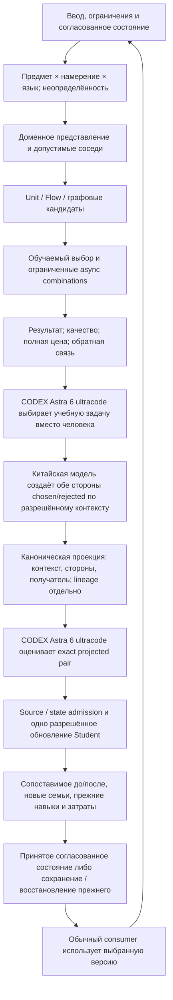

# R02 — восстановленные ожидания и алгоритмические решения

**13 октября 2026. Свежая проверка по запросу «Please review and repair R2».** R02 сохраняет восстановленные требования и уточняет передачу следующих исследований. Это документный результат, не полный аудит всех RAG, не готовность реализации и не измеренное обучение. Публикация и границы проверки — в [RUN-LOG.md](RUN-LOG.md).

[Матрица 52 требований](CHANGE-MAP.csv) сохраняет исходные идентификаторы и все три продуктовые линии. [SOURCES.csv](SOURCES.csv) хранит источники и глубину чтения; [DECISIONS.md](DECISIONS.md) — решения и модельные поручения. Полный предыдущий текст доступен [на опоре перед этой проверкой](https://github.com/lubochka/xiigen-planning/blob/10dfbfd8a46f67b9cf43ce827d00d1dbf6d18078/llm%20mvp/design%20to%20code%20session/replanning/results/R02/FINDINGS.md). Его находки не отменяются; эта редакция сохраняет параллельный review каталога и исправляет конкретное противоречие авторства DPO, указанное пользователем.

**Исправление после уточнения пользователя:** действующий контракт назначает китайскую модель автором **обеих окончательных сторон chosen/rejected**. CODEX с **Astra 6 ultracode** выбирает учебную задачу вместо человека и отдельно оценивает качество exact pair. Слабый ответ Student на отдельную разрешённую учебную задачу — контекст генерации, не обязательный final rejected. Основание: [RUN §2.2 в коммите 8 октября](https://github.com/lubochka/xiigen-planning/blob/59499f459b8e5c9c714ddb475c34bf3a393b5d99/llm%20mvp/design%20to%20code%20session/Kiro-Xiigen-S04-Luna-xhigh-v2-Pack/overlay/.kiro/xiigen-slices/luna/s04/RUN-CONTRACT.md) и [действующий RUN §§2.1–2.2](https://github.com/lubochka/xiigen-planning/blob/277959a20f2e6742d8caa51d08106e061e16a086/llm%20mvp/design%20to%20code%20session/Kiro-Xiigen-S04-Luna-xhigh-v2-Pack/overlay/.kiro/xiigen-slices/luna/s04/RUN-CONTRACT.md), P15/P16/U02. Старое teacher-goal ограничение P14/RV02 не является действующим запретом и не передаётся R12 как нерешённый выбор. Схема, objective и остальные отдельно подтверждённые положения P14 сохраняются.

## 1. Что исправляет именно этот review

Прежний R02 уже сохранял четыре роли, BM25+kNN, память отказов, semantic OrderedPatternIds, unit-level payload, CODEX-роли, семь предметов, PC/feedback/retention и три продукта. Утверждать, что всё это отсутствовало, было бы неверно.

**Реальный пробел:** восьмитиповой каталог Q02 был оставлен непрочитанным маршрутом, хотя его правила могут вернуть в последующие задания старую адресацию, неверное происхождение negative и неподходящий критерий допуска. Параллельный review прочитал первичные разделы каталога, сопоставил их со схемой P14 и установил конкретные расхождения. В полном R08 остаются тела отдельных примеров и их нынешняя применимость, а не повторное открытие известного каталога. Исправление авторства уточняет предел такого сопоставления: P14 сам содержит отменённое положение, поэтому не может автоматически отменять китайское авторство обеих сторон.

**Сохранённый алгоритмический риск — положительный policy/reference margin как условие допуска до обучения.** Каталог PE-1.2 п.5 связывает reward с policy/reference log-probabilities и одновременно говорит «margin ≤ 0.05 → LOW_CONTRAST, не учим». По формуле P14 при policy = reference обе стороны имеют reward = 0, следовательно margin = 0 независимо от того, насколько содержательно хороша пара. Если применить такой порог к исходному состоянию, можно отвергнуть все первые качественные уроки. Это алгебраический контрпример к плановому правилу, **не доказанный дефект нынешнего trainer**. Оценка предпочтения CODEX, сила содержательного контраста и уже выученный моделью margin должны быть разными величинами. Адресное решение — R12, фактический consumer/admission trace — R05; новые продуктовые правила R02 не применяет молча. Это отдельный вопрос RC4, не основание вновь открывать уже решённое авторство RC2.

Цель пересмотра остаётся: **пригодный baseline → минимально недостающее соединение → допустимый новый урок → сопоставимое наблюдение → следующий содержательно иной домен**. Полная Windows/IDE-поставка не объявляется предпосылкой любого опыта; исходные обязательства поставки не удаляются. Код и обучение этим R02 не запускаются.

## 2. Источники и границы свежести

Ранее прочитанные original/WorkLeft документы закреплены на planning `156dd1a5d93d71837a5600dea1d95b6503b94e0a`, пользовательская дельта — `215443ef96899383e5cf567537574b2b0fa39cdb`; P11–P13 — `647bd124fd24f105b926f00d2cee1604fafa9ae9`; P14 и последующая редакция задания — `9ab76cac434331a407aa0a01cf642b6543baf287`. Эти pins не выдаются за новое полное чтение.

Опора сохранённого параллельного review: planning `10dfbfd8a46f67b9cf43ce827d00d1dbf6d18078`; core `a5de1a893db8e44e3dce0f4f54cdae2a4d06d1a3`. Этот review сообщает, что сравнение core с прежним `731d2e55728caf601f05daaca7ab3fc370dd0240` показывает один новый Windows/resource commit, а C01–C11 и использованные skills не входят в его changed-file список. Здесь это сохранённая проверка дельты, не повторный аудит алгоритмов или Windows. Текущий core HEAD отдельно подтверждён при исправлении авторства; продуктовый код не менялся этим worker.

Параллельный review прочитал собственные пять R02 носителей, действующее R02-поручение, правила параллельной работы, выбранные начальные/поздние части previous rounds, первичные sections P14 и каталог Q02. Для большого Q02 fetch_file дважды вернул пустой content при существующем blob; чтение через GitHub blob/contents и адресные resource sections восстановило текст. Пустой ответ инструмента не был принят за пустой или отсутствующий файл. Эта адресная правка дополнительно прочитала исходный RUN 8 октября, текущие RUN §§2.1–2.2, межслайсовую queue и P14 строки385–461; не присваивает себе весь объём параллельного review.

Первичные опоры:

- **RV01:** `llm mvp/visual studio & visual studio code continue/PLAN-VS-VSCODE-CONTINUE-v1.md` на planning `10dfbfd8a46f67b9cf43ce827d00d1dbf6d18078`, blob `ca1e423c5285f88dcada241358eab6d76b9bd18d`: заголовок каталога, PE-1.1–PE-1.5 (в частности строки 4055–4119), найденные PE-1.6/PE-1.7 и итоговые/ограничительные excerpts PE-2…PE-10 по сохранённому review. Это содержательное выборочное чтение, не полный аудит всех восьми тел примеров. При этой правке непосредственно подтверждены заголовок восьми задач, PE-10.2 и PE-10.7; Q02 больше не неизвестный маршрут.
- **RV02:** `llm mvp/dpo legal build/active-codex-execution-plan-07-dpo-builder.md` на той же опоре, blob `d6e37ab55a2bfd4deb057c28376fbb1620f7cf08`: строки 195–373 и 385–461 по review. Подтверждены §3.2/§3.2a, схема, сериализация, reward, fan-out; teacher-goal Student-only положение найдено, но **историческое и заменено P15/P16/U02**. Строки 374–384 этим review не заявлены прочитанными. Прямая повторная проверка385–461 на `277959a20f2e6742d8caa51d08106e061e16a086` подтвердила тот же blob.
- **RV03:** `09.09.26WorkLeft-RESEARCH-02-owner-decisions-resolution.md` в D на той же опоре, blob `de660f0646865d33bb7aa99be8f8540efe344fae`: строки 85–135, таблица решений 14–24 и начало разбора many→many/честности по сохранённому review. Полное исследование RESEARCH-01 остаётся R08.
- **P15/P16:** S04 `RUN-CONTRACT.md`, исходный контракт на `59499f459b8e5c9c714ddb475c34bf3a393b5d99` и действующие строки45–80 на `277959a20f2e6742d8caa51d08106e061e16a086`, текущий blob `1f008553956af825089757bfea6655f7bfeabc83`. Прямое назначение обеих сторон китайскому автору, Student-context, exact CODEX assessment, отсутствие переписывания сторон и различие persistence/optimizer eligibility. N07/N12 и U02 подтверждают применимость назначения ролей, а не только историческое наличие текста.

Применены адресные sections skills: startup, authority binding, trainable architecture, phase planning, plan review, generated code review, prompt patch authoring и human-readable architecture. Точные пути/диапазоны перечисляются в RUN-LOG. Отдельный reviewer и полная библиотека skills не заявляются.

## 3. Сохранённая кодовая опора

| Источник | Что установлено прежним R02 и сохранено | Что этим не доказано |
|---|---|---|
| C01 `00.Core/LearningMachineContracts.cs` | Train принадлежит машине; LearningTrainingItem имеет ItemId/Prompt/ChosenResponse/RejectedResponse; personal/global/portability. | Работающее обучение, наличие UnitId в item или проверенный checkpoint. |
| C02/C03 `LogicalContracts.cs`, `DynamicGraphContracts.cs` | Unit/Flow/Orchestrator, typed queryable candidates, отношения, async budgets, разделение baseline/authority. | Реальная many→many полезность, исполнение всех комбинаций или обученность. |
| C04 `DynamicGraphEdgeAuthorityContracts.cs` | Детерминированные proposals/materialization и отдельный decision; semantic tokens/predicates/context. | Полный learned selector → actual target путь. |
| C05 `10.LoRA/LoraLinear.cs` | Base projection плюс масштабированный A/B вклад; capture/restore RNG. | Tokenizer/decoder либо доказанная доменная vector-token функция. |
| C06 `BoundedDpoTrainingContentProjector.cs` | Три текста, TeachingVector и consumer Context в начале projector. | Весь projector, все consumers и сохранность структуры на каждом переходе. |
| C07–C09 `DpoPair.cs`, `DpoDataset.cs`, `DpoTrainerPairAdmission.cs` | Lower triple, parsing, author/fingerprint admission; legacy admission=null существует в loader. | Достижимая runtime уязвимость или гарантированный отказ до мутации; подлинность источника из одного enum. |
| C10 `LogicalCapabilityTrainingContracts.cs` | CODE_Q, knowledge edges, branch count. | Branch count как число optimizer updates или разрешение bulk/replay. |
| C11 `26.TrainableRouter/Models/RoutingModels.cs` | ChosenUnitId/RejectedUnitId обозначают альтернативы маршрутизации. | Адрес обучаемого selector равен ID выбранного solver. |

## 4. Четыре роли и соединение алгоритмов

Исходные ILearningUnit/IlearnyngFlow/IlearningOrchestrator/ILearningDynamicGraph — функциональные роли. Опечатки имён не являются основанием создавать новый API. IQueryable не доказывает remote LINQ provider или бесконечную ленивую выдачу.

| Роль | Пользовательский результат | Детерминированная и обучаемая части | Различающий неуспех |
|---|---|---|---|
| Unit | Домен, формы входа/выхода, typed many→many в обе стороны. | Типы, ограничения, materialization отдельно от learned преобразования/выбора. | Разные входы усреднены; один ответ клонирован; множество не соответствует запросу. |
| Flow | Связи units корректируют вход в выход. | Перенос значений/fan-in отдельно от learned связи или проекции. | Совместимая shape скрывает разные пространства; коррекция осциллирует. |
| Orchestrator | Один input проходит несколько допустимых асинхронных combinations. | Scheduler, limits, cancellation отдельно от learned route policy. | Быстрая ошибка победила; поздняя ветвь изменила уже выбранный результат; её цена скрыта. |
| DynamicGraph | Отношения паттернов разных порядков, повторное использование и Builder. | Топология/кандидаты/память отдельно от learned authority/update. | Рёбер больше, но новые сочетания не решаются лучше; потеряна зависимость шагов. |

P11 описывает DynamicGraph как специализацию L5 ILearningMachine, не шестой уровень. C01 сохраняет Train на машине, не четыре независимых публичных Train. Unit-level payload не отменяет обучения полезных отношений. Если текущий механизм не способен менять нужную связь, сохраняются требование и конкретный gap R05/R07/R12.

Это целевой смысл и уточнение R02, не утверждение реализации. Каждая стрелка требует producer/method/consumer, порта, владельца состояния и источника. Детерминированное исполнение выученной матрицы остаётся learning; случайный выбор без изменения состояния им не становится.

## 5. Domain mapping, представления, kNN и LoRA

**Предмет не равен intent.** CODE_Q/BUG/PLAN/ARCH/REFACTOR из P12/C10/C11 не заменяют семь предметов. «Объяснить ошибку SQL JOIN» сочетает SQL, BUG, объяснение и язык. Нужны mixed/new/ambiguous cases и честный отказ, не один насильно взаимоисключающий enum. Разделять ошибку маршрута и ошибку solver помогает сравнение actual route с экспертно допустимым domain при том же solver.

**Паспорт домена:** источник/версия правила; invariant, предметная предпосылка, пользовательская policy, предпочтение или unknown; допустимые выходы; признаки; типичные ошибки и неоднозначность. Нельзя превратить привычку корпуса в закон мира. P12 D-07 сохраняет stack features до разрушительной нормализации. Представление должно сохранять отрицание, числа, units, placeholders, AST/layout-связи и смысловой порядок; одинаковая размерность не означает общие координаты.

**Гибрид поиска.** P12 D-10 сохраняет BM25+kNN fusion. P13 разделяет pre-generation guidance и post-generation arbiter: similarity не отменяет недопустимость результата. Positive показывает пригодное решение, negative — существенную ошибку, warning — риск; warning не обязательно является DPO-side или gradient sample. Близкий текст регистрации дубликата нельзя использовать как chosen только за близость обычной регистрации.

Для каждой kNN-функции нужны allowed pool по предмету/правам/версии, feature groups/normalization, distance/similarity, k/radius, learned weights/selection, политика трёх видов памяти и fallback. Сначала пригодный reference и одно изменение, а не весь декартов перебор. Отдельно сравнивать domain mapping, metric при fixed k, dynamic k при fixed metric, memory disposition и BM25 fusion. Учитывать совместимость exact/ANN index с функцией, смену пространства и reindex. Исторические k=5/0.50/+8% не становятся универсальными порогами или свежим выигрышем.

RV03, решение 24, сохраняет прежние исследовательские направления: перевод — каскад подписей, код — векторные соседи, оркестрация — фильтр навыков. Это маршрут переиспользования для R06/R08, не новая проверка реализации этих механизмов. Решения 21/23 сохраняют донорный порядок исследования и кривую обучения на каждой ступени; точные donor/source bodies разбирает R08, без автоматического повторения всей матрицы.

**LoRA:** назвать matrix W/A/B, rank/scaling, input/output, objective, optimizer owner и реального downstream consumer. Tokenization, vector encoding, projection и дискретный codebook/decoder — разные компоненты. Сравнение frozen projection с одной адаптацией должно показать сохранение смысла и пользу consumer, не только shape/loss/hash. Смена координат требует согласования index/schema и полной цены переиндексации.

## 6. DPO: сохранённый канон и исправленные границы

### 6.1. Получатель и структурный смысл

P14/RV02 §3.2 сохраняет 14 полей: PairId, Level, NodeOrEdgeId, InputContext, Chosen, Rejected, WrongMarkers, Reason, TeacherProvenance, SourceIds, HeldOut, CandidateOrderInvariant, ExcludedLeakageSignals, DpoTrainReady. Train-ready Level = unit; NodeOrEdgeId несёт идентичность целевого unit. Это схема плана, не найденная C# declaration. Диагностика и proof остаются вне 14-field canon.

LearningTrainingItem не имеет UnitId; lower DpoPair содержит только три текста. Следовательно, R05 должен назвать настоящий recipient/context/manifest bridge. ChosenUnitId альтернативы не является автоматически обучаемым selector ID. Плановое `winner.UnitId` требует проверки адресации, а не добавления поля в каждый DTO.

OrderedPatternIds сериализуется внутри chosen/rejected; InputContext сохраняет OrderLevel/ConsumesPatternIds/CapabilityTags. Порядок шагов решения значим; случайный порядок подачи кандидатов — нет. Перестановка кандидатов не должна менять предпочтение, а перестановка зависимых шагов может сделать путь неверным. Сортировка всех порядков уничтожила бы требуемую способность. Не нужны автоматически Level=graph или пятнадцатое поле.

### 6.2. Роли и три разных результата

**CODEX с Astra 6 ultracode выполняет оба назначения: выбор учебной задачи вместо человека и оценку качества exact DPO-пары. Допущенная открытая китайская модель создаёт ОБЕ окончательные стороны chosen/rejected; XIIGEN Student обучается.** Собственный Builder остаётся отдельной требуемой обучаемой способностью, не скрытой заменой этого автора. Подлинность источников контекста сохраняется отдельно от доказательства, что обе окончательные стороны получены из ответа китайского генератора.

Teaching packet сохраняет полный выбранный допустимый task, настоящий слабый Student response на отдельную учебную задачу, разрешённый reference и прошлые accepted examples только как контекст. Закрытые экзаменационные payload/ответы туда не входят. Student response не превращается в final rejected автоматически, а CODEX не редактирует стороны под Chinese provenance. Exact assessment связано с окончательным контекстом и парой; смена содержимого делает прежнее judgment неприменимым.

Три результата различаются: материал допустим; пара содержательно качественна; обучение Student полезно на новых задачах. Hash/admission не доказывает semantic validity; CODEX judgment не доказывает downstream gain; уменьшение loss не доказывает перенос. Структурно допустимый кандидат может быть сохранён до semantic acceptance, но missing/rejected/stale assessment не допускает optimizer и не разрешает автоматическую регенерацию или стирание истории. Старый Qwen-as-judge или ручной labeler не отменяет нынешнюю роль CODEX.

### 6.3. DPO objective не равен экспертному score

Плановая формула: `reward(side|context) = Beta * (policyLogP(serialized_side|context) - referenceLogP(serialized_side|context))`; model margin — разность reward сторон. Judge score служит проверке предпочтения, но не подменяет эту величину.

Отсюда не следует, что model margin уже обязан быть положительным до первого урока. Контрпример policy=reference из §1 необходимо рассмотреть R12 вместе с точным consumer старого LOW_CONTRAST. R05 устанавливает actual masks, reduction, reference freeze, beta, trainable parameters и место admission. Если собственный vector/path learner не задаёт вероятность или иную явную цель, arbitrary distance не называется стандартным DPO: требуется именованное архитектурное решение, не скрытая замена.

### 6.4. Fan-out, side origins и no-repeat

N всего кандидатов с одним выбранным winner дают N−1 source-row/pair attempts. L допустимых losers дают L attempts. Это не гарантированное число качественных пар и не число разрешённых updates. TIE/BOTH_BAD/UNJUDGEABLE не принуждаются к предпочтению. Все строки общего input остаются общей source family для split и статистики. Эта арифметика не является автоматическим допуском старых producing branches.

**Историческое, заменённое положение:** P14/RV02 v1 teacher-goal требовало Student candidates как losers и исключало teacher-vs-teacher из train-ready. Перенос этого положения в действующие требования R02 был ошибкой. По P15/P16/U02 обе окончательные стороны создаёт допущенная китайская модель. Это уже установленное авторство, не «другой producer, который ещё нужно разрешить» и не вопрос R12. Исторические Student-origin пары сохраняют настоящее происхождение; их нельзя сделать совместимыми простым переименованием автора. R05 проверяет соответствие фактического пути новому контракту, R16/R20 помечают старые положения и исправляют активные производные тексты. Схема, meaningful order, objective и ограничения происхождения закрытых материалов не отменяются.

One-pair/no-repeat не отменяется словом bulk, batch DTO или fan-out. Context examples и kNN memory не равны повторному gradient. Различия sample/step/episode и старый replay70/30 — адрес R12, затем явная migration. После сбоя нельзя выдать новый pair_id и обучить то же повторно.

### 6.5. Exact pair после проекции

Каталог требует удалять служебный `[WRONG:]` до tokenization. Значит, смысловой вердикт должен быть связан с фактическими projected context/chosen/rejected и адресатом, которые получит trainer, а не только с размеченной исходной строкой. Сохраняются source bytes, marker metadata, projection version и связь с consumer; это sidecar/proof, не новая C#-схема по предположению.

Предлагаемое уточнение для R05/R12: подготовить canonical training view до exact-pair examination; после вердикта неизменны семантические bytes и получатель. Изменение проекции/контекста/сторон/адресата требует нового связывания и при изменении смысла повторной оценки в существующих разрешениях, а не автоматического нового вызова. Служебный tag удаляется, но реальное отрицание вроде NOT и semantic OrderedPatternIds не удаляются как «утечка». Реализация этого порядка здесь не подтверждается.

## 7. Каталог: восемь задач, а не восемь новых моделей

RV01 подтверждает отдельную ось типов задач. Его examples — исторические плановые SYNTHETIC_SEED, не нынешние вызовы teacher и не готовый допущенный dataset. При переносе форм каталога авторство и оценка определяются P15/P16/U02; историческая Student-only ветвь P14 не возвращается через примеры.

| Тип задачи | Существующий раздел | Что сохранять при переиспользовании | Что должен различить будущий урок |
|---|---|---|---|
| Оркестрация | PE-2 | Структурный план, ORCH taxonomy, выбранные units и зависимости. | Пригодный путь против потерянной зависимости/неподходящего unit; не candidate position. |
| Переводы | PE-3 | Направление, терминология, числа, placeholders, HE_EN caveat. | Смысловой перевод против fluent mistranslation/omission; отдельно каждое направление. |
| Серверный код | PE-4 | Контекст .NET, контракт результата, cancellation и предметные ограничения. | Полезный код против правдоподобного нарушения контракта; исторические code refs обновить. |
| Клиентский код | PE-5 | Реальный client/stack, state/API boundary; synthetic wiring обозначено. | Рабочий клиент против ложной связи UI→API; название repo не доказывает Angular. |
| Серверная документация | PE-6 | Grounding утверждений в исходниках, dependencies/effects. | Подтверждённое описание против выдуманного вызова/эффекта. |
| Клиентская документация | PE-7 | Component/template/state и доказанные взаимодействия. | UI-текст не становится HTTP-вызовом; .NET baseline не переносится на Angular. |
| Хранимые процедуры | PE-8 | Parameters/results/effects; synthetic seed и no-source/consent distinction. | Нужная процедура против ошибочных effects; неизвестный реальный corpus не выдумывается. |
| HTML-CSS | PE-9 | Element/Style IR, responsive/layout/missing-element и safety/accessibility axes. | Реальный render на разных размерах, а не хорошая строка HTML или fake PNG. |

PE-10 — консолидация этого каталога, не девятая задача. Полные тела PE-2…PE-9 и нынешние code/data counterparts остаются R08 и соответствующим R04–R06 owners. Старые объявления шести conditional DpoTrainReady=true и двух false не являются текущим допуском или свежей готовностью доменов.

### Подтверждённые конфликты каталога и их трактовка

| ID | Первичный конфликт | Что R02 исправляет в передаче |
|---|---|---|
| RC1 | PE-1.4/PE-1.5: Level unit/node/edge; P14 §3.2: train-ready unit. | Не копировать старую адресацию; сохранить evaluated graph level отдельно от recipient unit. |
| RC2 | P14 v1 teacher-goal запрещало Chinese-authored rejected; действующий контракт 8 октября P15/P16 и пользователь U02 назначают китайской модели обе стороны. | **RESOLVED: Chinese authors chosen/rejected.** P14 Student-only/eval-only ограничение историческое и заменено. Каталог не отвергать по нему; Student context не путать с final side. R05 проверяет фактический путь, R16/R20 исправляют активные производные тексты; не передавать R12 повторный выбор автора. |
| RC3 | PE-1.2 п.8: IndependentDomainScorer/user controls; текущий пользователь назначил CODEX. | Сохранить независимость оценки, но не восстановить старую ручную/Qwen роль. |
| RC4 | PE-1.2 п.5: model margin >0.05 до обучения; P14 policy/reference formula. | Counterexample policy=reference; не путать качество предпочтения с уже выученным margin. |
| RC5 | PE-1.2 п.10: N назван числом losers, но результат N−1; P14 N — все кандидаты. | Явно N total / L losers; две проигравшие стороны дают две attempts, не одну. |
| RC6 | Source WRONG tags, исторические overlap windows и illustrative train-ready flags. | Судить projected semantic pair; не считать tag/length/overlap универсальным качеством или старый flag современным допуском. |

RC1–RC6 — найденные расхождения документов и риска их переноса. Они не означают, что шесть соответствующих ошибок уже доказаны в production коде. RC2 закрыт действующей авторской инструкцией; RC4 остаётся отдельным адресным вопросом. Числовые пороги каталога не выбраны заново этим review; актуальные правила R12/R13 должны быть привязаны к смыслу и откалиброваны до итоговой оценки, без подгонки по результату.

**Различающий пример для RC2:** китайский генератор создал chosen, сохраняющий отрицание, и plausible rejected с потерянным отрицанием; CODEX оценил exact pair на разрешённом контексте. Отказ только потому, что rejected не создан Student, нарушает текущий контракт. Подмена provenance сохранённого Student response, переписывание стороны CODEX, обе равноценные/неправильные стороны или устаревший verdict остаются неуспехом. Это проверка смысла документа, не созданная пара или выполненная training-кампания.

## 8. Сохранённый полный функциональный объём

Семь baseline предметов: EN↔RU, оркестрация, Figma→HTML/CSS, документация C#, Angular, SQL и DPO Builder. Они не заменены восьмью task types или intent enum. Сохраняются Hebrew→English, дополнительные языковые направления, server/client code и stored procedures. Для каждого — domain laws/features, контраст ошибки, перенос на новую семью, retention и полная цена. Builder оценивается отдельно по пригодности пары и utility обученного получателя.

**DPO/DynamicGraph:** все четыре роли, доменные сигналы/представления/kNN, структурные пары, обучаемые связи, checkpoint/restore, новый ordinary answer. **DTC:** связанные tree/HTML/CSS/images через platform API, несколько разрешений, iteration/quality/cost tier, специальная БД результатов, происхождение DPO, показ полезности, обучение и загрузка принятой версии на сервер. **IDE:** локальная кодовая база и индекс, prompt→plan→этапы исполнения, дополнительные языки, offline/local-first, обратная связь и перенос персонального состояния.

Все названные consumers сохранены: xiigen-platform-dot-net-angular, xiigen-flows-dot-net-angular, FigmaToCode-design-gen, CanvaToCode; их существование в source list не является свежим аудитом внешнего runtime. Common/global и personal/adaptive не смешиваются. Canonical project pairs/weights в core не разрешают публикацию private user corpus. Обычный consumer должен действительно использовать принятую совместимую версию, а не только видеть опубликованный checkpoint.

## 9. Способ наблюдать обучение, а не увеличивать coverage

Будущий опыт фиксирует до результата: domain/task/language и source families; baseline/challenger; один изменяемый фактор; shared panel; rubric; достаточность/неопределённость; retention; полную цену; правило решения. Обе версии получают сопоставимые задания. Новая панель предъявляется обеим, а варианты одного input не считаются независимыми наблюдениями. Evaluation/certification источники не становятся учебными target через teacher, judge rationale или новую pair_id.

Нужны сравнения по смыслу: actual/oracle-domain; fixed/domain-aware representation; fixed/domain metric; fixed/dynamic k; adapter off/on; fixed units/changing Flow; fixed/learned route; frozen/no-update против разрешённого update. Они применяются там, где различают гипотезу, не требуют всех вариантов до первого опыта. Замер уровня комбинаций не заменяется замером только Unit. Средний gain не скрывает worst-domain регресс.

Итоги различаются: IMPROVE, REGRESS, INCONCLUSIVE, INVALID_EVIDENCE. Неуспешное измерение не равно нулевому эффекту, а отсутствие положительного gain не повод менять эталон. Владельческая цель 95% к зафиксированному эталону сохранена отдельно от confidence, статистической уверенности и порога допуска первого урока.

PC-компактность — гипотеза, не обещание. Полная цена включает base/adapters/optimizer/RNG, index, graph, cache, snapshots, reindex, teacher/judge, все ветви и неудачные попытки; качество сравнивается при сопоставимых ресурсах. Ответ на пользовательский input оценивается до обучения на этом input; последующий перенос — на новых families. Privacy/poisoning и conflicting feedback требуют admission, не слепого доверия коррекции.

Full pre-pair snapshot и возврат согласованного состояния не ограничены weights: нужны все изменяемые связанные состояния. При unknown-running update сначала установить terminal state; нельзя откатывать под живой мутацией. Состояние из файла должно продолжать прежнее обучение, а не скрыто стартовать заново. Расходы и раскрытие данных откатом weights не отменяются.

## 10. Следующее действие и предел результата

Точный адресный вход R05 — DECISIONS §6 с дополнением review: разрешённый Student-context → Chinese-authored chosen/rejected → projected exact pair → CODEX assessment → admission/objective → нужный recipient → состояние → ordinary consumer. R04 держит representation, R06 domain/kNN/path, R07 только unresolved connections, R08 catalogue/domain data, R09 стоимость и реальные зависимости; R12 решает RC4 и связанные действительно нерешённые policy/architecture вопросы, но не авторство RC2; R13 проектирует различающий опыт. Не запускать новую общую разведку вместо этих передач.

R01 сохраняет полный inventory, R03 — route walk; R10 сводит их уникальные дельты. R02 не закрывает их работу и не требует их blanket DONE для использования доказанного subset. Общая программа остаётся 10+5+5+5; review этого R02 не дополнительный фиктивный Rxx.

**Не выполнялись:** изменения product code/tests/workflows/core skills/weights/datasets, build, Windows/Actions, генерации teacher, CODEX selector/judge, trainer и quality/time/memory measurement. Отдельная Astra Ultra экспертиза NOT_PERFORMED; исполнитель адресной проверки авторства — ChatGPT, GPT-6 Astra Pro, не независимый CODEX reviewer. Learning gain NOT_MEASURED. Исправления собственных R02 документов публикуются прямо в GitHub; внешний apply не нужен.
