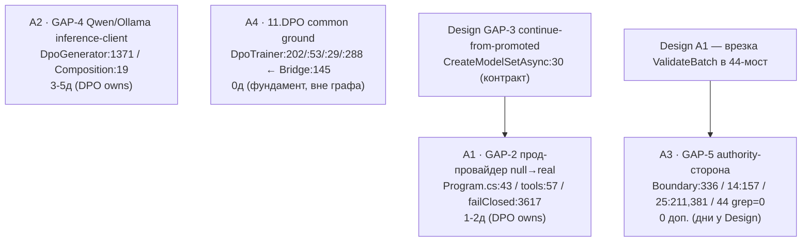

# LeftToWorkDPO 02.08.26 — DPO-сторона: code-first действия по re-audit @ bc03773bf

- Дата: 2026-08-03. Семейная метка: **02.08.26 re-audit** (капстон-вердикт `02.08.26WorkLeft-00-ИТОГ.md`). Этот файл — DPO-сторонняя аддитивная программа действий по итогам re-audit'а.
- PIN наблюдён при исполнении: `git -C C:\Projects\llm_mvp_core-DpoImplementation cat-file -t bc03773bfb00312e126049b668217125c7df061c` = **`commit`**; `bc03773bf` = **`bc03773bfb00312e126049b668217125c7df061c`** (Merge PR #52 from lubochka/main, Mon Aug 3 2026; два родителя P1=`159accd31`, P2=`7f9b2ef98`=origin/main). Все пины пере-привязаны на этот таргет; строки двигаются — доверяю собственному git-выводу, а не номерам строк.
- Репозиторий (READ-ONLY): `C:\Projects\llm_mvp_core-DpoImplementation` (пин `bc03773bf` отсутствует в клоне `C:\Projects\llm_mvp_core` — тот на `llm_plan3`, НЕ используется). Доступ только `git show`/`grep`/`cat-file`/`status`/`rev-parse` на пине. Рабочее дерево НЕ читалось; ни записи/чек-аута/сборки/теста/dotnet/model-run.
- **Одна объединённая ветка `codex/dpo-implementation`.** «DPO-сторона» = ВЛАДЕНИЕ ПОДСИСТЕМОЙ **11.DPO + 14.ContinuousLearning + 25.ModelServer** (инфраструктура обучения + легальная граница + тренер), а не отдельная ветка. Наблюдённый дрейф рабочего клона: HEAD сдвинулся `eaca42ea6 → 6247b749f` между снимками footprint (внешний churn), `git status --porcelain` неизменен (3 предсуществующих `M`-правки, мной НЕ трогались); мой вклад в footprint = **0**. Пин `bc03773bf` остаётся достижимым коммитом; все чтения — против него.
- Источники (read-only, НЕ модифицированы): `..\design to code session\02.08.26WorkLeft-00-ИТОГ.md` (SOURCE OF TRUTH); детальные циклы `02.08.26WorkLeft-01-delta-and-foundation.md` (C1), `-02-gate-and-margin.md` (C2), `-03-lora-teacher-checkpoint.md` (C3 — ядро GAP-4), `-04-knn-durable-convergence.md` (C4), `-05-gapmap-and-estimation.md` (C5 капстон). Кросс-ссылки (НЕ редактировались): `..\design to code session\LeftToWorkDesign02.08.26-actions.md` (Design-сторона, EXISTS); `..\visual studio & visual studio code continue\` Continue-файл 02.08 — **создаётся параллельной задачей** (на момент письма отсутствует).
- **git-вывод главнее.** Если номер строки в источнике расходится с наблюдённым — YOUR git-вывод wins; цитирую наблюдённое, отмечаю дрейф.
- **SUPERSESSION-оговорка:** этот файл СУПЕРСИДИТ статусы гэпов `LeftToWorkDPO31.7.26-actions.md` (@`9ac23b0d5`) — их вердикты УСТАРЕЛИ на пине `bc03773bf`. Файл 31.7 **НЕ перезаписан и НЕ тронут** (byte-identical); маппинг старое→новое — в §3.

---

## 1. Executive summary (RU)

**Фундамент — ДА; эффект — НЕ зажжён.** Домен-44 (design-to-code) на пине `bc03773bf` вызывает БУКВАЛЬНО тот же тренер `11.DPO/DpoTrainer` — `DesignConversionDpoPolicyCheckpointBridge.cs:145` `trainer.StepVector(batches, DpoStepCount)` входит в `11.DPO/DpoTrainer.cs:202` `public DpoMetrics StepVector(...)`, с тем же `AdamW(weightDecay: 0.01f)` (`:53`), той же замороженной reference (`:29`), тем же `model.Forward` (`:288`); код сам маркирует источник `"11.DPO:DpoTrainer.StepVector"` (`Bridge.cs:253/:964/:996`). Это НЕ копия и НЕ заглушка — тот же механизм. Но приёмку держит baseline-визуальный вердикт, в проде тренировка невозможна (провайдер `null`), учителя нет, цикла сходимости нет.

**Что владеет ЭТОТ (DPO) файл.** DPO-подсистема владеет: **GAP-2** (прод-провайдер базовой модели = `null` → fail-closed) и **GAP-4** (клиент инференса легального учителя Qwen/Ollama не подключён — ядро C3) как ОЦЕНЁННОЙ проводкой; плюс **authority-стороной GAP-5** (семантика легального гейта на трёх путях 14/25/44); плюс **статус-строкой 11.DPO common ground** (общий тренер — фундамент обеих сторон). **GAP-1** (приёмка/G3), **GAP-3** (continue-from-promoted), **GAP-6** (сходимость/шаг=1), **GAP-7** (плейсхолдеры артефактов) — у Design-файла (`LeftToWorkDesign02.08.26-actions.md`); здесь только кросс-реф.

**«Прод не тренирует» — это факт проводки, НЕ вывод аудита.** `25.ModelServer/Program.cs:43` `dpoPolicyBaseProvider: null).Run();` → fail-closed `44.DesignConversionDomain/DesignConversionLocalArtifactDb.cs:3617` `if (_dpoPolicyBaseProvider is null)` (код `DESIGN_CONVERSION_DPO_POLICY_BASE_PROVIDER_REQUIRED`). ПОЧЕМУ так и МЕНЯТЬ ли — продуктовое решение (**luba_flag**), не задача аудита.

**Оценка = усилия на зажигание механизма, НЕ обещание качества.** Сдвиг весов / held-out / reward-hacking доказуемы ТОЛЬКО прогоном — прогоны запрещены в этом срезе (H13 вне scope).

---

## 2. Статус-таблица @bc03773bf (строки подсистемы DPO; вердикты из C1–C5 + re-pin при таргете)

| Строка | Статус @bc03773bf | Дельта/источник | Пиновая цитата @bc03773bf (наблюдена при re-pin) | Что это НЕ доказывает |
|--------|-------------------|-----------------|--------------------------------------------------|------------------------|
| **GAP-2** прод-провайдер базовой policy = null (обучение fail-closed) | **LOCKED — PROD CANNOT TRAIN** (DPO owns, оценён A1) | `159accd31..bc03773bf` (line lubochka/main); toy-провайдер — предсущ. | `25.ModelServer/Program.cs:43` `dpoPolicyBaseProvider: null).Run();`; `tools/DesignConversionLiveLocalServer/Program.cs:57` `dpoPolicyBaseProvider: null);`; fail-closed `LocalArtifactDb.cs:3617` `if (_dpoPolicyBaseProvider is null)`; единств. impl — toy `Tests/DesignConversionDpoPolicyBaseTestProvider.cs:13` | Что прод-обучение design-conversion зажжено. Провод есть, боевой провайдер отсутствует → прод физически не может тренировать. |
| **GAP-4** учитель Qwen/Ollama не подключён (только политика допуска; путь идёт через Deterministic-no-teacher) | **BENCH-ONLY / TEACHER-ABSENT** (DPO owns, оценён A2) | C3 (ядро) | эмиссия `44.DesignConversionDomain/DesignConversionDpoGenerator.cs:1371` `TeacherProvenance: TrainingTeacherProvenance.Deterministic(`; аллоулист-коммент `14.ContinuousLearning/Training/ContinuousLearningProductionComposition.cs:19` `...fixed to local Qwen through Ollama under Apache-2.0.`; клиент инференса (`11434`/`/api/chat`) = 0 hits | Что легальный teacher реально генерирует пары. Qwen/Ollama живут ТОЛЬКО как admission-policy (запись аллоулиста), клиента нет — путь 44 удовлетворяет гейт no-teacher-записью. |
| **GAP-5** гейт легального учителя не на боевом 44-мосту (**authority-сторона**) | **NOT-WIRED-ON-44** (дни у Design; DPO держит семантику) | C3 NEW-FINDING | гейт LIVE на 14/25: `14.ContinuousLearning/Core/LegalTrainingTeacherBoundary.cs:336` `public OperationResult<LegalTrainingTeacherAdmission> ValidateBatch(`; `IncrementalTrainer.cs:157`; `DesignConversionDpoTrainingHandoff.cs:211`/`:381`. ABSENT на 44: `git grep -c ValidateBatch -- 44.DesignConversionDomain` = **0** (нет вывода) | Что гейт стоит на боевом пути обновления весов 44. Мост `ExecuteAndConvertAsync → StepVector` проходит только `IsTrainableRow` (лицензия/карантин) + абляцию, БЕЗ `ValidateBatch`. |
| **11.DPO** тренер (общая земля) | **STABLE FOUNDATION — теперь РЕАЛЬНО ЗВАН с 44** | `DpoTrainer.cs` +276/−15 (31.07 «0-delta» устарел) | `11.DPO/DpoTrainer.cs:29` `private readonly LlmModel _reference;`; `:53` `new AdamW(weightDecay: 0.01f)`; `:202` `public DpoMetrics StepVector(...)`; `:288` `model.Forward(ids, training: false, ...)`; вызван из `Bridge.cs:145` | Что тренер зажжён в проде. Стабильность/реальный вызов ≠ активность в проде (E10 заперт). Общая земля обеих сторон — трогать НЕ планируется. |

---

## 3. SUPERSESSION 31.7 (@9ac23b0d5) → 02.08 (@bc03773bf) — маппинг устаревших строк

Строки статус-таблицы `LeftToWorkDPO31.7.26-actions.md` §2 УСТАРЕЛИ на пине `bc03773bf`. Маппинг старое→новое (файл 31.7 **НЕ перезаписан**):

- **LEGAL-GATE «НЕ ПОСТРОЕНА» (только НАЗВАНА в коде)** → **ПОСТРОЕНА И ENFORCED на путях 14/25.** Реальный типизированный контракт: `14.ContinuousLearning/Core/LegalTrainingTeacherBoundary.cs:336` `ValidateBatch(...)`; принуждён на `IncrementalTrainer.cs:157` и `DesignConversionDpoTrainingHandoff.cs:211`/`:381`. **НО** (а) граница допускает `DeterministicNoExternalTeacher` **безусловно** (`LegalTrainingTeacherBoundary.cs:433-453` — `if (row.SourceKind == TrainingTeacherSourceKind.DeterministicNoExternalTeacher) ... return null` при пустых Family/AccessMode/HostingProvider/ModelLicense) → это **GAP-4** (учитель не обязателен → не подключён); и (б) гейт **НЕ стоит на боевом 44-мосту** (`git grep -c ValidateBatch -- 44.DesignConversionDomain` = 0) → это **GAP-5**.
- **G7 «стена DPO_PAIRS_DEFERRED»** → **строка ИСЧЕЗЛА из репо.** `git grep -n "DPO_PAIRS_DEFERRED" bc03773bf` = **0 (нет вывода)** — deferral супersежен admission-гейтом (обучение стартабельно end-to-end по мосту 44). Прежний «lift deferral = разблокировка START» больше не применим: стены нет.
- **G6b «база tiny, производна от policy»** → **CreateTinyPolicyConfig остался ТОЛЬКО provenance-строкой.** `44.DesignConversionDomain/DesignConversionDpoPolicyBaseProvider.cs:37` `"DesignConversionDpoPolicyCheckpointBridge.CreateTinyPolicyConfig"` объявлен как `LegacyTinyPolicyConfigurationKind` (легаси-идентичность, `IsLegacyConfigurationKind` `:52`, валидный конфиг требует `VocabSize >= 256` `:97`). Единственный работающий impl провайдера — **toy** `Tests/DesignConversionDpoPolicyBaseTestProvider.cs:13`. Итог: **G6b схлопнулся в GAP-2** (нужен реальный прод-провайдер, а не tiny/legacy).
- **G3-server «пороговая проводка intake»** → **«потребление real held-out» разблокировано.** Гейт A теперь ВЫЧИСЛЯЕТСЯ: `44.DesignConversionDomain/DesignConversionMachine.cs:333` `var passesGate = accuracy >= HeldOutEvaluationAccuracyGateThreshold` (мёртвый литерал `false` ушёл). Остаток — приёмка/авторитет — у **Design GAP-1** (кросс-реф), не у DPO.
- **G9 «teacher placeholder / TeacherProvenance=0»** → **boundary реальна + enforced.** `TrainingTeacherProvenance` — реальный контракт; осталось только **GAP-4** (клиент учителя) и **GAP-5** (гейт на 44-мосту).
- **11.DPO «0-delta = common ground»** → **тренер РЕАЛЬНО ЗВАН с 44.** 31.07 «0-delta» устарел (`DpoTrainer.cs` +276/−15), но суть важнее дельты: `Bridge.cs:145` `StepVector` реально входит в `DpoTrainer.cs:202`. Стабильность стала **ФУНДАМЕНТОМ**, который design-to-code переиспользует буквально (см. A4).

**Явно:** файл `LeftToWorkDPO31.7.26-actions.md` (@`9ac23b0d5`) НЕ перезаписан, НЕ переименован, НЕ тронут; байт-идентичен. Этот раздел лишь фиксирует, что его статусы гэпов устарели на новом пине.

---

## 4. СЕКЦИЯ A — code-first действия (чистая проводка; без прогонов)

### A1 · GAP-2 — прод-провайдер базовой policy: `null` → real [1–2 д]
Заменить `null` на реальную прод-реализацию `IDesignConversionDpoPolicyBaseProvider` в точках инжекта: `25.ModelServer/Program.cs:43` (`dpoPolicyBaseProvider: null).Run()`, дефолт параметра `:47`) и `tools/DesignConversionLiveLocalServer/Program.cs:57` (`dpoPolicyBaseProvider: null`). Сейчас единственный работающий impl — toy `Tests/DesignConversionDpoPolicyBaseTestProvider.cs:13` (VocabSize 300 / HiddenDim 12 / 1 слой). Fail-closed guard `LocalArtifactDb.cs:3617` (`if (_dpoPolicyBaseProvider is null)`) СОХРАНЯЕТСЯ как защита — не удалять. Валидный конфиг обязан быть не-legacy и `VocabSize >= 256` (`DpoPolicyBaseProvider.cs:47/:97`).
- **БЛАСТ-РАДИУС:** Design **GAP-3** (continue-from-promoted) меняет контракт `IDesignConversionDpoPolicyBaseProvider.CreateModelSetAsync(...)` (`DpoPolicyBaseProvider.cs:30`, сейчас без аргумента «предыдущий чекпоинт»). **Координировать:** имплементить прод-провайдер против НОВОГО контракта после/вместе с Design-GAP-3, дни НЕ дублировать (проводка одна). НЕ форсить свой контракт поверх Design.
- **Разблокирует:** прод-СТАРТ тренировки (сам RUN запрещён — Секция B). Снимает прод-замок Трека C (кросс-реф Continue-файл 02.08, создаётся параллельной задачей).

### A2 · GAP-4 — учитель Qwen/Ollama: admission-policy → inference-client [3–5 д]
Построить реальный inference-client локального Qwen-через-Ollama для генерации/оценки пар. Сейчас Qwen/Ollama существуют ТОЛЬКО как admission-policy (`ContinuousLearningProductionComposition.cs:19` коммент «fixed to local Qwen through Ollama under Apache-2.0»; `OpenWeightTeacherFamily.Qwen` / `TrainingTeacherHostingProvider.Ollama` — записи аллоулиста), клиента нет (`11434`/`/api/chat`/`/api/generate` = 0 hits). Три подпункта:
1. **inference-client** — HTTP-клиент к локальному Ollama (лейн TP1_LOCAL, open-weight; закрытые проприетарные Claude/OpenAI/Gemini ЗАПРЕЩЕНЫ как training-teachers — F9/F7).
2. **реальный provenance вместо Deterministic** — точка эмиссии на земле 44: `DesignConversionDpoGenerator.cs:1371` `TeacherProvenance: TrainingTeacherProvenance.Deterministic(` (SourceKind=`DeterministicNoExternalTeacher`, `TeacherOutputUsedForTraining=false`). Писать реальный `TrainingTeacherProvenance` при использовании учителя. **Координация с Design** (эмиссия внутри 44-домена).
3. **закрыть безусловный допуск Deterministic там, где teacher обязателен** — `LegalTrainingTeacherBoundary.cs:433-453` сейчас пропускает Deterministic безусловно (аллоулист не проверяется, бюджет не расходуется). При реальном учителе — путь Deterministic перестаёт быть единственным.
- **luba_flag:** активация реального учителя = продуктово-инфраструктурное решение (RESOLVED-PER-LUBA-DIRECTION в принципе — F9/F7 — но НЕ реализовано; активация Фазы 2).

### A3 · GAP-5 authority-сторона — семантика гейта на трёх путях [0 доп. дней — дни у Design]
Контракт легального гейта для боевого 44-моста: `ValidateBatch` должен быть вызываем с intake-пути 44 (сейчас `git grep -c ValidateBatch -- 44.DesignConversionDomain` = 0; боевая цепочка `LocalArtifactDb.cs:3530 → :3728 Bridge.ExecuteAndConvertAsync → Bridge.cs:145 StepVector` проходит только `IsTrainableRow:493` + абляцию). **Саму врезку `ValidateBatch` перед `StepVector` делает Design-файл (Design A1)** — insertion-точка в 44-домене = территория Design; дни считаются ТАМ. **Здесь (DPO authority-сторона)** — держать семантику `LegalTrainingTeacherBoundary` СОГЛАСОВАННОЙ на всех трёх путях: 14 (`IncrementalTrainer:157`), 25 (`Handoff:211`/`:381`), 44 (после врезки Design). No-double-count: дни GAP-5 у Design, здесь 0 доп.

### A4 · 11.DPO common ground — статус-строка [0 д]
Общий `DpoTrainer.StepVector` / `AdamW` / замороженная reference / `model.Forward` (`DpoTrainer.cs:202`/`:53`/`:29`/`:288`) — **ФУНДАМЕНТ**, который design-to-code переиспользует БУКВАЛЬНО через `Bridge.cs:145` (вход в `:202`) и самоноту `Bridge.cs:253` (`"11.DPO:DpoTrainer.StepVector"`). ЛЮБОЕ изменение тренера = **кросс-трековый blast-radius** на домен-44 (и на 18-путь capability-training, который тоже строит `new DpoTrainer` — `LlmIngredientLogicalUnits.cs:591`). Тренер НЕ свободен к изменению: не трогать без явной координации обеих сторон + отмашки. Работы нет — это фундамент, а не задача.

---

## 5. СЕКЦИЯ B — заблокировано / run-class (дней НЕ давать; NOT-ESTIMATED)

### B1 · Пересборка датасета легальным teacher [NOT-ESTIMATED]
Пересборка DPO-пар с реальным учителем (Qwen/Ollama прогоны генерации/оценки, лейн TP1_LOCAL) после A2. Run-class, запрещён в этом срезе. Закрытые проприетарные teachers → `DATASET_REBUILD_REQUIRED` (F7, направление (2)).

### B2 · Первый реальный прод-DPO-run [NOT-ESTIMATED]
Первый `StepVector` в проде с непустыми парами ПОСЛЕ инжекта реального провайдера (A1). TRAINING-RUN, запрещён. A1 разблокирует СТАРТ; сам RUN — вне scope.

### B3 · Выбор варианта/размера Qwen + acquisition весов [NOT-ESTIMATED]
Точный вариант/размер Qwen-базы под TP1_LOCAL/Ollama = **R-1** (решение Любы, без рекомендации) + загрузка/acquisition весов = run-class.

---

## 6. Граф зависимостей + сводка + no-double-count



Пояснение рёбер: **A1** координируется с Design-GAP-3 (общий контракт `CreateModelSetAsync` — имплементить против нового контракта); **A2** независим; **A3** связан с Design-A1 (врезку делает Design, DPO держит семантику); **A4** — вне графа (0д, статус, фундамент не трогать).

**Сводная таблица:**

| Действие | Дни | Зависит от | Разблокирует | Флаг |
|----------|-----|------------|--------------|------|
| A1 GAP-2 прод-провайдер | 1–2 | Design GAP-3 (контракт `CreateModelSetAsync`) | прод-СТАРТ (→ B2); прод-замок Трека C | luba_flag (активация) |
| A2 GAP-4 teacher inference-client | 3–5 | — (независим) | легальный teacher-run (→ B1) | luba_flag (F9/F7 resolved, не реализован) |
| A3 GAP-5 authority-сторона | 0 доп. (дни у Design) | Design A1 (врезка в 44) | гейт на боевом 44-мосту | luba_flag (намеренный обход vs дыра) |
| A4 11.DPO common ground | 0 (статус) | — | — | STABLE — фундамент, не трогать |
| B1 dataset rebuild | NOT-ESTIMATED | A2 | — | run-class |
| B2 первый прод-DPO-run | NOT-ESTIMATED | A1 | — | TRAINING-RUN |
| B3 Qwen-база выбор + acquisition | NOT-ESTIMATED | A2 | — | R-1 (Luba) |

**No-double-count.** (1) **GAP-5 дни у Design** — врезка `ValidateBatch` в 44-домен = insertion Design-файла (Design A1); DPO-authority-сторона = 0 доп. дней. (2) DPO-уникальная оценённая проводка = A1 [1–2] + A2 [3–5] = **4–7 д**. (3) Полный **батчированный батч 10–18 д** (SOT §5) — это КРОСС-ФАЙЛОВЫЙ уровень (обе стороны, GAP-1..7, где GAP-2+GAP-5+GAP-7 делят один intake-проход); приводится ТОЛЬКО как кросс-файловая сумма, здесь НЕ пересчитывается и НЕ дублируется.

---

## 7. Honest scope

- **Заявлено ≠ реализовано.** Boundary названа и реальна на 14/25 — но enforced на 14/25 ≠ enforced на 44 (grep=0 → GAP-5). Provenance-контракт реален — но клиента учителя нет (0 hits → GAP-4). Провайдер обязателен (fail-closed) — но в проде `null` (→ GAP-2).
- **Тот же механизм ≠ тот же эффект.** Реальный `StepVector` на стенде ≠ зажигание в проде (E10 заперт: null-провайдер + fail-closed). Строковая/самонота-ссылка `"11.DPO:DpoTrainer.StepVector"` — доказательство ВЫЗОВА (`Bridge.cs:145` реально входит в `DpoTrainer.cs:202`), а не только маркер.
- **Тренер НЕ свободен к изменению.** 11.DPO — общая земля 44/18/25; любое изменение = кросс-трековый blast-radius. Координация + отмашка обязательны (A4).
- **Продуктовых решений нет — только luba_flags.** «Прод не тренирует» = факт проводки (`Program.cs:43` null → fail-closed `:3617`); ПОЧЕМУ/менять ли — luba_flag. Активация учителя, приёмка G3, continue-from-promoted, порог R-7 — всё продуктовые решения Любы. Ни одно НЕ принято.
- **H13 (качество) вне scope.** Сдвиг весов / held-out / reward-hacking доказуемы ТОЛЬКО прогоном (запрещён этим срезом). Оценка = усилия на зажигание, НЕ обещание качества. Все вердикты валидны ТОЛЬКО для `bc03773bf`.

---

## 8. Верификационный блок (re-runnable, read-only на пине)

```bash
P=bc03773bfb00312e126049b668217125c7df061c
R=C:/Projects/llm_mvp_core-DpoImplementation
git -C "$R" cat-file -t $P                                                    # commit
git -C "$R" show $P:25.ModelServer/Program.cs | sed -n '43p;47p'              # dpoPolicyBaseProvider: null).Run(); / ? param = null
git -C "$R" show $P:tools/DesignConversionLiveLocalServer/Program.cs | sed -n '57p'   # dpoPolicyBaseProvider: null);
git -C "$R" show $P:44.DesignConversionDomain/DesignConversionLocalArtifactDb.cs | sed -n '3617p'  # if (_dpoPolicyBaseProvider is null) — fail-closed
git -C "$R" grep -n "class DesignConversionDpoPolicyBaseTestProvider" $P -- Tests     # Tests/...:13 — ONLY impl, toy
git -C "$R" show $P:44.DesignConversionDomain/DesignConversionDpoGenerator.cs | sed -n '1371p'  # TeacherProvenance: TrainingTeacherProvenance.Deterministic(
git -C "$R" show $P:14.ContinuousLearning/Core/LegalTrainingTeacherBoundary.cs | sed -n '336p;433,436p'  # ValidateBatch( / DeterministicNoExternalTeacher admit
git -C "$R" grep -n "ValidateBatch" $P -- 14.ContinuousLearning 25.ModelServer  # Boundary:336 + IncrementalTrainer:157 + Handoff:211/:381
git -C "$R" grep -c "ValidateBatch" $P -- 44.DesignConversionDomain             # 0 (нет вывода) — gate NOT on 44 battle path
git -C "$R" grep -n "Qwen through Ollama" $P -- 14.ContinuousLearning           # ContinuousLearningProductionComposition.cs:19 (admission-policy)
git -C "$R" grep -n "DPO_PAIRS_DEFERRED" $P                                     # 0 (нет вывода) — old G7 wall GONE at pin
git -C "$R" show $P:11.DPO/DpoTrainer.cs | sed -n '29p;53p;202p;288p'           # _reference / AdamW(0.01f) / StepVector(...) / model.Forward(...)
git -C "$R" show $P:44.DesignConversionDomain/DesignConversionDpoPolicyBaseProvider.cs | sed -n '37p'  # "...CreateTinyPolicyConfig" (LegacyTinyPolicyConfigurationKind provenance)
git -C "$R" show $P:44.DesignConversionDomain/DesignConversionDpoPolicyCheckpointBridge.cs | sed -n '145p;253p'  # StepVector / "11.DPO:DpoTrainer.StepVector"
git -C "$R" show $P:44.DesignConversionDomain/DesignConversionMachine.cs | sed -n '333p'  # passesGate = accuracy >= HeldOutEvaluationAccuracyGateThreshold
```

**Наблюдённый дрейф при исполнении STEP 2:** все строки подтверждены на пине. Расхождений номеров нет; `CreateTinyPolicyConfig`-провенанс наблюдён ровно на `DpoPolicyBaseProvider.cs:37`. `ValidateBatch` в 14/25 = `Boundary:336` + `IncrementalTrainer:157` + `Handoff:211`/`:381` (совпало с ожиданием); в 44 = 0. `DPO_PAIRS_DEFERRED` = 0 (стена снята). Footprint: `git status --porcelain` до/после = 3 предсущ. `M`-правки (внешний churn); HEAD клона сдвинулся `eaca42ea6→6247b749f` внешне; мой вклад = 0.

---
## ПРАВИЛО ГИГИЕНЫ ИСПОЛНИТЕЛЯ (обязательно для любого исполнения этой программы)

ПРАВИЛО ГИГИЕНЫ ИСПОЛНИТЕЛЯ (executor hygiene). Агент/исполнитель имеет право создавать файлы ТОЛЬКО внутри репозитория, который он назначен править, и в своём выделенном scratchpad-каталоге. Запрещено создавать скрытые файлы (dotfiles, .tmp, служебные артефакты) где-либо ещё — ни в чужих репозиториях, ни в planning-репо, ни в домашнем каталоге. Исполнитель НЕ имеет права оставлять после себя грязное состояние правимого репозитория: никаких брошенных/грязных веток, никаких оставшихся worktrees, никакого незакоммиченного мусора сверх намеренного изменения. По завершении задачи рабочее дерево, список веток и список worktrees должны быть НЕ грязнее, чем на входе (для read-only задач — нулевой след). Нарушение — hard violation.

Применение к этой программе:

- При исполнении code-first действий этой программы (A1–A7 DESIGN-стороны / A1–A6 DPO-стороны) исполнитель создаёт файлы ТОЛЬКО внутри `C:\Projects\llm_mvp_core-DpoImplementation` и в своём выделенном scratchpad-каталоге. Нигде больше: ни в planning-репо, ни в других `llm_mvp_core*`-репозиториях, ни в домашнем каталоге.
- Скрытые файлы (dotfiles, `.tmp`, служебные артефакты) вне этих двух мест — запрещены безусловно.
- git-финализация (Фаза 0 / M4 PART A: merge, fast-forward, retire веток) — ЕДИНСТВЕННОЕ намеренное изменение git-состояния, предусмотренное программой, и исполняется ТОЛЬКО когда Люба явно авторизует её. Любая другая задача программы обязана оставить рабочее дерево, список веток (`git branch --list`) и список worktrees (`git worktree list`) НЕ грязнее, чем на входе; для read-only задач — нулевой след.
- Гейт на выходе каждой задачи: снять `git status --porcelain` + `git branch --list` + `git worktree list` до и после; любая НОВАЯ ветка, НОВЫЙ worktree или НОВЫЙ незакоммиченный/скрытый файл сверх намеренного изменения = hard violation — исполнение останавливается, след устраняется, инцидент фиксируется в return_packet.

## ПРАВИЛО РАСПОЛОЖЕНИЯ РЕПОЗИТОРИЯ (обязательно для любого исполнения этой программы)

Canonical RU clause (repo location) — additive 2026-07-31, per Luba's directive:
ПРАВИЛО РАСПОЛОЖЕНИЯ РЕПОЗИТОРИЯ (repo location). Библиотека/репозиторий проекта, который исполнитель назначен править, ВСЕГДА находится на диске C по пути `C:\Projects\<project_name>-<branch_name>` и НИГДЕ БОЛЬШЕ: один клон = одна ветка, имя папки = `<имя-проекта>-<имя-ветки>`. Запрещено держать, искать, клонировать или править репозиторий по любому другому пути — другой диск, домашний каталог, вложенная или временная папка, второй клон под тем же именем. Перед любым код-действием исполнитель обязан убедиться, что назначенный репозиторий лежит именно по этому шаблону пути; если путь не соответствует шаблону — остановиться и эскалировать, а не создавать/клонировать/править репо в произвольном месте. Нарушение — hard violation.
EN summary (the RU clause above is canonical): the project library/repository the executor is assigned to modify ALWAYS lives on the C drive at `C:\Projects\<project_name>-<branch_name>` and nowhere else — one clone per branch, folder name = `<project>-<branch>`. Keeping, searching, cloning, or editing the repo at any other path (another drive, the home directory, a nested/temp folder, a second clone under the same name) is forbidden. Before any code action the executor must confirm the assigned repo sits exactly at this path pattern; if it does not, stop and escalate rather than creating/cloning/editing the repo in an arbitrary location. Violation = hard violation.

Применение к этой программе (расположение репозитория): единственный правимый код-репозиторий — `C:\Projects\llm_mvp_core-DpoImplementation` (проект `llm_mvp_core`), он и есть библиотека проекта по шаблону `C:\Projects\<project_name>-<branch_name>`. Все код-действия (A1–A7 DESIGN-стороны / A1–A6 DPO-стороны) — только в нём. Второй клон `C:\Projects\llm_mvp_core` (ушёл на ветку `llm_plan3`) для этой работы НЕ используется. `C:\Projects\xiigen-planning` — planning-репо, только для документов этой программы, не для код-правок. Если назначенного репозитория нет по этому пути или путь не соответствует шаблону — остановиться и эскалировать, не клонировать/создавать репо в произвольном месте.

## Применение к 02.08.26 (re-audit @ bc03773bf)

- Дата применения клауз: 2026-08-03, пин `bc03773bf` (`bc03773bfb00312e126049b668217125c7df061c`). Обе клаузы выше (гигиена исполнителя + расположение репозитория) применены **байт-идентично** из `LeftToWorkDPO31.7.26-actions.md` без изменений.
- Единственный правимый код-репозиторий для действий A1–A4 этой программы — `C:\Projects\llm_mvp_core-DpoImplementation` (проект `llm_mvp_core`, ветка `codex/dpo-implementation`) по шаблону `C:\Projects\<project_name>-<branch_name>`. Второй клон `C:\Projects\llm_mvp_core` (ушёл на `llm_plan3`, пин `bc03773bf` в нём отсутствует) НЕ используется. `C:\Projects\xiigen-planning` — planning-репо, только для документов этой программы, не для код-правок.
- Данная задача (написание этого файла) — READ-ONLY относительно кода: нулевой след в код-репо (`git status --porcelain` до/после = 3 предсуществующих `M`-правки — внешний churn; HEAD клона дрейфовал `eaca42ea6→6247b749f` внешне; мой вклад в footprint кода = 0). Деливерабл записан только в planning-репо + выделенный scratchpad.
- git-финализация (Фаза 0 / M4 PART A из `LeftToWorkDPO31.7.26-actions.md`) НЕ исполняется этой задачей; тайминг = **LUBA-M1-F1** (решает Люба). Дрейф пина против 31.7: `9ac23b0d5` → `bc03773bf` (потомок codex; Merge PR #52 from lubochka/main). Продуктовых решений нет — только luba_flags.
