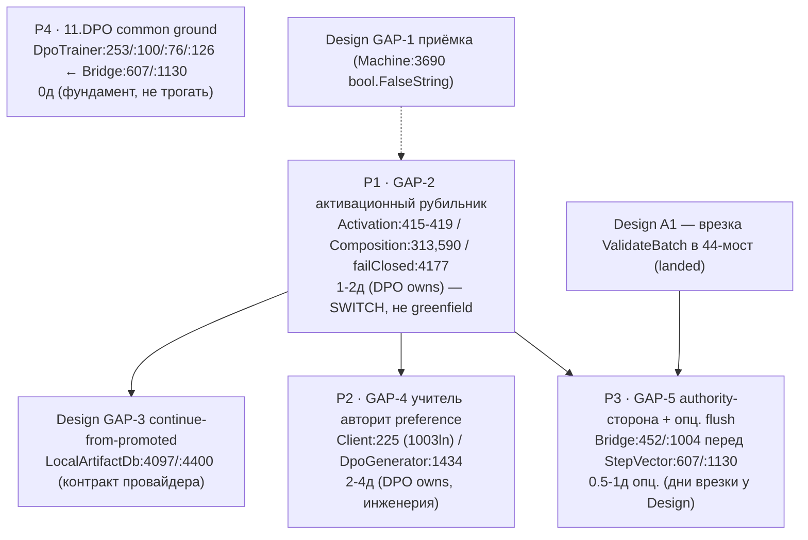

# LeftToWorkDPO 07.08.26 — DPO-сторона (11.DPO + 14.ContinuousLearning + 25.ModelServer): IGNITE/VERIFY действия по re-audit @ 31b52f199

- **Дата: 2026-08-08.** Семейная метка: **07.08.26 re-audit** (капстон-вердикт `..\design to code session\07.08.26WorkLeft-00-ИТОГ.md`). Задача applied once — **один файл, одно применение**; оркестратор верифицирует на диске. Этот файл **аддитивно СУПЕРСЕДИТ статус** `LeftToWorkDPO02.08.26-actions.md` (не перезаписывает и не трогает его, byte-identical).
- **PIN наблюдён МНОЙ при исполнении:** `git -C C:\Projects\llm_mvp_core-DpoImplementation cat-file -t 31b52f199` = **`commit`**; `31b52f199` = **`31b52f199f63668556e904e832ac342898d06419`** — subject «Bind DPO teacher outputs to Ollama manifest identity», Tue Aug 4 22:55:38 2026 +0300. Предок сравнения `bc03773bf` (02.08) подтверждён: `git merge-base --is-ancestor bc03773bf 31b52f199` = **0 (ANCESTOR-OK)**. Пин **иммутабелен**; ветки движутся — рабочий HEAD клона ушёл за пин (циклы наблюдали `412b750de` / `0d9df72093`), пин — предок HEAD, это НЕ рабочее дерево и НЕ аудит-таргет.
- **Владение (scope).** «DPO-сторона» = ВЛАДЕНИЕ ПОДСИСТЕМОЙ **11.DPO + 14.ContinuousLearning + 25.ModelServer** (инфраструктура обучения + легальная граница + тренер), приземляется на ЕДИНУЮ ветку кода — **НЕ отдельный git-бранч**. Этот файл владеет: **GAP-2** (прод-провайдер / активационный рубильник) + **GAP-4** (учитель Qwen/Ollama — авторство preference) + **authority-стороной GAP-5** (семантика легального гейта на путях 14/25/44) + **статус-строкой 11.DPO common ground** (общий тренер — фундамент обеих сторон). **GAP-1** (приёмка/G3), **GAP-3** (continue-from-promoted), **GAP-6** (сходимость/шаг), **GAP-7** (артефакты tokenizer/policy) + **44-сторона GAP-5** — у Design-файла (`..\design to code session\LeftToWorkDesign07.08.26-actions.md` — **сиблинг, EXISTS**, наблюдён на диске 2026-08-07, 44563 байт; кросс-ссылка, см. §6); здесь только кросс-реф.
- **Источники (read-only, НЕ модифицированы):** `..\design to code session\07.08.26WorkLeft-00-ИТОГ.md` (SOURCE OF TRUTH) + `-05-gapmap-and-estimation.md` (сводные таблицы + хребет E1-E10 + Mermaid) + `-01-provider-and-artifacts.md` (GAP-2 ядро + GAP-7) + `-03-teacher-and-gate.md` (GAP-4 + GAP-5) + `LeftToWorkDPO02.08.26-actions.md` (формат-шаблон + supersession-база + tail-клаузы). Кросс-реф (НЕ редактировались): сиблинг Design 07.08 (EXISTS); Continue-файл 07.08 в `..\visual studio & visual studio code continue\` — **наблюдённое состояние: ещё НЕ существует**.
- **READ-ONLY оговорка.** Все код-цитаты — только `git show`/`git grep` на пине `31b52f199`. Рабочее дерево `llm_mvp_core-DpoImplementation` **НЕ читалось**; ни сборки, ни теста, ни dotnet, ни model-run. Разрешённый git: `cat-file`/`rev-parse`/`log`/`merge-base`/`show`/`grep`/`status`/`branch`/`worktree list`. Мутирующий git запрещён.
- **git-вывод главнее номеров строк.** Каждая строка ниже перепроверена `git show/grep @31b52f199` (лог — §8). Дрейфа номеров относительно этого промпта не обнаружено; где номер расходился бы — победил бы мой git-вывод.

---

## 1. Executive summary (RU)

**Фундамент — ДА и НЕ изменился.** Домен-44 (design-to-code) на пине `31b52f199` вызывает БУКВАЛЬНО тот же тренер `11.DPO/DpoTrainer` — не копию и не заглушку: `DesignConversionDpoPolicyCheckpointBridge.cs:607`/`:1130` `trainer.StepVector(...)` входит ровно в `11.DPO/DpoTrainer.cs:253` `public DpoMetrics StepVector(...)`; та же DPO-математика `-log sigma(margin)` (`DpoTrainer.cs:126` `float loss = -MathF.Log(Sigmoid(margin) + 1e-8f);`), та же замороженная reference (`:76` `private readonly LlmModel _reference;`), тот же оптимизатор `AdamW(weightDecay: 0.01f)` (`:100`), тот же скорер (`Machine.cs:3103` `DpoTrainer.EvaluateAverageNextTokenLogProbability`). Код САМ называет источник строкой `"11.DPO:DpoTrainer.StepVector"` (`Bridge.cs:881`) — доказательство ВЫЗОВА, а не декоративный ярлык. Это тот же **механизм**, байт-фундамент неизменен с 02.08.

**Сдвиг 07.08: проводка ПРИЗЕМЛИЛАСЬ, но эффект НЕ зажжён.** За 5 дней (+39 коммитов) учитель реально сел на стул, легальный гейт врезан ПЕРЕД шагом тренера, наследование от промотированного чекпойнта прошито, мультишаг разблокирован — но ВСЁ держит поведение default-off за ОДНИМ активационным замыканием (GAP-2, которым владеет ЭТОТ файл). Поэтому DPO-действия Секции A на 07.08 — это **IGNITE / VERIFY / CLOSE-SPEC-NUANCE**, а НЕ build: на 02.08 это были BUILD-задачи (подключить учителя, врезать гейт), теперь они landed.

**«Прод не тренирует» — это факт проводки/конфигурации, НЕ вывод аудита.** В дефолтной позе эффективный прод-провайдер политики = null и тот же fail-closed замок, что и на 02.08 (переехал с `LocalArtifactDb.cs:3617` @bc03773bf на `:4177` @31b52f199), блокирует обучение; даже при включённом env-бандле потолок = `ContinuousLearningModelServerComposition.cs:590` `ConfigurationStatus = "materialized_inactive"` + `:77`/`:141` `LegalEvidenceVerified: false`. ПОЧЕМУ так и МЕНЯТЬ ли — продуктовое решение (**luba_flag C5-FLAG-1**), не задача аудита.

**Оценка = усилия на ЗАЖИГАНИЕ механизма, НЕ обещание качества.** Сдвиг весов / held-out / reward-hacking доказуемы ТОЛЬКО прогоном — прогоны запрещены в этом срезе. «Прошито» != «зажжено»; «тот же механизм» != «тот же эффект».

---

## 2. Статус-таблица @31b52f199 (строки подсистемы DPO; вердикты синтеза Циклов 1-5 + re-pin МНОЙ)

Ступени рунга: R1 код-существует < R2 подключён-в-вызыватель < R3 достижим-на-боевом-пути (гейты прослежены) < R4 зажжён-по-умолчанию.

| Строка | Статус @31b52f199 (рунг) | Пиновая цитата @31b52f199 (наблюдена МНОЙ) | Что это НЕ доказывает |
|--------|--------------------------|--------------------------------------------|------------------------|
| **GAP-2** прод-провайдер базовой policy (активационный рубильник) | **PARTIALLY — wired-under-env-gate, default-null** (reached=R3 constructed+injected под env / blocked=R4 активация; потолок `materialized_inactive`) | реальный провайдер `DesignConversionCheckpointBackedDpoPolicyBaseProvider.cs` = **734 строки** (EXISTS); fail-closed `LocalArtifactDb.cs:4177` `if (_dpoPolicyBaseProvider is null)`; потолок `ContinuousLearningModelServerComposition.cs:590` `ConfigurationStatus = "materialized_inactive"`; `:77`/`:141` `LegalEvidenceVerified: false`; замыкание `DesignConversionRetainedDpoPolicyBaseActivation.cs:415-419` `() => gateway.IsBound && ...StableDpoExecutorConfigured && ...LegalEvidenceVerified` | НЕ доказывает, что прод-обучение design-conversion зажжено. Реальный провайдер СТРОИТСЯ и ИНЖЕКТИТСЯ, но только при полном env-бандле; в дефолте эффективный провайдер = null → fail-closed. Провайдер уже есть — это НЕ «постройка провайдера», а поворот рубильника. |
| **GAP-4** учитель Qwen/Ollama (авторство preference) | **MOVED-WIRED (R2) + PARTIAL-vs-SPEC** (attests-not-authors; reached=R2 / blocked=R3/R4 activation-lock) | реальный клиент `LocalQwenOllamaTeacherInferenceClient.cs:225` `await lease.HttpClient.SendAsync(...)`; `:794` `TeacherOutputUsedForTraining: true`; клиент = **1003 строки**; fail-closed `DpoGenerator.cs:1104` `if (teacherAttestation is null)` (нет аттестации → нет кандидата); роль `:1434` `["runtime_teacher_selected_preference"] = bool.FalseString`; замок `RetainedDpoPolicyBaseActivation.cs:415-419` | НЕ доказывает, что легальный учитель АВТОРИТ preference. Клиент реален и подключён, `Deterministic`-штамп на 44 удалён (grep=0, exit 1), но учитель пока лишь АТТЕСТУЕТ пару (проверяет хеши/манифест), а preference авторизует детерминированный скелет — роль ниже интенда RAG1-019. |
| **GAP-5** authority-сторона (семантика гейта на 14/25/44) | **MOVED-ENFORCED (R3) + CONDITIONAL** (инверсия 02.08; proven-empty legacy проходит; blocked=R4 `Composition.cs:313`) | `ValidateBatch` на боевом мосту 44: `Bridge.cs:452` и `:1004` `legalTeacherAdmissionAuthority.ValidateBatch(...)` — ПЕРЕД `Bridge.cs:607`/`:1130` `trainer.StepVector(...)`; default-off `Composition.cs:313` `_legalTeacherAdmissionAuthority = deferredPlan is null` → Unavailable; граница `LegalTrainingTeacherBoundary.cs` байт-идентична (`git diff --numstat bc03773bf 31b52f199` = ПУСТО) | НЕ доказывает, что гейт зажжён на боевом пути. Гейт присутствует+enforced fail-closed (02.08: `grep -c ValidateBatch -- 44` = 0), но по умолчанию заблокирован рубильником GAP-2; гейт = «legal-teacher ИЛИ proven-no-teacher» → старые proven-empty Deterministic-строки всё ещё проходят. |
| **11.DPO** тренер (общая земля) | **STABLE FOUNDATION — реально ЗВАН с 44** (0 работ; статус) | `DpoTrainer.cs:76` `_reference`; `:100` `AdamW(weightDecay: 0.01f)`; `:126` loss `-log sigma(margin)`; `:253` `StepVector(...)`; `:321` `EvaluateAverageNextTokenLogProbability`; вызван из `Bridge.cs:607`/`:1130`; самонота `Bridge.cs:881` `"11.DPO:DpoTrainer.StepVector"` | НЕ доказывает, что тренер зажжён в проде. Стабильность/реальный вызов != активность (E10 заперт активацией GAP-2). Общая земля обеих сторон + 18-пути — трогать НЕ планируется. |

---

## 3. SUPERSESSION 02.08 (@bc03773bf) → 07.08 (@31b52f199) — маппинг устаревших строк

Строки статус-таблицы `LeftToWorkDPO02.08.26-actions.md` §2 УСТАРЕЛИ на пине `31b52f199`. Маппинг старое→новое (файл 02.08 **НЕ перезаписан, НЕ переименован, НЕ тронут**, byte-identical):

- **GAP-2 «`Program.cs:43` null / единств. impl — toy»** → **реальный `DesignConversionCheckpointBackedDpoPolicyBaseProvider` (734 строки) СТРОИТСЯ и ИНЖЕКТИТСЯ** через композицию/gateway при env-бандле; toy остался Tests-only. Дефолтная поза: env пуст → эффективный провайдер = null → fail-closed `LocalArtifactDb.cs:4177` (замок сохранён дословно, дрейф строки `:3617` @bc03773bf → `:4177` @31b52f199). Потолок состояния = `Composition.cs:590` `materialized_inactive`; активационное замыкание `Activation.cs:415-419` (три флага readiness) по умолчанию НЕ закрыто. Итог: **из «null-lock» стало «wired-under-env-gate, default-null»**.
- **GAP-4 «Deterministic-штамп + клиент=0»** → **реальный Ollama HTTP-клиент на стуле** (`LocalQwenOllamaTeacherInferenceClient.cs:225` `SendAsync`, 1003 строки); `Deterministic` на 44 = 0 (`git grep -c` exit 1); без валидной аттестации генератор выдаёт пустой набор (`DpoGenerator.cs:1104` fail-closed), а не тихую детерминированную пару. **НО:** учитель АТТЕСТУЕТ, а НЕ АВТОРИТ preference (`DpoGenerator.cs:1434` `runtime_teacher_selected_preference=False`) — ниже интенда RAG1-019. Итог: **из «TEACHER-ABSENT» стало «MOVED-WIRED + PARTIAL-vs-SPEC»**.
- **GAP-5 «`grep -c ValidateBatch -- 44` = 0 (гейта на боевом мосту нет)»** → **2 сайта врезаны ПЕРЕД StepVector**: `Bridge.cs:452`/`:1004` `ValidateBatch(...)` до `:607`/`:1130` `trainer.StepVector(...)`, fail-closed (инверсия 02.08: неподключённый = ОТКАЗ). Итог: **из «NOT-WIRED-ON-44» стало «MOVED-ENFORCED + CONDITIONAL»** (default-off держит `Composition.cs:313`).
- **11.DPO «STABLE FOUNDATION — реально зван с 44»** → **не изменился**: тот же `StepVector`/`AdamW`/frozen-ref/loss (`DpoTrainer.cs:253`/`:100`/`:76`/`:126`), вход из `Bridge.cs:607`/`:1130`, самонота `Bridge.cs:881`. Фундамент, который design-to-code переиспользует буквально (см. P4).

**ЧЕСТНАЯ КОРРЕКЦИЯ (Корр. D, обязательна).** Baseline-анкор `LegalTrainingTeacherBoundary.cs` (регион 433-453 «Deterministic-admit») НЕ является замком GAP-4/GAP-5 — граница **байт-идентична на обоих пинах**: `git diff --numstat bc03773bf 31b52f199 -- 14.ContinuousLearning/Core/LegalTrainingTeacherBoundary.cs` = **ПУСТО** (наблюдено МНОЙ). Реальное движение = удаление `Deterministic`-штампа в `DpoGenerator` (grep=0) + добавление `ValidateBatch` на мост 44 (`Bridge.cs:452`/`:1004`). Прошлый анкор границы как «замка» — ложный сигнал; вердикт GAP-5 (MOVED-ENFORCED) от этого не меняется.

**Явно:** файлы `LeftToWorkDPO02.08.26-actions.md` (@bc03773bf) и `LeftToWorkDPO31.7.26-actions.md` (@9ac23b0d5) НЕ перезаписаны, НЕ переименованы, НЕ тронуты; байт-идентичны. Этот раздел лишь фиксирует, что их статусы гэпов устарели на новом пине.

---

## 4. СЕКЦИЯ A — IGNITE/VERIFY действия (чистая проводка/поворот рубильника; без прогонов)

### P1 · GAP-2 — активационное замыкание = ЕДИНСТВЕННЫЙ рубильник [1-2 д + luba_flag C5-FLAG-1]

**Это НЕ greenfield.** Реальный провайдер `DesignConversionCheckpointBackedDpoPolicyBaseProvider` (734 строки, наблюдено `wc -l`) уже СТРОИТСЯ и ИНЖЕКТИТСЯ в прод-путь через композицию/gateway. Осталось НЕ «построить провайдер», а **закрыть активационное замыкание** = конфиг/ops-флип + продуктовое решение:
1. собрать env-бандл (`XIIGEN_CONTINUOUS_LEARNING_COMPOSITION_ENABLED=True` + сопутствующие) → admitted `deferredPlan` (`Composition.cs:313` `deferredPlan is null` → Unavailable, пока не admitted);
2. положить retained-чекпойнт на диск (источник для реального провайдера);
3. закрыть три флага readiness `Activation.cs:415-419` `() => gateway.IsBound && StableDpoExecutorConfigured && LegalEvidenceVerified` (сейчас `Composition.cs:77`/`:141` `LegalEvidenceVerified: false`).

Потолок до поворота = `Composition.cs:590` `materialized_inactive` (биндинг хэширует чекпойнт, но НЕ грузит модель и НЕ открывает рантайм-активацию). **Fail-closed guard `LocalArtifactDb.cs:4177` `if (_dpoPolicyBaseProvider is null)` ОСТАЁТСЯ как защита — не удалять.**
- **БЛАСТ-РАДИУС / координация:** Design **GAP-3** (continue-from-promoted, `LocalArtifactDb.cs:4097`/`:4400`) едет на ТОМ ЖЕ рубильнике и разделяет контракт провайдера. Координировать с Design (A3): дни НЕ дублировать (проводка одна), НЕ форсить свой контракт поверх Design.
- **Разблокирует:** Design A3 (GAP-3 зажигание), GAP-5 R4 (гейт зажигается), зажигание GAP-4/GAP-6, прод-замок Трека C (кросс-реф Continue-файл 07.08 — ещё не существует), первый прод-DPO-run (Секция B).

### P2 · GAP-4 — учитель АВТОРИТ preference (аттестация → авторство) [2-4 д + luba_flag C5-FLAG-3]

Клиент и проводка **сделаны** (`LocalQwenOllamaTeacherInferenceClient.cs:225` `SendAsync`, 1003 строки; `:794` `TeacherOutputUsedForTraining: true`; fail-closed `DpoGenerator.cs:1104`). Осталась РЕАЛЬНАЯ ИНЖЕНЕРИЯ: поднять роль учителя с аттестации до **авторства preference** — генерация кандидатов `GenerateCandidatesAsync` по интенду RAG1-019 (сейчас `DpoGenerator.cs:1434` `runtime_teacher_selected_preference=False` — preference авторизует детерминированный скелет, роль ниже спеки).
- **Зажигание блокирует P1** (тот же активационный замок `Activation.cs:415-419`): даже после инженерии авторства учитель не создаёт пары, пока рубильник GAP-2 не повёрнут.
- **Разблокирует:** teacher-authored пары (→ Секция B, пересборка датасета). Закрытые проприетарные teachers (Claude/OpenAI/Gemini) как training-teachers ЗАПРЕЩЕНЫ (допустимы лишь как judge/eval).

### P3 · GAP-5 authority-сторона — семантика гейта + опц. legacy-flush [0.5-1 д ОПЦИОНАЛЬНО + luba_flag C5-FLAG-4]

Гейт `ValidateBatch` УЖЕ врезан+enforced на боевом мосту 44 (`Bridge.cs:452`/`:1004` перед `:607`/`:1130`) — **саму врезку/верификацию 44-стороны делает Design (0 доп. дней там — landed)**. Здесь (DPO authority-сторона) — держать семантику `LegalTrainingTeacherBoundary` СОГЛАСОВАННОЙ на всех трёх путях 14/25/44 (граница байт-идентична @bc03773bf, Корр. D). ОПЦИОНАЛЬНО: явный legacy-flush proven-empty `Deterministic`-строк — гейт = «legal-teacher ИЛИ proven-no-teacher», и старые proven-empty пары всё ещё проходят `ValidateBatch`.
- **No-double-count:** дни 44-врезки — у Design (A1). Здесь только семантика (0 доп.) + опциональный flush (0.5-1 д).

### P4 · 11.DPO common ground — статус-строка [0 д]

Общий `DpoTrainer.StepVector` / `AdamW(0.01f)` / замороженная reference / loss `-log sigma(margin)` (`DpoTrainer.cs:253`/`:100`/`:76`/`:126`) — **ФУНДАМЕНТ**, который design-to-code переиспользует БУКВАЛЬНО через `Bridge.cs:607`/`:1130` (вход в `:253`) + самонота `Bridge.cs:881` (`"11.DPO:DpoTrainer.StepVector"`). ЛЮБОЕ изменение тренера = **кросс-трековый blast-radius** на домен-44 И на 18-путь capability-training (который тоже строит `DpoTrainer` — `LlmIngredientLogicalUnits.cs`). Тренер **НЕ свободен к изменению**: не трогать без явной координации обеих сторон + отмашки. Работы нет — это фундамент, а не задача.

---

## 5. СЕКЦИЯ B — заблокировано / run-class (дней НЕ давать; NOT-ESTIMATED)

### B1 · Первый реальный прод-DPO-run [NOT-ESTIMATED]
Первый `StepVector` в проде с непустыми парами ПОСЛЕ поворота рубильника (P1). TRAINING-RUN, запрещён этим срезом. P1 разблокирует СТАРТ; сам RUN — вне scope, продуктовое решение флипа активации в проде (C5-FLAG-1, это решение, не дни).

### B2 · Пересборка датасета teacher-authored парами [NOT-ESTIMATED]
Пересборка DPO-пар с реальным авторством учителя (Qwen/Ollama, лейн TP1_LOCAL) ПОСЛЕ P2. Run-class, запрещён. Закрытые проприетарные teachers → `DATASET_REBUILD_REQUIRED`.

### B3 · Выбор варианта/размера Qwen + acquisition весов [NOT-ESTIMATED]
Точный вариант/размер Qwen-базы под TP1_LOCAL/Ollama = **R-1** (решение Любы, без рекомендации) + загрузка/acquisition весов = run-class.

### B4 · Флип активации в проде [DECISION, NOT-ESTIMATED]
Поворот активационного замыкания GAP-2 в проде (`Activation.cs:415-419` + admitted `deferredPlan`) = **C5-FLAG-1**, продуктовое решение Любы, а не инженер-дни.

---

## 6. Граф зависимостей + сводка + no-double-count



Пояснение рёбер: **P1** — рубильник, разблокирует Design-GAP-3, зажигание P2/P3 (общий активационный замок); координируется с Design-GAP-3 по контракту провайдера. **P2** — инженерия авторства, зажигание блокирует P1. **P3** — врезку делает Design (A1, landed), DPO держит семантику + опц. flush. **P4** — вне графа (0д, статус, фундамент). **Design-GAP-1** (приёмка) — соседний замок у Design, кросс-реф.

**Сводная таблица:**

| Действие | Дни | Зависит от | Разблокирует | Флаг |
|----------|-----|------------|--------------|------|
| P1 GAP-2 активационный рубильник | 1-2 (+ решение) | Design GAP-3 (контракт провайдера) | Design A3, GAP-5 R4, зажигание GAP-4/6, прод-СТАРТ (→ B1) | C5-FLAG-1 (главный рубильник) |
| P2 GAP-4 учитель авторит preference | 2-4 | P1 (зажигание) | teacher-authored пары (→ B2) | C5-FLAG-3 (роль учителя) |
| P3 GAP-5 authority-сторона | 0.5-1 опц. (дни врезки у Design) | Design A1 (landed) | согласованная семантика 14/25/44 | C5-FLAG-4 (legacy-flush) |
| P4 11.DPO common ground | 0 (статус) | — | — | STABLE — фундамент, не трогать |
| B1 первый прод-DPO-run | NOT-ESTIMATED | P1 | — | TRAINING-RUN |
| B2 dataset rebuild | NOT-ESTIMATED | P2 | — | run-class |
| B3 Qwen-база выбор + acquisition | NOT-ESTIMATED | P2 | — | R-1 (Luba) |
| B4 флип активации в проде | DECISION | P1 | — | C5-FLAG-1 (решение, не дни) |

**No-double-count.** (1) **GAP-5 дни врезки у Design** (Design A1) — DPO authority-сторона = 0 доп. (+0.5-1 д опциональный flush). (2) DPO-уникальная оценённая проводка (сырая, ТОЛЬКО владеемые гэпы) = P1 [1-2] + P2 [2-4] + P3 [0.5-1 опц.] = **3-6 д (+0.5-1 опц.)**. (3) Полная программа (обе стороны, кросс-файловый уровень, где GAP-2+GAP-3+GAP-5 делят один активационный проход) из SOT: **RAW 9-18 / БАТЧИРОВАНО 8-15 д** — приводится ТОЛЬКО как кросс-файловая сумма (цитата, не пересчёт); дни GAP-1/3/6/7 — у Design-файла, здесь НЕ дублируются.

---

## 7. Honest scope

- **Switch != greenfield.** GAP-2: реальный провайдер (734 строки) уже строится+инжектится — осталось повернуть активационное замыкание (`Activation.cs:415-419` + admitted `deferredPlan`), а НЕ «построить провайдер». Значительная часть GAP-2 — ПЕРЕКЛЮЧАТЕЛЬ / ПРОДУКТОВОЕ РЕШЕНИЕ, не инженер-дни.
- **Wired != ignited.** Учитель на стуле (клиент 1003 строки), гейт enforced (`Bridge.cs:452`/`:1004`), наследование прошито — но всё default-off за одним рубильником (`Composition.cs:590` `materialized_inactive`, `:77`/`:141` `LegalEvidenceVerified:false`).
- **Default-off = факт конфигурации/продукта.** «Прод не тренирует» = факт проводки (эффективный провайдер null → fail-closed `:4177`); ПОЧЕМУ/менять ли — luba_flag C5-FLAG-1.
- **Тренер НЕ свободен к изменению.** 11.DPO — общая земля 44/18/25; любое изменение = кросс-трековый blast-radius (P4). Координация + отмашка обязательны.
- **Оценка != качество.** Сдвиг весов / held-out / reward-hacking доказуемы ТОЛЬКО прогоном (запрещён). Оценка = усилия на зажигание. Все вердикты валидны ТОЛЬКО для `31b52f199`.
- **Продуктовых решений нет — только luba_flags:** C5-FLAG-1 (активационный рубильник GAP-2), C5-FLAG-3 (роль учителя — аттестация vs авторство), C5-FLAG-4 (legacy-flush proven-empty Deterministic).

---

## 8. Верификационный блок (re-runnable, read-only на пине)

```bash
P=31b52f199f63668556e904e832ac342898d06419
R=C:/Projects/llm_mvp_core-DpoImplementation
git -C "$R" cat-file -t $P                                                                 # commit
git -C "$R" log -1 --format="%H %ad %s" $P                                                 # ...Bind DPO teacher outputs to Ollama manifest identity
git -C "$R" merge-base --is-ancestor bc03773bf $P; echo $?                                 # 0 (ANCESTOR-OK)
# GAP-2 (активационный рубильник):
git -C "$R" show $P:44.DesignConversionDomain/DesignConversionLocalArtifactDb.cs | sed -n '4177p'                        # if (_dpoPolicyBaseProvider is null)  (drift :3617->:4177)
git -C "$R" show $P:14.ContinuousLearning/Training/ContinuousLearningModelServerComposition.cs | sed -n '77p;141p;313p;590p'  # LegalEvidenceVerified:false x2; deferredPlan is null; materialized_inactive
git -C "$R" show $P:25.ModelServer/DesignConversion/DesignConversionRetainedDpoPolicyBaseActivation.cs | sed -n '415,419p'    # gateway.IsBound && StableDpoExecutorConfigured && LegalEvidenceVerified
git -C "$R" show $P:44.DesignConversionDomain/DesignConversionCheckpointBackedDpoPolicyBaseProvider.cs | wc -l           # 734 (real provider EXISTS)
# GAP-4 (учитель):
git -C "$R" show $P:14.ContinuousLearning/Training/LocalQwenOllamaTeacherInferenceClient.cs | sed -n '225p;794p'         # SendAsync; TeacherOutputUsedForTraining: true
git -C "$R" show $P:14.ContinuousLearning/Training/LocalQwenOllamaTeacherInferenceClient.cs | wc -l                      # 1003
git -C "$R" show $P:44.DesignConversionDomain/DesignConversionDpoGenerator.cs | sed -n '1104p;1434p'                    # attestation-null fail-closed; runtime_teacher_selected_preference=False
git -C "$R" grep -c "TrainingTeacherProvenance.Deterministic" $P -- 44.DesignConversionDomain; echo $?                   # 0 hits, exit 1 (Deterministic REMOVED)
# GAP-5 (гейт на мосту 44) + Корр. D:
git -C "$R" grep -n "ValidateBatch" $P -- 44.DesignConversionDomain                                                     # Bridge:452 / :1004
git -C "$R" grep -n "trainer.StepVector" $P -- 44.DesignConversionDomain/DesignConversionDpoPolicyCheckpointBridge.cs   # :607 / :1130 (после ValidateBatch)
git -C "$R" diff --numstat bc03773bf $P -- 14.ContinuousLearning/Core/LegalTrainingTeacherBoundary.cs                   # ПУСТО (boundary byte-identical — Корр. D, never the lock)
# 11.DPO common ground:
git -C "$R" show $P:11.DPO/DpoTrainer.cs | sed -n '76p;100p;126p;253p'                                                  # _reference | AdamW(0.01f) | loss=-log sigma(margin) | StepVector
git -C "$R" show $P:44.DesignConversionDomain/DesignConversionDpoPolicyCheckpointBridge.cs | sed -n '881p'              # "11.DPO:DpoTrainer","11.DPO:DpoTrainer.StepVector"
git -C "$R" status --porcelain   # before + after (идентичны; внешний churn атрибутирован)
```

**Наблюдённый дрейф при исполнении STEP 2:** все строки подтверждены на пине (git-вывод главнее номеров). `LocalArtifactDb.cs:4177` — fail-closed guard (дрейф `:3617` @bc03773bf → `:4177`). `CheckpointBackedProvider` = 734 строки; `LocalQwenOllamaTeacherInferenceClient` = 1003 строки. `ValidateBatch` на 44 = `Bridge:452`/`:1004` ПЕРЕД `StepVector:607`/`:1130`. `Deterministic` в 44 = 0 хитов (grep exit 1). `git diff --numstat` границы = ПУСТО (Корр. D подтверждён).

**FOOTPRINT (код-репо `C:\Projects\llm_mvp_core-DpoImplementation`, READ-ONLY) — наблюдённый дрейф зафиксирован честно:** `git status --porcelain` BEFORE (STEP 0) = **2** предсуществующих `M`-правки (`ContinuousLearningModelServerComposition.cs`, `LocalQwenOllamaTeacherInferenceClient.cs`); AFTER (STEP 5) = **7** `M`-правок (добавились `ContinuousLearningProductionComposition.cs`, `Tests/LocalQwenOllamaTeacherInferenceClientTests.cs`, `tools/ContinuousLearningBaseBootstrap/Program.cs`, `tools/ContinuousLearningTp1EvaluationRunner/OfflineScoringCli.cs`, `Program.cs`), рабочий HEAD ушёл на `5d9727774`. **BEFORE != AFTER — но ВЕСЬ дельта = ВНЕШНИЙ churn** параллельного процесса (сборка TP1-Evaluation-Runner + teacher-файлы GAP-4, о чём предупреждали циклы C3-FLAG-4), НЕ мой. Все мои git-команды read-only (`cat-file`/`log`/`merge-base`/`show`/`grep`/`diff`/`status`/`worktree list`) — рабочее дерево НЕ модифицируют и НЕ читаются; ни один изменённый путь не относится к записи этого файла. Новых веток/worktrees не создано. **Мой вклад в код-репозиторий = 0 строк.** Деливерабл записан только в planning-репо (1 новый файл) + выделенный scratchpad.

---

## ПРАВИЛО ГИГИЕНЫ ИСПОЛНИТЕЛЯ (обязательно для любого исполнения этой программы)

ПРАВИЛО ГИГИЕНЫ ИСПОЛНИТЕЛЯ (executor hygiene). Агент/исполнитель имеет право создавать файлы ТОЛЬКО внутри репозитория, который он назначен править, и в своём выделенном scratchpad-каталоге. Запрещено создавать скрытые файлы (dotfiles, .tmp, служебные артефакты) где-либо ещё — ни в чужих репозиториях, ни в planning-репо, ни в домашнем каталоге. Исполнитель НЕ имеет права оставлять после себя грязное состояние правимого репозитория: никаких брошенных/грязных веток, никаких оставшихся worktrees, никакого незакоммиченного мусора сверх намеренного изменения. По завершении задачи рабочее дерево, список веток и список worktrees должны быть НЕ грязнее, чем на входе (для read-only задач — нулевой след). Нарушение — hard violation.

Применение к этой программе:

- При исполнении code-first действий этой программы (A1–A7 DESIGN-стороны / A1–A6 DPO-стороны) исполнитель создаёт файлы ТОЛЬКО внутри `C:\Projects\llm_mvp_core-DpoImplementation` и в своём выделенном scratchpad-каталоге. Нигде больше: ни в planning-репо, ни в других `llm_mvp_core*`-репозиториях, ни в домашнем каталоге.
- Скрытые файлы (dotfiles, `.tmp`, служебные артефакты) вне этих двух мест — запрещены безусловно.
- git-финализация (Фаза 0 / M4 PART A: merge, fast-forward, retire веток) — ЕДИНСТВЕННОЕ намеренное изменение git-состояния, предусмотренное программой, и исполняется ТОЛЬКО когда Люба явно авторизует её. Любая другая задача программы обязана оставить рабочее дерево, список веток (`git branch --list`) и список worktrees (`git worktree list`) НЕ грязнее, чем на входе; для read-only задач — нулевой след.
- Гейт на выходе каждой задачи: снять `git status --porcelain` + `git branch --list` + `git worktree list` до и после; любая НОВАЯ ветка, НОВЫЙ worktree или НОВЫЙ незакоммиченный/скрытый файл сверх намеренного изменения = hard violation — исполнение останавливается, след устраняется, инцидент фиксируется в return_packet.

## ПРАВИЛО РАСПОЛОЖЕНИЯ РЕПОЗИТОРИЯ (обязательно для любого исполнения этой программы)

Canonical RU clause (repo location) — additive 2026-07-31, per Luba's directive:
ПРАВИЛО РАСПОЛОЖЕНИЯ РЕПОЗИТОРИЯ (repo location). Библиотека/репозиторий проекта, который исполнитель назначен править, ВСЕГДА находится на диске C по пути `C:\Projects\<project_name>-<branch_name>` и НИГДЕ БОЛЬШЕ: один клон = одна ветка, имя папки = `<имя-проекта>-<имя-ветки>`. Запрещено держать, искать, клонировать или править репозиторий по любому другому пути — другой диск, домашний каталог, вложенная или временная папка, второй клон под тем же именем. Перед любым код-действием исполнитель обязан убедиться, что назначенный репозиторий лежит именно по этому шаблону пути; если путь не соответствует шаблону — остановиться и эскалировать, а не создавать/клонировать/править репо в произвольном месте. Нарушение — hard violation.
EN summary (the RU clause above is canonical): the project library/repository the executor is assigned to modify ALWAYS lives on the C drive at `C:\Projects\<project_name>-<branch_name>` and nowhere else — one clone per branch, folder name = `<project>-<branch>`. Keeping, searching, cloning, or editing the repo at any other path (another drive, the home directory, a nested/temp folder, a second clone under the same name) is forbidden. Before any code action the executor must confirm the assigned repo sits exactly at this path pattern; if it does not, stop and escalate rather than creating/cloning/editing the repo in an arbitrary location. Violation = hard violation.

Применение к этой программе (расположение репозитория): единственный правимый код-репозиторий — `C:\Projects\llm_mvp_core-DpoImplementation` (проект `llm_mvp_core`), он и есть библиотека проекта по шаблону `C:\Projects\<project_name>-<branch_name>`. Все код-действия (A1–A7 DESIGN-стороны / A1–A6 DPO-стороны) — только в нём. Второй клон `C:\Projects\llm_mvp_core` (ушёл на ветку `llm_plan3`) для этой работы НЕ используется. `C:\Projects\xiigen-planning` — planning-репо, только для документов этой программы, не для код-правок. Если назначенного репозитория нет по этому пути или путь не соответствует шаблону — остановиться и эскалировать, не клонировать/создавать репо в произвольном месте.

## Применение к 02.08.26 (re-audit @ bc03773bf)

- Дата применения клауз: 2026-08-03, пин `bc03773bf` (`bc03773bfb00312e126049b668217125c7df061c`). Обе клаузы выше (гигиена исполнителя + расположение репозитория) применены **байт-идентично** из `LeftToWorkDPO31.7.26-actions.md` без изменений.
- Единственный правимый код-репозиторий для действий A1–A4 этой программы — `C:\Projects\llm_mvp_core-DpoImplementation` (проект `llm_mvp_core`, ветка `codex/dpo-implementation`) по шаблону `C:\Projects\<project_name>-<branch_name>`. Второй клон `C:\Projects\llm_mvp_core` (ушёл на `llm_plan3`, пин `bc03773bf` в нём отсутствует) НЕ используется. `C:\Projects\xiigen-planning` — planning-репо, только для документов этой программы, не для код-правок.
- Данная задача (написание этого файла) — READ-ONLY относительно кода: нулевой след в код-репо (`git status --porcelain` до/после = 3 предсуществующих `M`-правки — внешний churn; HEAD клона дрейфовал `eaca42ea6→6247b749f` внешне; мой вклад в footprint кода = 0). Деливерабл записан только в planning-репо + выделенный scratchpad.
- git-финализация (Фаза 0 / M4 PART A из `LeftToWorkDPO31.7.26-actions.md`) НЕ исполняется этой задачей; тайминг = **LUBA-M1-F1** (решает Люба). Дрейф пина против 31.7: `9ac23b0d5` → `bc03773bf` (потомок codex; Merge PR #52 from lubochka/main). Продуктовых решений нет — только luba_flags.

## Применение к 07.08.26 (re-audit @ 31b52f199)

Обе клаузы выше (гигиена исполнителя + расположение репозитория) действуют для этого среза **без изменений** — они сплайснуты байт-идентично из `LeftToWorkDPO02.08.26-actions.md` (который, в свою очередь, сплайснул их из `LeftToWorkDPO31.7.26-actions.md`). Применение к re-audit 07.08.26:

- **Клаузы в силе без изменений.** Единственный правимый код-репозиторий при исполнении P1-P3 этой программы — `C:\Projects\llm_mvp_core-DpoImplementation` (проект `llm_mvp_core`, шаблон `C:\Projects\<project_name>-<branch_name>`). Второй клон `C:\Projects\llm_mvp_core` для этой работы НЕ используется. `C:\Projects\xiigen-planning` — planning-репо, только для документов, не для код-правок.
- **Пин `31b52f199` — read-only аудит-якорь, НЕ рабочее дерево.** Наблюдённый HEAD клона ушёл за пин (циклы видели `412b750de` / `0d9df72093`); все цитаты приколоты к пину через `git show 31b52f199:` / `git grep ... 31b52f199 --`; рабочее дерево и HEAD не цитировались.
- **Данная задача (написание этого файла) — READ-ONLY относительно кода: нулевой мой след.** `git status --porcelain` BEFORE (STEP 0) = 2 предсущ. `M`-правки; AFTER (STEP 5) = 7 `M`-правок (рабочий HEAD дрейфовал на `5d9727774`) — BEFORE != AFTER, но ВЕСЬ дельта = ВНЕШНИЙ churn параллельного процесса (TP1-Evaluation-Runner + teacher-файлы GAP-4, C3-FLAG-4), мной НЕ трогался; ни одна из этих правок не относится к записи этого файла. Новых веток/worktrees не создано. Мой вклад в footprint кода = **0 строк**. Деливерабл записан только в planning-репо (1 новый файл) + выделенный scratchpad.
- **Run-фаза (Секция B) запрещена этим срезом** — ни сборки, ни теста, ни dotnet, ни model-run. Оценка = усилия на зажигание, НЕ обещание качества.
- **git-финализация Любе.** Тайминг любой git-финализации (Фаза 0: merge / fast-forward / retire веток) остаётся за Любой (`LUBA-M1-F1`) и исполняется ТОЛЬКО при её явной авторизации; проводка P1-P3 (при исполнении) — только правки внутри назначенного репо. Продуктовых решений нет — только luba_flags (C5-FLAG-1 / C5-FLAG-3 / C5-FLAG-4).
