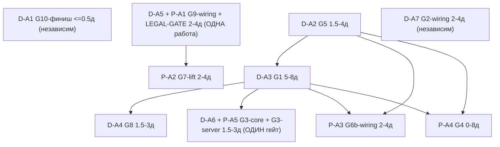

# LeftToWorkDPO 31.7.26 — DPO-сторона: code-first список действий

- Дата: 2026-07-31. Кампания / цикл: BRANCH-CONVERGENCE, цикл **M3**, задача **M3-T2** (DPO-сторона).
- TIP наблюдён при исполнении: `git -C C:\Projects\llm_mvp_core-DpoImplementation rev-parse codex/dpo-implementation` = **`9ac23b0d5752e2454fefb4fffce4734d5367789b`** — совпал с ожидаемым `9ac23b0d5`, **дрейфа нет**. Все пины пере-привязаны на этот TIP (строки двигаются; доверяю собственному git-выводу, а не номерам строк из M2/-07 — напр. M2 цитировал tiny-консты `:35-36`, при TIP они `:38-:39`).
- Репозиторий (READ-ONLY): `C:\Projects\llm_mvp_core-DpoImplementation`. Доступ только `git show`/`grep`/`diff`/`log` на пине. Рабочее дерево НЕ читалось; ни записи/чек-аута/сборки/теста/dotnet/model-run.
- Источники (read-only): `..\design to code session\30.07.26_2WorkLeft-07-reconciled-and-decisions.md` (§2, §4 резолюции F4/F6/F7/F9 + R-1..R-8, §5-доп арифметика 15.5-38); `..\Prepare to merge\LeftToWork-CONVERGENCE-M2-delta-gapmap.md` (§2 таблица, §3.1 G7, §3.2 G3/G5). Кросс-ссылка (НЕ редактировалась): `..\design to code session\LeftToWorkDesign31.7.26-actions.md`.
- **Одна объединённая ветка `codex/dpo-implementation`. «DPO-сторона» = ВЛАДЕНИЕ ПОДСИСТЕМОЙ (инфраструктура обучения + легальная граница), а не отдельная ветка.**

---

## 1. Executive summary (RU)

DPO-сторона = инфраструктура обучения + **легальная граница** (LEGAL TEACHER GATE, G7, G6b, G4, G3-server) плюс общая земля — стабильный тренер `11.DPO`. Что реально приземлилось в дельте `33a8cfd93..9ac23b0d5`: DPO-пары стали **durable** (`7fadd4c4b` — новый `FileDpoPairStore`, переживают рестарт), сервер-owned **пороговый конфиг** measurement-gate протянут в intake (`f0af554e4`, fail-closed). Но точка зажигания закрыта: тренер по-прежнему отклоняет пары стеной `DPO_PAIRS_DEFERRED` (`IncrementalTrainer.cs:62-66`). Легальная training-граница, которую называет текст deferral, **как объект/конфиг ещё не построена**. Снятие deferral = разблокировка START; сам RUN (первый реальный DPO-прогон, пересборка датасета легальным teacher) запрещён в этом срезе. **Заявлено ≠ реализовано; durable store ≠ обучение зажжено.** Ниже: Секция A — оценённая проводка (WIRING); Секция B — заблокированное run-class (дней НЕ дают).

---

## 2. Статус-таблица @9ac23b0d5 (6 строк подсистемы; вердикты из M2 §2 + re-pin при TIP)

| Строка | Статус @TIP | Коммит дельты | Пиновая цитата @9ac23b0d5 (наблюдена при re-pin) | Что это НЕ доказывает |
|--------|-------------|---------------|--------------------------------------------------|------------------------|
| **LEGAL-GATE** (легальная training-граница) | **НЕ ПОСТРОЕНА** (только НАЗВАНА в коде как цель) | — (объекта нет) | `IncrementalTrainer.cs:65` `"DPO pairs are deferred until the dedicated legal training boundary is available."` — граница упомянута строкой, самого объекта/конфига в `14.ContinuousLearning` нет | Что легальный teacher-allowlist / license-quarantine гейт существует в коде обучения. Это лишь текст причины отказа. |
| **G7** continuous-путь: пары отклоняются | **ADVANCED (durable-store продвинут; deferral UNCHANGED)** | `7fadd4c4b` (durable store) | durable: `FeedbackRouter.cs:70` `_dpoPairStore = new FileDpoPairStore(...)`, `:98 => _dpoPairStore.GetAll()`. Стена: `IncrementalTrainer.cs:62` `if (dpoPairs is { Count: > 0 })` → `:66 "DPO_PAIRS_DEFERRED"` | Что DPO-обучение зажжено. Durable-стор — ПАРАЛЛЕЛЬНОЕ хранилище: пары переживают рестарт, но упираются в стену deferral. |
| **G6b** база tiny, производна от policy | **UNCHANGED** | — (файл не тронут) | `DpoPolicyCheckpointBridge.cs:38` `PolicyVocabSize = 512`, `:39 PolicyContextLength = 64`, `:87 var config = CreateTinyPolicyConfig();`, `:199 private static ModelConfig CreateTinyPolicyConfig()` | Что база не-tiny/предобучена. Размер (512 vocab / ctx 64), single-source, прежний. |
| **G4** счётчик vs градиент: машина детерминирована | **UNCHANGED** | — (файл не тронут) | `DesignConversionMachine.cs:74` `TrainBatchAsync(...)`; `:1408` «TrainBatchAsync does not perform held-out measurement; it carries forward»; `:1692 _weightedSum += delta.Contribution` (скаляр, не градиент) | Что машинный уровень обучается градиентом. Несёт скаляр `_weightedSum`, не градиент. |
| **G3-server** пороговая проводка intake | **ADVANCED (пороги протянуты; ядро-оценка НЕ закрыта)** | `f0af554e4` | `TrainingIntakeHandler.cs:488/:535/:587` `ApplyProductionMeasurementGateThresholds(...)` (fail-closed, поле `_enforceServerOwnedMeasurementGateThresholds` `:309`); файл `...MeasurementGateThresholdConfiguration.cs` EXISTS. НО `DesignConversionTrainingMeasurementGate.cs:459 NotRealModelReady: true` всё ещё эмитится | Что домен-44 реально меряет held-out обученной модели. Дельта добавила server-owned ПОРОГИ + fail-closed wiring; сама модель-оценка остаётся scaffold. |
| **11.DPO** тренер (общая земля) | **STABLE (0 delta = common ground)** | — | `git diff --name-only 33a8cfd93 9ac23b0d5 -- 11.DPO` = пусто (0-delta); последний коммит, тронувший `11.DPO`: `8a8cad4a2 fix: connect LoRA adapters to live training path` (вне дельты) | Что тренер зажжён на 44-пути. Стабильность ≠ активность; это общая земля обеих сторон, трогать не планируется. |

---

## 3. СЕКЦИЯ A — code-first действия (чистая проводка; без прогонов, без нерешённых вопросов Любы)

### A1 · LEGAL-GATE wiring — легальная training-граница [входит в 2-4д G9-кластера; overlap с design-side A5 — дни НЕ дублировать]
Построить выделенную легальную training-boundary, которую по имени называет текст deferral (`IncrementalTrainer.cs:65`) — объект/конфиг в `14.ContinuousLearning`: (1) **open-weight allowlist** — легальный teacher = локальный **Qwen через Ollama** (лейн TP1_LOCAL), только open-weight; закрытые проприетарные (Claude/OpenAI/Gemini) ЗАПРЕЩЕНЫ как training-teachers (резолюция **F9/F7**, направление Любы **(2)**); (2) **license/quarantine** + **MaxTeacherCalls** как гейты — переиспользовать машинерию **BS-09** (пиновой контекст: `DesignConversionModelServerApi.cs:39 int? MaxTeacherCalls = null`, `:1180 IsValidConfiguredMaxTeacherCalls`; `DesignConversionDpoTrainingHandoff.cs:368 && !row.Quarantine.IsQuarantined;` — ПРЕДСУЩЕСТВУЮЩАЯ, вне дельты). **Кросс-ссылка:** 44-провенанс teacher — design-файл **A5 (G9-wiring)**; дни считаются там. **RESOLVED-PER-LUBA-DIRECTION (F9/F7).**

### A2 · G7-lift — тренер перестаёт безусловно отклонять пары [2-4д, RESOLVED-PER-LUBA-DIRECTION (F7); бывший INTENDED_CANDIDATE]
`IncrementalTrainer.cs:62-66` перестаёт безусловно возвращать `DPO_PAIRS_DEFERRED` — deferral заменяется проверкой **LEGAL-GATE (A1)**: если teacher-запись легальна (open-weight allowlist пройден) — пары текут `FeedbackRouter.GetDpoPairs()` (`ContinuousLearningPipeline.cs:84`) → `_trainer.TrainAsync(...)` (`:113`) → DPO-шаг через `11.DPO`. **Durable store уже есть** (`7fadd4c4b`, `FeedbackRouter.cs:70/:98/:129/:147`) — ИСПОЛЬЗОВАТЬ, не строить заново. **Оговорка non-overclaim:** снятие deferral = разблокировка **START**, НЕ RUN — сам первый DPO-прогон запрещён (Секция **B2**). INTENDED-история: G7 был `INTENDED_CANDIDATE (blocked_on_luba)`; §4 применил направление **(2)** Любы. **Зависит от A1.**

### A3 · G6b-wiring — боевой knob для non-tiny предобученной базы [2-4д, RESOLVED-PER-LUBA-DIRECTION (F6); бывший INTENDED_CANDIDATE]
Добавить боевой knob для инъекции **production pretrained base** вместо tiny: сейчас `DpoPolicyCheckpointBridge.cs:87` single-source `CreateTinyPolicyConfig()` (`:199`) с константами `PolicyVocabSize = 512` (`:38`) / `PolicyContextLength = 64` (`:39`). Резолюция **F6** (направление **(1)+(2)**): production pretrained base, не developer-machine tiny. **Точный вариант/размер Qwen = R-1** (residual Любы, Секция B3) — knob-wiring его НЕ блокирует (проводка каркаса ортогональна выбору веса). **Кросс-зависимость:** G1/G5 design-стороны (design-файлы **A3/A2**). INTENDED-история: был `INTENDED_CANDIDATE`; §4 применил направление Любы.

### A4 · G4 — градиентный мост машинного уровня [0-8д, RESOLVED-PER-LUBA-DIRECTION (F4); бывший INTENDED_CANDIDATE]
Детерминированную машину (`DesignConversionMachine.TrainBatchAsync`, `:74`; скаляр `_weightedSum` `:1692`) **СОХРАНИТЬ как честный каркас**, НО зажечь градиентный мост, чтобы он реально управлял (резолюция **F4**, направление **(1)**). Диапазон **[0, 8]**: низ **0д** = каркас схлопывается в G1 (design-файл **A3**), отдельного machine-level wiring нет; верх **8д** = отдельная полная градиентная проводка машинного уровня поверх G1. **Честная оговорка:** из 22.5д общей ширины пост-резолюционной оценки (15.5→38, §5-доп) **8д несёт один G4** — самый неопределённый вклад, не твёрдая оценка. **Зависит от G1+G5 (design-сторона, A3+A2).** INTENDED-история: `INTENDED_CANDIDATE`, разблокирован F4.

### A5 · G3-server-side — потребление реального held-out score [малый остаток; overlap с G3-core design-файла A6 — дни НЕ дублировать]
Пороговая проводка уже приземлилась (`f0af554e4`: `MeasurementGateThresholdConfiguration.cs` EXISTS, +256; `TrainingIntakeHandler` fail-closed `ApplyProductionMeasurementGateThresholds` `:488/:535/:587`). Остаток server-side wiring = потреблять **РЕАЛЬНЫЙ held-out score**, когда домен-44 начнёт его производить (реальную оценку строит design-сторона, файл **A6 G3-core**). **Статус ADVANCED ≠ закрыт:** `DesignConversionTrainingMeasurementGate.cs:459 NotRealModelReady: true` всё ещё эмитится. Дни за реальную оценку — на design-стороне (A6), здесь НЕ дублируются.

### A6 · 11.DPO common ground [0д — статус-строка, не действие]
Тренер `11.DPO` стабилен: `git diff --name-only 33a8cfd93 9ac23b0d5 -- 11.DPO` = пусто (**0 delta**); последний коммит, тронувший директорию, — `8a8cad4a2 fix: connect LoRA adapters to live training path` (вне дельты). Общая земля обеих сторон (DPO + design). **Трогать не планируется** — это фундамент, а не задача.

---

## 4. СЕКЦИЯ B — заблокировано / run-class (дней НЕ давать; NOT-ESTIMATED)

### B1 · DATASET_REBUILD_REQUIRED — пересборка датасета легальным teacher [NOT-ESTIMATED]
Пересборка датасета DPO-пар с легальным teacher (**Qwen через Ollama**, лейн TP1_LOCAL) = teacher-прогоны (генерация/оценка). **Run-class, запрещён в этом срезе.** Закрытые проприетарные teachers → `DATASET_REBUILD_REQUIRED` (резолюция F7, направление (2)).

### B2 · Первый реальный DPO-run [NOT-ESTIMATED]
`TrainAsync` с непустыми парами после снятия deferral (A2) = **TRAINING-RUN**. Запрещён в этом срезе. Снятие `DPO_PAIRS_DEFERRED` разблокирует START; сам RUN — вне scope.

### B3 · G6b: выбор/загрузка конкретной Qwen-базы [NOT-ESTIMATED]
Точный вариант/размер Qwen = **R-1** (решение Любы, без рекомендации) + acquisition/загрузка весов = run-class. Направление (1)/(2) размер НЕ фиксирует.

### B4 · Прочие residuals DPO-стороны — решения Любы [NOT-ESTIMATED]
- **R-4** · SQL-vs-JSONL хранение артефактов (реляционное vs NDJSON) — без рекомендации.
- **R-6** · Лицензионное решение AGPL/GPL (код несёт AGPL-3.0; остаться vs двойное лицензирование vs пересмотр) — без рекомендации.
Оба — продуктовые решения Любы, инженеро-дней НЕ получают.

---

## 5. Граница WIRING vs TRAINING-RUN + сводка

**Явная граница.** Проводка A1-A5 ОЦЕНЕНА (wiring-only: A2 [2-4], A3 [2-4], A4 [0-8]; A1/A5 — overlap с design-стороной, дни там). B1-B3 НЕ оценены и запрещены (run-class). **Качество обучения (сдвиг весов, reward-hacking, held-out) доказуемо ТОЛЬКО прогоном — прогоны вне scope этого среза.** Снятие `DPO_PAIRS_DEFERRED` разблокирует START; RUN запрещён.

**Сводная таблица:**

| Действие | Дни | Зависит от | Разблокирует | Флаг |
|----------|-----|------------|--------------|------|
| A1 LEGAL-GATE wiring | входит в 2-4 G9-кластера (дни на design A5) | — | A2 | RESOLVED (F9/F7) |
| A2 G7-lift | 2-4 | A1 | START DPO-пути 14 (→ B2) | RESOLVED (F7); был INTENDED |
| A3 G6b-wiring | 2-4 | G1/G5 (design A3/A2) | prod-base knob (→ B3/R-1) | RESOLVED (F6); был INTENDED |
| A4 G4 | 0-8 | G1+G5 (design A3+A2) | градиентный machine-уровень | RESOLVED (F4); был INTENDED |
| A5 G3-server-side | малый остаток (дни на design A6) | design A6 (G3-core) | server-side порог на реальном held-out | ADVANCED, не закрыт |
| A6 11.DPO | 0 (статус) | — | — | STABLE common ground |
| B1 dataset rebuild | NOT-ESTIMATED | A1 | — | run-class |
| B2 первый DPO-run | NOT-ESTIMATED | A2 | — | TRAINING-RUN |
| B3 Qwen-база выбор | NOT-ESTIMATED | A3 | — | R-1 (Luba) |
| B4 R-4 / R-6 | NOT-ESTIMATED | — | — | residual (Luba) |

**Пост-резолюционный wiring-only диапазон (общий, из §5-доп -07, НЕ пересчитываю):** ядро + вошедшие условные = **15.5 - 38 дней**; вошедшие условные G4[0,8]+G6b[2,4]+G7[2,4] = **[4,16]**. Критический путь `G5→G1→G3` = 8.0-15д (G4/G6b/G7 НЕ на нём, исполняются параллельно).

**Honest scope.** Всё привязано к `9ac23b0d5` через `git show`/`grep`/`diff`/`log` (read-only); рабочее дерево НЕ читалось. **Заявлено ≠ реализовано; durable store ≠ обучение зажжено.** RESOLVED-строки ПРИМЕНЯЮТ направление Любы (1)/(2), а не решения Claude — здесь нет продуктовых решений, только luba_flags/residuals (R-1/R-4/R-6). ADVANCED = «код продвинулся», НЕ «гэп закрыт»: G7-durable и G3-пороги — проводка/долговечность вокруг гэпов, а НЕ зажигание боевого DPO-обучения (стена `DPO_PAIRS_DEFERRED` намеренно стоит). Один task, applied once.

<!-- END M3-T2 -->

---

## PART A — GIT-FINALIZATION SEQUENCE (цикл M4, задача M4-T1; общий блок для обоих deliverable-файлов)

- **Дата:** 2026-07-31. Кампания BRANCH-CONVERGENCE, цикл **M4**, задача **M4-T1**. Применено один раз; блок байт-идентично приписан в оба файла (контент бранч-агностичен).
- **Наблюдённые tips при исполнении** (read-only, БЕЗ fetch — локальные remote-tracking refs; состояние GitHub может отличаться):
  - `codex/dpo-implementation` = **`83245a2039bf7493e79d61de93b64d67dc65bc8d`** — «Merge latest DesignToCode-clean into DPO implementation»
  - `main` = **`afd26cbd292417967aa9cb90f8f56efac015fabb`** (= `origin/main`) — «Merge pull request #44 from lubochka/DesignToCode-clean»
  - `origin/DesignToCode-clean` = **`f6172743881f19db33d18aac94dbd863e849c16d`** — «Allow rejected promotions without checkpoint export»
- **Дрейф против M1/M3:** M3 пинул codex на `9ac23b0d5…`; наблюдённый tip `83245a2039…` — **потомок** `9ac23b0d5` (is-ancestor exit 0): codex продвинулся с `9ac23b0d5` (M3) на `83245a203`, оставаясь потомком. DTC сдвинулся с `99ef8a2c3` (M1) на `f61727438`. codex-tip — merge свежего DTC («Merge latest DesignToCode-clean into DPO implementation»): дрейф ПОГЛОТИЛ продвижение DTC. NB: наблюдённые tips совпадают с baseline оркестратора (2026-07-31) — дрейфа с момента ассессмента оркестратора нет.
- **Пять проверок M1 ПЕРЕПРОВЕРЕНЫ на наблюдённых tips:** is-ancestor main→codex exit 0; is-ancestor DTC→codex exit 0; merge-tree main×codex = `47d3bb45dcdc97ef92933d763557e9b339a222e1` чисто exit 0; merge-tree DTC×codex = `47d3bb45dcdc97ef92933d763557e9b339a222e1` чисто exit 0; усилитель: `47d3bb45d…` = `codex^{tree}` — чистый merge предка в потомка возвращает дерево потомка. Ahead/behind: main…codex = 0/29; DTC…codex = 0/10.
- **Вердикт M1 держится @наблюдённые tips:** codex/dpo-implementation = 0-конфликтный superset и main, и DesignToCode-clean. «0 конфликтов» — ТОЛЬКО о перечисленных tips; перед исполнением обязателен гейт G-3.
- **СТАТУС: ПИСЬМЕННАЯ ПРОГРАММА. НИКАКОЙ merge/ff/branch-delete НЕ ИСПОЛНЯЕТСЯ в этой кампании** — команды ниже записаны как текст для Любы/исполнителя. **WHEN исполнять = LUBA-M1-F1 (carried M1→M4): тайминг решает Люба; здесь только механика.**

### G-3 · DRIFT-ПРОТОКОЛ — execution-time gate (исполняется ПЕРВЫМ, непосредственно перед G-1/G-2)

```bash
cd C:\Projects\llm_mvp_core-DpoImplementation
git fetch origin        # ТОЛЬКО на реальном исполнении (исполнитель); кампания-аналитика fetch не делает
git rev-parse codex/dpo-implementation main origin/DesignToCode-clean            # (1)-(3) записать
git merge-base --is-ancestor main codex/dpo-implementation; echo $?              # (4) ожидаем 0
git merge-base --is-ancestor origin/DesignToCode-clean codex/dpo-implementation; echo $?   # (5) ожидаем 0
git merge-tree --write-tree main codex/dpo-implementation                        # (6) один tree-OID, exit 0, без конфликтов
git merge-tree --write-tree origin/DesignToCode-clean codex/dpo-implementation   # (7) то же
git rev-parse "codex/dpo-implementation^{tree}"                                  # усилитель: обязан совпасть с OID из (6)/(7)
```

**GO** ⇔ (4)=(5)=exit 0 И (6),(7) чисты. Иначе **STOP** + ре-ассессмент:
- Сломалось (4) — main разошёлся (кто-то закоммитил в main): fast-forward невозможен. `git log codex/dpo-implementation..main --oneline` — список уникальных коммитов main. Если (6) при этом чист — возможен настоящий merge, но только после пере-проверки и подписи Любы; если (6) грязный — полный ре-ассессмент (новый цикл унификации). НЕ форсить.
- Сломалось (5) — у DTC появились уникальные коммиты: `git log codex/dpo-implementation..origin/DesignToCode-clean --oneline`. DTC **НЕ удалять**: сначала влить уникальные коммиты в codex (новый цикл), затем перегнать гейт.
- (6)/(7) с конфликтами: merge-tree после tree-OID перечисляет конфликтные пути — записать, STOP, эскалация Любе.

«Постепенно / softly»: merge остаётся мягким ровно до тех пор, пока superset-отношение держится; дрейф поглощается пере-прогоном гейта, никогда — форсом.

### G-1 · Финализация codex/dpo-implementation → main (письменная программа)

Предусловие: G-3 GO. На проверенных tips codex ahead 29/behind 0 от main → доступен fast-forward ИЛИ чистый merge. Ремоут `https://github.com/lubochka/llm_mvp_core.git`.

**Вариант G-1a — PR-based merge (аудит-след на GitHub):**
```bash
gh pr create --repo lubochka/llm_mvp_core --base main --head codex/dpo-implementation \
  --title "Converge: codex/dpo-implementation -> main (verified 0-conflict superset)" \
  --body "Drift-gate G-3 passed at tips codex=83245a2039bf7493e79d61de93b64d67dc65bc8d, main=afd26cbd292417967aa9cb90f8f56efac015fabb; merge-tree clean."
gh pr merge --repo lubochka/llm_mvp_core --merge     # merge-commit; 0-conflict на проверенных tips
```
**Вариант G-1b — локальный fast-forward (без PR):**
```bash
git checkout main
git merge --ff-only codex/dpo-implementation   # --ff-only сам по себе drift-guard: упадёт, если main разошёлся
git push origin main
```

### G-2 · Retire/archive origin/DesignToCode-clean (письменная программа)

Предусловия: G-1 исполнен; `git rev-list --count codex/dpo-implementation..origin/DesignToCode-clean` = **0** (строгий предок, 0 уникальных коммитов — терять нечего).

**Вариант G-2a — keep-as-tag (обратимо, маркер остаётся):**
```bash
git tag archive/DesignToCode-clean-2026-07-31 origin/DesignToCode-clean
git push origin archive/DesignToCode-clean-2026-07-31
git push origin --delete DesignToCode-clean
```
**Вариант G-2b — delete-after-merge (маркер не остаётся):**
```bash
git push origin --delete DesignToCode-clean
```
Выбор G-2a/G-2b = **luba_flag**; факт для решения: G-2a обратим без потерь; G-2b опирается на то, что каждый коммит DTC уже содержится в codex.

### Carried flag

- **LUBA-M1-F1 (carried M1→M4):** КОГДА исполнять G-1/G-2 — решает Люба. В кампании BRANCH-CONVERGENCE ни один участник (Fable/Opus/оркестратор) не исполняет merge/ff/delete/push/tag.

**Honest scope (M4-T1).** Все git-факты — read-only наблюдения на перечисленных tips, без fetch (GitHub может отличаться — исполнитель обязан fetch в G-3). «0 конфликтов» не переносится на будущие tips автоматически — только через G-3. Никакой merge не исполнен. Продуктовых решений нет: тайминг = LUBA-M1-F1, выбор G-2a/b = luba_flag.

<!-- END M4-T1 (PART A) -->

---

## PART B — CROSS-SIDE CODE-FIRST ORDERING (цикл M4, задача M4-T2; общий блок для обоих deliverable-файлов)

- **Дата:** 2026-07-31. Кампания BRANCH-CONVERGENCE, цикл **M4**, задача **M4-T2**. Применено один раз; блок байт-идентично приписан в оба файла.
- **Пин-штамп:** codex/dpo-implementation = `7258be865693cb63317713f6615c5478d5ef8fe3`, main = `afd26cbd292417967aa9cb90f8f56efac015fabb`, origin/DesignToCode-clean = `f6172743881f19db33d18aac94dbd863e849c16d`; is-ancestor main→codex exit 0, DTC→codex exit 0. Дрейф против M3 `9ac23b0d5`: codex сдвинулся с M4-T1-baseline `83245a203` на `7258be865` (форвард; main/DTC без изменений — `afd26cbd2`/`f61727438`), обе is-ancestor держат exit 0 → superset-отношение M3→M4 сохраняется, релейшены не сломаны.
- **Scope:** единый порядок над Section-A (WIRING-only) ОБОИХ файлов. Узлы D-* = Design-файл §3 (A1-A7), P-* = DPO-файл §3 (A1-A6). Section B обеих сторон (teacher-прогоны, первый DPO-run, второй render+judge, выбор Qwen-базы, R-2/R-3/R-4/R-6/R-7/R-8) — run-фаза ПОСЛЕ проводки, за флагами Любы; в порядок НЕ входит.

### Инвентарь узлов (13)

| Узел | Действие | Дни | Источник |
|------|----------|-----|----------|
| D-A1 | G10-финиш (аудит-closeout) | <=0.5 | Design §3 A1 |
| D-A2 | G5 порт checkpoint-контракта в 44 | 1.5-4 | Design §3 A2 |
| D-A3 | G1 обученная policy ведёт боевой скоринг | 5-8 | Design §3 A3 |
| D-A4 | G8 LoRA на боевом 44-пути | 1.5-3 | Design §3 A4 |
| D-A5 | G9-wiring teacher-provenance | 2-4 | Design §3 A5 |
| D-A6 | G3-core реальный held-out гейт | 1.5-3 | Design §3 A6 |
| D-A7 | G2-wiring измеренная маржа | 2-4 | Design §3 A7 |
| P-A1 | LEGAL-GATE wiring | 0 доп. (overlap D-A5) | DPO §3 A1 |
| P-A2 | G7-lift снятие deferral | 2-4 | DPO §3 A2 |
| P-A3 | G6b prod-base knob | 2-4 | DPO §3 A3 |
| P-A4 | G4 градиентный мост машинного уровня | 0-8 | DPO §3 A4 |
| P-A5 | G3-server потребление real held-out | 0 доп. (overlap D-A6) | DPO §3 A5 |
| P-A6 | 11.DPO common ground | 0 (статус-строка) | DPO §3 A6 |

### Граф зависимостей



Рёбра D-A2->P-A3 и D-A2->P-A4 транзитивно покрыты через D-A3, но приведены как в источнике (DPO §3: «зависит от G1+G5»). P-A6 — вне графа (0д, статус). Независимые входы: D-A1, D-A2, D-A5+P-A1, D-A7.

### Рекомендованный порядок исполнения (code-first: дешёвое независимое — первым)

1. **D-A1 G10-финиш** [<=0.5д] — дешёвейший независимый, закрывается чтением кода.
2. **D-A2 G5** [1.5-4д] — старт дизайн-хребта (порт проверенного шаблона 27.TranslationDomain).
   параллельно с п.2: **D-A5+P-A1 G9+LEGAL-GATE** [2-4д, одна работа, дни один раз] и **D-A7 G2-wiring** [2-4д].
3. **P-A2 G7-lift** [2-4д] — сразу после D-A5+P-A1 (deferral заменяется проверкой LEGAL-GATE). Разблокирует START DPO-пути (RUN остаётся запрещён — Section B).
4. **D-A3 G1** [5-8д] — после D-A2. Самый тяжёлый узел; разблокирует всю нижнюю волну.
5. Параллельная волна после D-A3: **D-A4 G8** [1.5-3д] + **D-A6+P-A5 G3 (обе половины)** [1.5-3д] + **P-A3 G6b** [2-4д] + **P-A4 G4** [0-8д].
6. **P-A6 11.DPO** — 0д, статус-строка; работы нет, фундамент не трогать.
Далее — run-фаза (Section B обеих сторон), за флагами Любы; порядок лейнов из DPO B1: CODE_FIRST -> TP1_LOCAL -> TP2_HOSTED -> G-DPO-FINAL -> DPO_TRAINING.

### Критический путь

**D-A2 (G5) -> D-A3 (G1) -> D-A6+P-A5 (G3 обе половины) = 8.0-15 инженеро-дней** — совпадает с M3-DPO §5 («G5->G1->G3 = 8.0-15д»). Честная оговорка: P-A4 (G4) висит на том же D-A3; при верхней оценке 8д standalone цепочка D-A2->D-A3->P-A4 = 6.5-20д длиннее номинальной — но низ G4 = 0д (каркас схлопывается в G1), и M3 пометил вклад 8д как «самый неопределённый». Обе цепочки приведены; какая реализуется — решится только исполнением.

### No-double-count (3 пересечения)

1. **G3-половины:** D-A6 (core, 1.5-3д) + P-A5 (server-side «малый остаток», дни у D-A6) = ОДИН гейт; считать 1.5-3д один раз.
2. **G9/LEGAL-GATE:** D-A5 (2-4д) + P-A1 («входит в 2-4д G9-кластера») = ОДНА работа; считать 2-4д один раз.
3. **G4/G1:** низ P-A4 = 0д именно потому, что каркас схлопывается в D-A3 (G1); дни G4 — только за standalone machine-level wiring СВЕРХ G1.

### Сводная арифметика (механическая по M3-диапазонам; НЕ пересчёт -07)

- Design-узлы D-A1..D-A7: **13.5-26.5д** (низ 0+1.5+5+1.5+2+1.5+2; верх 0.5+4+8+3+4+3+4).
- DPO-уникальные после вычета пересечений (P-A2+P-A3+P-A4): **4-16д**.
- Итого уникальной проводки: **17.5-42.5д**.
- Нота: -07 §5-доп давала 15.5-38д при СВОЁМ скоупе включения; расхождение — иной состав узлов (G8, G2-wiring, G10-остаток), здесь НЕ reconciled — non-overclaim, обе цифры сосуществуют каждая со своим скоупом.

**Honest scope (M4-T2).** Порядок построен над WIRING-only узлами; ни один узел не доказывает качество обучения (сдвиг весов, held-out, reward-hacking — только прогоном; прогоны запрещены в срезе). Дни — диапазоны из M3-файлов как есть. Продуктовых решений нет; run-фаза за флагами Любы (R-1, R-2, R-3, R-4, R-6, R-7, R-8; тайминг git-финализации = LUBA-M1-F1, PART A). Один task, applied once.

<!-- END M4-T2 (PART B) -->

## ИТОГ ПРОГРАММЫ КОНВЕРГЕНЦИИ (M5)

**Пин-штамп (M5-T1, 2026-07-31):** codex/dpo-implementation = `7258be8`, main = `afd26cb`, origin/DesignToCode-clean = `f617274`; relations hold: main⊂codex ✓, DTC⊂codex ✓ (обе `merge-base --is-ancestor` exit 0). Наблюдённые tips совпали с пином M4-T2 (`7258be865`/`afd26cbd2`/`f6172743`) — дрейфа с момента M4 нет; факты валидны ТОЛЬКО для этих tips, ветки двигаются ежедневно, перед любым исполнением обязателен re-verify через drift-гейт G-3.

### §1 ОТВЕТ НА ВОПРОС ЛЮБЫ

«Как постепенно свести две ветки в один бранч, приоритет — код»: git-конвергенция по существу ДОСТИГНУТА — `codex/dpo-implementation` наблюдается как 0-конфликтный superset и `main`, и `DesignToCode-clean` (обе is-ancestor exit 0 на пине выше; «по существу» — ТОЛЬКО на этих наблюдаемых tips и ТОЛЬКО через drift-гейт G-3, ветки двигаются ежедневно), DTC — строгий предок codex (0 уникальных коммитов), финализация = тривиальный fast-forward codex→main + retire DTC за гейтом G-3, тайминг — решение Любы (LUBA-M1-F1); НИКАКОЙ merge/ff/delete этой кампанией НЕ исполнен — только письменная программа; реальная оставшаяся работа — код-первая проводка (крит. путь 8-15д; вся уникальная проводка ~17.5-42.5д, всё — только wiring формы, НЕ run-фаза), а прогоны (реальное обучение) — отдельная фаза за флагами Любы, запрещены в этом срезе, и качество обучения доказуемо ТОЛЬКО прогоном; легальный учитель = локальный Qwen через Ollama (направление Любы, резолюции F9/F7).

### §2 ПРОГРАММА В ТРИ ФАЗЫ

- **Фаза 0 — git-финализация** (M4 PART A; исполняется КОГДА решит Люба = LUBA-M1-F1, НЕ этой кампанией): G-3 drift-гейт (re-verify трёх tips + is-ancestor ×2 + merge-tree ×2) → G-1 fast-forward codex→main → G-2 retire DTC (вариант G-2a keep-as-tag / G-2b delete-after-merge).
- **Фаза 1 — код-первая проводка** (M4 PART B, порядок над 13 узлами WIRING-only): G10-финиш → G5 (порт checkpoint-контракта 27.TranslationDomain) → параллельно {G9/LEGAL-GATE, G2-wiring} → G7-lift (снятие `DPO_PAIRS_DEFERRED` = START, НЕ RUN) → G1 (обученная policy ведёт боевой скоринг) → параллельная волна {G8 LoRA, G3 обе половины, G6b prod-base, G4 градиентный мост}. Критический путь G5→G1→G3 = 8-15 инженеро-дней; вся уникальная проводка 17.5-42.5д (no-double-count: G3-половины, G9/LEGAL-GATE, G4/G1 считаются один раз).
- **Фаза 2 — run-фаза** (Section B обеих сторон; NOT-ESTIMATED; вся за флагами Любы, запрещена в срезе): teacher-прогоны Qwen/Ollama (лейн TP1_LOCAL), первый реальный DPO-run, второй render+judge. Порядок лейнов: CODE_FIRST → TP1_LOCAL → TP2_HOSTED → G-DPO-FINAL → DPO_TRAINING.

Код-первый приоритет соблюдён: Фаза 1 (проводка формы) исполняется ЦЕЛИКОМ ПЕРЕД Фазой 2 (прогоны/поведение); ни один день Фазы 1 не доказывает качество обучения — это доказуемо ТОЛЬКО прогоном Фазы 2.

### §3 СВОДНЫЙ ЛЕДЖЕР РЕШЕНИЙ ЛЮБЫ

Открытые решения Любы (варианты БЕЗ рекомендаций; дедуп по M1–M4 + -07):

1. **LUBA-M1-F1** — КОГДА исполнять git-финализацию (ff codex→main + retire DTC): тайминг решает Люба; кампания фиксирует ТОЛЬКО механику (M1 §5; M4 PART A).
2. **LUBA-M1-T2-F1** — судьба трёх 22.07-документов в «Prepare to merge»: архивировать как «HISTORICAL 22.07» (пометка/переименование) vs оставить как есть (M1 §10).
3. **LUBA-M1-T2-F2** — нужна ли формальная merge-стратегия: заполнять пустой §10 плана 22.07 формальной стратегией vs закрыть git-часть одним fast-forward-PR (M1 §10).
4. **G-2a / G-2b** — retire DesignToCode-clean: keep-as-tag (обратимо, маркер остаётся) vs delete-after-merge (маркер не остаётся) (M4 PART A, G-2).
5. **R-1** — точный вариант/размер Qwen под TP1_LOCAL/Ollama (из F6/G6b, F1/G1 toy-scale) (-07 §4.1; M3 DPO Section B3).
6. **R-2** — per-run cost / бюджет петли: фиксированный per-run cap vs адаптивный бюджет (из F2/G2) (-07 §4.1).
7. **R-3** — real-Chromium-render на боевом хосте vs headless-CI vs отложить (из F2/G2) (-07 §4.1).
8. **R-4** — SQL vs JSONL хранение артефактов: реляционное vs NDJSON (-07 §4.1; M3 DPO Section B4).
9. **R-5** — BS-03 host-repo доступ (LOCK1/LOCK2, `xiigen-flows-dot-net-angular`; = F12): предоставить доступ и верифицировать vs держать как гипотезу vs внешняя верификация. Флаг присутствует ТОЛЬКО в -07 (в M3/M4 под лейблом R-5 не переносился); включён по дедуп-правилу (-07 §4.1, F12).
10. **R-6** — лицензионное решение AGPL/GPL (код несёт AGPL-3.0): остаться на AGPL-3.0 vs двойное лицензирование vs пересмотр (-07 §4.1; M3 DPO Section B4).
11. **R-7** — точное значение acceptance-threshold held-out гейта (из F3/G3) (-07 §4.1).
12. **R-8** — privacy_scope второго render+judge при ре-рендере проигравшего (из F2/G2) (-07 §4.1).

**NOTE (не решение — уже закрыто направлением Любы):** G4/G6b/G7 и G9/LEGAL-GATE (teacher-граница) уже RESOLVED-PER-LUBA-DIRECTION per -07 §4 (резолюции F4/F6/F7/F9: настоящее DPO зажечь + teacher = локальный Qwen через Ollama, open-weight; закрытые проприетарные запрещены) — НЕ re-open, в леджер открытых решений НЕ входят. Их проводка исполняется в Фазе 1, активация/прогон — в Фазе 2.

### §4 ЧЕСТНОЕ ЗАКРЫТИЕ

- git-факты приколоты к наблюдаемым tips (пин-штамп выше); re-verify at execution обязателен — ветки дрейфуют ежедневно, протокол drift-гейта G-3 обязателен перед любым исполнением Фазы 0. «0 конфликтов / superset» держится ТОЛЬКО на перечисленных tips.
- Никакой merge / fast-forward / delete НЕ исполнен этой кампанией — записана лишь письменная программа для Любы/исполнителя.
- Качество обучения (сдвиг весов, held-out, reward-hacking) доказуемо ТОЛЬКО прогоном, который запрещён в этом срезе; все «дни» — ТОЛЬКО код-проводка (wiring формы), не run-фаза.
- Deliverables аддитивны: ничего существующего не перезаписано; supporting-файлы M1/M2 лежат в «Prepare to merge».
- Продуктовых решений кампания не принимает: §3 перечисляет решения Любы с вариантами, БЕЗ рекомендаций. Связь артефактов: -07 = улучшенный план (резолюции по направлению Любы); M2 = re-pin дельты/статусов гэпов к наблюдаемому коммиту.

### §5 КАРТА ФАЙЛОВ КАМПАНИИ

- `Prepare to merge\LeftToWork-CONVERGENCE-M1-status.md` — M1 STATUS FOUNDATION: наблюдаемые tips, топология main⊂DTC⊂codex, is-ancestor + merge-tree проверки, дельта, вердикт конвергенции, staleness-леджер 22.07-документов, переиспользуемый материал.
- `Prepare to merge\LeftToWork-CONVERGENCE-M2-delta-gapmap.md` — M2 покоммитный разбор дельты (33a8cfd93..9ac23b0d5) + GAP-STATUS re-pin таблица (G1–G10 вердикты @TIP: ADVANCED/UNCHANGED) + глубокая проверка G7 и G3/G5.
- `design to code session\LeftToWorkDesign31.7.26-actions.md` — DESIGN-сторона: code-first действия A1–A7 (проводка 7 гэпов подсистемы DesignConversion) + M4 PART A (git-финализация) + M4 PART B (кросс-порядок) + этот M5-итог.
- `dpo legal build\LeftToWorkDPO31.7.26-actions.md` — DPO-сторона: code-first действия A1–A6 (LEGAL-GATE, G7-lift, G6b, G4, G3-server, 11.DPO common ground) + M4 PART A + M4 PART B + этот M5-итог.

<!-- END M5-T1 — CONVERGENCE PROGRAM COMPLETE -->

---

## ПРАВИЛО ГИГИЕНЫ ИСПОЛНИТЕЛЯ (обязательно для любого исполнения этой программы)

ПРАВИЛО ГИГИЕНЫ ИСПОЛНИТЕЛЯ (executor hygiene). Агент/исполнитель имеет право создавать файлы ТОЛЬКО внутри репозитория, который он назначен править, и в своём выделенном scratchpad-каталоге. Запрещено создавать скрытые файлы (dotfiles, .tmp, служебные артефакты) где-либо ещё — ни в чужих репозиториях, ни в planning-репо, ни в домашнем каталоге. Исполнитель НЕ имеет права оставлять после себя грязное состояние правимого репозитория: никаких брошенных/грязных веток, никаких оставшихся worktrees, никакого незакоммиченного мусора сверх намеренного изменения. По завершении задачи рабочее дерево, список веток и список worktrees должны быть НЕ грязнее, чем на входе (для read-only задач — нулевой след). Нарушение — hard violation.

Применение к этой программе:

- При исполнении code-first действий этой программы (A1–A7 DESIGN-стороны / A1–A6 DPO-стороны) исполнитель создаёт файлы ТОЛЬКО внутри `C:\Projects\llm_mvp_core-DpoImplementation` и в своём выделенном scratchpad-каталоге. Нигде больше: ни в planning-репо, ни в других `llm_mvp_core*`-репозиториях, ни в домашнем каталоге.
- Скрытые файлы (dotfiles, `.tmp`, служебные артефакты) вне этих двух мест — запрещены безусловно.
- git-финализация (Фаза 0 / M4 PART A: merge, fast-forward, retire веток) — ЕДИНСТВЕННОЕ намеренное изменение git-состояния, предусмотренное программой, и исполняется ТОЛЬКО когда Люба явно авторизует её. Любая другая задача программы обязана оставить рабочее дерево, список веток (`git branch --list`) и список worktrees (`git worktree list`) НЕ грязнее, чем на входе; для read-only задач — нулевой след.
- Гейт на выходе каждой задачи: снять `git status --porcelain` + `git branch --list` + `git worktree list` до и после; любая НОВАЯ ветка, НОВЫЙ worktree или НОВЫЙ незакоммиченный/скрытый файл сверх намеренного изменения = hard violation — исполнение останавливается, след устраняется, инцидент фиксируется в return_packet.

## ПРАВИЛО РАСПОЛОЖЕНИЯ РЕПОЗИТОРИЯ (обязательно для любого исполнения этой программы)

Canonical RU clause (repo location) — additive 2026-07-31, per Luba's directive:
ПРАВИЛО РАСПОЛОЖЕНИЯ РЕПОЗИТОРИЯ (repo location). Библиотека/репозиторий проекта, который исполнитель назначен править, ВСЕГДА находится на диске C по пути `C:\Projects\<project_name>-<branch_name>` и НИГДЕ БОЛЬШЕ: один клон = одна ветка, имя папки = `<имя-проекта>-<имя-ветки>`. Запрещено держать, искать, клонировать или править репозиторий по любому другому пути — другой диск, домашний каталог, вложенная или временная папка, второй клон под тем же именем. Перед любым код-действием исполнитель обязан убедиться, что назначенный репозиторий лежит именно по этому шаблону пути; если путь не соответствует шаблону — остановиться и эскалировать, а не создавать/клонировать/править репо в произвольном месте. Нарушение — hard violation.
EN summary (the RU clause above is canonical): the project library/repository the executor is assigned to modify ALWAYS lives on the C drive at `C:\Projects\<project_name>-<branch_name>` and nowhere else — one clone per branch, folder name = `<project>-<branch>`. Keeping, searching, cloning, or editing the repo at any other path (another drive, the home directory, a nested/temp folder, a second clone under the same name) is forbidden. Before any code action the executor must confirm the assigned repo sits exactly at this path pattern; if it does not, stop and escalate rather than creating/cloning/editing the repo in an arbitrary location. Violation = hard violation.

Применение к этой программе (расположение репозитория): единственный правимый код-репозиторий — `C:\Projects\llm_mvp_core-DpoImplementation` (проект `llm_mvp_core`), он и есть библиотека проекта по шаблону `C:\Projects\<project_name>-<branch_name>`. Все код-действия (A1–A7 DESIGN-стороны / A1–A6 DPO-стороны) — только в нём. Второй клон `C:\Projects\llm_mvp_core` (ушёл на ветку `llm_plan3`) для этой работы НЕ используется. `C:\Projects\xiigen-planning` — planning-репо, только для документов этой программы, не для код-правок. Если назначенного репозитория нет по этому пути или путь не соответствует шаблону — остановиться и эскалировать, не клонировать/создавать репо в произвольном месте.
