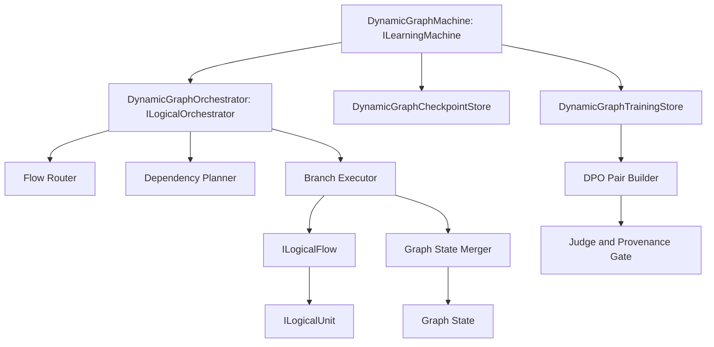
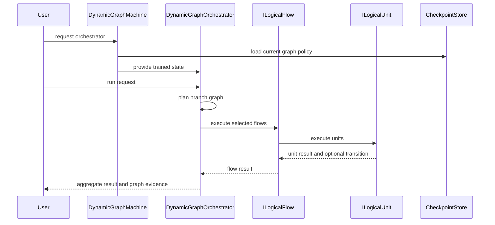
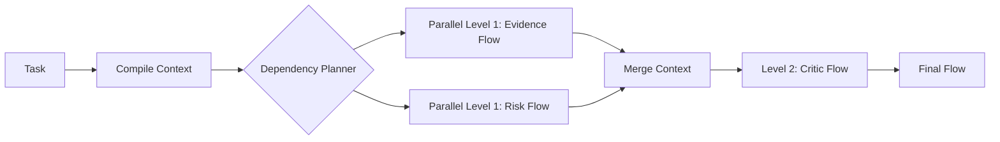

## Fable Coverage Repair Overlay (2026-07-05)

plan_readiness: PLAN_NOT_READY / FABLE_GAP_REPAIR_QUEUE
implementation_authorization: NO until fresh Luba approval after review
current_verdict_basis: Newer Fable coverage evidence `claude-fable-plan-check-v1.md` and attachment `98cbe69a` supersede the previous final-readiness overlay. Fable reports 127 findings: 91 COVERED, 30 PARTIAL, 6 MISSING. Mental implementation from active-codex would still hit plan-level design/source/dependency blockers: R-B 20/40 knowledge-library artifacts are not accepted built artifacts; R-G source addressability is incomplete; several shared contracts/readability/lifecycle carriers need plan-family repair. This is plan repair evidence only, not product implementation, not tests/builds/runtime/provider/training/checkpoint/git proof.
current_verdict_classes: DESIGN_BLOCKER_CURRENT=FABLE_MISSING_AND_PARTIAL_ITEMS; CURRENT_REPAIR_QUEUE=FABLE_RB_RG_AND_PARTIAL_REPAIR; FABLE_EVIDENCE=claude-fable-plan-check-v1.md lines 35-153 and attachment 98cbe69a lines 32-79; CURRENT_LEDGER_ACCEPTANCE_BOUNDED_EVIDENCE=previous 50/50 planning-section acceptance remains historical/process evidence only and cannot override later Fable MISSING/PARTIAL findings; IMPLEMENTATION_AUTHORIZATION_GATE=NO until fresh Luba approval after review.
historical_classification_rule: Any older line in this file saying PLAN_READY_FOR_LUBA_REVIEW, Final Readiness Review Overlay, no unresolved design/dependency blocker, CURRENT_REPAIR_QUEUE=NONE_IDENTIFIED_BY_FINAL_READINESS_REVIEW, or parent final-readiness acceptance before this overlay is historical/pre-Fable evidence only unless it cites a later unquoted Luba instruction or later evidence-bound review after 2026-07-05.
fable_gap_repair_addendum: active-codex-execution-42-fable-gap-repair-additions-20260705.md is the current repair map for R-B/R-G and the partial contract/readability/lifecycle additions.
## Historical Pre-Fable Final Readiness Review Overlay (2026-07-05)
historical_pre_fable_plan_readiness: PLAN_READY_FOR_LUBA_REVIEW
implementation_authorization: NO until fresh Luba approval after review
final_readiness_review_scope: one bounded planning/governance readiness review only; no product implementation, tests, builds, runtime, browser, provider/API, model/training/checkpoint, git, branch, mergeability, PR, or product-readiness proof was run.
historical_pre_fable_current_verdict_basis: This final review read the required governance/skill gate markers, the two unique original-task/reference attachments, the minimum Claude baseline surfaces, the active-codex plan/board/matrix/source-map/legal/gate/ledger surfaces, and current status/search evidence. End-to-end mental simulation from the active plan found no unresolved design/dependency decision that an executor would have to choose before coding/testing. The prior PLAN_NOT_READY / PLAN_PARTIAL_REPAIR_QUEUE state after 0aa/Laplace/Kepler/Singer was retained for parent final-review acceptance; this overlay supplies that final bounded review. Remaining items are execution or approval gates only: fresh Luba implementation approval, local self-authored seed file creation, code implementation, tests/builds/runtime/training/checkpoint/fresh-load/ablation proof, same-scenario Path A/Path B host proof, mock/replacement-ledger proof, branch/mergeability/git proof if later authorized, final product review, and route-specific hosted TogetherAI/Qwen3 terms/output-use proof before hosted train/common use.
historical_pre_fable_current_verdict_classes: DESIGN_BLOCKER_CURRENT=NONE_IDENTIFIED_BY_FINAL_READINESS_REVIEW; CURRENT_REPAIR_QUEUE=NONE_IDENTIFIED_BY_FINAL_READINESS_REVIEW; CURRENT_LEDGER_ACCEPTANCE_BOUNDED_EVIDENCE=50/50 accepted planning sections after 2026-07-05 Pass37-Pass50/Singer repair, not 50 cycles, not 50 product reviews, not product proof, not test/build/runtime/provider/training/checkpoint/git proof; HOSTED_PROVIDER_PRE_USE_GATE_ROUTE_SPECIFIC=TogetherAI/Qwen3 proof required before hosted train/common use only, not a local self-authored v1 planning blocker; IMPLEMENTATION_AUTHORIZATION_GATE=NO until fresh Luba approval after review.
historical_classification_rule: Any older line in this file saying PLAN_NOT_READY / PLAN_PARTIAL_REPAIR_QUEUE, current verdict remains PLAN_NOT_READY, CURRENT_REPAIR_QUEUE, parent must run final readiness review, or no-go boundaries before this overlay is historical/pre-final-readiness-review evidence only unless it cites a later unquoted Luba instruction or later evidence-bound review after 2026-07-05.
---
artifact_type: ilearningdynamicgraph_architecture_brief
authority_source: latest unquoted Luba work order for DPO Legal Learning active execution chain
status: populated_now_planning_only
last_updated: 2026-06-29
write_scope: C:\Users\lubao\Documents\xiigen\llm mvp\dpo legal build\active-codex-execution-*.md
---

## 43c2 Current Readiness Downgrade Overlay (2026-07-02)

historical_pre_final_review_plan_readiness: PLAN_NOT_READY / PLAN_PARTIAL_REPAIR_QUEUE
implementation_authorization: NO
latest_attachment: C:\Users\lubao\.codex\attachments\43c2bc75-9134-4cb2-8ad3-8985d2689bb6\pasted-text.txt
evidence_scope: Attachment 43c2 reports newer Claude PLAN_PARTIAL / NOT READY evidence with two plan-level residues. It is evidence-only, not this worker's pass count, not a sub-agent packet, and not implementation proof.
current_residue_queue:
- plan-09 B-15 / IGraphWeaknessDetectorUnit edge/graph wording: v1 train-ready DPO rows remain unit-level only; edge/graph training, scoring, acceptance, and promotion are deferred unless a later explicit Luba-approved plan expands scope.
- plan-06 fan-in merger wording: current canon is IEdgeFanInMerger.Merge(GraphFanInMergeInput input) -> OperationResult<GraphFanInMergeResult>, not a bare LogicalFlowResult return.
historical_pre_final_current_verdict_basis: Newer evidence attachment 0aa5730c, the Erdos bounded worker packet, and the 2026-07-05 Pass37-Pass50/Singer correction supersede stale READY and stale acceptance-count overlays. Historical/pre-Fable evidence supported PLAN_NOT_READY / PLAN_PARTIAL_REPAIR_QUEUE: current-ledger 50-pass acceptance is repaired as bounded planning-section evidence (50 headings exist and strict acceptance-field/readability evidence is 50/50 after the 2026-07-05 Pass37-Pass50/Singer repair). This queue-classification repair finds no current plan/design blocker in the stale CURRENT_REPAIR_QUEUE labels: F0 locks are recorded with implementation proof pending; legal/provenance is propagated in active plan, policy, and source-map surfaces; hosted-provider proof is a route-specific external pre-use gate before hosted Qwen3/Together train/common use, not a local self-authored v1 planning blocker; future execution proof remains after approval; fresh Luba post-review approval is implementation authorization, not a plan-design blocker. This is not 50 cycles, not product readiness, not PLAN_READY, not B-22 closure, and not implementation authorization.
historical_pre_final_current_verdict_classes: DESIGN_BLOCKER_CURRENT=NONE_IDENTIFIED_BY_THIS_QUEUE_CLASSIFICATION; CURRENT_LEDGER_ACCEPTANCE_BOUNDED_EVIDENCE=50/50 accepted planning sections after 2026-07-05 Pass37-Pass50/Singer repair, not cycles/readiness/product/implementation proof; CURRENT_REPAIR_QUEUE=NONE_IDENTIFIED_BY_THIS_QUEUE_CLASSIFICATION; F0_LOCKS_RECORDED_IMPLEMENTATION_PROOF_PENDING=Q3/Q6/Q8/Q11/Q14/Q30/Q38 recorded, Q37/Q-host implementation checks only; LEGAL_PROVENANCE_PROPAGATED_IN_PLAN_EXECUTION_PROOF_PENDING=20-field TeacherProvenance, ProviderProof, LicenseProof, LegalVerdict, C16/C17 quarantine/block/rebuild behavior present in active plan/policy/source-map surfaces; HOSTED_PROVIDER_PRE_USE_GATE_ROUTE_SPECIFIC=TogetherAI/Qwen3 proof required before hosted train/common use, not local self-authored v1 planning blocker; IMPLEMENTATION_AUTHORIZATION_GATE=fresh Luba post-review approval required before execution, not plan-design blocker; EXECUTION_PROOF_PENDING_AFTER_APPROVAL=code implementation, seed file creation, tests/builds/runtime, mock execution/replacement, training/checkpoint/fresh-load/ablation, same-scenario dual-path proof, branch/mergeability/git; readiness_candidate_for_parent_review=ZERO_CURRENT_DESIGN_BLOCKERS_FOUND_BY_THIS_QUEUE_CLASSIFICATION; parent must run final readiness review before any PLAN_READY wording; HISTORICAL_PRE_0AA_EVIDENCE=older PLAN_READY_FOR_LUBA_REVIEW / READY and older NOT_READY records unless a later evidence-bound repair proves current status.

## Historical/pre-43c2 Pass50 Readiness Verdict Overlay (2026-07-02)

historical_pre_43c2_plan_readiness: PLAN_NOT_READY / PLAN_PARTIAL_REPAIR_QUEUE
implementation_authorization: NO until fresh Luba approval after review
current_pass_chain: 50 canonical pass headings exist and strict current-ledger acceptance-field/readability evidence is now 50/50 after the 2026-07-05 Pass37-Pass50 bounded acceptance repair recorded in active-codex-execution-41-current-ledger-50-pass-acceptance-index.md. This is 50 accepted planning pass sections, not 50 cycles, not product readiness, not PLAN_READY, not B-22 closure, and not implementation authorization.
# ILearningDynamicGraph Architecture Brief

## Architecture Intent

`ILearningDynamicGraph` is a trainable graph-policy layer for choosing, combining, and improving logical flows. It should learn from DPO rows which graph path, branch combination, evidence route, or final answer is better for a task, while preserving the existing project hierarchy.

## Pass 33 Executor First-Page Architecture Walkthrough


This block is historical/pre-post-repair planning guidance for a future implementer. It does not prove that code was written, tests passed, an external provider was approved, a checkpoint was created, or implementation was authorized. Historical/pre-post-repair status at that pass was `PLAN_NOT_READY`; historical/pre-43c2 post-repair review readiness was `PLAN_READY_FOR_LUBA_REVIEW`; historical/pre-Fable readiness after 0aa/Laplace/Kepler evidence was `PLAN_NOT_READY / PLAN_PARTIAL_REPAIR_QUEUE`; implementation_authorization remains `NO until fresh Luba approval after review`.

### 1. Что делает ILearningDynamicGraph и почему DPO только unit-level

`ILearningDynamicGraph` - это L5-машина (`ILearningMachine<DynamicGraphDomain>`), которая
учится выбирать и улучшать связи между уже существующими `ILogicalUnit`/`ILogicalFlow`.
Графовый путь, порядок, fan-in/fan-out и async-комбинации являются контекстом и
provenance. Train-ready DPO-строка остается **unit-level**: `GraphDpoPair(Level="unit")`
ссылается на конкретный `UnitId`/`ILogicalUnit`, а не превращает whole graph A vs whole
graph B в обучающую пару.

### 2. Роли компонентов

#### 2.0 Канонический four-role summary (L2-L5 role parity)

Fable P-04 role-parity repair (additive; не удаляет и не заменяет таблицу ниже). Эти четыре роли — псевдонимы Luba, отображённые на реально существующие контракты проекта, без нового шестого уровня (A-LM-12). I/O и семантика приведены к family-канону из `active-codex-execution-16-full-task-coverage-simulation-gate.md` (строки 220-229, Sequential Pass 04 R-OT-04) и `active-codex-execution-guide-04-ilearningmachine-pattern-and-graph.md` (Ф0 маппинг имён, строка 421).

| level | роль (псевдоним Luba ≡ реальный контракт) | Input -> Output | семантика / authority boundary |
|---|---|---|---|
| L2 | `ILearningUnit ≡ ILogicalUnit<TInput,TOutput>` (узел / `Node`) | `LogicalUnitRequest<TInput>` -> many-to-many lazy/queryable candidate surface (`IQueryable<GraphNodeCandidate>` или эквивалентная семантическая queryable-поверхность) | runtime inference; производит один или несколько candidate outputs; сам не получает `Train*` (A-LM-02) |
| L3 | `ILearningFlow ≡ ILogicalFlow<TInput>` (ребро/поток) | `LogicalFlowRequest<TInput>` -> `LogicalFlowResult` | владеет relation, correction, edge traversal, fan-out, fan-in, many-to-many, multi-output и return-loop семантикой; НЕ авторствует train-ready DPO-текст |
| L4 | `ILearningOrchestrator ≡ ILogicalOrchestrator` (async runner) | `LogicalOrchestratorRequest` -> `LogicalOrchestratorResult` | async input->output runner; запускает N combinations и материализует candidate batches на границе runner; координатор, не владелец training |
| L5 | `ILearningDynamicGraph ≡ ILearningMachine<DynamicGraphDomain>` (граф-машина, `DynamicGraphMachine`) | `TrainBatchAsync` / `EvaluateAsync` / `ExportAsync` / `ImportAsync` / `GetOrchestratorAsync` над `DynamicGraphDomain` | единственный trainable L5 owner: graph-level learner над unit combinations/orders; владеет topology/order/checkpoint/export-import/promotion policy; явное разделение deterministic baseline vs trainable authority; L5-специализация, не шестой уровень (A-LM-12) |

Инвариант пары: `GraphDpoPair` остаётся `Level="unit"` только; edge/path/order/fan_out/fan_in данные — это provenance/context envelope, не pair-level train-ready материал. Историческая заметка: раздел «2. Роли компонентов» ниже — это mechanism-role таблица (узел/ребро/оркестратор/машина плюс механизмы enumerator/fan-in/gate); она остаётся в силе как детализация механизмов, а данный подраздел 2.0 — каноническая L2-L5 four-role parity над теми же ролями. Текущий verdict рядом: implementation_authorization остаётся `NO until fresh Luba approval after review`; план остаётся `PLAN_NOT_READY`.

| role | executor meaning | authority boundary |
|---|---|---|
| `Node` / `ILearningUnit` / `ILogicalUnit` | производит один или несколько candidate outputs | runtime inference; сам не получает `Train*` |
| `Edge` / `IDynamicGraphEdge` | описывает fan-out, fan-in, many-to-many, multi-output, return-loop | edge contract; не скрывает победителя в порядке списка |
| `AdaptiveLogicalOrchestrator` (+ `DynamicGraphTopology` adapter; owner: block 03) | запускает выбранные ветки и собирает результат | runtime coordinator; не владелец training. Owner-canon fix (Fable P02 dangling-owner): роль оркестратора реализует существующий `AdaptiveLogicalOrchestrator` (`21.AgentInfrastructure\Logical\AdaptiveLogicalOrchestrator.cs`) через адаптер `DynamicGraphTopology`, определённый в блоке plan-03; `DynamicGraphOrchestrator` — это label этой роли, а не новый класс. Не создавать новый orchestrator-класс: plan-03 это запрещает. |
| `DynamicGraphMachine` / `ILearningDynamicGraph` | владеет training, checkpoint, export/import, promotion | единственный trainable L5 owner |
| `AsyncCombination` / `RunCandidatesAsync` | прогоняет один input через несколько комбинаций | enumerator; не judge и не final authority |
| `FanIn` / `GraphFanInMergeResult` | сливает ветки с `MergeRole` и `MergeOrderIsAuthority=false` | deterministic baseline witness, not learned winner |
| `EdgeAuthorityUnit` / `GraphOrderResolverUnit` | обучаемый выбор order/path/edge target под hard constraints | trainable authority only after legal/proof gates |
| `WeaknessDetector` / `WinnerSelection` | находит weak output и выбирает pair material | diagnostic/selection path; must not bypass legal gates |
| `GraphDpoBuilder` | нормализует источник в `GraphDpoPair` and triad verdict | deterministic validator/builder; not proof of learned builder |
| `TrainableGraphDpoBuilderUnit` | обучаемая unit-level политика pair construction | trainable only through accepted unit pairs |
| `LegalTeacherGate` / `TeacherProvenanceGateUnit` | решает, можно ли teacher/judge output использовать | hard legal/provenance gate before train-ready |
| `ModelServer` / checkpoint store | публикует/загружает proven checkpoint/manifest | promotion only after held-out, ablation, fresh-load proof |

### 3. End-to-end flow

```text
source input
-> DynamicGraphTopology + allowed units/edges
-> RunCandidatesAsync(N combinations)
-> GraphNodeCandidate / GraphCandidateOutput snapshots
-> GraphFanInMergeResult(MergeOrderIsAuthority=false)
-> WeaknessDetector + WinnerSelectionDecision
-> TeacherProvenanceGate / LegalGate
-> GraphDpoPair(Level=unit, 14-field owner canon, nested TeacherProvenance)
-> DpoDataset / TrainBatchAsync / continue-training from checkpoint
-> held-out + ablation + no-regression measurement
-> promotion only if checkpoint manifest and proof gates pass
```

### 4. Data contracts the executor must keep straight

| contract | owner/use | minimum clarity rule |
|---|---|---|
| `GraphNodeCandidate` / `GraphCandidateOutput` | async candidate snapshot from block 06 | typed refs and metadata; no raw `object Output` as semantic contract |
| `GraphFanInMergeResult` | fan-in merge result | includes merged result, rejected alternatives/conflicts, `MergeRole`, `MergeOrderIsAuthority=false` |
| `EdgeAuthorityDecision` | trainable edge/order decision | ordered targets/confidence/reasons; no separate hidden confidence array or source-path leakage |
| `GraphDpoPair` | block 07 owner canon | exactly 14 fields; train-ready rows require `Level="unit"` |
| `TeacherProvenance` | block 08 owner canon | 20 fields, including RR6 `service_mode` and `grounding_used`; missing proof is not train-ready |
| `SeedCorpus` row | bootstrap input prompt material | self-authored/allowed source proof, split proof, source prompt id, no leakage |

### 5. Authority boundaries and no-hidden-determinism rules

- Deterministic order, Kahn/topological traversal, closure, merge order, file order,
  correlation ids, dictionaries, hard-coded scorers, and baseline routers may enumerate
  candidates or provide ablation evidence. They are not trainable authority or DPO
  training signal.
- Path/order learning also needs resolver-off ablation:
  `GraphOrderResolverOffAblation_DropsOrBlocksOrderClaim` must show that disabling
  `GraphOrderResolverUnit` and falling back to deterministic topology/Kahn/closure drops
  below the locked ablation threshold or blocks the learned-order claim.
- Trainable authority comes only from accepted unit-level DPO rows after legal,
  provenance, split, leakage, order-invariance, and held-out gates.
- Closed proprietary providers may be judge/eval/critique only. Their text must not
  become `chosen`, `rejected`, distillation target, or train-ready row.
- Provider proof and model license proof are separate: allowlisted model family is not
  enough without provider terms/output-use proof.
- Common/global training and personal/adaptive learning are separate routes. Client,
  private, third-party, or unverified material defaults to adaptive/quarantine until
  positive proof allows common.

### 6. Failure and quarantine routes

| condition | required route |
|---|---|
| missing or incomplete `TeacherProvenance` | `QUARANTINE` / `DpoTrainReady=false` |
| provider terms or hosted-use proof missing | `QUARANTINE` or `BLOCK`, not common train |
| closed provider text used as training target | `DATASET_REBUILD_REQUIRED` |
| low chosen/rejected contrast or too-short reason | `LOW_CONTRAST` / `REASON_TOO_SHORT`, no training |
| candidate order changes the chosen side | `order-artifact` quarantine |
| stale schema or owner-canon mismatch | repair plan/contract before implementation |
| wrong repo/workdir/source authority | stop implementation path and repair source authority plan |
| mock-only external path | label as mock proof only; real provider replacement remains future proof debt |

### 7. Proof gates and evidence honesty

This architecture brief is a plan spec. It is not implementation proof. Future approval
must still execute bounded Gate B work: exact code anchors refreshed in the selected
`DPOLegalLearning` workdir, schema/readback tests, legal/provider mocks, no real provider
calls until separately allowed, held-out/ablation/fresh-load/no-regression checks,
checkpoint manifest validation, Path A/Path B host proof where applicable, and
mergeability/no-conflict checks before any commit/push. A table, ledger row, or diagram
does not count as a test, build, runtime probe, training run, provider approval, or
completed pass.

## Component View



## Data Flow



## Graph State

Graph state should include:

```text
node registry
edge registry
flow binding map
unit capability map
branch run history
transition signal history
evidence id map
dpo preference history
metric snapshots
checkpoint manifest
```

Graph state must distinguish deterministic infrastructure from learned policy. Closure and bridge detection are helper functions. DPO-trained path preference is learned policy.

## Routing Model

The routing model should accept:

```text
user request
compiled prompt features
available flow bindings
known graph transitions
context packet
source evidence ids
current graph policy checkpoint
```

It should return:

```text
selected flow ids
parallel branch levels
sequential dependency edges
bridge subphases
transition follow-up plan
confidence metrics
reason codes
```

## Async Experimentation

Independent branches should run as parallel candidates when dependency analysis permits. Dependent branches must wait for their prerequisites. The measurement layer compares complete branch combinations, not just isolated unit outputs.



## Interfaces In Prose

`DynamicGraphMachine` owns training, evaluation, export, import, and runtime orchestrator construction.

`DynamicGraphDpoPairBuilder` turns graph run comparisons into legal DPO rows with chosen and rejected paths.

`DynamicGraphLegalGate` validates source state, model or judge route, and provider terms status before rows enter train or held-out sets.

`DynamicGraphTrainingRunner` trains on source-disjoint rows and evaluates held-out rows without mutating during evaluation.

`DynamicGraphMeasurementRunner` reports DPO, graph, lifecycle, leakage, and resource metrics.

`DynamicGraphOrchestrator` runs selected graph branches through existing `ILogicalFlow` and `ILogicalUnit` contracts.

## Solved Subtasks

| subtask | decision |
|---|---|
| hierarchy | Use `ILearningMachine` above `ILogicalOrchestrator`, do not put training on unit or flow |
| runtime entry | Runtime requests enter through orchestrator returned by machine |
| DPO row shape | Use prompt, chosen, rejected plus graph provenance metadata |
| legal boundary | Closed APIs blocked for training until provider terms gate passes |
| branch execution | Use dependency levels for parallel and sequential branch planning |
| transition handling | Reuse transition signals and context packets |
| graph helpers | Use closure and bridge detection as deterministic helpers |
| learned claim | Require held-out metrics, fresh-load, and ablation |
| implementation state | Not authorized in this library work |

## Evidence-To-Architecture Mapping

| evidence path | architecture consequence |
|---|---|
| `00.Core\LearningMachineContracts.cs` | Machine owns training and returns orchestrator |
| `00.Core\LogicalContracts.cs` | Units, flows, orchestrator, transition signals, context packets are the runtime spine |
| `21.AgentInfrastructure\Logical\AdaptiveLogicalOrchestrator.cs` | Branch execution and transition follow-up already have precedent |
| `17.DynamicDomains\DynamicDomainGraph.cs` | Closure and bridge subphase expansion can support dynamic graph planning |
| `22.AgentAlgorithms\MultiAgent\DependencyGraph.cs` | Kahn-level dependency sorting supports parallel branch levels |
| `11.DPO\DpoTrainer.cs` | Reward margin and accuracy are existing DPO measurement primitives |
| `27.TranslationDomain\TranslationMachine.cs` | Existing machine lifecycle shows training history and checkpoint boundary concerns |

## Pass 01 Central Blocker Repair Addendum - B1/B6/B7/B15

Historical/pre-post-repair readiness at that pass was `PLAN_NOT_READY`; historical/pre-43c2 post-repair review readiness was `PLAN_READY_FOR_LUBA_REVIEW`; historical/pre-Fable readiness after 0aa/Laplace/Kepler evidence was `PLAN_NOT_READY / PLAN_PARTIAL_REPAIR_QUEUE`; implementation_authorization remains `NO until fresh Luba approval after review`. The following design is a planning overlay retained as historical evidence for refinement and verification.

### B1 Teacher/Judge Provider Seams

Add two plan-level provider seams:

- `ITeacherGoalClient.GetGoalAsync(TeacherGoalRequest request, CancellationToken ct)`
- `IJudgeScoreClient.ScoreAsync(JudgeScoreRequest request, CancellationToken ct)`

**[HISTORICAL/pre-Pass03 evidence-only — Проход 5]:** перечень полей `TeacherGoalRequest` НИЖЕ — это узкая Pass-01 seam-форма (15 полей), superseded owner-каноном Pass03 в plan-08 (18 полей; `TeacherGoalRequest` для `ITeacherGoalClient.GetGoalAsync`). Не реализовывать этот 15-полевой список как текущий контракт — владелец перечня полей `TeacherGoalRequest` = plan-08 (Pass03 canon). Unit-вход авто-DPO петли — это `TeacherGoalUnitRequest` (владелец plan-09, `ITeacherGoalProviderUnit : ILogicalUnit<TeacherGoalUnitRequest, TeacherGoalResult>`), НЕ seam-`TeacherGoalRequest`.

`TeacherGoalRequest` fields: `request_id`, `scenario_id`, `graph_manifest_id`, redacted `input_context`, `candidate_outputs[]`, `allowed_use_intent`, `provider_config_id`, `model_id`, `model_version`, `sampling_params`, `seed`, `terms_snapshot_ref`, `license_ref`, `redaction_policy_ref`, `source_ids[]`.

`TeacherGoalResponse` fields: `provider_request_id`, `goal_text`, `goal_hash`, `teacher_provenance`, `usage`, `terms_snapshot_ref`, `license_ref`, `raw_response_storage_policy`.

`JudgeScoreRequest` uses the same provenance envelope plus `chosen_candidate_hash`, `rejected_candidate_hash`, `score_rubric_id`, `expected_wrong_markers[]`, and `eval_only=true` for closed providers. `JudgeScoreResponse` returns scalar scores, rank, rationale summary hash, wrong markers, usage, and provider provenance; it does not create chosen/rejected training text.

Provider policy: closed proprietary providers are judge/eval/critique only and never training targets. API transport may be a training-teacher route only for hosted open-weight/permissive models after provider terms plus model license proof pass; missing proof routes to `QUARANTINE` / not train-ready, and closed proprietary output in training routes to `DATASET_REBUILD_REQUIRED`. Auth secrets stay outside plan artifacts and training rows; rows store secret refs/hashes only. Real calls remain future execution debt, and mock-call seam tests remain required before runtime.

### B6 Trainable Unit-Level Graph-DPO Builder

`GraphDpoBuilder.BuildPairAsync` remains the deterministic fallback and schema validator. It cannot be used as evidence that the machine learned to build DPO pairs.

Pass 04 narrows the learned authority: `TrainableGraphDpoBuilderUnit` is the trainable `ILogicalUnit` owned/contained/coordinated by `ILearningDynamicGraph` through `DynamicGraphMachine`. It learns unit-level pair-construction policy: which `UnitId` / `ILogicalUnit` output comparison should become DPO material. It is not whole graph A vs whole graph B, not a graph-wide blob pair, and not merely learned edge choice.

`GraphDpoBuilderUnitState` holds feature weights, policy version, unit-context vocabulary, rejection-reason classifier state, weakness-detector state, advisory provenance/legal gating calibration, observed reward/outcome statistics, checkpoint refs, split id, and ablation baseline ids.

Training input: graph snapshot, unit candidates with chosen/rejected unit output refs, teacher goal/eval and judge score from B1 when used, B7 graph-order resolver output, B10 provenance envelope, B12 winner-selection trace when applicable, B15 leg scope, B18 cold-start seed ref when bootstrap material is used, split id, and legal eligibility flags.

Training output: `GraphDpoPairCandidate(level=unit, unit_id=..., chosen_unit_output_ref=..., rejected_unit_output_ref=..., unit_context_ref=..., path_order_ref=..., provenance_ref=..., legal_scope=...)` plus `builder_score`, `rejection_reason_class`, `dpo_train_ready_eligible`, and common/adaptive/quarantine/eval-only routing. Legal/provenance gates are hard constraints before train-ready emission and cannot be bypassed by learned state. Promotion requires held-out unit-pair correctness, downstream reward lift, source-disjoint split proof, and ablation showing learned state changes pair selection or rejection reasoning while deterministic fallback stays stable.

### B7 Graph-Order Resolver

Pass 05 canonical distinction: deterministic Kahn/topological/closure traversal is the correctness/safety baseline and candidate enumerator. It stays stable for comparison and fallback, but it is not final learned authority after cutover. `GraphOrderResolverUnit` is the trainable/adaptive `ILogicalUnit` coordinated by `ILearningDynamicGraph`; it ranks or chooses legal traversal/order patterns under hard constraints.

Pattern-order taxonomy:

```text
order-0-direct-unit = direct unit/local input-output path
order-1-single-predecessor = one dependency/predecessor expansion
order-2-fan-out-fan-in = branch/fan-out/fan-in traversal
order-3-cross-domain-reference = cross-domain or reference-augmented traversal
order-4-async-many-to-many-aggregation = async/many-to-many candidate aggregation
```

Inputs: graph nodes/edges, `AuthorityUnitId`, dependencies/predecessors, candidate units, scenario/query, provenance refs, budget/concurrency limits, legal scope, prior outcomes, and B12 winner-selection trace when present.

Output: `GraphOrderDecision(pattern_id, ordered_unit_ids[], ordered_path_refs[], skipped_edges[], rejected_edges[], confidence, legal_status, provenance_status, path_order_ref, trace_ref, reason_codes[])`. `path_order_ref` is the stable handoff into B6 `GraphDpoPair(level=unit, path_order_ref=...)`; it is metadata for unit-level DPO, not a whole-graph DPO row.

Hard constraints: acyclic/termination guard; source/provenance/legal gate before any train-ready output; preserve L0-L5 only, with no hidden sixth graph level; no learned order may bypass `TeacherProvenance`, B1 legal seam, B6 unit-level DPO invariant, quarantine routing, or forbidden leakage signal filters.

Training and evaluation: learn from held-out success, reward delta, resolver-off ablation, legal rejection reasons, runtime outcome, and user/client feedback only when policy allows that feedback to train. The deterministic baseline remains available and stable for comparison; a learned resolver passes only when fixture evidence shows the trained state can change legal order choice while the deterministic baseline output remains unchanged.

Pass 05 status: `PASS05_GRAPH_ORDER_RESOLVER_DESIGNED_NEEDS_DOWNSTREAM_REVIEW`; no implementation, test, build, provider call, or readiness upgrade was performed by this planning pass.

### B15 Personal/Adaptive Machine Pair

V1 is common-only. `DynamicGraphMachinePair : ILearningMachinePair<DynamicGraphPersonal, DynamicGraphGlobal>` is the later personal/adaptive activation blueprint, not a v1-active training leg.

`DynamicGraphGlobal` stores common/legal material under `llm_mvp_core` plus `25.ModelServer`/`IRemoteUnitLocator`. `DynamicGraphPersonal` stores local client/project material under `<project>\.xiigen`.

Client outputs, UI feedback, raw private text, customer/project material, FigmaToCode/CanvaToCode/FLOW-38 outputs, and unverified third-party material route to personal/adaptive, eval-only, or quarantine by default. They do not train common/global by default. Promotion to common requires redaction, output-license proof, consent/ownership where needed, per-client terms snapshot, positive provenance, source-disjoint split/leakage proof, held-out/ablation/no-regression/fresh-load proof, manifest compatibility, and explicit Luba approval. Proof gates include separate future checkpoints/manifests, local held-out before/after, fresh-load local, rollback, export/import/backup, `no secrets captured`, and common-contamination zero.

| blocker | pass 01 status |
|---|---|
| B1 real teacher/judge call design | `PASS01_DESIGNED_NEEDS_REVIEW` |
| B6 trainable unit-level DPO builder | `PASS04_UNIT_LEVEL_POLICY_DESIGNED_NEEDS_DOWNSTREAM_REVIEW` |
| B7 graph-order resolver | `PASS05_GRAPH_ORDER_RESOLVER_DESIGNED_NEEDS_DOWNSTREAM_REVIEW` |
| B15 personal/adaptive pair | `PASS01_DESIGNED_NEEDS_REVIEW` |
---
---

# Active Codex Execution Addendum - DPO Legal Learning

## Current Live Authority And Evidence Boundary

This file is an active execution copy of the Claude baseline artifact. The original `claude-*` file remains unchanged. Claude remains the baseline because it is stronger by Luba criteria: human clarity, readable architecture, architectural reliability, evidence honesty, requirement fidelity, execution-control quality, and low overclaim risk. `codex-*` files are delta/source-map evidence only, not the baseline and not product-readiness proof.

Current active task source is Luba's latest live unquoted instruction for the DPO Legal Learning active plan chain. Prior sub-agent packets are evidence to verify, not live commands. The Heisenberg/no-branches/git-realignment branch of work is explicitly NOT THE TASK and must not be revived as a blocker, cleanup scope, branch operation, commit/push reason, or planning-repo git task.

Codex delta inputs retained for this addendum:

- `C:\Users\lubao\Documents\xiigen\llm mvp\dpo legal build\codex-EXECUTION-CONTROL-BOARD.md`: matching branch/source-map notes for `DPOLegalLearning`; not repo authority and not a source for expanding scope.
- `C:\Users\lubao\Documents\xiigen\llm mvp\dpo legal build\codex-REQUIREMENTS-COVERAGE-MATRIX.md`: matching notes for Claude latest-updated branch authority and `DPOLegalLearning` working branch/work name; not independent authority.
- `C:\Users\lubao\Documents\xiigen\llm mvp\dpo legal build\codex-ILEARNINGDYNAMICGRAPH-PLAN-v1.md`: crosswalk and plan-only branch authority wording.

Do not claim Codex 50/50 cycles as proven product readiness. Ledger rows, checklist rows, generated tables, and summaries are not completed cycles unless independently inspectable review/fix evidence records exist for the exact claim.

## Active Requirement Count Strategy

The active execution requirement count strategy is:

- original Claude `R1-R20` / master `R-01..R-20` baseline remains the quality and honesty baseline;
- Claude baseline, with matching non-contradictory Codex delta evidence, defines `R21`: latest-updated implementation source-branch authority plus the `DPOLegalLearning` work name rule for implementation repo copies/workdirs under `C:\Projects`;
- current Luba execution requirements are live addendum requirements and must be checked by pre-implementation, pre-commit, pre-push, and before-stop gates;
- the prior no-branch planning-repo policy packet is quarantined evidence only and is not an active task, stop gate, branch-cleanup requirement, or permission to touch planning-repo git state.

This strategy is an execution-control strategy, not product-readiness proof.

## R21 - Source Authority, Working Directory, And DPOLegalLearning

For each participating repository/source role before implementation:

1. Identify the source authority as the most advanced/latest-updated branch in that repository at the time work starts, using read-only git commands.
2. Treat the source authority branch as read-only authority, not as the implementation work branch.
3. Because `C:\Project` does not exist and `C:\Projects` exists in this environment, use `C:\Projects` as the implementation root. Create or use a separate working directory for the work name `DPOLegalLearning`, with repo copies under `C:\Projects\DPOLegalLearning\<repo-name>` unless an existing active plan row names a more specific safe `C:\Projects` path.
4. The controlling repo-by-repo authority/source-to-plan table is `active-codex-execution-02-source-inventory-and-reference-map.md` R21.1. During future implementation, record the concrete repo path or URL, branch-list source, selected latest-updated branch, selected branch timestamp/ref evidence, divergence note, separate `C:\Projects` working directory, and work name `DPOLegalLearning`.
5. Participating Claude-baseline route/source identifiers are `llm_mvp_core` (core implementation), `xiigen-platform-dot-net-angular` (public API facade for R16/R17), `xiigen-flows-dot-net-angular` (FLOW-31/FLOW-38 internal seam), and client/caller labels `FigmaToCode-design-gen` + `CanvaToCode` (R16 html/css clients). FigmaToCode/CanvaToCode are not implementation-repository authority for the platform host unless a later exact source proves that. Codex may be used only as matching delta/source-map evidence. This list must not be expanded from discovered/copied workdirs unless Luba explicitly expands repo scope.
6. Do not switch, create, delete, rebase, merge, cherry-pick, push, or open PRs in `C:\Users\lubao\Documents\xiigen`. That planning location may be read only as an evidence source when needed; no git realignment or branch cleanup is part of this chain.

## Execution Actor And Stop Gate

Future implementation, if later authorized, must run through bounded sub-agent work packets, requested model/mode `gpt-5.5` / `xhigh` (user wording: gpt 5.5 extra high). Parent orchestrates and no unbounded executor is allowed. Each packet must name exact scope, allowed files/repos, max time, required report packet, accepted evidence, and forbidden actions. A spawned bounded sub-agent is already the delegated execution actor for its allowed scope and must not invoke nested Codex/Claude/CLI agents unless the work order explicitly asks for nested delegation. Ledger rows, tables, summaries, and self-review are not fake cycles and cannot be reported as sub-agent passes.

Stop is allowed only when the product is fully ready, or when a true external blocker remains after mitigation/discovery and decision-prep. Before any stop, the worker must check whether the active plan is complete. If incomplete, the worker must identify the loophole that would cause premature stop, repair the governing plan/gate/skill text inside the allowed scope, and continue the nearest safe authorized work. NOT READY, NEEDS_FIX, review findings, partial evidence, and missing verification are bounded work queues, not completion claims.

## Pre-Commit And Pre-Push Merge/PR Conflict Gate

Before every commit and before every push during implementation:

1. Re-read the current source authority branch for each participating implementation repo because the source branch may advance in parallel.
2. Validate that merge/PR into the original source authority branch copied from has no conflicts.
3. Record the exact command or tool evidence used for the no-conflict result.
4. If conflicts exist, stop the commit/push path, repair or prepare a decision packet, then re-check against the current source authority.
5. Do not create PRs and do not merge unless Luba gives a separate future instruction.

This gate does not authorize any branch operation, commit, push, merge, PR, or cleanup in `C:\Users\lubao\Documents\xiigen`.

## External APIs And Mock-Only Technical Debt Gate

Future implementation, if later authorized, must handle every external API/resource path through an explicit seam/interface/adapter boundary, mock the expected external response instead of making the real external call, and add a unit test that asserts exactly the expected mock response/result. Record replacement of the mock with the real external resource call only in:

`C:\Users\lubao\Documents\xiigen\llm mvp\DPO LEARNING\codex-external-calls-mock.md`

This mock replacement record is the only allowed technical debt. No other technical debt may be introduced under this active plan. Mock-only evidence must not be reported as real external integration readiness.

## Current Worker Execution Boundary

Current 2026-06-29 planning-repair boundary: Luba's latest unquoted instruction says `План не готов к выполнению - нужно починить`. This worker is authorized only to repair active plan files in this folder. Product implementation, implementation workdir setup/copying, repo inventory, tests/builds, git actions, commits, pushes, PRs, merges, and mock-debt file edits are NOT AUTHORIZED in this task. Any earlier wording that implied starting implementation after coherence is superseded until a later plan-readiness gate truly passes and Luba gives fresh implementation authority.

Source `claude-*` and `codex-*` files remain read-only. In this planning-repair task, PRs, merges, commits, pushes, branch switches, workdir copying, and implementation repo edits are forbidden. Future implementation commits/pushes may be considered only in separate implementation workdirs after plan readiness, a bounded sub-agent work order, and the mergeability/no-conflict gate pass; PRs and merges still require separate future Luba instruction.


