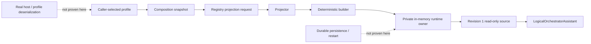
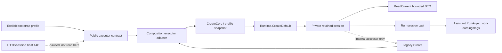

# Текущая библиотека навигации: цикл 1 из 20
> Пометка 14.08.26: accepted tip `e7c6af49f…` в этом файле — historical (slice 14B); текущий tip `codex/dpo-implementation` = `773afd5750` + merge-коммит DpoImplementation (`d2a385f75d`, 14.08/17.08); ветка-канон = `codex/dpo-implementation` (см. 14.08.26WorkLeft-05). Пути `C:\Projects\llm_mvp_core-DpoImplementation\…` — имя каталога, не ветка.

Дата выполнения: 2026-07-19  
Тип результата: рабочий RAG-артефакт для навигации по планам и документации  
Текущий охват: один последовательный цикл, шесть непосредственно прочитанных источников  
Оставшиеся циклы после принятия этого результата архитектором: 19  
Текущая задача остаётся открытой: да  
Внешний блокер: отсутствует

## 1. Что сделано в этом цикле

Этот цикл создаёт начальное навигационное ядро, а не заявляет полный охват двух
корпусов. Worker прочитал шесть файлов: три активных файла планирования, один
документ из фоновой библиотеки `llm mvp` и две канонические карты документации
`llm_mvp_core`. Для каждого файла ниже записано:

- что в нём фактически находится;
- как и когда его использовать;
- какую роль ему нельзя приписывать;
- куда переходить дальше;
- какой пробел должен закрыть следующий цикл.

Это свежая работа текущего цикла. Старые библиотеки и плановые счётчики
используются только как исходные доказательства и не засчитываются как новый
проход.

## 2. Граница метода и загруженные правила

- Запрошенная модель: `gpt-5.5`.
- Запрошенное усилие рассуждения: `xhigh`.
- Фактическая модель среды: `gpt-5.6-sol`.
- Фактическое усилие рассуждения: `ultra`.
- Причина замены: запрошенная версия `gpt-5.5` недоступна в текущей среде
  запуска; использована доступная более новая модель с максимальным заданным
  усилием.
- `AGENTS.md`: `loaded_from_current_agent_context=true`;
  `fresh_full_file_read_this_worker=false`. Worker не заявляет повторное чтение
  всего файла.
- `reference-inventory-and-source-map-SKILL.md`: полностью прочитан этим
  worker, 376 строк.
- `output-readability-gate-SKILL.md`: полностью прочитан этим worker, 827 строк.
- Другие architect/planning/review skills не перечитывались этим worker в
  ограниченном цикле и не заявляются как свежезагруженные.

Два skill-файла являются правилами построения артефакта, а не строками
предметного RAG. Поэтому предметных строк ниже ровно шесть.

## 3. Согласование физического пути

Проверка существования дала следующий результат:

| Проверенный путь | Результат | Как трактовать |
|---|---:|---|
| `C:\Users\lubao\Documents\xiigen\llm mvp` | отсутствует | Старые упоминания этого корня внутри планов являются историческими путями и не подходят для навигации по текущему диску. |
| `C:\Users\lubao\Documents\xiigen\llm mvp\dpo legal build` | отсутствует | Нельзя использовать как текущую папку планирования. |
| `C:\Projects\xiigen-planning\llm mvp` | существует | Текущий физический корень фоновой библиотеки. |
| `C:\Projects\xiigen-planning\llm mvp\dpo legal build` | существует | Текущая физическая папка active-планов и этого RAG. |
| `C:\Projects\llm_mvp_core\docs` | существует | Текущий физический корень канонической документации core. |

Правило навигации этого RAG: если прочитанный старый документ указывает на
`C:\Users\lubao\Documents\xiigen\llm mvp`, будущий worker сначала ищет
одноимённый относительный путь под
`C:\Projects\xiigen-planning\llm mvp`, проверяет его существование и только
после этого читает. Автоматически переносить статус, хеш, ветку или утверждение
из старого пути нельзя.

## 4. Карта источников

### Строка 1. Активный индекс библиотеки и вход в code-first маршрут

**Точный путь:**  
`C:\Projects\xiigen-planning\llm mvp\dpo legal build\active-codex-execution-00-library-index.md`

**Статус источника:** текущий навигационный носитель с большим количеством
встроенных исторических секций. Верхний overlay от 2026-07-14 важнее более
старых readiness- и path-секций внутри того же файла.

**Фактически прочитано:** строки 1–319. Наиболее полезные участки:
строки 1–14, 90–166, 172–238 и 305–319.

**Что находится внутри:** верхняя секция задаёт актуальный порядок чтения:
сначала execution-control board, затем code-first implementation audit, затем
двухфазный teacher-overlay и только потом DPO/training owners. Она также
указывает текущий принятый core tip, различает возможности срезов 07–13 и
перечисляет ещё ручную цепочку: выбор deployment host, владение runtime,
persist/restart и отдельное проектирование authority schema/canon/resolver.
Ниже находится индекс плановой библиотеки, старые readiness overlays, карта
Claude/active counterparts, правила будущих worktree и внешних seams.

**Как использовать:** открывать первым как каталог, когда неизвестно, какой
active-файл владеет нужным вопросом. Для текущего статуса не останавливаться на
этом индексе: сразу переходить к board и code-first audit, названным в строках
5–7 файла.

**Когда использовать:** в начале нового цикла; при поиске владельца этапа; при
проверке, относится ли вопрос к deterministic code-first, двум teacher-этапам
или финальному DPO/training.

**Не использовать как:** доказательство свежего состояния ветки, полный
implementation audit, разрешение на teacher/DPO/training, доказательство
готовности всей машины или подтверждение существования старых
`Documents`-путей.

**Связь:** строка 2 этого RAG уточняет источники и опубликованные tips; строка 3
объясняет архитектуру и порядок зависимостей; будущий переход —
`active-codex-execution-EXECUTION-CONTROL-BOARD.md`,
`active-codex-execution-code-first-implementation-audit.md` и
`active-codex-execution-two-phase-local-remote-overlay.md`.

**Что нужно следующему циклу:** напрямую прочитать board, code-first audit и
existing file RAG, чтобы заменить индексное описание фактическим
файл-к-коду статусом и определить следующий ещё не закрытый deterministic
slice без перехода к DPO.

### Строка 2. Активная карта источников и опубликованного состояния

**Точный путь:**  
`C:\Projects\xiigen-planning\llm mvp\dpo legal build\active-codex-execution-02-source-inventory-and-reference-map.md`

**Статус источника:** текущий source-map с актуальным верхним published-state
overlay и историческими таблицами ниже. Старые строки, где
`C:\Users\lubao\Documents\...` помечен существующим, опровергнуты свежей
проверкой пути этого цикла.

**Фактически прочитано:** верхние и навигационные секции файла, включая строки
1–75, 237–310, 474–641 и 846–917.

**Что находится внутри:** верхняя секция перечисляет пять implementation
worktrees, текущий publication target `origin/codex/dpo-implementation`,
принятые/pushed tips и отдельные core-коммиты срезов 07–13. Она честно
ограничивает срез 13: production caller уже есть, но deployment host,
runtime-lifetime ownership, persistence/restart и полноценная authority
семантика ещё не реализованы. Карта также содержит каталог core contracts,
DPO/training precedents, repo roles, legal/provider evidence, source ids и
историческую плановую трассировку.

**Как использовать:** использовать верхние строки для отправной точки при
сверке опубликованного состояния, а таблицы source ids — чтобы найти
первичный код или владеющий plan-файл. Любое текущее утверждение затем
проверять в конкретном worktree и конкретном файле, а не принимать карту за
runtime-доказательство.

**Когда использовать:** перед выбором нового code slice; при выяснении, какой
repo является core, API facade, flow seam или client/caller; при поиске
контракта `ILearningMachine`, DPO precedent, translation precedent или
источника legal/provenance правила.

**Не использовать как:** замену свежему `git`-осмотру, доказательство
mergeability, полный тестовый отчёт, разрешение на DPO, юридическое заключение
или доказательство существования старого `Documents`-корня.

**Связь:** строка 1 задаёт владельцев текущей навигации; строки 5 и 6 дают
каноническую core-карту, по которой проверяются source ids; строка 3 содержит
верхнеуровневую архитектурную цель.

**Что нужно следующему циклу:** проверить board и code-first audit против
верхнего published-state overlay, затем добавить точные production/test
файлы последнего принятого среза и явно отделить уже работающий call chain от
manual-only gaps.

### Строка 3. Мастер-план архитектуры ILearningDynamicGraph

**Точный путь:**  
`C:\Projects\xiigen-planning\llm mvp\dpo legal build\active-codex-execution-ILEARNINGDYNAMICGRAPH-PLAN-v1.md`

**Статус источника:** текущий архитектурный план с актуальным code-first
pointer наверху и значительным историческим plan-only телом. Для
execution-status владельцем остаётся board, а не мастер-план.

**Фактически прочитано:** строки 1–170, 173–433 и 631–860.

**Что находится внутри:** верхний pointer фиксирует порядок
`CODE_FIRST -> TP1_LOCAL eval-only -> TP2_HOSTED eval-only -> G-DPO-FINAL ->
DPO/training`, текущий core tip и незакрытые deterministic gaps. Основная
архитектура описывает L2 unit, L3 flow/edge, L4 orchestrator и L5
`ILearningDynamicGraph`; обучение разрешено только на L5. План задаёт
`DynamicGraphTopology`, пять видов `GraphEdgeKind`, `EdgeAuthorityUnit`,
14-польный `GraphDpoPair`, 20-польный `TeacherProvenance`, запрет скрытого
детерминизма и legal teacher gate. Раздел зависимостей связывает graph
foundation, async combinations, DPO builder, training lifecycle,
measurement, deterministic replacement и tests.

**Как использовать:** брать из него смысл системы, канонические роли,
архитектурные инварианты и зависимость блоков. Перед реализацией переходить к
board за очередностью, к source-map за физическими файлами и к code-first
audit за фактически реализованным состоянием.

**Когда использовать:** при проектировании следующего deterministic slice;
при проверке, не переносится ли обучение на unit/flow/orchestrator; при
разделении candidate generation, learned authority и DPO-last этапов; при
review соответствия кода исходной архитектуре.

**Не использовать как:** свидетельство, что все NEW-типы уже существуют в
production, что весь план готов, что тесты прошли сейчас, что teacher/DPO
этапы разрешены или что старые `claude-*`/`Documents` ссылки физически
актуальны.

**Связь:** строки 1 и 2 этого RAG направляют к живому execution state;
строки 5 и 6 показывают, где в core искать реальные проекты и пятиуровневую
иерархию.

**Что нужно следующему циклу:** сопоставить current manual-only chain из
верхнего pointer с конкретными findings code-first audit и определить
минимальный следующий slice, который завершает deterministic runtime path, не
начиная DPO.

### Строка 4. Фоновый пример bottom-up documentation learning

**Точный путь:**  
`C:\Projects\xiigen-planning\llm mvp\documentation learning\README.md`

**Статус источника:** текущий индекс своего узкого домена, но только
evidence/reference для ILearningDynamicGraph. Он не является active-планом
DynamicGraph.

**Фактически прочитано:** строки 1–72 полностью.

**Что находится внутри:** метод обучения локальной модели документированию
legacy .NET снизу вверх: method/function, затем callers, затем classes и
components, затем controllers/pages/workflows/modules. README задаёт
очерёдность 13 документов и важное правило: 50 пар — размер одного измеряемого
batch, а не весь curriculum. Подготовленный pairset не является обученным
результатом; при отсутствии runner статус обязан оставаться training-pending,
а следующий точный runner contract должен быть записан.

**Как использовать:** как precedent для поэтапного curriculum, propagation от
малого элемента к графу вызовов, раздельных train/held-out данных и честной
границы между подготовленными парами и реально обученной моделью.

**Когда использовать:** позднее, при проектировании DPO/training lifecycle и
документационного pilot; сейчас — только для проверки, что code-first
реализация не выдаёт pairset или scaffold за обученную способность.

**Не использовать как:** готовый DynamicGraph алгоритм, source of truth по
production-коду, доказательство существующего DPO runner, разрешение начать
обучение или замену active plan-07/09/10/11.

**Связь:** строка 3 задаёт общую L5-архитектуру; строка 6 показывает
`42.ProjectWikiDomain` и честный `runner_missing` precedent в core.

**Что нужно следующему циклу:** пока не углубляться в 13 дочерних документов.
Сначала завершить code-first инвентаризацию; вернуть этот README в работу
только в позднем training-focused цикле.

### Строка 5. Карта подпроектов llm_mvp_core

**Точный путь:**  
`C:\Projects\llm_mvp_core\docs\SUBPROJECT-MAP.md`

**Статус источника:** канонический компактный навигатор документации core по
состоянию на 2026-06-04; evidence для поиска, а не свежая проверка каждого
implementation status.

**Фактически прочитано:** строки 1–102 полностью.

**Что находится внутри:** таблица подпроектов и ключевых файлов. Для
DynamicGraph особенно важны `00.Core` с контрактами, `11.DPO`,
`14.ContinuousLearning`, `15.OrchestratorModel`,
`18.CapabilityTraining`, `21.AgentInfrastructure`,
`22.AgentAlgorithms`, `26.TrainableRouter`,
`27.TranslationDomain`, `42.ProjectWikiDomain` и
`43.SmartSkillsDomain`. Файл также показывает dependency graph,
implementation notes, model/training-data roots и предупреждает, что рабочую
ветку нельзя угадывать.

**Как использовать:** как быстрый каталог «в каком подпроекте искать
ответ», затем переходить в
`docs/projects/PROJECT-DOCUMENTATION-INDEX.md` и в конкретный production-файл.

**Когда использовать:** при маршрутизации вопроса к core contracts, DPO
engine, trainable router, translation precedent, project wiki или logical
orchestration; перед любым широким поиском по repo.

**Не использовать как:** доказательство текущего branch tip, свежего числа
тестов, наличия нового slice 07–13, точной актуальности каждого статуса
`Done/Active/Planned` или замену чтению production кода.

**Связь:** строка 6 даёт высокоуровневую архитектуру; строка 2 содержит
active source ids и current publication pointers; строка 3 задаёт целевую
DynamicGraph структуру.

**Что нужно следующему циклу:** использовать эту карту для проверки, какие
конкретные проекты и файлы участвуют в последнем принятом code-first call
chain, а затем добавить только эти адресуемые production/test файлы.

### Строка 6. Высокоуровневая архитектура llm_mvp_core

**Точный путь:**  
`C:\Projects\llm_mvp_core\docs\ARCHITECTURE.md`

**Статус источника:** каноническая высокоуровневая карта архитектуры по
состоянию на 2026-06-04; evidence/навигация, не live implementation audit.

**Фактически прочитано:** строки 1–485 полностью.

**Что находится внутри:** Mermaid dependency graph, agent pipeline,
continuous-learning pipeline, project-wiki flow, translation training domain,
smart-skills boundary, архитектурные правила и пятиуровневая
`ILearningMachine<TDomain>` иерархия. Для текущей задачи особенно важны:
обучение только на L5; unit и flow не владеют training; continuous learning
делегирует LoRA и DPO существующим подпроектам; project wiki честно сообщает
`runner_missing`; translation domain даёт существующий precedent
train/evaluate/export/import; external host extensions не должны содержать
training logic или corpus.

**Как использовать:** проверять целевую архитектуру DynamicGraph против уже
принятых core принципов и выбирать правильный подпроект перед чтением кода.
Для точной реализации после этого открывать project documentation index,
конкретные contracts и production tests.

**Когда использовать:** при review границ L2–L5; при поиске существующего
training/DPO precedent; при проверке, что новая логика не дублирует
`11.DPO`, `14.ContinuousLearning`, `22.AgentAlgorithms` или
`27.TranslationDomain`; при проектировании API/core separation.

**Не использовать как:** доказательство текущей реализации
ILearningDynamicGraph, свежий runtime/test result, точную карту последних
срезов, разрешение на training или замену current board/code-first audit.

**Связь:** строка 5 помогает выбрать подпроект; строка 3 показывает, как
DynamicGraph должен встроиться в пятиуровневую модель; строка 2 связывает это
с current worktrees и source ids.

**Что нужно следующему циклу:** открыть project documentation index лишь для
тех подпроектов, которые назовёт current code-first audit, и добавить
точные production call-chain/test anchors вместо общей архитектурной
характеристики.

## 5. Проверка навигации мысленным прогоном

### Сценарий A. Будущему worker нужен текущий активный план

1. Он открывает строку 1 и видит, что индекс не владеет live-status.
2. По cross-link переходит к execution-control board.
3. По соседнему cross-link открывает code-first implementation audit.
4. Строку 3 использует только для проверки архитектурного смысла выбранного
   slice.

Ожидаемый результат: worker не принимает исторический readiness overlay или
старый `Documents` путь за текущую команду.

### Сценарий B. Будущему worker нужен существующий RAG/source evidence

1. Он открывает строку 2 и получает source ids, repo roles и published-state
   boundary.
2. Он проверяет физический путь через раздел согласования пути этого файла.
3. Он использует строки 5 и 6, чтобы выбрать core подпроект.
4. Он читает конкретный production-файл до утверждения о реализации.

Ожидаемый результат: source-map помогает найти доказательство, но не
подменяет его.

### Сценарий C. Будущему worker нужна карта core implementation

1. Строка 5 отвечает, в каком подпроекте искать contract или precedent.
2. Строка 6 объясняет dependency и границы L2–L5.
3. Строка 2 указывает current worktree/publication boundary.
4. Неизвестные точные файлы последнего среза остаются явно неизвестными до
   чтения code-first audit в цикле 2.

Ожидаемый результат: навигация приводит к точному коду, не создавая
непроверенную implementation claim.

## 6. Неизвестные границы после цикла 1

- Не прочитан current execution-control board.
- Не прочитан current code-first implementation audit.
- Не прочитан existing `active-codex-execution-file-rag.md`.
- Не проверены production/test файлы срезов 07–13.
- Не выбран следующий bounded code slice.
- Не проверены ветки или remote tips текущими Git-командами.
- Не выполнялись tests/build/runtime/provider/training действия.
- Teacher этапы `TP1_LOCAL` и `TP2_HOSTED`, финальный DPO gate и обучение не
  начинались в этом цикле.

Эти неизвестные не являются внешним блокером. Это очередь следующих
последовательных циклов.

## 7. Seed для цикла 2

Цикл 2 обязан начать с чтения этого принятого файла и использовать его строки
1–3 как маршрут. Рекомендуемый ограниченный набор первых трёх источников:

1. `C:\Projects\xiigen-planning\llm mvp\dpo legal build\active-codex-execution-EXECUTION-CONTROL-BOARD.md`
2. `C:\Projects\xiigen-planning\llm mvp\dpo legal build\active-codex-execution-code-first-implementation-audit.md`
3. `C:\Projects\xiigen-planning\llm mvp\dpo legal build\active-codex-execution-file-rag.md`

После их чтения цикл 2 может выбрать не более трёх точных
production/test-файлов, прямо названных audit, чтобы общий лимит снова не
превысил шесть предметных источников. Его цель: построить адресуемую карту
последнего принятого deterministic call chain, подтвердить фактический разрыв
после среза 13 и сформировать seed следующего code-first шага. Он не должен
начинать DPO, teacher или training.

Цикл 2 не считается выполненным этим файлом. Он должен быть отдельным свежим
последовательным запуском после личного принятия цикла 1 архитектором.

## 8. Честная граница результата

Заявляется ровно один выполненный worker-цикл и шесть предметных строк.
Полные 20 циклов, полный corpus RAG, актуальность всех веток, готовность плана,
готовность продукта, реализация всей машины и DPO/training не заявляются.
Личное принятие архитектором должно произойти после возврата worker-пакета;
оно не подменено самооценкой этого файла.

## 9. Cycle 2/20 — адресуемая цепочка profile → runtime → assistant

Дата свежего запуска: 2026-07-19  
Предыдущий принятый артефакт прочитан полностью: строки 1–404.  
SHA-256 принятого входа до добавления этого раздела:
`02E6C13A75AF2710FA7F697FF5862A8E74C8B070936204839B68F5B02B78D341`.  
Запрошенная модель: `gpt-5.5`.  
Запрошенное усилие рассуждения: `xhigh`.  
Фактическая модель среды: `gpt-5.6-sol`.  
Фактическое усилие рассуждения: `ultra`.  
Причина замены: модель `gpt-5.5` недоступна в текущем runtime; среда
предоставила более новую `gpt-5.6-sol` с усилием `ultra`.

### 9.1. Загруженные правила и граница доказательств

- `reference-inventory-and-source-map-SKILL.md` прочитан полностью, строки
  1–376, SHA-256
  `6C9B89FC07037E8392CA4484728536C4418777DB138DA8557DB5C93C81FF061F`.
- `generated-code-review-SKILL.md` прочитан полностью, строки 1–812, SHA-256
  `2FFD14F7AA79143B976DB110B478FB59C437D8F144152E114444EB3D1CFF273A`.
- Skill-файлы управляют методом проверки и не считаются предметными RAG-строками.
- Статусные plan-файлы ниже являются навигацией и evidence-only. Реализацию
  подтверждают только непосредственно прочитанные production/test bytes.
- В этом цикле не запускались build/test/runtime и не выполнялись Git-команды.
  Числа исторических test packets не являются тестами этого запуска.
- Текущий worktree по live-board содержит paused dirty candidate 14C. Поэтому
  прямое чтение его файлов подтверждает текущие байты, но без разрешённой в этом
  цикле Git-сверки не доказывает, какие строки принадлежат accepted 14A/14B, а
  какие — uncommitted 14C.

Предметных новых источников ровно шесть. Нумерация продолжается после строки 6.

### Строка 7. Live execution-control board

**Точный путь:**  
`C:\Projects\xiigen-planning\llm mvp\dpo legal build\active-codex-execution-EXECUTION-CONTROL-BOARD.md`

**Статус источника:** текущий status/navigation owner; evidence-only, не code
proof.

**Фактически прочитано:** строки 1–180 напрямую. SHA-256:
`1CFE736E2C5B29F57FC991643517A58BC510EADEAAF55926D5846763ECE11090`.

**Что находится внутри:** верхний live overlay фиксирует
`YES_CODE_FIRST_ONLY`, accepted/pushed slices 07–14B, core tip
`e7c6af49f2a18ee96145e431433d07b994d15cba`, paused uncommitted 14C и
blocking gate `G-LEGACY-BRANCH-RECONCILIATION`. Он сохраняет порядок
`CODE_FIRST → TP1_LOCAL eval-only → TP2_HOSTED eval-only → G-DPO-FINAL →
DPO/training`.

**Как и когда использовать:** открывать первым для актуального порядка работ,
stage authorization, blocking gate и published-state boundary. После этого
переходить к exact code/test files.

**Не использовать как:** доказательство содержимого accepted commit, test pass
этого запуска, чистого worktree, mergeability, готового deployment host,
persistence или разрешения на teacher/DPO/training.

**Роль в call chain:** сообщает, что host-neutral contracts/executor 14A/14B
уже приняты, а live-local HTTP/session host 14C ещё не принят и не может быть
опубликован до reconciliation gate.

**Tests/evidence:** строки 20–30 содержат исторические accepted/pushed tips;
строки 32–48 задают publication rule, текущий gap и blocking gate. Никакие
тесты из доски этим worker не запускались.

**Граница authority:** владеет execution state, но не реализацией и не
двухфазной teacher-семантикой.

**Cross-links:** строка 8 даёт более старый slice-13 audit; строка 9 даёт
файл-к-коду индекс до slice 13; строки 10–12 проверяют текущие bytes.

**Что нужно следующему циклу:** прочитать owner
`active-codex-execution-legacy-dpoimplementation-reconciliation.md`, затем
адресуемо найти и проверить exact 14A/14B owner/test files до решения о
возобновлении 14C.

### Строка 8. Code-first implementation audit

**Точный путь:**  
`C:\Projects\xiigen-planning\llm mvp\dpo legal build\active-codex-execution-code-first-implementation-audit.md`

**Статус источника:** полностью прочитанный evidence index. Его overlay
актуален только до slice 13 и уже частично superseded строкой 7.

**Фактически прочитано:** строки 1–129 полностью. SHA-256:
`45C1CD2D9DFF2C238F85F4E7E40E8202E9C0631DD69A1DC6341E72CC49146CED`.

**Что находится внутри:** ledger accepted slices 01–13, описание facade slice
12, composition caller slice 13, ручную post-13 цепочку и исторический
foundation audit. Строки 45–53 честно отделяют production caller от
deployment hosting, profile selection/deserialization, runtime lifetime,
persistence/restart и authority resolution.

**Как и когда использовать:** использовать для понимания зависимости slices
12→13 и выбора exact anchors; затем сверять с более свежей доской и кодом.

**Не использовать как:** текущий tip после 14A/14B, доказательство, что
host-reference seam ещё совсем не начат, test execution этого цикла или
разрешение вернуться к старому `CORE-DYNAMIC-GRAPH-CONTRACTS-01`.

**Роль в call chain:** связывает explicit caller-owned profile с
`DynamicGraphLogicalOrchestratorRuntime` и его `Runtime.Assistant`.

**Tests/evidence:** строки 23–43 перечисляют исторические packets; строки
101–108 — старую Implementation Evidence Map. Они навигационные, не свежие
test results.

**Граница authority:** более свежие строки 1–48 live-board побеждают audit в
вопросах slices 14A–14C и следующего gate.

**Cross-links:** строка 9 даёт exact paths slices 12–13; строки 10–12 дают
прямое code/test readback.

**Что нужно следующему циклу:** не повторять исторический contract slice;
проверить accepted 14A/14B и paused 14C boundary, начиная с reconciliation
owner и exact definitions host-neutral contracts/executor.

### Строка 9. Existing canonical file RAG

**Точный путь:**  
`C:\Projects\xiigen-planning\llm mvp\dpo legal build\active-codex-execution-file-rag.md`

**Статус источника:** навигационный индекс; его current core code index
заканчивается slice 13 и поэтому stale относительно строки 7.

**Фактически прочитано:** строки 1–185 напрямую. SHA-256:
`E4EE1DD68D4B2D0626D2130F7CD048FADB726B91116CEF911BFB168E4FD43B21`.

**Что находится внутри:** post-cycle additions INV-056/057; exact paths и роли
production/test файлов slices 07–13; явную role separation и manual-only
цепочку. Строки 85–118 адресуют runtime facade, composition caller и focused
test. Строки 141–147 всё ещё называют slice 13 current tip, что устарело после
accepted 14A/14B из строки 7.

**Как и когда использовать:** как каталог exact file paths и назначения
компонентов до slice 13. Перед status claim всегда сверять верхний live-board.

**Не использовать как:** доказательство current accepted tip, описание 14A/14B,
свежий test/build result или полный текущий worktree inventory.

**Роль в call chain:** показывает
`registry → projector → builder → runtime owner → read-only source →
Adaptive/Assistant`, затем `explicit profile → composition → runtime facade`.

**Tests/evidence:** перечисляет historical focused/regression counts, но этот
worker их не запускал.

**Граница authority:** точные пути полезны; status/tip остановлены на slice 13.

**Cross-links:** строка 7 исправляет temporal status; строка 8 объясняет
post-13 gap; строки 10–12 проверяют три exact anchors.

**Что нужно следующему циклу:** добавить exact 14A/14B owner/test paths и
явную staleness-поправку только после прямого чтения этих файлов.

### Строка 10. Runtime facade: projection, revision owner и assistant

**Точный путь:**  
`C:\Projects\llm_mvp_core-DpoImplementation\15.OrchestratorModel\Logical\DynamicGraphLogicalOrchestratorRuntime.cs`

**Статус источника:** production code в текущем worktree; current-bytes proof,
но не accepted-commit attribution из-за paused dirty 14C.

**Фактически прочитано:** строки 1–588 полностью. SHA-256:
`CB13AFB5AEF6126D4FDD439C53B0F9E82DCF5A3F75A81D361ACA1740BC30836A`.

**Что находится внутри:** facade публикует `Assistant`, read-only
`TopologySource` и `InitialApply` (61–68); `CreateDefaultImplementation`
(158–290) строит projector, deterministic builder и in-memory runtime owner,
project-ит явный request, применяет revision `0→1` и создаёт assistant с тем же
source. `ApplyRegistryProjection` (292–337) сохраняет CAS mutation authority
внутри facade. Текущие bytes также содержат edge-authority preload validation
(384–565), которой нет в slice-12 описании старого RAG.

**Как и когда использовать:** читать при изменении bootstrap, source/owner
separation, initial revision, explicit projection update или preload validation.

**Не использовать как:** deployment host, durable persistence/restart,
profile deserializer, доказательство HTTP/session lifetime, DPO builder,
trainer или completed L5 machine.

**Роль в call chain:** explicit projection request → projector → deterministic
builder → private runtime owner → revision 1 → read-only source → assistant.

**Tests/evidence:** этот цикл тесты не запускал. Marker scan
`TODO|FIXME|NotImplemented|placeholder|scaffold|stub|not_ready` дал 0
совпадений в этом production-файле.

**Граница authority:** прямой code proof только для текущих bytes. Источник не
доказывает accepted/pushed status и не показывает host-owned lifetime.

**Cross-links:** строка 11 вызывает этот facade из composition; строка 12
проверяет legacy composition behavior, но не весь текущий public surface.

**Что нужно следующему циклу:** определить через exact 14A/14B owners, какие
новые overload/preload/session строки приняты, а какие относятся к paused 14C;
затем задать точный test/fix slice.

### Строка 11. Production composition и candidate invocation entry

**Точный путь:**  
`C:\Projects\llm_mvp_core-DpoImplementation\15.OrchestratorModel\Logical\DynamicGraphLogicalOrchestratorComposition.cs`

**Статус источника:** production code в текущем worktree; current-bytes proof,
с той же accepted-vs-dirty границей.

**Фактически прочитано:** строки 1–487 полностью. SHA-256:
`63EF1003FE462C08C6FE60FA92160E6DA9FCB7AE90B0A745A7167575DE68BB9B`.

**Что находится внутри:** `Create` (55–82) делегирует host-neutral
`DynamicGraphLogicalOrchestratorCompositionExecutorAdapter.Compose`; второй
`Create` (85–111) принимает node-output source и edge-authority preload;
`CreateAxisSweepInvocation` (113–166) строит one-shot invocation.
`CreateCoreImplementation` (213–264) validates/snapshots profile, строит exact
projection request и вызывает runtime factory. Snapshot (428–465) копирует
node/edge/budget fields; descriptor-only node (477–486) не исполняет и не
обучает модель.

**Как и когда использовать:** как production composition boundary для уже
выбранного explicit profile и host-neutral session/invocation. Здесь проверять
точность profile snapshot и передачу authority/proof fields.

**Не использовать как:** реальный HTTP host, configuration/profile provider,
deserializer, durable session store, restart owner, legal teacher seam,
DPO/training authority или доказательство full machine.

**Роль в call chain:** caller profile → validated deep snapshot → registry
projection request → runtime facade; отдельный entry связывает runtime с
candidate invocation orchestrator.

**Tests/evidence:** тесты этим worker не запускались. Production marker scan
`TODO|FIXME|NotImplemented|placeholder|scaffold|stub|not_ready` дал 0
совпадений.

**Граница authority:** `CompositionExecutorAdapter`, session contracts и
invocation owners определены вне этого выбранного файла и в этом цикле не
проверены. Их наличие по ссылке в коде не равно полной реализации host seam.

**Cross-links:** строка 10 содержит runtime factory; строка 12 показывает
focused slice-13 tests и найденный current-surface drift.

**Что нужно следующему циклу:** exact discovery:
`rg -l "DynamicGraphLogicalOrchestratorCompositionExecutorAdapter|IDynamicGraphLogicalOrchestratorRuntimeSessionAccessor|DynamicGraphLogicalOrchestratorSessionDescriptor" C:\Projects\llm_mvp_core-DpoImplementation`
— затем прочитать найденные 14A/14B owner и focused test files, не расширяясь к
DPO.

### Строка 12. Focused composition tests и current-surface drift

**Точный путь:**  
`C:\Projects\llm_mvp_core-DpoImplementation\Tests\DynamicGraphLogicalOrchestratorCompositionTests.cs`

**Статус источника:** test code в текущем worktree; прочитан, но не выполнен.

**Фактически прочитано:** строки 1–455 полностью. SHA-256:
`E0024627E3E91BF587974336A0D6B9D7F9B0EE8B63C19137636AC2760FFD1FB4`.

**Что находится внутри:** test bodies для revision-one runtime и shared source
(26–43), validation/failure propagation (45–194), exact copied authority/proof
fields (196–230), mutation isolation (232–264), public surface (279–302) и
read-only source boundary (304–318). Fixture `NullSessionStorage` (444–454)
явно не является persistence proof.

**Как и когда использовать:** запускать при изменении legacy profile
composition, deep snapshot, validation propagation или read-only source.

**Не использовать как:** доказательство выполненного теста, coverage новых
14A/14B contracts/executor, HTTP/session host, persistence/restart или accepted
14C.

**Роль в call chain:** проверяет ожидаемую форму profile → runtime revision 1
и что assistant получает тот же read-only source.

**Tests/evidence:** runtime не запускался. Прямое статическое сравнение выявило
review finding: test 279–302 требует `Assert.Single` для public static methods
и ожидает единственный `Create`, тогда как текущий production-файл содержит
public methods на 55–82, 85–111 и 113–166. Это
`STATIC_CONTRACT_DRIFT_NEEDS_EXECUTION_REVIEW`, а не заявленный test failure.

**Граница authority:** старый focused test доказывает намерение slice 13, но
не подтверждает совместимость текущего expanded surface без build/test.

**Cross-links:** строка 11 — несовпадающий production surface; строка 7
объясняет, почему current worktree может содержать paused 14C bytes.

**Что нужно следующему циклу:** после reconciliation gate и exact
accepted-vs-dirty attribution дать bounded builder/reviewer slice на
согласование public-surface assertion с принятыми 14A/14B contracts, затем
запустить focused tests уже в implementation/review цикле.

### 9.2. Implementation Evidence Map текущей deterministic цепочки

```text
user_task_requirement:
  Продолжать code-first; понять, что реально сделано, и не начинать DPO.
claimed_capability:
  CURRENT_WORKTREE_CODE_PRESENT — explicit profile достигает runtime facade,
  revision-one read-only source и assistant; accepted-commit attribution
  для всех текущих строк не заявляется.
implementation_location:
  DynamicGraphLogicalOrchestratorComposition.Create/CreateCoreImplementation
  -> DynamicGraphLogicalOrchestratorRuntime.CreateDefaultImplementation
  -> Runtime.Assistant/TopologySource/InitialApply.
exact_file_line_refs:
  Composition.cs:55-82, 168-264, 428-486;
  Runtime.cs:61-68, 158-290, 292-337.
call_chain:
  caller profile
  -> composition snapshot
  -> DynamicGraphRegistryProjectionRequest
  -> projector
  -> deterministic topology builder
  -> private in-memory runtime owner
  -> exact revision 0->1
  -> read-only IDynamicGraphTopologySource
  -> LogicalOrchestratorAssistant.
changed_code_files:
  none in this RAG cycle.
tests_or_runtime_commands_that_exercise_call_chain:
  none executed; CompositionTests.cs:26-43 is an addressable intended test.
expected_observable_behavior:
  успешная композиция сохраняет ProfileId, создаёт revision 1 и передаёт
  assistant тот же read-only topology source без выдачи mutation owner.
stub_not_ready_scan_terms:
  TODO|FIXME|NotImplemented|placeholder|scaffold|stub|not_ready;
  0 matches in the two selected production files.
verdict:
  CODE_PRESENT_CURRENT_WORKTREE;
  ACCEPTED_14A_14B_EXACT_BYTES_UNVERIFIED;
  CURRENT_PUBLIC_SURFACE_TEST_DRIFT_NEEDS_REVIEW;
  DEPLOYMENT_HOST_AND_PERSISTENCE_NOT_PROVEN.
```



### 9.3. Реализовано, manual-only и не доказано

**Физически присутствует в прочитанных текущих bytes:**

1. Явный profile snapshot и преобразование в registry projection request.
2. Создание projector + deterministic builder + private in-memory runtime owner.
3. Exact bootstrap revision `0→1`, read-only source и assistant.
4. Явные CAS projection updates внутри facade.
5. Host-neutral adapter/invocation вызовы в composition surface, но их owner
   files не входили в лимит этого цикла.

**Manual-only / не доказано этим циклом:**

1. Точный accepted content owners slices 14A/14B.
2. Принятый live-local HTTP/session deployment host: board помечает 14C
   `PAUSED_UNCOMMITTED_NEEDS_FIX`.
3. Profile deserialization/selection и host-owned runtime lifetime.
4. Durable profile + revision/CAS persistence и restart recovery.
5. Полная authority schema/canon/resolver execution boundary.
6. Platform/client/facade wiring и FigmaToCode/CanvaToCode/flows caller proof.
7. Composite Gate B, L5/full machine, TP1, TP2, DPO и training.

Особый current-code риск: focused composition test ожидает один public method,
а production surface физически содержит несколько. До accepted-vs-dirty
атрибуции и запуска теста это не разрешено ни называть исправленным, ни
выдавать за test pass.

### 9.4. Мысленный прогон для следующего implementation worker

1. Worker открывает строку 7, а не доверяет старому tip в file-RAG.
2. Видит blocking `G-LEGACY-BRANCH-RECONCILIATION` и не возобновляет 14C
   преждевременно.
3. Использует строки 8–9 только для пути к exact code anchors.
4. Читает строки 10–12 и прослеживает profile → runtime → assistant по методам,
   а не по status prose.
5. Замечает несовпадение public production/test surface и не объявляет старые
   historical packets свежими.
6. Не начинает TP1/TP2, DPO или обучение: кодовая цепочка host/persistence ещё
   не закрыта, а live-board прямо оставляет их последними.

### 9.5. Явный seed для цикла 3

Цикл 3 должен сначала потребить этот принятый Cycle 2 результат. Его
ограниченная code-first цель:

1. напрямую прочитать
   `C:\Projects\xiigen-planning\llm mvp\dpo legal build\active-codex-execution-legacy-dpoimplementation-reconciliation.md`;
2. выполнить точный owner discovery для трёх имён из строки 11:
   `DynamicGraphLogicalOrchestratorCompositionExecutorAdapter`,
   `IDynamicGraphLogicalOrchestratorRuntimeSessionAccessor`,
   `DynamicGraphLogicalOrchestratorSessionDescriptor`;
3. выбрать не более трёх найденных production/test owners slices 14A/14B;
4. установить exact accepted capability и отделить её от paused 14C;
5. проверить найденный public-surface drift
   `Composition.cs:55–166` ↔ `CompositionTests.cs:279–302`;
6. вернуть один bounded code-first implementation/review seed с exact files,
   tests и falsification evidence.

Не делать в цикле 3: DPO pair generation, teacher/provider/API work, training,
checkpoint, broad corpus inventory, publication или возобновление 14C до
принятия blocking reconciliation gate.

### 9.6. Счётчики и честная граница

```text
fresh_cycle_completed: 2
new_subject_rows_this_cycle: 6
cumulative_subject_rows: 12
new_sources_limit: 6
new_sources_limit_respected: true
active_task_open: true
next_bounded_action_exists: true
required_cycles_remaining: 18
teacher_stage_started: false
dpo_training_started: false
build_test_runtime_executed_this_cycle: false
git_mutation_performed: false
external_blocker: NONE
```

SHA-256 итогового файла после append намеренно фиксируется в worker return
packet: самохеш нельзя встроить в файл как его финальный SHA без изменения
содержимого.

## 10. Cycle 3/20 — host-neutral contract → adapter → retained session

Дата свежего запуска: 2026-07-19  
Предыдущий принятый артефакт прочитан полностью: строки 1–834.  
SHA-256 принятого входа до добавления этого раздела:
`4AC363ED809717A0054ED4111C8092C17F2648822AAF3A7ACA5A60ED3F7C2268`.  
Запрошенная модель: `gpt-5.5`.  
Запрошенное усилие рассуждения: `xhigh`.  
Фактическая модель среды: `gpt-5.6-sol`.  
Фактическое усилие рассуждения: `ultra`.  
Причина замены: запрошенная модель `gpt-5.5` недоступна в runtime; среда
предоставила более новую `gpt-5.6-sol` с усилием `ultra`.

### 10.1. Загруженные review-правила и граница цикла

- `generated-code-review-SKILL.md` свежо прочитан полностью, строки 1–812.
- `verification-before-completion-SKILL.md` свежо прочитан полностью,
  строки 1–943.
- Skill-файлы задают метод проверки и не считаются предметными RAG-строками.
- Cycle 2 потреблён как принятая навигация: его строки 7–12 задали точные
  имена для discovery, найденный public-surface drift и запрет выдавать
  текущие worktree bytes за accepted commit bytes.
- Прочитан ровно один reconciliation owner и ровно пять файлов, найденных
  точным поиском трёх заданных имён. Один из пяти — уже известный по строке 11
  `Composition.cs`; он перечитан как связующий owner и не маскируется под новый
  физический файл.
- В этом цикле не выполнялись Git-команды, build, tests, runtime, network,
  provider, teacher, DPO или training.
- Поэтому status-owner может подтвердить, что slices 14A/14B приняты, а 14C
  paused; только Git-сравнение accepted tip с текущим worktree сможет
  приписать конкретные текущие строки accepted или dirty состоянию.

Нумерация предметных строк продолжается после 12.

### Строка 13. Единственный owner reconciliation legacy/current веток

**Точный путь:**  
`C:\Projects\xiigen-planning\llm mvp\dpo legal build\active-codex-execution-legacy-dpoimplementation-reconciliation.md`

**Статус источника:** активный status/decision owner
`G-LEGACY-BRANCH-RECONCILIATION`; evidence-only для commit attribution.

**Фактически прочитано:** строки 1–122 полностью. SHA-256:
`2BFC573A5EF86E8928F4891369EF7107BCB9E22D4CB618679A3AB12EBC69B28B`.

**Что находится внутри:** current published tip через slice 14B —
`e7c6af49f2a18ee96145e431433d07b994d15cba`; legacy tip —
`233b1f0ee6749fb59e86a719ed61f113f0779c72`; ветки разошлись и не являются
предками друг друга. Current DynamicGraph contracts, deterministic
builder/projector/runtime owner, host-neutral composition contracts и
assistant/facade chain классифицированы `SUPERSEDED_KEEP_CURRENT`.
Translation DPO/checkpoint owners отложены как `PORT_AT_G_DPO_FINAL`.
Slice 14C явно имеет статус `PAUSED_UNCOMMITTED_NEEDS_FIX` и является
live-local HTTP/session host candidate, а не training slice.

**Как и когда использовать:** открывать перед любой попыткой возобновить 14C,
сравнить legacy/current или решить, относится ли файл к code-first либо
финальному DPO gate.

**Не использовать как:** разрешение на merge/cherry-pick, доказательство
содержимого текущего dirty worktree, test pass, принятие 14C или разрешение на
DPO/training.

**Роль в call chain:** отделяет принятый host-neutral core boundary 14A/14B
от ещё не принятого live-local deployment/session host 14C.

**Tests/evidence:** содержит критерии будущего независимого gate-review, но
никакие команды воспроизведения или тесты этим worker не запускались.

**Граница authority:** владеет branch reconciliation и stage boundary; не
владеет реализацией contract/adapter/session и не доказывает exact current
bytes accepted-коммита.

**Cross-links:** строки 14–18 ниже дают current-byte owners/tests; строки 7 и
12 Cycle 2 задают live-board и static surface finding.

**Что нужно следующему циклу:** сохранять exact-byte attribution как
неизвестную до разрешённой Git-сверки; не переносить legacy DPO owners раньше
`G_DPO_FINAL`.

### Строка 14. Host-neutral execution contracts

**Точный путь:**  
`C:\Projects\llm_mvp_core-DpoImplementation\19.DynamicGraphComposition.Contracts\Logical\DynamicGraphLogicalOrchestratorExecutionContracts.cs`

**Статус источника:** production contract source в текущем worktree.
Reconciliation owner относит host-neutral contracts к принятому current
направлению 14A/14B, но exact equality этих bytes published tip в этом цикле
не проверялась.

**Фактически прочитано:** строки 1–56 полностью. SHA-256:
`CD16F5D112CB4BCC37A41893C99DD5B9A77AA8506BB5588B2C57F6D8127D67B9`.

**Что находится внутри:** `SessionDescriptor` (7–11), bounded
`SessionResult` (14–21), `RunRequest` (24), bounded `RunResult` (27–33),
read-only composition session (36–41), отдельный run-session contract
(44–49) и executor contract `Compose(profile)` (52–56). Публичный contract
не принимает storage, runtime owner, topology owner или training adapter.

**Как и когда использовать:** начинать здесь, когда host/client должен понять,
какие DTO и interfaces ему разрешено видеть; использовать при review
совместимости assembly boundary и публичных signatures.

**Не использовать как:** реализацию composition, доказательство persistence,
HTTP host, runtime lifetime, assistant execution, DPO/training или test pass.

**Роль в call chain:** host создаёт
`IDynamicGraphLogicalOrchestratorCompositionExecutor`, передаёт explicit
bootstrap profile, получает read-only composition session; выполнение
доступно отдельным `IDynamicGraphLogicalOrchestratorRunSession`.

**Tests/evidence:** строка 16 ниже проверяет намерение assembly/shape/dependency
boundary; тесты не запускались.

**Граница authority:** единственный прочитанный owner публичных
descriptor/result/session/executor shapes; не владеет private runtime.

**Cross-links:** строка 15 реализует interfaces; строка 16 проверяет contract
architecture; строка 18 строит descriptor и runtime.

**Что нужно следующему циклу:** точным поиском `IDynamicGraphLogicalOrchestratorRunSession`
найти focused run tests и проверить non-learning invocation path без DPO.

### Строка 15. Executor adapter и retained private runtime session

**Точный путь:**  
`C:\Projects\llm_mvp_core-DpoImplementation\15.OrchestratorModel\Logical\DynamicGraphLogicalOrchestratorCompositionExecutorAdapter.cs`

**Статус источника:** production implementation в текущем worktree;
current-byte proof. Status-owner принимает host-neutral executor направление
14A/14B, но Git attribution конкретных bytes не выполнена.

**Фактически прочитано:** строки 1–195 полностью. SHA-256:
`F180B8958FFA615E5217E31884320306AA009D5F59F59F43F96E909C050C09CC`.

**Что находится внутри:** internal-only runtime accessor (9–12), public
executor adapter (15–17), все выключенные non-learning flags (29–37),
parameterless host-neutral constructor с `NullSessionStorage.Instance`
(43–47), `Compose` через `Composition.CreateCore` (57–76) и private
`RuntimeCompositionSession` (83–195). Session удерживает runtime, наружу
возвращает defensive-copied descriptor (103–104), bounded `ReadCurrent`
(109–132) и реализует `RunAsync` (134–194). `RunAsync` вызывает
`_runtime.Assistant.RunAsync` с non-learning flags (152–157) и fail-closed
отклоняет результат, если любой applied learning/evidence flag стал true
(170–184).

**Как и когда использовать:** читать после public contracts при изменении
composition executor, retained session lifetime, bounded read DTO,
assistant-run projection или non-learning guard.

**Не использовать как:** реальный HTTP host, durable storage/restart,
доказательство отсутствия любых downstream side effects, training runner,
DPO builder или accepted 14C.

**Роль в call chain:** executor `Compose(profile)` →
`Composition.CreateCore` → private runtime → private session →
`ReadCurrent`; для assistant call host использует отдельный run-session
interface → `Runtime.Assistant.RunAsync` с six false flags → bounded result.

**Tests/evidence:** строка 17 содержит focused composition/read tests.
Выбранный test-file не вызывает `RunAsync`; поэтому non-learning run path
доказан здесь только кодом, не executed test. Точный scan
`DpoTrainer|StepMany|EvaluateMany|TrainBatchAsync|TODO|FIXME|NotImplemented`
дал 0 совпадений в трёх выбранных production owners. Internal
`ProjectWikiTrainingFlowAdapter` seam присутствует, поэтому более сильное
утверждение «весь downstream никогда не обучает» этим scope не доказано.

**Граница authority:** владеет adapter/session mechanics; public contract
владеет shapes, composition — runtime construction, reconciliation — stage
status.

**Cross-links:** строка 14 задаёт interfaces; строка 18 показывает
`CreateCore`; строка 17 фиксирует test intent.

**Что нужно следующему циклу:** найти test, который реально cast-ит session в
run-session и проверяет exact non-learning behavior; если такого теста в
ограниченном discovery нет, открыть будущий test slice, не объявлять gap
глобально без полного bounded search.

### Строка 16. Architecture tests host-neutral contracts

**Точный путь:**  
`C:\Projects\llm_mvp_core-DpoImplementation\Tests\DynamicGraphCompositionContractsArchitectureTests.cs`

**Статус источника:** focused test source в текущем worktree; test intent,
не executed evidence и не commit attribution.

**Фактически прочитано:** строки 1–411 полностью. SHA-256:
`A317878C1DE26AFFFE7CB4A7BE84BAC706E836888449F5B730F02B2A9EF5BECB`.

**Что находится внутри:** проверки ownership contracts/runtime assemblies
(15–41), type forwarders (48–59), exact carrier shapes (63–107), bounded
public signatures без runtime/storage/training types (110–145), project
closure (148–177), запрет runtime/training dependencies (180–235) и
source-level intent `adapter.CreateCore → composition.Runtime.CreateDefault`
с fail-closed null-source behavior (296–316).

**Как и когда использовать:** запускать после изменений contracts project,
DTO shapes, public signatures, project references, type forwarders или
adapter/core wiring.

**Не использовать как:** свежий PASS, доказательство runtime assistant result,
HTTP host, persistence, 14C или полная behavioral coverage.

**Роль в call chain:** проверяет архитектурную оболочку
`contracts-only public boundary → runtime assembly implementation`, но не
исполняет весь assistant scenario.

**Tests/evidence:** test methods непосредственно прочитаны, но не запускались.
Source-level regex assertions выражают намерение, а не заменяют behavioral
runtime proof.

**Граница authority:** владеет test intent contract architecture; production
truth остаётся в строках 14, 15 и 18.

**Cross-links:** строка 14 — проверяемые carriers; строка 15 — adapter;
строка 18 — composition/core factory.

**Что нужно следующему циклу:** связать architecture intent с behavioral
run-session test и отдельно сохранить public-surface drift строки 12.

### Строка 17. Focused adapter composition/read tests

**Точный путь:**  
`C:\Projects\llm_mvp_core-DpoImplementation\Tests\DynamicGraphLogicalOrchestratorCompositionExecutorAdapterTests.cs`

**Статус источника:** focused test source в текущем worktree; не выполнялся и
не доказывает accepted commit content.

**Фактически прочитано:** строки 1–384 полностью. SHA-256:
`FF74E1C34099D0B431F2048C624370EC951EB5397868160E8A75C65972F0036C`.

**Что находится внутри:** intended revision-one session evidence (15–37),
legacy/executor equivalence (40–63), retained runtime после GC (67–78),
deep mutation isolation (82–114), отсутствие storage операций при compose/read
(116–128), bounded public adapter/session surface (130–167), DTO shape
(169–191) и exact downstream failure propagation (194–239).

**Как и когда использовать:** запускать после изменения adapter Compose,
descriptor/read DTO, session retention, snapshot isolation, public leakage или
validation propagation.

**Не использовать как:** persistence proof — test ожидает ноль storage
операций; также не использовать как RunAsync coverage, training proof,
HTTP/session host proof или свежий PASS.

**Роль в call chain:** проверяет intended
`profile → executor → revision-one retained session → ReadCurrent` и
эквивалентность legacy composition initial topology.

**Tests/evidence:** выбранный файл не содержит вызова `RunAsync`; это точная
граница его intent. Никакие test commands не запускались.

**Граница authority:** test expectations не меняют production surface и не
решают accepted-vs-dirty attribution.

**Cross-links:** строка 15 — tested owner; строка 12 — отдельный stale
legacy composition public-surface assertion; строка 16 — assembly boundary.

**Что нужно следующему циклу:** найти run-session behavioral tests и не
смешивать их с этим read-only-focused test-file.

### Строка 18. Повторно прочитанный composition owner: legacy bridge и surface drift

**Точный путь:**  
`C:\Projects\llm_mvp_core-DpoImplementation\15.OrchestratorModel\Logical\DynamicGraphLogicalOrchestratorComposition.cs`

**Статус источника:** тот же production owner, что строка 11 Cycle 2,
перечитанный полностью для exact adapter/session call chain. SHA совпал с
Cycle 2; accepted-vs-dirty attribution по-прежнему не установлена.

**Фактически прочитано:** строки 1–487 полностью. SHA-256:
`63EF1003FE462C08C6FE60FA92160E6DA9FCB7AE90B0A745A7167575DE68BB9B`.

**Что находится внутри:** legacy public `Create` делегирует adapter
`Compose` (55–68), затем через internal runtime accessor строит legacy result
(73–81). Второй public `Create` находится на 85–111; generic public
`CreateAxisSweepInvocation` — 113–166. Три `CreateCore` overload находятся
на 169–210. Единый `CreateCoreImplementation` (213–266) validates/snapshots
profile, строит registry request, вызывает runtime factory и создаёт
`SessionDescriptor` на 259–264.

**Как и когда использовать:** читать вместе со строкой 15, когда нужно
проследить, почему legacy caller и host-neutral executor получают один core
runtime, либо определить exact intended public static surface.

**Не использовать как:** доказательство того, что все три public methods
приняты в 14A/14B, accepted 14C, deployment host, persistence или test pass.

**Роль в call chain:** legacy caller → adapter → `CreateCore` → runtime
factory → descriptor/runtime; host-neutral caller входит напрямую через
adapter и получает private retained session.

**Tests/evidence:** Cycle 2 строка 12 зафиксировала
`DynamicGraphLogicalOrchestratorCompositionTests.cs:279–302`, где reflection
ожидает ровно один public static method `Create`. Текущий production owner
имеет public declarations на 55, 85 и 115. Production SHA не изменился с
Cycle 2. Это статическая несовместимость expectations, но тест не запускался.

**Граница authority:** current bytes доказывают форму текущего worktree.
Reconciliation owner доказывает только stage status. Без Git нельзя решить,
является ли assertion stale после принятого API expansion или дополнительные
public methods относятся к dirty/unaccepted bytes.

**Cross-links:** строка 11 содержит общий runtime summary; строка 12 —
первичный drift finding; строки 14–17 уточняют contracts/adapter/tests.

**Что нужно следующему циклу:** сохранить finding открытым до разрешённой
accepted-tip/worktree attribution; не «исправлять» тест под current bytes и
не удалять методы по догадке.

### 10.2. Exact contract/adapter/session call chain

```text
Host-selected DynamicGraphLogicalOrchestratorBootstrapProfile
  -> IDynamicGraphLogicalOrchestratorCompositionExecutor.Compose(profile)
  -> DynamicGraphLogicalOrchestratorCompositionExecutorAdapter.Compose
  -> DynamicGraphLogicalOrchestratorComposition.CreateCore
  -> CreateCoreImplementation
  -> DynamicGraphLogicalOrchestratorRuntime.CreateDefault*
  -> DynamicGraphLogicalOrchestratorSessionDescriptor + private RuntimeCompositionSession
  -> IDynamicGraphLogicalOrchestratorCompositionSession.ReadCurrent
     OR IDynamicGraphLogicalOrchestratorRunSession.RunAsync
  -> Runtime.Assistant.RunAsync with all six learning/evidence flags false
  -> bounded DynamicGraphLogicalOrchestratorRunResult
```

Legacy compatibility path:

```text
DynamicGraphLogicalOrchestratorComposition.Create(storage, profile)
  -> same adapter.Compose/profile snapshot/core runtime
  -> internal IDynamicGraphLogicalOrchestratorRuntimeSessionAccessor.Runtime
  -> DynamicGraphLogicalOrchestratorCompositionResult
```



### 10.3. Implementation Evidence Map

```text
user_task_requirement:
  Продолжать code-first, установить сделанное в 14A/14B, отделить paused 14C
  и оставить DPO последним.
claimed_capability:
  CURRENT_WORKTREE_CODE_PRESENT — host-neutral contracts, executor adapter,
  retained private session, bounded read/run DTO и legacy compatibility bridge.
implementation_location:
  ExecutionContracts.cs:7-56;
  CompositionExecutorAdapter.cs:9-195;
  Composition.cs:55-266.
exact_file_line_refs:
  SessionDescriptor 7-11; composition session 36-41; run session 44-49;
  executor 52-56; adapter Compose 57-76; retained session 83-195;
  composition legacy bridge 55-81; CreateCore 169-210;
  CreateCoreImplementation 213-266.
call_chain:
  profile -> executor adapter -> composition core -> runtime factory
  -> private retained session -> ReadCurrent or non-learning RunAsync.
changed_code_files:
  none; изменён только этот RAG-артефакт.
tests_or_runtime_commands_that_exercise_call_chain:
  none executed in Cycle 3;
  addressable intended tests are rows 16-17 and Cycle 2 row 12.
expected_observable_behavior:
  explicit profile creates revision-one bounded session evidence; public
  contracts do not expose runtime/storage/training authority; assistant run
  requests all learning/evidence flags false and rejects applied-flag drift.
stub_not_ready_scan_terms:
  TODO|FIXME|NotImplemented|PLACEHOLDER|scaffold|stub|not_ready|
  DpoTrainer|StepMany|EvaluateMany|TrainBatchAsync;
  0 matches in the three selected production owners for the exact scan.
verdict:
  CODE_PRESENT_CURRENT_WORKTREE;
  ACCEPTED_CAPABILITY_STATUS_BY_RECONCILIATION_OWNER;
  EXACT_ACCEPTED_BYTE_ATTRIBUTION_UNVERIFIED_NO_GIT;
  STATIC_PUBLIC_SURFACE_ASSERTION_DRIFT_NEEDS_EXECUTION_REVIEW;
  TESTS_NOT_RUN;
  14C_PAUSED_NOT_ACCEPTED;
  DPO_TRAINING_NOT_STARTED.
```

### 10.4. Accepted-vs-dirty attribution

| Поверхность | Что доказано | Что не доказано | Честная классификация |
|---|---|---|---|
| Published slices 14A/14B | Reconciliation owner называет accepted current tip `e7c6af49...` и сохраняет host-neutral contracts/executor/current chain. | Current worktree file blobs не сравнивались с tip. | `ACCEPTED_STATUS_ONLY; EXACT_BYTES_UNKNOWN` |
| `ExecutionContracts.cs` | Прямо прочитаны текущие contracts и interfaces. | Не доказано, какие строки равны accepted blob. | `CURRENT_BYTES_PRESENT` |
| `CompositionExecutorAdapter.cs` | Прямо прочитаны Compose, retained session, ReadCurrent и non-learning RunAsync. | Не доказана exact commit attribution; RunAsync test не выполнен. | `CURRENT_BYTES_PRESENT; BEHAVIOR_NOT_EXECUTED` |
| `Composition.cs` | SHA совпадает с Cycle 2; три public declarations и bridge реально присутствуют. | Без Git нельзя разделить accepted API expansion и dirty 14C bytes. | `ATTRIBUTION_BLOCKED_BY_FORBIDDEN_GIT_THIS_CYCLE` |
| Выбранные tests | Прочитано exact test intent. | Они не запускались; принадлежность exact tip не сверялась. | `TEST_SOURCE_PRESENT; NO_PASS_CLAIM` |
| Slice 14C | Status owner говорит `PAUSED_UNCOMMITTED_NEEDS_FIX`, live-local HTTP/session host. | 14C files/behavior не читались и не проверялись этим циклом. | `PAUSED_STATUS_ONLY; NOT_ACCEPTED` |
| Legacy DPO candidates | Owner откладывает их до `G_DPO_FINAL`. | Реализация/port не начинались. | `DPO_LAST; IMPLEMENTATION_BLOCKED` |

### 10.5. Public-surface finding: точная классификация

**Наблюдение:** принятая строка 12 Cycle 2 читала test
`DynamicGraphLogicalOrchestratorCompositionTests.cs:279–302`, который требует
один public static method с именем `Create`. Текущий production owner содержит
public methods на строках 55, 85 и 115.

**Классификация:** `STATIC_PUBLIC_SURFACE_ASSERTION_DRIFT_NEEDS_EXECUTION_REVIEW`.

**Это не:** заявленный test failure, доказанный compile failure или
разрешение автоматически переписать test под текущий code.

**Почему решение отложено:** есть две правдоподобные гипотезы:

1. accepted 14A/14B намеренно расширили API, и старый reflection assertion
   stale;
2. часть surface находится только в dirty/unaccepted worktree, и изменение
   test под неё узаконит непринятый API.

Текущие разрешённые evidence-команды не включали Git; выбрать гипотезу без
accepted-tip/worktree diff было бы догадкой.

### 10.6. Самый маленький безопасный будущий implementation/review slice

Имя seed: `CF-PUBLIC-SURFACE-ATTRIBUTION-AND-CONTRACT-TEST`.

Он выполняется только после 20 RAG-циклов и setup/sync нужного проекта/ветки.

```text
owner_worker:
  отдельный implementation sub-agent, requested gpt-5.5 / xhigh.
files_to_inspect_before_edit:
  C:\Projects\llm_mvp_core-DpoImplementation\15.OrchestratorModel\Logical\
    DynamicGraphLogicalOrchestratorComposition.cs
  C:\Projects\llm_mvp_core-DpoImplementation\Tests\
    DynamicGraphLogicalOrchestratorCompositionTests.cs
  accepted tip e7c6af49f2a18ee96145e431433d07b994d15cba versus current worktree
files_to_modify:
  минимум DynamicGraphLogicalOrchestratorCompositionTests.cs;
  Composition.cs только если attribution докажет unaccepted public leakage.
required_behavior:
  reflection test перечисляет exact accepted public method names, generic
  arity and parameter signatures; extra или пропавший public method ломает
  тест. Legacy Create и host-neutral contracts остаются совместимыми.
branch_rule:
  если три current methods находятся в accepted 14A/14B, исправить stale test;
  если дополнительные methods dirty 14C, не благословлять их тестом —
  вернуть exact NEEDS_FIX production work order.
tests_to_run_later:
  dotnet test LlmFromScratch.sln --filter
  "FullyQualifiedName~DynamicGraphLogicalOrchestratorCompositionTests|
   FullyQualifiedName~DynamicGraphLogicalOrchestratorCompositionExecutorAdapterTests|
   FullyQualifiedName~DynamicGraphCompositionContractsArchitectureTests"
falsification_conditions:
  extra public method не обнаруживается тестом;
  accepted overload ошибочно удалён;
  public signature протекает Runtime/ISessionStorage/training authority;
  legacy Create и executor дают разную initial topology evidence;
  RunAsync может применить любой learning/evidence flag;
  test зелёный только потому, что expected set подогнан под dirty bytes.
independent_review:
  отдельный reviewer читает actual diff и запускает focused tests;
  root architect затем лично read-only проверяет actual diff, signatures,
  invariant и mutation-sensitive test до ACCEPT.
publication:
  commit/push закрыты до reviewer REVIEW_ACCEPT и личного ACCEPT архитектора.
```

Почему это code-first: slice устраняет неопределённость публичного
composition API и regression gate. Он не создаёт teacher output, DPO pairs,
checkpoint или training behavior.

### 10.7. Мысленный прогон будущего builder

1. Builder начинает с строки 14 и видит, что host получает descriptor,
   read-session и отдельный run-session, но не runtime owner.
2. Переходит к строке 15: `Compose` вызывает `CreateCore`, private session
   удерживает runtime и возвращает bounded evidence.
3. Переходит к строке 18: descriptor создаётся из snapshot profile, а legacy
   `Create` извлекает runtime только через internal accessor.
4. Для execution builder cast-ит возвращённую session в run-session и видит
   exact six false flags; отсутствие focused RunAsync test остаётся видимым
   риском, а не скрытым допущением.
5. Перед изменением reflection test builder останавливается: current source
   bytes не отвечают, accepted ли три public methods.
6. Только разрешённый accepted-tip/worktree diff выбирает ветку ремонта:
   stale test либо unaccepted code leakage.
7. Ни один шаг не переходит к TP1/TP2/DPO/training; 14C остаётся paused.

### 10.8. Exact seed для Cycle 4

Cycle 4 обязан сначала прочитать принятый Cycle 3 и использовать строки
14–18 как маршрут. Он не должен повторно описывать composition/read boundary.

Ограниченная цель следующего RAG-цикла:

1. выполнить exact-name discovery для
   `IDynamicGraphLogicalOrchestratorRunSession`,
   `DynamicGraphLogicalOrchestratorRunRequest` и
   `DynamicGraphLogicalOrchestratorRunResult`;
2. выбрать не более шести новых owner/focused-test источников;
3. проследить `RunAsync` до assistant result и установить, существует ли
   mutation-sensitive test six-false non-learning flags;
4. отдельно записать, какие downstream side effects остаются неизвестными
   без чтения assistant owner;
5. не выполнять Git, build/tests/runtime или code fixes, если новый bounded
   work order явно их не разрешит.

Отдельный pending attribution seed сохраняется до момента, когда
user-ordered 20-cycle RAG phase разрешит branch/worktree setup:

```text
pending_after_rag:
  compare accepted tip e7c6af49f2a18ee96145e431433d07b994d15cba
  with current worktree for Composition.cs, CompositionTests.cs,
  ExecutionContracts.cs, CompositionExecutorAdapter.cs and their two focused
  tests; classify each changed hunk as accepted 14A/14B or dirty 14C.
```

Cycle 4 не считается выполненным этим разделом.

### 10.9. Счётчики и честная граница

```text
fresh_cycle_completed: 3
new_subject_rows_this_cycle: 6
cumulative_subject_rows: 18
subject_sources_opened_this_cycle: 6
reconciliation_sources: 1
discovered_owner_or_focused_test_files: 5
distinct_paths_new_to_rag: 5
source_limit_respected: true
cycle2_consumed: true
active_task_open: true
next_bounded_action_exists: true
required_cycles_remaining: 17
teacher_stage_started: false
dpo_training_started: false
build_test_runtime_executed_this_cycle: false
git_command_executed_this_cycle: false
git_mutation_performed: false
code_or_test_files_changed: 0
artifact_files_changed: 1
external_blocker: NONE
```

SHA-256 итогового файла после append фиксируется в worker return packet:
самохеш нельзя встроить в файл как его финальный SHA без изменения содержимого.

## 11. Cycle 4/20 — six-false request → applied flags → fail-closed run boundary

Дата свежего запуска: 2026-07-19.  
Принятый Cycle 3 и весь предшествующий файл прочитаны до EOF до начала append.  
SHA-256 принятого входа:
`ACBD4A9149FB263EDC1B6E3B4640A0AD65EE045097F28139DC3F559C4943FB15`.  
Размер принятого префикса: `88038` bytes.  
Запрошенная модель: `gpt-5.5`.  
Запрошенное усилие рассуждения: `xhigh`.  
Фактическая модель среды: `gpt-5.6-sol`.  
Фактическое усилие рассуждения: `ultra`.  
Причина замены: запрошенная модель `gpt-5.5` недоступна в runtime; среда
предоставила более новую модель, поэтому замена явно отмечена как
`unavailable substitution`, а не выдана за точное исполнение model request.

### 11.1. Method, review skills и граница доказательств

- Контекст architect/development/execution review уже был загружен родительской
  сессией. Большие skill-файлы повторно не перечитывались в этом bounded slice.
- Применены требуемые review-гейты: Implementation Evidence Map,
  code-present/test-present/executed-proof separation, fail-closed mental
  simulation, mutation-sensitive future test, bounded absence wording и
  falsification conditions.
- Никакие code/test-файлы не изменялись. Единственное изменение этого цикла —
  append в текущую RAG-библиотеку.
- Git, build, test и runtime не запускались. Поэтому `executed proof = none`;
  ниже нет ни одного утверждения о passing tests.
- Два пути из seed оказались устаревшими. Разрешённый exact-filename поиск
  установил фактические пути:
  - `00.Core\LogicalContracts.cs`, а не `00.Core\Logical\LogicalContracts.cs`;
  - `21.AgentInfrastructure\Logical\AdaptiveLogicalOrchestrator.cs`, а не
    `15.OrchestratorModel\Logical\AdaptiveLogicalOrchestrator.cs`.
- Узкий exact-name поиск test-source по
  `IDynamicGraphLogicalOrchestratorRunSession`,
  `DynamicGraphLogicalOrchestratorRunRequest` и
  `DynamicGraphLogicalOrchestratorRunResult` вернул:

```text
test files containing an exact requested name:
  not found in bounded exact-name search

all .cs matches in the same bounded search:
  19.DynamicGraphComposition.Contracts\Logical\
    DynamicGraphLogicalOrchestratorExecutionContracts.cs
  15.OrchestratorModel\Logical\
    DynamicGraphLogicalOrchestratorCompositionExecutorAdapter.cs
  tools\DynamicGraphCompositionLiveLocalServer\Program.cs
  tools\DynamicGraphCompositionLiveLocalServer\
    DynamicGraphCompositionSessionRegistry.cs
```

Это не глобальное утверждение, что в repository нет косвенных тестов.
Это только доказательство отсутствия test-source, содержащего один из трёх
точных type names, в выполненном bounded search.

### Строка 19. Logical execution flags и request/result carriers

**Файл**

`C:\Projects\llm_mvp_core-DpoImplementation\00.Core\LogicalContracts.cs`

**Что там находится**

- `LogicalExecutionFlags` на строках 7–59 — канонический carrier всех
  execution controls, которые видят orchestrator, flow и unit.
- `LogicalOrchestratorRequest` на строках 178–183 принимает nullable `Flags`.
- `LogicalOrchestratorResult` на строках 186–197 возвращает non-null
  `AppliedFlags`.
- `ILogicalOrchestrator.RunAsync` на строках 205–210 задаёт границу между
  assistant и orchestration implementation.

**Как это работает**

Шесть флагов, выбранных run-session как non-learning boundary, имеют разные
defaults в общем carrier:

```text
UseLearnedUnitWhenAvailable = true by default
UseIdleLearningScheduling   = true by default
UseKnowledgeEdgeDetection   = true by default
UseSkillRetriever           = false by default
UseReplayFusionRanking      = false by default
WriteEvidenceArtifacts      = true by default
```

Следовательно, adapter обязан явно присвоить `false` всем шести. Простого
`new LogicalExecutionFlags()` недостаточно: четыре из шести включились бы.
Другие флаги не входят в эту six-false политику; многие из них остаются
включёнными по default.

**Когда использовать**

- когда нужно определить полную семантику request flags;
- когда будущий builder добавляет или меняет execution-control;
- когда reviewer проверяет, что boundary сравнивает request и фактически
  применённые controls, а не только исходный initializer.

**Когда не использовать**

- не считать этот carrier доказательством отсутствия I/O;
- не считать `false` шести свойств запретом всех side effects;
- не использовать defaults как host policy без явного allow/deny решения.

**Call chain**

`LogicalExecutionFlags` → `LogicalOrchestratorRequest.Flags` →
`LogicalOrchestratorResult.AppliedFlags`.

**Tests / authority / next**

- code-present: `true`;
- exact-name test-source-present: `false` в bounded search;
- executed proof: `none`;
- authority: текущие source bytes, не accepted-tip attribution;
- next: будущий test должен ломаться при one-bit drift каждого из шести
  свойств, а не только подтверждать happy path.

### Строка 20. Assistant сохраняет caller flags и возвращает owned AppliedFlags

**Файл**

`C:\Projects\llm_mvp_core-DpoImplementation\15.OrchestratorModel\Logical\LogicalOrchestratorAssistant.cs`

**Что там находится**

- `RunAsync` на строках 407–425 принимает caller `flags`.
- `PrepareRunRequest` на строках 429–491 кладёт тот же carrier в
  `LogicalOrchestratorRequest`.
- `RunPreparedAsync` на строках 495–521 вызывает `_orchestrator.RunAsync`.
- `TryMapOrchestratorResult` и `TryMapAssistantResult` на строках 780–858
  проверяют result shape, отвергают null `AppliedFlags` и создают owned copy
  через `appliedFlags with { }`.

**Как это работает**

Assistant не заменяет non-null caller flags defaults-объектом. Он передаёт
ссылку в request, а при возврате делает record-copy фактически применённых
flags. Поэтому adapter проверяет не собственный исходный initializer, а
значения, прошедшие orchestration result boundary.

**Когда использовать**

- чтобы проследить request flags до assistant result;
- чтобы отличить caller intent от returned applied state;
- для тестов malformed/null result и ownership результата.

**Когда не использовать**

- не считать `with { }` доказательством, что downstream соблюдал flags;
- не считать assistant owner полным аудитом flow/unit side effects;
- не выводить отсутствие storage writes только из неизменности carrier.

**Call chain**

`LogicalOrchestratorAssistant.RunAsync(flags)` →
`PrepareRunRequest(... Flags=flags)` →
`_orchestrator.RunAsync(request)` →
`TryMapAssistantResult(... AppliedFlags)` →
owned `LogicalAssistantRunResult.AppliedFlags`.

**Tests / authority / next**

- code-present: `true`;
- exact-name run-session test-source-present: `false` в bounded search;
- executed proof: `none`;
- authority: текущий owner source;
- next: future test должен получать `AppliedFlags` через реальную assistant
  chain или через узкий malicious-result seam, а не сравнивать только static
  initializer.

### Строка 21. Adaptive orchestrator применяет exact request carrier

**Файл**

`C:\Projects\llm_mvp_core-DpoImplementation\21.AgentInfrastructure\Logical\AdaptiveLogicalOrchestrator.cs`

**Что там находится**

- public `RunAsync` на строках 196–204 передаёт request в общий `RunCoreAsync`.
- На строке 277 выполняется единственная нормализация:
  `var flags = request.Flags ?? new LogicalExecutionFlags();`.
- Non-null flags передаются compiler, classifier, route и flow execution.
- Explicit-scenario result на строках 541–550 сохраняет тот же `flags` в
  `LogicalOrchestratorResult`; aggregate result делает то же на строках
  3137–3147.

**Как это работает**

Для adapter path `request.Flags` non-null, поэтому default-object не создаётся.
Шесть явных `false` идут дальше как applied carrier. Explicit scenario,
выбранный adapter через `Assistant.DefaultScenarioId`, не отменяет flags:
orchestrator сначала принимает их, затем кладёт их в result.

**Когда использовать**

- чтобы проверить отсутствие скрытой default-on замены non-null flags;
- чтобы увидеть, какие downstream branches читают те же controls;
- чтобы локализовать будущий regression, если returned `AppliedFlags`
  расходятся с caller flags.

**Когда не использовать**

- не утверждать, что каждый downstream implementation корректно соблюдает
  каждый `false`: все flows/units в этом цикле не прочитаны;
- не утверждать, что enabled non-six flags безопасны для любого host;
- не считать source reading выполненным runtime proof.

**Call chain**

`RunAsync` → `RunCoreAsync` → `flags = request.Flags ?? defaults` →
explicit/adaptive flow execution → `new LogicalOrchestratorResult(... flags ...)`.

**Tests / authority / next**

- code-present: `true`;
- focused exact-name test-source-present: `false` в bounded search;
- executed proof: `none`;
- downstream side-effect proof: `unknown`;
- next: one-bit malicious drift должен быть проверен на adapter output boundary.

### Строка 22. Paused 14C host owner удерживает run-session и восстанавливает её из profile

**Файл**

`C:\Projects\llm_mvp_core-DpoImplementation\tools\DynamicGraphCompositionLiveLocalServer\DynamicGraphCompositionSessionRegistry.cs`

**Почему этот один host-файл выбран**

Exact-name search вернул два host callers. Выбран только registry, потому что он
показывает необходимую для Cycle 5 границу session retention/persistence.
`Program.cs` в этом цикле не открывался и не получил отдельную RAG-строку.

**Что там находится**

- `CreateAsync` на строках 63–190 принимает composition delegate, который
  возвращает evidence и `IDynamicGraphLogicalOrchestratorRunSession`.
- `ComposeAndStoreAsync` удерживает run-session в memory `SessionEntry`, а
  строки 227–236 передают persistence только checkpoint fields, profile и
  composition evidence.
- `Restore` на строках 260–347 читает checkpoint и заново вызывает
  caller-owned `compose(profile)`, получая новую run-session.
- Host `RunAsync` на строках 379–424 проверяет tenant/session/admission,
  ограничивает concurrency и вызывает retained session.
- `SessionEntry.ExecuteAsync` на строках 617–620 делегирует
  `_runSession.RunAsync`.

**Как это работает**

В прочитанном owner runtime session является in-memory capability, а persisted
checkpoint служит материалом для deterministic recomposition после restart.
Execution проходит через lookup и admission checks до и после awaited run.

**Когда использовать**

- для следующего code-first анализа host/session/persistence boundary;
- чтобы проверить, что restart восстанавливает capability recomposition, а не
  сериализует runtime object;
- чтобы найти точные host tests для TTL, tenant, idempotency, restore и run.

**Когда не использовать**

- не считать этот файл доказательством формата/защиты checkpoint: persistence
  owner ещё не прочитан;
- не утверждать, что HTTP request/result никогда не сохраняются, пока не
  прочитаны Program/persistence/test owners;
- не принимать paused 14C как опубликованный или accepted code;
- не считать host admission доказательством six-false flow compliance.

**Call chain**

`CreateAsync(compose)` → in-memory `SessionEntry(runSession)` +
`PersistNew(profile,evidence)` → optional `Restore(compose(profile))` →
host `RunAsync` → `SessionEntry.ExecuteAsync` → contract `RunAsync`.

**Tests / authority / next**

- code-present: `true`;
- exact-name focused test-source-present: `false` в bounded search;
- executed proof: `none`;
- accepted-vs-dirty attribution: `not performed`, потому что Git запрещён;
- next: Cycle 5 читает persistence и caller owners и строит отдельный bounded
  implementation/test slice; он не принимает 14C этим RAG-наблюдением.

### 11.2. Повторно использованные bridge references без новых строк

**Строка 14 — host-neutral contracts**

`19.DynamicGraphComposition.Contracts\Logical\DynamicGraphLogicalOrchestratorExecutionContracts.cs`
повторно подтверждает:

- request содержит только `UserRequest` (строка 24), то есть host caller не
  может включить learning controls через public run contract;
- result на строках 27–33 не публикует `AppliedFlags`;
- отдельный `IDynamicGraphLogicalOrchestratorRunSession.RunAsync` находится на
  строках 44–48.

**Строка 15 — fail-closed adapter**

`15.OrchestratorModel\Logical\DynamicGraphLogicalOrchestratorCompositionExecutorAdapter.cs`
повторно подтверждает:

- exact six false initializer на строках 29–36;
- вызов assistant с этим carrier на строках 152–157;
- проверку returned `AppliedFlags` на строках 170–179;
- bounded projection без flags на строках 182–192.

Эти два файла уже были строками 14 и 15 Cycle 3, поэтому они не увеличивают
число новых subject rows Cycle 4.

### 11.3. Exact run-flag chain

```text
public host request
  DynamicGraphLogicalOrchestratorRunRequest(UserRequest only)
    |
    v
private RuntimeCompositionSession.RunAsync
  constructs/reuses NonLearningExecutionFlags:
    learned unit          = false
    idle scheduling      = false
    knowledge edge       = false
    skill retriever      = false
    replay fusion        = false
    evidence artifacts   = false
    |
    v
LogicalOrchestratorAssistant.RunAsync
  preserves non-null flags in LogicalOrchestratorRequest
    |
    v
AdaptiveLogicalOrchestrator.RunCoreAsync
  flags = request.Flags ?? defaults
  (request flags are non-null, so defaults are not substituted)
    |
    v
LogicalOrchestratorResult.AppliedFlags
    |
    v
LogicalAssistantRunResult.AppliedFlags (owned record copy)
    |
    v
adapter checks all six returned values
  any true -> fail NON_LEARNING_BOUNDARY_VIOLATED
  all false -> bounded result without AppliedFlags
```

### 11.4. Malicious drift simulation и честная side-effect граница

**Simulation**

Предположим, downstream defect или malicious implementation возвращает
`AppliedFlags.UseSkillRetriever = true`, хотя request передал `false`.
Assistant переносит это returned значение в owned result. Adapter проверяет
именно returned `AppliedFlags`, видит `true` и возвращает failure:

`DYNAMIC_GRAPH_LOGICAL_ORCHESTRATOR_NON_LEARNING_BOUNDARY_VIOLATED`.

То же верно для любого из остальных пяти перечисленных свойств. Поэтому
source-код содержит fail-closed output guard против заявленного one-bit drift.

**Поймает ли это существующий test**

В разрешённом bounded exact-name search test-source не найден. Следовательно:

```text
code guard present: true
focused exact-name test source present: false
executed proof: none
would an existing test catch malicious drift: not proven
```

Нельзя повышать `not proven` до глобального `no tests`: косвенный тест с другими
type names мог существовать вне bounded evidence.

**Что шесть false доказывают и чего не доказывают**

Доказывается source-chain:

- host не принимает public learning-control input;
- adapter отправляет шесть конкретных `false`;
- non-null carrier не заменяется defaults;
- returned applied carrier проходит fail-closed проверку;
- public result не раскрывает execution controls.

Не доказано:

- что каждый flow/unit не выполняет иной I/O;
- что enabled flags вне шести не имеют side effects;
- что injected/internal storage всегда `NullSessionStorage`;
- что external approval, context, trace, metrics или other enabled controls не
  вызывают downstream behavior;
- что host не сохраняет request/result на другом уровне;
- что runtime действительно выполнялся с этой версией source.

Поэтому итоговая формулировка: `non-learning six-flag boundary is present in
code`; не `all downstream side effects are absent`.

### 11.5. Implementation Evidence Map

| Поле | Evidence |
|---|---|
| User requirement | Найти executable run boundary, проследить six-false flags и оставить DPO/training на поздний этап |
| Claimed capability | Public run request не принимает controls; adapter передаёт six-false carrier и fail-closed отвергает returned one-bit drift |
| Implementation locations | `LogicalContracts.cs:7–59,178–197`; `LogicalOrchestratorAssistant.cs:407–521,780–858`; `AdaptiveLogicalOrchestrator.cs:196–280,541–550,3137–3147`; adapter bridge `:29–36,152–192` |
| Production call chain | public request → private run-session → assistant → adaptive orchestrator → assistant result → adapter guard → bounded result |
| Changed code files | none |
| Test/runtime commands | none; explicitly forbidden in Cycle 4 |
| Expected observable behavior | all six returned false → bounded success; any returned true → exact boundary-violation failure |
| Test-source evidence | not found in bounded exact-name search |
| Executed evidence | none |
| Stub/not-ready scan | exact-name search only; no broad stub scan performed |
| Remaining risk | no mutation-sensitive focused test; downstream side effects and current-vs-accepted attribution remain unknown |

### 11.6. Actionable future code/test slice

Это очередь implementation после завершения требуемой RAG-фазы, а не
выполненная реализация Cycle 4.

```text
owner_worker:
  отдельный implementation sub-agent, requested gpt-5.5 / xhigh.

files_to_read:
  C:\Projects\llm_mvp_core-DpoImplementation\15.OrchestratorModel\Logical\
    DynamicGraphLogicalOrchestratorCompositionExecutorAdapter.cs
  C:\Projects\llm_mvp_core-DpoImplementation\Tests\
    DynamicGraphLogicalOrchestratorCompositionExecutorAdapterTests.cs

files_to_modify:
  DynamicGraphLogicalOrchestratorCompositionExecutorAdapterTests.cs
  DynamicGraphLogicalOrchestratorCompositionExecutorAdapter.cs only when
  a narrow injectable/internal policy seam is required to falsify returned drift.

required_behavior:
  1. Add a focused run-session test using the public request contract.
  2. Prove successful projection for an all-six-false returned carrier.
  3. Add table-driven one-bit drift cases for each of the six properties.
  4. Every one-bit true case must fail with
     DYNAMIC_GRAPH_LOGICAL_ORCHESTRATOR_NON_LEARNING_BOUNDARY_VIOLATED.
  5. The public result must not expose AppliedFlags, topology mutation,
     training authority or storage.
  6. Preserve request/result ownership assertions for metrics/evidence arrays.

production_change_if_needed:
  Extract the existing six-property predicate into one internal,
  side-effect-free validator called by RuntimeCompositionSession.RunAsync.
  Do not weaken the private session boundary and do not add public controls.

tests_to_run_later:
  dotnet test LlmFromScratch.sln --filter
  "FullyQualifiedName~DynamicGraphLogicalOrchestratorCompositionExecutorAdapterTests"

mutation_sensitive_falsification:
  - remove any one property from the validator -> its one-bit test must fail;
  - change any one NonLearningExecutionFlags initializer to true -> success
    integration test must fail;
  - substitute default flags -> test must expose the four default-on drifts;
  - return a bounded success while one applied flag is true -> test must fail;
  - expose AppliedFlags on public result -> contract shape test must fail.

review_and_acceptance:
  independent reviewer reads actual diff and runs focused tests;
  root architect then personally reads the same production/test diff,
  verifies non-tailored falsification and decides ACCEPT or NEEDS_FIX;
  commit/push remain closed until both reviews accept.
```

Почему это code-first: slice укрепляет уже существующую production execution
boundary и regression proof. Он не создаёт teacher outputs, preference pairs,
DPO checkpoint или training behavior.

### 11.7. Exact seed для Cycle 5

Cycle 5 должен сначала прочитать принятый Cycle 4 и использовать строки 19–22.
Он не повторяет six-false анализ и не выполняет DPO/training.

```text
cycle5_goal:
  code-first host/session/persistence boundary:
  определить, что реально сохраняется, как runtime capability recomposes after
  restart, и где request/result retention разрешён или запрещён.

bounded_sources:
  bridge, no new row:
    C:\Projects\llm_mvp_core-DpoImplementation\tools\
      DynamicGraphCompositionLiveLocalServer\
      DynamicGraphCompositionSessionRegistry.cs
  new owner candidates:
    C:\Projects\llm_mvp_core-DpoImplementation\tools\
      DynamicGraphCompositionLiveLocalServer\
      DynamicGraphCompositionSessionPersistence.cs
    C:\Projects\llm_mvp_core-DpoImplementation\tools\
      DynamicGraphCompositionLiveLocalServer\Program.cs
  tests:
    exact-name search only for
      DynamicGraphCompositionSessionRegistry
      DynamicGraphCompositionSessionPersistence
    select no more than three focused test files.

questions_to_answer:
  - Does checkpoint contain only profile/composition evidence, or any
    request/result/runtime carrier?
  - Does Restore recompose a fresh run-session and verify deterministic evidence?
  - Which tenant, idempotency, TTL, concurrency and admission invariants guard run?
  - Are run results persisted, logged, cached or only returned?
  - Which behaviors are code-present, test-source-present and runtime-proven?

required_output:
  at most six new RAG rows;
  exact persist/restore/run call chain;
  separate current source from accepted/publication attribution;
  smallest code/test implementation slice with exact files, tests and
  mutation-sensitive falsification conditions.

forbidden:
  Git, build/test/runtime, code edits, web, DPO/teacher/training exploration,
  broad repository discovery, or claiming 14C accepted.
```

Cycle 5 не выполнен этим seed.

### 11.8. Счётчики и честная граница

```text
fresh_cycle_completed: 4
cycle_claimed_this_append: 1
new_subject_rows_this_cycle: 4
cumulative_subject_rows: 22
new_subject_source_files_read: 4
reconciliation_bridge_files_reread: 2
production_or_host_source_files_read_total: 6
artifact_input_files_read: 1
exact_name_all_cs_matches: 4
exact_name_test_matches: 0
selected_test_files: 0
selected_paused_host_files: 1
new_source_limit: 6
new_source_limit_respected: true
prior_cycle_consumed: true
active_task_open: true
next_bounded_action_exists: true
required_cycles_remaining: 16
teacher_stage_started: false
dpo_training_started: false
build_test_runtime_executed_this_cycle: false
git_command_executed_this_cycle: false
git_mutation_performed: false
code_or_test_files_changed: 0
artifact_files_changed: 1
test_pass_claimed: false
downstream_side_effect_absence_claimed: false
cycle5_completed: false
subagent_id: UNKNOWN_IN_SUBAGENT
subagent_task: /root/rag_cycle_04_recovery
external_blocker: NONE
```

Финальный SHA-256 после append фиксируется во внешнем return packet; самохеш
нельзя встроить в файл как его финальный SHA без последующего изменения bytes.

## 12. Cycle 5/20 — persisted checkpoint → restart recomposition → transient run

Дата свежего запуска: 2026-07-19.  
Этот раздел является восстановлением того же непринятого Cycle 5 после
прерывания до записи; дополнительный цикл за recovery не начисляется.  
SHA-256 принятого Cycle 4 входа:
`033293194BFB65103263637213145385E7215A608D2697259204E17F63363A83`.  
Размер принятого префикса: `115089` bytes.  
Запрошенная модель: `gpt-5.5`.  
Запрошенное усилие рассуждения: `xhigh`.  
Фактическая модель среды: `gpt-5.6-sol`.  
Фактическое усилие рассуждения: `ultra`.  
Причина замены: `gpt-5.5` недоступна в текущем runtime; использована доступная
более новая модель. Это `unavailable substitution`, а не заявление о точном
исполнении model request.

### 12.1. Skills, метод и граница доказательств

- `generated-code-review-SKILL.md` свежо и полностью прочитан этим worker:
  813 строк, EOF подтверждён.
- `verification-before-completion-SKILL.md` свежо и полностью прочитан этим
  worker: 943 строки, EOF подтверждён.
- Применены: call-chain evidence, code-present/test-source-present/executed
  evidence separation, persistence threat model, fail-closed simulation,
  mutation-sensitive future tests и запрет overclaim.
- До append принят весь предыдущий RAG, а Cycle 4 и его Cycle 5 seed прочитаны
  полностью. Строка 22 `DynamicGraphCompositionSessionRegistry.cs` перечитана
  как bridge и не дублируется новой subject row.
- Exact-name discovery внутри `Tests` по
  `DynamicGraphCompositionSessionRegistry` и
  `DynamicGraphCompositionSessionPersistence` нашёл один файл:
  `DynamicGraphCompositionLiveLocalServerTests.cs`.
- Никакие code/test-файлы не изменялись. Git, build, tests, runtime и network
  не запускались. Поэтому `executed proof = none`, а test-pass claim закрыт.
- Все рассмотренные production bytes находятся в paused worktree
  `C:\Projects\llm_mvp_core-DpoImplementation`. Git был запрещён, поэтому
  accepted-tip/pushed/publication attribution не выполнялся. Cycle 5 не
  принимает и не публикует 14C.

### Строка 23. Persistence owner: signed create-only checkpoints

**Точный путь**

`C:\Projects\llm_mvp_core-DpoImplementation\tools\DynamicGraphCompositionLiveLocalServer\DynamicGraphCompositionSessionPersistence.cs`

**Статус источника**

Текущий source owner persistence в paused 14C worktree. Source-present:
`true`; accepted/pushed attribution: `not checked`; runtime proof: `none`.

**Что находится внутри**

- schema и byte limits: строки 18–23;
- exclusive lifetime lock и trusted directory lease: строки 52–98;
- HMAC index derivation: строки 119–143;
- bounded/strict/HMAC-checked `ReadAll`: строки 147–258;
- create-only `PersistNew`: строки 270–326;
- `Delete`: строки 329–351;
- payload validation: строки 354–389;
- strict JSON duplicate-property rejection: строки 412–443;
- index-key creation: строки 470–522;
- temp/write/move sequence: строки 525–553;
- data flush: строки 556–572;
- exact envelope/payload records: строки 663–680;
- owner/ACL/path/symlink/identity policy: строки 682–1843.

**Как это работает**

Persistence включается только когда configured `StateDirectory` не null.
Owner получает exclusive `host.lock`, owner-only directory/file checks и
32-byte `index.key`. Tenant и idempotency indexes вычисляются как
length-prefixed HMAC-SHA256; raw idempotency key в checkpoint не записывается.

`PersistNew` делает owned JSON snapshot profile, canonicalizes payload,
вычисляет HMAC envelope, сериализует не более 2 MiB и публикует новый filename
через такую source-последовательность:

```text
create .<session>.json.<guid>.tmp with CreateNew + WriteThrough
  -> write complete bytes
  -> Flush(flushToDisk: true)
  -> verify regular private temp
  -> require final name missing
  -> File.Move(temp, final, overwrite: false)
  -> verify regular private final
  -> finally delete remaining temp if present
```

Это create-only move, не replace существующего checkpoint. В полностью
прочитанном файле нет explicit flush/fsync parent-directory metadata после
`File.Move` и после `File.Delete`. Поэтому source доказывает flush содержимого
temp и no-overwrite move, но не доказывает power-loss durability финального
directory entry или удаления на всех поддерживаемых filesystems.

`ReadAll` принимает только top-level `.json`, ограничивает число и общий объём
64 MiB, запрещает comments/trailing commas/duplicate/unmapped properties,
сверяет envelope HMAC fixed-time, schema, filename/session identity, timestamps,
profile admission, tenant index, canonical digest и evidence bounds. Один
невалидный/неожиданный файл прерывает весь restore.

**Когда использовать**

- при изменении checkpoint schema, at-rest integrity, state-directory policy;
- при расследовании restart, expired cleanup, idempotency replay;
- при проектировании crash/tamper/rotation/backup tests.

**Когда не использовать**

- не называть HMAC encryption: full profile остаётся читаемым владельцу файла;
- не обещать durable rename/delete без explicit directory-flush proof;
- не считать adjacent `index.key` защитой от same-owner compromise;
- не считать source read passing persistence test.

**Call chain**

`Registry.PersistNew(payload)` → snapshot profile → validate → canonicalize →
HMAC envelope → temp `WriteThrough` → create-only `File.Move` →
`ReadAll` strict parse/HMAC/validation → registry restore.

**Tests / authority / next**

- exact-name selected test file: `true`, но прямого
  `DynamicGraphCompositionSessionPersistence` usage в нём нет;
- persistence-enabled/restart/crash/tamper test в выбранном файле:
  `not present`;
- tests executed: `false`;
- authority: current paused source bytes only;
- next: first future slice adds persistent restart/retention/tamper proof before
  any accepted durability claim.

### Строка 24. Program owner: HTTP retention boundary and fail-closed startup

**Точный путь**

`C:\Projects\llm_mvp_core-DpoImplementation\tools\DynamicGraphCompositionLiveLocalServer\Program.cs`

**Статус источника**

Текущий paused host entrypoint. Source-present: `true`; accepted/pushed
attribution: `not checked`; runtime proof: `none`.

**Что находится внутри**

- logging providers cleared: строка 28;
- persistence/registry ownership: строки 30–44;
- restore before readiness and `HOST_SESSION_RESTORE_FAILED`: строки 63–81;
- create endpoint/admission/idempotency: строки 105–207;
- session lookup: строки 210–241;
- run endpoint: строки 243–338;
- tenant binding: строки 370–382;
- deterministic `Compose` and evidence projection: строки 384–437;
- HTTP run-result projection: строки 484–503;
- honest ready marker (`tenant_binding_is_authentication=false`): строки
  531–564;
- fail-closed readiness latch: строки 602–714.

**Как это работает**

Startup creates persistence, then registry, then calls:

```text
registry.Restore(profile =>
  Compose(executor, profile, readiness, requireReady: false))
```

до публикации ready marker. Любой restore exception переводит readiness в
`HOST_SESSION_RESTORE_FAILED`, очищает registry и не разрешает composition/run.

Create endpoint валидирует configured tenant header, idempotency key и admitted
profile; persistence получает profile/evidence через registry. Run endpoint
десериализует только `user_request`, создаёт transient run request, вызывает
registry и сразу проецирует result в HTTP response. Application logging
providers очищены; в прочитанном Program нет явного request/result logger,
cache или persistence call на run path.

**Когда использовать**

- чтобы проследить checkpoint restore до public readiness;
- чтобы проверить, что create profile сохраняется, а assistant request/result
  остаются transient;
- при review tenant binding, request IDs, error sanitization и run admission.

**Когда не использовать**

- tenant header здесь не является authentication: ready marker говорит это
  явно;
- отсутствие application logger не является глобальным доказательством
  отсутствия OS/proxy/network telemetry;
- HTTP response не доказывает durable retention;
- Program source не доказывает запущенный host.

**Call chain**

startup persistence → `registry.Restore` → fresh `Compose(profile)` →
readiness publish; затем HTTP create → registry create/persist; HTTP run →
registry retained run-session → transient operation result → HTTP response.

**Tests / authority / next**

- selected process test source covers ephemeral health/create/read/idempotency,
  tenant/capacity/TTL and sanitized public output;
- selected file contains no `--state-directory` and no request to `/runs`;
- tests executed: `false`;
- authority: current paused source bytes only;
- next: persistent child-process restart and real run-before/run-after-restart
  test.

### Строка 25. Focused live-local tests: useful ephemeral coverage, persistence gap

**Точный путь**

`C:\Projects\llm_mvp_core-DpoImplementation\Tests\DynamicGraphCompositionLiveLocalServerTests.cs`

**Статус источника**

Единственный test-source, найденный bounded exact-name discovery. Полностью
прочитан, 834 строки. Tests not executed.

**Что находится внутри**

- same digest replay / different digest conflict: строки 156–184;
- tenant required/mismatch: строки 186–218;
- bounded capacity: строки 249–273;
- public output secret/path/assembly non-leak check: строки 275–309;
- broad ephemeral create/replay/read boundary: строки 311–413;
- TTL Gone → later NotFound: строки 415–445;
- static project/source wiring assertions: строки 533–597.

Все child-process launches в выбранном файле являются ephemeral: нет
`--state-directory`; ready-file assertions ожидают `persistent=false`.
Полностью прочитанный файл не отправляет `/runs` request и не содержит
persistence restart, orphan-temp, HMAC tamper, recomposed-evidence mismatch или
concurrent same-session run test.

**Как использовать**

- сохранить существующие ephemeral HTTP invariants как regression baseline;
- расширить этим же child-process harness persistent restart tests;
- отличать public non-leak от at-rest checkpoint confidentiality.

**Когда не использовать**

- не считать static `Assert.Contains` runtime persistence proof;
- не считать ephemeral replay доказательством replay после restart;
- не утверждать global absence других косвенных tests: discovery был exact-name
  и bounded;
- не заявлять PASS без свежего test run.

**Call chain / intent**

test process → ready file → loopback HTTP create/get → registry behavior →
sanitized response. Persistent state и assistant run path в текущем selected
test intent не задействованы.

**Tests / authority / next**

- test-source-present для ephemeral invariants: `true`;
- test-source-present для persistent restart/run: `false` в полностью
  прочитанном selected file;
- executed proof: `none`;
- next: добавить один bounded persistence-enabled process scenario и его
  mutation-sensitive negative variants.

### 12.2. Exact persisted-vs-not-persisted map

Envelope и payload задаются explicit JSON names:

| Слой | Persisted field | Значение / чувствительность |
|---|---|---|
| envelope | `schema` | `dynamic-graph-composition-session.v1` |
| envelope | `payload` | весь payload ниже |
| envelope | `hmac_sha256` | integrity MAC canonical payload |
| payload | `schema` | schema повторно |
| payload | `session_id` | opaque `dgs_` + 32 lowercase hex |
| payload | `tenant_index` | HMAC-derived index, не raw header |
| payload | `opaque_idempotency_index` | HMAC tenant+raw key; raw key не хранится |
| payload | `canonical_digest` | admitted profile canonical digest |
| payload | `created_at_utc` | UTC creation time |
| payload | `expires_at_utc` | UTC TTL boundary |
| payload | `profile` | полный owned bootstrap profile snapshot |
| payload | `evidence` | composition evidence snapshot |

В bounded sources full profile constructor несёт как минимум `ProfileId`,
raw `TenantId`, `DomainTag`, `ContextId`, `SignalId`, `SourceRef`, `TraceRef`,
`NodeDefinitions`, `EdgeBindings` и `Budget`. Следовательно, tenant/provenance
не появляются в public success body, но остаются внутри at-rest profile JSON.
Nested JSON spelling целиком принадлежит shared serializer/options owner,
который не расширялся в этом bounded cycle.

Evidence, создаваемый Program, состоит из `ProfileId`, `Revision`,
`SourceKind`, `NodeCount`, `EdgeCount`, `InitialRevisionAdvanced`.

| Не сохраняется этим checkpoint owner | Где живёт |
|---|---|
| `IDynamicGraphLogicalOrchestratorRunSession` object | только `SessionEntry` memory |
| assistant `UserRequest` | request body → transient run request |
| assistant run result (`ScenarioId`, flow, verdict, human result, metrics, evidence IDs) | operation result → HTTP response |
| safe/caller `X-Request-Id` | `HttpContext.Items` → response |
| raw `Idempotency-Key` | только inbound header; persisted только HMAC index |
| `_expiredSessions` tombstones | memory only |
| semaphore/admission state | process memory only |

### 12.3. Restart/recomposition algorithm and evidence comparison

```text
startup
  -> acquire exclusive private state-tree lease and index.key
  -> ReadAll(maxSessions)
       exact .json only
       bounded bytes + strict JSON + no unknown/duplicate fields
       HMAC verify + payload/profile/tenant/digest validation
  -> for each unexpired checkpoint:
       SnapshotProfile(checkpoint.Profile)
       ValidateOwnedSnapshot(profile, configured tenant)
       require digest and HMAC-derived tenant index match
       Compose(profile) -> NEW evidence + NEW runtime run-session
       validate profile again after compose
       compare persisted vs recomposed:
         ProfileId, Revision, SourceKind, NodeCount, EdgeCount,
         InitialRevisionAdvanced
       require both revisions == 1
       retain fresh run-session in SessionEntry
       restore session-id/idempotency replay state/TTL
  -> any failure: registry invalidated + readiness fail-closed
```

Runtime capability не сериализуется. Restart заново строит её из persisted
profile и принимает только при совпадении bounded composition evidence.
Сравнение не доказывает равенство скрытого внутреннего состояния run-session:
оно охватывает перечисленные шесть evidence fields.

### 12.4. Tenant, idempotency, TTL, concurrency and admission

| Инвариант | Source behavior | Ограничение |
|---|---|---|
| Tenant | Program требует exact configured tenant header; registry использует HMAC tenant index; restore сверяет configured tenant | binding явно не authentication; profile хранит raw tenant |
| Idempotency | HMAC tenant+key → conflict for different digest; pending while lazy compose active; replay same unexpired entry | concurrent first-use near `MaxSessions` может увидеть capacity before losing request binds key; отдельного race test нет |
| TTL | created/expires persisted; expired checkpoint удаляется on restore/access; tombstone живёт ещё один TTL in memory | timer cleanup нет; tombstone не переживает restart; delete durability не доказана |
| Composition concurrency | global non-waiting `_compositionSlots`; exhausted → Busy | per-tenant fairness не показана |
| Run concurrency | global non-waiting `_runSlots`; lookup/admission повторяются after slot | per-session serialization нет; thread-safety retained run-session не доказана |
| Admission | profile admission before compose and before publish; restore pre/post compose; readiness checked before/after run | downstream implementation beyond bounded evidence не перечитывалась |

### 12.5. Request/result retention and logging boundary

```text
create HTTP profile
  -> persisted full profile + composition evidence

run HTTP user_request
  -> transient DynamicGraphLogicalOrchestratorRunRequest
  -> retained in-memory runtime session
  -> transient DynamicGraphLogicalOrchestratorRunResult
  -> HTTP response
  -> no persistence call observed on this run chain
```

`builder.Logging.ClearProviders()` отключает configured ASP.NET application
providers. Поэтому в прочитанном host нет explicit request/result log. Это не
глобальный privacy proof для reverse proxy, OS, crash dump или caller.
At-rest profile подписан HMAC и защищён owner-only filesystem policy, но не
зашифрован. Key rotation/version, encrypted backup, quarantine/recovery одного
битого checkpoint, secure erase и durable directory metadata flush в bounded
owner не реализованы/не обнаружены.

### 12.6. Required mental simulations

**Crash после temp creation или во время write**

Process crash обходит `finally`; partial `.tmp` может остаться. На restart
`ReadAll` видит non-`.json` entry и отвергает всё persisted state. Program
фиксирует `HOST_SESSION_RESTORE_FAILED`, ready не публикуется. Это fail-closed,
но availability recovery/automatic safe cleanup отсутствует.

**Crash после `Flush(true)`, до `File.Move`**

Полный temp остаётся с `.tmp`; результат тот же fail-closed. Source не делает
startup recovery promote/delete для собственного orphan temp.

**Crash после `File.Move`, до return**

Если final `.json` виден и intact, restart проверит HMAC и recomposes session.
Если filesystem после power loss не сохранил directory entry, source не имеет
explicit directory-flush evidence, поэтому session retention не доказана.
Нельзя на основании этого файла обещать exactly-once durable publication.

**Tampered или mismatched checkpoint**

- byte tamper без нового MAC → fixed-time HMAC failure;
- duplicate/unmapped JSON или bad bounds/path/schema → strict validation failure;
- HMAC-valid, но profile/digest/tenant mismatch → admission failure;
- HMAC-valid profile, но recomposed six-field evidence mismatch/revision != 1 →
  restore failure.

Любой такой failure инвалидирует registry и readiness целиком. Adjacent
owner-only `index.key` не защищает от полностью скомпрометированного same-user
authority, который может прочитать key и переподписать payload.

**Concurrent duplicate create**

Known HMAC index даёт conflict/pending/replay без второго compose. Для двух
одновременных first-use requests оба могут пройти initial miss и увеличить
reservation; при `MaxSessions=1` один может получить capacity response прежде,
чем увидит winner state. Source behavior определён, но desired duplicate
contract и race proof отсутствуют.

**Concurrent duplicate run**

Global run semaphore ограничивает общее число, но два run одного session не
сериализуются отдельно и могут одновременно войти в один retained `_runSession`.
В bounded contracts нет доказательства его thread safety; выбранный test file
run endpoint не вызывает. Поэтому safe same-session concurrency = `not proven`.

### 12.7. Implementation Evidence Map

| Поле | Evidence |
|---|---|
| User requirement | Определить persisted boundary, restart recomposition, request/result retention и оставить DPO последним |
| Claimed capability | Source содержит signed bounded checkpoint + fresh recomposition + fail-closed mismatch handling; run request/result не входят в checkpoint |
| Implementation locations | Persistence `:18–389,412–443,470–680`; Registry bridge `:63–347,379–424,500–573,617–620`; Program `:28–81,105–338,370–503` |
| Production call chain | HTTP create → registry → checkpoint; startup → ReadAll → Compose(profile) → evidence compare → fresh run-session; HTTP run → transient response |
| Changed code files | none |
| Changed artifact | только этот RAG append |
| Test-source evidence | один exact-name selected file; ephemeral coverage only |
| Test/runtime commands | none; prohibited |
| Observable behavior from source | corrupt/mismatch → host not ready; valid checkpoint → fresh recomposition; run result returned but not checkpointed |
| Stub/not-ready scan | broad scan not performed |
| Remaining risks | no persistence-enabled test; no directory durability proof; no same-session run concurrency contract; no same-owner confidentiality |

### 12.8. Smallest future code/test slice

Это очередь после обязательной RAG-фазы, а не исполненная реализация.

```text
slice_name:
  persistent_restart_and_transient_run_proof

owner_worker:
  implementation sub-agent, requested gpt-5.5 / xhigh

files_to_modify:
  C:\Projects\llm_mvp_core-DpoImplementation\Tests\
    DynamicGraphCompositionLiveLocalServerTests.cs

production_files_to_change_only_if_a_failing_test_proves_the_gap:
  C:\Projects\llm_mvp_core-DpoImplementation\tools\
    DynamicGraphCompositionLiveLocalServer\
    DynamicGraphCompositionSessionPersistence.cs
  C:\Projects\llm_mvp_core-DpoImplementation\tools\
    DynamicGraphCompositionLiveLocalServer\
    DynamicGraphCompositionSessionRegistry.cs

required_behavior:
  1. Start child with explicit state directory.
  2. Create profile, call real /runs with unique sentinel, record session/evidence.
  3. Stop and restart against same state.
  4. Same key+same profile replays same session id; GET and /runs work through
     the freshly recomposed run-session.
  5. Checkpoint has exact envelope/payload fields and does not contain raw
     idempotency key, request id, run user sentinel or run-result sentinel.
  6. One-byte payload tamper without MAC causes not-ready/no ready marker.
  7. HMAC-valid evidence mismatch also causes not-ready.
  8. Orphan .tmp causes deterministic fail-closed startup.

tests_to_run_later:
  dotnet test LlmFromScratch.sln --filter
  "FullyQualifiedName~DynamicGraphCompositionLiveLocalServerTests"

mutation_sensitive_falsification:
  - persist user_request or run result -> retention assertion fails;
  - remove HMAC verification -> byte-tamper test fails;
  - remove post-compose EvidenceEquals -> re-signed mismatch test fails;
  - reuse a serialized runtime object instead of Compose(profile) -> restart
    run/recomposition marker test fails;
  - ignore orphan temp and publish ready -> fail-closed test fails;
  - return a new session id for same persisted idempotency key -> replay test fails.

review_and_acceptance:
  independent reviewer reads actual production/test diff and executes focused tests;
  root architect then personally inspects the same diff, persistence threat
  model and non-tailored falsification before ACCEPT/NEEDS_FIX;
  any finding returns to implementation sub-agent;
  commit/push stay closed until reviewer REVIEW_ACCEPT plus root ACCEPT.
```

Почему это code-first: slice проверяет executable host persistence/run boundary
и может открыть узкую production correction. Он не создаёт teacher output,
preference pairs, DPO checkpoint или training.

### 12.9. Exact seed для Cycle 6

Cycle 6 обязан сначала потребить принятый Cycle 5 и строки 22–25. Он не
повторяет persistence analysis и не выполняет future slice.

```text
cycle6_goal:
  закрыть ownership exact config/JSON/admission semantics, которые Cycle 5
  честно оставил nested/unknown, и определить следующий deterministic code slice.

bounded_discovery:
  exact-name search only inside
    C:\Projects\llm_mvp_core-DpoImplementation\tools\
      DynamicGraphCompositionLiveLocalServer
  owner names:
    DynamicGraphCompositionServerOptions
    DynamicGraphCompositionJson
    DynamicGraphCompositionProfilePolicy
  select no more than three owner files;
  exact-name search those three names in Tests and select no more than
  three focused test files;
  total new subject rows <= 6.

questions_to_answer:
  - exact state-directory/TTL/session/concurrency/body-size CLI bounds;
  - exact JSON naming, unknown-field and max-depth behavior for HTTP vs checkpoint;
  - exact canonical digest/profile admission and forbidden trained-input rules;
  - whether raw provenance or mutable collections cross snapshot boundary;
  - code-present vs test-source-present vs executed-proof;
  - smallest deterministic implementation/test slice before DPO.

required_output:
  exact owner/test paths and call chains;
  config and serialization tables;
  malicious config/duplicate JSON/profile mutation simulations;
  current paused bytes separated from accepted/publication attribution;
  exact Cycle 7 seed.

forbidden:
  Git, build/test/runtime, network, code edits, broad search,
  teacher/DPO/training exploration, or claiming paused 14C accepted.
```

Cycle 6 не выполнен этим разделом.

### 12.10. Счётчики и честная граница

```text
fresh_cycle_completed: 5
cycle_claimed_this_append: 1
recovery_extra_cycle_claimed: 0
new_subject_rows_this_cycle: 3
cumulative_subject_rows: 25
new_subject_source_files_read: 3
reconciliation_bridge_files_reread: 1
selected_test_files: 1
new_source_limit: 6
new_source_limit_respected: true
prior_cycle_consumed: true
active_task_open: true
next_bounded_action_exists: true
required_cycles_remaining: 15
teacher_stage_started: false
dpo_training_started: false
build_test_runtime_executed_this_cycle: false
git_command_executed_this_cycle: false
git_mutation_performed: false
code_or_test_files_changed: 0
artifact_files_changed: 1
test_pass_claimed: false
durable_rename_claimed: false
accepted_14c_claimed: false
cycle6_completed: false
claim_scope: Cycle 5 RAG artifact only
evidence_scope: bounded current source read, no runtime
count_claimed: 1
independent_evidence_count: 1
subagent_id: /root/rag_cycle_05
subagent_task: /root/rag_cycle_05
external_blocker: NONE
```

Финальный SHA-256 после append фиксируется во внешнем return packet; самохеш
не встраивается в собственные bytes.

## 13. Cycle 6/20 — strict config → JSON boundary → canonical profile admission

Дата свежего запуска: 2026-07-19.  
Принятый target Cycle 5 прочитан полностью до EOF до начала append.  
SHA-256 принятого входа:
`5272B1E26B0F04FEA2A6252C9B59016F60FEF82C5B3FF883B2E7726393ADB4C9`.  
Размер принятого префикса: `144483` bytes.  
Запрошенная модель: `gpt-5.5`.  
Запрошенное усилие рассуждения: `xhigh`.  
Фактическая модель среды: `gpt-5.6-sol`.  
Фактическое усилие рассуждения: `ultra`.  
Причина замены: `gpt-5.5` недоступна в текущем runtime; использована доступная
более новая модель. Это `unavailable substitution`, а не заявление о точном
исполнении model request.

### 13.1. Skills, discovery и граница доказательств

- `generated-code-review-SKILL.md` полностью прочитан тем же worker в
  непосредственно предшествующем Cycle 5: 813 строк, EOF. В Cycle 6 он
  унаследован из той же agent-context; новый reread не заявляется.
- `verification-before-completion-SKILL.md` полностью прочитан тем же worker в
  Cycle 5: 943 строки, EOF. Статус:
  `inherited_same_agent_context=true`, `fresh_reread_this_cycle=false`.
- Применены call-chain evidence, code/test/executed separation, malicious-input
  simulations, mutation-sensitive future tests и no-overclaim.
- Exact-name discovery только внутри
  `tools\DynamicGraphCompositionLiveLocalServer` по трём заданным именам
  выбрал три owner-файла ниже.
- Exact-name search тех же имён внутри `Tests` вернул 0 файлов. Это bounded
  result, не глобальное утверждение об отсутствии indirect tests.
- Принятая строка 25 остаётся indirect bridge: она содержит process tests для
  части config/admission behavior, но не содержит exact owner names и не
  считается новой строкой Cycle 6.
- Git, build, tests, runtime, network, code edits и DPO/training не выполнялись.
  Три owner-файла находятся в paused 14C worktree; accepted/pushed attribution
  текущих bytes не проверялась.

### Строка 26. Server options: strict CLI/env precedence and bounded local host

**Точный путь**

`C:\Projects\llm_mvp_core-DpoImplementation\tools\DynamicGraphCompositionLiveLocalServer\DynamicGraphCompositionServerOptions.cs`

**Статус источника**

Текущий config owner paused live-local host. Полностью прочитан, 167 строк.
Source-present: `true`; exact-name test-owner: `not found`; executed proof:
`none`; accepted 14C: `false/not checked`.

**Что находится внутри**

- fixed loopback и graph/input constants: строки 8–15;
- option properties/defaults: строки 17–24;
- CLI-over-environment parse: строки 26–72;
- startup cleanup ready-file lookup: строки 75–92;
- validation/ranges: строки 94–131;
- safe identifier grammar: строки 133–137;
- exact supported CLI and duplicate rejection: строки 139–157;
- invariant integer parsing: строки 159–166.

**Как это работает**

CLI value побеждает одноимённую environment variable. Arguments обязаны идти
парами `name value`; option names case-sensitive; unknown или повторное имя
отвергается. Integer parser использует invariant `NumberStyles.None`, после
чего `Validate` применяет range. Host URL не настраивается этим carrier:
`http://127.0.0.1:0`.

**Когда использовать**

- при изменении startup contract, env/CLI names и resource bounds;
- при security review loopback/state/ready paths;
- перед тестами capacity, TTL, body limits и concurrency.

**Когда не использовать**

- не считать tenant identifier authentication;
- не считать option validation runtime test;
- не выводить filesystem durability из path validation;
- не расширять bounds по догадке ради большого profile.

**Call chain**

`args + environment` → `ParseCli` → CLI-over-env `Value` →
path normalization → `Validate` → Program/Kestrel/registry/persistence.

**Tests / authority / next**

- exact-name test-source-present: `false`;
- indirect prior row 25 covers missing/invalid tenant, loopback, body limit,
  max sessions и TTL in test source, но не выполнялась;
- next: strict config table ниже должна стать exact regression matrix in a
  future test slice, without changing limits silently.

### Строка 27. HTTP/checkpoint JSON owner: case-sensitive but asymmetric strictness

**Точный путь**

`C:\Projects\llm_mvp_core-DpoImplementation\tools\DynamicGraphCompositionLiveLocalServer\DynamicGraphCompositionHttpContracts.cs`

**Статус источника**

Owner `DynamicGraphCompositionJson` и HTTP DTO. Полностью прочитан, 84 строки.
Source-present: `true`; exact-name test-owner: `not found`; executed proof:
`none`.

**Что находится внутри**

- `HttpOptions`: строки 7–13;
- `CheckpointOptions`: строки 15–21;
- create request: строки 23–25;
- evidence/session responses: строки 27–42;
- run request с type-level unmapped-member disallow: строки 44–46;
- assistant result/response: строки 48–61;
- boundary/error/readiness responses: строки 63–84.

**Как это работает**

Оба serializer profiles используют `JsonSerializerDefaults.Web`,
`PropertyNameCaseInsensitive=false` и compact output. Checkpoint options
глобально ставят `UnmappedMemberHandling=Disallow`; HTTP options этого не
делают. Только `RunCompositionSessionHttpRequest` имеет type-level
`JsonUnmappedMemberHandling.Disallow`.

Все top-level HTTP carrier fields имеют explicit snake_case
`JsonPropertyName`. Unannotated nested fields используют Web naming policy,
если их собственный owner не задаёт иной attribute. Exact nested profile
schema не читался в этом цикле и остаётся seed Cycle 7.

Owner не задаёт `MaxDepth` ни для HTTP, ни для Checkpoint options. Для
checkpoint принятая строка 23 уже доказала отдельный strict pre-parse с
`MaxDepth=64`, comments/trailing commas disallowed и recursive duplicate-name
rejection. Для HTTP project-level duplicate-property traversal отсутствует,
а project-specific numeric depth lock не instantiated. Framework defaults
не выдаются здесь за собственный зафиксированный contract.

**Когда использовать**

- при изменении public JSON names и strictness;
- при сравнении HTTP request admission с signed checkpoint parsing;
- при добавлении duplicate/unknown/depth regression tests.

**Когда не использовать**

- не считать run type-level unknown-field rejection duplicate-field rejection;
- не утверждать, что create unknown fields fail: owner этого не требует;
- не приписывать каждому nested profile field snake_case без чтения его owner;
- не считать DTO serialization runtime/API proof.

**Call chain**

HTTP body → `HttpOptions` → create/run DTO → Program validation/admission;
checkpoint bytes → strict persistence pre-parse → `CheckpointOptions` →
signed payload/profile.

**Tests / authority / next**

- exact-name test-source-present: `false`;
- indirect row 25 covers malformed body and normal DTO shape, but not
  duplicate/unknown/depth behavior;
- next: smallest future slice делает HTTP parsing fail-closed симметричным по
  unknown/duplicate/depth, не изменяя checkpoint schema.

### Строка 28. Profile policy: deep snapshot, bounded authority and SHA-256 canon

**Точный путь**

`C:\Projects\llm_mvp_core-DpoImplementation\tools\DynamicGraphCompositionLiveLocalServer\DynamicGraphCompositionProfilePolicy.cs`

**Статус источника**

Текущий admission/canonical digest owner paused 14C. Полностью прочитан,
172 строки. Source-present: `true`; exact-name test-owner: `not found`;
executed proof: `none`.

**Что находится внутри**

- nullable/shape admission and JSON deep snapshot: строки 10–32;
- owned snapshot validation: строки 34–103;
- canonical serialization: строки 105–112;
- graph limits: строки 114–120;
- forbidden trained/final authority scan: строки 122–133;
- recursive object sorting / array preservation: строки 135–160;
- admission result carrier: строки 166–172.

**Как это работает**

`Admit` требует profile, node/edge arrays и budget, затем создаёт owned deep
snapshot JSON round-trip через checkpoint serializer. `ValidateOwnedSnapshot`
проверяет safe tenant и exact configured binding, graph counts/budget,
forbidden trained/final-authority markers и canonical byte length. Только
после этих gates вычисляется SHA-256 uppercase digest.

Canonicalizer сначала сериализует typed profile, затем recursively сортирует
object properties ordinal. Arrays остаются в исходном порядке. Поэтому object
property order не должен менять digest, а node/edge array reorder меняет
canonical bytes и digest.

**Когда использовать**

- при admission profile, idempotency digest и restart revalidation;
- при изменении graph caps или forbidden deterministic/trained authority;
- при проектировании snapshot mutation/order tests.

**Когда не использовать**

- не считать SHA-256 authentication или encryption;
- не считать `ValidateOwnedSnapshot` deep-copy: копия делается в `Admit`, а
  validate возвращает тот же already-owned carrier;
- не считать этот scan полным semantic audit nested node/edge contracts;
- не считать canonical digest доказательством runtime composition result.

**Call chain**

HTTP typed profile → `Admit` → JSON deep snapshot →
`ValidateOwnedSnapshot` → limits/authority → canonical sorted-object bytes →
SHA-256 → registry idempotency/persistence/restart validation.

**Tests / authority / next**

- exact-name test-source-present: `false`;
- indirect row 25 source checks tenant mismatch and trained node rejection;
- canonical-order, deep-copy and forbidden-marker mutation tests:
  `not found in exact-name scope`;
- next: Cycle 7 reads exact nested profile/node/edge/budget owners before
  asserting full schema or all mutability constraints.

### 13.2. Exact CLI/config table

| CLI | Environment | Default | Allowed / rule |
|---|---|---:|---|
| `--tenant-id` | `XIIGEN_DYNAMIC_GRAPH_TENANT_ID` | required | length 1–128; `^[A-Za-z0-9._:-]+$` |
| `--ready-file` | `XIIGEN_DYNAMIC_GRAPH_READY_FILE` | required | nonblank local path; normalized; outside state tree |
| `--state-directory` | `XIIGEN_DYNAMIC_GRAPH_STATE_DIRECTORY` | disabled/null | fully-qualified local path; filesystem policy from row 23 |
| `--max-sessions` | `XIIGEN_DYNAMIC_GRAPH_MAX_SESSIONS` | 64 | 1–4096 |
| `--session-ttl-seconds` | `XIIGEN_DYNAMIC_GRAPH_SESSION_TTL_SECONDS` | 900 | 1–86400 seconds |
| `--max-concurrent-compositions` | `XIIGEN_DYNAMIC_GRAPH_MAX_CONCURRENT_COMPOSITIONS` | 2 | 1–64 |
| `--max-concurrent-runs` | `XIIGEN_DYNAMIC_GRAPH_MAX_CONCURRENT_RUNS` | 4 | 1–64 |
| `--max-request-body-bytes` | `XIIGEN_DYNAMIC_GRAPH_MAX_REQUEST_BODY_BYTES` | 1048576 | 1024–1048576 |

Additional fixed caps:

```text
loopback URL:          http://127.0.0.1:0
idempotency key max:  128 (Program requires min 8)
canonical input max:  1048576 bytes
graph nodes max:      128
graph edges max:      256
graph depth max:      64
parallel branches:    32
```

CLI always has precedence over environment, including an invalid CLI value:
the parser does not fall back to a valid environment value after CLI failure.

### 13.3. JSON strictness and depth table

| Surface | Names/case | Unknown fields | Duplicate names | Depth |
|---|---|---|---|---|
| HTTP create | explicit `profile`, `trained_input`; case-sensitive | no global/type disallow in owner; source does not reject unknown top-level fields | no project duplicate traversal | owner leaves framework default; not project-locked |
| HTTP run | explicit `user_request`; case-sensitive | type-level disallow | no project duplicate traversal | owner leaves framework default; not project-locked |
| HTTP responses | explicit snake_case fields | serialization only | N/A | N/A |
| Checkpoint envelope/payload/profile | case-sensitive Web options; explicit outer snake_case | globally disallow + type attributes | recursive strict pre-parse rejects | strict pre-parse locks 64 |
| Canonical digest input | typed serialized element | unknown input already resolved by deserialization | duplicates already resolved/absent | serializer-owned; no separate policy constant |

`UnmappedMemberHandling.Disallow` does not by itself reject two occurrences of
одного известного property. Без dedicated duplicate traversal HTTP boundary
остаётся parser-order dependent. Фактическое duplicate-resolution поведение не
исполнялось и не заявляется как proven last-wins.

### 13.4. Profile admission and forbidden authority table

| Input/finding | Result in source |
|---|---|
| null profile | 400 `HOST_PROFILE_REQUIRED` |
| missing nodes/edges/budget or snapshot failure | 400 `HOST_PROFILE_SHAPE_INVALID` |
| unsafe profile tenant | 400 `HOST_PROFILE_TENANT_INVALID` |
| tenant differs from configured tenant | 403 `HOST_PROFILE_TENANT_MISMATCH` |
| count/budget above nodes 128, edges 256, depth 64, branches 32 | 422 `HOST_GRAPH_LIMIT_EXCEEDED` |
| null node/descriptor, trained node, deterministic final authority, runtime semantic quality claim | 422 `HOST_TRAINED_NODE_INPUT_FORBIDDEN` |
| non-null checkpoint/manifest, null role or role containing `trained` | 422 `HOST_TRAINED_NODE_INPUT_FORBIDDEN` |
| null edge or deterministic-final edge | 422 `HOST_TRAINED_NODE_INPUT_FORBIDDEN` |
| canonical profile exceeds 1 MiB | 413 `HOST_REQUEST_BODY_LIMIT_EXCEEDED` |
| accepted profile | owned profile + uppercase SHA-256 canonical digest |
| non-null top-level HTTP `trained_input` | Program bridge rejects 422 before policy |

This host boundary prevents already-trained/final-authority input; it does not
create or train a DPO.

### 13.5. Snapshot and mutable-collection boundary

```text
caller/request profile
  -> JSON serialize + deserialize
  -> new owned profile object graph
  -> validate owned nodes/edges/budget
  -> canonicalize current owned values
  -> digest
  -> registry/compose
  -> persistence snapshots again
  -> restart snapshots again before recomposition
```

Mutation of the original caller object after `Admit` should not affect the
owned JSON-round-tripped graph. However arrays inside the returned owned
profile remain mutable CLR arrays, and `ValidateOwnedSnapshot` does not clone
them. Internal mutation after digest calculation would create digest/profile
drift; later persistence revalidation is designed to fail closed, but no
focused mutation-race test was found or executed. The public HTTP path does not
return the owned profile reference to the caller, which narrows but does not
mathematically eliminate internal mutation risk.

### 13.6. Required malicious-input simulations

**Malicious/ambiguous configuration**

- odd CLI argument count → startup configuration invalid;
- unsupported, duplicate or wrong-case CLI name → invalid;
- invalid CLI overrides a valid environment value and still fails;
- `0` parses then range-fails; signed/whitespace integer text is rejected by
  `NumberStyles.None`;
- body 1023/1048577, sessions 0/4097, concurrency 0/65 and TTL 0/86401 fail
  validation;
- state path relative/null-character or ready-file inside state fails before
  ready publication.

These are source simulations; no startup process was run.

**Duplicate/unknown HTTP JSON**

- create body with unknown top-level property has no owner-level disallow;
- run body with unknown property is rejected by its record attribute;
- duplicate `profile`, `trained_input` or `user_request` is not detected by a
  project duplicate traversal;
- checkpoint with any duplicate property is rejected by row 23 strict parser.

Therefore a proxy/parser differential remains possible at HTTP boundary until
the actual duplicate behavior is locked fail-closed. No bypass of trained
authority is claimed: the finally deserialized typed profile still passes
`Admit`; the ambiguity itself is the open gap.

**Property order and profile mutation**

- reorder only JSON object properties → canonicalizer sorts them, digest should
  remain stable;
- reorder nodes or edges → array order is preserved, digest changes;
- mutate original request arrays after `Admit` → owned snapshot should remain
  unchanged;
- mutate owned arrays after digest → digest/profile mismatch can arise and must
  be rejected before durable publication.

Existing exact-name test evidence for these cases: `none`; executed proof:
`none`.

### 13.7. Implementation Evidence Map

| Поле | Evidence |
|---|---|
| User requirement | Закрыть config/JSON/admission ownership code-first и оставить DPO последним |
| Claimed capability | Strict bounded config; asymmetric HTTP/checkpoint JSON strictness; deep-snapshot profile admission and canonical SHA-256 digest |
| Implementation locations | Options `:8–166`; HTTP/JSON `:7–84`; ProfilePolicy `:10–172`; bridge Persistence row 23; Program row 24 |
| Production call chain | CLI/env → options → HTTP JSON → owned profile admission → digest → registry/persistence/restart |
| Changed code files | none |
| Changed artifact | только Cycle 6 append |
| Exact-name test files | 0 |
| Indirect test source | accepted row 25, not executed |
| Test/runtime commands | none |
| Stub/not-ready scan | not performed; outside exact-name scope |
| Remaining risks | HTTP unknown/duplicate/depth not project-locked; nested schema not read; mutable owned arrays not mutation-tested |

### 13.8. Smallest deterministic future implementation/test slice

Это очередь после RAG-фазы, не выполненная реализация.

```text
slice_name:
  strict_http_json_admission

owner_worker:
  implementation sub-agent, requested gpt-5.5 / xhigh

files_to_modify:
  C:\Projects\llm_mvp_core-DpoImplementation\tools\
    DynamicGraphCompositionLiveLocalServer\
    DynamicGraphCompositionHttpContracts.cs
  C:\Projects\llm_mvp_core-DpoImplementation\tools\
    DynamicGraphCompositionLiveLocalServer\Program.cs
  C:\Projects\llm_mvp_core-DpoImplementation\Tests\
    DynamicGraphCompositionLiveLocalServerTests.cs

required_behavior:
  1. HTTP create and run reject unknown fields at every deserialized level.
  2. Add bounded strict pre-parse with MaxDepth 64, comments/trailing commas
     disallowed and recursive duplicate-property rejection.
  3. Preserve exact case-sensitive snake_case names.
  4. Duplicate profile/trained_input/user_request fails 400 before admission.
  5. Preserve chunked/body-size 413 and sanitized fixed error envelopes.
  6. Valid create/run payloads continue through the same admission/run chain.
  7. Checkpoint serializer/schema stays unchanged.

tests_to_run_later:
  dotnet test LlmFromScratch.sln --filter
  "FullyQualifiedName~DynamicGraphCompositionLiveLocalServerTests"

mutation_sensitive_falsification:
  - remove recursive duplicate check -> duplicate-name cases fail the test;
  - restore unknown-field skip -> unknown top-level/nested tests fail;
  - set case-insensitive names -> wrong-case property test fails;
  - omit explicit depth 64 -> depth-65 case fails;
  - parse through a second permissive code path -> route parity test fails;
  - weaken trained_input rejection -> malicious create test fails.

review_and_acceptance:
  independent reviewer reads actual diff and runs focused tests;
  root architect personally reviews the same production/test diff, confirms
  body limits, parser parity, non-tailored negative tests and no checkpoint
  regression; findings return to implementation sub-agent;
  commit/push closed until REVIEW_ACCEPT plus root ACCEPT.
```

Почему это code-first: slice укрепляет deterministic host input boundary. Он
не создаёт teacher output, DPO pair, checkpoint обучения или training loop.

### 13.9. Exact seed для Cycle 7

Cycle 7 обязан сначала потребить принятый Cycle 6 и строки 26–28. Он не
реализует future slice и не начинает DPO.

```text
cycle7_goal:
  закрыть exact nested profile schema и mutation/ordering ownership, которые
  Cycle 6 честно оставил неизвестными.

bounded_discovery:
  exact-name search only inside
    C:\Projects\llm_mvp_core-DpoImplementation
  names:
    DynamicGraphLogicalOrchestratorBootstrapProfile
    DynamicGraphLogicalOrchestratorNodeDefinition
    DynamicGraphRegistryEdgeBinding
    TopologyBuildBudget
  select <=3 defining owner files;
  exact-name search the same names in Tests and select <=3 focused files;
  total new subject rows <=6.

questions_to_answer:
  - exact nested JSON field names/attributes/nullability;
  - arrays vs immutable carriers and all deep-copy points;
  - node/edge identity, duplicate/null/negative-budget validation owners;
  - which order changes are semantic and therefore digest-sensitive;
  - raw source/trace/checkpoint/manifest retention;
  - code-present vs test-source-present vs executed proof;
  - smallest deterministic implementation/test slice before DPO.

required_output:
  full nested schema table and call chain;
  mutation, duplicate-id, negative-budget and reorder simulations;
  current paused bytes separated from accepted/publication attribution;
  exact files/tests/falsification for future slice;
  exact Cycle 8 seed.

forbidden:
  Git, build/test/runtime, network, code edits, broad semantic search,
  teacher/DPO/training work, accepting 14C or executing Cycle 8.
```

Cycle 7 не выполнен этим разделом.

### 13.10. Счётчики и честная граница

```text
fresh_cycle_completed: 6
cycle_claimed_this_append: 1
new_subject_rows_this_cycle: 3
cumulative_subject_rows: 28
selected_owner_files: 3
exact_name_test_matches: 0
selected_test_files: 0
new_source_limit: 6
new_source_limit_respected: true
prior_cycle_consumed: true
active_task_open: true
next_bounded_action_exists: true
required_cycles_remaining: 14
teacher_stage_started: false
dpo_training_started: false
build_test_runtime_executed_this_cycle: false
git_command_executed_this_cycle: false
git_mutation_performed: false
code_or_test_files_changed: 0
artifact_files_changed: 1
test_pass_claimed: false
accepted_14c_claimed: false
cycle7_completed: false
claim_scope: Cycle 6 RAG artifact only
evidence_scope: bounded current source read, no runtime
count_claimed: 1
independent_evidence_count: 1
subagent_id: /root/rag_cycle_05
subagent_task: /root/rag_cycle_05 Cycle 6
external_blocker: NONE
```

Финальный SHA-256 после append фиксируется во внешнем return packet; самохеш
не встраивается в собственные bytes.

## 14. Cycle 7/20 — exact nested profile schema, identity, budget and ordering

### 14.0. Протокол свежего последовательного прохода

Cycle 7 начат только после полного потребления принятого Cycle 6 и его exact
seed. Входной SHA-256:
`3AD231BC3E1536192FAAE732C863E08FE699D63C25C9BDA8C27845DFCEC2561D`;
входной размер: `168993` bytes.

Запрошенная модель `gpt-5.5` с `xhigh` недоступна в текущем runtime.
Фактическая замена: `gpt-5.6-sol`, `ultra`. Это один свежий последовательный
sub-agent pass; параллельные workers, nested agents и внешние модели не
использовались.

Тот же worker ранее полностью прочитал и применяет
`generated-code-review-SKILL.md` и
`verification-before-completion-SKILL.md`: source/test/executed evidence
разделены, green-test claim запрещён без запуска, future tests требуют
mutation-sensitive falsification. В этом цикле build/test/runtime не
запускались.

Exact-name discovery выполнен только внутри
`C:\Projects\llm_mvp_core-DpoImplementation` для четырёх имён из seed:

```text
DynamicGraphLogicalOrchestratorBootstrapProfile
DynamicGraphLogicalOrchestratorNodeDefinition
DynamicGraphRegistryEdgeBinding
TopologyBuildBudget
```

Выбраны ровно три defining owner-файла. Exact-name поиск тех же имён в
`Tests` дал 8 файлов; из них выбраны три новые focused test-файла. Итого
6 новых subject rows, предел `<=6` соблюдён. Текущие bytes относятся к paused
14C worktree; этот проход не приписывает им accepted, committed или pushed
статус.

### Строка 29. Bootstrap profile и descriptor-only node definition

**Точный путь**

`C:\Projects\llm_mvp_core-DpoImplementation\19.DynamicGraphComposition.Contracts\Logical\DynamicGraphLogicalOrchestratorProfileContracts.cs`

**Статус источника**

Defining contracts owner, полностью прочитан, 21 строка. Source-present:
`true`; test-source-present: строки 32 и 34 ниже; executed proof: `none`.

**Что находится внутри**

- `DynamicGraphLogicalOrchestratorNodeDefinition`: строки 6–8;
- `DynamicGraphLogicalOrchestratorBootstrapProfile`: строки 11–21.

`NodeDefinition` содержит `LogicalSubPhaseId` и `Descriptor`. Profile содержит
`ProfileId`, `TenantId`, `DomainTag`, `ContextId`, `SignalId`, `SourceRef`,
`TraceRef`, массивы `NodeDefinitions`/`EdgeBindings` и `Budget`.

**Как и когда использовать**

- как точный caller-owned composition carrier;
- при изменении nested HTTP/checkpoint profile schema;
- при проверке provenance, snapshot и projection call chain.

**Когда не использовать**

- positional `record` не делает содержащиеся массивы immutable;
- non-nullable C# declaration не является runtime JSON-required validation;
- descriptor-only record не исполняет node и не строит DPO.

**Call chain / authority**

HTTP/checkpoint typed profile → admission snapshot → composition snapshot →
node/edge projection bindings → deterministic builder/runtime. Owner не
содержит JSON attributes, validation, execution или training behavior.

### Строка 30. Exact edge-binding authority/proof carrier

**Точный путь**

`C:\Projects\llm_mvp_core-DpoImplementation\00.Core\DynamicGraphRegistryProjectionContracts.cs`

**Статус источника**

Defining projection-contract owner, полностью прочитан, 42 строки.
Source-present: `true`; focused test-source-present: строка 33; executed proof:
`none`.

**Что находится внутри**

`DynamicGraphRegistryEdgeBinding` на строках 10–24 несёт `EdgeId`,
`LogicalTransitionIds`, `Kind`, `ParallelEligible`, explicit authority unit
id/level, deterministic-final flag, nullable `BaselineUnitId`, baseline role,
leakage exclusions и три proof references. В том же файле request связывает
tenant/domain/context/signal/source/trace с node/edge bindings, а projector
возвращает `DynamicGraphBuildSignal`.

**Как и когда использовать**

- при explicit registry-to-graph projection;
- при проверке, что authority/proofs приходят от caller binding, а не
  извлекаются из legacy registry prose;
- при проектировании duplicate-transition/edge tests.

**Когда не использовать**

- не считать array fields read-only;
- не считать nullable только по reflection type: только owner syntax
  `string? BaselineUnitId` фиксирует nullable intent;
- не приписывать binding runtime mutation authority.

**Call chain / authority**

Profile edge array → composition snapshot → projection request → projector
canonical topology edge → builder/runtime snapshot. Projector tests доказывают
точную передачу полей в source, но не являются executed proof.

### Строка 31. Topology budget carrier

**Точный путь**

`C:\Projects\llm_mvp_core-DpoImplementation\00.Core\DynamicGraphTopologyBuildContracts.cs`

**Статус источника**

Defining build-contract owner, полностью прочитан, 70 строк.
Source-present: `true`; focused test-source-present: строка 32; executed proof:
`none`.

**Что находится внутри**

`TopologyBuildBudget` на строках 23–28 — positional record из четырёх `int`:
`MaxNodes`, `MaxEdges`, `MaxDepth`, `MaxParallelBranches`. Соседние contracts
разделяют proposed signal, measured budget proof, mutation evidence и result.

**Как и когда использовать**

- как caller-supplied structural cap для deterministic builder;
- при согласовании host admission и builder validity ranges;
- при boundary/mutation evidence tests.

**Когда не использовать**

- carrier сам не валидирует значения;
- `int` не доказывает positive/non-negative invariant;
- budget не является execution concurrency или training budget.

**Call chain / authority**

Profile budget → host admission → composition → builder → measured proof →
apply/no-op. Exact value rules принадлежат policy/builder behavior, не record.

### Строка 32. Builder tests: budget range, semantic no-op and defensive output

**Точный путь**

`C:\Projects\llm_mvp_core-DpoImplementation\Tests\DeterministicDynamicGraphTopologyBuilderTests.cs`

**Статус источника**

Focused test source, полностью прочитан, 1035 строк. Test-source-present:
`true`; executed proof: `none`.

**Что проверяет source**

- exact budget shape: строки 43–49;
- ID-based no-op despite enumeration shuffle и defensive nested copies:
  343–393;
- set-like target/leakage array reorder is no-op: 397–434;
- exact boundary/exceeded dimensions: 436–520;
- null/invalid budget cases: 522–540;
- canonical graph validation propagation: 563–639;
- stable proof under shuffled enumeration: 771–787;
- read-only output/evidence collections: 789–809.

Test matrix фиксирует `MaxNodes=0`, `MaxEdges=-1`, `MaxDepth=-1`,
`MaxParallelBranches=0` и `9` как
`DYNAMIC_GRAPH_TOPOLOGY_BUILD_BUDGET_INVALID`. Значит parallel builder range
в test contract — `1..8`. Exact-budget equality принимается; actual overflow
возвращает auditable no-op/previous snapshot.

**Граница**

Файл не запускался. Он доказывает test intent и обнаруживает policy mismatch,
но не даёт PASS и не доказывает current compiled behavior.

### Строка 33. Projector tests: duplicate identity, canonical order and ownership

**Точный путь**

`C:\Projects\llm_mvp_core-DpoImplementation\Tests\LogicalRegistryDynamicGraphProjectorTests.cs`

**Статус источника**

Focused test source, полностью прочитан, 817 строк. Test-source-present:
`true`; executed proof: `none`.

**Что проверяет source**

- exact edge/request record shapes: 33–61;
- exact source/trace and edge authority/proof retention: 85–121;
- registry/request/node/transition permutations produce identical snapshot:
  123–157;
- null/empty request carriers: 159–187;
- duplicate node/edge bindings and node identity mismatch: 189–218;
- duplicate transition coverage/source mismatch/duplicate target: 257–311;
- poisoned registry prose cannot override explicit authority: 495–529;
- request/registry mutation after return cannot change projected topology:
  531–548;
- projected signal survives builder/runtime revision `0→1`: 551–572.

Source fixes stable codes for duplicate logical node binding, duplicate edge
binding and duplicate transition coverage. It also shows that request array
order and transition-id order are non-semantic at projection output.

**Граница**

Null inner IDs/elements are not exhaustively matrixed here. Exact duplicate
graph-node validation owner is not read in this cycle. Tests не выполнялись.

### Строка 34. Runtime tests: source/trace retention and auditable budget no-op

**Точный путь**

`C:\Projects\llm_mvp_core-DpoImplementation\Tests\DynamicGraphLogicalOrchestratorRuntimeTests.cs`

**Статус источника**

Focused test source, полностью прочитан, 462 строки. Test-source-present:
`true`; executed proof: `none`.

**Что проверяет source**

- initial revision-one topology and read-only source: 28–61;
- null request/budget facade codes: 74–97;
- changed/no-op/rejected projection and revision behavior: 99–187;
- bounded public facade without raw builder/owner/training surface: 278–313;
- exact edge binding/proof/bootstrap request fixture: 321–395;
- runtime snapshot includes revision/signal/source/trace/topology: 412–423.

Budget overflow after initial publication remains auditable no-op and retains
current revision. Initial overflow publishes no facade. Fixture intentionally
uses `NullSessionStorage`, поэтому это не persistence proof.

**Граница**

Файл не использует bootstrap profile JSON owner directly and не доказывает
host admission/digest/idempotency behavior. Tests не выполнялись.

### 14.1. Exact nested JSON schema and nullability

Три defining owners не содержат `JsonPropertyName`, `JsonRequired`,
`required` или unmapped-member attributes. По принятому row 27 shared
`JsonSerializerDefaults.Web` превращает их CLR names в case-sensitive
camelCase. Это даёт следующую nested naming map:

| Carrier | CLR field | JSON field | Declared type / nullability |
|---|---|---|---|
| bootstrap | `ProfileId` | `profileId` | `string`, non-null intent |
| bootstrap | `TenantId` | `tenantId` | `string`, non-null intent |
| bootstrap | `DomainTag` | `domainTag` | `string`, non-null intent |
| bootstrap | `ContextId` | `contextId` | `string`, non-null intent |
| bootstrap | `SignalId` | `signalId` | `string`, non-null intent |
| bootstrap | `SourceRef` | `sourceRef` | `string`, non-null intent |
| bootstrap | `TraceRef` | `traceRef` | `string`, non-null intent |
| bootstrap | `NodeDefinitions` | `nodeDefinitions` | mutable `NodeDefinition[]` reference |
| bootstrap | `EdgeBindings` | `edgeBindings` | mutable `EdgeBinding[]` reference |
| bootstrap | `Budget` | `budget` | non-null `TopologyBuildBudget` intent |
| node definition | `LogicalSubPhaseId` | `logicalSubPhaseId` | `string`, non-null intent |
| node definition | `Descriptor` | `descriptor` | non-null descriptor intent |
| descriptor* | `NodeId` | `nodeId` | `string`, non-null intent |
| descriptor* | `DomainTag` | `domainTag` | `string`, non-null intent |
| descriptor* | `TInputTypeName` | `tInputTypeName` | `string`, non-null intent |
| descriptor* | `TOutputTypeName` | `tOutputTypeName` | `string`, non-null intent |
| descriptor* | `IsTrained` | `isTrained` | `bool` |
| descriptor* | `DeterministicFinalAuthority` | `deterministicFinalAuthority` | `bool` |
| descriptor* | `RuntimeSemanticQualityClaimed` | `runtimeSemanticQualityClaimed` | `bool` |
| descriptor* | `AuthorityRole` | `authorityRole` | `string`, non-null intent |
| descriptor* | `CheckpointRef` | `checkpointRef` | `string?` |
| descriptor* | `ManifestRef` | `manifestRef` | `string?` |
| edge | `EdgeId` | `edgeId` | `string`, non-null intent |
| edge | `LogicalTransitionIds` | `logicalTransitionIds` | mutable `string[]` reference |
| edge | `Kind` | `kind` | `GraphEdgeKind` |
| edge | `ParallelEligible` | `parallelEligible` | `bool` |
| edge | `AuthorityUnitId` | `authorityUnitId` | `string`, non-null intent |
| edge | `AuthorityUnitLevel` | `authorityUnitLevel` | `string`, non-null intent |
| edge | `DeterministicFinalAuthority` | `deterministicFinalAuthority` | `bool` |
| edge | `BaselineUnitId` | `baselineUnitId` | единственный declared `string?` edge field |
| edge | `BaselineRole` | `baselineRole` | `string`, non-null intent |
| edge | `ExcludedLeakageSignals` | `excludedLeakageSignals` | mutable `string[]` reference |
| edge | `SourceProof` | `sourceProof` | `string`, non-null intent |
| edge | `CutoverProof` | `cutoverProof` | `string`, non-null intent |
| edge | `AblationProofRef` | `ablationProofRef` | `string`, non-null intent |
| budget | `MaxNodes` | `maxNodes` | `int` |
| budget | `MaxEdges` | `maxEdges` | `int` |
| budget | `MaxDepth` | `maxDepth` | `int` |
| budget | `MaxParallelBranches` | `maxParallelBranches` | `int` |

\* Descriptor field shape подтверждена exact constructor use в строках 32–34;
его defining owner намеренно оставлен exact seed Cycle 8.

Non-null intent не равен runtime guarantee: CLR arrays могут быть `null!`,
их элементы могут оказаться null at runtime, а positional record сохраняет
mutable array reference. Reflection test видит `string` и для `string?`;
nullable distinction выше взято из defining owner syntax.

### 14.2. Records, arrays and all bounded deep-copy points

```text
caller arrays
  -> ProfilePolicy.Admit JSON serialize/deserialize deep snapshot       [row 28]
  -> Composition.SnapshotProfile copies node/edge/budget fields        [row 11]
  -> Projector creates owned topology; later request/registry mutation
     does not alter returned signal                                    [row 33]
  -> Builder returns defensive topology and read-only nested lists     [row 32]
  -> runtime publishes read-only source snapshot                       [row 34]
  -> persistence snapshots full profile before write and again on
     restart before recomposition                                      [row 23]
```

Records give value-style equality/init-only properties, not recursive
immutability. `with` is shallow for array fields; the selected projector tests
explicitly replace or mutate arrays. The JSON admission copy protects against
mutation of the original caller graph. Internal mutation of the owned arrays
after digest still creates digest/profile drift until another snapshot or
revalidation boundary catches it.

### 14.3. Validation owner matrix

| Input | First owner proven in bounded evidence | Proven result / open gap |
|---|---|---|
| null profile / null node array / null edge array / null budget | host `ProfilePolicy` row 28 | shape-invalid before compose |
| null node or descriptor / null edge | host `ProfilePolicy` row 28 | forbidden-input result; inner strings not exhaustively validated |
| duplicate `LogicalSubPhaseId` binding | `LogicalRegistryDynamicGraphProjector` test row 33 | duplicate-node-binding code |
| descriptor `NodeId` differs from logical sub-phase | projector test row 33 | node-mismatch code |
| duplicate `EdgeId` binding | projector test row 33 | duplicate-edge-binding code |
| one transition covered twice | projector test row 33 | duplicate-transition-coverage code |
| two transitions create same target | projector → canonical graph validator test row 33 | duplicate-edge-target code |
| null budget at builder | builder test row 32 | budget-required code |
| `nodes=0`, `edges=-1`, `depth=-1`, `parallel=0/9` | builder test row 32 | budget-invalid code |
| host budget above `128/256/64/32` | host policy row 28 | 422 graph-limit-exceeded |
| whitespace/null inner IDs or array elements | no complete focused matrix in selected files | `NOT_PROVEN`; Cycle 8 owner read required |

Important mismatch: host policy only compares budget values with upper caps
`128/256/64/32`. Therefore it admits lower-invalid values and
`MaxParallelBranches=9..32`, while builder test contract rejects `0` and `9`
and fixes parallel range `1..8`. Это fail-late, а не bypass: composition should
still reject downstream, но public admission contract и builder contract
расходятся.

### 14.4. Semantic order versus digest order

| Reorder | Downstream semantic evidence | Current profile digest |
|---|---|---|
| `nodeDefinitions` / request node bindings | projector permutations give identical topology/order | changes: arrays preserved |
| `edgeBindings` | projector canonicalizes identical binding set | changes |
| `logicalTransitionIds` | reversed ids give identical projected targets | changes |
| `excludedLeakageSignals` | builder treats order as set-like no-op and retains previous carrier order | changes |
| topology node/edge enumeration | builder ID-based comparison is no-op | N/A after profile canonical bytes already differ |
| explicit order position/order identity | builder reports reordered retained nodes | should remain semantic/digest-sensitive |
| JSON object property order only | canonicalizer sorts properties ordinal | stable |

Thus current digest is stricter than proven graph semantics. Two profiles that
project to one identical topology can receive different idempotency digests
solely because set-like arrays were reordered. This is a source-derived
correctness risk; no HTTP/runtime simulation was executed.

### 14.5. Provenance, proof and checkpoint/manifest retention

| Value | Carrier path | Retention boundary |
|---|---|---|
| `SourceRef`, `TraceRef` | profile → projection signal → runtime snapshot | exact pass-through in rows 33/34; full profile persisted by row 23 |
| edge `SourceProof`, `CutoverProof`, `AblationProofRef` | binding → projected topology edge | exact pass-through; poisoned registry strings do not replace them |
| `CheckpointRef`, `ManifestRef` | node descriptor inside full profile | syntactically nullable and included by full-profile snapshot |
| non-null checkpoint/manifest at live-local host | ProfilePolicy forbidden scan | rejected before accepted host session |
| public create evidence | profile id/revision/source kind/counts/apply flag | raw source/trace/checkpoint/manifest are not exposed by accepted row 24 |

Persistence of the full profile is not encryption. Host rejection of non-null
checkpoint/manifest prevents those refs from entering an accepted live-local
checkpoint, even though the generic carrier can represent them.

### 14.6. Required source simulations

**Mutation**

- mutate original `NodeDefinitions`, `LogicalTransitionIds` or leakage arrays
  after `Admit` → admitted JSON-round-tripped graph should remain unchanged;
- mutate projector request/registry after `Project` → row 33 expects returned
  topology unchanged;
- mutate owned admitted array after digest → digest/profile drift is possible;
- mutate builder output collections → selected tests expect read-only
  exceptions and unchanged evidence.

**Duplicate/null identity**

- duplicate logical sub-phase definitions → host scan currently accepts shape,
  projector rejects duplicate binding;
- duplicate edge IDs → host scan accepts shape, projector rejects duplicate
  edge binding;
- repeat a transition across edges → projector rejects duplicate coverage;
- null arrays/budget → host shape rejection;
- null inner ID/element or whitespace IDs → exact first failure owner is not
  proven by selected sources and must not be guessed.

**Negative/oversized budget**

- `MaxNodes=0`, `MaxEdges=-1`, `MaxDepth=-1`,
  `MaxParallelBranches=0` → host upper-only policy admits, selected builder
  test expects budget-invalid;
- `MaxParallelBranches=9` → host admits (`<=32`), builder test expects invalid;
- `129/257/65/33` in corresponding fields → host rejects 422 before compose;
- actual topology exceeding an otherwise valid caller budget → builder returns
  fixed exceeded dimensions and auditable no-op/previous snapshot.

**Reordered arrays**

- reverse object properties only → stable digest;
- reverse node/edge/transition/leakage arrays → current digest changes;
- projector/builder tests show those carrier permutations can still produce
  identical topology and no mutation;
- same idempotency key with these two semantically equivalent profile orders
  can therefore conflict by digest. This final HTTP behavior is an inference
  from accepted call chain, not an executed request.

### 14.7. Implementation Evidence Map

| Поле | Evidence |
|---|---|
| User requirement | code-first inventory; DPO remains last |
| Claimed capability | exact nested profile carriers, projection identity validation, builder budget/no-op semantics |
| Implementation locations | rows 29–31 defining contracts; accepted rows 11/23/28 call-chain owners |
| Exact test locations | rows 32–34; 2314 lines fully read |
| Production call chain | typed profile → owned snapshots → projector → builder → runtime → optional checkpoint |
| Changed code/test files | none |
| Changed artifact | only this Cycle 7 append |
| Tests/runtime commands | none |
| Test-source status | 3 selected of 8 exact-name matches |
| Executed status | none; no PASS claimed |
| Main defects | host/builder budget range mismatch; digest more order-sensitive than graph semantics; incomplete null/ID admission matrix |
| Accepted/publication status | paused current bytes only; no accepted 14C attribution |

### 14.8. Smallest deterministic future implementation/test slice

Это queued code slice после обязательной RAG-фазы, не выполненная реализация.

```text
slice_name:
  host_budget_admission_parity

owner_worker:
  implementation sub-agent, requested gpt-5.5 / xhigh

files_to_modify:
  C:\Projects\llm_mvp_core-DpoImplementation\tools\
    DynamicGraphCompositionLiveLocalServer\
    DynamicGraphCompositionProfilePolicy.cs
  C:\Projects\llm_mvp_core-DpoImplementation\Tests\
    DynamicGraphCompositionLiveLocalServerTests.cs
  optional direct focused test file only if internal visibility permits:
    DynamicGraphCompositionProfilePolicyTests.cs

required_behavior:
  1. Reject MaxNodes <= 0 before composition.
  2. Reject MaxEdges < 0 and MaxDepth < 0 before composition.
  3. Reject MaxParallelBranches outside 1..8 before composition.
  4. Preserve existing 128/256/64 host upper caps and fixed safe envelope.
  5. Boundary 1/0/0/1 and parallel 8 remain admissible when other profile
     invariants are valid.
  6. Values 0/-1/-1/0/9 cannot reach projector/builder.
  7. No DPO, teacher, checkpoint schema or runtime authority change.

tests_to_run_later:
  dotnet test LlmFromScratch.sln --filter
  "FullyQualifiedName~DynamicGraphCompositionLiveLocalServerTests|
   FullyQualifiedName~DynamicGraphCompositionProfilePolicyTests"

mutation_sensitive_falsification:
  - remove lower-bound branch -> zero/negative admission case fails;
  - restore host parallel cap 32 -> branch-9 parity case fails;
  - tighten edge/depth zero to positive -> valid zero-edge/depth case fails;
  - move check after composition -> spy/route-order assertion fails;
  - change safe fixed response mapping -> envelope assertion fails.

review_and_acceptance:
  independent reviewer reads actual diff and runs focused tests;
  root architect personally checks exact builder parity, boundary cases,
  non-tailored failure evidence and unchanged valid path;
  every finding returns to implementation sub-agent;
  commit/push only after REVIEW_ACCEPT plus root ACCEPT.
```

Почему это smallest/code-first: устраняется конкретный source-proven
fail-late mismatch в одном production policy owner и focused tests. Duplicate
identity и semantic digest normalization остаются отдельными slices после
Cycle 8 owner proof, чтобы не смешивать независимые invariants.

### 14.9. Exact seed для Cycle 8

Cycle 8 обязан сначала потребить принятый Cycle 7 и строки 29–34. Он не
реализует future slice и не начинает DPO.

```text
cycle8_goal:
  закрыть exact validation/deep-copy owners для оставшихся null/duplicate-ID
  и semantic-order gaps; не повторять уже доказанный budget mismatch.

bounded_discovery:
  exact-name search only inside
    C:\Projects\llm_mvp_core-DpoImplementation
  names:
    DynamicGraphNodeDescriptor
    DynamicGraphValidation
    DeterministicDynamicGraphTopologyBuilder
    SnapshotProfile
  select <=3 defining owner files;
  exact-name search the same names in Tests and select <=3 focused files;
  total new subject rows <=6.

questions_to_answer:
  - exact descriptor owner attributes/nullability and deep-copy method body;
  - first failure owner/code for null/blank/duplicate node and edge IDs;
  - exact builder budget predicate, especially parallel hard ceiling 8;
  - which arrays validation treats set-like versus ordered/multiplicity-aware;
  - whether semantic digest normalization can sort a digest-only projection
    without changing caller/execution order;
  - smallest separate duplicate/null or semantic-digest implementation slice.

required_simulations:
  null/blank IDs; duplicate node/edge IDs; null array elements;
  duplicate versus reordered transition/leakage arrays;
  caller mutation before/after each snapshot; parallel 8/9.

required_output:
  exact validation call graph and error-code precedence;
  complete clone/alias table;
  semantic-order normalization decision table;
  future files/tests/falsification and exact Cycle 9 seed.

forbidden:
  Git, build/test/runtime, network, code edits, broad semantic search,
  teacher/DPO/training work, accepting 14C or executing Cycle 9.
```

Cycle 8 не выполнен этим разделом.

### 14.10. Счётчики и честная граница

```text
fresh_cycle_completed: 7
cycle_claimed_this_append: 1
new_subject_rows_this_cycle: 6
cumulative_subject_rows: 34
selected_owner_files: 3
exact_name_test_matches: 8
selected_test_files: 3
new_source_limit: 6
new_source_limit_respected: true
prior_cycle_consumed: true
active_task_open: true
next_bounded_action_exists: true
required_cycles_remaining: 13
teacher_stage_started: false
dpo_training_started: false
build_test_runtime_executed_this_cycle: false
git_command_executed_this_cycle: false
git_mutation_performed: false
code_or_test_files_changed: 0
artifact_files_changed: 1
test_pass_claimed: false
accepted_14c_claimed: false
cycle8_completed: false
claim_scope: Cycle 7 RAG artifact only
evidence_scope: bounded current source/test read, no runtime
count_claimed: 1
independent_evidence_count: 1
subagent_id: /root/rag_cycle_05
subagent_task: /root/rag_cycle_05 Cycle 7
external_blocker: NONE
```

Финальный SHA-256 после append фиксируется во внешнем return packet; самохеш
не встраивается в собственные bytes.

## 15. Cycle 8/20 — validation, deep-copy and semantic-order owners

Recovery of the same fresh sequential Cycle 8 pass. Accepted Cycle 7 was read
through EOF before the six bounded sources below were read completely.

```text
input_sha256: EEA7EA576104FD720B2EA9EF96847B8466057E8E8593A2A22B0F0D6E76B7C413
input_bytes: 197490
input_lines: 3611
prior_cycle_consumed: true
requested_model: gpt-5.5 / xhigh
actual_model: gpt-5.6-sol / ultra
requested_model_available: false
```

No Git, build, test, runtime, network, code/test edit, teacher, DPO or training
action was performed. `SnapshotProfile`/`ProfilePolicy` facts below are accepted
prior-row bridges, not extra Cycle 8 subject rows.

### 15.1. RAG rows 35–40

| Row | Source and identity | What / when to use | Do not use as | Call-chain and evidence status |
|---:|---|---|---|---|
| 35 | `C:\Projects\llm_mvp_core-DpoImplementation\00.Core\DynamicGraphContracts.cs`; 605 lines; SHA `C7CC4FCCE9B22EF02206FC3B0701038AFE8FD4A24DCA2647C200CFBF62DC0C3F` | Descriptor, node/edge/order contracts and owned `DynamicGraphTopology`; use for public carrier and defensive-copy changes. | Validation, execution, training or judge authority. | caller carriers → topology snapshots; production source present/read; focused row 38 present/read; executed `none`. |
| 36 | `C:\Projects\llm_mvp_core-DpoImplementation\00.Core\DynamicGraphValidation.cs`; 429 lines; SHA `ABF49A0FE1E768E8B0CED8BCFCF8B77186C28ED3C92B75B5B93C9E8CFD62CBF9` | Deterministic first-error topology validation; use for exact structural/scope/authority/error precedence. | Profile/HTTP/projector admission. | topology snapshot → validation result; production source present/read; row 38 test source present/read; executed `none`. |
| 37 | `C:\Projects\llm_mvp_core-DpoImplementation\21.AgentInfrastructure\Logical\DeterministicDynamicGraphTopologyBuilder.cs`; 358 lines; SHA `D16E01E53DC284037BC263F06385F1250833D07B1D523C905C35D8A3CB8C2041` | Signal/budget gates, previous/proposed validation, budget proof, ID-based mutation evidence and defensive output; use for builder parity/no-op semantics. | Trainer, semantic judge or learned final authority. | signal → validation → budget proof → copied topology/evidence; production source present/read; row 39 present/read; executed `none`. |
| 38 | `C:\Projects\llm_mvp_core-DpoImplementation\Tests\DynamicGraphContractsTests.cs`; 1241 lines; SHA `519E1D9B08518912125C3013C19A2DC4C5EAA7119791B0EEBA27256605B05EDD` | Contract shape, null-carrier, validation and deep-snapshot tests; use for mutation-sensitive topology regressions. | Runtime PASS evidence: it was not run. | focused test source present/read completely; executed `none`. |
| 39 | `C:\Projects\llm_mvp_core-DpoImplementation\Tests\DeterministicDynamicGraphTopologyBuilderTests.cs`; 1035 lines; SHA `4DD0E79F8529E20CA02EA396A7439E630B4E2F73321BC82CC06F6D82B1393B32` | Builder shapes, field mutation, order shuffle, budget, validation propagation and defensive outputs; use for builder regression design. | Compiled/current PASS evidence. | focused test source present/read completely; executed `none`. |
| 40 | `C:\Projects\llm_mvp_core-DpoImplementation\Tests\DynamicGraphLogicalOrchestratorCompositionTests.cs`; 455 lines; SHA `E0024627E3E91BF587974336A0D6B9D7F9B0EE8B63C19137636AC2760FFD1FB4` | Profile composition, downstream-code preservation, authority/proof copy and caller-mutation isolation; use as profile→runtime bridge. | Host digest/idempotency proof. | focused test source present/read completely; executed `none`. |

Exactly three owners plus three focused tests were selected; total new subject
rows `6`. Their normalized text is line-for-line identical to the same relative
files in `C:\Projects\llm_mvp_core`; hashes above identify the required worktree.

### 15.2. Descriptor and clone/alias truth

`DynamicGraphNodeDescriptor` is a public sealed positional record with no custom
serialization/validation attributes and exactly:

```text
string NodeId
string DomainTag
string TInputTypeName
string TOutputTypeName
bool IsTrained
bool DeterministicFinalAuthority
bool RuntimeSemanticQualityClaimed
string AuthorityRole
string? CheckpointRef
string? ManifestRef
```

Only checkpoint/manifest are nullable annotations. Other `string` annotations
do not enforce runtime non-null; row 36 supplies enforcement. A blank/null
descriptor ID paired with a valid node ID produces descriptor-ID mismatch.

| Carrier/boundary | Clone/alias result | Caller mutation result |
|---|---|---|
| topology scope strings | immutable string refs retained | string content cannot mutate |
| outer nodes/edges/order | new read-only arrays | later collection changes have no effect |
| caller node | new private `NodeSnapshot` | later node property changes have no effect |
| descriptor | `with { }` record copy; only scalar/immutable fields | descriptor object identity severed completely |
| caller edge | new private `EdgeSnapshot` | later edge property changes have no effect |
| targets/leakage arrays | new arrays plus read-only wrappers | later nested-list changes have no effect |
| order entry | `with { }` record copy | later slot/record replacement has no effect |
| null node/descriptor/edge/nested list/order | null deliberately preserved | validator retains exact null diagnostic |
| builder result | `CopyTopology` invokes topology snapshot again | returned result aliases no caller object/list |
| composition `SnapshotProfile` | accepted row 11: copies node/descriptor, edge/nested arrays and budget | row 40 mutation test expects unchanged runtime |
| host `Admit` | accepted row 28: JSON round-trip owns a new profile graph | original caller mutation should not affect owned graph |
| owned arrays after digest | no additional clone proven | internal digest/profile drift reachability is `NOT_PROVEN` |

Rows 38/40 are mutation-sensitive test intent, not executed PASS.

### 15.3. Exact validation call graph and error precedence

```text
BuildDynamicTopology:
  signal null
  → signal invalid
  → budget null
  → budget invalid
  → Validate(previous), when present
  → Validate(proposed)
  → scope mismatch
  → actual budget proof
  → budget no-op or accepted mutation/no-op copy

DynamicGraphValidation:
  topology null
  → tenant → domain → context → nodes nonempty
  → every node in snapshot order
  → order count and every order entry
  → every edge in snapshot order
  → direction/group/cycle checks
```

Relevant per-node order:

```text
null node → blank NodeId → duplicate NodeId → null Descriptor
→ Descriptor.NodeId mismatch → descriptor field/authority/evidence checks
```

Relevant per-edge order:

```text
null edge → blank EdgeId → duplicate EdgeId → kind
→ blank/dangling source → null/empty targets → cardinality
→ authority/baseline/leakage/proofs
→ target element blank/null → duplicate → dangling → self
→ return/group/cycle
```

| Input | First exact code |
|---|---|
| topology null | `DYNAMIC_GRAPH_TOPOLOGY_REQUIRED` |
| node element null | `DYNAMIC_GRAPH_NODE_REQUIRED` |
| node ID null/blank | `DYNAMIC_GRAPH_NODE_ID_REQUIRED` |
| duplicate valid node ID | `DYNAMIC_GRAPH_DUPLICATE_NODE_ID` |
| descriptor null | `DYNAMIC_GRAPH_NODE_DESCRIPTOR_REQUIRED` |
| descriptor ID null/blank/different while node ID valid | `DYNAMIC_GRAPH_NODE_DESCRIPTOR_ID_MISMATCH` |
| order element null | `DYNAMIC_GRAPH_ORDER_ENTRY_REQUIRED` (all order checks precede edges) |
| edge element null | `DYNAMIC_GRAPH_EDGE_REQUIRED` |
| edge ID null/blank | `DYNAMIC_GRAPH_EDGE_ID_REQUIRED` |
| duplicate valid edge ID | `DYNAMIC_GRAPH_DUPLICATE_EDGE_ID` |
| target list null/empty | `DYNAMIC_GRAPH_EDGE_TARGETS_REQUIRED` |
| target element null/blank | `DYNAMIC_GRAPH_EDGE_TARGET_REQUIRED` |
| duplicate target | `DYNAMIC_GRAPH_DUPLICATE_EDGE_TARGET` |
| leakage list null | `DYNAMIC_GRAPH_EDGE_LEAKAGE_EXCLUSIONS_REQUIRED` |
| required leakage set plus null/blank/duplicate extras | row 36 has no rejection: it only checks required vocabulary presence |
| profile node entry null | row 40 expects `DYNAMIC_GRAPH_LOGICAL_ORCHESTRATOR_NODE_DEFINITION_REQUIRED` |
| profile edge entry null | row 40 expects `DYNAMIC_GRAPH_REGISTRY_PROJECTION_EDGE_BINDINGS_INVALID` |
| null/blank transition inner element | `NOT_PROVEN` by these six files |

Consequences: invalid budget wins over topology errors; with valid budget an
invalid previous topology wins over proposed; node failures win over order and
edge; earlier snapshot elements win over later duplicates.

### 15.4. Exact budget 8/9

Row 37 predicate:

```text
MaxNodes >= 1
&& MaxEdges >= 0
&& MaxDepth >= 0
&& MaxParallelBranches >= 1
&& MaxParallelBranches <= 8
```

`MaximumParallelBranches` is exactly `8`. Row 39 expects `8` valid and lists
`0`/`9` as `DYNAMIC_GRAPH_TOPOLOGY_BUILD_BUDGET_INVALID`.

| Simulation | Source-derived result |
|---|---|
| maximum `8`, actual width `8` | accepted/within budget |
| maximum `9` | budget-invalid before topology validation |
| maximum `8`, actual width `9` | valid budget but result failure reason `DYNAMIC_GRAPH_TOPOLOGY_BUILD_BUDGET_EXCEEDED`; mutation not applied |

Actual-width 8/9 is algorithm-derived; a focused executed test is `NOT_PROVEN`.

### 15.5. Semantic-order normalization decision

`EdgeEquals` treats `ToNodeIds` and `ExcludedLeakageSignals` with count equality
then ordinal sort/compare: order is non-semantic, multiplicity is semantic.
`DynamicGraphNodeOrder` compares every field including position and is semantic.

| Carrier | Current semantics | Digest-only decision |
|---|---|---|
| JSON object properties | non-semantic; accepted row 28 sorts ordinal | retain |
| profile node definitions | accepted row 33 permutation-stable projection | sort digest clone by validated logical/node ID |
| edge bindings | accepted row 33 permutation-stable projection | sort digest clone by validated `EdgeId` |
| transition IDs | order non-semantic; duplicate coverage invalid | ordinal sort clone; never `Distinct` |
| topology targets | set-like; duplicate target invalid | sort digest projection only, never execution carrier |
| leakage exclusions | order non-semantic; multiplicity affects mutation | ordinal sort clone, preserve duplicates |
| topology node/edge enumeration | ID-based mutation comparison | do not reorder execution carrier |
| explicit graph order/order fields | semantic | never normalize |
| authority/proof/source strings | exact scalar identity | preserve exactly |

Verdict: digest-only semantic normalization is feasible on a dedicated clone,
without changing caller/admitted/execution order, but only after identity and
inner-element validation. Never deduplicate. Sorting invalid null/blank/duplicate
keys first is unsafe and may merge invalid identities.

### 15.6. Required source simulations

| Simulation | Result/boundary |
|---|---|
| caller mutation before snapshot | snapshot observes the already-mutated value |
| topology caller mutation after snapshot | no effect; rows 35/38 |
| profile caller mutation after composition | runtime expected unchanged; row 40 test source |
| HTTP caller mutation after `Admit` | accepted row 28 owned round-trip should isolate |
| internal owned mutation after digest | possible drift; reachability `NOT_PROVEN` |
| null node/edge/order/target element | exact section 15.3 codes |
| duplicate node/edge ID | exact duplicate codes |
| reverse transition IDs | accepted row 33: same projection; current digest changes |
| duplicate transition coverage | projector rejection accepted row 33; exact inner-null precedence `NOT_PROVEN` |
| reverse leakage | builder no-op when multiplicity unchanged |
| duplicate leakage value | edge updated because multiplicity changes |
| required leakage set plus null extra | current topology validator accepts; host nested gap |
| parallel 8/9 | section 15.4 |

These are source simulations; no runtime execution is claimed.

### 15.7. Implementation Evidence Map

| Field | Evidence |
|---|---|
| User requirement | code-first inventory; DPO remains last |
| Claimed capability | exact descriptor ownership, snapshot isolation, validation precedence, budget/set semantics |
| Production locations | rows 35–37; accepted rows 11/28 only as bridges |
| Test locations | rows 38–40 |
| Production call chain | profile/caller snapshot → projection → topology validation → builder proof/copy → runtime |
| Changed code/test files | none |
| Changed artifact | this Cycle 8 append only |
| Tests/runtime commands | none |
| Expected behavior | stable errors, no caller aliases, hard parallel ceiling, multiplicity-aware comparisons |
| Not-ready findings | incomplete host identity/inner-null admission; digest stricter than graph semantics |
| Stub scan | not performed; outside exact-name scope |
| Acceptance/publication | no 14C acceptance, commit or push |

Later independent verification must read the actual diff and focused tests,
falsify whitespace/duplicate/order/multiplicity mutations, and return preliminary
`REVIEW_ACCEPT` or `REVIEW_NEEDS_FIX`. Root architect must then personally read
the same diff/tests and render binding `ACCEPT`/`NEEDS_FIX`; green tailored tests
alone are insufficient and the architect must not self-repair.

### 15.8. Smallest separate future code slice

Queued only; not implemented now.

```text
slice_name:
  host_profile_identity_admission

owner_worker:
  implementation sub-agent, requested gpt-5.5 / xhigh

files_to_modify:
  C:\Projects\llm_mvp_core-DpoImplementation\tools\
    DynamicGraphCompositionLiveLocalServer\
    DynamicGraphCompositionProfilePolicy.cs
  C:\Projects\llm_mvp_core-DpoImplementation\Tests\
    DynamicGraphCompositionLiveLocalServerTests.cs

required_behavior:
  - validate the owned snapshot before canonical bytes/digest and compose;
  - reject null/blank logical node ID, descriptor node ID, edge ID,
    transition element and leakage element;
  - reject descriptor mismatch and duplicate logical/descriptor/edge IDs using
    StringComparer.Ordinal;
  - reject duplicate transition coverage before projection;
  - preserve leakage multiplicity; never Distinct;
  - reuse safe 400 HOST_PROFILE_SHAPE_INVALID without echoing supplied IDs;
  - preserve existing tenant/limit/trained-authority mappings and valid path;
  - no digest normalization, DPO, teacher, checkpoint schema or authority change.

tests_to_run_later:
  dotnet test LlmFromScratch.sln --filter
  "FullyQualifiedName~DynamicGraphCompositionLiveLocalServerTests"

mutation_sensitive_falsification:
  remove whitespace check; use ignore-case set; omit one duplicate set; move
  validation after digest/compose; Distinct transition/leakage; echo bad ID.
  Each mutation must fail a focused case, including no session/checkpoint for
  rejected input and a valid ordinal case-distinct control.

proof_expected:
  fresh diff; tests red against parent/equivalent broken mutation and green
  after fix; independent REVIEW_ACCEPT plus root personal ACCEPT before commit.
```

This is separate from Cycle 7 budget parity and future digest normalization.

### 15.9. Exact Cycle 9 seed

Cycle 9 must consume this Cycle 8 and rows 35–40 first. It does not implement
the queued slice and does not begin DPO.

```text
cycle9_goal:
  close exact host identity admission and digest-only canonicalization owners,
  including projector duplicate/inner-null codes and stable sort keys.

bounded_discovery:
  exact-name search only in
    C:\Projects\llm_mvp_core-DpoImplementation
  names:
    DynamicGraphCompositionProfilePolicy
    Canonicalize
    DynamicGraphRegistryProjectionRequest
    LogicalRegistryDynamicGraphProjector
  select <=3 defining owners and <=3 focused tests;
  total new subject rows <=6.

questions:
  exact Admit→snapshot→validate→canonicalize→digest→compose order and mappings;
  exact null/blank/duplicate logical/descriptor/edge/transition precedence;
  exact projector ordering keys and duplicate coverage behavior;
  JSON nodes available to a digest-only clone;
  internal post-digest mutation reachability;
  smallest semantic_digest_normalization slice.

simulations:
  permutation-equivalent profiles; duplicate/null identities; transition and
  leakage reorder/multiplicity; caller/internal mutation; same idempotency key.

required_output:
  host/projector call graph and codes; canonical sort-key table;
  digest/execution separation algorithm; alias/concurrency verdict;
  future files/tests/falsification; exact Cycle 10 seed.

forbidden:
  Git/build/test/runtime/network/code edits/broad search/DPO/training;
  accepting 14C; executing Cycle 10.
```

Cycle 9 is not performed here.

### 15.10. Counters and honest boundary

```text
fresh_cycle_completed: 8
cycle_claimed_this_append: 1
new_subject_rows_this_cycle: 6
cumulative_subject_rows: 40
selected_owner_files: 3
selected_test_files: 3
new_source_limit_respected: true
prior_cycle_consumed: true
active_task_open: true
required_cycles_remaining: 12
teacher_stage_started: false
dpo_training_started: false
build_test_runtime_executed_this_cycle: false
git_command_executed_this_cycle: false
code_or_test_files_changed: 0
artifact_files_changed: 1
test_pass_claimed: false
accepted_14c_claimed: false
cycle9_completed: false
claim_scope: Cycle 8 RAG artifact only
evidence_scope: six bounded sources/tests, no runtime
count_claimed: 1
independent_evidence_count: 1
subagent_id: /root/rag_cycle_05
subagent_task: /root/rag_cycle_05 Cycle 8 recovery
external_blocker: NONE
```

Final SHA-256 is returned externally; self-hash is not embedded.

## 16. Cycle 9/20 — host digest semantics and projector identity precedence

Fresh sequential Cycle 9. The accepted artifact was consumed through EOF before
the bounded exact-name pass.

```text
input_sha256: 22C9C788AD53BEFAAB70C30824A614FF7DE1D1F7B5AB8B0D28A2008591915A6A
input_bytes: 215108
input_lines: 3963
prior_cycle_consumed: true
requested_model: gpt-5.5 / xhigh
actual_model: gpt-5.6-sol / ultra
requested_model_available: false
```

Discovery used only the four seed literals inside
`C:\Projects\llm_mvp_core-DpoImplementation`:
`DynamicGraphCompositionProfilePolicy`, `Canonicalize`,
`DynamicGraphRegistryProjectionRequest`, and
`LogicalRegistryDynamicGraphProjector`. Exactly three owners and three focused
tests were read completely. No Git, build, test, runtime, network, code/test
edit, DPO, teacher or training action was performed.

### 16.1. RAG rows 41–46

| Row | Exact source | SHA-256 / lines | What and when to use | Do not use as | Call-chain/evidence status |
|---:|---|---|---|---|---|
| 41 | `C:\Projects\llm_mvp_core-DpoImplementation\tools\DynamicGraphCompositionLiveLocalServer\DynamicGraphCompositionProfilePolicy.cs` | `E87B68A1CF81EE423C3C963A0DCABE2D0D7D3FFC0CFBE1388EC50422136D78CF` / 172 | Host profile snapshot/admission, limits, forbidden authority, canonical bytes and SHA-256; use for digest/admission changes. | Projector, executor, authentication, encryption or training authority. | HTTP profile → owned profile → digest; production source present/read; row 44 indirect test; executed `none`. |
| 42 | `C:\Projects\llm_mvp_core-DpoImplementation\tools\DynamicGraphCompositionLiveLocalServer\Program.cs` | `0AADA2B39621A2684129A315ECAB9EEC6D2ACCC0723B98BD37E230FB270CB33A` / 726 | Exact HTTP gate order, admission mapping, registry/idempotency handoff, composition and downstream status mapping; use for public host behavior. | Proof of registry internals or profile immutability after handoff. | request → policy → registry → compose → response; production source present/read; row 44 test; executed `none`. |
| 43 | `C:\Projects\llm_mvp_core-DpoImplementation\21.AgentInfrastructure\Logical\LogicalRegistryDynamicGraphProjector.cs` | `08A8F9452A45C6C3DE5F10B04663A3579502225B3CD4C56195FED64E1134C79F` / 519 | Request snapshots, node/edge/transition validation, canonical projection ordering and graph validation; use for exact identity/coverage precedence. | Host digest, idempotency or runtime mutation authority. | projection request → validated build signal; production source present/read; row 45 test; executed `none`. |
| 44 | `C:\Projects\llm_mvp_core-DpoImplementation\Tests\DynamicGraphCompositionLiveLocalServerTests.cs` | `DBA4F1CB84A543C5BA015D8A406203BA23AF47B8E16222F6CECB4E6DD8A9E6D7` / 834 | Process-level host boundary, same/different digest replay/conflict and sanitized response test source; use for future idempotency regressions. | Current PASS or semantic-permutation coverage: neither was executed/present. | focused test source present/read; executed `none`. |
| 45 | `C:\Projects\llm_mvp_core-DpoImplementation\Tests\LogicalRegistryDynamicGraphProjectorTests.cs` | `74E5044A925C240A30A85E1CB617B7BAB018512683C01D4728E2B51283A0686A` / 817 | Exact contract, permutation, duplicate coverage, canonical target/order and mutation-isolation tests; use for projector regression/falsification. | Host digest or HTTP mapping proof. | focused test source present/read; executed `none`. |
| 46 | `C:\Projects\llm_mvp_core-DpoImplementation\Tests\DynamicGraphLogicalOrchestratorCompositionTests.cs` | `E0024627E3E91BF587974336A0D6B9D7F9B0EE8B63C19137636AC2760FFD1FB4` / 455 | Focused revisit for composition snapshots, downstream-code preservation and caller mutation isolation; use between host admission and projector. | Host-policy or registry-concurrency proof. | focused test source present/read; executed `none`. |

Row 46 revisits a known file for the new host→composition question; it is one
new RAG row, not a newly discovered unique file. New rows this cycle: exactly 6.
The projection request contract shape from accepted row 30 is a bridge, not a
seventh source.

### 16.2. Exact host call graph, admission order and mappings

```text
POST /sessions
  readiness
  → JSON content type
  → declared request length
  → configured tenant header validity/match
  → Idempotency-Key validity
  → JSON body deserialize
  → top-level trained_input forbidden
  → ProfilePolicy.Admit
      profile null
      → top-level node/edge/budget shape
      → SessionPersistence.SnapshotProfile
      → ValidateOwnedSnapshot
          safe profile tenant
          → configured tenant match
          → repeated top-level shape
          → upper graph limits
          → forbidden node/edge authority scan
          → Canonicalize
          → canonical byte-size limit
          → SHA-256 uppercase hex
  → registry.CreateAsync(tenant, key, digest, admittedProfile, Compose callback)
  → Compose(executor, same admittedProfile)
  → composition snapshot/projector/builder/runtime
  → evidence identity check
  → created/replayed/conflict response
```

Exact policy results:

| First policy finding | Status/code |
|---|---|
| null profile | 400 `HOST_PROFILE_REQUIRED` |
| null node array, edge array or budget; snapshot/canonical JSON failure | 400 `HOST_PROFILE_SHAPE_INVALID` |
| unsafe profile tenant | 400 `HOST_PROFILE_TENANT_INVALID` |
| tenant differs from configured tenant | 403 `HOST_PROFILE_TENANT_MISMATCH` |
| upper host graph limit exceeded | 422 `HOST_GRAPH_LIMIT_EXCEEDED` |
| null node/descriptor, forbidden trained/final marker, null edge, final edge | 422 `HOST_TRAINED_NODE_INPUT_FORBIDDEN` |
| canonical bytes above 1 MiB | 413 `HOST_REQUEST_BODY_LIMIT_EXCEEDED` |
| accepted | same owned profile reference + uppercase SHA-256 digest |

`Program.StatusForDownstreamCode` maps `_RESULT_REQUIRED`/`_EXCEPTION` to 500;
profile carrier codes to 400; every other `DYNAMIC_GRAPH_*` to 422; unknown
codes to 500. Thus direct composition row 46 codes and public host codes differ
when policy intercepts first.

### 16.3. Exact projector precedence and codes

```text
dependency
→ request
→ scope tenant/domain/context
→ signal/source/trace refs
→ nonempty node bindings
→ non-null edge bindings
→ SnapshotRequest (all outer/nested arrays copied)
→ ValidateBindingSurface:
    all nodes in snapshot order
      null binding / blank logical ID / null node
      → duplicate logical ID OR duplicate node ID
    all edges in snapshot order
      null/blank edge ID
      → duplicate edge ID
      → null/empty/any blank transition ID
→ registry sub-phases/transitions, each read once
→ ResolveNodes sorted by LogicalSubPhaseId
→ ResolveEdges sorted by EdgeId
→ CreateOrder
→ DynamicGraphValidation
→ build signal
```

| Input | First exact public downstream code |
|---|---|
| blank logical sub-phase ID / null node binding | `DYNAMIC_GRAPH_REGISTRY_PROJECTION_NODE_BINDINGS_REQUIRED` |
| duplicate logical ID or duplicate node ID | `DYNAMIC_GRAPH_REGISTRY_PROJECTION_DUPLICATE_NODE_BINDING` |
| logical ID absent from registry | `DYNAMIC_GRAPH_REGISTRY_PROJECTION_SUB_PHASE_NOT_FOUND` |
| logical ID differs from bound node/descriptor node ID | `DYNAMIC_GRAPH_REGISTRY_PROJECTION_NODE_MISMATCH` |
| null/blank edge ID | `DYNAMIC_GRAPH_REGISTRY_PROJECTION_EDGE_BINDINGS_INVALID` |
| duplicate edge ID | `DYNAMIC_GRAPH_REGISTRY_PROJECTION_DUPLICATE_EDGE_BINDING` |
| transition array null/empty or any null/blank element | `DYNAMIC_GRAPH_REGISTRY_PROJECTION_TRANSITIONS_REQUIRED` |
| unknown/foreign/non-induced transition | `DYNAMIC_GRAPH_REGISTRY_PROJECTION_TRANSITION_NOT_PROJECTABLE` |
| same transition repeated within one binding or across bindings | `DYNAMIC_GRAPH_REGISTRY_PROJECTION_DUPLICATE_TRANSITION_COVERAGE` |
| induced transition omitted | `DYNAMIC_GRAPH_REGISTRY_PROJECTION_INCOMPLETE_TRANSITION_COVERAGE` |
| transitions in one edge use different sources | `DYNAMIC_GRAPH_REGISTRY_PROJECTION_EDGE_SOURCE_MISMATCH` |
| two unique transitions produce the same target | canonical `DYNAMIC_GRAPH_DUPLICATE_EDGE_TARGET` |

Coverage precedence is exact: projectability is checked before duplicate
coverage; edge bindings are visited by ordinal `EdgeId`, while transition IDs
inside one binding are visited in supplied order. Node-surface errors precede
all edge-surface errors. Host policy currently intercepts null node/descriptor
or null edge as `HOST_TRAINED_NODE_INPUT_FORBIDDEN`, but not blank/duplicate IDs
or null transition elements.

Leakage behavior: the policy/projector do not reject null/blank/duplicate
leakage elements. If all six required signals remain, topology validation
accepts extras; replacing a required signal produces
`DYNAMIC_GRAPH_EDGE_LEAKAGE_EXCLUSION_REQUIRED`.

### 16.4. Canonical ordering and JSON-node decision table

`Canonicalize` serializes the typed profile to a `JsonElement`, recursively
sorts every object property by ordinal name, and preserves every array in
enumeration order. The available typed JSON tree is:

```text
profile object
  scalar profile/scope/signal/source/trace values
  nodeDefinitions[] objects
    logicalSubPhaseId
    descriptor object (all ten descriptor scalars/nulls)
  edgeBindings[] objects
    edge scalar authority/proof values
    logicalTransitionIds[] strings/nulls
    excludedLeakageSignals[] strings/nulls
  budget object (four integer limits)
```

Concrete serialized property casing is owned by `CheckpointOptions` and was not
re-read as a seventh source; casing is `NOT_PROVEN` by this six-file selection.
A typed digest projection avoids depending on hard-coded JSON property names.

| Carrier | Projector/builder semantics | Exact stable key for digest clone | Preserve |
|---|---|---|---|
| object properties | non-semantic | existing ordinal property name | all values |
| node definitions | projector sorts ordinal logical ID | `LogicalSubPhaseId`, ordinal | every descriptor scalar |
| edge bindings | projector sorts ordinal edge ID | `EdgeId`, ordinal | every edge scalar/proof |
| transition IDs | supplied order does not affect sorted targets when valid | transition ID, ordinal | duplicates/multiplicity; never `Distinct` |
| projected targets | sorted ordinal | projector-owned target ID | duplicates remain validator-visible |
| leakage exclusions | builder treats order set-like, count/multiplicity semantic | signal value, ordinal | null/count/duplicates until admission rejects them |
| graph node order | Kahn order with ordinal ready/adjacency ties | execution-owned, not digest normalization | exact order identity/position |
| scalar/profile/budget/proof fields | exact | none | exact value |

Other projector sort keys:

- nodes resolve by ordinal `LogicalSubPhaseId`;
- edges resolve and publish by ordinal `EdgeId`;
- targets publish ordinal;
- Kahn seeds node IDs ordinal, uses an ordinal `SortedSet`, and visits adjacency
  targets ordinal;
- order ID hashes length-prefixed tenant/domain/context/node UTF-8 bytes.

### 16.5. Digest/execution separation algorithm and alias verdict

Safe future algorithm:

```text
ownedProfile = SnapshotProfile(callerProfile)
validate ownedProfile, including queued identity/inner-element gate
digestProfile = a second typed deep clone of ownedProfile
sort only digestProfile.NodeDefinitions by LogicalSubPhaseId
sort only digestProfile.EdgeBindings by EdgeId
sort each digestProfile.LogicalTransitionIds ordinal
sort each digestProfile.ExcludedLeakageSignals ordinal
do not Distinct and do not sort graph order/scalars
canonicalBytes = Canonicalize(digestProfile)
digest = SHA256(canonicalBytes)
zero canonical/digest byte arrays
return original ownedProfile + digest
Program passes original ownedProfile, never digestProfile, to registry/Compose
```

Alias/concurrency verdict:

| Boundary | Proven result |
|---|---|
| caller → `Admit` | `SnapshotProfile` severs caller object/array aliases |
| canonical `JsonElement`/bytes | serialization materializes independent values; byte arrays are zeroed |
| digest string | immutable uppercase hex remains |
| admission → Program | admission returns the same owned mutable profile reference used for digest |
| Program → registry/callback | same owned profile is passed and captured |
| composition | accepted row 11 snapshots again before projection |
| public caller access after admission | no returned/exposed profile reference in selected HTTP path |
| internal mutation between digest and compose | no selected source mutates it, but registry cloning/locking was not selected: `NOT_PROVEN` |

Therefore external caller mutation after `Admit` cannot cause drift. An internal
post-digest race is structurally possible because arrays are mutable, but
reachability is `NOT_PROVEN`. Digest normalization must use a second clone so it
adds no mutation to that window.

### 16.6. Required source simulations

| Simulation | Current source-derived outcome |
|---|---|
| identical profile + same idempotency key | same digest; row 44 expects replay |
| scalar/trace change + same key | different digest; row 44 expects conflict |
| reverse node/edge/transition arrays only | row 45 projects identical topology; current canonical arrays differ, so same key is inferred conflict |
| reverse leakage array only | builder semantics are unchanged; current digest differs |
| add duplicate leakage value | multiplicity changes builder comparison and must keep a different digest |
| duplicate logical/node/edge ID | policy digests first; projector returns exact duplicate code |
| null/blank transition element | policy digests first; projector returns transitions-required |
| null node/descriptor or null edge | policy rejects first as trained-input-forbidden |
| complete required leakage set plus null/blank extra | currently accepted; admission gap |
| mutate caller after `Admit` | owned snapshot unaffected |
| mutate internal admitted array after digest | possible drift, reachability `NOT_PROVEN` |
| normalized future permutation + same key | should replay, but no current test/runtime proof |

The permutation conflict is an inference from current canonical bytes plus
Program/registry status contract, not an executed HTTP result.

### 16.7. Implementation Evidence Map

| Field | Cycle 9 evidence |
|---|---|
| User requirement | code-first RAG; DPO last |
| Claimed capability | exact host digest/order, projector identity/coverage and HTTP mapping |
| Production locations | rows 41–43; accepted rows 11/28/30 as bridges only |
| Test locations | rows 44–46 |
| Production call chain | HTTP → owned snapshot/policy/digest → registry → composition snapshot → projector → builder/runtime |
| Changed code/test files | none |
| Changed artifact | this Cycle 9 append only |
| Tests/runtime commands | none |
| Expected behavior | current permutations conflict at digest despite identical projection; exact malformed-input codes above |
| Remaining risks | identity-admission slice queued; internal post-digest mutation `NOT_PROVEN`; serialized casing not re-read |
| Stub/not-ready scan | not performed; outside seed |
| Acceptance/publication | no 14C acceptance, commit or push |

Independent future verification must read the actual diff, inspect that the
admitted profile is never sorted in place, run focused tests, and falsify each
sort/multiplicity branch. Preliminary reviewer verdict does not replace root
architect personal read-only acceptance; tailored green tests are insufficient.

### 16.8. Smallest future `semantic_digest_normalization` slice

Queued after `host_profile_identity_admission`; not implemented now.

```text
slice_name:
  semantic_digest_normalization

precondition:
  host_profile_identity_admission is accepted so sort keys/elements are valid

owner_worker:
  implementation sub-agent, requested gpt-5.5 / xhigh

files_to_modify:
  C:\Projects\llm_mvp_core-DpoImplementation\tools\
    DynamicGraphCompositionLiveLocalServer\
    DynamicGraphCompositionProfilePolicy.cs
  C:\Projects\llm_mvp_core-DpoImplementation\Tests\
    DynamicGraphCompositionLiveLocalServerTests.cs

required_behavior:
  - create a second typed digest-only deep clone;
  - ordinal-sort node definitions by LogicalSubPhaseId;
  - ordinal-sort edge bindings by EdgeId;
  - ordinal-sort transition IDs and leakage signals within the digest clone;
  - preserve duplicate counts and every scalar/proof/budget value;
  - never reorder/mutate the admitted profile passed to registry/Compose;
  - preserve canonical object-property sorting, byte limits, zeroing and
    uppercase SHA-256;
  - no authority, checkpoint, DPO, teacher or execution-order change.

focused_tests_to_add:
  - same key + reversed node/edge/transition/leakage arrays replays same session;
  - same key + added duplicate leakage conflicts (proves no Distinct);
  - same key + changed scalar/proof/transition membership conflicts;
  - reflection-level policy test inspects returned Admission.Profile and proves
    its original array order/multiplicity is unchanged by digest generation.

tests_to_run_later:
  dotnet test LlmFromScratch.sln --filter
  "FullyQualifiedName~DynamicGraphCompositionLiveLocalServerTests"

mutation_sensitive_falsification:
  remove each of four sorts → corresponding permutation replay test conflicts;
  add Distinct → multiplicity-change test wrongly replays;
  sort owned profile in place → returned-profile order test fails;
  omit a scalar from clone → scalar-change test wrongly replays;
  normalize graph order/proofs → exact-value conflict control fails.

proof_expected:
  focused tests red on parent/equivalent mutation, green after fix;
  independent REVIEW_ACCEPT plus root personal ACCEPT before commit/push.
```

### 16.9. Exact Cycle 10 seed

Cycle 10 must consume accepted Cycle 9 and rows 41–46 first. It does not
implement either queued slice and does not begin DPO.

```text
cycle10_goal:
  close the remaining registry/persistence alias and idempotency-state boundary
  before implementation of identity admission and semantic digest normalization.

bounded_discovery:
  exact-name search only inside
    C:\Projects\llm_mvp_core-DpoImplementation
  names:
    DynamicGraphCompositionSessionRegistry
    CreateAsync
    SnapshotProfile
    DynamicGraphCompositionProfileAdmission
  select <=3 defining owners and <=3 focused tests;
  total new subject rows <=6.

questions:
  exact profile clone/retention timing in registry and persistence;
  whether any mutable profile alias crosses digest→compose or async boundaries;
  exact idempotency pending/replay/conflict/rejection cleanup precedence;
  whether failed composition binds or releases the key;
  exact test access for direct policy/admission inspection;
  final implementation ordering between identity admission and digest normalization.

simulations:
  caller mutation; internal mutation before/during CreateAsync; compose failure;
  concurrent same-key same/different digest; persistence/restart replay;
  permutation-equivalent digest and multiplicity-different digest.

required_output:
  alias/lock timeline; idempotency state machine and codes;
  persistence snapshot table; exact two-slice implementation order;
  tests/falsification; exact Cycle 11 seed.

forbidden:
  Git/build/test/runtime/network/code edits/broad search/DPO/training;
  accepting 14C; executing Cycle 11.
```

Cycle 10 is not performed here.

### 16.10. Counters and honest boundary

```text
fresh_cycle_completed: 9
cycle_claimed_this_append: 1
new_subject_rows_this_cycle: 6
cumulative_subject_rows: 46
selected_owner_files: 3
selected_test_files: 3
new_source_limit_respected: true
prior_cycle_consumed: true
active_task_open: true
required_cycles_remaining: 11
teacher_stage_started: false
dpo_training_started: false
build_test_runtime_executed_this_cycle: false
git_command_executed_this_cycle: false
code_or_test_files_changed: 0
artifact_files_changed: 1
test_pass_claimed: false
accepted_14c_claimed: false
cycle10_completed: false
claim_scope: Cycle 9 RAG artifact only
evidence_scope: six bounded sources/tests, no runtime
count_claimed: 1
independent_evidence_count: 1
subagent_id: /root/rag_cycle_05
subagent_task: /root/rag_cycle_05 Cycle 9
external_blocker: NONE
```

Final SHA-256 is returned externally; self-hash is not embedded.

## 17. Cycle 10/20

Fresh sequential Cycle 10. The accepted artifact, including Cycle 9 and rows
41-46, was consumed through exact EOF before this bounded pass.

```text
input_sha256: CEEA506A37EF3B952E75C9A3D923501A03E2855F77F6FEBC30C08225610957BA
input_bytes: 235507
input_lines: 4361
prior_cycle_consumed: true
requested_model: gpt-5.5 / xhigh
actual_model: gpt-5.6-sol / ultra
requested_model_available: false
```

Discovery used only the four Cycle 10 seed literals inside
`C:\Projects\llm_mvp_core-DpoImplementation`:
`DynamicGraphCompositionSessionRegistry`, `CreateAsync`, `SnapshotProfile`,
and `DynamicGraphCompositionProfileAdmission`. Three defining owners and the
three nearest tests were read completely. No dedicated registry/persistence
test owner was found by that bounded discovery; this absence is recorded rather
than replaced with a broad search. No Git, build, test, runtime, network,
code/test edit, DPO, teacher or training action was performed.

### 17.1. RAG rows 47-52

| Row | Exact source | SHA-256 / lines | What and when to use | Do not use as | Call-chain/evidence status |
|---:|---|---|---|---|---|
| 47 | `C:\Projects\llm_mvp_core-DpoImplementation\tools\DynamicGraphCompositionLiveLocalServer\DynamicGraphCompositionSessionRegistry.cs` | `AC1DE80BEDDCF15322C587626154ED39B4B17A732F4FD5B3FF6D18B1B67F467A` / 680 | Registry capacity, TTL, idempotency state, compose publication, rollback, restore and invalidation; use for exact pending/replay/conflict and failed-compose ownership. | Profile admission, HTTP authentication, semantic digest normalization or durable file security. | admitted profile/digest/key -> `CreateAsync` -> lazy compose -> optional checkpoint -> session; production source present/read; dedicated focused test absent; executed `none`. |
| 48 | `C:\Projects\llm_mvp_core-DpoImplementation\tools\DynamicGraphCompositionLiveLocalServer\DynamicGraphCompositionSessionPersistence.cs` | `4858C3719625870EFF4F9830A4B15EBE4F4714706865EF2B2D3AB474AC985579` / 1843 | Owned checkpoint snapshot, strict JSON/HMAC validation, atomic private-file persistence, delete and restore materialization; use for profile-retention and restart reasoning. | Registry state precedence, semantic execution quality, distributed persistence or database transactions. | registry profile/evidence -> snapshot -> validated/HMAC checkpoint -> `ReadAll` -> registry `Restore`; production source present/read; dedicated focused test absent; executed `none`. |
| 49 | `C:\Projects\llm_mvp_core-DpoImplementation\tools\DynamicGraphCompositionLiveLocalServer\DynamicGraphCompositionProfilePolicy.cs` | `E87B68A1CF81EE423C3C963A0DCABE2D0D7D3FFC0CFBE1388EC50422136D78CF` / 172 | Admission-owned snapshot and digest carrier; use to identify the exact mutable reference handed to registry and to implement the two queued policy slices. | Registry clone, lock or persistence-retention proof. | caller -> `Admit` snapshot -> `ValidateOwnedSnapshot` -> digest -> same owned profile reference; production source present/read; direct test absent; executed `none`. |
| 50 | `C:\Projects\llm_mvp_core-DpoImplementation\Tests\DynamicGraphCompositionLiveLocalServerTests.cs` | `DBA4F1CB84A543C5BA015D8A406203BA23AF47B8E16222F6CECB4E6DD8A9E6D7` / 834 | Process-level created/replayed/conflict, capacity, expiry and safe-boundary test source; use as the public HTTP regression owner and as reflection precedent for internal server helpers. | Current PASS, pending-concurrency, compose-failure, persistence-restart or semantic-permutation proof; those cases are absent/not run. | focused revisit; test source present/read; executed `none`. |
| 51 | `C:\Projects\llm_mvp_core-DpoImplementation\Tests\DynamicGraphLogicalOrchestratorCompositionTests.cs` | `E0024627E3E91BF587974336A0D6B9D7F9B0EE8B63C19137636AC2760FFD1FB4` / 455 | Composition snapshot and post-return caller-mutation isolation; use to distinguish runtime ownership from registry/checkpoint ownership. | Proof that registry clones its input or that the pre-compose mutable alias is safe. | focused revisit; test source present/read; executed `none`. |
| 52 | `C:\Projects\llm_mvp_core-DpoImplementation\Tests\DynamicGraphCompositionContractsArchitectureTests.cs` | `A317878C1DE26AFFFE7CB4A7BE84BAC706E836888449F5B730F02B2A9EF5BECB` / 411 | Contract carrier shape/assembly ownership and production-adapter architecture; use when a test must construct the typed profile without widening production contracts. | A direct policy, registry, persistence, concurrency or restart test. | nearest bounded architecture test; indirect only; executed `none`. |

Rows 50 and 51 are deliberate revisits for the new async/persistence ownership
question. Row 52 is explicitly indirect. New RAG rows this cycle: exactly 6;
new unique files: 4. A missing dedicated test is a finding, not evidence.

### 17.2. Alias and lock timeline

```text
external caller profile
  -> ProfilePolicy.Admit
     -> Persistence.SnapshotProfile (JSON deep clone)
        => admission-owned mutable profile A
     -> ValidateOwnedSnapshot(A)
     -> Canonicalize(A) + SHA-256 digest D
     -> Admission returns the same reference A + immutable digest string D
  -> Program passes A and D to Registry.CreateAsync
     -> IdempotencyState(D)
     -> Lazy<Task<SessionEntry>> captures A and the creator cancellation token
     -> composition semaphore admits at most the configured compose concurrency
        -> compose(A)
           -> composition code takes its own runtime snapshot B
        -> validate evidence
        -> Persistence.PersistNew(... Profile = A ...)
           -> SnapshotProfile(A) produces checkpoint-owned profile C
           -> validate C against D, serialize/HMAC, atomic publish
        -> SessionEntry retains session/evidence/idempotency identity,
           but does not retain A as a profile field
```

| Boundary | Clone/retention result | Synchronization result |
|---|---|---|
| caller -> admission | Deep JSON clone severs caller arrays/objects. | No caller lock is required after clone completion. |
| admission digest -> registry call | The same mutable profile A crosses the boundary; registry does not snapshot it. | No profile-specific lock or immutable carrier exists. |
| registry candidate -> async compose | `Lazy<Task<SessionEntry>>` captures A and the creator token. | Concurrent dictionaries and the lazy state coordinate idempotency; they do not lock A. |
| compose entry -> runtime | Composition snapshots before projector/runtime ownership, as row 51 demonstrates after-return isolation. | Composition semaphore limits compose concurrency but is not a lock on A. |
| compose return -> persistence | Registry again uses A, not the composition snapshot B. | Mutation between digest, compose and `PersistNew` is not excluded by a profile lock. |
| `PersistNew` | Persistence snapshots A into C immediately before validation/serialization. | Private tree lease, exclusive lifetime lock, write-through temporary file and atomic `File.Move` protect filesystem identity/publication, not A before the snapshot. |
| in-memory `SessionEntry` | No profile field is retained; evidence/session and exact idempotency-state identity are retained. | Exact-reference checks protect rollback from deleting a newer idempotency state. |
| checkpoint | Serialized C is retained until expiry/delete; disabled persistence retains no checkpoint. | HMAC and strict read validate integrity on restart. |
| restore | `ReadAll` materializes a profile; registry snapshots it again, validates, composes, then revalidates digest/evidence after compose. | Restore fails closed and invalidates all on any rejected/tampered checkpoint. |

Proven conclusion: external caller mutation after successful `Admit` cannot
change A. Also proven: no registry clone exists between digest D and asynchronous
compose/persistence. No selected production source mutates A, so practical
reachability from the current HTTP route is `NOT_PROVEN`; structural internal
mutation exposure is real and must not be described as immutable.

### 17.3. Exact idempotency state machine and public result codes

```text
request(tenant, key, digest)
  -> remove expired entries
     persistence cleanup failure -> invalidate all -> PersistenceFailure
  -> publication/readiness forbidden -> ForbiddenAssembly
  -> derive HMAC tenant index + opaque idempotency index
  -> existing state?
       digest differs
         -> Conflict (this check precedes pending)
       same digest, lazy not started or task incomplete
         -> Pending (does not wait)
       same digest, completed successfully and unexpired
         -> Replayed
       same digest, completed but expired
         -> expire/delete/remove exact state -> retry state lookup
       same digest, completed task throws
         -> remove exact state + reservation -> rethrow
  -> no state
       reserve bounded capacity or CapacityExceeded
       create candidate state + lazy task
       publication forbidden before/after add
         -> remove candidate/reservation -> ForbiddenAssembly
       lose TryAdd race
         -> release own reservation -> recurse into existing-state path
       win TryAdd
         -> start/await lazy compose
            composition slot unavailable -> remove state -> CompositionBusy
            publication forbidden -> remove state -> ForbiddenAssembly
            persistence failure -> remove state -> PersistenceFailure
            compose/other exception -> remove state -> rethrow
            persisted/published entry -> Created
```

| Registry result | HTTP result already mapped by the accepted host source |
|---|---|
| `Created` | 201, `created` |
| `Replayed` | 200, `replayed` |
| `Conflict` | 409, `HOST_IDEMPOTENCY_CONFLICT` |
| `Pending` | 409, `HOST_IDEMPOTENCY_PENDING` |
| `CapacityExceeded` | 503, `HOST_SESSION_CAPACITY_EXHAUSTED` |
| `ForbiddenAssembly` | 503, fail-closed readiness/publication error |
| `PersistenceFailure` | 503, sanitized persistence error |
| `CompositionBusy` | 429, bounded local concurrency error |
| thrown compose/other failure | state is released; host owns sanitized exception mapping |

Failed composition does not permanently bind the idempotency key: the exact
candidate state is removed and the reserved count is decremented, so a later
request can retry. A successfully published entry remains bound until expiry,
rollback/invalidation, or disposal. A persistence exception after an atomic
move but before `PersistNew` returns could leave a checkpoint whose cleanup
outcome is not established by this registry catch path; that narrow failure
window is `NOT_PROVEN` and needs a fault-injection test before any stronger
claim.

### 17.4. Persistence snapshot and restart table

| Scenario | Source-derived behavior | Retained/replay consequence |
|---|---|---|
| persistence disabled | `ReadAll` is empty; `PersistNew`/`Delete` are no-ops. | Replay is process-memory/TTL only. Mutation of A before compose can bind D to different execution input because no persistence validation runs; reachability is `NOT_PROVEN`. |
| new persistent session | After compose, `PersistNew` snapshots A, validates profile digest/tenant/evidence, canonicalizes the whole persisted session, HMACs it, enforces 2 MiB checkpoint bound, flushes a new temp file and atomically moves it. | Checkpoint owns C; duplicate target checkpoint is rejected. |
| process restart | `ReadAll` rejects unsafe tree content, oversized/duplicate/unmapped/invalid JSON, bad HMAC, duplicate session/index and invalid payload; registry snapshots, validates, composes, then validates digest and evidence again. | A valid unexpired checkpoint becomes a completed idempotency state. Same key/same digest replays; same key/different digest conflicts. |
| expired checkpoint during restore | Registry deletes it instead of restoring. | No replay; no restored tombstone is retained. |
| runtime expiry | Registry deletes checkpoint, removes session and its exact idempotency state, and keeps a bounded in-memory tombstone. | Same key can create again after state removal; old session ID is Gone only during tombstone retention. |
| invalidation/readiness loss | Registry clears in-memory sessions, tombstones and idempotency states. | `InvalidateAll` itself does not delete every checkpoint; restart behavior after this event needs an explicit lifecycle test. |
| restore mutation during compose | Registry validates the owned restore profile before compose and again afterward, including digest and evidence identity. | Mutation that changes canonical identity should fail closed; no executed proof this cycle. |

The restart replay conclusion is production-source derived, not a test result.
No selected test starts the host with persistent state, restarts it, and verifies
replay/conflict.

### 17.5. Required simulations

| Simulation | Exact current outcome |
|---|---|
| caller mutates original profile after `Admit` | Admission-owned A is unaffected by the deep snapshot. |
| internal code mutates A before registry lazy compose starts | D is unchanged while compose sees mutated A; registry has no clone/lock. With persistence enabled, later payload digest validation should reject; with persistence disabled, the mismatch can publish if all other evidence checks pass. Current HTTP reachability/test proof: `NOT_PROVEN`. |
| A mutates after composition snapshot B but before persistence snapshot C | Runtime B remains stable, but checkpoint validation compares C to pre-mutation D and should fail; the candidate key/reservation is released. |
| compose throws/rejects before session publication | Exact candidate state and reservation are removed; retry can become a new creator. |
| concurrent same key + same digest while first is incomplete | First owns the lazy candidate; follower immediately receives Pending. After success, a later follower receives Replayed. |
| concurrent same key + different digest while first is incomplete | Conflict wins before the pending check. |
| persistence restart + same key/same digest | Valid restored completed state should replay the same session. Not executed. |
| persistence restart + same key/different digest | Valid restored state should conflict. Not executed. |
| current permutation-equivalent arrays + same key | Current array-preserving canonicalization yields a different digest, so conflict is inferred. |
| future normalized permutation-equivalent arrays + same key | Must yield the same digest and replay. |
| future multiplicity-different leakage/transition array + same key | Must keep a different digest and conflict; `Distinct` is forbidden. |

The concurrency table follows source order, not scheduler observation. Pending,
failure release, restart replay, and mutation windows remain unexecuted
`NOT_PROVEN` behavior until mutation-sensitive tests exist and run.

### 17.6. Direct policy/admission test access

`DynamicGraphCompositionProfilePolicy` and
`DynamicGraphCompositionProfileAdmission` are internal. The selected test suite
does not directly exercise them. Row 50 already establishes a non-production
surface precedent: load the built server assembly and invoke an internal static
helper by reflection.

Smallest future access pattern, without widening product visibility:

```text
load tools/.../bin/Debug/net9.0/DynamicGraphCompositionLiveLocalServer.dll
get type
  LlmFromScratch.DynamicGraphCompositionLiveLocalServer.
  DynamicGraphCompositionProfilePolicy
get non-public static method Admit
invoke with typed bootstrap profile + configured tenant
reflect admission IsAccepted / Code / Profile / CanonicalDigest
inspect returned Profile arrays before and after digest generation
```

This is a future test design, not an executed reflection result. Direct compile-
time access via `InternalsVisibleTo` was not established by the bounded sources.
Reflection avoids a production API expansion. Public process tests remain
necessary for status/session behavior; reflection tests prove that digest
normalization did not mutate the admitted execution profile.

### 17.7. Final two-slice implementation order

The order from Cycle 9 is confirmed, not reversed:

1. `host_profile_identity_admission`
   - validate the already-owned snapshot before canonicalization/digest;
   - establish non-null, non-blank, unique ordinal node/descriptor/edge IDs and
     valid transition/leakage elements;
   - preserve multiplicity and use the stable 400 host shape code;
   - reason: these identities are the sort keys and normalization must never
     turn malformed input into a canonical accepted identity.
2. `semantic_digest_normalization`
   - create a second typed digest-only clone after identity admission;
   - ordinal-sort only semantic set-like arrays on that clone;
   - never sort/mutate A and never `Distinct`;
   - reason: execution order/value ownership remains exact while equivalent
     request permutations share D.

Registry alias hardening is not silently folded into either policy slice. It is
a separate `NOT_PROVEN` boundary: first add the direct mutation/failure tests
below, then open a bounded registry-owned-snapshot slice only if the required
invariant is accepted. This keeps the two requested changes reviewable and
prevents a hidden third behavior change.

### 17.8. Future tests, falsification and work queue

Queued only; no code/test edit or execution occurred in Cycle 10.

| Future test | File owner | Required observable behavior | Mutation-sensitive falsification |
|---|---|---|---|
| direct `Admit` identity matrix | row 50 via reflection + row 49 | blank/null/mismatch/duplicate identities reject before digest; returned A keeps input order | move validation after digest; use ignore-case set; omit one nested element check |
| direct admitted-profile non-mutation | row 50 via reflection + row 49 | semantic digest clone changes only digest representation; A arrays/multiplicity remain byte-for-byte/order equivalent | sort A in place or apply `Distinct` |
| same-key concurrent same/different digest | new focused registry test owner is required; row 47 production | same digest Pending then Replay; different digest Conflict even while pending | swap digest/pending checks; await follower; allocate two candidates |
| compose failure releases key/capacity | new focused registry test owner is required; row 47 | first compose fails; retry same key can create; max-session reservation is restored | omit `RemoveState`; decrement wrong state; retain failed lazy |
| mutation between digest and compose/persist | new focused registry test owner is required; rows 47-49 | chosen invariant must prevent D from binding different execution/checkpoint input | remove registry snapshot/revalidation; mutate an inner array while compose is gated |
| persistent restart replay/conflict | row 50 process harness + rows 47-48 | restart with same state/key/profile replays same session; changed digest conflicts | regenerate index key; omit restore idempotency state; skip post-compose validation |
| checkpoint fault after atomic move | new focused persistence test owner is required; row 48 | cleanup/restart result is deterministic and fail-closed | throw after `File.Move`; accept orphan silently |
| permutation vs multiplicity | row 50 + row 49 | permutations replay; added duplicate conflicts | remove one sort; add `Distinct`; omit a scalar/proof |

Required independent verification order for each implementation slice:

```text
executor edits bounded production + focused tests
-> independent reviewer reads actual diff/invariants and returns REVIEW_*
-> root architect personally reads the same actual diff and tests
-> mutation-sensitive/red-before-or-equivalent falsification is evaluated
-> only REVIEW_ACCEPT + root ACCEPT permits commit/push
```

No green result may redefine the invariant, and no result from this RAG cycle
counts as test acceptance.

### 17.9. Implementation Evidence Map

| Field | Cycle 10 evidence |
|---|---|
| User requirement | sequential code-first RAG; DPO last |
| Claimed capability | exact registry/persistence alias timing, idempotency precedence, failure release and restart reconstruction |
| Production locations | rows 47-49 |
| Test locations | rows 50-52; dedicated registry/persistence owners absent |
| Production call chain | admission A+D -> idempotency lazy -> compose snapshot B -> persistence snapshot C/checkpoint -> restore completed state |
| Changed code/test files | none |
| Changed artifact | this Cycle 10 append only |
| Tests/runtime commands | none |
| Expected behavior | state machine, persistence table and simulations above |
| Remaining risks | internal mutation reachability; atomic-move failure cleanup; invalidation/restart lifecycle; creator-token cross-waiter behavior; all `NOT_PROVEN` by runtime |
| Stub/not-ready scan | not performed; outside exact seed |
| Acceptance/publication | no 14C acceptance, commit or push |

Independent future verifier must read rows 47-50 and the actual implementation
diff, force compose/persistence timing with deterministic gates, inspect
checkpoint bytes only inside a private test directory, and reject any test that
passes after removing the relevant clone/state cleanup/sort.

### 17.10. Exact Cycle 11 seed

Cycle 11 must consume accepted Cycle 10 and rows 47-52 first. It does not
implement the queued slices and does not begin DPO.

```text
cycle11_goal:
  close the missing test harness and JSON/checkpoint option evidence needed for
  mutation-sensitive registry concurrency and persistent restart verification.

bounded_discovery:
  exact-name search only inside
    C:\Projects\llm_mvp_core-DpoImplementation
  names:
    DynamicGraphCompositionJson
    StateDirectory
    HOST_IDEMPOTENCY_PENDING
    PersistNew
  select <=3 defining owners and <=3 focused tests;
  total new subject rows <=6.

questions:
  exact CheckpointOptions naming/unmapped/case behavior;
  exact CLI/state-directory and ready-boundary wiring for restart tests;
  whether any existing test directly covers persistence tamper/restart,
  concurrent pending, failed compose release or post-move failure;
  smallest deterministic gate/fault seam without widening production authority;
  exact next code-facing test slice after identity admission.

simulations:
  same-key concurrent same/different digest; creator cancellation;
  compose throw then retry at capacity one; restart replay/conflict;
  malformed/duplicate-property/bad-HMAC checkpoint; failure after atomic move.

required_output:
  concrete test-owner/harness map; JSON option table; deterministic concurrency
  timeline; fault-injection decision; implementation work order; exact Cycle 12
  seed.

forbidden:
  Git/build/test/runtime/network/code edits/broad search/DPO/training;
  accepting 14C; executing Cycle 12.
```

Cycle 11 is not performed here.

### 17.11. Counters and honest boundary

```text
fresh_cycle_completed: 10
cycle_claimed_this_append: 1
new_subject_rows_this_cycle: 6
cumulative_subject_rows: 52
selected_owner_files: 3
selected_test_files: 3
fully_read_selected_files: 6
new_source_limit_respected: true
prior_cycle_consumed: true
active_task_open: true
required_cycles_remaining: 10
teacher_stage_started: false
dpo_training_started: false
build_test_runtime_executed_this_cycle: false
git_command_executed_this_cycle: false
code_or_test_files_changed: 0
artifact_files_changed: 1
test_pass_claimed: false
accepted_14c_claimed: false
cycle11_completed: false
claim_scope: Cycle 10 RAG artifact only
evidence_scope: six bounded sources/tests, no runtime
count_claimed: 1
independent_evidence_count: 1
subagent_id: /root/rag_cycle_05
subagent_task: /root/rag_cycle_05 Cycle 10
external_blocker: NONE
```

Final SHA-256 is returned externally; self-hash is not embedded.

## 18. Cycle 11/20

Fresh sequential Cycle 11. The accepted artifact was consumed through actual
EOF before the bounded pass.

```text
input_sha256: CA97A659B0595C9965660FFAF4DAC1EA1C89BA09BF8EC90EE4D92230D33A9B6B
input_bytes: 259285
input_lines: 4715
prior_cycle_consumed: true
requested_model: gpt-5.5 / xhigh
actual_model: gpt-5.6-sol / ultra
requested_model_available: false
```

Exact-name discovery used only `DynamicGraphCompositionJson`,
`StateDirectory`, `HOST_IDEMPOTENCY_PENDING`, and `PersistNew` inside
`C:\Projects\llm_mvp_core-DpoImplementation`. It returned six production files
and zero tests. Three required owners were selected. The three test rows are
explicit bounded revisits from accepted rows 50-52, not false exact-search
matches. Accepted persistence row 48 is used as a consumed bridge. All six
selected files were read completely.

### 18.1. RAG rows 53-58

| Row | Exact source | SHA-256 / lines | What and when to use | Do not use as | Evidence |
|---:|---|---|---|---|---|
| 53 | `C:\Projects\llm_mvp_core-DpoImplementation\tools\DynamicGraphCompositionLiveLocalServer\Program.cs` | `0AADA2B39621A2684129A315ECAB9EEC6D2ACCC0723B98BD37E230FB270CB33A` / 726 | Startup persistence/restore/readiness wiring, public pending/error mapping and process lifecycle; use for restart harness expectations. | Checkpoint parser or registry-state implementation. | Production revisit; fully read; executed `none`. |
| 54 | `C:\Projects\llm_mvp_core-DpoImplementation\tools\DynamicGraphCompositionLiveLocalServer\DynamicGraphCompositionServerOptions.cs` | `EC415311ACC308730007B233C44B39932D332B47E5BF1212960CD446AB5A9D7F` / 167 | CLI/environment precedence, state-directory enablement and ready/state separation; use for persistent process setup. | Filesystem durability or restore proof. | Production source; fully read; executed `none`. |
| 55 | `C:\Projects\llm_mvp_core-DpoImplementation\tools\DynamicGraphCompositionLiveLocalServer\DynamicGraphCompositionHttpContracts.cs` | `9C820D17FDC7BBA34743BC4B3C7F445CE80599180DFF5526E865696C750C463A` / 84 | Exact HTTP/checkpoint JSON options and explicit wire names; use for case/unmapped/naming tests. | Duplicate-property/HMAC enforcement by itself. | Production source; fully read; executed `none`. |
| 56 | `C:\Projects\llm_mvp_core-DpoImplementation\Tests\DynamicGraphCompositionLiveLocalServerTests.cs` | `DBA4F1CB84A543C5BA015D8A406203BA23AF47B8E16222F6CECB4E6DD8A9E6D7` / 834 | Existing child-process harness, sequential replay/conflict, capacity and reflection precedent; use as future host/restart test owner. | Existing persistent, pending, cancellation, tamper or fault proof. | Focused revisit; fully read; executed `none`. |
| 57 | `C:\Projects\llm_mvp_core-DpoImplementation\Tests\DynamicGraphLogicalOrchestratorCompositionTests.cs` | `E0024627E3E91BF587974336A0D6B9D7F9B0EE8B63C19137636AC2760FFD1FB4` / 455 | Runtime snapshot/mutation isolation; use as a control when testing registry-owned profile timing. | Registry concurrency/persistence proof. | Focused revisit; fully read; executed `none`. |
| 58 | `C:\Projects\llm_mvp_core-DpoImplementation\Tests\DynamicGraphCompositionContractsArchitectureTests.cs` | `A317878C1DE26AFFFE7CB4A7BE84BAC706E836888449F5B730F02B2A9EF5BECB` / 411 | Typed carrier and assembly boundary; use to preserve public contract shape while adding internal-only tests. | Host/persistence behavior proof. | Indirect revisit; fully read; executed `none`. |

New RAG rows: 6; new unique files: 2. The exact search's zero-test result is
itself evidence that no selected test names the seeded pending/persistence
surfaces.

### 18.2. Exact JSON option table

| Surface | Naming | Case | Unknown members | Duplicate/comments/trailing | Formatting |
|---|---|---|---|---|---|
| HTTP | `JsonSerializerDefaults.Web`; explicit DTO names are snake_case, unannotated nested carrier names use Web camelCase | `PropertyNameCaseInsensitive=false` | Global default remains permissive; `RunCompositionSessionHttpRequest` alone has type-level `Disallow` | No checkpoint pre-scan | compact |
| checkpoint | `JsonSerializerDefaults.Web`; envelope/persisted-session fields have explicit `schema`, `payload`, `hmac_sha256`, `session_id`, `tenant_index`, `opaque_idempotency_index`, `canonical_digest`, timestamps, `profile`, `evidence`; nested unannotated carrier fields use Web camelCase | exact case only | global `UnmappedMemberHandling=Disallow`, reinforced on envelope/session records | accepted row 48 `EnsureStrictJson` disallows comments/trailing commas, depth above 64, and exact-name duplicate properties recursively | compact |

Consequences:

- exact duplicate JSON property names fail before deserialization/HMAC;
- case variants are not the same ordinal duplicate, but the incorrectly cased
  member is unmapped and therefore fails checkpoint deserialization;
- unknown members at any checkpoint depth are rejected by the global option;
- malformed syntax, comments and trailing commas fail closed;
- Web defaults also imply camelCase and framework Web number handling; no
  runtime probe was executed, so numeric-string acceptance is `NOT_PROVEN`;
- canonical checkpoint HMAC input sorts JSON object properties ordinal while
  preserving arrays, as accepted rows 41/48 establish.

### 18.3. CLI, restore and ready-file wiring

```text
CLI --state-directory
  overrides XIIGEN_DYNAMIC_GRAPH_STATE_DIRECTORY
  -> null means persistence disabled
  -> non-null must normalize to an absolute safe local state directory
  -> ready file must be outside that state directory
  -> persistence owner constructed before app build
     constructor failure: stderr NOT_READY, exit 3, no ready file
  -> registry constructed
  -> if persistence enabled: Restore before listener start
     restore failure: readiness latches HOST_SESSION_RESTORE_FAILED
  -> app starts
  -> PublishReady only when latch is healthy
     ready JSON, health/readiness and session boundaries publish persistent=true
```

CLI tokens are case-sensitive, supplied as exact name/value pairs, and duplicate
or unsupported options fail startup. An empty supplied state directory is not
the disabled state; it is invalid. Existing `StartServer` can pass the state
argument unchanged, but `WaitForReadyAsync` currently hard-codes
`persistent=false` and must accept an expected value for a persistent test.

Concrete restart harness:

1. create private test root; place `state` below it and `ready.json` beside,
   not inside, state;
2. start with tenant, ready file and `--state-directory`;
3. wait for ready with `persistent=true`, create session, retain session ID/key;
4. stop process so the lifetime lock is released;
5. restart with the same state directory;
6. assert same key/profile returns 200 replay with the same session ID;
7. assert same key/changed digest returns 409 conflict.

Cross-platform setup must make the existing test root owner-private before the
server creates state. This was not run and is `NOT_PROVEN`.

### 18.4. Existing test coverage verdict

| Behavior | Direct current test? | Evidence |
|---|---:|---|
| sequential same-key replay/different digest conflict | yes, source only | row 56; not executed this cycle |
| concurrent same-key same digest Pending | no | no seeded test literal; all posts are awaited sequentially |
| concurrent different digest while creator pending | no | same |
| creator cancellation while compose is gated | no | no injectable/gated compose path |
| compose throw releases key/capacity | no | invalid inputs reject outside the required state-machine path |
| capacity one after failed creator | no | current capacity test retains one successful session |
| persistent create/restart replay/conflict | no | every existing server launch omits state directory and ready assertions require `persistent=false` |
| malformed/duplicate/unknown/wrong-case checkpoint | no | no checkpoint is created or edited |
| bad HMAC | no | same |
| failure after atomic move | no | no fault seam |

Rows 57-58 provide controls, not direct coverage. No PASS is claimed.

### 18.5. Deterministic concurrency/cancellation timeline

Future direct registry test timeline:

```text
T0 creator calls CreateAsync(key K, digest D)
T1 gated compose delegate signals entered and waits on release gate
T2 follower calls K,D        -> Pending
T3 conflicting caller K,D2  -> Conflict (digest comparison precedes pending)
T4 release gate
T5 creator completes         -> Created
T6 follower K,D              -> Replayed
```

Compose-throw/capacity-one timeline:

```text
T0 max sessions = 1; creator K,D enters gate
T1 gate releases by throwing
T2 creator fails; exact state/reservation must be removed
T3 retry K,D with successful delegate -> Created
T4 unrelated key -> CapacityExceeded
```

Creator cancellation has two cases:

- delegate observes cancellation: task cancels, state/reservation release, retry
  should create;
- delegate ignores cancellation: `WaitAsync` may cancel the request while the
  underlying lazy task continues. Accepted row 47 contains no proven
  post-compose cancellation barrier, so late publication after state removal is
  a structural risk and `NOT_PROVEN`.

A deterministic test must hold the delegate after entry, cancel the creator,
then release it and prove there is neither an orphan session nor two sessions.
It must not use timing sleeps.

### 18.6. Checkpoint corruption and post-move decision

| Simulation | Expected source-derived boundary |
|---|---|
| malformed JSON/comment/trailing comma | restore failure, no ready publication |
| exact duplicate property | strict recursive duplicate rejection before HMAC |
| unknown or wrong-case property | checkpoint unmapped-member rejection |
| changed `hmac_sha256` nibble | fixed-time MAC mismatch and restore failure |
| valid checkpoint restart | completed restored idempotency state; replay/conflict as above |
| exception after atomic move, before final tree assertion | current request fails persistence and readiness fails closed; checkpoint may already exist; restart result is `NOT_PROVEN` |

Fault-injection decision:

- do not add an environment variable, CLI switch, HTTP endpoint or public hook;
- first prove the test assembly/access boundary in Cycle 12;
- if no existing internal seam exists, add one internal constructor-injected
  no-op fault probe to persistence with the single stage
  `AfterCheckpointMoveBeforeFinalTreeAssertion`;
- production construction supplies no probe;
- the test throws `IOException` at that stage, asserts current-process
  fail-closed behavior, then restarts against the same state to establish the
  durable commit rule;
- do not automatically delete through a state tree whose post-move identity
  check failed.

The desired durable rule is: a valid already-moved checkpoint may be recovered
and replayed after a clean restart; an invalid/unsafe tree must remain
not-ready. That rule needs implementation/review evidence and is not claimed
current behavior.

### 18.7. Concrete test-owner and work-order map

Immediate code order remains:

1. accepted future slice `host_profile_identity_admission`;
2. next code-facing slice `semantic_digest_normalization`;
3. independent `registry_persistence_state_machine_tests` slice.

The slice immediately after identity admission is:

```text
slice: semantic_digest_normalization
production:
  tools/DynamicGraphCompositionLiveLocalServer/
    DynamicGraphCompositionProfilePolicy.cs
tests:
  Tests/DynamicGraphCompositionLiveLocalServerTests.cs
behavior:
  digest-only second clone; ordinal semantic sorts; no Distinct; admitted
  execution profile remains in original order
proof:
  policy-reflection order test; process permutation replay; multiplicity
  conflict; scalar/proof conflict
```

Subsequent bounded test slice:

```text
slice: registry_persistence_state_machine_tests
test_owner:
  new focused Tests/DynamicGraphCompositionSessionRegistryTests.cs
  plus persistent child-process cases in
  Tests/DynamicGraphCompositionLiveLocalServerTests.cs
production_only_if_required:
  internal-only access/fault seam; no public/CLI/environment authority
tests:
  gated Pending/Conflict/Replay; creator cancellation; compose throw and retry
  at capacity one; restart replay/conflict; strict JSON/tamper/bad-HMAC;
  post-move fail-closed then restart
falsification:
  swap pending/conflict checks; omit RemoveState/decrement; remove
  post-compose cancellation barrier; allow unknown/duplicate JSON; skip HMAC;
  delete or ignore the already-moved checkpoint
```

### 18.8. Implementation Evidence Map

| Field | Cycle 11 evidence |
|---|---|
| User requirement | sequential code-first RAG; DPO last |
| Claimed capability | exact JSON options, persistent startup wiring, test gaps and deterministic future harness |
| Production locations | rows 53-55 plus accepted rows 47-49 |
| Test locations | rows 56-58 |
| Production call chain | options -> persistence -> restore -> readiness -> create/idempotency/checkpoint |
| Changed code/test files | none |
| Changed artifact | this Cycle 11 append only |
| Tests/runtime commands | none |
| Expected behavior | tables/timelines above |
| Remaining risks | cancellation late publication, post-move restart result, Web numeric-string behavior and cross-platform private test root are `NOT_PROVEN` |
| Acceptance/publication | no 14C acceptance, commit or push |

Future independent reviewer must read actual production/test diffs, use gates
rather than sleeps, run red-before/equivalent mutations, and distinguish
process fail-closed from durable restart recovery. Root personal acceptance is
still required.

### 18.9. Exact Cycle 12 seed

Cycle 12 must consume accepted Cycle 11 and rows 53-58 first. It does not
implement the queued work and does not begin DPO.

```text
cycle12_goal:
  prove the exact test-assembly access boundary and smallest internal-only
  deterministic registry/persistence seam before any harness implementation.

bounded_discovery:
  exact-name search only inside
    C:\Projects\llm_mvp_core-DpoImplementation
  names:
    InternalsVisibleTo
    ProjectReference
    DynamicGraphCompositionPersistenceException
    WaitForReadyAsync
  select <=3 defining owners and <=3 focused tests/projects;
  total new subject rows <=6.

questions:
  exact test assembly name and server project reference;
  whether friend access already exists;
  reflection versus friend-assembly cost for registry tests;
  exact internal constructor/fault-probe signature and production default;
  smallest process-harness changes for persistent ready/not-ready observation.

simulations:
  gated compose; creator cancellation with ignored token; exception after move;
  valid checkpoint recovery; invalid checkpoint fail-closed startup.

required_output:
  access graph; seam signature; no-public-authority proof; exact file/test work
  order and falsification; exact Cycle 13 seed.

forbidden:
  Git/build/test/runtime/network/code edits/broad search/DPO/training;
  accepting 14C; executing Cycle 13.
```

Cycle 12 is not performed here.

### 18.10. Counters and honest boundary

```text
fresh_cycle_completed: 11
cycle_claimed_this_append: 1
new_subject_rows_this_cycle: 6
cumulative_subject_rows: 58
selected_owner_files: 3
selected_test_files: 3
fully_read_selected_files: 6
exact_search_test_matches: 0
new_source_limit_respected: true
prior_cycle_consumed: true
active_task_open: true
required_cycles_remaining: 9
teacher_stage_started: false
dpo_training_started: false
build_test_runtime_executed_this_cycle: false
git_command_executed_this_cycle: false
code_or_test_files_changed: 0
artifact_files_changed: 1
test_pass_claimed: false
accepted_14c_claimed: false
cycle12_completed: false
claim_scope: Cycle 11 RAG artifact only
evidence_scope: six bounded files plus accepted persistence bridge, no runtime
count_claimed: 1
independent_evidence_count: 1
subagent_id: /root/rag_cycle_05
subagent_task: /root/rag_cycle_05 Cycle 11
external_blocker: NONE
```

Final SHA-256 is returned externally; self-hash is not embedded.

## 19. Cycle 12/20

Fresh sequential Cycle 12. The accepted artifact was consumed through actual
EOF before the bounded pass.

```text
input_sha256: 151B98BDDCDE3CD97BC7F6100E800CF701E568734A470D80DA4C6BA0DE45EAAD
input_bytes: 275338
input_lines: 5038
prior_cycle_consumed: true
requested_model: gpt-5.5 / xhigh
actual_model: gpt-5.6-sol / ultra
requested_model_available: false
```

Discovery used only `InternalsVisibleTo`, `ProjectReference`,
`DynamicGraphCompositionPersistenceException`, and `WaitForReadyAsync` inside
`C:\Projects\llm_mvp_core-DpoImplementation`. Three defining owners and three
focused test/projects were selected and read completely. Generic
`ProjectReference` matches outside this boundary were not followed.

### 19.1. RAG rows 59-64

| Row | Exact source | SHA-256 / lines | What and when to use | Do not use as | Evidence |
|---:|---|---|---|---|---|
| 59 | `C:\Projects\llm_mvp_core-DpoImplementation\tools\DynamicGraphCompositionLiveLocalServer\DynamicGraphCompositionSessionPersistence.cs` | `4858C3719625870EFF4F9830A4B15EBE4F4714706865EF2B2D3AB474AC985579` / 1843 | Public persistence construction, atomic checkpoint commit and exact post-move location; use for the internal fault seam. | Registry cancellation or test assembly identity. | Production revisit; fully read; executed `none`. |
| 60 | `C:\Projects\llm_mvp_core-DpoImplementation\tools\DynamicGraphCompositionLiveLocalServer\DynamicGraphCompositionSessionRegistry.cs` | `AC1DE80BEDDCF15322C587626154ED39B4B17A732F4FD5B3FF6D18B1B67F467A` / 680 | Public direct-test surface and creator/lazy cancellation lifecycle; use for gated concurrency and atomic idempotency fixes. | HTTP process wiring or filesystem trust proof. | Production revisit; fully read; executed `none`. |
| 61 | `C:\Projects\llm_mvp_core-DpoImplementation\tools\DynamicGraphCompositionLiveLocalServer\DynamicGraphCompositionLiveLocalServer.csproj` | `38819BFCE19D94A7DE3525FBDF28B651F7EE31E66B24333FC17FA353E7E468B8` / 11 | Exact server build identity and two production references; use to prove no test/training dependency enters production. | Test project reference proof. | Project owner; fully read; executed `none`. |
| 62 | `C:\Projects\llm_mvp_core-DpoImplementation\Tests\LlmFromScratch.Tests.csproj` | `C188D27FA9AFA86623E233C5F203AA095B45322CBCC4BB51DF376CD730867A00` / 70 | Current test assembly/project graph; use to add the missing test-only server reference. | Proof that server internals are currently visible. | Focused project; fully read; executed `none`. |
| 63 | `C:\Projects\llm_mvp_core-DpoImplementation\Tests\DynamicGraphCompositionLiveLocalServerTests.cs` | `DBA4F1CB84A543C5BA015D8A406203BA23AF47B8E16222F6CECB4E6DD8A9E6D7` / 834 | Current child-process and reflection harness; use for persistent ready/not-ready/restart cases. | Direct registry cancellation proof. | Focused test revisit; fully read; executed `none`. |
| 64 | `C:\Projects\llm_mvp_core-DpoImplementation\Tests\DynamicGraphCompositionContractsArchitectureTests.cs` | `A317878C1DE26AFFFE7CB4A7BE84BAC706E836888449F5B730F02B2A9EF5BECB` / 411 | Public carrier/project-boundary assertions; use to prove the new test seam does not alter production authority. | Runtime registry/persistence behavior proof. | Focused test revisit; fully read; executed `none`. |

New rows: 6; new unique files: 2. Accepted rows 53-55 remain the Program,
options and JSON bridges.

### 19.2. Exact assembly/reference and access graph

The test project declares no `AssemblyName`; under the SDK default its assembly
name is the project basename `LlmFromScratch.Tests`. No selected file overrides
that name. Actual emitted metadata was not probed, so this remains
source-derived rather than runtime evidence.

```text
current:
  LlmFromScratch.Tests
    -> many core/product ProjectReferences
    -> NO ProjectReference to tools/DynamicGraphCompositionLiveLocalServer
    -> process tests locate built server DLL by path
    -> one test uses Assembly.LoadFrom + reflection for internal ReadyFile

  DynamicGraphCompositionLiveLocalServer
    -> 15.OrchestratorModel
    -> 19.DynamicGraphComposition.Contracts
    -> NO test project reference
    -> NO InternalsVisibleTo for LlmFromScratch.Tests

smallest future direct-registry access:
  LlmFromScratch.Tests
    -> add test-only ProjectReference to server
    -> compile directly against already-public Options, Persistence, Registry,
       CreateAsync, SessionCreationResult and status enums
```

No friend access is needed for registry tests. Exact discovery found no server
`InternalsVisibleTo`, and adding one would expose every server internal to a
large test assembly that already references training/DPO projects.

### 19.3. Reflection versus friendship decision

| Need | Direct reference | Reflection | Friend assembly | Decision |
|---|---|---|---|---|
| gated `CreateAsync` state tests | all required types/methods are public | unnecessary/brittle for async delegates/results | unnecessary broad access | add test-side ProjectReference and compile directly |
| process restart/tamper | child process already works by DLL path | existing helper only | unnecessary | extend row 63 harness |
| internal post-move fault point | proposed overload must stay non-public | one exact constructor invocation with public `Action` is bounded | would expose all internals | reflection |
| policy admission inspection | internal policy/admission | existing reflection pattern | unnecessary | reflection |

This avoids both a public test hook and friendship. The server project keeps its
two exact production references; only the test project gains a reference to the
server.

### 19.4. Exact internal fault-seam signature and production default

Queued signature:

```csharp
private readonly Action? _afterCheckpointMoveBeforeFinalTreeAssertion;

public DynamicGraphCompositionSessionPersistence(
    DynamicGraphCompositionServerOptions options)
    : this(options, afterCheckpointMoveBeforeFinalTreeAssertion: null)
{
}

internal DynamicGraphCompositionSessionPersistence(
    DynamicGraphCompositionServerOptions options,
    Action? afterCheckpointMoveBeforeFinalTreeAssertion)
{
    _afterCheckpointMoveBeforeFinalTreeAssertion =
        afterCheckpointMoveBeforeFinalTreeAssertion;
    // existing constructor body, unchanged
}
```

Exact invocation point in `PersistNew`:

```text
WriteNewAtomic(...)
-> checkpoint has moved and per-file checks/zeroing completed
-> _afterCheckpointMoveBeforeFinalTreeAssertion?.Invoke()
-> AssertStateTreeIdentity()
```

The callback executes inside the existing `PersistNew` try. A test `Action`
throws `IOException`, which is wrapped as
`DynamicGraphCompositionPersistenceException`. Production Program continues to
call the unchanged one-argument public constructor, whose default is exactly
`null`.

Forbidden alternatives: static mutable hook, environment variable, CLI flag,
HTTP endpoint, public overload, conditional production behavior, or hook before
atomic move.

### 19.5. No-public-authority proof obligations

The future diff is acceptable only if all hold:

- server `.csproj` still contains exactly its two current ProjectReferences;
- server has no `InternalsVisibleTo` item/attribute;
- public persistence constructors remain exactly the current one-argument
  options constructor;
- the two-argument seam constructor is non-public and takes only `Action?`;
- Program contains no fault argument/configuration;
- HTTP/CLI/environment contracts contain no test/fault vocabulary;
- test project reference points to the server, never the reverse;
- architecture test rejects any public fault member or new server dependency.

These are future acceptance conditions, not current implementation.

### 19.6. Smallest process-harness changes

In row 63:

```text
WaitForReadyAsync(process, readyFile, expectedPersistent = false)
  -> compare ready JSON persistent to the supplied expectation

WaitForNotReadyAsync(process, readyFile, expectedMarker = "NOT_READY")
  -> bounded ReadLineAsync
  -> assert marker
  -> assert ready file absent
  -> assert process remains alive for restore fail-closed cases

CreateTempRoot()
  -> preserve current Windows path
  -> on Unix set owner-only rwx before state creation

PersistentArguments(root, readyFile)
  -> tenant + ready + --state-directory root/state
  -> ready remains outside state
```

Valid restart:

```text
start persistent -> ready(persistent=true) -> create -> stop
-> restart same state -> ready(persistent=true)
-> same key/profile replays same session ID
-> changed digest conflicts
```

Invalid checkpoint:

```text
create valid checkpoint -> stop -> mutate checkpoint
-> restart -> stdout NOT_READY
-> no ready file -> process remains fail-closed -> stop
```

No sleeps are required; use marker/file/task completion gates and bounded
cancellation tokens. Cross-platform private-root behavior remains `NOT_PROVEN`
until executed.

### 19.7. Required simulations and newly proven source gap

Gated compose:

```text
creator K,D enters delegate and waits
follower K,D -> Pending
follower K,D2 -> Conflict
release -> creator Created
later K,D -> Replayed
```

Creator cancellation with ignored token:

```text
creator candidate lazy starts gated compose with request token
-> request token cancels
-> candidate WaitAsync throws
-> CreateAsync catch removes exact idempotency state/reservation
-> underlying compose task ignores token and remains alive
-> release gate
-> ComposeAndStoreAsync has no post-compose cancellation check
-> it can persist/add a SessionEntry whose idempotency state is no longer mapped
-> retry can create another candidate/session
```

This late-orphan path is proven structurally by row 60 ordering; its runtime
reproduction is `NOT_PROVEN`. Required invariant: cancellation may result in
either a fully removed unpublished candidate or a still-mapped completed
candidate, never a published session without its exact idempotency state.

Post-move exception:

```text
valid checkpoint atomically moved
-> injected IOException before final tree assertion
-> PersistenceException
-> registry removes candidate, invalidates all and latches persistence failure
-> checkpoint may remain
-> fresh process must revalidate it
-> valid checkpoint may restore/replay; invalid/unsafe state must stay NOT_READY
```

Valid recovery and invalid fail-closed outcomes are source-designed but
unexecuted `NOT_PROVEN`.

### 19.8. Exact code/test work orders and falsification

New evidence changes the post-identity order:

1. `host_profile_identity_admission`;
2. `registry_creator_cancellation_atomicity`;
3. `semantic_digest_normalization`;
4. persistence/restart/fault harness.

Cancellation correctness precedes digest semantics because the current public
registry contract can lose idempotency ownership.

```text
slice: registry_creator_cancellation_atomicity
production:
  tools/.../DynamicGraphCompositionSessionRegistry.cs
tests:
  Tests/LlmFromScratch.Tests.csproj
  new Tests/DynamicGraphCompositionSessionRegistryTests.cs
required:
  add test-only server ProjectReference;
  gated same/different digest assertions;
  ignored-token creator cancellation;
  no late orphan, duplicate session or leaked capacity;
  compose throw then same-key retry at capacity one;
  no sleeps and no private-field assertions when public behavior suffices.
falsification:
  remove post-compose cancellation/ownership barrier;
  remove exact-state cleanup;
  swap conflict/pending precedence;
  let canceled underlying task publish after state removal.
```

```text
slice: persistence_post_move_recovery_harness
production:
  tools/.../DynamicGraphCompositionSessionPersistence.cs
tests:
  Tests/DynamicGraphCompositionLiveLocalServerTests.cs
  Tests/DynamicGraphCompositionContractsArchitectureTests.cs
required:
  internal two-argument Action seam exactly as section 19.4;
  reflection invokes it; production default null;
  direct fault result fails closed;
  restart valid checkpoint recovers/replays;
  malformed/duplicate/bad-HMAC checkpoint never publishes ready;
  architecture assertions prove no public/friend/config authority.
falsification:
  make overload public; add CLI/env hook; invoke before move; delete through an
  untrusted tree; skip restart validation; publish ready after corruption.
```

### 19.9. Implementation Evidence Map

| Field | Cycle 12 evidence |
|---|---|
| User requirement | sequential code-first RAG; DPO last |
| Claimed capability | exact access graph, no-friend decision, fault seam, harness and cancellation finding |
| Production locations | rows 59-61 plus accepted rows 53-55 |
| Test/project locations | rows 62-64 |
| Production call chain | test direct reference -> public registry -> persistence atomic move -> restart/readiness |
| Changed code/test/project files | none |
| Changed artifact | this Cycle 12 append only |
| Tests/runtime commands | none |
| Expected behavior | sections 19.4-19.8 |
| Remaining risks | runtime cancellation reproduction, emitted assembly metadata, post-move recovery and cross-platform ACL are `NOT_PROVEN` |
| Acceptance/publication | no 14C acceptance, commit or push |

Future reviewer must mutate cancellation ownership, constructor visibility,
fault-stage placement and project direction independently. Root personal review
must inspect actual public metadata/project graph before acceptance.

### 19.10. Exact Cycle 13 seed

Cycle 13 must consume accepted Cycle 12 and rows 59-64 first. It does not
implement the queued slices and does not begin DPO.

```text
cycle13_goal:
  close the exact creator-cancellation ownership algorithm and mutation-sensitive
  registry test design before implementation.

bounded_discovery:
  exact-name search only inside
    C:\Projects\llm_mvp_core-DpoImplementation
  names:
    WaitAsync
    OperationCanceledException
    RemoveState
    ComposeAndStoreAsync
  select <=3 defining owners and <=3 focused tests;
  total new subject rows <=6.

questions:
  every cancellation catch and task-completion race;
  whether caller cancellation cancels operation or only waiting;
  exact state/reservation owner until terminal task completion;
  safe pre-commit/post-commit cancellation boundary;
  smallest fix that preserves Pending/Conflict/Replay precedence.

simulations:
  token canceled before lazy start; during ignored-token compose; after compose
  before persistence; during persistence; after durable move; two simultaneous
  callers and capacity one.

required_output:
  state/ownership algorithm; race table; exact production/test diff work order;
  mutation-sensitive falsification; exact Cycle 14 seed.

forbidden:
  Git/build/test/runtime/network/code edits/broad search/DPO/training;
  accepting 14C; executing Cycle 14.
```

Cycle 13 is not performed here.

### 19.11. Counters and honest boundary

```text
fresh_cycle_completed: 12
cycle_claimed_this_append: 1
new_subject_rows_this_cycle: 6
cumulative_subject_rows: 64
selected_owner_files: 3
selected_test_or_project_files: 3
fully_read_selected_files: 6
new_source_limit_respected: true
prior_cycle_consumed: true
active_task_open: true
required_cycles_remaining: 8
teacher_stage_started: false
dpo_training_started: false
build_test_runtime_executed_this_cycle: false
git_command_executed_this_cycle: false
code_or_test_files_changed: 0
artifact_files_changed: 1
test_pass_claimed: false
accepted_14c_claimed: false
cycle13_completed: false
claim_scope: Cycle 12 RAG artifact only
evidence_scope: six bounded owners/tests/projects, no runtime
count_claimed: 1
independent_evidence_count: 1
subagent_id: /root/rag_cycle_05
subagent_task: /root/rag_cycle_05 Cycle 12
external_blocker: NONE
```

Final SHA-256 is returned externally; self-hash is not embedded.

## 20. Cycle 13/20

Cycle 13 is a fresh sequential continuation of accepted Cycle 12. The requested
worker model `gpt-5.5` with `xhigh` reasoning was not available in the spawn
menu; the actual worker was `gpt-5.6-sol` with `ultra` reasoning. No nested
agent or external AI was used.

Accepted input was consumed through EOF before the interrupted attempt and was
re-verified before this recovery append:

- accepted SHA-256:
  `7E2D9AAAA310AE7239682E92CFECE2A014926FEFA9940B93CC41BE89CFCCF101`;
- accepted size: `291079` bytes;
- accepted line count: `5416` LF-terminated lines;
- pre-append `## 20. Cycle 13/20` count: `0`;
- accepted last non-empty line:
  `Final SHA-256 is returned externally; self-hash is not embedded.`

The first interrupted Cycle 13 attempt produced no artifact delta and therefore
counts as zero. This recovery reused only the six files already fully read in
that attempt. It did not repeat discovery or file reading.

### 20.1. Exact-name result and subject rows 65-70

Discovery was restricted to literal occurrences of `WaitAsync`,
`OperationCanceledException`, `RemoveState`, and `ComposeAndStoreAsync` under
`C:\Projects\llm_mvp_core-DpoImplementation`, with C# files only. The two
registry-specific names both resolve to the session registry. `WaitAsync` and
`OperationCanceledException` also identify the server boundary and the
server-owned idempotency precedent in DesignConversion. The target
DynamicGraph test file was inherited from accepted row 63 because the exact
search proves the cancellation-specific test is currently absent there.

| Row | Fully read subject | SHA-256 / lines | Use it when | Do not use it as | Cycle 13 status |
|---:|---|---|---|---|---|
| 65 | `C:\Projects\llm_mvp_core-DpoImplementation\tools\DynamicGraphCompositionLiveLocalServer\DynamicGraphCompositionSessionRegistry.cs` | `AC1DE80BEDDCF15322C587626154ED39B4B17A732F4FD5B3FF6D18B1B67F467A` / 680 | Defining owner of `_idempotency`, `_reservedSessions`, `WaitAsync`, `RemoveState`, and `ComposeAndStoreAsync`; use for the binding cancellation fix. | Proof that request cancellation is currently atomic. | Defining owner; fully read; executed `none`. |
| 66 | `C:\Projects\llm_mvp_core-DpoImplementation\tools\DynamicGraphCompositionLiveLocalServer\Program.cs` | `0AADA2B39621A2684129A315ECAB9EEC6D2ACCC0723B98BD37E230FB270CB33A` / 726 | Defines HTTP cancellation mapping and shows that the production compose delegate currently ignores its token. | Owner of idempotency state or durable commit. | Boundary owner; fully read; executed `none`. |
| 67 | `C:\Projects\llm_mvp_core-DpoImplementation\25.ModelServer\DesignConversion\DesignConversionModelServerRouteAdmission.cs` | `02D89B1A3231FFC951BCB18FF227787315023E22BDCF46146598909231CBA725` / 1438 | Existing in-repository precedent for a server-owned operation using `CancellationToken.None` while each caller only cancels `ResponseTask.WaitAsync`. | Code to copy wholesale across different response, persistence, and capacity semantics. | Analogue owner; fully read; executed `none`. |
| 68 | `C:\Projects\llm_mvp_core-DpoImplementation\Tests\DynamicGraphCompositionLiveLocalServerTests.cs` | `DBA4F1CB84A543C5BA015D8A406203BA23AF47B8E16222F6CECB4E6DD8A9E6D7` / 834 | Target server process suite and current proof of replay/conflict/capacity/readiness boundaries. | Existing proof of creator-cancellation ownership; no such test exists. | Focused target test; fully read; executed `none`. |
| 69 | `C:\Projects\llm_mvp_core-DpoImplementation\Tests\DesignConversionModelServerRouteAdmissionTests.cs` | `2DE56F5A59F80E38D242A9FDB17A0E26BC42C48AD3079B901A149BC5A9A16FE1` / 2141 | Reference for gated same-key concurrency, canceled-waiter independence, capacity retention, terminal-failure retry, and reflection-based state assertions. | Proof that the DynamicGraph registry already has those guarantees. | Focused analogue test; fully read; executed `none`. |
| 70 | `C:\Projects\llm_mvp_core-DpoImplementation\Tests\SingleCombinationGraphCandidateRunnerTests.cs` | `2D0901365F4CE77103A851B202C116F21131AC5E6BEDB53A62B5CA6661552800` / 675 | Reference for pre-cancel versus mid-execution cancellation gates and bounded `TaskCompletionSource` synchronization. | Idempotency or persistence precedent. | Focused cancellation test; fully read; executed `none`. |

Selected defining owners: 3/3. Selected focused tests: 3/3. Fully read:
6/6. No seventh subject was opened.

### 20.2. Current cancellation semantics and every catch

The current request token has two incompatible jobs:

1. it is captured by the new candidate's lazy operation and passed into
   `ComposeAndStoreAsync`;
2. it also cancels only the creator's
   `candidate.Session.Value.WaitAsync(cancellationToken)`.

Therefore the truthful answer to “does caller cancellation cancel the
operation or only waiting?” is **both, conditionally**. It cancels the operation
only where downstream code observes the token. If `compose` ignores the token,
it cancels only the wait while the operation continues. `Program.cs` currently
passes `_ => Task.FromResult(Compose(...))`, so the production delegate ignores
the supplied token. This split ownership is the defect.

Catch inventory:

| Site | Current behavior | Cancellation race |
|---|---|---|
| Known-state replay catch in registry lines 101-113 | Any exception from the completed task or `WaitAsync` removes the exact state and decrements the reservation. | A waiter-originated cancellation must not evict a successful or still-owned operation; cleanup must be conditional on terminal operation failure, not on the waiter exception. |
| Creator `CompositionConcurrencyException` catch, lines 163-168 | Removes candidate and returns `Busy`. | Safe only because the operation has terminally faulted; the terminal task, not the caller, authorizes removal. |
| Creator forbidden-publication catch, lines 169-174 | Removes candidate and returns `ForbiddenAssembly`. | Safe only after terminal task failure; readiness invalidation remains the rollback authority. |
| Creator persistence catch, lines 175-181 | Removes candidate, invalidates all state, returns persistence failure. | If the caller has already canceled its wait, no creator remains to run this fail-closed path; terminal observation must own it. |
| Creator catch-all, lines 182-187 | Removes candidate and rethrows. | This catches caller `OperationCanceledException` even while the underlying task is incomplete, releasing capacity too early. |
| `ComposeAndStoreAsync` | Has no failure cleanup; its `finally` only releases the composition semaphore. | An ignored-token compose can continue to persistence and `_sessions.TryAdd` after the caller catch removed idempotency state. |
| Session-create endpoint, Program lines 168-187 | Maps request-token `OperationCanceledException` to sanitized HTTP 408; all other exceptions to 500. | Mapping is correct only if 408 abandons the wait, not registry ownership. |
| JSON and run endpoint cancellation catches | Map request-body or run cancellation to 408. | They do not own composition idempotency and require no change in this slice. |

Task completion introduces four distinct states that current waiter cleanup
conflates:

- lazy not started: no operation exists;
- task incomplete: state and reservation must remain owned and report
  `Pending` for the same digest;
- task terminal-success: state and reservation become replay ownership until
  expiry or explicit rollback;
- task terminal-fault/cancel: exact state may be removed and its reservation
  released once.

### 20.3. Binding registry-owned operation algorithm

The smallest safe change keeps the existing dictionaries, lazy task, public
method signature, result statuses, and precedence. It changes token and cleanup
ownership only.

1. Run the existing known-key loop first. Its order remains:
   different digest → `Conflict`; same digest plus incomplete task →
   `Pending`; same digest plus completed live task → `Replayed`.
2. After that loop, but before incrementing `_reservedSessions`, call
   `cancellationToken.ThrowIfCancellationRequested()`. A pre-canceled request
   for a genuinely new key creates no reservation and no operation. Placing the
   check here deliberately preserves existing `Conflict` and `Pending`
   precedence for known keys.
3. Reserve capacity and install the candidate exactly as now. A losing
   `TryAdd` decrements only its own reservation and recursively re-enters the
   known-key precedence.
4. Once `_idempotency.TryAdd` succeeds, the registry—not the request—owns the
   candidate, reservation, and operation through terminal task completion.
5. Start `ComposeAndStoreAsync` with **`CancellationToken.None`**. This is the
   explicit operation-token choice for this bounded local operation. It matches
   the repository's DesignConversion precedent and prevents future compose
   implementations from accidentally restoring request ownership.
6. Immediately attach one non-throwing terminal observer to the created task.
   It awaits the operation itself, so cleanup cannot run before
   `operation.IsCompleted`:

   ```csharp
   private async Task ObserveCompositionCompletionAsync(
       string idempotencyIndex,
       IdempotencyState state,
       Task<SessionEntry> operation)
   {
       try
       {
           await operation.ConfigureAwait(false);
       }
       catch (DynamicGraphCompositionPersistenceException)
       {
           RemoveState(idempotencyIndex, state);
           FailPersistence();
       }
       catch
       {
           RemoveState(idempotencyIndex, state);
       }
   }
   ```

   Start it once as
   `_ = ObserveCompositionCompletionAsync(idempotencyIndex, candidate, operation);`.
   It catches all outcomes, observes background faults, and uses compare-remove,
   so concurrent terminal cleanup remains decrement-once.
7. The caller awaits only
   `operation.WaitAsync(cancellationToken)`. Request cancellation now cancels
   only that caller's wait. It never calls `RemoveState`, never decrements
   `_reservedSessions`, and never rolls back a server-owned operation.
8. Existing typed catches may retain their response mapping. Removal in those
   catches is redundant but safe only after the awaited operation itself
   faulted; the cleaner implementation removes waiter-owned `RemoveState` calls
   and lets the observer be the single terminal cleanup owner.
9. In the known-state catch, remove only when the stored operation is
   `IsFaulted` or `IsCanceled`. Never remove merely because this caller's
   `WaitAsync` was canceled.
10. On terminal success, keep the state and reservation for replay. Existing
    expiry, rollback, restore, and invalidation paths remain their owners.

No linked request token is allowed after candidate installation. A future
server shutdown token would be a separate registry-owned lifetime design and is
not silently introduced by this slice.

### 20.4. Safe pre-commit and post-commit boundary

For this registry, a filesystem move inside `PersistNew` is not by itself the
observable commit boundary. `PersistNew` must return after its final state-tree
identity assertion, then `_sessions.TryAdd` must succeed, and the composition
task must complete successfully.

- Before new-key admission, caller cancellation stops with no state or side
  effect.
- After candidate admission and before `PersistNew` returns, caller
  cancellation abandons only the wait. The registry continues the operation
  and retains capacity.
- During synchronous persistence, request cancellation cannot interrupt or
  release the owner.
- After the durable move but before `PersistNew` returns, a post-move assertion
  failure is still a terminal persistence failure: exact state is removed,
  `FailPersistence` latches not-ready, and no in-memory session is published.
- After `PersistNew` returns and `_sessions.TryAdd` succeeds, caller
  cancellation must not turn committed success into rollback. The state remains
  replayable; readiness invalidation, not caller lifetime, is the rollback
  authority.
- A generated session-id collision deletes that attempt's checkpoint and loops
  while retaining the same idempotency owner and reservation.

This boundary prevents both an orphan committed session and a duplicate retry.

### 20.5. Required race simulations

| Simulation | Current result | Result under the binding algorithm |
|---|---|---|
| Token canceled before lazy start for a new key | Candidate may be installed and its operation starts with the canceled request token. | Post-known-loop cancellation check throws before reservation/add; compose count 0. |
| Token canceled during compose that ignores it | Waiter catch removes state/reservation; compose can later persist and publish an orphan. | Caller observes cancellation/HTTP 408 only; same digest is `Pending`, different digest is `Conflict`, capacity stays held; completion becomes replay. |
| Token canceled after compose, before persistence | Waiter cleanup can race the synchronous publication continuation. | Registry-owned task proceeds; no state is removed before terminal outcome. |
| Token canceled during persistence | Wait cancels while non-cancelable persistence continues, permitting orphan publication under current cleanup. | Wait cancels only; owner survives until persistence and task terminal state. |
| Token canceled after durable move | Current catch can remove mapping while the checkpoint/session finishes publication. | Move remains pre-commit until `PersistNew` returns; terminal success retains replay, terminal persistence failure fails closed. |
| Two callers, same key/digest | Second gets `Pending` while task is incomplete, but a canceled creator can erase that owner. | Second remains `Pending`; after success it gets `Replayed`; compose count stays 1. |
| Two callers, same key/different digest | `Conflict` precedes task state. | Unchanged: `Conflict` precedes `Pending`, cancellation, and capacity. |
| Capacity 1 plus canceled creator | Reservation is released early, allowing another key while the first operation is still live. | Reservation remains 1 until terminal failure or expiry/success lifecycle; distinct key is `CapacityExceeded`. |
| Underlying compose faults/cancels | Waiting creator removes state; an absent creator may leave a fault unowned. | Terminal observer removes exact state once, observes the fault, and permits retry. |
| Persistence faults after caller left | No waiter necessarily calls `FailPersistence`. | Terminal observer always invokes fail-closed persistence invalidation. |

These are source-derived simulations. Runtime reproduction in Cycle 13 is
`NOT_PROVEN`; no test or server was executed.

### 20.6. Exact production and test diff work order

#### Production slice

Modify only:

`C:\Projects\llm_mvp_core-DpoImplementation\tools\DynamicGraphCompositionLiveLocalServer\DynamicGraphCompositionSessionRegistry.cs`

Required diff:

1. preserve the existing known-key digest/task-status checks in their current
   order;
2. add the new-key pre-cancellation check after the known loop;
3. pass `CancellationToken.None` to `ComposeAndStoreAsync`;
4. materialize the lazy task once into `operation`;
5. attach `ObserveCompositionCompletionAsync` once before awaiting it;
6. make the caller token exclusive to `operation.WaitAsync`;
7. make the observer the single owner of terminal failure/cancellation cleanup
   and background persistence fail-closed handling;
8. prevent all waiter-originated cancellation catches from removing state;
9. retain compare-remove decrement-once behavior and all public signatures.

`Program.cs` requires no product change: its filtered cancellation catch remains
the HTTP 408 mapping for an abandoned request wait.

#### Test slice

Modify:

- `C:\Projects\llm_mvp_core-DpoImplementation\Tests\LlmFromScratch.Tests.csproj`
  to add a test-only project reference to the live-local server;
- add
  `C:\Projects\llm_mvp_core-DpoImplementation\Tests\DynamicGraphCompositionSessionRegistryCancellationTests.cs`;
- strengthen the source-boundary assertions in
  `C:\Projects\llm_mvp_core-DpoImplementation\Tests\DynamicGraphCompositionLiveLocalServerTests.cs`
  so no public cancellation/fault-injection knob or friend assembly is added.

The direct registry test must use
`TaskCompletionSource` with `RunContinuationsAsynchronously`, `MaxSessions = 1`,
and a compose delegate that records the received token, signals entry, ignores
caller cancellation, and waits on an explicit release gate. It must prove:

1. a pre-canceled new-key call invokes compose zero times and consumes no
   capacity;
2. canceling the only waiter during ignored-token compose throws
   `OperationCanceledException`, while the compose token is non-cancelable;
3. before release: same key/same digest is `Pending`, same key/different digest
   is `Conflict`, and a distinct key is `CapacityExceeded`;
4. after release: the same key replays the exact session, compose count is one,
   and reflected `_reservedSessions`, `_idempotency`, and `_sessions` agree;
5. terminal compose fault and terminal underlying cancellation remove the
   owner, release capacity once, and allow one clean retry;
6. a persistence failure after the caller has canceled still invalidates the
   registry and invokes the registered fail-closed callback.

Planned focused commands, not executed here:

```text
dotnet test Tests/LlmFromScratch.Tests.csproj --filter FullyQualifiedName~DynamicGraphCompositionSessionRegistryCancellationTests
dotnet test Tests/LlmFromScratch.Tests.csproj --filter FullyQualifiedName~DynamicGraphCompositionLiveLocalServerTests
dotnet test Tests/LlmFromScratch.Tests.csproj
```

#### Mutation-sensitive falsification

The cancellation test is acceptable only if each deliberate mutation fails:

- replace `CancellationToken.None` with the request token;
- restore `RemoveState` in the caller-cancellation catch;
- detach or delete the terminal observer;
- run cleanup before the operation is terminal;
- decrement `_reservedSessions` without exact compare-remove;
- change same-digest incomplete precedence from `Pending`;
- change different-digest precedence from `Conflict`.

Equivalent parent-baseline evidence is acceptable only if the new canceled
waiter/capacity/replay test fails against the pre-fix registry and passes
against the implementation. Renaming an assertion or aligning expected values
with broken behavior is not evidence.

### 20.7. Implementation Evidence Map and independent verification order

| User requirement | Claimed capability | Production location/call chain | Acceptance evidence | Cycle 13 status |
|---|---|---|---|---|
| Caller cancellation cannot orphan a composition | Registry-owned task survives a canceled waiter | `Program` session route → `CreateAsync` → lazy `ComposeAndStoreAsync` → persistence → `_sessions` | Gated direct test: canceled waiter, pending/conflict/capacity before release, replay after release, compose count 1 | `NOT_PROVEN`; work order only |
| State/reservation stays owned until terminal task | Exact state is removed only after terminal fault/cancel | `_idempotency.TryAdd` → terminal observer → compare-remove `RemoveState` | Reflected counts before and after release/fault; deliberate early-cleanup mutation fails | `NOT_PROVEN` |
| Request token has one meaning | After admission it cancels only `WaitAsync`; operation uses `CancellationToken.None` | `CreateAsync` candidate construction and caller await | Delegate asserts `ct.CanBeCanceled == false`; canceled caller still replays one result | `NOT_PROVEN` |
| Durable failure remains fail-closed without a waiter | Observer handles persistence exception | terminal observer → `FailPersistence` → `InvalidateAll` and callback | Canceled-waiter persistence-fault test observes not-ready callback and no replay | `NOT_PROVEN` |
| Existing API semantics stay stable | `Conflict` → `Pending` → `Replay` precedence and public surface unchanged | known-key loop and result mapping | Existing process tests plus direct gated tests and architecture surface assertions | `NOT_PROVEN` |

Independent reviewer work order after implementation:

1. read the complete production diff, test-project reference, new direct tests,
   and strengthened boundary assertions;
2. trace every `RemoveState` and `_reservedSessions` decrement and reject any
   path reachable solely from waiter cancellation;
3. verify the operation token is exactly `CancellationToken.None` after
   admission and the request token appears only on the caller wait;
4. run the focused direct tests, focused process tests, then the full test
   project;
5. execute at least one mutation or parent-baseline falsification;
6. return `REVIEW_NEEDS_FIX` if a background terminal fault is unobserved,
   persistence fail-closed depends on a live waiter, capacity is released
   before terminal completion, or precedence/public surface changes.

The root architect must then personally inspect the same diff and invariants
read-only before acceptance. Reviewer self-report and green tests alone do not
authorize commit or push.

### 20.8. Exact Cycle 14 seed

Cycle 14 must consume accepted Cycle 13 and rows 65-70 first. It must not
implement this work order and must not begin DPO.

```text
cycle14_goal:
  close terminal-observer lifetime, disposal/invalidation races, and the direct
  registry test fixture before the cancellation code slice is implemented.

bounded_discovery:
  exact-name search only inside
    C:\Projects\llm_mvp_core-DpoImplementation
  names:
    InvalidateAll
    Dispose
    _reservedSessions
    TaskCreationOptions.RunContinuationsAsynchronously
  select <=3 defining owners and <=3 focused tests;
  total new subject rows <=6.

questions:
  whether invalidation/disposal may race an owned composition and republish;
  whether terminal observation survives the last caller;
  exact decrement-once proof under observer, waiter, rollback, and invalidation;
  smallest test fixture that proves counts without widening production API.

simulations:
  invalidate during ignored-token compose; dispose during compose; persistence
  failure after waiter cancellation; terminal observer and explicit rollback
  racing; restored successful state; repeated RemoveState attempts.

required_output:
  lifecycle ownership table; exact observer/disposal rule; direct fixture
  design; mutation-sensitive work order; Evidence Map; exact Cycle 15 seed.

forbidden:
  Git/build/test/runtime/network/code edits/broad search/DPO/training;
  accepting the implementation; executing Cycle 15.
```

Cycle 14 is not performed here.

### 20.9. Cycle counters and boundary

- RAG cycles accepted through this append: `13/20`.
- RAG cycles remaining: `7`.
- Subject rows after this append: `70`.
- New Cycle 13 rows: `6` (`65-70`).
- Selected defining owners: `3`.
- Selected focused tests: `3`.
- Selected files fully read in the interrupted attempt: `6/6`; recovery rereads:
  `0`.
- Code/test/project edits: `0`.
- Git/build/test/runtime/network actions: `0`.
- DPO/training actions: `0`.
- Cycle 14 actions: `0`.
- Runtime proof for the cancellation defect and fix: `NOT_PROVEN`.

This cycle produced an evidence-bound cancellation ownership algorithm and
implementation/review work order. It did not implement, test, accept, commit,
push, teach, or train anything.

Final SHA-256 is returned externally; self-hash is not embedded.

## 21. Cycle 14/20

Cycle 14 is the recovery execution of the exact seed in accepted section 20.8.
The first attempt produced no artifact delta and counts as zero. The requested
`gpt-5.5`/`xhigh` worker was unavailable; the actual sole worker was
`gpt-5.6-sol`/`ultra`. No nested agent or external AI was used.

Accepted input was consumed through EOF before recovery and verified as
`314531` bytes with SHA-256
`9F9F75F9EB6599A20E5DFF41E0BFE217DF4824259C332BB44FF29BF5D1BC298D`;
the Cycle 14 heading count was zero. Recovery reused only the six already-read
subjects and performed no new discovery or reread.

### 21.1. Exact-name subjects and rows 71-76

Discovery was limited to literal `InvalidateAll`, `Dispose`,
`_reservedSessions`, and
`TaskCreationOptions.RunContinuationsAsynchronously` in C# files under
`C:\Projects\llm_mvp_core-DpoImplementation`.

| Row | Fully read subject | SHA-256 / lines | Use it when | Not evidence of | Status |
|---:|---|---|---|---|---|
| 71 | `C:\Projects\llm_mvp_core-DpoImplementation\tools\DynamicGraphCompositionLiveLocalServer\DynamicGraphCompositionSessionRegistry.cs` | `AC1DE80BEDDCF15322C587626154ED39B4B17A732F4FD5B3FF6D18B1B67F467A` / 680 | Binding owner of invalidation, reservation accounting, semaphores, publication, rollback, and disposal. | Safe concurrent disposal today. | Owner; fully read; executed `none`. |
| 72 | `C:\Projects\llm_mvp_core-DpoImplementation\tools\DynamicGraphCompositionLiveLocalServer\Program.cs` | `0AADA2B39621A2684129A315ECAB9EEC6D2ACCC0723B98BD37E230FB270CB33A` / 726 | Trace readiness invalidation callbacks, registry/persistence ownership, and shutdown order. | Atomic registry publication. | Owner; fully read; executed `none`. |
| 73 | `C:\Projects\llm_mvp_core-DpoImplementation\tools\DynamicGraphCompositionLiveLocalServer\DynamicGraphCompositionSessionPersistence.cs` | `4858C3719625870EFF4F9830A4B15EBE4F4714706865EF2B2D3AB474AC985579` / 1843 | Establish what physical disposal closes: index key, lifetime lock, and directory-tree lease. | Permission to dispose while persistence is active. | Owner; fully read; executed `none`. |
| 74 | `C:\Projects\llm_mvp_core-DpoImplementation\Tests\DynamicGraphCompositionLiveLocalServerTests.cs` | `DBA4F1CB84A543C5BA015D8A406203BA23AF47B8E16222F6CECB4E6DD8A9E6D7` / 834 | Target process/boundary suite and reflection precedent without friendship. | Existing lifecycle-race proof. | Focused test; fully read; executed `none`. |
| 75 | `C:\Projects\llm_mvp_core-DpoImplementation\Tests\DesignConversionModelServerRouteAdmissionTests.cs` | `2DE56F5A59F80E38D242A9FDB17A0E26BC42C48AD3079B901A149BC5A9A16FE1` / 2141 | Reuse gated canceled-waiter, capacity, terminal-failure, and private-state assertion patterns. | Proof for this registry. | Focused analogue; fully read; executed `none`. |
| 76 | `C:\Projects\llm_mvp_core-DpoImplementation\Tests\SingleCombinationGraphCandidateRunnerTests.cs` | `2D0901365F4CE77103A851B202C116F21131AC5E6BEDB53A62B5CA6661552800` / 675 | Reuse bounded asynchronous gates and cancellation timing. | Idempotency/persistence semantics. | Focused cancellation test; fully read; executed `none`. |

Owners: 3/3; tests: 3/3; files fully consumed through EOF: 6/6.

### 21.2. Lifecycle and race findings

Current `InvalidateAll` latches invalidation, clears all three dictionaries, and
sets `_reservedSessions` to zero under `_cleanupGate`. Current `Dispose`
instead sets `_disposed`, immediately disposes both semaphores, and, when
owned, disposes persistence. It neither waits for nor safely hands off an
already-owned operation.

| Race | Current consequence | Binding outcome |
|---|---|---|
| Invalidate during ignored-token compose | Most checkpoints are caught by later checks, but invalidation can occur after the last check and before task return; canceled callers remove the final compensating check. | Publication and invalidation share one lifecycle gate; no session can be added after invalidation. |
| Dispose during compose | The operation can use disposed persistence or throw from semaphore `Release`; a committed session can finish as a fault and lose only its idempotency mapping. | Dispose closes admission logically and returns promptly, but physical resources remain until all API and owned-operation leases finish. |
| Persistence fails after waiter cancellation | Without a surviving observer, no caller is guaranteed to call `FailPersistence`. | Terminal observer survives every caller and owns fail-closed handling. |
| Observer and explicit rollback race | Independent unconditional decrements can underflow capacity. | Only exact dictionary compare-remove decrements; rollback, observer, and expiry are idempotent competitors. |
| Restored successful state | Restore adds both maps and then increments once; later invalidation resets globally. | Restored state owns one reservation until replay expiry/rollback/invalidation; it owns no active-operation lease. |
| Repeated `RemoveState` | `TryRemove(KeyValuePair)` already allows only the winner to decrement. | Preserve this primitive; every loser performs no decrement. |
| Invalidation followed by terminal observer | Invalidation resets count to zero; later exact remove cannot find the cleared state. | Observer releases its lifecycle lease but cannot decrement the session reservation below zero. |

`SemaphoreSlim.Dispose` racing a composition/run `finally` is independently
unsafe because `Release` can throw `ObjectDisposedException`. Persistence
disposal is also physical: it zeroes `_indexKey` and closes its lifetime/file
tree leases, so deferral is required, not optional.

### 21.3. Binding lifecycle gate and deferred-dispose rule

Use one private lifecycle gate (the existing `_cleanupGate` may be retained)
and three private counters/latches:

```text
active_lifecycle_leases
dispose_requested
resources_disposed
```

The rule is:

1. Every public/internal registry operation that can touch persistence or a
   semaphore holds an API lifecycle lease through its final continuation.
   This includes create, run, restore, expiry, and rollback paths.
2. Installing a new idempotency candidate acquires a separate owned-operation
   lease under the same gate before the candidate becomes visible. The terminal
   observer—not its caller—owns that lease.
3. A losing `TryAdd` releases only its unused operation lease and its own
   reservation before re-entering existing conflict/pending/replay precedence.
4. After installation, the operation still uses `CancellationToken.None`; the
   request token cancels only the caller wait.
5. The observer awaits the actual task. On terminal persistence failure it
   exact-removes state and calls `FailPersistence`; on other terminal
   fault/cancel it exact-removes state; on success it keeps replay ownership.
   In `finally` it releases the owned-operation lifecycle lease.
6. `InvalidateAll` and final `_sessions` publication execute under the same
   gate. Publication rechecks invalidation, disposal, and
   `publicationAllowed` inside the gate. A rejected post-persistence
   publication deletes only its just-written checkpoint and faults forbidden;
   it never adds a session.
7. `Dispose` takes the gate, atomically closes new admission, latches
   invalidation, clears maps, and resets `_reservedSessions` once. It does not
   physically dispose resources while any lifecycle lease exists.
8. `Dispose` returns without waiting for ignored/unbounded user work. The last
   lease release atomically wins `resources_disposed` and, outside the gate,
   disposes `_compositionSlots`, `_runSlots`, and owned persistence exactly
   once.
9. An API lease plus an owned-operation lease are intentionally distinct. A
   canceled/finished caller may release its API lease while the observer keeps
   the operation and resources alive. Conversely, after task completion the
   caller's API lease protects its post-await rollback/result mapping while the
   observer releases the operation lease.
10. `RemoveState` remains the only per-state reservation decrement:
    decrement iff exact `(key,state)` removal succeeds. Global invalidation
    clears maps and writes zero; no later observer, rollback, expiry, or repeated
    removal may decrement.

Physical disposal must occur outside the lifecycle lock to prevent callbacks or
OS handle cleanup from extending the critical section. Invalidation alone does
not dispose resources.

### 21.4. Required simulations

- **Invalidate during ignored-token compose:** install owner, cancel its only
  waiter, invoke internal invalidation by reflection while compose is gated,
  release compose; assert no checkpoint/session/idempotency entry, reservation
  zero, forbidden terminal outcome, and observer completion.
- **Dispose during compose:** call `Dispose` while compose is gated; it must
  return promptly without disposing resources, then release compose and wait
  for observer/API completion; assert exactly-once deferred resource disposal,
  no `ObjectDisposedException` from semaphore release, no publication, and
  repeated `Dispose` is inert.
- **Persistence failure after canceled waiter:** inject the internal post-move
  persistence failure seam, cancel caller, release operation; assert observer
  invokes the fail-closed callback, invalidates state, and leaves no replay.
- **Observer versus rollback:** complete successfully, race reflected
  `RollbackPublished` with observer/caller completion, and assert one exact
  state removal, one reservation decrement, and no checkpoint/session.
- **Restored success:** persist one session, restore it into a clean registry,
  assert maps and reservation are each one, no active-operation lease exists,
  then rollback/invalidate to zero.
- **Repeated removal:** obtain the exact private state by reflection and invoke
  `RemoveState` concurrently/repeatedly; only one invocation may change the
  reservation.

All simulations are designed, not executed. Runtime status is `NOT_PROVEN`.

### 21.5. Smallest direct fixture without public widening

Add the test-only server `ProjectReference` already identified in Cycle 12, and
place direct tests in:

`C:\Projects\llm_mvp_core-DpoImplementation\Tests\DynamicGraphCompositionSessionRegistryLifecycleTests.cs`

Use public options/registry construction and a private test
`IDynamicGraphLogicalOrchestratorRunSession` stub. Use reflection only for
internal/private lifecycle methods, exact state/count readback, the internal
persistence fault constructor, and disposal latches. Use
`TaskCompletionSource` with
`TaskCreationOptions.RunContinuationsAsynchronously`; never use sleeps as the
race authority.

No production member becomes public. Do not add `InternalsVisibleTo`, a public
fault hook, an environment variable, CLI flag, HTTP route, or friend assembly.
Keep process tests for public behavior and direct tests for deterministic race
placement.

### 21.6. Exact implementation and mutation-sensitive work order

Production owner:

`C:\Projects\llm_mvp_core-DpoImplementation\tools\DynamicGraphCompositionLiveLocalServer\DynamicGraphCompositionSessionRegistry.cs`

Required code delta:

- introduce private lifecycle lease/latches and exact-once resource disposer;
- acquire API leases on every persistence/semaphore-using registry path;
- acquire the separate operation lease atomically with candidate installation;
- attach the non-throwing terminal observer before caller waiting;
- serialize invalidation and final publication;
- make `Dispose` logical-first and physical-deferred;
- retain exact compare-remove reservation accounting and all public signatures;
- retain Cycle 13 conflict/pending/replay and token rules.

Test delta:

- `Tests\LlmFromScratch.Tests.csproj`: test-only reference to the server;
- new direct lifecycle test file described above;
- `DynamicGraphCompositionLiveLocalServerTests.cs`: assert no friend/public
  lifecycle or fault authority was introduced.

Planned commands, not executed:

```text
dotnet test Tests/LlmFromScratch.Tests.csproj --filter FullyQualifiedName~DynamicGraphCompositionSessionRegistryLifecycleTests
dotnet test Tests/LlmFromScratch.Tests.csproj --filter FullyQualifiedName~DynamicGraphCompositionLiveLocalServerTests
dotnet test Tests/LlmFromScratch.Tests.csproj
```

The tests must fail under each mutation:

- dispose semaphores/persistence immediately;
- remove the owned-operation lease;
- release that lease when the caller cancels;
- publish outside the lifecycle gate;
- omit the in-gate invalidation/disposal recheck;
- decrement without successful exact remove;
- let the observer skip persistence fail-closed;
- allow a lifecycle lease after `dispose_requested`;
- physically dispose twice.

Parent-baseline failure or an equivalent deliberate mutation is required;
green tests tailored to new implementation values are insufficient.

### 21.7. Evidence Map and verification order

| Requirement | Production chain | Required observable evidence | Status |
|---|---|---|---|
| No republish after invalidation | `InvalidateAll` ↔ lifecycle gate ↔ final session publication | Gated compose invalidated before release leaves all maps/files empty and count zero | `NOT_PROVEN` |
| Dispose never breaks live work cleanup | API/operation leases → last-release resource disposer | Dispose-during-compose returns promptly; no semaphore/persistence ODE; resources dispose once after terminal | `NOT_PROVEN` |
| Observer survives last caller | candidate task → terminal observer → cleanup/fail-closed | Canceled sole waiter plus later success/failure produces replay or fail-closed deterministically | `NOT_PROVEN` |
| Reservation cannot underflow | exact `TryRemove(KeyValuePair)` or global reset | Observer/rollback/invalidation/repeated-remove races finish at expected 0 or 1, never negative | `NOT_PROVEN` |
| No public authority widening | private implementation plus test reflection | Reflection/architecture assertions show unchanged public constructors/methods and no friend assembly | `NOT_PROVEN` |

Independent review must read the complete diff, trace every lifecycle lease and
every `_reservedSessions` write, run focused and full tests, and falsify at
least one immediate-dispose or early-release mutation. It must return
`REVIEW_NEEDS_FIX` for an unleased persistence/semaphore path, post-invalidation
publication window, unobserved terminal fault, premature/double disposal, or
non-exact decrement. The root architect then performs the binding read-only
acceptance; neither review nor tests alone authorize commit/push.

### 21.8. Exact Cycle 15 seed

Cycle 15 must consume accepted Cycle 14 and rows 71-76 first.

```text
cycle15_goal:
  close the atomic publication/rollback helper and prove that every
  persistence/semaphore path is covered by the lifecycle lease design.

bounded_discovery:
  exact-name search only inside
    C:\Projects\llm_mvp_core-DpoImplementation
  names:
    RollbackPublished
    _cleanupGate
    _compositionSlots.Release
    FailPersistence
  select <=3 defining owners and <=3 focused tests;
  total new subject rows <=6.

questions:
  exact lock ordering with readiness callbacks and persistence;
  publication result states for added, collision, invalidated, and failed;
  lease coverage of CreateAsync, RunAsync, Restore, Get/expiry, and rollback;
  smallest helper split that remains mutation-testable without public widening.

simulations:
  invalidation before/inside/after publication gate; collision checkpoint
  delete; rollback racing dispose; persistence failure racing invalidation;
  run semaphore release during dispose.

required_output:
  lock-order table; publication state machine; complete lease coverage matrix;
  exact code/test work order; Evidence Map; exact Cycle 16 seed.

forbidden:
  Git/build/test/runtime/network/code edits/broad search/DPO/training;
  implementation acceptance; executing Cycle 16.
```

Cycle 15 is not performed here.

### 21.9. Counters and boundary

- Accepted RAG cycles after append: `14/20`; remaining: `6`.
- Subject rows: `76`; new rows: `71-76` (6).
- Owners/tests selected: `3/3`; files fully read: `6/6`.
- Recovery rereads/discovery: `0`.
- Code/test/project edits: `0`.
- Git/build/test/runtime/network actions: `0`.
- DPO/training actions: `0`.
- Implementation acceptance and Cycle 15 actions: `0`.
- Runtime proof: `NOT_PROVEN`.

Final SHA-256 is returned externally; self-hash is not embedded.

## 22. Cycle 15/20

Cycle 15 executes only the exact seed in accepted section 21.8. Requested
`gpt-5.5`/`xhigh` was unavailable; the actual sole worker was
`gpt-5.6-sol`/`ultra`. No nested agent or external AI was used.

The accepted artifact was consumed through EOF and verified at `330956` bytes,
SHA-256
`644027EF480CC93C04A795B4DFEB1F9A84D73B38EC7A2F392E3B2A11B8BF23E5`;
the Cycle 15 heading pre-count was zero.

### 22.1. Exact-name subjects and rows 77-82

Discovery was restricted to literal `RollbackPublished`, `_cleanupGate`,
`_compositionSlots.Release`, and `FailPersistence` in C# files under
`C:\Projects\llm_mvp_core-DpoImplementation`. The exact search identifies only
the registry, Program, and the target live-local test; persistence and the two
additional focused tests were selected from already accepted call-chain
references to close the demonstrated test gap without broad discovery.

| Row | Fully read subject | SHA-256 / lines | Use it when | Not evidence of | Status |
|---:|---|---|---|---|---|
| 77 | `C:\Projects\llm_mvp_core-DpoImplementation\tools\DynamicGraphCompositionLiveLocalServer\DynamicGraphCompositionSessionRegistry.cs` | `AC1DE80BEDDCF15322C587626154ED39B4B17A732F4FD5B3FF6D18B1B67F467A` / 680 | Binding owner of rollback, cleanup gate, semaphore release, persistence failure, and every requested lease path. | Atomic publication/disposal today. | Owner; fully read; executed `none`. |
| 78 | `C:\Projects\llm_mvp_core-DpoImplementation\tools\DynamicGraphCompositionLiveLocalServer\Program.cs` | `0AADA2B39621A2684129A315ECAB9EEC6D2ACCC0723B98BD37E230FB270CB33A` / 726 | Trace readiness callback order and caller-side rollback. | Owner of registry locking. | Owner; fully read; executed `none`. |
| 79 | `C:\Projects\llm_mvp_core-DpoImplementation\tools\DynamicGraphCompositionLiveLocalServer\DynamicGraphCompositionSessionPersistence.cs` | `4858C3719625870EFF4F9830A4B15EBE4F4714706865EF2B2D3AB474AC985579` / 1843 | Define synchronous persist/delete/failure and physical-disposal boundaries. | Safe I/O while holding registry locks. | Owner; fully read; executed `none`. |
| 80 | `C:\Projects\llm_mvp_core-DpoImplementation\Tests\DynamicGraphCompositionLiveLocalServerTests.cs` | `DBA4F1CB84A543C5BA015D8A406203BA23AF47B8E16222F6CECB4E6DD8A9E6D7` / 834 | Target rollback/readiness/process and no-authority-widening assertions. | Existing publication-race proof. | Focused target; fully read; executed `none`. |
| 81 | `C:\Projects\llm_mvp_core-DpoImplementation\Tests\DynamicGraphCompositionContractsArchitectureTests.cs` | `A317878C1DE26AFFFE7CB4A7BE84BAC706E836888449F5B730F02B2A9EF5BECB` / 411 | Guard public contracts, references, and assembly boundary after private helper extraction. | Runtime race proof. | Focused architecture test; fully read; executed `none`. |
| 82 | `C:\Projects\llm_mvp_core-DpoImplementation\Tests\DesignConversionModelServerRouteAdmissionTests.cs` | `2DE56F5A59F80E38D242A9FDB17A0E26BC42C48AD3079B901A149BC5A9A16FE1` / 2141 | Reuse gated concurrency, capacity, exact-state reflection, and mutation patterns. | Proof for DynamicGraph publication. | Focused analogue; fully read; executed `none`. |

Owners: 3/3; tests: 3/3; fully read: 6/6.

### 22.2. Binding lock order

Current readiness code copies and clears invalidation callbacks while holding
its private gate, then invokes them after releasing it. Preserve that property.
Current rollback is unsafe as a template because it holds `_cleanupGate` across
`_persistence.Delete`; on failure it calls `FailPersistence`, which re-enters
the cleanup gate and can invoke readiness failure while the outer cleanup lock
is still held.

`publicationAllowed` is caller-supplied executable code. It must never be
invoked while the registry lifecycle/cleanup gate is held. The registry takes
only a Boolean snapshot outside the gate. Likewise, persistence failure
notification needs a private monotonic `_persistenceFailureNotified` latch:
every failure converges on invalidation, but only the first latch winner invokes
the registered callback, after all registry locks have been released.

| Order | Boundary | Allowed while held | Forbidden while held |
|---:|---|---|---|
| 1 | Readiness latch gate | Set/read readiness state; snapshot callbacks. | Registry callback, persistence I/O, awaiting, physical disposal. |
| 2 | Registry lifecycle/cleanup gate | Check only registry disposal/invalidation latches; consume an already-computed Boolean publication snapshot; install/detach exact state; update counters; linearize final publication. | Calling `publicationAllowed`, any user delegate/callback, persistence calls, readiness callbacks, user compose/run code, awaiting, resource disposal. |
| 3 | Persistence operation | `PersistNew`, `Delete`, `ReadAll`, `DeriveIndex`, protected by a lifecycle lease. | Registry gate ownership. |
| 4 | Fail-closed notification | Invalidate through an acquire/release of the registry gate; atomically win `_persistenceFailureNotified`; only the first winner invokes readiness callback outside the gate. | Calling the callback from inside the registry gate or notifying it more than once. |
| 5 | Physical resource disposal | Dispose semaphores and owned persistence after the last lease, outside all gates. | Any active lifecycle lease or held readiness/registry lock. |

Thus there is no readiness→registry nested lock and no
registry→readiness/persistence nested lock. The readiness latch linearizes
first; callbacks are invoked after the readiness lock is released, and the
readiness event linearizes against publication only when `InvalidateAll`
acquires the registry gate. `FailPersistence` linearizes registry invalidation
first, releases the gate, atomically claims the notification latch, and only
the first claimant notifies readiness.

### 22.3. Private publication state machine

Split caller code and persistence I/O from one private, non-awaiting in-memory
helper:

```text
publicationAllowed() outside gate before persistence
  false -> terminate forbidden without writing
  true  -> PersistNew outside gate
       -> publicationAllowed() outside gate again
       -> TryPublishPersisted(entry, publicationAllowedSnapshot)
            false snapshot -> Invalidated before acquiring gate
            true snapshot  -> under lifecycle gate check only registry
                              invalidated/dispose latches, then
                              Added | Collision | Invalidated
  -> compensate outside gate
       Collision: delete this checkpoint, retry with new session id
       Invalidated: delete this checkpoint, terminate forbidden
       delete failure: FailPersistence, terminate persistence failure
```

Binding states:

| State | Linearization and effect |
|---|---|
| `Added` | The outside-gate publication snapshot was true; under the lifecycle gate only the internal disposed/invalidated latches are clear and exact `_sessions.TryAdd` succeeds. The state remains replay-owned. |
| `Collision` | Gate checks pass but session-id add loses. No session was added by this attempt. Delete only this attempt's checkpoint outside the gate, then retry under the same idempotency owner/reservation. |
| `Invalidated` | The outside-gate Boolean snapshot is false, or an internal disposal/invalidation latch is observed after acquiring the gate. No session is added. Delete the just-persisted checkpoint outside the gate and terminate forbidden. |
| `Failed` | `PersistNew` or compensating `Delete` fails. No further publication/retry; invalidate registry and readiness outside the gate. |

`TryPublishPersisted` receives a Boolean value, never the
`publicationAllowed` delegate. It rejects a false snapshot before taking the
gate; once inside, it calls no user code and checks only registry
invalidated/dispose latches before `TryAdd`.

Readiness may change after its outside-gate snapshot. Its callbacks run outside
the readiness lock and linearize registry invalidation when `InvalidateAll`
acquires the registry gate. If invalidation acquires the gate first, publication
yields `Invalidated`. If `Added` wins first, the later invalidation clears all
maps. Neither the terminal observer nor any caller may re-add them. This is the
complete before/after order and requires no user callback or I/O under the
registry gate.

Rollback uses the inverse private split:

1. acquire an API lifecycle lease;
2. under the gate, detach the exact session/state and decrement only through
   successful exact state removal;
3. outside the gate, delete its checkpoint;
4. on delete failure, call `FailPersistence` outside the gate.

Fail-closed makes an I/O failure authoritative, so detaching memory before a
failed delete is safe; the registry becomes unusable rather than silently
replaying unverifiable state.

### 22.4. Complete lifecycle-lease coverage

| Path | API lease | Separate owned-operation lease | Gate/I/O rule | Release point |
|---|---:|---:|---|---|
| `CreateAsync` admission/known replay | Yes | No until a candidate wins | Derive/expiry I/O outside gate; known-state decisions use gate snapshots. | Final method continuation. |
| New `CreateAsync` candidate | Yes | Yes, acquired atomically with candidate visibility | Compose/persist outside gate; only final publication under gate. | API lease at method end; operation lease in terminal observer `finally`. |
| `RunAsync` | Yes | No | API lease prevents semaphore disposal; user run is never under gate. | After run result and `_runSlots.Release`. |
| `Restore` | Yes | No | Read/compose outside gate; each exact map+reservation restore commit under gate. | End of synchronous restore or failure. |
| `Get` plus expiry/delete | Yes | No | Lookup/detach under gate; persistence delete outside gate via two-phase expiry. | End of lookup/expiry. |
| `RollbackPublished` | Yes | No | Exact detach under gate, delete/fail-closed outside. | After delete/failure handling. |
| `RemoveExpired`/`ExpireSession` | Covered by caller API lease | No | Same two-phase detach/delete rule; never perform I/O under gate. | Calling API release. |
| `FailPersistence` | Existing caller lease when applicable | Observer lease if caller left | Invalidate under gate; after release, `Interlocked.CompareExchange`/equivalent monotonic latch permits exactly one callback. Later failures invalidate idempotently and do not notify again. | Owning path's final release. |
| `InvalidateAll` | No resource access | No | Gate-only clear/reset; never physically dispose. | Gate exit. |
| `Dispose` | Closes new leases | No | Gate-only logical close; physical disposal deferred. | Last active lease performs exact-once disposal outside gate. |

`DeriveIndex` is persistence access and therefore also requires a live lease.
The separate operation lease is what keeps terminal observation and semaphore/
persistence resources alive after the last caller cancels.

### 22.5. Required simulations

- **Invalidation before publication gate:** an outside-gate false publication
  snapshot or an invalidation that acquires the registry gate first adds
  nothing, deletes its checkpoint, and terminally forbids.
- **Invalidation contending inside gate:** one linearization wins; if add wins,
  the following invalidation clears it; if invalidation wins, add is rejected.
  The `publicationAllowed` delegate call counter must remain unchanged while
  the registry gate is deliberately held.
- **Invalidation after gate:** `Added` is followed by global clear; observer
  success must not re-add state.
- **Session-id collision:** scripted identity collision leaves the pre-existing
  session untouched, deletes only the candidate checkpoint, retries once, and
  never changes reservation count.
- **Rollback racing disposal:** rollback's API lease prevents physical
  persistence disposal until detach/delete/fail-closed completes.
- **Persistence failure racing invalidation:** multiple persistence failures
  and readiness invalidation converge on one invalidated state and reservation
  zero; `_persistenceFailureNotified` has one winner, so the callback runs
  outside the registry gate exactly once.
- **Run semaphore release during disposal:** run API lease keeps `_runSlots`
  alive through its `finally`; last lease disposes it only after release.

All are source-derived designs. Runtime proof is `NOT_PROVEN`.

### 22.6. Smallest mutation-testable helper split and work order

Modify only production owner:

`C:\Projects\llm_mvp_core-DpoImplementation\tools\DynamicGraphCompositionLiveLocalServer\DynamicGraphCompositionSessionRegistry.cs`

Private additions:

- `PublicationDecision` enum: `Added`, `Collision`, `Invalidated`;
- two outside-gate `publicationAllowed()` snapshots around `PersistNew`;
- `TryPublishPersisted(..., bool publicationAllowedSnapshot)`: reject a false
  snapshot before taking the gate, then gate-only internal latch checks and
  `TryAdd`; no delegate, callback, or I/O;
- `TryDetachPublished(...)`, gate-only/no I/O/no callback;
- `DeleteCheckpointOrFailClosed(...)`, outside-gate I/O;
- private monotonic `_persistenceFailureNotified` with exact first-winner
  notification after invalidation and outside all gates;
- lifecycle lease acquisition/release and exact-once deferred disposer from
  Cycle 14;
- terminal observer from Cycle 13.

No public constructor, method, option, CLI/environment switch, route, or friend
assembly changes. `Program.cs` and persistence production code require no
semantic change.

Test changes:

- add the test-only server reference in `Tests\LlmFromScratch.Tests.csproj`;
- add
  `Tests\DynamicGraphCompositionSessionRegistryPublicationTests.cs`;
- retain lifecycle tests specified in Cycle 14;
- strengthen live-local and architecture tests to reject public/friend hooks.

Use reflection and internal fault/collision gates only. Tests must assert maps,
reservation and active-lease counters, exact checkpoint set, callback count,
and absence of raw exception/path leakage.

Mutation-sensitive failures required:

- invoke `publicationAllowed` or any caller callback while the registry gate is
  held;
- move persistence I/O or readiness callback inside the registry gate;
- omit the in-gate invalidation/disposal check;
- publish after `Invalidated`;
- fail to delete the collision checkpoint;
- delete the pre-existing collision winner;
- release rollback's lease before delete;
- dispose `_runSlots` before run `finally`;
- decrement reservation without exact state removal;
- let observer success re-add after invalidation.
- remove/bypass `_persistenceFailureNotified`, causing two concurrent
  persistence failures to invoke the callback twice.

Planned, not executed:

```text
dotnet test Tests/LlmFromScratch.Tests.csproj --filter FullyQualifiedName~DynamicGraphCompositionSessionRegistryPublicationTests
dotnet test Tests/LlmFromScratch.Tests.csproj --filter FullyQualifiedName~DynamicGraphCompositionSessionRegistryLifecycleTests
dotnet test Tests/LlmFromScratch.Tests.csproj --filter FullyQualifiedName~DynamicGraphCompositionLiveLocalServerTests
dotnet test Tests/LlmFromScratch.Tests.csproj
```

### 22.7. Evidence Map and independent review

| Requirement | Production chain | Acceptance evidence | Status |
|---|---|---|---|
| Atomic add/invalidate order | persist → private publication helper ↔ `InvalidateAll` | Three gate-timing tests prove `Added` before clear or `Invalidated` without add | `NOT_PROVEN` |
| No caller code under registry gate | outside-gate `publicationAllowed` snapshots → Boolean-only helper | Gate-held probe proves delegate/callback count cannot advance until outside the gate | `NOT_PROVEN` |
| Collision compensation is exact | `Collision` → delete candidate checkpoint → retry | Forced collision retains winner, removes loser file, count unchanged | `NOT_PROVEN` |
| Rollback cannot deadlock/fail from disposal | API lease → detach → outside-gate delete | Rollback/dispose race completes, callback outside lock, resources dispose once | `NOT_PROVEN` |
| Persistence failure notification is exactly once | invalidate → `_persistenceFailureNotified` winner → outside-gate callback | Two concurrent injected failures plus invalidation produce callback count 1; latch-removal mutation fails | `NOT_PROVEN` |
| Every resource path is leased | coverage matrix above | Reflection counters plus dispose races for create/run/restore/get/rollback | `NOT_PROVEN` |
| No public authority widening | private helpers and test reflection | API/assembly architecture assertions unchanged | `NOT_PROVEN` |

Independent review must inspect all helper call sites, prove the lock table has
no violating edge, trace every persistence/semaphore access to a live lease,
run focused/full tests, and falsify at least one lock/I/O or early-dispose
mutation. Any unleased path, invocation of `publicationAllowed` or another user
callback under the registry gate, gate-held I/O/readiness notification,
ambiguous publication state, wrong checkpoint deletion, missing exactly-once
failure-notification latch, early semaphore disposal, or non-exact decrement is
`REVIEW_NEEDS_FIX`. Root architect read-only acceptance remains mandatory
before commit/push.

### 22.8. Exact Cycle 16 seed

Cycle 16 must consume accepted Cycle 15 and rows 77-82 first.

```text
cycle16_goal:
  close the exact test-only construction/reflection surface and deterministic
  collision/fault gates for the combined cancellation-lifecycle-publication
  implementation slice.

bounded_discovery:
  exact-name search only inside
    C:\Projects\llm_mvp_core-DpoImplementation
  names:
    BindingFlags.NonPublic
    DynamicGraphCompositionSessionPersistence
    CreateOpaqueId
    ProjectReference
  select <=3 defining owners and <=3 focused tests/projects;
  total new subject rows <=6.

questions:
  exact constructors/types directly usable by Tests;
  smallest private identity/fault seam required for deterministic collisions;
  reflection signatures resilient enough to prove counters without friendship;
  project-reference and public-surface assertions needed before implementation.

simulations:
  reflected invalidation/removal; injected session-id collision; post-move
  persistence fault; no-hook production defaults; missing reflection member;
  test assembly reference without production reverse dependency.

required_output:
  fixture construction map; exact private seam/default wiring; reflection
  contract; code/test project diff order; Evidence Map; Cycle 17 seed.

forbidden:
  Git/build/test/runtime/network/code edits/broad search/DPO/training;
  implementation acceptance; executing Cycle 17.
```

Cycle 16 is not performed here.

### 22.9. Counters and boundary

- Accepted RAG cycles after append: `15/20`; remaining: `5`.
- Subject rows: `82`; new rows: `77-82`.
- Owners/tests: `3/3`; files fully read: `6/6`.
- Code/test/project edits: `0`.
- Git/build/test/runtime/network actions: `0`.
- DPO/training, implementation acceptance, and Cycle 16 actions: `0`.
- Runtime proof: `NOT_PROVEN`.

Final SHA-256 is returned externally; self-hash is not embedded.

## 23. Cycle 16/20

Cycle 16 executes only the exact seed in accepted section 22.8. Requested
`gpt-5.5`/`xhigh` was unavailable; the actual sole worker was
`gpt-5.6-sol`/`ultra`. No nested agent or external AI was used.

The accepted artifact was consumed through EOF and matched exactly:

- size: `350023` bytes;
- SHA-256:
  `EA09EF5C4EE06DAE8964B75173B752419541020BAB2CE7CE712A9CC9F8F057AD`;
- accepted rows/cycles: `1-82` / `1-15`;
- pre-append Cycle 16 heading count: `0`.

### 23.1. Exact-name inventory rows 83-88

Discovery was restricted to literal `BindingFlags.NonPublic`,
`DynamicGraphCompositionSessionPersistence`, `CreateOpaqueId`, and
`ProjectReference` in C# and project files under the live
`C:\Projects\llm_mvp_core-DpoImplementation` worktree.

| Row | Fully inspected file | SHA-256 / lines | Exact anchors and use | Do not use it as | Status |
|---:|---|---|---|---|---|
| 83 | `C:\Projects\llm_mvp_core-DpoImplementation\tools\DynamicGraphCompositionLiveLocalServer\DynamicGraphCompositionSessionRegistry.cs` | `AC1DE80BEDDCF15322C587626154ED39B4B17A732F4FD5B3FF6D18B1B67F467A` / 680 | Public/private constructor chain `25-55`; session creation/publication `190-258`; exact removal `529-533`; `CreateOpaqueId` `549-550`; disposal `572-580`. | Implemented injectable identity or lifecycle fix. | Defining owner; fully read; executed `none`. |
| 84 | `C:\Projects\llm_mvp_core-DpoImplementation\tools\DynamicGraphCompositionLiveLocalServer\DynamicGraphCompositionSessionPersistence.cs` | `4858C3719625870EFF4F9830A4B15EBE4F4714706865EF2B2D3AB474AC985579` / 1843 | Public type/constructor `16,40`; `PersistNew` and its atomic-write/final-assert boundary `270-326`; physical disposal `609-617`. | Existing post-move fault injection. | Defining owner; fully read; executed `none`. |
| 85 | `C:\Projects\llm_mvp_core-DpoImplementation\tools\DynamicGraphCompositionLiveLocalServer\Program.cs` | `0AADA2B39621A2684129A315ECAB9EEC6D2ACCC0723B98BD37E230FB270CB33A` / 726 | Production options/persistence/registry default construction `9-44`; use to prove no hook is wired by CLI, environment, HTTP, or DI. | Test access authority. | Defining wiring owner; fully read; executed `none`. |
| 86 | `C:\Projects\llm_mvp_core-DpoImplementation\Tests\LlmFromScratch.Tests.csproj` | `C188D27FA9AFA86623E233C5F203AA095B45322CBCC4BB51DF376CD730867A00` / 70 | Existing direct references `30-67`; insertion point for exactly one test-only server reference. | A production dependency. | Focused test project; fully read; executed `none`. |
| 87 | `C:\Projects\llm_mvp_core-DpoImplementation\tools\DynamicGraphCompositionLiveLocalServer\DynamicGraphCompositionLiveLocalServer.csproj` | `38819BFCE19D94A7DE3525FBDF28B651F7EE31E66B24333FC17FA353E7E468B8` / 11 | The complete production reference set is exactly OrchestratorModel and DynamicGraphComposition.Contracts at `8-9`. | Permission for a reverse Tests reference or training dependency. | Focused production project; fully read; executed `none`. |
| 88 | `C:\Projects\llm_mvp_core-DpoImplementation\Tests\DynamicGraphCompositionLiveLocalServerTests.cs` | `DBA4F1CB84A543C5BA015D8A406203BA23AF47B8E16222F6CECB4E6DD8A9E6D7` / 834 | Project-boundary test `532-584`; existing non-public reflection precedent `586-617`; bounded readiness helper `778-804`. | Existing collision/fault/lifecycle runtime proof. | Focused test; fully read; executed `none`. |

Owners: 3/3. Focused tests/projects: 3/3. Files fully read: 6/6.

### 23.2. Directly usable construction surface

After adding one test-only project reference, Tests can compile directly
against these already-public types:

| Fixture part | Direct construction/use | Source evidence |
|---|---|---|
| Options | Obtain `DynamicGraphCompositionServerOptions` through its public parsing/configuration surface using a private temporary root, tenant, ready file, bounded concurrency/capacity, and optional state directory. | Program uses the same type and parse path at `Program.cs:9-13`. |
| Default persistence | `new DynamicGraphCompositionSessionPersistence(options)`. | Public sealed type and public one-argument constructor at persistence `16,40`. |
| Registry owning default persistence | `new DynamicGraphCompositionSessionRegistry(options, timeProvider)`. | Public constructor at registry `25-30`. |
| Registry using test-owned persistence | `new DynamicGraphCompositionSessionRegistry(options, persistence, timeProvider)`. | Public constructor at registry `32-37`; test disposes each owner explicitly. |
| Composition input/output | Existing public profile, evidence response, and `IDynamicGraphLogicalOrchestratorRunSession` types already flow through `CreateAsync`. | Registry `63-72,190-200`; server already references OrchestratorModel and Contracts. |

Persistent fixtures create a unique private state root; on Unix they set the
root mode to owner-only before constructing persistence. The ready file remains
outside the state root. Ephemeral collision fixtures omit the state directory
so checkpoint behavior cannot obscure the `_sessions.TryAdd` collision branch.

### 23.3. Smallest private seams with unchanged production defaults

#### Deterministic session identity

Add one private field:

```csharp
private readonly Func<string> _sessionIdFactory;
```

Extend only the existing private registry constructor with a nullable
`Func<string>? sessionIdFactory` final parameter. Both public constructors pass
`null`. The private constructor assigns:

```csharp
_sessionIdFactory = sessionIdFactory ?? CreateOpaqueId;
```

Replace only `CreateOpaqueId()` at registry line 218 with
`_sessionIdFactory()`. Keep `CreateOpaqueId` private/static and unchanged.
Tests invoke the private constructor by exact reflection signature and pass a
queue-backed factory returning valid `dgs_` plus 32 lowercase-hex IDs.

Collision sequence:

1. first create returns `dgs_A` and publishes it;
2. a distinct idempotency key first returns the same `dgs_A`, forcing
   `_sessions.TryAdd` to lose;
3. the retry returns `dgs_B`;
4. assert the winner `dgs_A` remains unchanged, only the losing attempt is
   compensated, the second session is `dgs_B`, compose count is two total, and
   reservation count is exactly two.

#### Post-move persistence fault

Keep the public persistence constructor unchanged and delegate it to a private
constructor with nullable:

```csharp
Action? afterCheckpointMoveBeforeFinalTreeAssertion
```

Store the action privately. Invoke it exactly after the atomic checkpoint write
has returned and immediately before `PersistNew` performs its final
`AssertStateTreeIdentity`. The public one-argument constructor passes `null`;
Program and the registry-owned default therefore execute the current path with
no hook and no added branch effect beyond a null check.

The test reflects the private constructor and supplies an action that either
blocks on deterministic gates or throws `IOException`. The existing
`PersistNew` exception boundary must wrap the injected I/O failure as
`DynamicGraphCompositionPersistenceException`. No action is exposed through
options, DI, environment, command line, HTTP, or a public/internal friend API.

These are test seams, not product authorities. Runtime behavior remains
`NOT_PROVEN` until the implementation and tests exist.

### 23.4. Binding reflection contract

Centralize reflection in one test-only helper and fail loudly:

```text
RequirePrivateConstructor(type, exact parameter Type[])
RequirePrivateField(type, exact name, exact field Type)
RequirePrivateMethod(type, exact name, exact return Type, exact parameter Type[])
RequirePrivateNestedType(type, exact name)
```

Each lookup uses `BindingFlags.Instance | BindingFlags.NonPublic |
BindingFlags.DeclaredOnly` (plus `Static` only for a genuinely static member),
requires exactly one match, verifies the complete signature, and throws an
`XunitException` containing type, member name, and expected signature when
missing or ambiguous. It never returns null, selects “first”, silently skips,
or falls back to source-text matching.

Required contracts:

- private registry constructor:
  `(DynamicGraphCompositionServerOptions,
  DynamicGraphCompositionSessionPersistence, TimeProvider, bool,
  Func<string>)`;
- private persistence constructor:
  `(DynamicGraphCompositionServerOptions, Action)`;
- `InvalidateAll`: instance, non-public, `void`, zero parameters;
- `RollbackPublished`: instance, non-public, `bool`, one
  `DynamicGraphCompositionSessionRegistry.SessionEntry` parameter;
- `RemoveState`: instance, non-public, `void`, parameters `string` and the exact
  private nested `IdempotencyState`;
- fields `_reservedSessions`, `_sessions`, `_idempotency`, `_invalidated`, and
  the planned lifecycle counters/latches: exact declared field types, not just
  names.

To invoke `RemoveState`, enumerate the reflected `_idempotency` dictionary,
select the exact key/value pair, verify the value type equals the reflected
nested `IdempotencyState`, then invoke repeatedly/concurrently. Missing-member
behavior has its own test: request a deliberately nonexistent member and assert
the helper throws a diagnostic containing that name. This proves that future
renames fail the suite instead of weakening it.

### 23.5. Required simulations and no-hook proof

| Simulation | Deterministic setup | Required evidence |
|---|---|---|
| Reflected invalidation | Gate ignored-token compose; invoke exact `InvalidateAll`; release. | No session/idempotency/checkpoint, reservation zero, no post-invalidation re-add. |
| Reflected repeated removal | Capture exact private state; race repeated `RemoveState`. | One successful exact removal/decrement; all later calls inert; count never negative. |
| Injected identity collision | Private queue factory emits A, A, B in ephemeral registry. | Existing A survives; losing A compensation cannot delete winner; retry B succeeds; stable counts. |
| Post-move persistence fault | Private persistence action throws after atomic write, before final identity assertion. | Wrapped persistence exception, fail-closed callback once, no published session/replay, recovery behavior left for its focused test. |
| Production no-hook default | Construct only through public persistence/registry constructors and Program path. | Factory uses opaque random IDs; fault action is null; no CLI/env/HTTP/DI hook; normal create remains unchanged. |
| Missing reflection member | Ask helper for an impossible exact signature. | Immediate diagnostic failure naming type/member/signature; no skip. |
| Reference direction | Add Tests → server reference. | Server retains exactly two existing references and contains no Tests reverse reference. |

### 23.6. Exact project and public-surface assertions

Add exactly:

```xml
<ProjectReference Include="..\tools\DynamicGraphCompositionLiveLocalServer\DynamicGraphCompositionLiveLocalServer.csproj" />
```

to `Tests\LlmFromScratch.Tests.csproj`. Do not modify the server project's two
references.

Architecture assertions must prove:

1. Tests contains the server reference exactly once.
2. The server reference set remains exactly:
   `15.OrchestratorModel\OrchestratorModel.csproj` and
   `19.DynamicGraphComposition.Contracts\19.DynamicGraphComposition.Contracts.csproj`.
3. The server has no reverse reference to Tests, DPO, TrainingLoop, or any
   training project.
4. Registry public constructors remain exactly the two existing overloads;
   persistence has exactly its existing one public constructor.
5. No public method/property/field exposes `Func<string>`, the fault `Action`,
   lifecycle counters, publication helpers, or state identities.
6. The server assembly has no `InternalsVisibleToAttribute` for Tests.
7. Program contains no configuration/wiring path for either seam.

### 23.7. Code/test diff order and product invariants

Implementation order:

1. Production registry: private identity factory/default wiring only.
2. Production persistence: private post-move action/default wiring only.
3. Production registry: accepted cancellation/lifecycle/publication helpers
   from Cycles 13-15, using the seams only at their specified points.
4. Tests project: add the one forward project reference.
5. Tests: add strict reflection helper plus cancellation, lifecycle,
   publication, collision, and persistence-fault fixtures.
6. Architecture/process tests: add public-surface/reference/no-hook guards.
7. Independent review, focused tests, mutation/baseline falsification, full
   test project, then root architect read-only acceptance.

Binding product invariants:

- production constructors and external configuration remain unchanged;
- production defaults use cryptographic opaque IDs and no injected fault;
- collision compensation never removes the existing winner;
- post-move failure occurs before final persistence success and never publishes
  in-memory state;
- no caller delegate, callback, or persistence I/O runs under the registry
  lifecycle gate;
- canceled waiters never own state/reservation cleanup;
- invalidation cannot be followed by observer/caller re-add;
- persistence failure notification is monotonic exactly once;
- every semaphore/persistence path remains lifecycle-leased;
- reflection failures are loud and no friend assembly is introduced.

### 23.8. Mutation-sensitive acceptance and Evidence Map

Required mutations that must fail:

- make either private seam public/internal-friend or expose it in options;
- wire a non-null seam from either public constructor or Program;
- bypass `_sessionIdFactory` and restore direct `CreateOpaqueId()` at the call
  site;
- place the fault action before the atomic move or after final success;
- let collision compensation delete the existing winner;
- make reflection choose a first/nullable member or ignore a missing member;
- remove Tests → server reference or add server → Tests;
- add `InternalsVisibleTo`;
- remove any Cycle 13-15 cancellation/lifecycle/publication invariant.

| Requirement | Implementation location/call chain | Acceptance evidence | Status |
|---|---|---|---|
| Deterministic collision without production authority | private registry constructor → `_sessionIdFactory` → create loop | A,A,B test plus public-constructor/default architecture assertions | `NOT_PROVEN` |
| Exact post-move fault | private persistence constructor → atomic write → action → final assertion | Reflected throwing action yields wrapped persistence failure and no publication | `NOT_PROVEN` |
| Stable private inspection | strict reflection helper → exact constructors/methods/fields/nested state | Missing-member test fails loudly; repeated removal/count assertions | `NOT_PROVEN` |
| Correct dependency direction | Tests csproj → server csproj; no reverse edge | Parsed project-reference sets and assembly public-surface checks | `NOT_PROVEN` |
| Combined product invariants | `CreateAsync` → observer/lifecycle lease → persist/publication/rollback | Focused race suites, parent-baseline or deliberate mutations, full Tests project | `NOT_PROVEN` |

Independent verification work order:

1. Read the complete production/test/project diff and the unchanged public
   construction paths.
2. Reflect every exact signature above and independently parse both project
   reference sets.
3. Run collision and post-move fault tests, then cancellation/lifecycle/
   publication suites, live-local process tests, and the full test project.
4. Falsify at least one seam-default mutation, one reflection-softening
   mutation, and one accepted lifecycle/publication mutation.
5. Return `REVIEW_NEEDS_FIX` for public authority widening, nondeterministic
   timing, collision winner deletion, wrong fault location, silent reflection
   fallback, reverse dependency, or any unproven product invariant.
6. Root architect personally inspects the same diff/invariants read-only before
   any commit or push.

### 23.9. Exact Cycle 17 seed

Cycle 17 must consume accepted Cycle 16 and rows 83-88 first.

```text
cycle17_goal:
  close the combined implementation slice boundaries and mutation-sensitive
  test matrix before code execution begins.

bounded_discovery:
  exact-name search only inside
    C:\Projects\llm_mvp_core-DpoImplementation
  names:
    CreateAsync
    PersistNew
    GetConstructors
    InternalsVisibleToAttribute
  select <=3 defining owners and <=3 focused tests/projects;
  total new subject rows <=6.

questions:
  exact method-level diff boundaries for the combined slice;
  compile-time consequences of the test project reference;
  one-to-one mapping from every accepted invariant to a falsifying test;
  smallest independently reviewable commit boundary.

simulations:
  pre-cancel; canceled ignored compose; invalidation/dispose races; collision;
  post-move fault; public-surface mutation; missing reflection member.

required_output:
  implementation slice manifest; invariant-to-test matrix; compile/test command
  order; rollback boundary; Evidence Map; exact Cycle 18 seed.

forbidden:
  Git/build/test/runtime/network/code edits/broad search/DPO/training;
  implementation acceptance; executing Cycle 18.
```

Cycle 17 is not performed here.

### 23.10. Counters and self-verdict

- Accepted RAG cycles after append: `16/20`; remaining: `4`.
- Subject rows: `88`; new rows: `83-88`, each unique.
- Defining owners / focused tests-projects: `3/3`.
- Files fully inspected through EOF: `6/6`.
- Code/test/project edits: `0`.
- Git/build/test/runtime/network actions: `0`.
- DPO/training, implementation acceptance, and Cycle 17 actions: `0`.
- All described runtime behavior: `NOT_PROVEN`.
- Worker self-verdict: `READY_FOR_ROOT_REVIEW`.

Final SHA-256 is returned externally; self-hash is not embedded.
