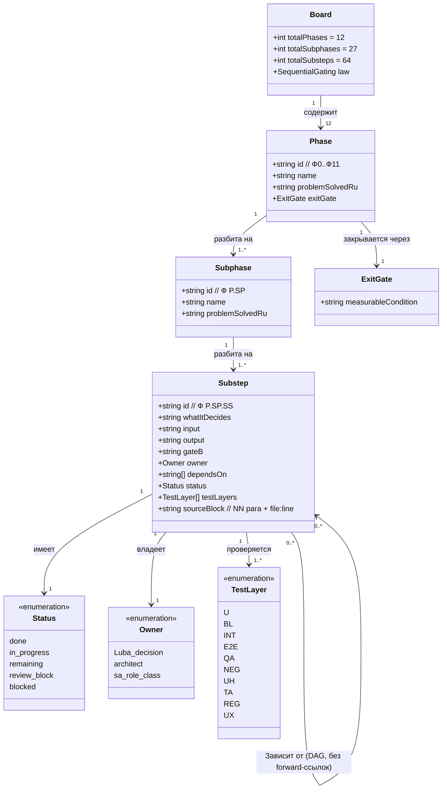
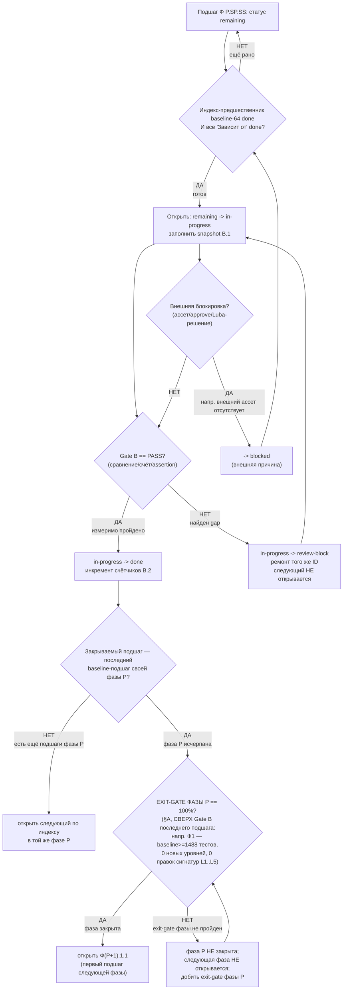

## Current Code-First Execution State Overlay (2026-07-14, live authority)

```text
execution_state: ACTIVE_CODE_FIRST
implementation_authorization: YES_CODE_FIRST_ONLY
teacher_dpo_training_authorization: NO_TEACHER_DPO_TRAINING_UNTIL_G_DPO_FINAL
publication_target: origin/codex/dpo-implementation
current_core_accepted_pushed_tip: e7c6af49f2a18ee96145e431433d07b994d15cba
published_core_slices: [07, 08, 09, 10, 11, 12, 13, 14A, 14B]
next_slice: G_LEGACY_BRANCH_RECONCILIATION__BLOCKS_14C_RESUME_AND_PUBLICATION
legacy_branch_reconciliation_gate: G-LEGACY-BRANCH-RECONCILIATION_BLOCKING
slice_14c_state: PAUSED_UNCOMMITTED_NEEDS_FIX
teacher_stage_state: TP1_LOCAL_NOT_STARTED; TP2_HOSTED_NOT_STARTED
dpo_training_state: NOT_STARTED
architecture_review_state: A1_A5_RESIDUALS_CURRENT
```
> Пометка 14.08.26: упоминания ветки `DpoImplementation` в этом файле — historical; ветка-канон = `codex/dpo-implementation` (см. 14.08.26WorkLeft-05-branch-reconciliation-codex-dpo-implementation.md). Гейт `G-LEGACY-BRANCH-RECONCILIATION` (строки `next_slice` / `legacy_branch_reconciliation_gate` выше и раздел ниже) закрыт merge-ом 14.08.26 (W-011 → CLOSED_1408): `DpoImplementation` была неправильной рабочей веткой и слита в `codex/dpo-implementation` (MERGE_HEAD `d2a385f75d`, merge-base `80d0c642b3`; hash merge-коммита вписать после его создания). `current_core_accepted_pushed_tip: e7c6af49f…` — historical accepted tip slice 14B; текущий tip `codex/dpo-implementation` = `773afd5750` + merge-коммит. Порядок `CODE_FIRST -> TP1_LOCAL -> TP2_HOSTED -> G_DPO_FINAL -> DPO/training` и запреты на training не меняются.

The current ordered lane is `CODE_FIRST → TP1_LOCAL eval-only → TP2_HOSTED eval-only → G-DPO-FINAL → DPO/training`. This board records execution state only. The sole owner of stage meaning, entry/exit/legal/human gates and the final activation boundary is `active-codex-execution-two-phase-local-remote-overlay.md`; do not copy or reinterpret its stage matrix here. Existing board counts and identifiers remain unchanged. The older branch/workdir block's “no commit or push yet” observation is historical pre-execution evidence and is superseded by the accepted/published ledger below.

> Пометка 17.08.26: `TP2_HOSTED` в полосе выше и в `stages:` ниже читать по дефолту D-02 (`17.08.26WorkLeft-03-decisions-register.md`; решение — `17.08.26WorkLeft-00-ИТОГ.md` §5): TP2 = локальный хост 25.ModelServer с тем же Qwen; внешний профиль `qwen3-together-v1` — OPTIONAL/evidence-only. Попутно W-194: профиль этапа 1 в коде — два: `qwen35-local-authoring-v1` / `qwen35-local-evaluation-v1` (`14.ContinuousLearning/Core/LegalTrainingTeacherInference.cs:116–117`), не один `qwen35-local-v1`. Текст доски не переписан.

### Accepted and published slice evidence

| Repository/worktree | Accepted pushed tip | Acceptance state |
|---|---|---|
| `llm_mvp_core-DpoImplementation` | `e7c6af49f2a18ee96145e431433d07b994d15cba` | upstream `origin/codex/dpo-implementation`; slices 07-14B accepted/pushed; 14A extracts host-neutral composition contracts (`718e4b225942acafe1109be3e808b28e174d02d7`); 14B adds the host-neutral executor (`e7c6af49f2a18ee96145e431433d07b994d15cba`). Slice 14C is a separate dirty candidate and is not accepted/published. |
| `xiigen-platform-dot-net-angular-DpoImplementation` | `2763345f377` | clean; upstream `origin/codex/dpo-implementation`; current CORS slice accepted; prior SQLite/runtime evidence includes `360/360`, build and vulnerability check |
| `FigmaToCode-design-gen-DpoImplementation` | `44dd7ec59e` | clean; upstream `origin/codex/dpo-implementation`; bearer-auth generation route accepted; focused `32` plus webpack |
| `CanvaToCode-DpoImplementation` | `82b1debf0d` | clean; upstream `origin/codex/dpo-implementation`; bearer-auth submission route accepted; full `153` plus webpack |
| `xiigen-flows-dot-net-angular-DpoImplementation` | no new accepted tip in this packet | clean; no completion or publication inference beyond the clean-state observation |

`ACCEPTED_PUSHED_SLICE` is bounded evidence, not a synonym for strict composite Gate-B `done`. Rows remain open/review-pending until their own complete Gate-B acceptance evidence exists; none of the 12/27/64 plan counters is changed by this overlay. DPO/teacher/training rows remain deliberately last and unauthorized.

### Mandatory per-slice publication rule

For each slice: builder code/tests -> independent `ACCEPTED` packet -> one exact-slice commit -> successful push to `origin/codex/dpo-implementation` -> prove local HEAD equals remote tip and worktree clean -> only then start the next slice. Accepted-but-unpushed accumulation is forbidden. Full canonical wording is in the current addendum of `active-codex-execution-two-phase-local-remote-overlay.md`.

### Current work item

Slices 12-14B are accepted/pushed: the bootstrap facade exists, an explicit caller-owned profile reaches it, 14A extracts host-neutral composition contracts, and 14B adds the host-neutral executor. These are bounded capabilities, not an accepted deployment host, persistence layer, full-machine completion or composite Gate B. The dirty 14C live-local HTTP/session host candidate is `PAUSED_UNCOMMITTED_NEEDS_FIX` and cannot resume or publish until `G-LEGACY-BRANCH-RECONCILIATION` is independently accepted. Its inspected JSON is HTTP/readiness/session metadata only and does not call training.

After that gate, the remaining code-first chain includes finishing and independently verifying 14C, platform client/facade integration, invocation through the accepted runtime boundary, persistence/restart for profile plus revision/CAS state, an explicit authority schema/canon/resolver because current metadata is insufficient, and FigmaToCode/CanvaToCode plus applicable flows caller proof. A5-R1 does not require another confirmation for code-first: Luba's live instruction authorizes `YES_CODE_FIRST_ONLY`; teacher/DPO/training remains `NO_TEACHER_DPO_TRAINING_UNTIL_G_DPO_FINAL`.

Accepted L4 consumption, facade bootstrap and production composition are not full-machine completion. Deployment hosting, persistence/restart, edge-authority execution, composite Gate B, L5/machine behavior, TP1/TP2 and DPO/training remain open; TP1/TP2/DPO are `NOT_STARTED`, and `ACCEPTED_PUSHED_SLICE != composite gate`.

### `G-LEGACY-BRANCH-RECONCILIATION` blocking gate

The remote legacy branch `refs/heads/DpoImplementation@233b1f0ee6749fb59e86a719ed61f113f0779c72` and current branch `refs/heads/codex/dpo-implementation@e7c6af49f2a18ee96145e431433d07b994d15cba` diverge at merge-base `6fe15e7b43a97936e14bddaa1fb19ff467c1815d` with `2171` legacy-only and `2313` current-only commits; neither tip is an ancestor of the other. The current code-first baseline `504bcba93f7bcd4db1c93fc094eea3e8133d310d` is not descended from the legacy tip. Therefore no wholesale merge, branch substitution or inferred inheritance is allowed. — historical: ветка DpoImplementation была неправильной, слита в codex/dpo-implementation 14.08.26 (гейт закрыт merge-ом; см. WorkLeft-05).

The classification owner is `active-codex-execution-legacy-dpoimplementation-reconciliation.md`. It records identical artifacts, current surfaces that supersede legacy, and translation-DPO/checkpoint candidates that may be ported only after `G_DPO_FINAL`. Its classification must be independently accepted before 14C resumes. This gate does not start TP1/TP2, materialize DPO pairs, invoke training or change the canonical order `CODE_FIRST -> TP1_LOCAL eval-only -> TP2_HOSTED eval-only -> G_DPO_FINAL -> DPO/training`.

## Current Implementation Branch/Workdir Convention Pointer (2026-07-09, Luba live authority)

pointer: The current implementation branch is `codex/dpo-implementation` (ветка-канон исправлена 14.08.26; прежде ошибочно DpoImplementation; для 4 не-core репо имя локальной ветки этим проходом не переадъюдицировано — upstream `origin/codex/dpo-implementation`) and the implementation workdir is a git worktree at `C:\Projects\<repo-name>-DpoImplementation` (that folder's HEAD). This supersedes the older `DPOLegalLearning` work-branch and `C:\Projects\DPOLegalLearning\<repo>` workdir wording wherever this board states it (for example the Pass31-Pass40 "Repo authority" consumer-sync row, the R21 section, and the `branch: DPOLegalLearning` / `origin/DPOLegalLearning` implementation-copy references). Full authority + per-repo source-startpoint table: see `Current Implementation Branch/Workdir Convention Overlay (2026-07-09)` at the top of `active-codex-execution-02-source-inventory-and-reference-map.md`.

name_scope_rule: this pointer changes ONLY the implementation BRANCH name and WORKDIR PATH; the DPO effort's TASK/PROJECT/work name remains "DPO Legal Learning" / `DPOLegalLearning`. Status 2026-07-09: worktrees created/populated/clean, no commit or push yet, mergeability check into the original source branch AND `main` still required before the first commit.

## Two-Phase Teacher Rollout Pointer (2026-07-13, Luba live authority)

owner_pointer: единственный владелец структуры двухфазного teacher-маршрута —
`active-codex-execution-two-phase-local-remote-overlay.md`. Здесь только pointer.
stages: Этап 1 `TP1_LOCAL` (локальный Ollama Qwen3.5-9B Q4_K_M, профиль
`qwen35-local-v1`); Этап 2 `TP2_HOSTED` (hosted `qwen3-together-v1` и др.
допущенные нейтральные провайдеры).
board_scope_rule: teacher-этапы — это ПРЕДУСЛОВИЕ внутри существующих фаз доски
(Ф2/Ф3/Ф6/Ф7/Ф10.3), а НЕ новые фазы. Счётчики 12 фаз / 27 подфаз / 64 подшага
НЕ меняются. Матрица этапов живёт только у владельца-overlay, не на этой доске.
readiness_unchanged: `PLAN_NOT_READY`; implementation_authorization split = code-first
`YES_CODE_FIRST_ONLY`, teacher/DPO/training `NO_TEACHER_DPO_TRAINING_UNTIL_G_DPO_FINAL`. Contracts
`TeacherProvenance` (20 полей, plan-08 §3.1) и `GraphDpoPair` (14 полей, plan-07)
не тронуты. Closed proprietary teachers запрещены в обеих фазах.

> **A5-R1 RESOLVED FOR CODE-FIRST (2026-07-14):** живое указание Luba уже подтверждает code-first дорожку, поэтому `IMPL_AUTH_CODE_FIRST_YES_NEEDS_LUBA_CONFIRM` закрыт как `RESOLVED_BY_LIVE_LUBA_INSTRUCTION`. Канон разделён: CODE_FIRST = `YES_CODE_FIRST_ONLY`; TEACHER/DPO/training = `NO_TEACHER_DPO_TRAINING_UNTIL_G_DPO_FINAL`. Старые bare `NO` относятся к historical/pre-code-first или только к teacher/DPO дорожке. Остальные A1-A5 residuals остаются current.

## Historical Fable Coverage Repair Overlay (2026-07-05)

historical_plan_readiness: PLAN_NOT_READY / FABLE_GAP_REPAIR_QUEUE
historical_pre_code_first_implementation_authorization: NO until fresh Luba approval after review
at_that_historical_time_verdict_basis: Newer Fable coverage evidence `claude-fable-plan-check-v1.md` and attachment `98cbe69a` supersede the previous final-readiness overlay. Fable reports 127 findings: 91 COVERED, 30 PARTIAL, 6 MISSING. Mental implementation from active-codex would still hit plan-level design/source/dependency blockers: R-B `llm mvp` 20-pass and `llm_mvp_core` 40-pass knowledge-library targets are accepted only as evidence-library closure, not readiness/implementation proof; R-G source addressability is incomplete; several shared contracts/readability/lifecycle carriers need plan-family repair. This is plan repair evidence only, not product implementation, not tests/builds/runtime/provider/training/checkpoint/git proof.
at_that_historical_time_verdict_classes: DESIGN_BLOCKER_CURRENT=FABLE_MISSING_AND_PARTIAL_ITEMS; CURRENT_REPAIR_QUEUE=FABLE_RB_RG_AND_PARTIAL_REPAIR; FABLE_EVIDENCE=claude-fable-plan-check-v1.md lines 35-153 and attachment 98cbe69a lines 32-79; CURRENT_LEDGER_ACCEPTANCE_BOUNDED_EVIDENCE=previous 50/50 planning-section acceptance remains historical/process evidence only and cannot override later Fable MISSING/PARTIAL findings; IMPLEMENTATION_AUTHORIZATION_GATE=NO until fresh Luba approval after review.
historical_classification_rule: Any older line in this file saying PLAN_READY_FOR_LUBA_REVIEW, Final Readiness Review Overlay, no unresolved design/dependency blocker, CURRENT_REPAIR_QUEUE=NONE_IDENTIFIED_BY_FINAL_READINESS_REVIEW, or parent final-readiness acceptance before this overlay is historical/pre-Fable evidence only unless it cites a later unquoted Luba instruction or later evidence-bound review after 2026-07-05.
fable_gap_repair_addendum: active-codex-execution-42-fable-gap-repair-additions-20260705.md is the current repair map for R-B/R-G and the partial contract/readability/lifecycle additions.

## Pass31-Pass40 Consumer Sync (40-pass llm_mvp_core evidence library)

sync_scope: evidence-only propagation from `active-codex-execution-knowledge-library-llm-mvp-core-40-pass.md` Pass31/40 through Pass40/40. At that historical time, the verdict remained `PLAN_NOT_READY / FABLE_GAP_REPAIR_QUEUE`; `implementation_authorization: NO`.

| board carrier | synced detail | no-claim boundary |
|---|---|---|
| Provenance/legal | `GraphDpoSourceRow -> GraphDpoPair -> TeacherProvenance -> legal verdict -> training batch -> checkpoint manifest -> promotion gate`; closed provider output is not a train target. | No provider terms/legal approval was run. |
| Unit-level DPO | `GraphDpoPair` is a graph-context envelope around a unit-level row with `UnitId`, `AuthorityUnitId`, graph refs, chosen/rejected, provenance/legal refs. | No GraphDpoPair code or training execution is proven. |
| Lifecycle | `GraphCheckpointManifest` / `GraphLearningExport` must carry held-out, ablation, fresh-load, promotion, rollback, and contamination rebuild evidence. | No checkpoint operation ran. |
| Scheduler | Distinguish `MaxCombinations`, `MaxParallelCombinationRuns`, and `MaxParallelBranches`; Gate B tests must cover ordering, cancellation, timeout, partial failure, and backpressure. | No tests/builds/runtime were run. |
| External mocks | Seam plus deterministic mock/fake expected response and replacement-plan row at `C:\Users\lubao\Documents\xiigen\llm mvp\DPO LEARNING\codex-external-calls-mock.md`. | Debt file not created here; no provider/API call ran. |
| Repo authority | Future worker must rediscover latest-updated source branch per repo, use `C:\Projects\DPOLegalLearning\<repo>`, no-write mergeability before commit/push, no PR/merge by default. | No git/workdir copy/mergeability action ran. |
## Historical Pre-Fable Final Readiness Review Overlay (2026-07-05)
historical_pre_fable_plan_readiness: PLAN_READY_FOR_LUBA_REVIEW
historical_pre_code_first_implementation_authorization: NO until fresh Luba approval after review
final_readiness_review_scope: one bounded planning/governance readiness review only; no product implementation, tests, builds, runtime, browser, provider/API, model/training/checkpoint, git, branch, mergeability, PR, or product-readiness proof was run.
historical_pre_fable_current_verdict_basis: This final review read the required governance/skill gate markers, the two unique original-task/reference attachments, the minimum Claude baseline surfaces, the active-codex plan/board/matrix/source-map/legal/gate/ledger surfaces, and current status/search evidence. End-to-end mental simulation from the active plan found no unresolved design/dependency decision that an executor would have to choose before coding/testing. The prior PLAN_NOT_READY / PLAN_PARTIAL_REPAIR_QUEUE state after 0aa/Laplace/Kepler/Singer was retained for parent final-review acceptance; this overlay supplies that final bounded review. Remaining items are execution or approval gates only: fresh Luba implementation approval, local self-authored seed file creation, code implementation, tests/builds/runtime/training/checkpoint/fresh-load/ablation proof, same-scenario Path A/Path B host proof, mock/replacement-ledger proof, branch/mergeability/git proof if later authorized, final product review, and route-specific hosted TogetherAI/Qwen3 terms/output-use proof before hosted train/common use.
historical_pre_fable_current_verdict_classes: DESIGN_BLOCKER_CURRENT=NONE_IDENTIFIED_BY_FINAL_READINESS_REVIEW; CURRENT_REPAIR_QUEUE=NONE_IDENTIFIED_BY_FINAL_READINESS_REVIEW; CURRENT_LEDGER_ACCEPTANCE_BOUNDED_EVIDENCE=50/50 accepted planning sections after 2026-07-05 Pass37-Pass50/Singer repair, not 50 cycles, not 50 product reviews, not product proof, not test/build/runtime/provider/training/checkpoint/git proof; HOSTED_PROVIDER_PRE_USE_GATE_ROUTE_SPECIFIC=TogetherAI/Qwen3 proof required before hosted train/common use only, not a local self-authored v1 planning blocker; IMPLEMENTATION_AUTHORIZATION_GATE=NO until fresh Luba approval after review.
historical_classification_rule: Any older line in this file saying PLAN_NOT_READY / PLAN_PARTIAL_REPAIR_QUEUE, current verdict remains PLAN_NOT_READY, CURRENT_REPAIR_QUEUE, parent must run final readiness review, or no-go boundaries before this overlay is historical/pre-final-readiness-review evidence only unless it cites a later unquoted Luba instruction or later evidence-bound review after 2026-07-05.
## Historical 43c2 Readiness Downgrade Overlay (2026-07-02)

historical_pre_final_review_plan_readiness: PLAN_NOT_READY / PLAN_PARTIAL_REPAIR_QUEUE
historical_pre_code_first_implementation_authorization: NO
latest_attachment: C:\Users\lubao\.codex\attachments\43c2bc75-9134-4cb2-8ad3-8985d2689bb6\pasted-text.txt
evidence_scope: Attachment 43c2 reports newer Claude PLAN_PARTIAL / NOT READY evidence with two plan-level residues. It is evidence-only, not this worker's pass count, not a sub-agent packet, and not implementation proof.
current_residue_queue:
current_b_inventory_owner: `active-codex-execution-16-full-task-coverage-simulation-gate.md` section `Current B-1..B-22 Status Reconciliation post-0aa5730c`; current B-row status is B-2 EXTERNAL_PRE_USE_PROOF_GATE, B-8 RESOLVED_SCOPE_EXECUTION_PENDING, B-18/B-21 HISTORICAL_OR_TRACE_ONLY, B-22 RESOLVED_IN_ACTIVE_PLAN_EXECUTION_PROOF_PENDING, and all other B rows RESOLVED_IN_PLAN_EXECUTION_PROOF_PENDING. At that historical time, the verdict remained PLAN_NOT_READY / PLAN_PARTIAL_REPAIR_QUEUE; implementation authorization remains NO.
- plan-09 B-15 / IGraphWeaknessDetectorUnit edge/graph wording: v1 train-ready DPO rows remain unit-level only; edge/graph training, scoring, acceptance, and promotion are deferred unless a later explicit Luba-approved plan expands scope.
- plan-06 fan-in merger wording: current canon is IEdgeFanInMerger.Merge(GraphFanInMergeInput input) -> OperationResult<GraphFanInMergeResult>, not a bare LogicalFlowResult return.
historical_pre_final_current_verdict_basis: Newer evidence attachment 0aa5730c, the Erdos bounded worker packet, and the 2026-07-05 Pass37-Pass50/Singer correction supersede stale READY and stale acceptance-count overlays. Historical/pre-Fable evidence supported PLAN_NOT_READY / PLAN_PARTIAL_REPAIR_QUEUE: current-ledger 50-pass acceptance is repaired as bounded planning-section evidence (50 headings exist and strict acceptance-field/readability evidence is 50/50 after the 2026-07-05 Pass37-Pass50/Singer repair). This queue-classification repair finds no current plan/design blocker in the stale CURRENT_REPAIR_QUEUE labels: F0 locks are recorded with implementation proof pending; legal/provenance is propagated in active plan, policy, and source-map surfaces; hosted-provider proof is a route-specific external pre-use gate before hosted Qwen3/Together train/common use, not a local self-authored v1 planning blocker; future execution proof remains after approval; fresh Luba post-review approval is implementation authorization, not a plan-design blocker. This is not 50 cycles, not product readiness, not PLAN_READY, not B-22 closure, and not implementation authorization.
historical_pre_final_current_verdict_classes: DESIGN_BLOCKER_CURRENT=NONE_IDENTIFIED_BY_THIS_QUEUE_CLASSIFICATION; CURRENT_LEDGER_ACCEPTANCE_BOUNDED_EVIDENCE=50/50 accepted planning sections after 2026-07-05 Pass37-Pass50/Singer repair, not cycles/readiness/product/implementation proof; CURRENT_REPAIR_QUEUE=NONE_IDENTIFIED_BY_THIS_QUEUE_CLASSIFICATION; F0_LOCKS_RECORDED_IMPLEMENTATION_PROOF_PENDING=Q3/Q6/Q8/Q11/Q14/Q30/Q38 recorded, Q37/Q-host implementation checks only; LEGAL_PROVENANCE_PROPAGATED_IN_PLAN_EXECUTION_PROOF_PENDING=20-field TeacherProvenance, ProviderProof, LicenseProof, LegalVerdict, C16/C17 quarantine/block/rebuild behavior present in active plan/policy/source-map surfaces; HOSTED_PROVIDER_PRE_USE_GATE_ROUTE_SPECIFIC=TogetherAI/Qwen3 proof required before hosted train/common use, not local self-authored v1 planning blocker; IMPLEMENTATION_AUTHORIZATION_GATE=fresh Luba post-review approval required before execution, not plan-design blocker; EXECUTION_PROOF_PENDING_AFTER_APPROVAL=code implementation, seed file creation, tests/builds/runtime, mock execution/replacement, training/checkpoint/fresh-load/ablation, same-scenario dual-path proof, branch/mergeability/git; readiness_candidate_for_parent_review=HISTORICAL_ZERO_BLOCKER_ASSESSMENT_SUPERSEDED_BY_A1_A5_RESIDUALS; parent must run final readiness review before any PLAN_READY wording; HISTORICAL_PRE_0AA_EVIDENCE=older PLAN_READY_FOR_LUBA_REVIEW / READY and older NOT_READY records unless a later evidence-bound repair proves current status.
# Доска исполнения ILearningDynamicGraph — строго последовательная (claude-EXECUTION-CONTROL-BOARD)

## Historical/pre-43c2 Pass50 Readiness Verdict Overlay (2026-07-02)

historical_pre_43c2_plan_readiness: PLAN_NOT_READY / PLAN_PARTIAL_REPAIR_QUEUE
historical_pre_code_first_implementation_authorization: NO until fresh Luba approval after review
current_pass_chain: 50 canonical pass headings exist and strict current-ledger acceptance-field/readability evidence is now 50/50 after the 2026-07-05 Pass37-Pass50 bounded acceptance repair recorded in active-codex-execution-41-current-ledger-50-pass-acceptance-index.md. This is 50 accepted planning pass sections, not 50 cycles, not product readiness, not PLAN_READY, not B-22 closure, and not implementation authorization.

Historical/pre-43c2 Pass50 basis:
- Original-task R1-R10 are FULLY_COVERED_PLAN_LEVEL by Pass46 and this Pass50 adversarial review.
- B-1..B-22 have no remaining implementable active-codex design/dependency blocker under the Pass39/Pass43/Pass44 current overlays. Hosted provider proof remains required only before hosted train/common use.
- Source-to-Plan inventory is 64/64 by exact canonical row-id audit, with 0 noncanonical row-like offenders.
- Claude/latest-baseline details are carried in active-codex: five participating repos, DPOLegalLearning work name, C:\Projects workdir boundary, latest-updated source-branch authority as active/Codex delta, xiigen-platform facade plus xiigen-flows seam, FigmaToCode/CanvaToCode as clients/callers, unit-level 14-field GraphDpoPair, 20-field TeacherProvenance, exactly one active language-translate pilot, and provider/terms boundary.
- QA, tests, builds, screenshots, same-scenario dual-path proof, mock replacement, provider/API proof, runtime/training/checkpoint proof, branch/mergeability, git, PR, and product review remain future execution-continuation gates after fresh Luba approval. They are not design decisions and were not run in Pass50.
- This Pass50 overlay is historical/pre-43c2 evidence only. Newer attachment 43c2 supersedes it; READY wording in this block is not current readiness, not B-22 closure, and not implementation authorization.

Readback: This Pass50 paragraph is historical/pre-43c2 evidence only. Attachment 43c2 triggered a downgrade, the residues were repaired, and the historical/pre-0aa post-repair-review active-codex verdict was PLAN_READY_FOR_LUBA_REVIEW; historical/pre-Fable 2026-07-02 bounded-repair verdict was PLAN_NOT_READY / PLAN_PARTIAL_REPAIR_QUEUE; implementation_authorization remains NO.

> **Артефакт:** `claude-EXECUTION-CONTROL-BOARD.md` (мой namespace `claude-*`).
> **Автор-роль:** архитектор доски исполнения (Opus 4.8 MAX).
> **Тип артефакта:** ПЛАН-ONLY (документация-решение: перестройка плана в строго
> последовательную исполнительную доску). Это **НЕ** разрешение реализовывать
> продукт/код, тренировать, билдить, запускать раннеры, делать git или вызывать
> внешние AI/API/модели. Реализация требует свежего явного approve Luba после ревью.
> **Источник канона (EVIDENCE-ONLY, не редактируется):** мастер-план
> `codex-ILEARNINGDYNAMICGRAPH-PLAN-v1.md` + 16 решённых блоков (`codex-plan-00..14`);
> бенчмарк `codex-EXECUTION-CONTROL-BOARD.md`; старый каркас `claude-00..07`.
> **Согласованность:** текущие счётчики после RR4/Q41/PASS26 (12 фаз / 27 подфаз /
> 64 подшага, включая активный пилот Ф10.3 `language-translate`), нумерация
> `Ф<P>.<SP>.<SS>`, имена контрактов (`GraphDpoPair`, `TeacherProvenance`,
> `DynamicGraphMachine`, …) и CANON-инварианты — едины с остальными `claude-*` и
> мастером. Бенчмарк `codex-*` — только чтение.
> **Язык:** русский (человеческим языком); имена типов/полей — английский.
> **GOVERNANCE-ЗАМЕТКА — Политика веток (NEW).** В **каждом** участвующем репозитории
> (5: `llm_mvp_core`, `xiigen-platform-dot-net-angular`, `xiigen-flows-dot-net-angular`,
> `FigmaToCode-design-gen`, `CanvaToCode`) authority = самый последний **ОБНОВЛЁННЫЙ**
> branch (по дате последнего коммита) на момент старта работ; рабочая ветка проекта
> **создаётся ОТ authority** и называется **`DPOLegalLearning`**. Это **предусловие
> реализации** (актуально на старте Ф0→Ф1), а **не** новый подшаг: счётчики доски
> **12 фаз / 27 подфаз / 64 подшага** не меняются этой политикой веток. План-only: определение
> authority-ветки и **создание** `DPOLegalLearning` — это git-запись (реализация),
> запрещённая здесь и выполняемая только после свежего явного approve Luba. Единая
> формулировка — мастер §B.4 «Политика веток (NEW)» и `claude-plan-14` §3.1а.
> **Live-authority branch boundary (2026-06-29):** Luba explicitly forbids continuing or reviving the prior planning-repo branch-policy packet in this chain. The planning repo `C:\Users\lubao\Documents\xiigen` is not a git-cleanup target here. `DPOLegalLearning` applies only to implementation copies/workdirs under `C:\Projects`.

> **50-pass authority repair (2026-06-29):** Claude baseline is the repo/plan authority. Codex files are delta/source-map evidence only and cannot become canon by recency, count, copied workdir discovery, or prior execution. `claude-ILEARNINGDYNAMICGRAPH-PLAN-v1.md:373-401`, `claude-plan-14-stage-references.md:269-290`, and `claude-EXECUTION-CONTROL-BOARD.md:17-27` define the five implementation repos (`llm_mvp_core`, `xiigen-platform-dot-net-angular`, `xiigen-flows-dot-net-angular`, `FigmaToCode-design-gen`, `CanvaToCode`) and the implementation branch name `DPOLegalLearning`. `planning-dpo-learning` is not Claude implementation authority and must not authorize planning-repo branch work. The old source-canon wording above is evidence of the active-board rebuild history only; live execution authority is Claude baseline plus validated non-contradictory Codex deltas.
>
> **PASS26 RR4/Q41 pilot-counter repair (2026-06-30):** active board-owner canon now follows
> `claude-EXECUTION-CONTROL-BOARD.md`: Q41=Вариант B RESOLVED for exactly one pilot,
> `language-translate`; Ф10.3 is an active baseline subphase with rows Ф10.3.1..Ф10.3.5,
> status `remaining`; global plan-start counters are 12 phases / 27 subphases / 64 substeps
> with `blocked=0`. Old six-domain Ф10.3.1..Ф10.3.6 reserve / baseline-59 wording is
> historical/pre-PASS26 evidence only or reference-navigation text, not current execution scope.
>
> **Graph/DPO authority repair:** The remaining F0 questions must not ask for a whole-graph `old broad GraphDpoPair question`. Pass04 supersedes the older broad `level(unit|edge|graph)` wording for train-ready DPO: current B6 requires `TrainableGraphDpoBuilderUnit` under `ILearningDynamicGraph` to learn unit-level pair construction, with `GraphDpoPair(level=unit, unit_id, chosen_unit_output_ref, rejected_unit_output_ref, unit_context_ref, path_order_ref, provenance_ref, legal_scope)` as the train-ready shape. Any remaining edge/graph-level wording is downstream B9/B10/B12 consistency debt, not current train-ready authority.

---

## Pass 13 Code Reference Inventory Execution Gate

Historical/pre-post-repair status at that pass was `PLAN_NOT_READY`; historical/pre-0aa post-repair review readiness was `PLAN_READY_FOR_LUBA_REVIEW`; historical/pre-Fable 2026-07-02 bounded-repair verdict was `PLAN_NOT_READY / PLAN_PARTIAL_REPAIR_QUEUE`; implementation authorization remains `NO until fresh Luba approval after review`.

The active board inherits the source-map Code Reference Inventory Contract. A future implementation work order must refresh code anchors after copying the latest updated branch into the `DPOLegalLearning` workdir. Until that refresh happens, source paths from this pass are `PATH_EXISTS_ONLY`; older `file:line` and quote anchors are `HISTORICAL_UNVERIFIED` or owner-doc evidence unless explicitly reclassified as `LINE_REF_VERIFIED` or `QUOTE_VERIFIED`.

Board rule: no fake line refs, no invented quotes, and no `implementation exists` claim from docs alone. If an execution row needs `LogicalContracts.cs`, `LearningMachineContracts.cs`, or `AdaptiveLogicalOrchestrator.cs` anchors and they were not opened at the exact line, the row must say `NEEDS_CODE_REF_INVENTORY`; implementation proof pending.

## Pass 14 Repo/Branch/Workdir Authority Execution Gate

Historical/pre-post-repair status at that pass was `PLAN_NOT_READY`; historical/pre-0aa post-repair review readiness was `PLAN_READY_FOR_LUBA_REVIEW`; historical/pre-Fable 2026-07-02 bounded-repair verdict was `PLAN_NOT_READY / PLAN_PARTIAL_REPAIR_QUEUE`; implementation authorization remains `NO until fresh Luba approval after review`.

Board execution rule for future implementation packets:

1. For each implementation repo, select authority from that repo's own latest updated branch or most advanced branch as recorded by the plan/repo inventory at implementation start.
2. Use `DPOLegalLearning` as the implementation working name and work in a separate copy/clone under `C:\Projects`, normally `C:\Projects\DPOLegalLearning\<repo-name>`.
3. Do not treat copied folders, stale branch memory, `planning-dpo-learning`, or `C:\Users\lubao\Documents\xiigen` as implementation authority.
4. Before every future commit and push, refresh/check the original authority branch and run a no-write mergeability/no-conflict check back into that original branch, and into `main` where project rules require main-branch mergeability; if conflicts appear, route to bounded repair or decision packet.
5. Do not create PRs and do not merge unless Luba later explicitly asks. Full access means no permission prompts for this authorized plan/governance repair; it does not authorize product implementation.

This gate is planning evidence only. It ran no git checks and proves no branch freshness, workdir creation, mergeability, commit, push, PR, merge, or implementation authorization.

## Pass 15 Test/Build/Mock Verification Continuation Gate

Historical/pre-post-repair status at that pass was `PLAN_NOT_READY`; historical/pre-0aa post-repair review readiness was `PLAN_READY_FOR_LUBA_REVIEW`; historical/pre-Fable 2026-07-02 bounded-repair verdict was `PLAN_NOT_READY / PLAN_PARTIAL_REPAIR_QUEUE`; implementation authorization remains `NO until fresh Luba approval after review`. Pass 15 did not run tests, builds, runtime probes, browser/host checks, provider/API/network calls, git, or create `codex-external-calls-mock.md`.

| board item | required future evidence | continuation rule |
|---|---|---|
| Build | Build command, exit code, output summary, and touched project/solution after implementation code exists. | Failure routes to bounded repair; no final stop while safe bounded work remains. |
| Unit tests | Unit-level `GraphDpoPair` semantics, legal/provenance gate, measurement/scorer thresholds, negative/quarantine paths, and mock seam assertions. | Failing tests are repair slices, not readiness denial as a stopping permission. |
| External mock seams | Exact expected mock response/result plus unit test assertion for every external API/resource seam; replacement path is only `C:\Users\lubao\Documents\xiigen\llm mvp\DPO LEARNING\codex-external-calls-mock.md`. | Mock-only evidence cannot claim real integration; replacement audit happens after product readiness. |
| Runtime/integration | Same-scenario Path A plus Path B proof with exact equality tuple and no-secrets redaction evidence. Tuple fields include input hash/ref, source unit/path, expected output artifact ids, provenance sidecar refs, legal/quarantine verdict, run id, and UTC timestamp convention; Path A-only is `api_only`, Path B-only is `ui_only`, neither is accepted scenario coverage. | Host/API/UI failure routes to bounded repair or true external blocker after mitigation. |
| Design boundary | Provider/provenance policy, thresholds, source-map authority, input/output contracts, mock response contracts, and model/checkpoint lifecycle are resolved before execution gates. | Missing design/dependency decisions keep `PLAN_NOT_READY`; they cannot hide in future tests/builds. |

---
## ЯКОРЬ ЗАДАЧИ (CURRENT TASK / NOT THE TASK / EVIDENCE-ONLY)

```text
CURRENT TASK:  построить МОЙ улучшенный артефакт claude-EXECUTION-CONTROL-BOARD.md —
               перестроить план ILearningDynamicGraph в строго последовательную
               исполнительную доску с трёхуровневой нумерацией Ф<P>.<SP>.<SS>
               (Фаза.ПодФаза.ПодШаг), exit-gate на каждую фазу, статусами
               execution-control, EXECUTION-VISIBILITY, сводными счётчиками,
               картой зависимостей (DAG) и обязательным Part A §0/§1 UML самой доски.
               Читая codex-* как бенчмарк, улучшить слабые места, СОХРАНИВ
               канонические счётчики и CANON-инварианты.
NOT THE TASK:  исполнять/тестировать/билдить код, запускать раннеры, тренировать,
               вызывать внешние AI/API/модели, git; править/создавать любые codex-*
               файлы (план Codex — только чтение), править claude-00..07 или dcm-*;
               слепо копировать бенчмарк; дублировать содержимое блоков (доска
               ИНДЕКСирует и упорядочивает блоки, а не копирует их текст).
EVIDENCE-ONLY: все codex-* (мастер-план, 16 блоков codex-plan-*, бенчмарк-доска
               codex-EXECUTION-CONTROL-BOARD.md, codex-recon-*, codex-50-cycle-*,
               codex-skill-improvement-*, codex-GPT55-50-CYCLE-REVIEW-LEDGER.md),
               старый каркас claude-00..07, концепт-доки llm dynamic flow/,
               транскрипты, STATE-файлы. Continuation/do-not-stop правила к этим
               evidence-артефактам НЕ применяются.
```

---

## CANON-инварианты (сохраняются дословно во всех claude-*)

```text
A-LM-12  ILearningDynamicGraph ≡ ILearningMachine<DynamicGraphDomain> — это уровень L5,
         БЕЗ 6-го уровня иерархии. DynamicGraph — это домен L5, а не новый уровень.
LEGAL    Легальный teacher-гейт: closed-проприетарная модель (Claude/OpenAI/Gemini)
         может быть ТОЛЬКО judge/eval, НЕ teacher-целью для дистилляции/DPO.
         Контаминация обучающих строк closed-моделью ⇒ DATASET_REBUILD_REQUIRED.
A-LM-09/13  Нет скрытого детерминизма: ни один детерминированный scorer/router/
         lookup/counter не является немаркированной финальной/обучаемой властью
         там, где требуется обучаемый юнит. Детерминированные помощники допустимы
         только как eval-only / helper / internal baseline / candidate-generator.
A-LM-02  Train-методы существуют ТОЛЬКО на ILearningMachine (L5). Узел (L2) и ребро
         (L3) — чистые inference-контракты, без Train.
A-LM-03  latest-wins: обученный юнит замещает baseline в реестре без правки RunAsync.
```

---

# §0. Part A — UML самой доски (классодиаграмма мета-модели + легенда + симуляции)

> Part A требует §0 UML, importable в draw.io (Mermaid classDiagram), с `note for`
> на каждом классе, легендой и таблицей симуляций на каждое соединение
> (`implementation-doc-uml-SKILL.md`; R3; OP-54/FC-14). Здесь §0/§1 описывают
> **мета-модель самой доски** (как устроена доска: фаза→подфаза→подшаг→статус→владелец
> →гейт), потому что доска — это управляющий артефакт, а §0/§1 архитектуры ПРОДУКТА
> (узлы/рёбра/машина графа) живут в `claude-06` и блоках `codex-plan-00..14`. Это
> улучшение бенчмарка: у `codex-EXECUTION-CONTROL-BOARD.md` §0/§1 UML самой доски нет.

## 0.0. Классодиаграмма мета-модели доски (Mermaid, draw.io-importable)



**Легенда классов (что делает / статус мета-модели):**

| Класс | Что делает | Статус |
|---|---|---|
| `Board` | Корень доски; держит инварианты счётчиков и закон строгой последовательности | ПОЛНОСТЬЮ ОПРЕДЕЛЁН (план-only) |
| `Phase` | Верхний уровень исполнения Ф0..Ф11; несёт человеко-язычную задачу и exit-gate | ПОЛНОСТЬЮ ОПРЕДЕЛЁН |
| `Subphase` | Средний уровень (группа работ) внутри фазы | ПОЛНОСТЬЮ ОПРЕДЕЛЁН |
| `Substep` | Атомарная единица работы со своим Gate B и владельцем | ПОЛНОСТЬЮ ОПРЕДЕЛЁН |
| `ExitGate` | Измеримое условие закрытия фазы | ПОЛНОСТЬЮ ОПРЕДЕЛЁН |
| `Status` | Словарь статусов (ровно 5 значений) | ПОЛНОСТЬЮ ОПРЕДЕЛЁН |
| `Owner` | Класс владельца (Luba-решение / архитектор / роль-класс sa-*) | ПОЛНОСТЬЮ ОПРЕДЕЛЁН |
| `TestLayer` | Слои тест-стратегии FC-26 (10 значений) | ПОЛНОСТЬЮ ОПРЕДЕЛЁН |

**Таблица симуляций на каждое соединение (per-connection, REQUIRED §0):**

| Соединение (A → B) | Пример входа (симуляция) | Ожидаемый результат по этой ветке |
|---|---|---|
| `Board → Phase` | запрос «перечисли фазы» | 12 фаз Ф0…Ф11 в порядке DAG (§2) |
| `Phase → ExitGate` | Ф2, проверка закрытия | exit-gate Ф2: 20 полей provenance + точный 19-строчный owner-list plan-08 §4.1 (вкл. C16 client-origin и C18 scorer-ref quarantine) + 5 форматов→1 канон = PASS |
| `Phase → Subphase` | Ф1 раскрыть | Ф1.1, Ф1.2, Ф1.3 (3 подфазы) |
| `Subphase → Substep` | Ф1.1 раскрыть | Ф1.1.1, Ф1.1.2, Ф1.1.3 (3 подшага) |
| `Substep → Status` | Ф1.1.1 на момент плана | `remaining` (план-only) |
| `Substep → Owner` | Ф0.1.1 | `Luba_decision`; Ф4.3.1 → `sa_role_class` (sa-train); Ф11.2.1 → `architect` (gate) + sa-* (10 ревью) |
| `Substep → TestLayer` | Ф1.2.2 | {U, BL, UH, NEG} |
| `Substep → Substep (Зависит от)` | Ф4.3.2 зависит от Ф0.1.3 (Q11) | Ф4.3.2 не стартует, пока Ф0.1.3 ≠ `done` (предпосылка СВЕРХ индекс-порядка) |

## 0.1. Нумерация — `Ф<P>.<SP>.<SS>`

- **Ф`<P>`** — Фаза `P` (верхний уровень). Всего фаз: **Ф0…Ф11** (12 фаз).
- **`.<SP>`** — ПодФаза `SP` внутри фазы (средний уровень, группа работ).
- **`.<SS>`** — ПодШаг `SS` (нижний уровень, атомарная единица со своим Gate B).

Каждый ID **уникален**, **без дублей**, **без дыр**: подфазы идут `1,2,3,…` подряд;
подшаги идут `1,2,3,…` подряд. Пример: `Ф1.2.3` = Фаза 1, ПодФаза 2, ПодШаг 3.

## 0.2. Статусы (execution-control) — ровно 5 значений

| Статус | Значение |
|---|---|
| `done` | Подшаг/подфаза/фаза завершены, Gate B пройден на 100%, evidence записан. |
| `in-progress` | Сейчас исполняется (ровно один активный подшаг во всём плане — единственная глобальная дорожка; см. §0.5). |
| `remaining` | Ещё не начато (нельзя начать, пока зависимости не закрыты и фаза не открыта). |
| `review-block` | Исполнение сделано, но REVIEW_INTERNAL нашёл gap; вернулось в ремонт того же ID. |
| `blocked` | Заблокировано ВНЕШНЕЙ причиной: недоступный ассет, отсутствие authority/approve, внешняя зависимость или ожидание конкретного решения Luba. НЕ применяется к Ф0: Ф0 — нормальная первая фаза, на момент плана = `remaining`, открывается как `in-progress` при старте. НЕ применяется к пилоту Ф10.3 `language-translate`: Q41=Вариант B уже RESOLVED, поэтому Ф10.3 — обычная `remaining` baseline-подфаза. |

> **На момент плана ВСЁ = `remaining`** (план-only; ни один реализационный подшаг не
> начат и начнётся только после approve Luba). Для текущего RR4/Q41-канона `blocked=0`;
> Ф10.3 `language-translate` входит в baseline-64 как обычная подфаза. `scope-gated/вне-59`
> допустимо только как историческая/pre-PASS26 пометка старой снятой схемы.

## 0.3. Правило строгой последовательности (закон доски, для всех уровней)

```text
ПРАВИЛО СТРОГОЙ ПОСЛЕДОВАТЕЛЬНОСТИ (SEQUENTIAL GATING):

ЕДИНАЯ СЕМАНТИКА ПОРЯДКА (разрешение конфликта индекс vs DAG): закон исполнения —
строгий тотальный порядок по индексу Ф<P>.<SP>.<SS>, И этот индекс-порядок СОГЛАСОВАН
с частичным порядком «Зависит от» (DAG): для baseline-доски «Зависит от» никогда не
ссылается ВПЕРЁД по индексу, поэтому индекс и DAG дают ОДИН ответ на «какой ровно один
подшаг сейчас». Индекс — это и порядок исполнения, и метка; «Зависит от» — это
дополнительные кросс-фазовые предпосылки, которые не противоречат индексу, а уточняют
готовность (если ID из «Зависит от» не `done`, подшаг ждёт, даже когда
индекс-предшественник уже закрыт).

1. Фаза N+1 НЕ начинается, пока exit-gate Фазы N не пройден на 100%.
2. ПодФаза SP закрыта ⇔ Gate B ВСЕХ её подшагов == PASS (exit-gate подфазы — это
   ПРОИЗВОДНОЕ условие, а не отдельный независимый гейт; правило 3 уже его обеспечивает по
   подшагам). ПодФаза SP+1 внутри фазы НЕ начинается, пока ПодФаза SP не закрыта в этом
   смысле (все её подшаги `done`). Так средний уровень иерархии вычислим без отдельной
   строки «Exit-gate подфазы».
3. ПодШаг SS+1 внутри подфазы НЕ начинается, пока Gate B ПодШага SS == PASS.
4. Если у подшага есть «Зависит от» с ID из ДРУГОЙ фазы/подфазы — он не стартует, пока
   ВСЕ перечисленные ID не `done` (предпосылка СВЕРХ индекс-порядка, не альтернатива;
   она никогда не открывает подшаг раньше его индекс-предшественника).
5. Любой проваленный Gate B → статус `review-block`, исполнение возвращается в ремонт
   ЭТОГО же ID (ARCHITECT_INTERNAL_REPAIR); следующий ID не открывается.
6. Единственное исключение порядка — Ф0: её exit-gate (ответы Luba) обязателен перед
   стартом Ф1; внутри Ф0 решения могут собираться параллельно (это сбор решений Luba,
   а не реализация на дорожке исполнения), но фаза закрывается, только когда ВСЕ ответы
   есть.
7. ОГОВОРКА RR4/Q41/PASS26 ПРО АКТИВНЫЙ ПИЛОТ: Q41=Вариант B RESOLVED 2026-06-30 для
   ровно одного пилота `language-translate`. Поэтому Ф10.3.1..Ф10.3.5 входят в строгий
   тотальный индекс-порядок baseline-64 как обычные `remaining` подшаги после Ф10.2.2.
   Эффективный индекс-предшественник Ф11.1.1 = Ф10.3.5, а exit-gate Ф10 достигается после
   закрытия последнего подшага пилота. Старое правило про шесть `blocked` слотов
   Ф10.3.1..Ф10.3.6 вне baseline-59 является historical/pre-PASS26 evidence-only и не
   является текущей веткой исполнения.
8. DOMAIN E2E SCOPE GUARD: только `language-translate` является активным v1 executable
   pilot после approval. `local-wiki`, `small-model`, `extensions`, `figma-html-css`,
   `design-to-code`, FigmaToCode и CanvaToCode остаются navigation/reference/deferred
   до отдельного activation bundle: seed/data, held-out scorer/gold, legal/provenance,
   activation substeps, lifecycle/fresh-load or promotion gates, and tests. Recon files,
   generic templates, Source-to-Plan rows, and Future Gate B are not E2E proof.
```

В каждый момент времени видно ровно один `in-progress` ID **во всём плане**
(единственная глобальная дорожка, §0.5), весь «хвост» — `remaining`.

> **Семантика exit-gate подфазы (S2-gating, разрешение):** доска принимает производное
> определение (§0.3 правило 2): подфаза закрыта ⇔ Gate B всех её подшагов == PASS;
> отдельной независимой строки «Exit-gate подфазы Ф`<P>`.`<SP>`» НЕТ и она не требуется —
> средний уровень иерархии вычислим по подшагам. **Зависимость (cross-file, plan-00 НЕ
> редактируется в этом задании):** обещание `claude-plan-00 §1.1` про «полные exit-gate'ы
> каждой подфазы в соответствующих claude-plan-NN» должно быть приведено к этому
> производному определению (убрать обещание отдельного subphase-gate ИЛИ добавить 26 явных
> строк) — зафиксировано здесь как дефект Contradiction Sweep для plan-00, синхронно с §D.1
> пунктом 2 и §B.5 шагом 4.

## 0.4. Поля строки подшага и таксономия владельцев

Каждый подшаг описан строкой-таблицей с полями:
`Что решает | Вход | Выход | Gate B (измеримо) | Owner | Зависит от (ID) | Статус | Тест-слои | Блок-источник`.

**Owner — три класса владельцев** (легенда обязана совпадать с реальными ячейками).
Ячейка несёт РОЛЬ-КЛАСС; конкретный НИК суб-агента назначается в bounded work order при
старте и пишется в snapshot §B.1, когда подшаг переходит в `in-progress`:

| Класс владельца | Где применяется | Кол-во | Кто исполняет |
|---|---|---|---|
| `Luba (решение)` | Ф0.1.1-3 (канон-решения) | 3 | Решения Luba (не реализация, не суб-агент-работа) |
| `sa-*` (роль-класс) | Ф1…Ф10, все 59 реализационных подшагов (54 прежних + активный пилот Ф10.3.1-5) | 59 | суб-агенты `gpt-5.5 / xhigh` (firewall CLAUDE.md) |
| `архитектор` | Ф11.1.1 (doc/governance-ревью); Ф11.2.1 (review-gate + финальный вердикт) | 2 | архитектор (Opus 4.8 MAX); **Ф11.2.1 — SPLIT: 10 execution-ревью ИСПОЛНЯЮТ суб-агенты, архитектор владеет только токеном `ARCHITECT_VERDICT_ALLOW_FINAL`** |

Сумма владельцев: **59 sa-исполнителей (Ф1–Ф10) + 3 Luba-решения (Ф0) + 2 архитектор
(Ф11) = 64**.

**Reconciliation R9 (две грани, во избежание ложного числа 56):**
1. «Через суб-агентов» в смысле РЕАЛИЗАЦИИ = **59** исполнителей Ф1–Ф10 (54 прежних + активный пилот Ф10.3.1-5).
2. Ф0.1.1-3 — это РЕШЕНИЯ Luba, законное исключение из R9 (НЕ суб-агент-работа).
3. Ф11.1.1 + Ф11.2.1-gate — архитектор-ревью/вердикт; 10 execution-ревью Ф11.2.1
   исполняют суб-агенты.
   **Каноническое число суб-агент-исполнителей реализации = 59; число 56 НЕ
   каноническое** (возникает только при ошибочном счёте Ф0 как суб-агент-работы; после
   PASS26 активный пилот добавляет пять Ф10.3 строк). Авторский facet R9 (написание самого плана
   суб-агентами) трассируется на мастер R-13 + R20-протокол, а НЕ на execution-owner
   колонку доски.

**Тест-слои (FC-26):** U=unit, BL=business-logic, INT=integration, E2E=e2e-host,
QA=QA-automation, NEG=negative, UH=untrained-honesty, TA=trained-acceptance,
REG=regression, UX=ux-automation.

**Блок-источник + нота R11 (референс на каждый этап, исполняемый слой):** колонка
«Блок-источник» = источник канона (`NN §...`) + код `file:line`. Чтобы R11 «референсы на
каждый этап» закрывался на исполняемом слое (а не только для Ф10), каждый подшаг
резолвится к ПРОЕКТАМ+ДОКУМЕНТАЦИИ затрагиваемых компонентов через current
Source-to-Plan owner `active-codex-execution-plan-14-stage-references.md` section 3.2
Pass30 Ф9 consolidated test-strategy row-evidence repair. Claude board/plan-14 remain read-only baseline/order
evidence, but the active consumer route is the plan-14 section 3.2 64-row denominator
roster. **Honest-статус карты после Pass30:** target = 64 baseline rows;
Pass18 enumerates 64 denominator rows, Pass30 records 64 accepted-delta inventory rows,
0 `NEEDS_CODE_REF_INVENTORY` rows, and zero verified rows; Source-to-Plan 64/64 is inventory-only, not readiness or implementation proof. Старое wording про 59-row/51-unmapped/59/59, 28/36, 31/33, 34/30, 41/23, 46/18, 50/14, 54/10, and 58/6 — historical/pre-current
evidence only and cannot drive current execution sequencing. Прежний таргет
`codex-plan-14 §11.0` снят: этой секции в бенчмарке физически НЕТ (`codex-plan-14` = 36 строк,
без §11), владелец active roster — plan-14 section 3.2, а не codex-файл.

> **Точность цитат (улучшение):** `file:line` ссылки унаследованы из бенчмарка и блоков
> `codex-plan-*` как EVIDENCE (бенчмарк помечает часть как «читано»/«проверено на
> диске»). В этом плане-only они НЕ переисполнялись через Read кода; перед стартом
> подшага исполнитель обязан перечитать цитату и при расхождении строки/имени —
> зафиксировать дрейф в snapshot §B.1 (а не доверять номеру строки слепо). Это явная
> честная граница, которой у бенчмарка нет.

## 0.5. Дорожка исполнения (определение)

**Дорожка исполнения ровно ОДНА и глобальная.** На всю доску в каждый момент существует
не более одного `in-progress` подшага (`in-progress P ∈ {0,1}` относится ко ВСЕЙ доске).
Параллельных дорожек реализации НЕТ. Это делает формулы счётчиков §B.2
(`done + in-progress + remaining + review-block + blocked = 64`) арифметически
корректными без суммирования по нескольким дорожкам и сохраняет инвариант строгой
последовательности.

Единственное допускаемое «параллельно» — сбор решений Luba в Ф0 (§0.3 правило 6): это
сбор ответов, а НЕ работа на дорожке исполнения, поэтому он не создаёт второго
`in-progress` подшага реализации.

## 0.6. Поток статуса подшага (Part A §1 — flowchart мета-модели)



**Симуляции на каждую ветку (per-branch, REQUIRED §1):**

| Ветка | Вход (симуляция) | Ожидаемый результат |
|---|---|---|
| B → НЕТ | Ф4.3.2, но Ф0.1.3 (Q11) ещё `remaining` | подшаг ждёт, остаётся `remaining` |
| B → ДА | Ф1.1.1, Ф0.1.1 = `done` | открыть Ф1.1.1 → `in-progress` |
| D → ДА | Ф2.1.1: 20 полей provenance present, denylist-вердикт протестирован | `done`, далее проверка границы фазы (узел I) |
| D → НЕТ | Ф4.1.2: grep всё ещё находит литерал `0.03` как RewardMargin | `review-block`, ремонт Ф4.1.2 |
| I → НЕТ | Ф1.1.1 закрыт, но в Ф1 ещё есть Ф1.1.2…Ф1.3.3 | открыть Ф1.1.2 (следующий подшаг той же фазы Ф1) |
| I → ДА | Ф1.3.3 закрыт — последний активный подшаг Ф1 | перейти к проверке exit-gate фазы Ф1 (узел K) |
| K → ДА (phase-boundary) | Ф1.3.3 `done` И exit-gate Ф1 = 100% (baseline≥1488, 0 новых уровней, 0 правок сигнатур L1..L5) | открыть Ф2.1.1 (первый подшаг Ф2) |
| K → НЕТ (phase-boundary) | Ф1.3.3 `done`, но регрессионный exit-gate Ф1 (baseline≥1488) НЕ пройден | Ф2.1.1 НЕ открывается; ждём закрытия exit-gate Ф1 (узел M) |
| PASS26 RR4/Q41 | На старте плана Ф10.2.2 ещё `remaining`; Q41=Вариант B RESOLVED; Ф10.3 = `language-translate` | после Ф10.2.2 открывается Ф10.3.1, затем Ф10.3.2..Ф10.3.5; Ф11.1.1 ждёт Ф10.3.5; `blocked=0`; Q41 не создаёт ветку ожидания |
| G → НЕТ | Ф6.1.2 ассеты доступны, approve есть | идём на проверку Gate B |

---

# §0R. Тест-стратегия по фазам (Plan testability gate — сводка)

> Plan testability gate (OP-55 / FC-26): каждая ветка несёт тест-стратегию по слоям,
> отдельно для untrained-honesty (UH) и trained-acceptance (TA). Это сводный индекс;
> точные слои — в колонке «Тест-слои» каждого подшага. Улучшение бенчмарка: единый
> rollup, по которому видно, что UH+TA покрыты для всех обучаемых веток.

| Фаза | Основные слои | UH (untrained-honesty) | TA (trained-acceptance) |
|---|---|---|---|
| Ф0 | — (решения) | n/a | n/a |
| Ф1 | U, BL, INT, REG, E2E | Ф1.2.2, Ф1.3.3 | n/a (контракты, не обучение) |
| Ф2 | U, BL, NEG, INT, QA | Ф2.1.2 | n/a |
| Ф3 | U, BL, INT, NEG, leakage | Ф3.1.2 | n/a (строит данные) |
| Ф4 | U, BL, INT, TA, leakage, REG | n/a | **Ф4.2.1, Ф4.2.3, Ф4.3.1, Ф4.3.2** |
| Ф5 | U, BL, NEG, TA, INT, QA | **Ф5.1.3** | **Ф5.2.1, Ф5.2.2** |
| Ф6 | INT, BL, NEG, leakage, judge-origin-NEG | n/a | n/a (через L5/Ф5) |
| Ф7 | INT, E2E, TA, BL, REG, NEG | n/a | **Ф7.2.1, Ф7.2.2** |
| Ф8 | BL, NEG, U, INT, E2E, TA, REG | n/a | **Ф8.2.2** |
| Ф9 | все 9 слоёв | **Ф9.1.2** | **Ф9.1.2, Ф9.2.2** |
| Ф10 | E2E, INT, UX, NEG, BL, REG | n/a | n/a (швы; trained-доказательство в Ф4-Ф9) |
| Ф11 | все слои через ревью | — | — |

Обе колонки честности (UH+TA) обязательны для 3 IsTrainable-веток (unit row
Ф4.3.1, edge-authority Ф4.3.2, graph machine) — измеряются в Ф5 и собираются в матрицу Ф9
(P-01/P-02/P-03 несут обе колонки, 3×2=6 обязательных).

---

# §1. Сводные счётчики

| Метрика | Значение |
|---|---|
| Всего фаз (Ф0…Ф11) | **12** |
| Всего подфаз | **27** |
| Всего подшагов | **64** (включает Ф10.3.1..Ф10.3.5 active pilot `language-translate`; old Ф10.3.6 reserve is historical/pre-PASS26 only) |
| `done` | **0** |
| `in-progress` | **0** |
| `remaining` | **64** |
| `review-block` | **0** |
| `blocked` | **0** (на момент плана Ф0 = `remaining` и откроется как `in-progress` при старте; `blocked` зарезервирован только для внешних причин; реализация всех фаз ждёт approve Luba) |
| Решённых блоков-документов (источник) | **16** (Part A §0/§4/§5 + P-01..P-14) |

> Счётчики подфаз/подшагов по фазам (самоконтроль без дыр):
> Ф0=1/3 · Ф1=3/9 · Ф2=2/5 · Ф3=2/5 · Ф4=3/8 · Ф5=2/5 · Ф6=2/4 · Ф7=2/4 · Ф8=2/4 ·
> Ф9=3/6 · Ф10=3/9 · Ф11=2/2.
> Σ подфаз = 1+3+2+2+3+2+2+2+2+3+3+2 = **27**.
> Σ подшагов = 3+9+5+5+8+5+4+4+4+6+9+2 = **64** (Ф10 includes active pilot Ф10.3.1-5).

---

# §2. Карта зависимостей фаз (DAG) с обоснованием порядка

```text
Ф0  Решения Luba (Exit-gate Ф0 — §A «Exit-gate Ф0 (измеримо…)», сбор ответов Luba как exit-gate, §0.3 правило 6)
      │  (канон уровня L5, схема GraphDpoPair, teacher-список, judge-политика,
      │   размещение common/adaptive, судьба baseline-роутеров — без них нельзя
      │   фиксировать контракты и легальный гейт)
      ▼
Ф1  Контракты и фундамент графа (узел/ребро/оркестратор/L5-машина/домен/топология)
      │  (NEW-типы и маппинг уровней — скелет, на который ложится всё остальное)
      ▼
Ф2  Легальный teacher-гейт + provenance + канон GraphDpoPair
      │  (ни одна строка не обучает без легального провенанса; формат пары — общий)
      ▼
Ф3  DPO-строитель (GraphDpoBuilder: chosen/rejected/[WRONG:], 5 форматов → 1 канон)
      │  (производит обучающие данные; нужен legal-гейт Ф2 как встроенный шаг)
      ▼
Ф4  Обучение + lifecycle (LoRA wiring, margin из движка, checkpoint/export/import/locator, split R5)
      │  (реальный сдвиг весов; нужны пары Ф3 и легальные данные Ф2)
      ▼
Ф5  Измерение (held-out / ablation / permutation / two-PASS)
      │  (доказывает обучаемость числом; нужен обученный узел Ф4)
      ▼
Ф6  Async мульти-комбинации (1 вход → N комбинаций → лучший)
      │  (генератор тренировочного сигнала; опирается на оркестратор Ф1, измерение Ф5)
      ▼
Ф7  Авто-DPO петля (интеграция Ф2-Ф6 в замкнутый цикл само-улучшения)
      │  (прогон → пара → обучение → измерение → промоушен → повтор)
      ▼
Ф8  Замена скрытого детерминизма (cutover baseline-роутеров → обучаемые юниты)
      │  (после того как обучаемый путь Ф4-Ф7 доказан — переключаем финал ребра)
      ▼
Ф9  Тесты/QA полная матрица (FC-26 по 14 строкам P-01..P-14, per-edge контроли)
      │  (сквозная верификация всего, что построено в Ф1-Ф8)
      ▼
Ф10 API/клиенты (figma→html+css; better-output→DPO; тонкий агент R-11)
      │  (прикладные швы наружу; ядро в llm_mvp_core)
      ▼
Ф11 Финальная приёмка (full completion gate + 10 execution reviews)
```

**Обоснование порядка (почему именно так):**

1. **Ф0 первой** — канон (L5, поля `GraphDpoPair`/`TeacherProvenance`, teacher-список,
   размещение ассетов) повторяется как открытый вопрос почти в каждом блоке (Q1 во всех
   16). Без ответов нельзя зафиксировать ни контракты, ни легальный гейт — иначе
   переделка всего скелета.
2. **Ф1 раньше Ф2-Ф4** — NEW-типы (`IDynamicGraphNode/Edge`, `DynamicGraphDomain`,
   `DynamicGraphTopology`, `DynamicGraphMachine`) — это скелет; на него ссылаются и
   `GraphDpoPair`, и legal-гейт, и обучение (§C.5 мастер-плана).
3. **Ф2 раньше Ф3** — legal-гейт встроен в `GraphDpoBuilder` шагом 1 (блок 07 §3 Шаг 1;
   блок 08 — владелец гейта). Строить пары без гейта = риск контаминации.
4. **Ф3 раньше Ф4** — обучение (`TrainBatchAsync`) кормится парами `GraphDpoPair` (блок
   10 §3 Шаг 1; блок 09 Шаг 4). Нет пар — нечем обучать.
5. **Ф4 раньше Ф5** — измерение меряет обученный узел; пустую заглушку мерить нечем
   (блок 11 §3 вход).
6. **Ф6 после Ф5** — async-арбитр выбирает «лучший» и доказывает это измерением (блок 06
   §8 G4 — метрики на стороне L5/Ф5).
7. **Ф7 после Ф2-Ф6** — петля по определению интегрирует все предыдущие (блок 09 §1:
   связывает P-06/P-07/P-08/P-10/P-11 в один цикл).
8. **Ф8 после Ф7** — cutover (замена baseline на обученный финал ребра) безопасен только
   когда обучаемый путь доказан; иначе сломаем рабочий baseline (блок 12 §E Q5: удаление
   ≠ покрытие; baseline остаётся для ablation).
9. **Ф9 после Ф8** — полная тест-матрица верифицирует уже построенное (блок 13 —
   поперечный, но финальная матрица собирается после cutover).
10. **Ф10 после Ф9** — прикладные швы (figma→html, better-output→DPO) подключают
    проверенное ядро; ядро остаётся в llm_mvp_core (блок 14, R5/R6).
11. **Ф11 последней** — full completion gate + 10 execution reviews только когда всё
    построено и проверено.

> Внутри Ф2..Ф6 есть «горизонтальные» зависимости между блоками (08↔07, 07↔06, 11↔09/10):
> они отражены в поле «Зависит от» каждого подшага, а не нарушают вертикальный порядок фаз.

---

# §A. ФАЗЫ — детально (название, что решает, exit-gate, подфазы, подшаги)

---

## Ф0 — Решения Luba (канон как exit-gate)

**Что решает (человеческим языком):** фиксирует канонические решения, без которых
нельзя проектировать контракты и легальный гейт. После ремонта 2026-06-29 это не
список "всё remaining / всё спросить у Luba": Claude baseline, original task and
attachments already resolve or partially resolve часть вопросов. Реализация всё
равно не разрешена, пока readiness gates не пройдут.

**Attachment 483d / Pass02 / Pass35 supersession (2026-06-29/2026-06-30/current active repair):** `C:\Users\lubao\.codex\attachments\483d666f-ff58-45e2-be05-121ed616cb6a\pasted-text.txt` explicitly records that Luba chose the recommended defaults, and latest Claude details keep v1 scoped to the common `language-translate` pilot. It locks Q3/Q6/Q8/Q11/Q14/Q30/Q38 for planning; Pass35 supersedes older Q6/B15 wording that made the personal/adaptive pair v1-active. Current Q6/B15 design requires v1 common-only storage under `llm_mvp_core`; `DynamicGraphMachinePair : ILearningMachinePair<DynamicGraphPersonal, DynamicGraphGlobal>` is a later activation blueprint with personal/adaptive under `<project>\.xiigen` only if Luba later explicitly expands scope. Q37 remains policy resolved with C16/provenance/terms/license implementation checks, Q-host remains route-principle resolved, blocker 2 closes seam design in-plan, and blocker 3 closes same-scenario dual-path design in-plan. Older board lines that say those items remain Luba-only choices or that the pair is v1-active are historical unless this paragraph explicitly reopens them. This is not implementation readiness.

**Attachment 0ce0 full-task coverage supersession (2026-06-30):** `C:\Users\lubao\.codex\attachments\0ce0d4e1-64cd-4a35-b8ed-56993844e412\pasted-text.txt` supersedes the earlier narrower attachment 429f/blocker-1..4 ready verdict. Attachment 0ce0 reports 33 valid sequential full-task simulation passes, FULLY=0, PARTIAL=25, NOT_COVERED=8, ERROR=1, verdict `NOT_READY`, and blockers B1-B21 with B5 absent from the numbering. Historical/pre-post-repair plan artifact verdict at that time was `PLAN_NOT_READY`; implementation authorization remains `NO until fresh Luba approval after review`. The earlier `PLAN_READY_FOR_LUBA_REVIEW` wording is historical/pre-attachment-0ce0/narrower-repair evidence only. Future tests/builds/screenshots/concrete branch-ref evidence/mergeability, same-scenario join files, real external calls, provider terms retrieval, and mock replacement ledger creation are execution-continuation checkpoints only after full-task plan repair and approval, not stop permissions and not current readiness proof.

**PASS08 numeric/Gate B threshold anchor:** the canonical active-codex threshold table is in
`active-codex-execution-ILEARNINGDYNAMICGRAPH-PLAN-v1.md` under
`PASS08 Canonical Threshold And Gate B Overlay`. Board Gate B rows must use these aliases:
`ablation_delta_min=0.02` (Q11), `heldout_accuracy_min=0.95`,
`heldout_delta_min=+0.02`, `reward_margin_min=0.025` (Q30/Q34),
`qualityThreshold=0.95` (Q22 alias to Q30), `goalConfidenceFloor=0.80` as
`PROPOSED_NOT_LOCKED` (Q17), `self_best_default` as a legal fallback mode (Q23),
and `N/combinationCount` as an async contract cardinality routed to B-11, not a quality
threshold. At that historical time, the verdict remained `PLAN_NOT_READY`.

**User-reported merge context:** Luba reports "я замержила в main все что было в xiigen mapping" and "я замержила в main все что было в xiigen planning". The board records both as user-reported only; no git verification was performed in `C:\Users\lubao\Documents\xiigen`.

**Exit-gate Ф0 (измеримо — фаза завершена, когда):**
- получены ответы Luba на **все 7 решающих вопросов** (Q1 уровень L5; Q2 канон
  `GraphDpoPair`; Q3 место `TeacherProvenance`; Q4 teacher-список + судьба `sonnet-*`;
  Q5 judge-политика; Q6 размещение common/adaptive; Q7 судьба `MultiSubPhaseRouterUnit`);
- закрыт **конечный (не «минимум»)** список блокирующих per-block вопросов с lock-флагом
  и явной картой «вопрос → первый зависимый подшаг» (так `decisions_open_count == 0`
  вычислим, а DAG-рёбра Ф0→{Ф1.x, Ф4.3.2, Ф5.x, Ф10.1.1, Ф10.2.1, Ф10.2.2} явные):
  - **Q8** строение выхода → attachment 483d locks `IQueryable<GraphNodeCandidate>` with `CandidateId`, `Confidence`, `EvidenceIds[]`, `SemanticQualityClaimed`, `candidate_order_invariant=true`, and leakage excluded
    (planning lock recorded; implementation proof remains; первый зависимый подшаг Ф1.2.1);
  - **Q11** порог просадки ablation → `ablation_threshold_locked==true` / `ablation_delta_min=0.02`
    (владелец Ф0.1.3; первые зависимые Ф4.3.2, Ф5.2.1);
  - **Q14** обучаемость порядка обхода → `traversal_order_trainability_locked==true`
    (владелец Ф0.1.2; первый зависимый Ф1.3.2);
  - **Q30** порог held-out accuracy приёмки → `heldout_accuracy_threshold_locked==true`
    with `heldout_accuracy_min>=0.95`, `heldout_delta_min>=+0.02`, `reward_margin_min>=0.025`
    (владелец Ф0.1.3; первые зависимые Ф5.1.x/Ф5.2.1, exit-gate Ф5);
  - **Q37** origin better-output → original-task lines 20 and 76-84 resolve the principle: self DynamicGraph or legal hosted open-weight teacher with provenance/terms; closed proprietary is judge/eval-only and closed+train means rebuild/quarantine
    (policy_principle_resolved; implementation C16/provenance gate remains; первый зависимый Ф10.2.1);
  - **Q38** политика лицензий выходов клиентов (common vs user-adaptive, R5) →
    `output_license_policy_locked==true` (владелец Ф0.1.3; первый зависимый Ф10.2.2);
  - **Q-host (R16/R17)** route scope → original-task lines 330-343 resolve route principle: `xiigen-platform` for figma API, FigmaToCode/CanvaToCode as callers, and `xiigen-platform` + `xiigen-flows` for better-output-to-DPO API
    (route_principle_resolved; implementation engine/seam proof remains; первый зависимый Ф10.1.1);
- закрытие формализовано как конечный чек-лист:
  **Ф0 planning locks for Q3/Q6/Q8/Q11/Q14/Q30/Q38 are recorded from attachment 483d**, где Q37/Q-host principles are resolved and implementation checks remain; no current Luba-only lock remains from this set unless Luba explicitly reopens it;
- `decisions_open_count == 0` по этому конечному набору; никаких открытых «минимум …».

**Подфазы:** Ф0.1 (сбор и закрытие решающих вопросов).

### Ф0.1 — Решающие вопросы и канон

**Что решает:** собрать 7 решающих + конечный блокирующий per-block остаток в один
список и получить ответы Luba.

| ID | Что решает | Вход | Выход | Gate B (измеримо) | Owner | Зависит от | Статус | Тест-слои | Блок-источник |
|---|---|---|---|---|---|---|---|---|---|
| Ф0.1.1 | Канон уровня: `ILearningDynamicGraph ≡ ILearningMachine<DynamicGraphDomain>` (L5), без 6-го уровня (A-LM-12) | §E.0 текущего мастера; Claude baseline; `DECISIONS-LOCKED.md:35` | Planning lock: L5 specialization, not sixth level; Luba may explicitly reopen later | `canon_level == L5_specialization`; no implementation claim | Claude baseline; Luba reopen only | — | planning_lock_recorded_implementation_pending | — (decision/config gate only) | мастер §E.0; §E.1 Q1 historical; 00/04/05 §12 |
| Ф0.1.2 | Canon format: current `GraphDpoPair` = active/Claude plan-07 14-field canon, train-ready only at unit level + `TeacherProvenance` 20-field canon/storage + Q8 container/fields + Q14 traversal/order policy | §E Q2/Q3; per-block Q8/Q14; original-task line 11; latest Claude plan-07/08; блоки 06/07/08/09 §5 | Planning locks recorded: `GraphDpoPair` has exactly 14 fields; `TeacherProvenance` has 20 fields and storage/projection via manifest/source ids; Q8 `IQueryable<GraphNodeCandidate>` fields; Q14 deterministic/topological traversal is baseline/candidate enumerator only while `GraphOrderResolverUnit` emits trainable order metadata | `graphdpopair_14_field_unit_level_canon_locked == true`; `teacherprovenance_20_field_storage == true`; **`output_container_locked == true` and `graph_node_candidate_fields_locked == true`**; **`graph_order_handoff_locked == baseline_plus_GraphOrderResolverUnit_path_order_ref`**; implementation proof still required | Luba/Claude baseline decision recorded; implementation checks remain | - | planning_lock_recorded_implementation_pending | - (decision/config gates only) | мастер §E.1 Q2/Q3; plan-07/08; Pass37 |
| Ф0.1.3 | Канон легальности и политик: teacher-список, judge-политика, размещение common/adaptive (R5), baseline-router fate, `sonnet-*` fate, Q11/Q30 thresholds, Q38 output license, Q37/Q-host checks | §E Q4/Q5/Q6/Q7; per-block Q11/Q30/Q37/Q38/Q-host; original-task lines 20, 76-84, 330-343; attachment 483d lines 33/35/47/48/49/53/56/57; latest Claude v1 scope details; R16/R17; блок 08 §12; Pass35 B15/Q6 storage repair | Planning locks recorded: Q6 v1 common-only placement; `DynamicGraphMachinePair : ILearningMachinePair<DynamicGraphPersonal, DynamicGraphGlobal>` is later activation blueprint, not v1-active pair; Q11 `0.02`; Q30 `>=0.95` plus `delta>=+0.02` and `reward>=0.025`; Q38 adaptive/quarantine default with common only after clearance/redaction/terms snapshot/Luba approval; Q37 policy resolved; Q-host route principle resolved | `teacher_allowlist_frozen`; `judge_policy_set`; `asset_split_dirs_set`; **`v1_common_only_storage_locked == true`**; **`adaptive_pair_activation_blueprint_deferred == true`**; **`ablation_threshold_locked == 0.02`**; **`heldout_accuracy_threshold_locked == >=0.95 with delta>=+0.02 and reward>=0.025`**; **Q37 implementation must pass C16/provenance/terms/license gates before real output use**; **Q38 output-license implementation gates remain**; **Q-host implementation must prove internal engine/seam placement before host readiness** | Luba decision recorded; `PASS35_COMMON_ONLY_V1_STORAGE_POLICY_REPAIRED_EXECUTION_PROOF_PENDING`; implementation checks remain | — | planning_lock_recorded_implementation_pending | — (decision/config/legal gates only) | мастер §E.1 Q4-Q7; per-block Q11/Q30/Q37/Q38/Q-host; R16/R17; attachment 483d; Pass35 |

---

## Ф1 — Контракты и фундамент графа

**Что решает:** вводит типизированный скелет графа как контракты (узлы, рёбра,
топология, домен, L5-машина) и фиксирует маппинг ролей Luby на реальные уровни.
Превращает «поведение оркестратора» в явные типы fan-out/fan-in/many-to-many/return-loop.

**Exit-gate Ф1 (измеримо):**
- все NEW-контракты определены с сигнатурами и помечены NEW vs существующее с `file:line`
  (блоки 00/05/01/02/03/04 §5);
- число введённых новых архитектурных уровней == **0** (A-LM-12: DynamicGraph = домен L5);
- маппинг ролей с `file:line` (00.Core/LogicalContracts.cs:97/166/202,
  LearningMachineContracts.cs:208) зафиксирован;
- 0 правок сигнатур существующих контрактов L1..L5 (совместимость);
- узел/ребро БЕЗ Train-метода (A-LM-02): счётчик Train-методов в обёртках == 0;
- регрессия: baseline ≥ 1488 тестов не падает от введения NEW-контрактов.

**Подфазы:** Ф1.1 (NEW-контракты графа), Ф1.2 (узел L2), Ф1.3 (ребро L3 + L4/L5 связка).

### Ф1.1 — NEW-контракты графа (скелет типов)

**Что решает:** ввести `DynamicGraphDomain`, `IDynamicGraphNode`, `IDynamicGraphEdge`
(+канон-enum `GraphEdgeKind` + `string AuthorityUnitId`), `DynamicGraphTopology` как
сигнатуры (0 правок 00.Core). **КАНОН ребра (мастер §A.4.1):** имя enum — `GraphEdgeKind`
(РОВНО 5 членов `{FanOut, FanIn, ManyToMany, MultiOutput, ReturnLoop}`); устаревшие
псевдонимы `EdgeKind`/`AuthorityKind`/поле `AuthorityUnit`/член `AsyncParallel` НЕ
используются; async-параллельность ребра — булев флаг `ParallelEligible`, а не член enum
(мастер §A.4.1 стр.178; §E Q13 стр.758).

| ID | Что решает | Вход | Выход | Gate B (измеримо) | Owner | Зависит от | Статус | Тест-слои | Блок-источник |
|---|---|---|---|---|---|---|---|---|---|
| Ф1.1.1 | `DynamicGraphDomain` (sealed marker TDomain) + маппинг ролей L2/L3/L4/L5 | Ф0.1.1; `LearningMachineContracts.cs:208` | NEW `DynamicGraphDomain`; таблица маппинга с file:line | тип компилируется как marker; маппинг 4 ролей с file:line; 0 новых уровней | sa-contracts | Ф0.1.1 | remaining | U, REG | 00 §5.2; 05 §5.2; 04 §5.2 |
| Ф1.1.2 | `IDynamicGraphEdge` (+канон-enum `GraphEdgeKind` + `string AuthorityUnitId` + `IReadOnlyList<string> ToNodeIds` для multi-target) — типизированное ребро + булев флаг `ParallelEligible` | Ф0.1.1; `DynamicDomainGraph.cs:3`; **канон — мастер §A.4.1** (блоки 02/03/04/05 §5 выравниваются на него) | NEW `IDynamicGraphEdge`, канон-enum `GraphEdgeKind {FanOut, FanIn, ManyToMany, MultiOutput, ReturnLoop}`, `string AuthorityUnitId`, `IReadOnlyList<string> ToNodeIds`, флаг `ParallelEligible` | **РОВНО 5 видов ребра в enum `GraphEdgeKind`** (источник канона — мастер §A.4.1; блок-03 одиночный `ToNodeId` расширяется до `ToNodeIds`, блок-04 5-членный набор дополняется `ReturnLoop`); `AuthorityUnitId` (string) ссылается на обучаемый L2; `ParallelEligible` (bool) выражает async без члена enum; `DeterministicFinalAuthority` поле present (=false в проде) | sa-contracts | Ф1.1.1 | remaining | U, BL, REG | мастер §A.4.1 (канон); 02 §5; 03 §5; 04 §5.2 |
| Ф1.1.3 | `DynamicGraphTopology` (мутируемая на лету проекция реестра) + `IDynamicGraphNode` (обёртка узла) | Ф0.1.1; `LogicalTopologyRegistry.cs:69/105`; блок 04 §3.5/§5.2 | NEW `DynamicGraphTopology` (Add/Mutate), `IDynamicGraphNode`, `BuildDynamicTopology(DynamicGraphBuildSignal, TopologyBuildBudget)` | топология читается через адаптер `BuildDynamicDomainTransitions` **и** строится/мутируется через `BuildDynamicTopology(signal,budget)`; Gate B: `source_kind` allowed, `budget.MaxNodes/MaxEdges/MaxDepth/MaxParallelBranches` checked, `budget_exceeded` blocks mutation, mutation evidence recorded; обёртка БЕЗ Train | sa-contracts | Ф1.1.2 | remaining | U, BL, INT, REG | 00 §5.2; 04 §3.5/§5.2; 05 §5.2 |

### Ф1.2 — Узел графа (L2, «упрощённая матрица»)

**Что решает:** обёртка `IDynamicGraphNode` поверх `ILogicalUnit` без Train; алгоритм
features·weights→top-N + honest `NoDecision`; миграция существующих юнитов.

| ID | Что решает | Вход | Выход | Gate B (измеримо) | Owner | Зависит от | Статус | Тест-слои | Блок-источник |
|---|---|---|---|---|---|---|---|---|---|
| Ф1.2.1 | Контракт узла: `IDynamicGraphNode<TInput,TOutput>` + `DynamicGraphNodeDescriptor` + `GraphNodeCandidate` (many→many) | Ф1.1.3; `LogicalContracts.cs:97/62/72`; Ф0 Q8-fields | NEW узловые типы; container уже queryable/IQueryable many-to-many; поля `GraphNodeCandidate` ждут Q8-candidate-fields | Train-методов в обёртке == 0 (A-LM-02); descriptor несёт `IsTrained/AuthorityRole/CheckpointRef`; выход = queryable/IQueryable many→many; поля candidate не выбираются без Q8-fields lock | sa-node | Ф1.1.3, Ф0.1.2 | remaining | U, REG | 01 §5 |
| Ф1.2.2 | Алгоритм узла: features·weights→top-N + honest `NoDecision` (счёт ≤0 → не выдумывать); анти-leakage входа (без candidate-index/source-path) | Ф1.2.1; образец `SkillSelectionLogicalHierarchy.cs:455-463`, `MultiSubPhaseRouterUnit.cs:291` | Описанный inference-путь узла; список `excluded_leakage_signals` | при счёте ≤0 → `HasDecision=false`, `SemanticQualityClaimed=false`; вход не содержит candidate-index/source-path как фич | sa-node | Ф1.2.1 | remaining | U, BL, UH, NEG | 01 §3.А; 01 §6 |
| Ф1.2.3 | Миграция существующих `ILogicalUnit` под узел: 3 класса случаев (обучаемый / детерминистический baseline / доменный trainable-интерфейс) | Ф1.2.2; `SkillSelectionLogicalHierarchy.cs:429+`, `MultiSubPhaseRouterUnit.cs:8`, `27.TranslationDomain` | План обёртки для 3 классов с file:line | для каждого из 3 классов named обёртка с file:line; baseline-узел несёт `IsTrained=false`, `AuthorityRole=baseline_candidate_generator` | sa-node | Ф1.2.2 | remaining | INT, REG | 01 §3.В |

### Ф1.3 — Ребро L3 + связка оркестратор L4 + машина L5

**Что решает:** ребро как L3-флоу с местом под обучаемую authority; оркестратор L4 читает
топологию как контракт (без правки RunAsync); L5-машина-каркас на существующих реестрах.

| ID | Что решает | Вход | Выход | Gate B (измеримо) | Owner | Зависит от | Статус | Тест-слои | Блок-источник |
|---|---|---|---|---|---|---|---|---|---|
| Ф1.3.1 | Флоу ребра `DynamicGraphEdgeFlow : ILogicalFlow` + `IEdgeCandidateProvider` (baseline) + `IEdgeFanInMerger` (typed contract слияния) | Ф1.1.2; `LogicalContracts.cs:166`, `AdaptiveLogicalOrchestrator.cs:311/316`; Claude B-16/F1-merge-carrier | NEW флоу ребра + контракты кандидатов/слияния (сигнатуры); `IEdgeFanInMerger.Merge` returns `GraphFanInMergeResult` | флоу реализует L3 без Train; merger — deterministic baseline typed carrier with `MergeRole=FanInMergeRole.DeterministicFanInBaseline`, `MergeOrderIsAuthority=false`, `Merged`, `Context`, `MergedBranchCount`, and conflict/provenance/trace/failure refs | sa-edge | Ф1.1.2, Ф1.2.1 | remaining | U, BL, INT, REG | 02 §3.1/§5; Pass32 B-16 |
| Ф1.3.2 | Оркестратор L4 читает топологию как контракт: адаптер `DynamicGraphTopology` поверх `BuildDynamicDomainTransitions` + вход от `BuildDynamicTopology(signal,budget)`; per-edge authority через `ResolveActiveUnit` (без нового кода в RunAsync); порядок обхода — по канону Q14 (Ф0.1.2) | Ф1.3.1, Ф0.1.2 (Q14); `AdaptiveLogicalOrchestrator.cs:269/316/825`; блок 04 §5.2 | Решение «adapter + BuildDynamicTopology + ResolveActiveUnit»; 0 новых решающих веток в RunAsync | подмена baseline→trained не требует нового кода в RunAsync (latest-wins, A-LM-03); `BuildDynamicTopology` output accepted only with budget proof and mutation evidence; G1..G8 блока 03 = 8/8; 0 скрытых финалов на L4; порядок обхода соответствует `traversal_order_trainability_locked` (Q14) | sa-orch | Ф1.3.1, Ф0.1.2 | remaining | U, BL, INT, E2E, REG | 03 §3/§10 (G1..G8); 04 §5.2 |
| Ф1.3.3 | L5-машина-каркас `DynamicGraphMachine : ILearningMachine<DynamicGraphDomain>`: 5 методов (Train/Eval/Export/Import/GetOrchestrator) поверх существующих реестров + lifecycle-загрузка (user→repo→honest scaffold) | Ф1.3.2; `LearningMachineContracts.cs:208-232`, `LogicalCapabilityTrainingContracts.cs:68` | NEW `DynamicGraphMachine` (сигнатуры 5 методов) + порядок загрузки чекпойнта | 5 методов реализуют контракт L5; число рёбер-с-authority == числу типов рёбер; lifecycle: user/cache→repo/common→`TRAINING_RUNNER_MISSING` | sa-machine | Ф1.3.2 | remaining | U, BL, INT, UH, REG | 04 §3/§10 |

---

## Ф2 — Легальный teacher-гейт + provenance + канон GraphDpoPair

**Что решает:** «dpo legal build» — ни одна строка не обучает без легального провенанса.
Вводит `TeacherProvenance` как обязательное поле строки, машину вердикта
ACCEPT/QUARANTINE/BLOCK/BLOCK_FOR_COMMON/DATASET_REBUILD_REQUIRED/EVAL_ONLY (6 значений,
канон — `claude-plan-08` §3.3), реестр разрешённых teacher, и канон `GraphDpoPair`
(объединяет 5 форматов в 1).

> **Канон вердиктов (улучшение — единый словарь, без разнобоя; владелец — `claude-plan-08`
> §3.3, ровно 6 значений):**
> `ACCEPT` (легальность доказана положительно) · `QUARANTINE` (легальность НЕ доказана
> положительно: teacher не в allowlist / terms_snapshot отсутствует / geography не
> разрешена / client-origin не верифицирован) · `BLOCK` (closed-teacher для обучения по
> denylist-идентичности) · `BLOCK_FOR_COMMON` (личное/raw без redaction — только adaptive
> leg) · `DATASET_REBUILD_REQUIRED` (контаминация: строка обучает на closed-выходе) ·
> `EVAL_ONLY` (**NEW, фикс R17, `claude-plan-08` §3.3/§8.6**: легально-чистая, но
> train-ineligible строка — неполная триада C15/C15b или невоспроизводимый конверт C8;
> отдельный отвергаемый вердикт, **не** `ACCEPT`, поэтому batch-гейт §7 отсеивает её на
> уровне вердикта). `PENDING` — не член канон-enum, а пред-вердиктное gate-состояние
> (вердикт ещё не проставлен — в `TrainBatchAsync` не допускается).

**Exit-gate Ф2 (измеримо):**
- `TeacherProvenance` определён со всеми **20 полями (13 base + 5 NEW + 2 RR6)**:
  13 базовых полей плюс `TermsSnapshotRef`, `GeographyExportConstraint`, `SourceCategory`,
  `raw_private_text_copied`, `redaction_policy_ref`, `service_mode`, `grounding_used`;
  домены значений заданы;
- машина вердикта покрывает **точный 19-строчный owner-list по таблице §4.1 plan-08**:
  `C2, C3, C4, C5, C6, C7, C8, C9, C10, C11-blocked, C11, C12, C13, C14, C15, C15b, C16, C17, C18`
  (включая C15/C15b Graph-DPO Artifact Triad Gate, C16 client-origin/R17 QUARANTINE и
  C18 scorer-ref QUARANTINE); board-local уточнения тестов
  `C3-identity,C3-scan,C6a,C6b,C10-neg` — это NEG/под-тесты соответствующих строк-владельцев
  C3/C6/C10, не отдельные owner-строки; счёт сводится к 19 owner-строкам, включая C18);
  для каждой фиксированной строки возвращает точный `verdict`+`reason`;
- **W-159 scorer carrier (reference-only):** единственный registry owner — plan-08 §3.5.
  Qwen teacher=`source_category=open_weight`; scorer-sidecar=`scorer_category=deterministic_baseline`
  + `scorer_id`/`scorer_version`/`threshold_set_id` (alias plan-10 `threshold_set`). C15/C15b раньше
  C18; complete registered scorer лишь продолжает eval, без auto-ACCEPT/train-ready; missing/
  unregistered scorer → C18, Candidate false, no projection; self-score под sentinel → C14.
  `LegalVerdict`=6, `SourceCategory`=8; `first_party_deterministic` только `chosen_origin`;
- **C16 client-origin (зеркало block 08 G10, чтобы фаза не закрывалась без R17-ветки):**
  `source_category ∈ {client_unverified, third_party} && used_for_training=true && provenance
  NOT allowlisted ⇒ QUARANTINE`; NEG-тест «marker-absence ≠ open_weight» present и зелёный
  (`c16_client_origin_quarantine_gated == true`, `c16_neg_test_present == true`);
- **Graph-DPO Artifact Triad Gate (CANON-предусловие `dpo_train_ready`,
  trainable-architecture-decision-SKILL §Graph-DPO Artifact Triad Gate):**
  `triad_field_presence_rate == 1.0` для всех строк с `dpo_train_ready=true` (триада
  `raw_comparison_event` + `legal_provenance_dpo_envelope` + `training_batch` с
  `candidate_order_hash`/`split_id`/`seed`/`sampling_params`);
  `train_ready_without_triad_count == 0`; `legal_verdict==ACCEPT` без полной триады ⇒
  строка остаётся eval-only (`dpo_train_ready=false`) — plan-08 §10 п.11;
- `accept_without_provenance == 0`; правило **по идентичности (R2)**
  `IsClosedByDenylist(model_id) && used_for_training=true ⇒ BLOCK` в 100%
  (`closed_proprietary_model` ВЫВОДИТСЯ из denylist, не доверяется как вход);
- `judge_model=closed` при `used_for_training=false ⇒ ACCEPT && judge_is_closed=true`;
- `provenance_field_presence_rate == 1.0` по всем 20 полям;
  `self_judge_train_ready_without_legal_gate == 0`;
- current `GraphDpoPair` canon is the active/Claude plan-07 exact 14-field canon; train-ready rows remain unit-level and whole-graph/blob DPO remains forbidden; old text downgrading the 14-field canon is
  historical/pre-Pass37 evidence only; graph/order data stays `path_order_ref` /
  provenance/context, not a graph-level train-ready pair. Adapters from 5 formats -> 1
  canon remain an implementation/integration-test obligation;
- `AllowedTeacherRegistry` создан (Qwen3/DeepSeek/Kimi/GLM/Mistral; denylist
  Claude/OpenAI/Gemini; denylist-вердикт по `model_id` протестирован NEG);
- манифест `legal-provenance-manifest.json` содержит только `legal_verdict==ACCEPT`;
  гейт батча допускает в `TrainBatchAsync` **ТОЛЬКО `legal_verdict==ACCEPT`** и отвергает
  `LearningBatch` со строкой `legal_verdict ∈ {BLOCK, DATASET_REBUILD_REQUIRED,
  BLOCK_FOR_COMMON, QUARANTINE, EVAL_ONLY}` ИЛИ `legal_verdict==PENDING`
  (`batch_admits_only_legal_verdict_ACCEPT == true`; plan-08 §3.3/§8.1);
  **зависимость:** plan-08 §3.3/Gate B п.7 — та же формулировка (только `ACCEPT` в общий
  корпус);
- **связка plan-08 §3.3 шаг-7:** `dpo_train_ready == true` требует
  `legal_verdict == ACCEPT` (`legal_gate_passed == true`) как необходимое предусловие.

**Подфазы:** Ф2.1 (TeacherProvenance + реестр + машина вердикта), Ф2.2 (канон GraphDpoPair
+ адаптеры + гейт батча).

### Ф2.1 — TeacherProvenance + реестр + машина вердикта

**Что решает:** легальный шлагбаум данных как обязательное поле + детерминированный
гейт-юнит (governance/eval-only, НЕ семантическая власть — A-LM-09/13).

| ID | Что решает | Вход | Выход | Gate B (измеримо) | Owner | Зависит от | Статус | Тест-слои | Блок-источник |
|---|---|---|---|---|---|---|---|---|---|
| Ф2.1.1 | `TeacherProvenance` (20 полей: 13 base + 5 NEW + 2 RR6 `service_mode`/`grounding_used`) + домены значений + `AllowedTeacherRegistry` (data: allowlist/denylist/провайдеры/`geography_allowed[]`) | Ф0.1.3; образец `ResultGapDpoWriters.cs:7-14/192-196`; benchmark T2 (`claude-04:60`; `claude-02:61`) | NEW `TeacherProvenance` (20 полей, включая `SourceCategory`, `service_mode`, `grounding_used`); `allowed-teacher-registry.json` (+ `geography_allowed[]`) | 20 полей с доменами; `SourceCategory`, `service_mode`, `grounding_used` present в record; allowlist=Qwen3/DeepSeek/Kimi/GLM/Mistral; denylist=Claude/OpenAI/Gemini; **denylist-вердикт по идентичности (R2):** `IsClosedByDenylist(model_id) ⇒ closed_proprietary_model=true` (флаг ВЫВОДИТСЯ из denylist), ветка `IsClosedByDenylist(model_id) && teacher_output_used_for_training=true ⇒ BLOCK` present и протестирована **NEG-тестом**; **ветка terms_snapshot:** `open_weight_hosted && used_for_training=true && (ProviderTermsChecked=false OR TermsSnapshotRef==UNKNOWN OR TermsSnapshotRef starts_with PENDING_LUBA_OR_EXTERNAL_TERMS_REVIEW) ⇒ QUARANTINE`; **Pass02:** C6 hosted-нога оценивается только при `teacher_access_mode==open_weight_hosted`; self-hosted нога — `QUARANTINE self_hosted_retention_or_pin_missing` (владелец plan-08 §2.2 шаг 4/§3.5.2); **ветка service-mode/grounding RR6:** `used_for_training && (service_mode != "plain" OR grounding_used==true) ⇒ BLOCK` reason `service_mode_grounding_for_training`; Gemini Grounding / Google Search / web retrieval запрещены для train даже при allowlist-модели; **ветка geography:** hosted teacher вне `geography_allowed[]` ⇒ QUARANTINE; **R17 client/third_party:** `SourceCategory` несёт `client_unverified`/`third_party` сверх enum plan-08 §3.1 (нота «мой канон расширяет plan-08 T5»); все значения present | sa-legal | Ф0.1.3 | remaining | U, NEG | 08 §3.1/§3.2/§5 + PASS25_RR6; benchmark T2 |
| Ф2.1.2 | `TeacherProvenanceGateUnit.Evaluate` — машина вердикта (8 шагов §3.3): scan contamination (по `model_id` И `judge_model`) → closed-block-by-denylist → lookup → license → reproducibility → first-party → ACCEPT → judge-ветка; + под-гейт §8.5 privacy/retention | Ф2.1.1; `training-data/orchestration-reasoning/*.jsonl` (контаминация); benchmark T3 (`claude-07:43`; `claude-04:26,79,90`) | NEW гейт-юнит + `TeacherProvenanceGateResult` (+ privacy/retention) | точный 19-строчный owner-list plan-08 §4.1 → verdict+reason; Qwen teacher `source_category=open_weight`, scorer-sidecar `scorer_category=deterministic_baseline` + `scorer_id`/`scorer_version`/`threshold_set_id` (alias plan-10 `threshold_set`); **триада:** C15/C15b раньше C18, `triad_field_presence_rate==1.0` для `dpo_train_ready=true`; missing/unregistered scorer ⇒ C18 `QUARANTINE(scorer_ref_missing)`, Candidate false, no projection; registered complete scorer лишь продолжает eval, не auto-accept/train-ready; self-score под sentinel ⇒ `forbidden_self_label` → C14; **идентичность важнее флага (R2):** `IsClosedByDenylist(model_id) && used_for_training=true ⇒ BLOCK` 100%; `accept_without_provenance==0`; `provenance_field_presence_rate==1.0`; **R17 C16:** client/third-party без allowlist ⇒ QUARANTINE; `LegalVerdict`=6, `SourceCategory`=8, `first_party_deterministic` только `chosen_origin` | sa-legal | Ф2.1.1 | remaining | U, BL, NEG, UH | 08 §3.3/§8.5/§10 (+C16/C18); benchmark T3 |
| Ф2.1.3 | Аудит/карантин контаминированных `sonnet-*` строк → DATASET_REBUILD_REQUIRED (рекон-1: 19 файлов/72 вхождения; 35/10 в reasoning) | Ф2.1.2 (gate); R17 | Список строк с вердиктом REBUILD; решение rebuild/quarantine | `contaminated_rows_marked_REBUILD == contaminated_rows_found`; 0 train-ready строк с `sonnet/openai/gpt/claude/gemini` в source_ref | sa-legal | Ф2.1.2, Ф0.1.3 | remaining | INT, QA, NEG | 08 §6.3; 07 §6.5; R17 |

### Ф2.2 — Канон GraphDpoPair + адаптеры + гейт батча

**Что решает:** единый формат пары для всего графа; адаптеры из 5 существующих форматов;
гейт батча перед обучением.

| ID | Что решает | Вход | Выход | Gate B (измеримо) | Owner | Зависит от | Статус | Тест-слои | Блок-источник |
|---|---|---|---|---|---|---|---|---|---|
| Ф2.2.1 | `GraphDpoPair` current active/Claude plan-07 14-field canon (`level=unit`, unit refs, chosen/rejected unit output refs, `path_order_ref`, provenance refs / nested `TeacherProvenance`, `candidate_order_invariant`, leakage exclusions, source ids) + projection to `LearningTrainingItem` | Ф0.1.2; `LearningMachineContracts.cs:30` | NEW `GraphDpoPair`; chosen/rejected/input triplet projection from unit-level refs | 14-field canon locked; train-ready rows are unit-level; graph/path/order metadata is provenance/context only; projection to `LearningTrainingItem` without 00.Core changes; **`dpo_train_ready==true` requires `legal_verdict==ACCEPT` (`legal_gate_passed==true`)** as a necessary precondition (plan-08 §3.3 step 7) | sa-legal | Ф2.1.1, Ф0.1.2 | remaining | U, REG | 07 §5.1; 06/08/09 §5; Pass37 |
| Ф2.2.2 | Адаптеры из 5 форматов → 1 канон + гейт батча (только `legal_verdict==ACCEPT`; `BLOCK/DATASET_REBUILD_REQUIRED/BLOCK_FOR_COMMON/QUARANTINE/EVAL_ONLY/PENDING` не допускаются — закрыт путь необработанной строки И путь недоказанной легальности) + `legal-provenance-manifest.json` | Ф2.2.1, Ф2.1.2 | Адаптеры (DpoPair/Wiki/Orchestration/jsonl/P5H → GraphDpoPair); гейт батча; манифест | integration «5 форматов → 1 канон» PASS; манифест содержит только `legal_verdict==ACCEPT`; **`batch_admits_only_legal_verdict_ACCEPT == true`**; батч отвергнут до `TrainBatchAsync` при любой строке `∈ {BLOCK, DATASET_REBUILD_REQUIRED, BLOCK_FOR_COMMON, QUARANTINE, EVAL_ONLY, PENDING}`; зависимость: plan-08 §3.3/§8.1/Gate B п.7 — та же формулировка | sa-legal | Ф2.2.1, Ф2.1.2 | remaining | INT, BL, NEG, QA | 07 §10; 08 §3.3/§10 |

---

## Ф3 — DPO-строитель (GraphDpoBuilder)

**Что решает:** сердце «авто-DPO из несуществующих данных» — машинно строит тройки
`(вход, chosen, rejected + [WRONG:])` из прогона графа, прогоняя через 3 гейта
(legal/leakage/near-miss-quality). Заменяет self-label `chosen` на легального teacher.

**Exit-gate Ф3 (измеримо):**
- `GraphDpoBuilder.BuildPairAsync` на фикстуре даёт валидный unit-level `GraphDpoPair`:
  `level=unit`, `unit_id`, chosen/rejected unit output refs, `WrongMarkers` непуст,
  `overlap_ratio < 0.60`, `reason.Length >= 24`, `ValidationOutcome="accepted"`;
- `TeacherProvenanceGate` встроен шагом 1: closed → DATASET_REBUILD_REQUIRED;
- permutation-инвариантность для edge: при ≥3 перестановках `candidate_node_ids` `chosen`
  идентичен → `candidate_order_invariant=true`; иначе QUARANTINE;
- материализация `GraphDpoPair → DpoPair` читается `DpoDataset.Load`
  (`11.DPO/DpoDataset.cs:18-26`) без исключения;
- QA-скан: 0 train-ready строк с closed-маркерами и 0 whole-graph blob pairs.

**Подфазы:** Ф3.1 (builder + 3 гейта), Ф3.2 (rejected near-miss + адаптер старых
генераторов).

### Ф3.1 — GraphDpoBuilder + три гейта построения

**Что решает:** оркестратор построения пары (классификация уровня → legal-гейт → вход A →
chosen → invariants → schema-validator).

| ID | Что решает | Вход | Выход | Gate B (измеримо) | Owner | Зависит от | Статус | Тест-слои | Блок-источник |
|---|---|---|---|---|---|---|---|---|---|
| Ф3.1.1 | `GraphDpoBuilder.BuildPairAsync`: Pass04 Шаг 0 классификация unit-level pair material + Шаг 1 legal-гейт (вызов `TeacherProvenanceGate`) + Шаг 2 вход A (`LeakageScrubber`) | Ф2.2.1, Ф2.1.2; `WikiContextRoutingDpoGenerator.cs:40-45` | NEW `GraphDpoBuilder` (BuildPairAsync/BuildBatchAsync) | train-ready level обязан быть `unit`; edge/graph context разрешён только как path/order metadata до B9/B10 review; legal-гейт встроен; вход прогнан через scrubber (пути/id/имена вычищены) | sa-builder | Ф2.2.1, Ф2.1.2 | remaining | U, BL, INT | 07 §3 Шаг0-2 + Pass04 |
| Ф3.1.2 | `ResolveChosenAsync`: teacher-путь (легальный) ИЛИ first-party baseline (`chosen_origin`, `semantic_quality_claimed=false`); **домен `chosen_origin` расширен значением `client_supplied_unverified` (R17, определяющий юнит)** | Ф3.1.1; `WikiContextRoutingDpoGenerator.cs:58` | chosen + `chosen_origin` (`legal_teacher`/`first_party_deterministic`/`human_correction`/**`client_supplied_unverified`**) + флаг semantic-claim | teacher-путь → `chosen_origin=legal_teacher`; first-party → `semantic_quality_claimed=false`; **`chosen_origin=client_supplied_unverified ⇒ QUARANTINE`** (значение определено здесь, лист Ф10.2.1 на него ссылается, а не вводит впервые) | sa-builder | Ф3.1.1 | remaining | U, BL, UH, NEG | 07 §3 Шаг3; 07 §6.2 (+client_supplied_unverified) |
| Ф3.1.3 | `CheckInvariants` + `GraphDpoSchemaValidator`: overlap<0.60, no-exact-prompt-overlap, permutation-инвариантность (edge), schema-валидатор анти-leakage | Ф3.1.2; `OrchestrationCorpusBuilder.cs:243-262`, `ResultGapDpoWriters.cs:241-266` | NEW `GraphDpoSchemaValidator`; вердикт invariants | overlap≥0.60 → quarantine; permutation меняет выбор → QUARANTINE_DO_NOT_TRAIN; schema-fail → `GRAPH_DPO_SCHEMA_INVALID` | sa-builder | Ф3.1.2 | remaining | U, BL, NEG, leakage | 07 §3 Шаг5-6/§10 |

### Ф3.2 — Rejected near-miss + адаптер старых генераторов

**Что решает:** построение rejected как near-miss + `[WRONG:]` (не мусор); адаптация
существующих генераторов в канон; материализация в движок.

| ID | Что решает | Вход | Выход | Gate B (измеримо) | Owner | Зависит от | Статус | Тест-слои | Блок-источник |
|---|---|---|---|---|---|---|---|---|---|
| Ф3.2.1 | `BuildRejected`: реальная ошибка прогона ИЛИ синтетический near-miss из таксономии + `[WRONG: код последствие]`; запрет rejected-мусора/отрицания-шаблона | Ф3.1.3; `WikiContextRoutingDpoGenerator.cs:230-267`, `ResultGapDpoWriters.cs:199-235` | rejected near-miss + wrong-annotation | rejected отличается от chosen РОВНО одной ошибкой; `[WRONG:]` непуст; мусор «I don't know» → QUARANTINE | sa-builder | Ф3.1.3 | remaining | U, BL, NEG | 07 §3 Шаг4; 07 §6 |
| Ф3.2.2 | Адаптер `WikiContextRoutingDpoGenerator`→`GraphDpoPair` (с `chosen_origin=first_party_deterministic`) + материализация `GraphDpoPair → DpoPair` (`DpoDataset.Load`) | Ф3.2.1; `WikiContextRoutingDpoGenerator.cs`, `11.DPO/DpoDataset.cs:18-26` | Адаптер 50-строчного батча; ref→текст материализация | адаптер даёт валидный `GraphDpoPair` на каждую строку; `DpoDataset.Load` парсит без исключения, `Count`=числу train-ready | sa-builder | Ф3.2.1, Ф2.2.2 | remaining | INT, QA, REG | 07 §3 Шаг7/§9/§10 |

---

## Ф4 — Обучение + lifecycle (LoRA+DPO, checkpoint/export/import/locator, split R5)

**Что решает:** делает обучение настоящим, а не заглушкой. Реальная вклейка LoRA в
Forward; reward margin из движка (устранить литерал 0.03); continue-training от
checkpoint; export/import через 25.ModelServer (SHA-256 round-trip), locator, fresh-load;
SPLIT common/personal (`DynamicGraphMachinePair`).

**Exit-gate Ф4 (измеримо, 10 строк блока 10 §10 + обучаемый узел level=unit):**
- **обучаемый узел `level=unit` (Ф4.3.1, прямой субъект R1):** `GraphNodePreferenceState`
  обучен DPO reward-margin'ом — `PreferenceWeights` сдвинуты, held-out `PassesGate`,
  `RewardMargin>0`, `After>Before`, `TrainedNotCounterBaseline==true` (counter-baseline
  только eval-only ablation);
- LoRA wired (структурно: `ForwardWired==true`, `AttachedCount>0`, градиент течёт в
  `lora_a/lora_b`) И trained (output-дельта≠0 после ≥1 DPO-шага) — раздельно;
- литерал 0.03 как RewardMargin устранён; margin из `DpoMetrics.RewardMargin`;
- continue-training замкнут: `Load(base)→Load(lora)→Apply→Step`, Δ>0 за ≥2 шага;
- `IModelServer` работает локально (`LocalFileModelServer`: SHA-256 совпадает);
- lifecycle полный: checkpoint + манифест с `TeacherProvenance` + locator + fresh-load
  (рестарт→LoadCheckpoint→та же метрика без replay);
- легальный гейт: closed → DATASET_REBUILD_REQUIRED;
- анти-leakage: `CandidateOrderInvariant` подтверждён перестановкой; ablation ≠
  детерминированный пол confidence;
- split R5: манифест несёт `LegScope`; `DynamicGraphMachinePair` разделяет
  common/personal; sync только обезличенный;
- числа без UNKNOWN (`AccuracyBefore/After`, `RewardMargin`, `CpuMs`, `PeakRamMb`,
  `ElapsedMs`).

**Подфазы:** Ф4.1 (LoRA wiring + margin из движка), Ф4.2 (continue-training + IModelServer
+ lifecycle), Ф4.3 (split R5 + обучаемый узел level=unit + EdgeAuthorityUnit).

### Ф4.1 — LoRA wiring + reward margin из движка

**Что решает:** починка двух заглушек обучения — LoRA реально влияет на Forward, и margin
вычисляется, а не хардкодится.

| ID | Что решает | Вход | Выход | Gate B (измеримо) | Owner | Зависит от | Статус | Тест-слои | Блок-источник |
|---|---|---|---|---|---|---|---|---|---|
| Ф4.1.1 | LoRA wiring (блюпринт A, ведущий вариант A3): `Apply` возвращает `LoraApplyResult` + карта адаптеров в `CausalSelfAttention.Forward` (поля Linear/readonly целы); inference-режим dropout | Ф3.2.2; `LoraApplicator.cs:9/35`, `CausalSelfAttention.cs:12-15/48`, `LoraLinear.cs:52` | Wired LoRA (`AttachedCount/ForwardWired`); dropout-флаг | (wired) `ForwardWired==true`, `AttachedCount>0`, градиент в `lora_a/lora_b`; output-дельта НЕ требуется на init (B=Zeros) | sa-train | Ф3.2.2, Ф1.3.3 | remaining | U, INT, REG | 10 §6 блюпринт A; 10 §10 п.1 |
| Ф4.1.2 | Reward margin из движка (блюпринт C): устранить литерал 0.03 в `TranslationMachine.cs:70/123-126/187`; `RewardMargin` из `DpoMetrics.RewardMargin` (`EvaluateMany`/`StepVector`) | Ф4.1.1; `TranslationMachine.cs:70/123-126/187`, `DpoMetrics.cs:9`, `DpoTrainer.cs:127-167` | Margin из движка во всех 3 местах | grep по `TranslationMachine.cs` НЕ находит `0.03` как RewardMargin; `RewardMargin == DpoMetrics.RewardMargin` | sa-train | Ф4.1.1 | remaining | U, BL, REG | 10 §6 блюпринт C; 10 §10 п.2; R19 |

### Ф4.2 — Continue-training + IModelServer + lifecycle

**Что решает:** замкнуть жизненный цикл: дообучение от чекпойнта, локальный транспорт
весов, fresh-load, манифест с teacher-провенансом.

| ID | Что решает | Вход | Выход | Gate B (измеримо) | Owner | Зависит от | Статус | Тест-слои | Блок-источник |
|---|---|---|---|---|---|---|---|---|---|
| Ф4.2.1 | Continue-training (блюпринт E): `LoraCheckpointIo.Save/Load` + порядок `Load(base)→Load(lora)→Apply→Step`; `IncrementalTrainer` (блюпринт B, ведущий B2) → `NOT_ON_GRAPH_TRAINING_PATH` | Ф4.1.2; `LlmIngredientLogicalUnits.cs:339-350`, `IncrementalTrainer.cs:50-52` | NEW `LoraCheckpointIo`; решение IncrementalTrainer | порядок load подтверждён; margin после родителя Δ>0 за ≥2 шага; `IncrementalTrainer` не no-op (B2: REBUILD-маркер) | sa-train | Ф4.1.2 | remaining | U, INT, TA | 10 §6 блюпринт B/E; 10 §10 п.3-4 |
| Ф4.2.2 | `IModelServer` (блюпринт F): `LocalFileModelServer` (stream↔файл, атомарно) + публикация через `IModelRepository.UploadAsync` (SHA-256) + locator `IRemoteUnitLocator` | Ф4.2.1; `IModelServer.cs:5-15`, `LocalModelRepository.cs:32-77` | NEW `LocalFileModelServer`; путь публикации | `PublishAsync`→`OpenWeightsAsync` SHA-256 совпадает; HTTP явно вне scope; locator резолвит unitId | sa-train | Ф4.2.1 | remaining | INT, QA | 10 §6 блюпринт F; 10 §10 п.5 |
| Ф4.2.3 | Lifecycle полный (блюпринт D/G): манифест с `TeacherProvenance` (`GeneratedCapabilityCheckpointManifest`) + поля lifecycle `manifest_id`/`schema_version`/`source_cutoff`/`late_file_queue`/`path_id_strategy`/`rollback_ref` + held-out/ablation/fresh-load/rollback раннер; числа без UNKNOWN | Ф4.2.2; `TeachingRegistrySnapshot.cs:41-83`, `LlmIngredientLogicalUnits.cs:389-390`; benchmark T1 (`codex-50-cycle…:233,240,242`); скил `trainable-architecture-decision-SKILL.md:96-99` | Расширенный манифест (+ lifecycle/rollback-поля); held-out+rollback-раннер | манифест несёт teacher-поля **И** `manifest_id`/`schema_version`/`source_cutoff`/`late_file_queue`/`path_id_strategy`/`rollback_ref`; `schema_version` обязателен и проверяется при import; fresh-load: рестарт→LoadCheckpoint→та же метрика без replay; **тест отката:** `Rollback(prev_checkpoint)` загружает прошлый чекпойнт и воспроизводит прошлую held-out метрику; 0 полей UNKNOWN | sa-train | Ф4.2.2 | remaining | INT, QA, TA, NEG | 10 §6 блюпринт D/G; 10 §10 п.6-7/п.10; benchmark T1 |

### Ф4.3 — Split R5 + обучаемый узел level=unit + EdgeAuthorityUnit

**Что решает:** разделение common/adaptive ноги, обучаемый узел `level=unit`
(`GraphNodePreferenceState` — прямой субъект R1) и обучаемый финальный решатель ребра
(заготовка под cutover Ф8; baseline пока не трогаем). **Покрытие R1:** unit-level row
обучается ОТДЕЛЬНЫМ подшагом Ф4.3.1 (узел), edge-authority — Ф4.3.2 (ребро); удаление/перенос
одного не покрывает другой (plan-review «removal/deferral != coverage»).

| ID | Что решает | Вход | Выход | Gate B (измеримо) | Owner | Зависит от | Статус | Тест-слои | Блок-источник |
|---|---|---|---|---|---|---|---|---|---|
| Ф4.3.1 | **Обучаемый узел `level=unit` (прямой субъект R1):** `GraphNodePreferenceState` (plan-01 §5.2) обучается через L5 на `GraphDpoPair(level=unit)` DPO reward-margin'ом — раздельно от ребра Ф4.3.2 | Ф4.2.3, Ф1.2.1, Ф4.1.2 (margin из движка); `GraphDpoPair(level=unit)` из Ф3.1.1; **plan-01 §3.Б/§5.2**, `11.DPO/DpoTrainer.cs:42-65` | trained `GraphNodePreferenceState` (`PreferenceWeights`) + checkpoint узла | для `level=unit` пары: `PreferenceWeights` сдвинуты DPO reward-margin (margin = chosenReward − rejectedReward, `DpoTrainer.cs:42-65`); held-out `PassesGate`; `RewardMargin>0`; `After>Before`; `TrainedNotCounterBaseline==true`; counter-baseline `Dictionary<string,int>`+(+1) ТОЛЬКО eval-only ablation (не финальная власть) | sa-train | Ф4.2.3, Ф1.2.1, Ф4.1.2 | remaining | U, BL, TA, leakage | 01 §3.Б/§5.2; 01 Gate B п.5; 10 §6 |
| Ф4.3.2 | Обучаемый `EdgeAuthorityUnit`/`SemanticEdgeRouterUnit` (NEW edge-authority): вход `EdgeAuthorityInput` (физически без candidate-index/source-path) → `EdgeAuthorityDecision`; обучается через L5 | Ф4.3.1, Ф1.3.1, Ф0.1.3 (Q11 порог ablation); unit-level `GraphDpoPair(level=unit, unit_id=<edge-authority-unit-id>, path_order_ref=...)` из Ф3; `MultiSubPhaseRouterUnit.cs:291`, блок 02 §5 | NEW обучаемый узел-решатель ребра + typed state | вход НЕ `SubPhaseRouterSourceDocument` (нормализующий адаптер); для unit-level rows targeting edge-authority unit: held-out PassesGate, RewardMargin>0, After>Before; ablation просадка ≥ порог (Ф0 Q11, `ablation_threshold_locked`) | sa-train | Ф4.3.1, Ф1.3.1, Ф0.1.3 | remaining | U, BL, TA, leakage | 02 §3/§5/§10; 12 §6.2 |
| Ф4.3.3 | Split R5: v1 manifest uses `LegScope=CommonGlobal` for the common-only pilot; `LegScope=PersonalAdaptive` and `DynamicGraphMachinePair : ILearningMachinePair` are later activation blueprint fields, not v1-active personal training | Ф4.3.2; `LearningMachineContracts.cs:245-261`; Pass35 storage policy | NEW future `DynamicGraphMachinePair`; `LegScope` in manifest | v1 manifest rejects client/private rows for common; personal/adaptive rows keep `CommonTrainReady=false`; future pair separates common/personal only after Luba activation, and `SyncPersonalToGlobalAsync` may send only anonymized/proof-gated signal after promotion approval | sa-train | Ф4.3.2, Ф0.1.3 | remaining | INT, BL, NEG | plan-10 Pass35 storage/privacy lifecycle; R10 |

---

## Ф5 — Измерение (held-out / ablation / permutation / two-PASS)

**Что решает:** экзаменатор графа — доказывает числом, что узел/ребро/граф обучился, а не
притворяется. Единый `GraphMeasurementReport` для трёх масштабов; разделяет
honest-scaffold vs trained-feature (two-PASS).

**Exit-gate Ф5 (измеримо, блок 11 §10):**
- `GraphMeasurementReport` покрывает 3 оси (СКОРОСТЬ/ТОЧНОСТЬ с разделением
  live-vs-held-out/КАЧЕСТВО) + `HonestyVerdict` + `ToHumanRu()`;
- разделение точности доказано тестом (`LiveMarginAccuracy != HeldOutAccuracy`, приёмка
  использует только held-out);
- two-PASS реализуем: `PASS_AS_TRAINED_FEATURE` только при held-out числа + ablation
  (`no_trained_state_baseline`) + lifecycle (fresh-load==trained И continue Δ>0);
- per-edge контроли: `SelectedFromSourceIdOnly==false`, permutation-invariance, 5
  именованных leakage-контролей на каждом ребре;
- пороги: novelty-gate `newPattern > (1-maxAccuracy) AND seenTokens < maxAccuracy`;
  held-out Δ≥+0.02; reward-margin≥0.025; held-out accuracy ≥ порог Q30
  (`heldout_accuracy_threshold_locked`, владелец Ф0.1.3);
- анти-стаб: 0 полей UNKNOWN/static/contract/mixed для trained-claim;
- teacher-provenance present; контаминация → DATASET_REBUILD_REQUIRED.

**Подфазы:** Ф5.1 (контракт отчёта + точность/скорость + честность untrained), Ф5.2
(качество per-edge + lifecycle-проба + two-PASS).

### Ф5.1 — Контракт отчёта + точность/скорость + untrained-honesty

**Что решает:** единый отчёт измерения, разделение live/held-out точности, ресурсы,
честность необученного.

| ID | Что решает | Вход | Выход | Gate B (измеримо) | Owner | Зависит от | Статус | Тест-слои | Блок-источник |
|---|---|---|---|---|---|---|---|---|---|
| Ф5.1.1 | `GraphMeasurementReport` (3 оси + honesty + ToHumanRu) + `GraphMeasurementCoordinator` (ClassifyLevel) + `GraphSpeedMeter` (CpuMs/RamMb/ElapsedMs/rows) | Ф4.2.3; `LearningMachineContracts.cs:43-62`, `CrossStackBusinessFlowGraphTrainingRunner.cs:35-39` | NEW отчёт + координатор + speed-meter | отчёт несёт 3 оси + honesty + ToHumanRu; ClassifyLevel отвергает scorer/KNN как финал (`FORBIDDEN_RUNTIME_SHORTCUT`); скорость без UNKNOWN | sa-measure | Ф4.2.3 | remaining | U, QA | 11 §3 Шаг0/5; 11 §10 п.1/6 |
| Ф5.1.2 | `GraphAccuracyMeter` (live vs held-out РАЗДЕЛЕНЫ) + `HeldOutSplitGuard` (контаминация до точности, source-disjoint); порог приёмки held-out — по канону Q30 (Ф0.1.3) | Ф5.1.1, Ф0.1.3 (Q30 порог held-out); `DpoTrainer.cs:64/120`, `LearningMachineContracts.cs:217`, `TranslationProductHeldOutRunner.cs:285-287`; блок 11 §split proof | NEW accuracy-meter + split-guard | `LiveMarginAccuracy != HeldOutAccuracy` доказано тестом; приёмка только held-out против порога Q30; split proof содержит `train_source_roots`, `eval_source_roots`, `source_hashes`, `cross_split_near_duplicate_count`, `simhash_or_minhash`, `near_duplicate_threshold`; `cross_split_near_duplicate_count>0` или overlap → точность запрещена | sa-measure | Ф5.1.1, Ф0.1.3 | remaining | U, BL, NEG | 11 §3 Шаг2-3; 11 §10 п.2; 11 §split proof |
| Ф5.1.3 | `MeasureUntrainedHonesty`: пустой узел/ребро честно `not_ready` (`NO_TRAINED_STATE_LOADED`) + рефлексия без Regex/Dictionary/Classifier/Lookup/Bm25/ExactPrompt | Ф5.1.2; `PromptToTaskMachineSkeletonTests.cs:18-20/79-85` | NEW untrained-honesty-проба | пустой элемент → `not_ready` + evidence-токен; рефлексия не находит запрещённых членов → `PASS_AS_HONEST_UNTRAINED_SCAFFOLD` | sa-measure | Ф5.1.2 | remaining | UH, NEG | 11 §3 Шаг1 |

### Ф5.2 — Качество per-edge + lifecycle-проба + two-PASS

**Что решает:** качество (novelty/ablation/permutation/leakage) на каждом ребре, реальный
continue-training, финальный выбор честности.

| ID | Что решает | Вход | Выход | Gate B (измеримо) | Owner | Зависит от | Статус | Тест-слои | Блок-источник |
|---|---|---|---|---|---|---|---|---|---|
| Ф5.2.1 | `GraphQualityMeter` (per-unit И per-edge-authority): novelty-gate + ablation `no_trained_state_baseline` + 5 leakage-контролей + permutation-invariance | Ф5.1.3, Ф4.3.1, Ф4.3.2, Ф0.1.3 (Q11 порог ablation); `TatoebaPilotLoopRunner.cs:777`, `Learn06HeldOutAblationRunnerTests.cs:42` | NEW quality-meter (per-unit + per-edge-authority) | **per-unit (`level=unit`, узел Ф4.3.1):** held-out обученного `GraphNodePreferenceState` против frozen-baseline даёт `RewardMargin>0`, `After>Before`, ablation просадка ≥ порог (Ф0 Q11) — узел реально обучился, а не counter-baseline; **per-edge-authority (ребро Ф4.3.2):** novelty `newPattern>(1-maxAcc) AND seenTokens<maxAcc`; `SelectedFromSourceIdOnly==false`; permutation не меняет выбор; ablation просадка ≥ порог (Ф0 Q11); 5 контролей на каждом ребре | sa-measure | Ф5.1.3, Ф4.3.1, Ф4.3.2, Ф0.1.3 | remaining | BL, NEG, TA, leakage | 11 §3 Шаг4; 11 §10 п.4-5 |
| Ф5.2.2 | `GraphLifecycleProbe` (export→import→fresh-load→continue-training реальным прогоном) + `Compose` (two-PASS: held-out+ablation+lifecycle → trained; масскарад → FAIL) | Ф5.2.1; `LearningMachineContracts.cs:222/227`, `OrchestrationReasoningMachineContinueTrainingTests.cs:13-19`; блок 11 §lifecycle proof | NEW lifecycle-проба + two-PASS логика | `freshEval==trainedEval`; continue Δ>0 прогоном; lifecycle proof содержит `process_id`, `restart_id`, `entrypoint_trace_id`, `no_replay_cache_proof`, loaded checkpoint/manifest hashes, `manifest_schema_version`, `source_cutoff`, `path_id_strategy`, `rollback_ref`; масскарад → `two_pass_conflation_untrained_reported_as_trained` | sa-measure | Ф5.2.1, Ф4.2.3 | remaining | TA, INT, NEG | 11 §3 Шаг6-7; 11 §10 п.3; 11 §lifecycle proof |

---

## Ф6 — Async мульти-комбинации (1 вход → N → лучший)

**Что решает:** «один вход → N комбинаций → лучший» параллельно, с честным выбором
победителя. Генератор тренировочного сигнала для авто-DPO петли: вместо шаблона chosen
приходит от лучшей реально прогнанной комбинации (или легального teacher).

**Exit-gate Ф6 (измеримо, блок 06 §10):**
- для `budget.Max=4` flow стартует ровно 4 async комбинации (`Task.WhenAll`) и собирает 4
  кандидата (упавшая = error-evidence, не chosen);
- победитель != немаркированная детерминированная формула; ablation без baseline-judge
  сохраняет held-out accuracy (`delta_without_helper >= 0`); иначе honest baseline;
- из N≥2 валидных кандидатов построены `GraphDpoPair[]` с `overlap<0.60`,
  `candidate_order_invariant=true`, `[WRONG:]` непуст;
- legal: каждая train-ready пара `closed_proprietary_model=false` ИЛИ chosen=Y_best;
  judge_model отдельно; 0 строк с teacher=Claude/OpenAI/Gemini;
- **judge-origin под-гейт (измеримая защита CANON «judge != teacher-цель», plan-09 §8
  G1/G2 + §10 п.2; обязателен в self_best и teacher_on):** для каждой принятой строки
  `chosen_equals_runtime_candidate_or_legal_goal == true` (chosen побитово равен выходу
  одной из реально прогнанных async-комбинаций ученика ИЛИ легальному Y_goal при
  `teacher_on`) И `judge_did_not_author_chosen == true` (closed `judge_model` вернул
  ТОЛЬКО ranking/scalar/wrong_reason, без поставки/правки текста chosen); нарушение любой
  ⇒ `DATASET_REBUILD_REQUIRED`, строка НЕ принимается;
- honest-ветки: всё плохо → KNOWLEDGE_EDGE без chosen; overlap≥0.60 → NO_PREFERENCE_SIGNAL,
  0 train-ready;
- learning-delta (на стороне L5/Ф5): RewardMargin≥0, loss<0.693 на held-out.

**Подфазы:** Ф6.1 (планировщик + async-арбитр + сбор кандидатов), Ф6.2 (judge +
teacher-goal-gate + сборщик пар + many-to-many merge).

### Ф6.1 — Планировщик комбинаций + async-арбитр

**Что решает:** какие комбинации пробовать (baseline) и параллельный прогон одного входа
через N комбинаций.

| ID | Что решает | Вход | Выход | Gate B (измеримо) | Owner | Зависит от | Статус | Тест-слои | Блок-источник |
|---|---|---|---|---|---|---|---|---|---|
| Ф6.1.1 | `CombinationPlanner.BuildCombinations` (baseline: узлы/порядок/флаги) + async-режим через канон-флаг ребра `ParallelEligible=true` (НЕ член enum; канон-enum — `GraphEdgeKind` 5 членов, мастер §A.4.1; член `AsyncParallel` устарел) + budget.Max=4 (потолок 8) + детерминированный дедуп spec по `SpecSignature` | Ф5.2.2, Ф1.3.2; `AdaptiveLogicalOrchestrator.cs:19/544`, `LogicalContracts.cs:46-59` | NEW планировщик + `CombinationSpec[]` + `SpecSignature` на каждый spec | помечен baseline (не выбирает победителя); потолок 8 = `MaxAdaptiveBranchCount`; async-параллельность выражена флагом `ParallelEligible`, а не членом enum; **дедуп (G6, plan-06 §10 п.7):** `|distinct SpecSignature| == |specs|` И `|specs| <= budget.Max`, детерминированно при `budget.Seed` | sa-async | Ф5.2.2, Ф1.3.2 | remaining | U, BL, unit-dedup | 06 §3 Шаг0; 06 §8 G6; 06 §10 п.1/п.7; мастер §A.4.1 |
| Ф6.1.2 | `AsyncCombinationArbiterFlow.RunCombinationsAsync` (`Task.WhenAll`, изоляция metadata-копий) + `CollectCandidates` (pre-filter, honest knowledge-edge, runtime-дедуп одинаковых выходов) | Ф6.1.1; `AdaptiveLogicalOrchestrator.cs:462-465/976` | NEW async-flow + `CombinationCandidate[]` | budget.Max=4 → ровно 4 async (integration-тест, не последовательно); упавшая = error-evidence; metadata изолирована; **runtime-дедуп (G7):** два разных spec с идентичным output на X ⇒ к судье доходит ОДИН кандидат, `duplicate_candidates_collapsed` учтён; вырожденная пара overlap≈1.0 НЕ строится | sa-async | Ф6.1.1 | remaining | INT, BL, NEG, unit-dedup | 06 §3 Шаг1-2; 06 §8 G7; 06 §10 п.1 |

### Ф6.2 — Judge + teacher-goal + сборщик пар + merge

**Что решает:** судейство лучшего, легальный teacher-эталон при слабом Y_best, сборка пар,
правило слияния fan-in.

| ID | Что решает | Вход | Выход | Gate B (измеримо) | Owner | Зависит от | Статус | Тест-слои | Блок-источник |
|---|---|---|---|---|---|---|---|---|---|
| Ф6.2.1 | `ICombinationJudgeUnit` (лучшая модель как judge, источники скрыты) + `DeterministicCombinationJudgeUnit` (fallback baseline, isLearned:false) + `TeacherGoalGate` (Y_best или легальный Y_goal) | Ф6.1.2, Ф2.1.2; `AdaptiveLogicalOrchestrator.cs:913-927` | NEW judge-юниты + teacher-goal-gate | judge не видит combination_id/позицию; fallback помечен baseline; Y_best<floor → легальный teacher; closed teacher-цель → DATASET_REBUILD_REQUIRED; **judge-origin под-гейт (plan-09 §8 G1/G2):** `chosen_equals_runtime_candidate_or_legal_goal == true` И `judge_did_not_author_chosen == true`; нарушение любой ⇒ `DATASET_REBUILD_REQUIRED`; проверка обязательна в self_best и teacher_on | sa-async | Ф6.1.2, Ф2.1.2 | remaining | U, BL, NEG, leakage, judge-origin-NEG | 06 §3 Шаг3-4; 06 §10 п.2/4; 09 §8 G1/G2/§10 п.2 |
| Ф6.2.2 | `GraphDpoPairAssembler` (chosen/rejected/[WRONG:]/overlap<0.60) + `CombinationVerdict` (A/B/C) + many-to-many merge на fan-in (обучаемый ИЛИ honest baseline-merge с пометкой) | Ф6.2.1, Ф3.2.1, Ф1.3.1 | NEW сборщик пар + merge-правило | A=COMBINATIONS_RANKED→пары; B=NO_PREFERENCE_SIGNAL (overlap≥0.60, 0 train-ready); C=KNOWLEDGE_EDGE без chosen; merge N→1 `FinalHumanResult` | sa-async | Ф6.2.1, Ф3.2.1, Ф1.3.1 | remaining | BL, INT, NEG | 06 §3 Шаг5-6; 05 §3.4; 06 §10 п.3/5 |

---

## Ф7 — Авто-DPO петля (интеграция Ф2-Ф6)

**Что решает:** замыкает само-обучение графа в один цикл «прогон → пара → TrainBatchAsync
→ измерение → промоушен → повтор». Сердце проекта: ученик сам себе готовит карточки-уроки
из ошибок и эталона наставника, непрерывно.

**Exit-gate Ф7 (измеримо, блок 09 §10):**
- канал не пуст: в `TrainBatchAsync` реально передаётся ≥1 авто-пара (не `[]`),
  построенная из шага 2 (слабый выход) и шага 3 (goal);
- гейты зелёные: `LegalTeacherGate=PASS` (или `used_for_training=false`),
  `AntiLeakageGate=PASS` (overlap<0.60, candidate_order_invariant=true);
- **опорная (reference) политика DPO для петли — явно (plan-09 §6.4, `DpoTrainer.cs:42-65`,
  `margin = Beta*(polChosenLogP−refChosenLogP) − Beta*(polRejectedLogP−refRejectedLogP)`,
  `loss=−log(sigmoid(margin))`):** reference = ЗАМОРОЖЕННЫЙ предыдущий принятый чекпойнт
  (frozen baseline), относительно которого считаются margin/loss на held-out, а НЕ текущая
  обучаемая policy;
- обучение измеримо на held-out: reward_margin≥0, loss<0.693, After≥Before+0.02, где margin
  = policy_after против frozen reference_before;
- **обработка первой итерации/cold-start:** на итерации 0 reference == стартовый чекпойнт
  (policy==reference ⇒ margin≡0 ⇒ loss=ln2=0.693 по построению), поэтому ACCEPT_ROW по
  `loss<0.693` применяется к строке ПОСЛЕ ≥1 DPO-шага, а НЕ к нулевому шагу;
- промоушен только при росте held-out; иначе `ACCURACY_NOT_IMPROVED`;
- `ShouldStop` возвращает stopReason ∈ {threshold, plateau, budget, no_signal}; threshold —
  режимная конъюнкция (teacher-on: `quality И teacher_gap_closed` epsilon; self-best:
  только `quality`) согласно блоку 09 §3 Шаг6;
- **judge-origin под-гейт (plan-09 §8 G1/G2 + §10 п.2, обязателен в self_best и
  teacher_on):** для каждой принятой строки `chosen_equals_runtime_candidate_or_legal_goal
  == true` И `judge_did_not_author_chosen == true`; нарушение любой ⇒
  `DATASET_REBUILD_REQUIRED`, строка не принимается;
- честная метка two-PASS (scaffold vs trained).

**Подфазы:** Ф7.1 (детектор слабости + teacher-goal + сборка пары), Ф7.2 (оркестратор петли
+ ShouldStop + промоушен).

### Ф7.1 — Юниты петли (слабость → goal → пара)

**Что решает:** обнаружить слабый выход, взять легальный goal, собрать пару (всё —
inference-юниты, A-LM-02).

| ID | Что решает | Вход | Выход | Gate B (измеримо) | Owner | Зависит от | Статус | Тест-слои | Блок-источник |
|---|---|---|---|---|---|---|---|---|---|
| Ф7.1.1 | `IGraphWeaknessDetectorUnit` (выбор Y_best + пометка слабых как rejected-сырьё; judge_model отдельно) + `ITeacherGoalProviderUnit` (internal `ILogicalUnit` wrapper around canonical `ITeacherGoalClient`; legal teacher как goal через `LegalTeacherGate`) | Ф6.2.2, Ф2.1.2; `AutonomousLearningPipeline.cs:137-140` | NEW детектор слабости + teacher-goal-провайдер | Y_best выбран; слабые помечены; teacher-goal через legal-гейт; режим self-best (без teacher) допустим; **judge-origin под-гейт (plan-09 §8 G1/G2):** в `self_best` closed `judge_model` РАЗРЕШЁН только если переранжирует/НЕ авторствует chosen — `chosen_equals_runtime_candidate_or_legal_goal == true` И `judge_did_not_author_chosen == true`; если closed-судья переписал/поставил chosen ⇒ обход легального гейта ⇒ `DATASET_REBUILD_REQUIRED`; B1 external seam remains `ITeacherGoalClient`/`IJudgeScoreClient`, not this internal unit. | sa-loop | Ф6.2.2, Ф2.1.2 | remaining | U, BL, NEG, judge-origin-NEG | 09 §3 Шаг2-3; 09 §8 G1/G2/§10 п.2 |
| Ф7.1.2 | `IGraphDpoPairBuilderUnit` (= Ф3 builder в петле): собрать пару + анти-leakage + anti-forgetting replay (70/30) | Ф7.1.1, Ф3.1.1; `ReplayBuffer.cs` | Пара из петли + replay-микс | пара построена через builder Ф3; overlap<0.60; replay подмешан 70/30 (A11/F-A3-11: только после первого source-disjoint held-out lift vs frozen baseline, owner plan-04 §0.2; до этого replay = eval-only) | sa-loop | Ф7.1.1, Ф3.1.1 | remaining | U, BL, INT | 09 §3 Шаг4 |

### Ф7.2 — Оркестратор петли + ShouldStop + промоушен

**Что решает:** управляющий цикл L5, условие остановки, промоушен по дельте.

| ID | Что решает | Вход | Выход | Gate B (измеримо) | Owner | Зависит от | Статус | Тест-слои | Блок-источник |
|---|---|---|---|---|---|---|---|---|---|
| Ф7.2.1 | `AutoDpoLoopOrchestrator : ILearningMachine<DynamicGraphDomain>` (PrepareAsync/RunCandidatesAsync/TrainBatchAsync/EvaluateAsync) — один оборот петли шаги 1→6 | Ф7.1.2, Ф5.2.2, Ф4.2.3 | NEW оркестратор петли | `batch.Items.Count ≥ 1` (не `[]`); один оборот: пара→Train→Eval→промоушен; **reference = frozen baseline (предыдущий принятый чекпойнт), margin/loss считаются policy_after против frozen reference_before; ACCEPT_ROW `loss<0.693` применяется ПОСЛЕ ≥1 DPO-шага, не к cold-start итерации 0**; held-out reward_margin≥0, loss<0.693, After≥Before+0.02 | sa-loop | Ф7.1.2, Ф5.2.2, Ф4.2.3 | remaining | INT, E2E, TA | 09 §3 Шаг1-5; 09 §10 п.1-3 |
| Ф7.2.2 | `ShouldStop` (threshold/plateau/budget/no_signal; threshold — режимная КОНЪЮНКЦИЯ по блоку 09 §3 Шаг6) + промоушен по дельте (только рост held-out) + append-only ledger + кумулятивность (regression window) | Ф7.2.1; `AutonomousLearningPipeline.cs:137-140`; блок 09 §no-signal | Условие остановки + промоушен-гейт | stopReason ∈ {threshold,plateau,budget,no_signal}; **threshold в режиме teacher-on требует `quality И teacher_gap_closed` (epsilon); в self-best — только `quality`**; no-signal ветка: `NO_AUTO_DPO_SIGNAL=true`, `accepted_auto_pair_count_after_all_gates=0`, `stop_reason=no_signal`, no training, no promotion, previous checkpoint retained; промоушен только при росте (иначе `ACCURACY_NOT_IMPROVED`); regression-ретест прошлых входов | sa-loop | Ф7.2.1 | remaining | BL, REG, TA, NEG | 09 §3 Шаг6; 09 §10 п.4-6; 09 §no-signal |

---

## Ф8 — Замена скрытого детерминизма (cutover на обучаемые юниты)

**Что решает:** закрывает все скрытые детерминистические финалы (анти-masquerade,
A-LM-09/13). Классифицирует 9 механизмов, заменяет финал ребра обученным
`SemanticEdgeRouterUnit`, понижает baseline-роутеры до генераторов кандидатов (не
удаляет), вводит `CandidateOrderLeakageGuardUnit`.

**Exit-gate Ф8 (измеримо, блок 12 §10):**
- `classified_mechanism_count == 9`; каждый forbidden/baseline имеет blueprint;
- blueprint называет trainable-класс (`SemanticEdgeRouterUnit`), typed state
  (`SemanticEdgeRoutingState`), training-algo, excluded-leakage;
- `CandidateOrderLeakageGuardUnit` специфицирован + negative-тест;
- legal-teacher поля специфицированы + правило DATASET_REBUILD_REQUIRED;
- ablation-gate специфицирован (прогон без обученного юнита);
- every code quote has file:line; 0 новых уровней;
- cutover через latest-wins: `ResolveLatest` отдаёт обученный поверх baseline; baseline
  остаётся с `IsLearned=false` для ablation.

**Подфазы:** Ф8.1 (классификация 9 механизмов + блюпринты), Ф8.2 (cutover latest-wins +
guard + ablation-доказательство).

### Ф8.1 — Классификация механизмов + блюпринты замены

**Что решает:** дать каждому из 9 механизмов вердикт и блюпринт замены (per-method, не
«заверни в unit»).

| ID | Что решает | Вход | Выход | Gate B (измеримо) | Owner | Зависит от | Статус | Тест-слои | Блок-источник |
|---|---|---|---|---|---|---|---|---|---|
| Ф8.1.1 | Инвентаризация + классификация 9 механизмов (KeywordUnitScorer, MultiSubPhaseRouterUnit, SubPhaseRouterUnit, ScenarioPhasePlanner, RoutingProfileTrainer, KnnLogicalUnit, ResolveLatest, BuildPathFreeScoringText, confidence-floor) по правилу вердикта §3C | Ф7.2.2; `KeywordUnitScorer.cs:38-52`, `MultiSubPhaseRouterUnit.cs:283`, `InMemoryLogicalUnitRegistry.cs:118` | Сводная таблица вердиктов (9 строк) | `classified_mechanism_count == 9`; каждый вердикт ∈ {OK_ALLOWED_LEVEL/OK_INTERNAL_DETAIL/OK_MODEL_COMPONENT/BASELINE_MUST_BE_LABELLED/FORBIDDEN_RUNTIME_SHORTCUT}; every quote has file:line | sa-determinism | Ф7.2.2 | remaining | BL, NEG | 12 §6.1/§10 |
| Ф8.1.2 | Блюпринты замены для FORBIDDEN/BASELINE: `SemanticEdgeRouterUnit` (NEW) + `SemanticEdgeRoutingState` (typed) + training-algo + excluded-leakage; DPO позитив/rejected/quarantine примеры | Ф8.1.1, Ф4.3.2; блок 12 §6.2 | Блюпринты (per-method) с named классами | каждый forbidden/baseline имеет blueprint; назван trainable-класс + typed state + training-algo + excluded-leakage список | sa-determinism | Ф8.1.1, Ф4.3.2 | remaining | U, BL | 12 §6.2/§10 |

### Ф8.2 — Cutover latest-wins + guard + ablation

**Что решает:** подключить обученный финал ребра через реестр (baseline остаётся), guard от
order-leakage, доказать ablation.

| ID | Что решает | Вход | Выход | Gate B (измеримо) | Owner | Зависит от | Статус | Тест-слои | Блок-источник |
|---|---|---|---|---|---|---|---|---|---|
| Ф8.2.1 | `CandidateOrderLeakageGuardUnit` (NEW): перестановка кандидатов не меняет выбор; diagnostics/guard, не финал | Ф8.1.2; образец `SkillSelectionLogicalHierarchy.cs:271-274` | NEW guard-юнит + negative-тест | guard PASS при инвариантности; FAIL при position-feature (блокирует); negative-кейс с искусственной позицией → FAIL | sa-determinism | Ф8.1.2 | remaining | U, NEG, leakage | 12 §6.3/§5.3 |
| Ф8.2.2 | Cutover: `ResolveLatest` отдаёт обученный `SemanticEdgeRouterUnit` вместо baseline (latest-wins, A-LM-03); baseline `MultiSubPhaseRouterUnit`/`KeywordUnitScorer` → генератор кандидатов (`isLearned:false`); ablation-доказательство | Ф8.2.1, Ф7.2.2; `InMemoryLogicalUnitRegistry.cs:107-118`; plan-11 two-PASS | Cutover-решение + ablation-прогон | обученный юнит выбран поверх baseline; baseline НЕ удалён (для ablation); **cutover запрещён, пока selected edge unit не имеет `PASS_AS_TRAINED_FEATURE` по plan-11 two-PASS** (held-out + ablation + lifecycle + no-UNKNOWN); ablation: без обученного accuracy просаживается ≥ порог | sa-determinism | Ф8.2.1, Ф7.2.2, plan-11 trained-acceptance | remaining | INT, E2E, TA, NEG, REG | 12 §3 Шаг E-F; 12 §10; 11 §8 |

---

## Ф9 — Тесты/QA полная матрица (FC-26)

**Что решает:** доказывает, что граф работает И что обученные узлы реально обучились.
Сквозная тест-стратегия: матрица 14 строк P-01..P-14, 9 слоёв, per-edge контроли, обе
колонки честности (UH+TA) для 3 обучаемых веток.

**Exit-gate Ф9 (измеримо, блок 13 §10):**
- матрица содержит ровно 14 строк P-01..P-14, 0 пустых клеток (9 колонок слоёв);
- каждая ✔ несёт конкретную assertion/Gate (file:line эталона или числовой порог);
- 3 IsTrainable-ветки (P-01/P-02/P-03) несут обе колонки UH+TA (3×2=6 обязательных);
- P-12 continue-training прогоном (не флагом);
- 6 гейтов §8 сопоставлены ≥1 строке;
- каждый NEW-тест-класс сопоставлен пробелу из §7;
- регрессия: baseline ≥ 1488 тестов зелёный.

**Подфазы:** Ф9.1 (структурные слои графа), Ф9.2 (генератор DPO + teacher-provenance), Ф9.3
(финальная матрица + честность + регрессия).

### Ф9.1 — Структурные тесты графа (fan-out/in/many-to-many/on-the-fly)

**Что решает:** unit/business-logic/integration слои для топологии и рёбер графа.

| ID | Что решает | Вход | Выход | Gate B (измеримо) | Owner | Зависит от | Статус | Тест-слои | Блок-источник |
|---|---|---|---|---|---|---|---|---|---|
| Ф9.1.1 | `DynamicGraphTopologyMutationTests` (NEW): fan-out/fan-in/many-to-many/multi-output + on-the-fly мутация (ребро между исполняющимися узлами, инвариант сохранён) | Ф8.2.2, Ф1.3.1; `TopologyMutationFlowTests.cs:7-64` | NEW структурный тест-класс | fan-out/in/many-to-many покрыты; on-the-fly мутация сохраняет инвариант; verdict + lookup PASS | sa-qa | Ф8.2.2, Ф1.3.1 | remaining | U, BL, INT, NEG | 13 §3.3/§9 P-04/P-05/P-06 |
| Ф9.1.2 | `GraphEdgeDeterminismGuardTests` + `GraphEdgeLeakageAblationTests` (NEW, per-edge): no-hidden-determinism на каждом ребре + ablation/permutation/source-id на каждом ребре | Ф9.1.1, Ф8.2.1; `PromptToTaskMachineSkeletonTests.cs:79-85`, `SkillSelectionPhase06...:269-305` | NEW per-edge тест-классы | каждое ребро: рефлексия no-determinism; `CandidateOrderInvariant=true`; `SelectedFromSourceIdOnly=false`; 5 ablation-контролей | sa-qa | Ф9.1.1, Ф8.2.1 | remaining | UH, TA, NEG, leakage | 13 §3.2/§9 P-03 |

### Ф9.2 — Тесты генератора DPO + teacher-provenance + continue-training

**Что решает:** слои генератора пар, легального гейта, реального continue-training.

| ID | Что решает | Вход | Выход | Gate B (измеримо) | Owner | Зависит от | Статус | Тест-слои | Блок-источник |
|---|---|---|---|---|---|---|---|---|---|
| Ф9.2.1 | `GraphDpoGeneratorTests` + `GraphDpoTeacherProvenanceGateTests` (NEW): train-ready записан / Set Quarantine bad-taxonomy / no-raw-text / leakage-exclusion; permissive→Pass, closed→DATASET_REBUILD_REQUIRED | Ф3.2.2, Ф2.2.2; `ResultGapPhase07DpoWriterTests.cs:6-236` | NEW тест-классы генератора + teacher-гейта | `Written=true` для train-ready; bad-taxonomy → Quarantined+файл НЕ создан; closed teacher → REBUILD; no-raw-text | sa-qa | Ф3.2.2, Ф2.2.2 | remaining | U, BL, NEG, QA | 13 §3.4/§3.5/§9 P-08/P-09/P-10/P-11 |
| Ф9.2.2 | `GraphNodeContinueTrainingTests` (NEW): continue-training ПРОГОНОМ (merge сохраняет старое + добавляет новое; дубликат отвергнут; нет состояния → отказ) | Ф4.2.1, Ф5.2.2; `OrchestrationReasoningMachineContinueTrainingTests.cs:13-19` | NEW continue-training тест | continue-training доказан прогоном (не флагом); merge корректен; дубликат/пустое состояние отвергнуты | sa-qa | Ф4.2.1, Ф5.2.2 | remaining | TA, INT, REG | 13 §3.2 Шаг6/§9 P-12 |

### Ф9.3 — Финальная матрица + честность + регрессия

**Что решает:** собрать матрицу 14×9 без дыр, проверить обе колонки честности, прогнать
регрессию.

| ID | Что решает | Вход | Выход | Gate B (измеримо) | Owner | Зависит от | Статус | Тест-слои | Блок-источник |
|---|---|---|---|---|---|---|---|---|---|
| Ф9.3.1 | Матрица «компонент → слои → assertion/Gate» (14 строк P-01..P-14, 9 колонок) + сопоставление 6 гейтов §8 + NEW-классы ↔ пробелы §7 | Ф9.1.2, Ф9.2.1, Ф9.2.2 | Заполненная матрица 14×9 | `строк==14` AND `пустых_клеток==0` AND `IsTrainable_с_обеими_колонками==3` AND `гейтов_сопоставлено==6`; каждая ✔ с assertion/Gate | sa-qa | Ф9.1.2, Ф9.2.1, Ф9.2.2 | remaining | все 9 слоёв | 13 §9/§10 |
| Ф9.3.2 | Регрессия + анти-loophole (FM-1/FM-3/FM-6/FM-7/FM-8): coverage-vs-execution, trainable-architecture-evidence, ui/ux scope, stub-fix masking | Ф9.3.1; `test-integrity-SKILL.md` | Регрессионный прогон + анти-loophole отчёт | baseline ≥ 1488 тестов зелёный; FM-3/FM-8 PASS для каждой строки; нет ослабления gate для «позеленить» | sa-qa | Ф9.3.1 | remaining | REG, QA | 13 §9 анти-loophole |

---

## Ф10 — API/клиенты (figma→html+css; better-output→DPO; тонкий агент R-11)

**Что решает:** прикладные швы наружу, ради которых граф обучается. Держит ядро в
llm_mvp_core (R5), агентный слой тонкий (R-11: только API-вызовы; не путать с требованием
R6 про рекон-библиотеку). Два шва: figma→html+css (FLOW-31 + FigmaToCode + CanvaToCode) и
better-output→DPO (FLOW-38 + Smart*).

**Exit-gate Ф10 (измеримо, блок 14 §10 адаптировано на реализацию):**
- шов figma→html+css: FLOW-31 `AnalyzeDesignAsync` → `GetOrchestratorAsync` → `RunAsync`;
  алгоритм генерации/выбора остаётся в llm_mvp_core; клиенты FigmaToCode/CanvaToCode тонкие
  (R-11: 0 строк алгоритм-логики в агенте);
- шов better-output→DPO: FLOW-38 outcome+score → `GraphDpoPair`; better-output проходит
  legal-гейт (closed → DATASET_REBUILD_REQUIRED);
- лицензии выходов клиентов классифицированы (common-training vs user-adaptive, R5/Ф0 Q38);
- e2e через реальный host-entrypoint клиента (или явно scoped handler-evidence);
- 0 строк переносят алгоритм-логику в агентный слой (R-11);
- **RR4/Q41 активный пилот (R15):** Luba выбрала Вариант B для ровно одного пилота
  `language-translate`; до закрытия Ф10 обязательно проходят Ф10.3.1..Ф10.3.5.
  Остальные 5 R15-доменов являются navigation/reference-only и не создают подшаги доски.

**Подфазы:** Ф10.1 (шов figma→html+css), Ф10.2 (шов better-output→DPO + тонкий агент),
Ф10.3 (пилот `language-translate`, Q41=Вариант B RESOLVED).

### Ф10.1 — Шов figma → html+css

**Что решает:** подключить FLOW-31 и клиенты FigmaToCode/CanvaToCode к ядру через тонкий
API-вызов.

| ID | Что решает | Вход | Выход | Gate B (измеримо) | Owner | Зависит от | Статус | Тест-слои | Блок-источник |
|---|---|---|---|---|---|---|---|---|---|
| Ф10.1.1 | Шов дизайн→код: **точная роль FLOW-31 — design-АНАЛИЗ, а НЕ эмиссия html+css.** `DesignIntelligenceEngineService.AnalyzeDesignAsync` (бенчмарк: читано :47-90) валидирует BFA-rule-pack, считает componentCount/tokenCount, апсертит analysis-документ, пишет outbox-события и возвращает `analysis_ready`/`needs_review` — он не генерирует html+css. Генерация html+css живёт ТОЛЬКО в клиентах (FigmaToCode `prepareCssForElement`, controller.ts). Шов: тонкий клиент шлёт задачу «дизайн→код» в ядро через API (`GetOrchestratorAsync().RunAsync`); алгоритм генерации/выбора в llm_mvp_core; FLOW-31 остаётся analysis/governance-sidecar (ИЛИ вводится НОВЫЙ design→code endpoint). **Binding-mapping (R16 vs код, бенчмарк-evidence):** R16 называет хост `xiigen-platform`, реальный код шва — `xiigen-flows-dot-net-angular/FLOW-31` (`DesignIntelligenceEngineService.cs:47-90`); в `xiigen-platform-dot-net-angular` НЕТ `DesignIntelligence*`/figma→code сервиса, `xiigen-platform` отдаёт design→code только через marketplace-клиентов (`Smart*` в `Xiigen.Platform.Marketplace`). | Ф9.3.2; `DesignIntelligenceEngineService.cs:47-90` (xiigen-flows), `controller.ts:3` (FigmaToCode), `LearningMachineContracts.cs:232` | Точка вызова ядра из FLOW-31/клиента + контракт задачи + явная binding-mapping-строка + лейбл роли FLOW-31 | клиент/FLOW-31 вызывает ядро через API-шов; 0 строк алгоритм-логики в FLOW-31; **`flow31_role_labelled = design_analysis_not_code_generation`**; **`html_css_generation_owner_named = client(FigmaToCode/CanvaToCode)`**; **`requirement_host_project_mapping_recorded == true`** (несоответствие `xiigen-platform`↔`xiigen-flows/FLOW-31` названо явно); **`figma_host_project_locked == true` (Ф0 Q-host) И принятая интерпретация R16 зафиксирована строкой «не сводить API xiigen-platform к xiigen-flows без пометки»** (дизъюнкция «ИЛИ открытый вопрос» УБРАНА — подшаг нельзя закрыть с открытым вопросом); **два уровня e2e разведены честно:** (a) **core-seam e2e** = задача «дизайн→код» доходит до `GetOrchestratorAsync().RunAsync` (plan-13 §3 стр.62-64) — CORE-evidence, НЕ host-entrypoint клиента; (b) **client-host e2e** для FigmaToCode/CanvaToCode = либо explicitly-scoped handler-evidence (плагин Figma `figma.showUI` нельзя гонять обычным host-тестом — пометить явно), либо назван конкретный механизм плагинного e2e (Figma plugin sandbox / Canva SDK harness); ЗАПРЕЩЕНО выдавать core `GetOrchestratorAsync`-прогон за host-entrypoint клиента | sa-api | Ф9.3.2, Ф0.1.3 | remaining | E2E (core-seam + client-host scoped), INT, UX | 14 §6.1; 14 P-11; plan-13 §3 (e2e-host определение) |
| Ф10.1.2 | Клиенты FigmaToCode (`controller.ts`) + CanvaToCode (`canva-adapter.ts`): тонкие хосты (R6), отправляют задачу через FLOW-31→ядро; «ML classifier» плагина помечен baseline. **Провенанс-нота (R16↔R17, CANON-инвариант legal):** `controller.ts:14` (бенчмарк: читано) показывает генерацию имён, назначенных Claude («Design Gen session state — maps Claude-assigned names → real Figma IDs»), т.е. выход клиента FigmaToCode может быть Claude-derived. Любой сгенерированный html+css FigmaToCode/CanvaToCode, попадающий в DPO, обязан нести `TeacherProvenance`; при `closed_proprietary_model=true` и обучении — BLOCK / `DATASET_REBUILD_REQUIRED` (допустим только как judge/eval или style-only a_side). | Ф10.1.1; `controller.ts:1/14/53-62`, `canva-adapter.ts` | Тонкие клиенты design→code + провенанс-нота закрытого teacher на выходе клиента | клиенты тонкие (R6: 0 алгоритм-логики); **client-host entrypoint существует и его e2e — explicitly-scoped handler-evidence ИЛИ названный плагинный механизм (Figma plugin sandbox / Canva SDK harness); НЕ core `GetOrchestratorAsync` выдаётся за host клиента**; «ML classifier» помечен baseline/helper; **`client_generated_output_provenance_checked == true`**; **closed-derived figma→code выход ⇒ не chosen для обучения (`DATASET_REBUILD_REQUIRED`)** (кросс-линк на Ф10.2.1); **plan-13 P-14 несёт явную assertion клиентского шва/R16 через proof-field gate client-host/R16 seam evidence** | sa-api | Ф10.1.1 | remaining | E2E (client-host scoped), UX, NEG | 14 §6.5; 14 P-11/P-14; plan-13 P-14 |

### Ф10.2 — Шов better-output → DPO + тонкий агент

**Что решает:** петля улучшения локальной модели из фидбека клиентов; граница агента.

| ID | Что решает | Вход | Выход | Gate B (измеримо) | Owner | Зависит от | Статус | Тест-слои | Блок-источник |
|---|---|---|---|---|---|---|---|---|---|
| Ф10.2.1 | FLOW-38 `RecordFeedbackAsync` outcome+score → `GeneratedUiOutputFeedbackEvent` → `GraphDpoPair` (chosen=better-output, rejected=worse) через builder Ф3; better-output проходит legal-гейт. **R17-сценарий — клиенты xiigen (FLOW-38/Smart*) в проде:** better-output чаще приходит из собственной модельной интеграции клиента с НЕИЗВЕСТНЫМ/третьесторонним провенансом. **Закрыт путь «отмыва»:** marker-absence ≠ open-weight. Любой client/customer-origin better-output обязан нести явный `SourceCategory` и по умолчанию = QUARANTINE + `semantic_quality_claimed=false`, пока провенанс не установлен ПОЛОЖИТЕЛЬНО (allowlist-match), никогда не молчаливый ACCEPT при отсутствии маркера. Значения `chosen_origin=client_supplied_unverified ⇒ QUARANTINE` (определено в Ф3.1.2) и `SourceCategory ∈ {client_unverified, third_party}` (определено в Ф2.1.1; ветка C16 client-origin в Ф2.1.2) — этот лист ССЫЛАЕТСЯ на уже-определённые в апстриме значения. **judge→teacher (self_judge):** если better/worse выбран judge-моделью, строка тегается `SourceCategory=self_judge` и обязана пройти legal-гейт (closed judge допустим ТОЛЬКО при `used_for_training=false`; если судейский «better» становится chosen, `used_for_training=true` и closed ⇒ `DATASET_REBUILD_REQUIRED`). | Ф10.1.2, Ф7.1.2, Ф2.1.2, Ф3.1.2; `RagQualityFeedbackService.cs:48`; `GeneratedUiOutputFeedbackEvent` contract | Конверсия фидбека → event → пара + правила client-origin/self_judge провенанса | outcome+score → `GeneratedUiOutputFeedbackEvent` с `output_provenance`; event may_build_graph_dpo_pair=true только при legal_verdict=ACCEPT; better-output от closed → `DATASET_REBUILD_REQUIRED`; chosen легален; **client/customer-origin без положительного провенанса ⇒ QUARANTINE**; **`chosen_origin` поддерживает `client_supplied_unverified ⇒ QUARANTINE`**; **`SourceCategory` имеет client/third_party значение**; **`self_judge_train_ready_without_legal_gate == 0`** (блок 08 §8.4 / C14); judge-выбранный «better», ставший chosen, при closed ⇒ `DATASET_REBUILD_REQUIRED` | sa-api | Ф10.1.2, Ф7.1.2, Ф2.1.2, Ф3.1.2 | remaining | INT, NEG, BL | 14 §6.2; 14 P-12 |
| Ф10.2.2 | Smart*-клиенты lifecycle (`SmartCodeAssistantService` export/import/locator; `SmartWikiService` abstention=honest negative) + лицензии выходов (common vs user-adaptive, R5; политика по канону Q38, Ф0.1.3) + docs-sync | Ф10.2.1, Ф4.3.3, Ф0.1.3 (Q38 политика лицензий); `SmartCodeAssistantService.cs:44/133`, `SmartWikiService.cs:217` | Стыковка клиентского lifecycle + классификация лицензий | Smart* export/import стыкуется с `IModelRepository`/locator; abstention=образец rejected; лицензии выходов классифицированы по политике Q38 (`output_license_policy_locked`, Ф0.1.3); docs обновлены | sa-api | Ф10.2.1, Ф4.3.3, Ф0.1.3 | remaining | INT, UX, REG | 14 §6.3/§6.4; 14 P-12/P-13; R10/R17 |

### Ф10.3 — Пилот №1: домен `language-translate` (АКТИВНАЯ подфаза baseline — Q41=Вариант B RESOLVED ровно для 1 пилота)

**Что решает:** Q41 (R15-scope) RESOLVED(Luba 2026-06-30): объём v1 = **РОВНО 1 пилот
реализации** = `language-translate` (Вариант B), остальные 5 R15-доменов = **навигация**
(Вариант A, reference-only, см. §C строка R15 / мастер §E.3 / `claude-plan-14` §3.5/§6.3).
Поскольку решение Luba уже принято, пилот `language-translate` — **активная подфаза baseline**
со статусом `remaining` (план-only: откроется после approve реализации, как любая baseline-фаза),
а **НЕ** `blocked` scope-gated резерв.

Пилот выбран `language-translate`, т.к. это единственный домен с доказанным lifecycle-эталоном
(margin из движка `11.DPO/DpoTrainer.cs`, checkpoint/export/import/continue-training, R-19,
блоки 10/11). Структура подшагов — 5-шаговая: контракт → DPO-строитель → legal-гейт →
измерение → тест-стратегия FC-26 UH/TA.

| ID | Что решает | Вход | Выход | Gate B (измеримо) | Owner | Зависит от | Статус | Тест-слои | Блок-источник |
|---|---|---|---|---|---|---|---|---|---|
| Ф10.3.1 | Контракт домена `language-translate`: `DomainTag="LanguageTranslateDomain"`, I/O узла/ребра графа домена | Ф10.2.2; мастер §E.3-bis | Контракт домена (DomainTag + I/O узла/ребра) | `DomainTag=="LanguageTranslateDomain"` объявлен; I/O узла/ребра графа домена названы; 0 строк алгоритм-логики в агентном слое (R-11) | sa-train | Ф10.2.2 | remaining | U, BL, INT | мастер §E.3-bis; блоки 10/11; R15 |
| Ф10.3.2 | DPO-строитель домена: `GraphDpoBuilder.BuildPairAsync` на корпусе `language-translate` (chosen/rejected пути домена) | Ф10.3.1, Ф3.1.2 | `GraphDpoPair` домена (chosen=лучший перевод, rejected=[WRONG:]) | `BuildPairAsync` на корпусе домена даёт валидный `GraphDpoPair`; chosen/rejected/[WRONG:] заполнены; leakage-сигналы исключены | sa-train | Ф10.3.1, Ф3.1.2 | remaining | U, BL, INT, NEG | мастер §E.3-bis; 14 P-07; R15 |
| Ф10.3.3 | Legal-гейт домена: `TeacherProvenanceGateUnit` + ветка C16 над строками `language-translate` | Ф10.3.2, Ф2.1.2 | Вердикт legal-гейта над строками домена | строки домена несут `TeacherProvenance`; closed-teacher ⇒ `DATASET_REBUILD_REQUIRED`; манифест домена = только `verdict==ACCEPT` | sa-train | Ф10.3.2, Ф2.1.2 | remaining | NEG, BL, INT | мастер §E.3-bis; блок 08; R15 |
| Ф10.3.4 | Измерение домена: held-out source-disjoint + ablation ≥0.02 (Q11) + Q30-триада (0.95/+0.02/0.025) на `language-translate` | Ф10.3.3, Ф5.* | Метрики домена (held-out, ablation, Q30-триада) | `RuntimeProductAccuracy>=0.95` И `delta>=+0.02` И `RewardMargin>=0.025`; ablation Δ≥0.02; 0 UNKNOWN; margin из движка, НЕ литерал 0.03 (R-19) | sa-train | Ф10.3.3 | remaining | TA, BL, INT, REG | мастер §E.3-bis; блоки 10/11; Q11/Q30; R15 |
| Ф10.3.5 | Тест-стратегия FC-26 домена: 9 слоёв + РАЗДЕЛЬНЫЕ колонки UH (`PASS_AS_HONEST_UNTRAINED_SCAFFOLD`) / TA (`PASS_AS_TRAINED_FEATURE`) | Ф10.3.4 | Тест-матрица домена (9 слоёв, UH/TA раздельно) | 9 слоёв FC-26 присутствуют; UH-колонка доказывает честный `not_ready` без скрытого детерминизма; TA-колонка = checkpoint+held-out+ablation+fresh-load+continue-training+e2e | sa-train | Ф10.3.4 | remaining | все 9 слоёв (UH+TA раздельно) | мастер §E.3-bis; 14 P-13; FC-26; R15 |

> **Навигация (остальные 5 R15-доменов — Вариант A, reference-only, НЕ подшаги доски):**
> `extensions`, `documentation-learning`, `small-model`, `local-wiki`, `session-start` не создают
> строк-подшагов доски в текущем baseline. Будущая активация кандидата №2 требует отдельного
> approve Luba и добавит новую подфазу той же 5-шаговой структуры.
>
> **Счётчики:** активация пилота `language-translate` = baseline-подфаза Ф10.3 (+1 подфаза)
> с 5 подшагами (+5 подшагов), поэтому текущий baseline = **12 фаз / 27 подфаз / 64 подшага**.
> Это НЕ scope-gated резерв и НЕ ожидание Q41: Q41 уже RESOLVED (1 пилот). Прежняя схема
> «6 blocked-слотов вне baseline-59» снята как historical/pre-PASS26 evidence-only.

---

## Ф11 — Финальная приёмка (full completion gate + 10 execution reviews)

**Что решает:** доказывает, что весь план реализован: швы (если применимо), обученный граф
с lifecycle, легальные данные, тесты/QA, нет скрытого детерминизма, ядро в llm_mvp_core.
Запускает 10 реальных независимых execution reviews.

**Exit-gate Ф11 (измеримо):**
- completion coverage matrix: каждая строка requirement→phase→evidence (§B.1 мастер-плана,
  R-01..R-19) = `доказано`; 0 строк `NOT_PROVEN`;
- two-PASS: каждый обучаемый узел/ребро = `PASS_AS_TRAINED_FEATURE` (held-out + ablation +
  fresh-load + continue-training + e2e) ИЛИ честно `PASS_AS_HONEST_UNTRAINED_SCAFFOLD`;
- 10 реальных независимых execution reviews (gpt-5.5/xhigh), каждый non-PASS не считается;
  каждый review: agent id, scope, verdict, findings, recheck;
- `STATE.json`: `goal_reached=true`, `ARCHITECT_VERDICT_ALLOW_FINAL` записан, hole register
  пуст;
- live git/state согласованы (если коммит-граница пройдена).

**Подфазы:** Ф11.1 (completion coverage matrix), Ф11.2 (10 execution reviews + финальный
вердикт).

### Ф11.1 — Completion coverage matrix

**Что решает:** свести requirement→phase→evidence и доказать каждую строку.

| ID | Что решает | Вход | Выход | Gate B (измеримо) | Owner | Зависит от | Статус | Тест-слои | Блок-источник |
|---|---|---|---|---|---|---|---|---|---|
| Ф11.1.1 | Матрица requirement→phase→evidence (R-01..R-19) — каждая строка с evidence-артефактом и статусом | Ф10.2.2; мастер §D.3 | Заполненная матрица завершения | каждая из R-01..R-19 = `доказано`; 0 строк `NOT_PROVEN`; два-PASS метка на каждый обучаемый элемент | архитектор (ревью) | Ф10.2.2 | remaining | — (матрица) | мастер §D.3; CLAUDE.md completion matrix |

### Ф11.2 — 10 execution reviews + финальный вердикт

**Что решает:** 10 реальных независимых ревью через суб-агентов; финальный
архитект-вердикт.

| ID | Что решает | Вход | Выход | Gate B (измеримо) | Owner | Зависит от | Статус | Тест-слои | Блок-источник |
|---|---|---|---|---|---|---|---|---|---|
| Ф11.2.1 | 10 реальных независимых execution-ревью реализации (код/runtime/тесты): швы, no-hidden-determinism, llm_mvp_core ownership, trainable lifecycle, DPO/source quality, тесты/e2e/QA, docs, live runtime; затем финальный архитект-вердикт | Ф11.1.1 | 10 review-пакетов (исполняют суб-агенты, видимы в суб-леджере §B.6) + финальный вердикт (архитектор) | **измеряется по 10-review суб-леджеру §B.6:** `k == 10` PASS-строк (non-PASS не считается), каждая строка с agent id/scope/verdict/findings/recheck/counts_toward_10; snapshot §B.1 несёт «ПРОГРЕСС 10 РЕВЬЮ: PASS k/10»; затем `goal_reached=true`; точный токен `ARCHITECT_VERDICT_ALLOW_FINAL` | review-gate owner = архитектор (Opus 4.8 MAX); исполнители 10 ревью = суб-агенты gpt-5.5/xhigh (10 независимых пакетов); архитектор владеет только финальным вердиктом `ARCHITECT_VERDICT_ALLOW_FINAL` | Ф11.1.1 | remaining | все слои (через ревью) | CLAUDE.md Final Execution Review Gate; мастер §B |

---

# §B. EXECUTION-VISIBILITY (как в любой момент понять, где мы)

> Этот раздел отвечает на вопрос Luby: «в любой момент — какая фаза/подфаза/подшаг сейчас,
> что решается, сколько done/осталось, и что остаётся». Это человеко-читаемая доска, не
> машинный лог.

## B.1. Где мы сейчас (snapshot — заполняется при исполнении)

> Этот snapshot ДОСЛОВНО несёт обязательный человеко-читаемый шаблон статуса
> (`plan-review-SKILL.md:640-651` + Sequential Execution-Control Gate): помимо указателей
> фаза/подфаза/подшаг — поля «Сейчас / Что найдено / Что исправлено / Что решает фаза / Что
> осталось» и встроенные счётчики. Технический label
> (`done|in-progress|remaining|review-block|blocked`) допустим ТОЛЬКО в скобках.

```text
CURRENT Ф<P>.<SP>.<SS>:  <id текущего in-progress подшага>   (на момент плана: НЕ НАЧАТО)
ЧТО РЕШАЕТСЯ СЕЙЧАС:     <поле «Что решает» текущего подшага>
ТЕКУЩАЯ ФАЗА:            Ф<P> — <название>
ЧТО РЕШАЕТ ФАЗА:         <одно простое русское предложение — что решает текущая фаза>
ТЕКУЩАЯ ПОДФАЗА:         Ф<P>.<SP> — <название>
OWNER ТЕКУЩЕГО ПОДШАГА:  <Luba (решение) | архитектор (ревью) | роль-класс sa-* + назначенный НИК суб-агента gpt-5.5/xhigh>
                          (роль-класс взят из ячейки Owner; конкретный ник назначается
                           в work order при старте подшага и пишется здесь;
                           Ф0.1.* → owner=Luba (решение); Ф11.1.1 → owner=архитектор;
                           Ф11.2.1 → архитектор владеет review-gate/вердиктом, а 10
                           execution-ревью исполняют суб-агенты gpt-5.5/xhigh;
                           Ф1–Ф10 → суб-агент (роль-класс sa-*); см. таксономию §0.4)
СЕЙЧАС:                  <человеческий перевод статуса; технический label
                          done|in-progress|remaining|review-block|blocked только в скобках>
ЧТО НАЙДЕНО:             <что REVIEW_INTERNAL / Gate B-проверка увидела, или «пока не проверялось»>
ЧТО ИСПРАВЛЕНО:          <что fix изменил, или «пока ничего не менялось»>
ЧТО ОСТАЛОСЬ:            <оставшаяся работа и boundary простыми словами>
ЦИТАТА file:line:        <перечитана при старте? да/нет; дрейф строки/имени зафиксирован, если есть>
EXIT-GATE ТЕКУЩЕЙ ФАЗЫ:  <измеримое условие закрытия фазы>
СЛЕДУЮЩИЙ ПОДШАГ:        <id следующего по порядку>  (откроется после Gate B текущего)
СЧЁТЧИКИ ФАЗЫ:           сделано <X>/<Y>, осталось <Y-X>/<Y>   (см. §B.2)
СЧЁТЧИКИ ВСЕГО ПЛАНА:    сделано <Z>/64, осталось <64-Z>/64    (см. §B.2)
ПРОГРЕСС 10 РЕВЬЮ:       <активно ТОЛЬКО при CURRENT=Ф11.2.1: PASS <k>/10, текущий ревьюер
                          <sa-ник gpt-5.5/xhigh>, осталось <10-k>; иначе «n/a»>  (см. §B.6)
```

> **Улучшение бенчмарка:** добавлено поле «ЦИТАТА file:line» — при старте подшага
> исполнитель перечитывает цитату кода и фиксирует дрейф строки/имени (см. §0.4 нота о
> точности цитат). У бенчмарка такого поля нет, поэтому устаревшая строка-цитата может
> пройти незамеченной.

## B.2. Счётчики прогресса (заполняются при исполнении)

> Разбиение **исчерпывающее, непересекающееся и суммируется в фиксированный итог** при
> любом состоянии. `remaining` = только ещё-не-начатое (review-block и blocked считаются
> ОТДЕЛЬНО, не входят в remaining). `in-progress P ∈ {0,1}` во всём плане (единственная
> глобальная дорожка, §0.5; не захардкожена 1: в ремонте/на финише P может быть 0).

```text
ФАЗЫ:     done X + in-progress P + remaining = 12            (P ∈ {0,1})
ПОДФАЗЫ:  done Y + in-progress P + remaining = 27            (P ∈ {0,1})
ПОДШАГИ:  done Z + in-progress P + remaining R + review-block W + blocked V = 64   (P ∈ {0,1})
```

На момент плана: `done 0`, `in-progress 0`, `remaining 64`, `review-block 0`, `blocked 0`
(0+0+64+0+0=64), всё в ожидании approve Luba и закрытия Ф0. Ф10.3 `language-translate` —
активная baseline-подфаза, не blocked reserve.

## B.3. Доска фаз (плоский список с прогрессом)

| Фаза | Название | Подфазы | Подшаги | Exit-gate (краткий) | Статус фазы |
|---|---|---|---|---|---|
| Ф0 | Решения Luba | 1 | 3 | 7 решающих вопросов + 7 lock-флагов закрыты | remaining |
| Ф1 | Контракты и фундамент графа | 3 | 9 | NEW-контракты + 0 новых уровней + 0 правок L1..L5 | remaining |
| Ф2 | Легальный teacher-гейт + GraphDpoPair | 2 | 5 | 20 полей provenance + точный 19-строчный owner-list plan-08 §4.1 (denylist-by-id; C15/C15b = triad gate раньше C18; C16 = client-origin quarantine; C18 = scorer_ref_missing quarantine, Candidate false/no projection) + триада (`triad_field_presence_rate==1.0`) + 5 форматов→1 канон + манифест только ACCEPT (QUARANTINE/PENDING не в TrainBatchAsync) | remaining |
| Ф3 | DPO-строитель | 2 | 5 | BuildPairAsync валидная пара + permutation-инвариантность + материализация | remaining |
| Ф4 | Обучение + lifecycle | 3 | 8 | LoRA wired+trained + margin из движка + lifecycle полный + обучаемый узел level=unit (Ф4.3.1) + split R5 | remaining |
| Ф5 | Измерение | 2 | 5 | held-out≠live + two-PASS + per-edge контроли + 0 UNKNOWN | remaining |
| Ф6 | Async мульти-комбинации | 2 | 4 | 4 async + honest winner + judge-origin под-гейт + пары overlap<0.60 + honest-ветки | remaining |
| Ф7 | Авто-DPO петля | 2 | 4 | канал не пуст + гейты PASS + frozen reference + held-out delta + ShouldStop | remaining |
| Ф8 | Замена скрытого детерминизма | 2 | 4 | 9 классиф. + блюпринты + guard + cutover latest-wins + ablation | remaining |
| Ф9 | Тесты/QA матрица | 3 | 6 | 14 строк / 0 пустых клеток / UH+TA×3 / baseline≥1488 | remaining |
| Ф10 | API/клиенты | 3 | 9 | 2 швa + ядро в llm_mvp_core + тонкий агент R-11 + legal-гейт + active pilot `language-translate` Ф10.3.1..Ф10.3.5 | remaining |
| Ф11 | Финальная приёмка | 2 | 2 | coverage matrix 0 NOT_PROVEN + 10 reviews + ALLOW_FINAL | remaining |

> **Исправление консистентности (улучшение):** строка Ф9 в бенчмарке писала «12 строк» в
> кратком exit-gate, хотя весь остальной план (Exit-gate Ф9, §C R13, мастер) говорит про
> матрицу **14 строк P-01..P-14**. Здесь приведено к **14** — это устранение
> внутреннего противоречия бенчмарка (Contradiction Sweep, §D.1 пункт 4).

## B.4. Список оставшегося (на момент плана — все 64 подшага)

Current after PASS26/PASS27/PASS18: оставшиеся baseline-подшаги = все 64 (`remaining`);
completed Source-to-Plan 64/64 is not claimed:
Ф0.1.1-3 · Ф1.1.1-3, Ф1.2.1-3, Ф1.3.1-3 · Ф2.1.1-3, Ф2.2.1-2 · Ф3.1.1-3, Ф3.2.1-2 ·
Ф4.1.1-2, Ф4.2.1-3, Ф4.3.1-3 · Ф5.1.1-3, Ф5.2.1-2 · Ф6.1.1-2, Ф6.2.1-2 ·
Ф7.1.1-2, Ф7.2.1-2 · Ф8.1.1-2, Ф8.2.1-2 · Ф9.1.1-2, Ф9.2.1-2, Ф9.3.1-2 ·
Ф10.1.1-2, Ф10.2.1-2, Ф10.3.1-5 · Ф11.1.1, Ф11.2.1.

При исполнении (одно определение, согласованное с §B.2 — review-block и blocked считаются
ОТДЕЛЬНО, не складываются в `remaining`):
- `remaining` = только ещё-не-начатые подшаги;
- `review-block` = исполнено, но Gate B провален (в ремонте) — отдельный счётчик;
- `blocked` = заблокировано внешней причиной — отдельный счётчик;
- `done` = завершённые; текущее = единственный `in-progress` во всём плане (одна глобальная
  дорожка, §0.5).
«Незакрытая работа» в человеческом смысле = `remaining + review-block + blocked`, но в
счётчиках §B.2 это ТРИ отдельных слагаемых, а не одно `remaining`.

## B.5. Как обновлять доску (протокол видимости)

1. При старте подшага: статус `remaining` → `in-progress`; заполнить B.1 snapshot
   (включая перечитку цитаты file:line и фиксацию дрейфа, если есть).
2. При прохождении Gate B: `in-progress` → `done`; инкремент счётчиков B.2; открыть
   следующий по порядку АКТИВНЫЙ baseline-подшаг. После Ф10.2.2 открывается Ф10.3.1
   (`language-translate`), потому что Q41=Вариант B уже RESOLVED для одного пилота.
3. При провале Gate B: `in-progress` → `review-block`; не открывать следующий; вернуть в
   ремонт того же ID (ARCHITECT_INTERNAL_REPAIR).
4. При закрытии последнего подшага подфазы: подфаза закрыта по ПРОИЗВОДНОМУ условию §0.3
   правило 2 (Gate B всех её подшагов == PASS — отдельной строки «exit-gate подфазы» нет);
   затем открыть первую подфазу следующей по порядку (только если exit-gate фазы достигается
   её последней АКТИВНОЙ подфазой).
5. При закрытии последней подфазы фазы: проверить exit-gate фазы; только при 100% — открыть
   Ф`<P+1>`.1.1. Для Ф10 последняя активная подфаза = Ф10.3, поэтому после Ф10.3.5
   открывается Ф11.1.1.

## B.6. Суб-леджер видимости 10 ревью Ф11.2.1 (10-review visibility sub-ledger)

> **Зачем (S3-visibility):** доска видит мир на гранулярности 64 подшагов, а Ф11.2.1 — ОДИН
> подшаг. Без этого суб-леджера самая ревью-ёмкая фаза приёмки схлопывается в «Ф11.2.1
> (in-progress)», и не видно прогресса «PASS k/10», ника каждого ревьюера, его verdict/
> findings/recheck. Это закрывает Final Execution Review Gate
> (`plan-review-SKILL.md:857 subagent_visibility_ledger_present=true`) и Ten-Review Evidence
> Gate (`plan-review-SKILL.md:609-614` — видимые записи 1..10, не сводка «10 passed`).
> **Gate B Ф11.2.1 измеряется ИМЕННО по этой таблице** (`k == 10`, каждая строка с
> id/scope/verdict/findings/recheck), а НЕ по одному статусу подшага; non-PASS не считается.
> На момент плана все 10 строк = `remaining` («ещё не прогонялось»). Бенчмарк
> `codex-EXECUTION-CONTROL-BOARD.md` той же §B без 10-review суб-леджера не имеет — это
> неполнота, закрытая в claude независимо (паритет дефекта).

| # ревью (1..10) | reviewer sa-ник (gpt-5.5/xhigh) | scope | verdict (PASS/non-PASS; non-PASS НЕ считается) | findings | fix/recheck | counts_toward_10 (true/false) |
|---|---|---|---|---|---|---|
| 1 | — (ещё не прогонялось) | швы/no-hidden-determinism/llm_mvp_core ownership | — | — | — | false |
| 2 | — (ещё не прогонялось) | trainable lifecycle (export/import/locator/continue) | — | — | — | false |
| 3 | — (ещё не прогонялось) | DPO/source quality + legal-гейт | — | — | — | false |
| 4 | — (ещё не прогонялось) | held-out/ablation/two-PASS | — | — | — | false |
| 5 | — (ещё не прогонялось) | тесты/e2e/QA матрица | — | — | — | false |
| 6 | — (ещё не прогонялось) | docs-sync / drift | — | — | — | false |
| 7 | — (ещё не прогонялось) | live runtime evidence | — | — | — | false |
| 8 | — (ещё не прогонялось) | client-host швы (R16/R17) | — | — | — | false |
| 9 | — (ещё не прогонялось) | no-hidden-determinism cutover (Ф8) | — | — | — | false |
| 10 | — (ещё не прогонялось) | сводная проверка матрицы завершения | — | — | — | false |

> **Owner-отображение Ф11.2.1 (SPLIT, §0.4):** review-gate/финальный вердикт
> `ARCHITECT_VERDICT_ALLOW_FINAL` — архитектор (Opus 4.8 MAX); 10 execution-ревью ИСПОЛНЯЮТ
> суб-агенты gpt-5.5/xhigh. Ник каждого из 10 суб-агентов пишется в колонку «reviewer sa-ник»
> при старте его ревью; счётчик «PASS k/10» обновляется в snapshot §B.1.
> **Засчитывается только PASS-пакет** с reviewer id, scope, verdict, findings, fix/recheck;
> сводка «10 passed» без 10 строк — провал гейта.

---

# §C. Трассировка требований R1-R20 → фазы/подшаги

> Каждое требование задания Luby покрыто фазами доски. Это доказывает, что перестройка в
> доску ничего не потеряла.

> **КАНОН covered/partial (cycle-37 honest state — идентично матрице §4 и мастеру §D.2).**
> `requirements_total=20`; **`covered=12`** (R2, R3, R4, R5, R7, R8, R10, R11, R12, R13,
> R18, R19); **`partial=8`** (R1, R6, R9, R14, R15, R16, R17, R20); `unmapped=0`. Из 8
> partial: **R15/R16/R17 — решения Luba** (§E мастера: scope R15 / host-mapping R16 /
> origin-legality Q37/Q38 R17); **R6/R9 — честная мета** (passes-unproven; per-документный
> authoring); **R1/R14 — pending implementation/readback evidence** (R1 unit-подшаг есть,
> R14 field-parity propagated, но runtime/data-manifest evidence ещё не является
> реализацией); **R20 partial — benchmark-disputed, claude real_pass=0**: 50/50 оспорено
> Luba дословно и признано бенчмарком верным; ledger-строки ≠ доказанные циклы; covered
> недостижим через ledger-строки.
> Структурный счёт подшагов: 12 фаз / 27 подфаз / 64 подшага (§1, после RR4/Q41/PASS26).

| Требование | Суть | Покрыто фазами/подшагами |
|---|---|---|
| R1 | ILearningDynamicGraph строит DPO на уровне UnitId / ILearningUnit внутри машины | Ф3 (builder, Pass04 unit-level pair material), **Ф4.3.1 (per-unit: `GraphNodePreferenceState`)**, Ф4.3.2 (per-edge: `EdgeAuthorityUnit` as unit authority plus path/order metadata), Ф5.2.1 (измерение per-unit), Ф7 (петля) |
| R2 | DPO строить только разрешёнными моделями (легальный список) | Ф0.1.3, Ф2.1 (гейт+реестр), Ф2.2.2 (гейт батча) |
| R3 | Все документы планирования в dpo legal build | Все артефакты `claude-*`/`codex-*` в `dpo legal build/` (мета); этот файл несёт Part A §0/§1 UML самой доски |
| R4 | Динамический graph помогает создавать DPO | Ф1.1 (топология), Ф6 (комбинации), Ф7 (петля) |
| R5 | Роли: Unit=матрица; Flow=коррекция; Orchestrator=async; DynamicGraph=паттерны разного порядка | Ф1.2 (узел), Ф1.3.1 (ребро), Ф1.3.2 (оркестратор), Ф1.3.3 (L5) |
| R6 | Рекон-фон: проверенный library/evidence corpus по `llm_mvp` и `llm_mvp_core` → библиотека | `codex-recon-*` и knowledge-library evidence; exact file/report inventory допустим как evidence, но `passes_unproven=true`: количество реальных проходов не утверждается без ledger packet evidence |
| R7 | Авто-DPO из несуществующих данных (прогон→низкий результат→teacher goal→обучать) | Ф6 (N-комбинаций), Ф7.1 (слабость→goal→пара), Ф7.2 (цикл) |
| R8 | Async-прогон одного входа через несколько комбинаций | Ф6.1.2 (Task.WhenAll), Ф6.2 (judge/merge) |
| R9 | План строится через суб-агентов (Opus 4.8 MAX оркестрирует) | Owner-колонка по трём классам (§0.4): 59 подшагов Ф1–Ф10 — суб-агенты gpt-5.5/xhigh (54 прежних + 5 активного пилота Ф10.3); 3 подшага Ф0 — Luba (решение, законное исключение из R9); 2 подшага Ф11 — архитектор. **Reconciliation: 59/3/2=64; прежнее 54/3/2=59 historical/pre-PASS26.** Авторский facet R9 → мастер R-13 + R20-протокол, НЕ execution-owner-колонка; мета |
| R10 | Stage1 — паттерн ILearningMachine + скилы → гайды | Ф1 (контракты по гайдам), Ф2-Ф4 (DPO/обучение/измерение по гайдам); мета |
| R11 | Stage2 — разбить этап на под-задачи + референсы | Вся трёхуровневая структура (27 подфаз/64 подшага). **Референс «на каждый этап» резолвится на исполняемом слое (см. §0.4 нота R11):** колонка «Блок-источник» → проекты+документация через crosswalk active/claude plan-14 §3.2 (Source-to-Plan Map; owner полной карты baseline-64); для НЕ-Ф10 подшагов SR-строка резолвится правилом §0.4. Current after Pass30/Pass39: owner карты «каждый Ф<P>.<SP>.<SS> → SR-NN» имеет 64/64 canonical rows as inventory/source-map evidence only; this is not readiness, B-22 closure, implementation authorization, code proof, test proof, or execution proof. Historical `codex-plan-14 §11.0` wording remains rejected evidence (36 строк, без §11). |
| R12 | Stage3 — человеческим языком + референсы кода + UML/решение/алгоритмы | §0/§1 UML доски + §A фаз (что решает) + блок-источник каждого подшага (§1/§2/§3 в блоках) |
| R13 | Stage4 — все требования учтены, нет скрытых под-задач, обучение не прячет детерминизм | §C (эта таблица) + Ф8 (no-hidden-determinism) + Ф9 (матрица 14×9) |
| R14 | Легальный гейт: только open-weight permissive; никогда Claude/OpenAI/Gemini; provenance | Ф0.1.3, Ф2.1.1-2, Ф2.2.2, Ф4.2.3 (манифест), Ф10.2.1 (better-output) |
| R15 | Доп. референсы (1 активный пилот + навигация) | Ф10 (швы+клиенты), Ф10.3 (активная baseline-подфаза пилота `language-translate`: Ф10.3.1 контракт, Ф10.3.2 DPO-строитель, Ф10.3.3 legal-гейт, Ф10.3.4 измерение, Ф10.3.5 тест-стратегия). **Q41 RESOLVED 2026-06-30:** ровно 1 пилот; остальные R15-домены (`small-model`, `local-wiki`, `extensions`, `documentation-learning`, `session-start`) являются navigation/reference-only и не создают текущих строк доски. |
| R16 | API figma→html+css на xiigen-platform; клиенты FigmaToCode/CanvaToCode | Ф0.1.3 (Q-host `figma_host_project_locked == true` by original task lines 330-336), Ф10.1.1 (binding-mapping xiigen-platform↔xiigen-flows/FLOW-31; FLOW-31=design-анализ, html+css генерят клиенты; core-seam vs client-host e2e разведены), Ф10.1.2 (FigmaToCode/CanvaToCode + провенанс-нота закрытого teacher); **статус: route-scope resolved, implementation/e2e proof still future** |
| R17 | API better-output→learning-DPO на xiigen-platform + xiigen-flows | Ф0.1.3 (Q37 `better_output_origin_policy_locked == true` by original task lines 20 and 76-84; Q38 output-license policy locked by attachment 483d as adaptive/quarantine default, common only after clearance/redaction/terms snapshot/Luba approval), Ф2.1.1/Ф2.1.2 (SourceCategory client/third_party + ветка C16), Ф3.1.2 (`chosen_origin=client_supplied_unverified`), Ф10.2.1 (FLOW-38), Ф10.2.2 (Smart*); **статус: origin and output-license policy resolved at planning level; implementation/legal/provenance proof still future** |
| R18 | Префикс claude для моих файлов (этот namespace) | Имя `claude-EXECUTION-CONTROL-BOARD.md` + claude-00..07 (мета); бенчмарк-аналог под префиксом codex — EVIDENCE-ONLY |
| R19 (NEW) | Строгая последовательность + полная execution-видимость + нумерация Фаза.ПодФаза.ПодШаг | §0.1 нумерация, §0.3 sequential gating, §0.6 flowchart статуса, §A exit-gates, §B EXECUTION-VISIBILITY |
| R20 (NEW) | До 50 проходов review/fix пока план корректно выстроен и покрывает требования | §D Review-Fix протокол; **для этого claude-артефакта `real_review_fix_pass_count` считается только по реальным returned packets `gpt-5.5/xhigh`, не по ledger-строкам**; Ф11.2 (10 execution reviews при реализации). **partial (benchmark-disputed, claude real_pass=0; ledger-строки ≠ доказанные циклы)**; `covered_for_R20_protocol_definition`, НЕ `covered_for_proven_cycles`; execution review gate остаётся отдельным |

---

# §D. Протокол review/fix доски (R20: до 50 проходов)

> R20 требует прогнать review/fix, пока доска полностью корректно выстроена и покрывает все
> требования. Это протокол ревью самой ДОСКИ (план-артефакта), не реализации. При исполнении
> плана действует отдельный 10-review gate Ф11.2.

## D.1. Что проверяет каждый проход ревью доски

```text
REVIEW-FIX CHECK (для доски исполнения):
1. NUMBERING:  каждый ID Ф<P>.<SP>.<SS> уникален; нет дублей; нет дыр
               (подфазы 1..N подряд; подшаги 1..M подряд). Σ совпадает со счётчиками §1.
2. SEQUENTIAL: каждая фаза имеет exit-gate; КАЖДЫЙ из трёх уровней гейтинга вычислим — фаза
               (exit-gate §A), ПОДФАЗА (производное условие §0.3 правило 2: Gate B всех
               подшагов == PASS; отдельной строки «exit-gate подфазы» нет и не требуется),
               подшаг (Gate B §1/§A); правило строгой последовательности §0.3 явно; «Зависит
               от» у каждого подшага не ссылается вперёд по фазам; ЕДИНСТВЕННАЯ семантика
               порядка (индекс не противоречит DAG «Зависит от», §0.3); активный пилот
               Ф10.3.1..Ф10.3.5 включён в тотальный порядок; число дорожек
               определено = 1 глобальная (§0.5).
3. GATE_B:     каждый подшаг имеет измеримый Gate B (сравнение/счёт/assertion), не «работает
               корректно».
4. COVERAGE:   каждое R1-R20 покрыто ≥1 фазой/подшагом (§C); нет потерянного блока
               P-01..P-14 (каждый блок-источник присутствует); счётчики (12/27/64) и краткие
               exit-gate §B.3 не противоречат детальным exit-gate §A (напр. Ф9 = 14 строк
               везде).
5. STATUS:     все статусы на момент плана = remaining (план-only); легенда статусов полная
               (5 значений).
6. VISIBILITY: §B отвечает «какая фаза/подфаза/подшаг сейчас, сколько done/total, что
               остаётся» без машинного лога; Part A §0/§1 UML доски присутствует; **для
               Ф11.2.1 присутствует 10-review суб-леджер §B.6** (10 строк 1..10 с reviewer
               sa-ник/scope/verdict/findings/fix-recheck/counts_toward_10), и snapshot §B.1
               несёт поле «ПРОГРЕСС 10 РЕВЬЮ: PASS k/10» при CURRENT=Ф11.2.1 — Gate B Ф11.2.1
               измеряется по этому суб-леджеру (k==10, non-PASS не считается), а не по одному
               статусу подшага.
7. DAG:        порядок фаз обоснован; нет циклов; зависимости блоков (§C.5 мастер-плана)
               отражены в «Зависит от».
8. CANON:      CANON-инварианты (A-LM-12 L5/без 6-го уровня; legal teacher-гейт; A-LM-09/13
               no-hidden-determinism; A-LM-02; A-LM-03) сохранены дословно; имена контрактов
               (GraphDpoPair/TeacherProvenance/…) едины с claude-00..07 и мастером.
```

## D.2. Ledger проходов ревью (заполняется при ревью; каждая строка — реальный пакет)

> Этот claude-артефакт — улучшенная версия, написанная заново в моём namespace. На момент
> написания число реальных returned review-пакетов ИМЕННО ПО ЭТОМУ файлу = **0** (план-only,
> ревью Luba/архитектора ещё не прогонялось). Бенчмарк `codex-*` отдельно фиксирует свои 50
> пакетов в `codex-GPT55-50-CYCLE-REVIEW-LEDGER.md` — это **EVIDENCE-ONLY** для меня, НЕ мои
> циклы (нельзя присвоить чужие пакеты; CLAUDE.md «Cycle-as-action rule»).

| Проход | Reviewer (id, model/effort) | Что проверено | Найдено | Фикс | Recheck |
|---|---|---|---|---|---|
| (план-only) | — (ещё не прогонялось по claude-файлу) | 8 проверок §D.1 | — | — | — |

> Правило R20: проходы засчитываются ТОЛЬКО как реальные пакеты ревью (reviewer id, artifact
> before/after, findings или no-fix justification, recheck). N строк ledger после одного
> ревью — провал (CLAUDE.md «Cycle-as-action rule»). **Честный учёт для этого файла:**
> `real_review_fix_pass_count=0` на момент написания; 50-пакетный счёт бенчмарка `codex-*` —
> evidence-only, не переносится на claude-артефакт.

## D.3. Что улучшено относительно бенчмарка `codex-EXECUTION-CONTROL-BOARD.md`

```text
1. PART A §0/§1 UML САМОЙ ДОСКИ (новое): classDiagram мета-модели (Board/Phase/Subphase/
   Substep/Status/Owner/TestLayer) с note for, легендой и per-connection симуляциями +
   flowchart перехода статуса подшага с per-branch симуляциями. У бенчмарка §0/§1 UML
   самой доски нет (R3/§0/implementation-doc-uml-SKILL).
2. ТЕСТ-СТРАТЕГИЯ (§0R, новое): единый rollup тест-слоёв по фазам с явными колонками
   UH/TA — видно, что Plan testability gate (OP-55/FC-26) и обе колонки честности
   покрыты для 3 обучаемых веток.
3. ЕДИНЫЙ СЛОВАРЬ ВЕРДИКТОВ (Ф2): ACCEPT/QUARANTINE/BLOCK/BLOCK_FOR_COMMON/
   DATASET_REBUILD_REQUIRED/EVAL_ONLY (6 значений, канон — claude-plan-08 §3.3; PENDING —
   пред-вердиктное gate-состояние вне канон-enum) вынесен в один канон-блок — устранён
   разнобой формулировок по тексту бенчмарка.
4. КОНСИСТЕНТНОСТЬ Ф9 (фикс противоречия бенчмарка): краткий exit-gate §B.3 приведён к
   «14 строк» (бенчмарк писал «12 строк», конфликтуя со своим же Exit-gate Ф9/§C R13).
5. ТОЧНОСТЬ ЦИТАТ (честная граница): file:line помечены как унаследованный EVIDENCE и НЕ
   переисполнялись через Read в план-only; добавлено поле snapshot «ЦИТАТА file:line»
   (перечитка + фиксация дрейфа при старте подшага).
6. CANON-БЛОК (новое в шапке): A-LM-12/legal/A-LM-09/13/A-LM-02/A-LM-03 собраны явно,
   плюс пункт 8 CANON в REVIEW-FIX CHECK §D.1.
7. ВЛАДЕЛЬЦЫ (ясность): таксономия трёх классов владельцев дана таблицей + reconciliation
   59/3/2=64 и явное «56 не каноническое».
8. R18 (namespace): префикс claude вместо codex; бенчмарк codex-аналог — EVIDENCE-ONLY.

СОХРАНЕНО ДОСЛОВНО (CANON/счётчики после PASS26): 12 фаз / 27 подфаз / 64 подшага; нумерация
Ф<P>.<SP>.<SS>; разбивка Ф0=1/3 … Ф11=2/2; Ф4.3.1 unit / Ф4.3.2 edge / Ф4.3.3 split;
Ф10.3.1..Ф10.3.5 активный пилот `language-translate`; имена контрактов GraphDpoPair/TeacherProvenance/
DynamicGraphMachine/GraphNodePreferenceState/SemanticEdgeRouterUnit/…; covered=12/partial=8
(R20 в partial, benchmark-disputed); CANON-инварианты A-LM-12/legal/A-LM-09/13/A-LM-02/A-LM-03.
```

---

*Конец доски исполнения ILearningDynamicGraph (claude-EXECUTION-CONTROL-BOARD). PLAN-ONLY:
документация-решение, перестраивающая план в строго последовательную исполнительную доску.
Нумерация Ф<P>.<SP>.<SS> (12 фаз / 27 подфаз / 64 подшага), Part A §0/§1 UML самой доски,
exit-gate на каждую фазу, статусы execution-control, EXECUTION-VISIBILITY, сводные счётчики,
DAG зависимостей. Не разрешает реализацию продукта/кода, тренировку, билд, запуск раннеров,
git или вызов внешних моделей. Реализация требует свежего явного approve Luba. Чужие
`codex-*`/`dcm-*`/claude-00..07 артефакты — evidence-only.*

# CYCLE-PLAN-ONLY HONEST BOARD STATUS

```text
artifact = claude-EXECUTION-CONTROL-BOARD.md (мой namespace claude-*)
benchmark_read = codex-EXECUTION-CONTROL-BOARD.md (EVIDENCE-ONLY, не редактировался)
real_review_fix_pass_count_for_this_file = 0   (план-only; ревью ещё не прогонялось)
codex_50_packets = EVIDENCE_ONLY_not_my_cycles
baseline_phases = 12
baseline_subphases = 27
baseline_substeps = 64
phase4_3_numbering = Ф4.3.1 unit / Ф4.3.2 edge / Ф4.3.3 split  (clean 1..3, no .0)
pilot_subphase = Ф10.3 language-translate (Q41=Вариант B RESOLVED 2026-06-30; ровно 1 пилот)
pilot_rows = Ф10.3.1..Ф10.3.5
pilot_rows_in_baseline_count = true
pilot_rows_status = remaining
historical_pre_PASS26_reserve_rows = Ф10.3.1..Ф10.3.6 (old six-domain reserve outside baseline-59; not current)
coverage_summary_current = covered 12 / partial 8 / unmapped 0
covered_set_current = R2, R3, R4, R5, R7, R8, R10, R11, R12, R13, R18, R19
partial_set_current = R1, R6, R9, R14, R15, R16, R17, R20
canon_invariants_preserved = A-LM-12, legal_teacher_gate, A-LM-09/13, A-LM-02, A-LM-03
part_a_uml_of_board_present = true   (§0 classDiagram + §1 flowchart, улучшение над бенчмарком)
current_execution_pointer = NONE_PLAN_ONLY
ordered_phase_queue = [Ф0, Ф1, Ф2, Ф3, Ф4, Ф5, Ф6, Ф7, Ф8, Ф9, Ф10, Ф11]
implementation_authorized_at_claude_plan_creation = false
current_live_instruction_2026_06_29_implementation_authorized = false
current_live_instruction_scope = active-codex-execution plan repair only; no implementation workdirs, no PR/merge/planning-repo git realignment
false_50_cycle_claims_allowed = false
```
---
---

# Active Codex Execution Addendum - DPO Legal Learning

## Current Live Authority And Evidence Boundary

This file is an active execution copy of the Claude baseline artifact. The original `claude-*` file remains unchanged. Claude remains the baseline because it is stronger by Luba criteria: human clarity, readable architecture, architectural reliability, evidence honesty, requirement fidelity, execution-control quality, and low overclaim risk. `codex-*` files are delta/source-map evidence only, not the baseline and not product-readiness proof.

Current active task source is Luba's latest live unquoted instruction for the DPO Legal Learning active plan chain. Prior sub-agent packets are evidence to verify, not live commands. The Heisenberg/no-branches/git-realignment branch of work is explicitly NOT THE TASK and must not be revived as a blocker, cleanup scope, branch operation, commit/push reason, or planning-repo git task.

Codex delta inputs retained for this addendum:

- `C:\Users\lubao\Documents\xiigen\llm mvp\dpo legal build\codex-EXECUTION-CONTROL-BOARD.md`: matching branch/source-map notes for `DPOLegalLearning`; not repo authority and not a source for expanding scope.
- `C:\Users\lubao\Documents\xiigen\llm mvp\dpo legal build\codex-REQUIREMENTS-COVERAGE-MATRIX.md`: matching notes for Claude latest-updated branch authority and `DPOLegalLearning` working branch/work name; not independent authority.
- `C:\Users\lubao\Documents\xiigen\llm mvp\dpo legal build\codex-ILEARNINGDYNAMICGRAPH-PLAN-v1.md`: crosswalk and plan-only branch authority wording.

Do not claim Codex 50/50 cycles as proven product readiness. Ledger rows, checklist rows, generated tables, and summaries are not completed cycles unless independently inspectable review/fix evidence records exist for the exact claim.

## Active Requirement Count Strategy

The active execution requirement count strategy is:

- original Claude `R1-R20` / master `R-01..R-20` baseline remains the quality and honesty baseline;
- Claude baseline, with matching non-contradictory Codex delta evidence, defines `R21`: latest-updated implementation source-branch authority plus the `DPOLegalLearning` work name rule for implementation repo copies/workdirs under `C:\Projects`;
- current Luba execution requirements are live addendum requirements and must be checked by pre-implementation, pre-commit, pre-push, and before-stop gates;
- the prior no-branch planning-repo policy packet is quarantined evidence only and is not an active task, stop gate, branch-cleanup requirement, or permission to touch planning-repo git state.

This strategy is an execution-control strategy, not product-readiness proof.

## R21 - Source Authority, Working Directory, And DPOLegalLearning

For each participating repository/source role before implementation:

1. Identify the source authority as the most advanced/latest-updated branch in that repository at the time work starts, using read-only git commands.
2. Treat the source authority branch as read-only authority, not as the implementation work branch.
3. Because `C:\Project` does not exist and `C:\Projects` exists in this environment, use `C:\Projects` as the implementation root. Create or use a separate working directory for the work name `DPOLegalLearning`, with repo copies under `C:\Projects\DPOLegalLearning\<repo-name>` unless an existing active plan row names a more specific safe `C:\Projects` path.
4. The controlling repo-by-repo authority/source-to-plan table is `active-codex-execution-02-source-inventory-and-reference-map.md` R21.1. During future implementation, record the concrete repo path or URL, branch-list source, selected latest-updated branch, selected branch timestamp/ref evidence, divergence note, separate `C:\Projects` working directory, and work name `DPOLegalLearning`.
5. Participating Claude-baseline route/source identifiers are `llm_mvp_core` (core implementation), `xiigen-platform-dot-net-angular` (public API facade for R16/R17), `xiigen-flows-dot-net-angular` (FLOW-31/FLOW-38 internal seam), and client/caller labels `FigmaToCode-design-gen` + `CanvaToCode` (R16 html/css clients). FigmaToCode/CanvaToCode are not implementation-repository authority for the platform host unless a later exact source proves that. Codex may be used only as matching delta/source-map evidence. This list must not be expanded from discovered/copied workdirs unless Luba explicitly expands repo scope.
6. Do not switch, create, delete, rebase, merge, cherry-pick, push, or open PRs in `C:\Users\lubao\Documents\xiigen`. That planning location may be read only as an evidence source when needed; no git realignment or branch cleanup is part of this chain.

## Execution Actor And Stop Gate

Future implementation, if later authorized, must run through bounded sub-agent work packets, requested model/mode `gpt-5.5` / `xhigh` (user wording: gpt 5.5 extra high). Parent orchestrates and no unbounded executor is allowed. Each packet must name exact scope, allowed files/repos, max time, required report packet, accepted evidence, and forbidden actions. A spawned bounded sub-agent is already the delegated execution actor for its allowed scope and must not invoke nested Codex/Claude/CLI agents unless the work order explicitly asks for nested delegation. Ledger rows, tables, summaries, and self-review are not fake cycles and cannot be reported as sub-agent passes.

Stop is allowed only when the product is fully ready, or when a true external blocker remains after mitigation/discovery and decision-prep. Before any stop, the worker must check whether the active plan is complete. If incomplete, the worker must identify the loophole that would cause premature stop, repair the governing plan/gate/skill text inside the allowed scope, and continue the nearest safe authorized work. NOT READY, NEEDS_FIX, review findings, partial evidence, and missing verification are bounded work queues, not completion claims.

F0 decision-continuation repair: `F0 decision blocker is a bounded continuation queue, not a final stop`. `true Luba choices stay in the last section`. `safe non-decision workstreams/reversible scaffolding must be exhausted through subagents before final hold`. `final hold requires independent no-safe-work evidence`. Open F0 choices block only rows that would choose the answer for Luba. They do not block reversible decision-lock sync validation, contract inventory, disabled/not-configured harnesses, mock-only external-call scaffolding, provenance/quarantine skeletons, documentation, or validation that preserves all Luba choices.

Repo/workstream no-safe-work repair: `repo/slice-local no-safe-work is not a final stop`. A no-safe-work packet for only `llm_mvp_core`, one `C:\Projects\DPOLegalLearning` workdir, one board row, or one implementation slice may close only that audited local slice. `whole-plan no-safe-work requires all participating repos/workstreams audited`: the audit must list `llm_mvp_core`, `xiigen-platform-dot-net-angular`, `xiigen-flows-dot-net-angular`, `FigmaToCode-design-gen`, `CanvaToCode` when present, and any additional active plan repo/workstream before a whole-plan hold. `cross-repo safe work must be exhausted before final hold`. `F0 Luba-only choices block only decision-dependent product behavior, not independent scaffolding/docs/tests/mocks/status/reporting/integration harnesses or other repo work`.

## Pre-Commit And Pre-Push Merge/PR Conflict Gate

Before every commit and before every push during implementation:

1. Re-read the current source authority branch for each participating implementation repo because the source branch may advance in parallel.
2. Validate that merge/PR into the original source authority branch copied from has no conflicts.
3. Record the exact command or tool evidence used for the no-conflict result.
4. If conflicts exist, stop the commit/push path, repair or prepare a decision packet, then re-check against the current source authority.
5. Do not create PRs and do not merge unless Luba gives a separate future instruction.

This gate does not authorize any branch operation, commit, push, merge, PR, or cleanup in `C:\Users\lubao\Documents\xiigen`.

## External APIs And Mock-Only Technical Debt Gate

Future implementation, if later authorized, must handle every external API/resource path through an explicit seam/interface/adapter boundary, mock the expected external response instead of making the real external call, and add a unit test that asserts exactly the expected mock response/result. Record replacement of the mock with the real external resource call only in:

`C:\Users\lubao\Documents\xiigen\llm mvp\DPO LEARNING\codex-external-calls-mock.md`

This mock replacement record is the only allowed technical debt. No other technical debt may be introduced under this active plan. Mock-only evidence must not be reported as real external integration readiness.

Blocker 2 supersession: the external seam design is no longer an unresolved current blocker. Canonical current seam IDs are `FIGMA_CANVA_DESIGN_TO_HTMLCSS`, `BETTER_OUTPUT_FEEDBACK_TO_DPO`, `LEGAL_TEACHER_JUDGE_PROVIDER`, and `PROVIDER_TERMS_LICENSE_METADATA`; the later replacement ledger rule is `MOCK_REPLACEMENT_LEDGER`. Future implementation must still prove the adapters, run the mock unit tests, collect provider/license proof where required, and record replacement debt only after product readiness and approval.

PASS08 R-OT-08 control: before any future implementation worker calls or replaces an external API/resource, the worker must name the seam id, use a mock expected response, add/run the exact unit test for that mock result, preserve legal/provenance failure routing (`QUARANTINE`, eval-only/block, or `DATASET_REBUILD_REQUIRED`), and record later real-call replacement only in `C:\Users\lubao\Documents\xiigen\llm mvp\DPO LEARNING\codex-external-calls-mock.md` after product readiness and approval. Missing mock, missing unit test, missing `ProviderProof`/`LicenseProof`/`TeacherProvenance`/`JudgeProvenance` when required, or skipped replacement entry is a blocker, not a future stop permission.

## Current Worker Execution Boundary

Current 2026-06-29 planning-repair boundary: Luba's latest unquoted instruction says `План не готов к выполнению - нужно починить`. This worker is authorized only to repair active plan files in this folder. Product implementation, implementation workdir setup/copying, repo inventory, tests/builds, git actions, commits, pushes, PRs, merges, and mock-debt file edits are NOT AUTHORIZED in this task. Any earlier wording that implied starting implementation after coherence is superseded until a later plan-readiness gate truly passes and Luba gives fresh implementation authority.

Source `claude-*` and `codex-*` files remain read-only. In this planning-repair task, PRs, merges, commits, pushes, branch switches, workdir copying, and implementation repo edits are forbidden. Future implementation commits/pushes may be considered only in separate implementation workdirs after plan readiness, a bounded sub-agent work order, and the mergeability/no-conflict gate pass; PRs and merges still require separate future Luba instruction.

## Pass07 Historical DPOLegalLearning Evidence Boundary

Older snippets below that name `C:\Projects\DPOLegalLearning`, `branch: DPOLegalLearning`, `origin/DPOLegalLearning`, implementation-copy files, or test counts are historical/evidence-only records from earlier bounded slices. They are not current branch freshness evidence, not source-authority selection, not mergeability proof, not implementation authorization, and not permission to reuse those refs. A future implementation worker must reselect the latest updated source branch inside each participating repo, create/use a separate `C:\Projects\DPOLegalLearning\<repo-name>` workdir only after fresh approval, and record fresh no-write no-conflict evidence against the original authority branch and `main` where project rules require it before any commit or push.

## A-LM Decision-Lock Sync Status - 2026-06-29

This board records the safe non-decision implementation slice completed by the current bounded Codex continuation worker.

Scope: decision-lock sync validation only. This does not choose any Luba-only F0 answer and does not claim product readiness, phase completion, training readiness, PR readiness, merge readiness, or host readiness.

Implementation copy drift fixed:

- Source authority: `C:\Projects\llm_mvp_core\docs\DECISIONS-LOCKED.md`
- Implementation copy: `C:\Projects\DPOLegalLearning\llm_mvp_core\docs\DECISIONS-LOCKED.md`
- Exact A-LM rows synced verbatim: `A-LM-01`, `A-LM-02`, `A-LM-03`, `A-LM-04`, `A-LM-05`, `A-LM-06`, `A-LM-07`, `A-LM-08`, `A-LM-09`, `A-LM-10`, `A-LM-11`, `A-LM-12`, `A-LM-13`

Verification:

```text
source_count=13
copy_count=13
missing_source=
missing_copy=
mismatched=

dotnet test .\Tests\LlmFromScratch.Tests.csproj --filter DecisionLockSyncValidatorTests
Passed! - Failed: 0, Passed: 5, Skipped: 0, Total: 5

dotnet test .\Tests\LlmFromScratch.Tests.csproj
Passed! - Failed: 0, Passed: 1229, Skipped: 0, Total: 1229
```

Validator/test impact:

- `DecisionLockSyncValidator` now checks exact required row text, not only A-LM ids.
- Missing copied rows and changed copied row text are distinct validation failures.
- `DecisionLockSyncValidatorTests` now covers all 13 default A-LM rows, missing-row detection, exact synced text, changed-text mismatch, and missing implementation file failure.

Current board meaning after attachment 483d propagation: the A-LM copied-workdir drift note is historical. No current Luba-only decision ask remains for Q3/Q6/Q8/Q11/Q14/Q30/Q38. Q37/Q-host are principle-resolved with implementation checks. This is a planning-lock update only, not implementation readiness.

## Q11/Q30/Q37/Q38 Disabled Harness Status - 2026-06-29

This board records the safe non-decision implementation slice completed by the
current bounded Codex implementation worker.

Scope: disabled/not-configured threshold and provenance harness only. This does
not choose numeric thresholds for Q11/Q30, does not choose provenance or
output-license policy for Q37/Q38, and does not claim product readiness, phase
completion, training readiness, PR readiness, merge readiness, or host
readiness.

Implementation files created:

- `C:\Projects\DPOLegalLearning\llm_mvp_core\21.AgentInfrastructure\Governance\DpoLegalLearningPolicyGate.cs`
- `C:\Projects\DPOLegalLearning\llm_mvp_core\Tests\DpoLegalLearningGovernanceTests.cs`
- `C:\Projects\DPOLegalLearning\llm_mvp_core\docs\dpo-legal-learning-disabled-policy-harness.md`

Verification:

```text
dotnet test 'C:\Projects\DPOLegalLearning\llm_mvp_core\Tests\LlmFromScratch.Tests.csproj' --filter FullyQualifiedName~DpoLegalLearningGovernance --no-restore
Passed! - Failed: 0, Passed: 3, Skipped: 0, Total: 3

dotnet test 'C:\Projects\DPOLegalLearning\llm_mvp_core\Tests\LlmFromScratch.Tests.csproj' --no-restore
Passed! - Failed: 0, Passed: 1232, Skipped: 0, Total: 1232
```

Current board meaning after attachment 483d propagation: Q11/Q30/Q38 planning
defaults are now recorded from Luba's attachment; Q37 remains policy resolved
with implementation checks. The older reversible guard-code evidence is
historical and was not rerun here. No implementation readiness, training
readiness, host readiness, or common-data readiness is claimed.

## Aggregate Decision-Blocker Status Reporter Status - 2026-06-29

This board records the safe non-decision status-reporting implementation slice
completed by the current bounded Codex implementation and repo-gate worker.

Scope: aggregate decision-blocker/status reporting only. This does not choose
Q1, Q2, Q3, Q4, Q5, Q6, Q7, Q8, Q11, Q14, Q30, Q37, Q38, or Q-host. It does
not claim product readiness, phase completion, training readiness, PR
readiness, merge readiness, or host readiness.

Implementation files created:

- `C:\Projects\DPOLegalLearning\llm_mvp_core\21.AgentInfrastructure\Governance\DpoLegalLearningStatusReporter.cs`
- `C:\Projects\DPOLegalLearning\llm_mvp_core\Tests\DpoLegalLearningStatusReportingGovernanceTests.cs`

Reporter behavior (historical, before attachment 483d propagation):

- Missing decisions return aggregate `blocked_not_configured`.
- At the time, unresolved decision ids were reported as `Q3, Q6, Q11, Q14, Q30, Q38`.
  After attachment 483d, this output is historical/stale for planning state:
  Q3/Q6/Q8/Q11/Q14/Q30/Q38 are recorded as Luba decisions; Q37 and Q-host are
  not current Luba decisions and remain implementation checks.
- Resolved decision meanings keep exact labels for Q2 GraphDpoPair row/envelope semantics,
  Q3 TeacherProvenance storage, Q7 MultiSubPhaseRouterUnit fate, Q8
  many-to-many output shape, and Q14 traversal-order trainability without
  answering those choices.
- A-LM sync, disabled threshold/provenance, contract inventory, and
  teacher/judge/asset harnesses are visible as evidence-backed constraints, not
  final policy.
- Product/public execution remains blocked because implementation/config/legal
  proof is still pending. This reporter output was not rerun or updated here.

Verification:

```text
dotnet test .\Tests\LlmFromScratch.Tests.csproj --filter FullyQualifiedName~DpoLegalLearningStatusReportingGovernance --no-restore
Passed: 5, Failed: 0

dotnet test .\Tests\LlmFromScratch.Tests.csproj --filter FullyQualifiedName~DpoLegalLearning --no-restore
Passed: 15, Failed: 0

dotnet test .\Tests\LlmFromScratch.Tests.csproj --no-restore
Passed: 1244, Failed: 0
```

Current board meaning after attachment 483d propagation: the DPO Legal Learning
implementation-copy harness note is historical. No current Luba-only decision
ask remains for Q3/Q6/Q8/Q11/Q14/Q30/Q38. Q37/Q-host are principle-resolved
with implementation checks. This does not update or verify the historical
status reporter implementation.

## Independent No-Safe-Non-Decision-Work Validation - 2026-06-29

This board records the independent validation/no-safe-work evidence worker
after latest pushed commit `49d06947b7fd6a72b6c5845ddaa232e0e14fdd8d`.

Scope: validation/report only. This does not choose Q1-Q7, Q8, Q11, Q14, Q30,
Q37, Q38, or Q-host. It does not claim product readiness, phase completion,
training readiness, PR readiness, merge readiness, or host readiness.

Evidence packet:

- `C:\Users\lubao\Documents\xiigen\llm mvp\dpo legal build\active-codex-execution-NO-SAFE-WORK-EVIDENCE-20260629.md`

Validation:

```text
branch: DPOLegalLearning
HEAD: 49d06947b7fd6a72b6c5845ddaa232e0e14fdd8d
origin/DPOLegalLearning: 49d06947b7fd6a72b6c5845ddaa232e0e14fdd8d
source authority: origin/claude/confident-jennings-4d87d9

dotnet test Tests\LlmFromScratch.Tests.csproj --no-restore
Passed: 1245, Failed: 0, Total: 1245

dotnet test Tests\LlmFromScratch.Tests.csproj --no-restore --filter FullyQualifiedName~DpoLegalLearning --nologo
Passed: 16, Failed: 0, Total: 16

dotnet test Tests\LlmFromScratch.Tests.csproj --no-restore --filter FullyQualifiedName~Dpo --nologo
Passed: 38, Failed: 0, Total: 38

strict conflict-marker scan: no actual merge markers found
tracked/cached DPO diff: clean
untracked experiments-v2 result artifacts: present, untouched, unstaged

git merge-tree --write-tree origin/claude/confident-jennings-4d87d9 HEAD
result: succeeded
tree: fbdf23d5c643ff203746ed18f237752811c7423f
```

Current board meaning after attachment 483d propagation: the old no-safe-work
packet is historical implementation evidence. Remaining work is no longer
blocked on a current Luba-only decision list for Q3/Q6/Q8/Q11/Q14/Q30/Q38, but
it still requires implementation/config/provenance/legal proof before any
product-ready, training-ready, host-ready, or common-data-ready claim.
## Sequential Pass 05 R-OT-05 Board Control

Current board verdict remains `PLAN_NOT_READY`; implementation authorization remains `NO`.

Board rule for later work orders: before any implementation task starts, the worker must read the Pass 05 source contract plus the accepted `20/20` and `40/40` evidence-library closures in `active-codex-execution-02-source-inventory-and-reference-map.md` and `active-codex-execution-knowledge-library-llm-mvp-core-40-pass.md`, confirm the planning library `dpo legal build`, source roots `llm mvp` and `C:\Projects\llm_mvp_core`, the Claude baseline repo list, and the `DPOLegalLearning` latest updated branch / mergeability / no PR gate. A work order that routes platform host ownership to CanvaToCode or FigmaToCode, treats evidence-library closure as readiness/implementation authorization, or lacks independently inspectable focused-pass evidence for any later library target is `NEEDS_FIX_REFERENCE_PROPAGATION`.

Reference propagation remains an execution-control precondition: answered questions from Claude baseline, active-codex, Codex evidence-only files, or source files must be downgraded from open to resolved/partial with exact evidence before asking Luba.

## PASS27 Original-Task Coverage And Latest Baseline Reconciliation

## Sequential Pass 06 R-OT-06 Board Control

Current board verdict remains `PLAN_NOT_READY`; implementation authorization remains `NO`.

Board rule for future R-OT-06 work orders: the worker must preserve the active DPO lifecycle contract before any product implementation. `low-result` / `weakness` detection must use `IGraphWeaknessDetectorUnit` over real async candidates and held-out scorer/judge signals. Better target generation is only `self_best` (`Y_best` from a real runtime candidate) or `legal teacher` (hosted open-weight/permissive with `TeacherProvenance` and terms/license proof). Closed proprietary providers are `judge-only` / eval-only; `JudgeProvenance` may rank/score/flag, but `judge_did_not_author_chosen == true` and `chosen_equals_runtime_candidate_or_legal_goal == true` are mandatory.

`GraphDpoPair` must remain `level=unit`; train-ready rows require split refs, provenance refs (`TeacherProvenance`, `JudgeProvenance` when used), `candidate_order_invariant`, `excluded_leakage_signals`, legal scope, and no graph-wide/blob pair. `ShouldStop` uses `qualityThreshold=0.95`, `teacherGapEpsilon=0.02`, and stop reasons `threshold`, `plateau`, `budget`, `no_signal`; otherwise continue. Future external API/provider work must start with mock expected response plus unit test and may later record replacement only in `codex-external-calls-mock.md`. This board entry does not authorize tests/builds/runtime probes/provider calls/git or training.

Historical/pre-post-repair status at that pass was `PLAN_NOT_READY`; historical/pre-0aa post-repair review readiness was `PLAN_READY_FOR_LUBA_REVIEW`; historical/pre-Fable 2026-07-02 bounded-repair verdict was `PLAN_NOT_READY / PLAN_PARTIAL_REPAIR_QUEUE`; implementation authorization remains `NO until fresh Luba approval after review`. See `active-codex-execution-18-pass27-original-task-coverage-reconciliation.md` for the controlling latest-baseline reconciliation context. Current active-codex canon after latest-baseline reconciliation plus Pass30 Ф9 consolidated test-strategy source-map repair: 12 phases / 27 subphases / 64 substeps; `TeacherProvenance` 20 fields (13 base + 5 NEW + 2 RR6 `service_mode`/`grounding_used`); exactly one active pilot `language-translate`; Source-to-Plan inventory rows are 64/64 accepted as source-map inventory evidence only; hosted Qwen3/Together train use remains blocked until provider terms proof; held-out scorer defaults to `RuntimeProductAccuracy` plus per-domain scorer (`language-translate`: exact-match + char-accuracy). Any older unqualified 12/26/59, 18-field, 8/64 (частично; historical/pre-PASS27 corrected from 8/59), 28/36, 31/33, 34/30, 41/23, 46/18, 50/14, 54/10, 58/6, incomplete-source-inventory, or narrower ready wording in this file is historical/pre-0aa evidence only.

## Sequential Pass 07 R-OT-07 Board Control

Current board verdict remains `PLAN_NOT_READY`; implementation authorization remains `NO`.

Board rule for future R-OT-07 work orders: preserve the async execution shape as `GraphCandidateRunRequest` -> async route execution -> `AsyncCandidateBatch` -> typed `GraphNodeCandidate` / `CandidateSelectionInput` -> unit-level `GraphDpoPair`. `N == combinationCount == request.CombinationCount`; default `4` and ceiling `8` are locked by Luba/Claude evidence, with requested-vs-actual recorded and no duplicate padding. Public many-to-many node output is queryable (`IQueryable<GraphNodeCandidate>` or equivalent); `AsyncCandidateBatch` carries materialized snapshots only. `NO_OBJECT_OUTPUT`: raw `object Output`, untyped arrays, and whole-graph blobs are not canonical.

Fan-out/fan-in/many-to-many merge stays explicit: fan-out branches produce candidate payloads; fan-in merge preserves conflicts, rejected alternatives, `LOW_CONTRAST`, `no_signal`, provenance, trace refs, and does not write train-ready DPO rows. Graph order handoff is baseline-plus-trainable: deterministic/topological traversal is baseline/candidate enumeration, while `GraphOrderResolverUnit` emits `GraphOrderDecision` with `path_order_ref`, `ordered_unit_ids`, `ordered_path_refs`, `skipped_edges`, `rejected_edges`, `trace_ref`, legal/provenance status, and reason codes. That data feeds B12/B6 only as provenance/context for `GraphDpoPair(level=unit)`, never as graph-level train-ready DPO.

## Sequential Pass 10 R-OT-10 Board Control

Current board verdict remains `PLAN_NOT_READY`; implementation authorization remains `NO`.

Board rule for future R-OT-10 work orders: before any implementation task starts, the worker must name the human-readable documentation packet it is using:

- UML/status owner: `active-codex-execution-plan-00-partA-uml-status.md` plus any local UML/status section in the relevant owner plan.
- algorithm owner: one or more of plans 03/04/06/07/08/09/10/11, depending on whether the task is orchestrator, graph machine, async combinations, DPO pair building, legal gate, auto-DPO loop, training lifecycle, measurement, promotion, or checkpoint.
- code refs owner: the exact active owner doc carrying the repo/path/line/quote evidence; if source line proof is not verified in the current work order, the row must say `NEEDS_CODE_REF_INVENTORY`.
- hierarchy owner: plan-05 and guide-04, preserving `ILearningMachine` / L5 DynamicGraph -> `ILogicalOrchestrator` -> `ILogicalFlow` -> `ILogicalUnit`, no hidden L6.
- stage/subphase/substep/Gate B owner: plan-14, this board, and the matrix; no hidden subtask may remain only in prose.
- guide owner: guides 01-04 for build DPO, train, measure, and ILearningMachine/DynamicGraph pattern.

A work order that says "implement later", "wire later", "choose during implementation", or uses a fake `file:line` quote is `NEEDS_FIX_R_OT_10_DOC_TRACE`. This board entry made no product implementation, test/build/runtime probe, browser check, external call, screenshot, git action, code-line verification, or readiness claim.

## PASS11 Board Rule - Source-to-Plan And B-1..B-22 Repair Queue

Historical/pre-post-repair status at that pass was `PLAN_NOT_READY`; historical/pre-0aa post-repair review readiness was `PLAN_READY_FOR_LUBA_REVIEW`; historical/pre-Fable 2026-07-02 bounded-repair verdict was `PLAN_NOT_READY / PLAN_PARTIAL_REPAIR_QUEUE`; implementation authorization remains `NO until fresh Luba approval after review`.

Before any readiness, B-22 closure, or implementation work order, the board must route Source-to-Plan and B-inventory checks as follows:

| board check | required current state |
|---|---|
| B inventory | B-1 through B-22 must be enumerable in `active-codex-execution-16-full-task-coverage-simulation-gate.md`; missing numbers are trace defects. |
| B-5 | `MISSING_NUMBER_NEEDS_TRACE_REPAIR` until direct source evidence assigns a precise owner. |
| Source-to-Plan | `target 64`, Pass18 plan-14 roster denominator `64`, current active complete map `not-proven`, status `incomplete`. |
| next action | PLAN_NOT_READY routes to repair queue / next bounded pass, not a stop. |
| future gate | Future Gate B may request execution checks after approval; it cannot hide source-map gaps, missing blocker numbers, design decisions, provider choices, provenance policy, thresholds, model/checkpoint lifecycle, or active-vs-Claude drift. |

This board rule is governance/plan trace only. It does not implement code, run checks, close blockers, or authorize execution.

## Pass 17 Board Rule - Source-to-Plan 64/B-22 Reconciliation Contract

Historical/pre-post-repair status at that pass was `PLAN_NOT_READY`; historical/pre-0aa post-repair review readiness was `PLAN_READY_FOR_LUBA_REVIEW`; historical/pre-Fable 2026-07-02 bounded-repair verdict was `PLAN_NOT_READY / PLAN_PARTIAL_REPAIR_QUEUE`; implementation authorization remains `NO until fresh Luba approval after review`. The board treats Source-to-Plan target 64 and B-22 as open routing work, not as completed counts.

| board item | current state | routing/acceptance rule |
|---|---|---|
| Source-to-Plan target 64 | `PARTIAL_NEEDS_OWNER_REVIEW` | Pass18 enumerates exact row ids in plan-14 §3.2, but `64/64` Source-to-Plan completion remains not claimed. |
| Active pilot/source-map rows | `PARTIAL_NEEDS_OWNER_REVIEW` | Existing active pilot and support groups are anchors only; each must map to an enumerated row before closure. |
| Claude/latest-baseline categories | `MISSING_ACTIVE_COUNTERPART` until mirrored, or `MAPPED_VERIFIED` after owner/consumer agreement | Board cannot close B-22 from summary prose. |
| Accepted Luba/Codex deltas | `MAPPED_ACCEPTED_DELTA` only with source evidence and no lost Claude detail | Deltas require source-map owner plus board/matrix/plan-14 propagation. |
| Older counters/status text | `STALE_HISTORICAL_ONLY` unless restated with current verdict | Historical rows cannot authorize execution. |
| Running/uninspected Claude Repair2 | `CLAUDE_REPAIR2_UNVERIFIED` | Do not accept as baseline until exact output and changed Claude files are inspected. |
| Code-reference rows | `NEEDS_CODE_REF_INVENTORY` | Later code anchor work remains plan/governance routing, not product implementation. |

B-22 remains open. Future board updates must show row-level owner, active counterpart, Claude baseline source, accepted delta reason if any, downstream consumer propagation, and acceptance state before changing this row.

## Historical Pass19 Board Rule - Source-to-Plan Row-Evidence Boundary

Historical/pre-Pass20 boundary: verdict remained `PLAN_NOT_READY`; implementation authorization remained `NO`. Board consumers now use `active-codex-execution-plan-14-stage-references.md` section 3.2 as the active Source-to-Plan baseline-64 roster owner and Pass20 seam row-evidence repair owner.

| board item | Pass19 state | board boundary |
|---|---|---|
| roster denominator | `source_to_plan_roster_rows = 64` | Denominator only; no `64/64` completion claim. |
| verified/accepted rows | `MAPPED_VERIFIED = 0`; `MAPPED_ACCEPTED_DELTA = 13` | Historical/pre-Pass20 accepted-delta rows were narrow planning/source-map rows only. Current Pass21 count is 19. |
| continuation queue | `PARTIAL_NEEDS_OWNER_REVIEW = 4`; `NEEDS_CODE_REF_INVENTORY = 45`; `ROSTER_ONLY_NEEDS_SOURCE_REF = 2` | Historical/pre-Pass20 partial queue. Current Pass21 partial count is 0 and roster-only count is 0. |

## Pass20 Source-to-Plan R16/R17 Seam Mirror

Historical/pre-post-repair status at that pass was `PLAN_NOT_READY`; historical/pre-0aa post-repair review readiness was `PLAN_READY_FOR_LUBA_REVIEW`; historical/pre-Fable 2026-07-02 bounded-repair verdict was `PLAN_NOT_READY / PLAN_PARTIAL_REPAIR_QUEUE`; implementation authorization remains `NO until fresh Luba approval after review`. Board execution rows Ф10.1.1, Ф10.1.2, Ф10.2.1, and Ф10.2.2 remain `remaining` for implementation, but their Source-to-Plan evidence state is no longer partial.

| board item | Pass20 state | board boundary |
|---|---|---|
| verified/accepted rows | `MAPPED_VERIFIED = 0`; `MAPPED_ACCEPTED_DELTA = 17` | Historical/pre-Pass21: four added rows were accepted only as planning/source-map contracts; no implementation or readiness closure. |
| continuation queue | `PARTIAL_NEEDS_OWNER_REVIEW = 0`; `NEEDS_CODE_REF_INVENTORY = 45`; `ROSTER_ONLY_NEEDS_SOURCE_REF = 2` | Historical/pre-Pass21: remaining non-accepted rows still needed code/source inventory or final-review evidence. Current Pass21 accepts the two final-control rows only as plan controls. |
| R16 seam | Ф10.1.1/Ф10.1.2 mapped to SR-16 in-repo `44.DesignConversionDomain` backing; FigmaToCode/CanvaToCode stay client/caller surfaces. | Do not make Canva/Figma platform-host authority; do not substitute core seam for client-host e2e. |
| R17 seam | Ф10.2.1/Ф10.2.2 mapped to SR-14 `NEW_PLANNED_CONTRACT` with mock/unit/replacement obligations. | Do not claim physical FLOW-38 implementation, external call, provider terms check, or train-ready/common proof. |

## Pass21 Source-to-Plan Ф11 Final-Control Mirror

Historical/pre-post-repair status at that pass was `PLAN_NOT_READY`; historical/pre-0aa post-repair review readiness was `PLAN_READY_FOR_LUBA_REVIEW`; historical/pre-Fable 2026-07-02 bounded-repair verdict was `PLAN_NOT_READY / PLAN_PARTIAL_REPAIR_QUEUE`; implementation authorization remains `NO until fresh Luba approval after review`. Board execution rows Ф11.1.1 and Ф11.2.1 remain `remaining` for execution/final acceptance, but their Source-to-Plan evidence state is no longer roster-only.

| board item | Pass21 state | board boundary |
|---|---|---|
| verified/accepted rows | `MAPPED_VERIFIED = 0`; `MAPPED_ACCEPTED_DELTA = 19` | Historical/pre-Pass22 Pass21 count. Two added rows are accepted only as planning/source-map final-control contracts; no implementation, review execution, final verdict, or readiness closure. |
| continuation queue | `PARTIAL_NEEDS_OWNER_REVIEW = 0`; `NEEDS_CODE_REF_INVENTORY = 45`; `ROSTER_ONLY_NEEDS_SOURCE_REF = 0` | Historical/pre-Pass22 Pass21 queue. Current Pass30 count is 0 Source-to-Plan inventory rows; B-22 remains open. |
| Ф11.1.1 matrix control | Active/Claude board row Ф11.1.1 plus requirements matrix Ф11 map the requirement-to-phase-to-evidence completion matrix. | Actual matrix proof remains future execution evidence; 0 `NOT_PROVEN` is not claimed. |
| Ф11.2.1 ten-review/verdict control | Active/Claude board row Ф11.2.1 plus §B.6 ten-review sub-ledger and `CLAUDE.md` final verdict gate map the planned review/verdict control. | All ten review rows are still not run/count false; `ARCHITECT_VERDICT_ALLOW_FINAL` is not claimed. |

## Pass22 Source-to-Plan Ф1 DynamicGraph Contract/Skeleton Mirror

Historical/pre-post-repair status at that pass was `PLAN_NOT_READY`; historical/pre-0aa post-repair review readiness was `PLAN_READY_FOR_LUBA_REVIEW`; historical/pre-Fable 2026-07-02 bounded-repair verdict was `PLAN_NOT_READY / PLAN_PARTIAL_REPAIR_QUEUE`; implementation authorization remains `NO until fresh Luba approval after review`. Board execution rows Ф1.1.1 through Ф1.3.3 remain `remaining`, but their Source-to-Plan evidence state is no longer `NEEDS_CODE_REF_INVENTORY`.

| board item | Pass22 state | board boundary |
|---|---|---|
| verified/accepted rows | `MAPPED_VERIFIED = 0`; `MAPPED_ACCEPTED_DELTA = 28` | Nine added rows are accepted only as planning/source-map DynamicGraph contract/skeleton rows; no implementation, runtime, test, readiness, B-22, or `64/64` closure. |
| continuation queue | `PARTIAL_NEEDS_OWNER_REVIEW = 0`; `NEEDS_CODE_REF_INVENTORY = 36`; `ROSTER_ONLY_NEEDS_SOURCE_REF = 0` | Historical/pre-Pass23-F2 queue. Current Pass30 count is 0 Source-to-Plan inventory rows; B-22 remains open. |

## Historical/pre-Pass24 Pass23-F2 Source-to-Plan Ф2 DPO/Legal Mirror

Historical/pre-post-repair status at that pass was `PLAN_NOT_READY`; historical/pre-0aa post-repair review readiness was `PLAN_READY_FOR_LUBA_REVIEW`; historical/pre-Fable 2026-07-02 bounded-repair verdict was `PLAN_NOT_READY / PLAN_PARTIAL_REPAIR_QUEUE`; implementation authorization remains `NO until fresh Luba approval after review`. Historical/pre-Pass24 board execution rows Ф2.1.3, Ф2.2.1, and Ф2.2.2 remain `remaining`, but their Source-to-Plan evidence state is no longer `NEEDS_CODE_REF_INVENTORY`.

| board item | Pass23-F2 state | board boundary |
|---|---|---|
| verified/accepted rows | `MAPPED_VERIFIED = 0`; `MAPPED_ACCEPTED_DELTA = 31` | Historical/pre-Pass24 count. Three rows were accepted only as planning/source-map DPO/legal rows; no implementation, runtime, test, readiness, or B-22 closure. Current Pass30 count is 64 accepted-delta inventory rows only. |
| continuation queue | `PARTIAL_NEEDS_OWNER_REVIEW = 0`; `NEEDS_CODE_REF_INVENTORY = 33`; `ROSTER_ONLY_NEEDS_SOURCE_REF = 0` | Historical/pre-Pass24 queue. Current Pass30 queue is 0 Source-to-Plan inventory rows; B-22 remains open. |
| Ф2.1.3 | `MAPPED_ACCEPTED_DELTA` | Quarantine/rebuild policy and scan route only; live `sonnet-*` contaminated-row count remains future execution evidence. |
| Ф2.2.1 | `MAPPED_ACCEPTED_DELTA` | NEW `GraphDpoPair` canon with existing projection/materialization anchors; no physical class proof. |
| Ф2.2.2 | `MAPPED_ACCEPTED_DELTA` | Five physical input-format anchors plus NEW canon/legal gate; adapters, manifest enforcement, and tests remain future evidence. |
| Ф1.1.1-Ф1.1.3 contracts | Active/Claude board Ф1.1 rows plus plan-14 `SR-17-legacy-active-logicalcontracts`/SR-18..SR-21/SR-24 map L2/L3/L4/L5, edge-kind, topology, and planned-new graph contracts. | Current `SR-17` is the `language-translate` seed corpus. `DynamicGraphDomain`, `IDynamicGraphEdge`, `GraphEdgeKind`, and `DynamicGraphTopology` remain planned-new; existing graph/topology files are precedents only. |
| Ф1.2.1-Ф1.2.3 node rows | Active/Claude board Ф1.2 rows plus plan-14 `SR-17-legacy-active-logicalcontracts`/SR-22/SR-23/SR-24 map node wrapper, weighted/top-N/no-decision algorithm, and migration wrappers. | Node wrapper/descriptor/candidate remain planned-new; no trained-node or wrapper implementation proof. Current `SR-17` is the seed corpus. |
| Ф1.3.1-Ф1.3.3 edge/orchestrator/machine rows | Active/Claude board Ф1.3 rows plus plan-14 `SR-17-legacy-active-logicalcontracts`/SR-18/SR-21/SR-23/SR-24 map L3 edge flow, L4 adapter/per-edge authority, and L5 machine skeleton. | `DynamicGraphEdgeFlow`, candidate provider, fan-in merger, topology adapter, and `DynamicGraphMachine` remain future implementation work. Current `SR-17` is the seed corpus. |

## Pass24 Source-to-Plan Ф3 DPO-Builder Mirror

Historical/pre-post-repair status at that pass was `PLAN_NOT_READY`; historical/pre-0aa post-repair review readiness was `PLAN_READY_FOR_LUBA_REVIEW`; historical/pre-Fable 2026-07-02 bounded-repair verdict was `PLAN_NOT_READY / PLAN_PARTIAL_REPAIR_QUEUE`; implementation authorization remains `NO until fresh Luba approval after review`. Board execution rows Ф3.1.3, Ф3.2.1, and Ф3.2.2 remain `remaining`, but their Source-to-Plan evidence state is no longer `NEEDS_CODE_REF_INVENTORY`.

| board item | Pass24 state | board boundary |
|---|---|---|
| historical/pre-Pass25 verified/accepted rows | `MAPPED_VERIFIED = 0`; `MAPPED_ACCEPTED_DELTA = 34` | Historical/pre-Pass25 Pass24 snapshot only: three DPO-builder rows were accepted as planning/source-map rows. Current Pass30 boundary is `MAPPED_ACCEPTED_DELTA = 64`; no implementation, runtime, test, readiness, or B-22 closure. |
| historical/pre-Pass25 continuation queue | `PARTIAL_NEEDS_OWNER_REVIEW = 0`; `NEEDS_CODE_REF_INVENTORY = 30`; `ROSTER_ONLY_NEEDS_SOURCE_REF = 0` | Historical/pre-Pass25 Pass24 queue only. Current Pass30 queue is `NEEDS_CODE_REF_INVENTORY = 0` for Source-to-Plan inventory; B-22 remains open. |
| Ф3.1.3 | `MAPPED_ACCEPTED_DELTA` | Planned validator/invariants plus existing anti-leakage/schema/quarantine/source-provenance precedents; no physical `GraphDpoSchemaValidator` proof. |
| Ф3.2.1 | `MAPPED_ACCEPTED_DELTA` | Planned `BuildRejected` taxonomy plus existing near-miss, `[WRONG:]`, `RejectedType`, and held-out precedents; no execution proof. |
| Ф3.2.2 | `MAPPED_ACCEPTED_DELTA` | Planned adapter/materialization path plus existing DPO/source-format anchors; no adapter/test/materialization execution proof. |

## Pass26 Source-to-Plan Ф5 Measurement/Quality/Lifecycle Mirror

Historical/pre-post-repair status at that pass was `PLAN_NOT_READY`; historical/pre-0aa post-repair review readiness was `PLAN_READY_FOR_LUBA_REVIEW`; historical/pre-Fable 2026-07-02 bounded-repair verdict was `PLAN_NOT_READY / PLAN_PARTIAL_REPAIR_QUEUE`; implementation authorization remains `NO until fresh Luba approval after review`. Board execution rows Ф5.1.1, Ф5.1.2, Ф5.1.3, Ф5.2.1, and Ф5.2.2 remain `remaining`, but their Source-to-Plan evidence state is no longer `NEEDS_CODE_REF_INVENTORY`.

| board item | Pass26 state | board boundary |
|---|---|---|
| current verified/accepted rows | `MAPPED_VERIFIED = 0`; `MAPPED_ACCEPTED_DELTA = 46` | Pass26 accepted five Ф5 rows as planning/source-map rows only; no implementation, runtime, test, readiness, B-22, or `64/64` closure. |
| current continuation queue | `PARTIAL_NEEDS_OWNER_REVIEW = 0`; `NEEDS_CODE_REF_INVENTORY = 18`; `ROSTER_ONLY_NEEDS_SOURCE_REF = 0` | Remaining non-accepted rows still require code/source inventory; B-22 remains open. |
| Ф5.1.1 | `MAPPED_ACCEPTED_DELTA` | Planned graph measurement report/coordinator/speed bridge over existing metrics contracts; no physical runner/report proof. |
| Ф5.1.2 | `MAPPED_ACCEPTED_DELTA` | Planned live-vs-held-out accuracy and split/scorer gate; no graph held-out scoring execution proof. |
| Ф5.1.3 | `MAPPED_ACCEPTED_DELTA` | Planned untrained-honesty/no-shortcut probe; no DynamicGraph reflection/test proof. |
| Ф5.2.1 | `MAPPED_ACCEPTED_DELTA` | Planned per-unit/per-edge quality meter; no per-edge ablation/novelty/permutation execution proof. |
| Ф5.2.2 | `MAPPED_ACCEPTED_DELTA` | Planned lifecycle-probe/two-PASS contract; no graph fresh-load/continue-training execution proof. |

## Pass27 Source-to-Plan Ф6 Async-Combinations Mirror

Historical/pre-post-repair status at that pass was `PLAN_NOT_READY`; historical/pre-0aa post-repair review readiness was `PLAN_READY_FOR_LUBA_REVIEW`; historical/pre-Fable 2026-07-02 bounded-repair verdict was `PLAN_NOT_READY / PLAN_PARTIAL_REPAIR_QUEUE`; implementation authorization remains `NO until fresh Luba approval after review`. Board execution rows Ф6.1.1, Ф6.1.2, Ф6.2.1, and Ф6.2.2 remain `remaining`, but their Source-to-Plan evidence state is no longer `NEEDS_CODE_REF_INVENTORY`.

| board item | Pass27 state | board boundary |
|---|---|---|
| current verified/accepted rows | `MAPPED_VERIFIED = 0`; `MAPPED_ACCEPTED_DELTA = 50` | Pass27 accepted four Ф6 rows as planning/source-map rows only; no implementation, runtime, test, readiness, B-22, or `64/64` closure. |
| current continuation queue | `PARTIAL_NEEDS_OWNER_REVIEW = 0`; `NEEDS_CODE_REF_INVENTORY = 14`; `ROSTER_ONLY_NEEDS_SOURCE_REF = 0` | Remaining non-accepted rows still require code/source inventory; B-22 remains open. |
| Ф6.1.1 | `MAPPED_ACCEPTED_DELTA` | Planned combination planner/strategy with default 4, ceiling 8, unique combination ids, and dedup; no physical runner proof. |
| Ф6.1.2 | `MAPPED_ACCEPTED_DELTA` | Planned async arbiter/candidate collection over existing branch parallelism and arbiter precedents; no async candidate execution proof. |
| Ф6.2.1 | `MAPPED_ACCEPTED_DELTA` | Planned judge/fallback/teacher-goal gate with legal/provenance constraints; no provider/legal runtime proof. |
| Ф6.2.2 | `MAPPED_ACCEPTED_DELTA` | Planned unit-level pair assembler and many-to-many merge preserving candidate/queryable shape; no graph pair assembly execution proof. |

## Pass28 Source-to-Plan Ф7 Auto-DPO Loop Mirror

Historical/pre-post-repair status at that pass was `PLAN_NOT_READY`; historical/pre-0aa post-repair review readiness was `PLAN_READY_FOR_LUBA_REVIEW`; historical/pre-Fable 2026-07-02 bounded-repair verdict was `PLAN_NOT_READY / PLAN_PARTIAL_REPAIR_QUEUE`; implementation authorization remains `NO until fresh Luba approval after review`. Board execution rows Ф7.1.1, Ф7.1.2, Ф7.2.1, and Ф7.2.2 remain `remaining`, but their Source-to-Plan evidence state in plan-14 is no longer `NEEDS_CODE_REF_INVENTORY`.

| board item | Pass28 state | board boundary |
|---|---|---|
| Pass28 verified/accepted rows at that time | `MAPPED_VERIFIED = 0`; `MAPPED_ACCEPTED_DELTA = 54` | Pass28 accepted four Ф7 rows as planning/source-map rows only; no implementation, runtime, test, readiness, B-22, or `64/64` closure at that time. Historical/pre-Pass30 Pass29 count is recorded below. |
| Pass28 continuation queue at that time | `PARTIAL_NEEDS_OWNER_REVIEW = 0`; `NEEDS_CODE_REF_INVENTORY = 10`; `ROSTER_ONLY_NEEDS_SOURCE_REF = 0` | Later Pass29 reduced the active queue to 6; B-22 remains open. |
| Pass28 item: Ф7.1.1 | `MAPPED_ACCEPTED_DELTA` | Planned weakness detector and TeacherGoal/legal teacher route with ResultGap/low-result precedents; no provider call or graph unit execution proof. |
| Pass28 item: Ф7.1.2 | `MAPPED_ACCEPTED_DELTA` | Planned unit-level `GraphDpoPair` builder and replay contract; no graph pair builder or anti-forgetting replay execution proof. |
| Pass28 item: Ф7.2.1 | `MAPPED_ACCEPTED_DELTA` | Planned `AutoDpoLoopOrchestrator` prepare/run/train/evaluate loop over `TrainBatchAsync`, `EvaluateAsync`, and held-out anchors; no training loop proof. |
| Pass28 item: Ф7.2.2 | `MAPPED_ACCEPTED_DELTA` | Planned `ShouldStop` threshold/plateau/budget/no-signal and promotion contract with locked defaults; no stop-loop or promotion runtime proof. |

## Pass29 Source-to-Plan Ф8 No-Hidden-Determinism Mirror

Historical/pre-post-repair status at that pass was `PLAN_NOT_READY`; historical/pre-0aa post-repair review readiness was `PLAN_READY_FOR_LUBA_REVIEW`; historical/pre-Fable 2026-07-02 bounded-repair verdict was `PLAN_NOT_READY / PLAN_PARTIAL_REPAIR_QUEUE`; implementation authorization remains `NO until fresh Luba approval after review`. Board execution rows Ф8.1.1, Ф8.1.2, Ф8.2.1, and Ф8.2.2 remain `remaining` for implementation/runtime work, but their Source-to-Plan evidence state in plan-14 is no longer `NEEDS_CODE_REF_INVENTORY`.

| board item | Pass29 state | board boundary |
|---|---|---|
| historical/pre-Pass30 verified/accepted rows | `MAPPED_VERIFIED = 0`; `MAPPED_ACCEPTED_DELTA = 58` | Pass29 accepted four Ф8 rows as planning/source-map rows only; no implementation, runtime, test, readiness, B-22, or `64/64` closure at that time. |
| historical/pre-Pass30 continuation queue | `PARTIAL_NEEDS_OWNER_REVIEW = 0`; `NEEDS_CODE_REF_INVENTORY = 6`; `ROSTER_ONLY_NEEDS_SOURCE_REF = 0` | The remaining six rows were accepted by Pass30 as Source-to-Plan inventory only; B-22 remains open. |
| Pass29 item: Ф8.1.1 | `MAPPED_ACCEPTED_DELTA` | Planned 9-mechanism deterministic/baseline inventory and classification, including `OrchestrationScenarioPhasePlanner` mechanism #4; no production hidden-determinism removal proof. |
| Pass29 item: Ф8.1.2 | `MAPPED_ACCEPTED_DELTA` | Planned replacement blueprint with `SemanticEdgeRouterUnit`, typed state/update/checkpoint/ablation, excluded leakage, and labelled baseline/internal/eval roles; no trained edge authority proof. |
| Pass29 item: Ф8.2.1 | `MAPPED_ACCEPTED_DELTA` | Planned/adapted `CandidateOrderLeakageGuardUnit` permutation guard; candidate-index, array-order, original/file order, source-path, source-id, exact-prompt, correlation id, and merge order remain forbidden leakage/authority features. |
| Pass29 item: Ф8.2.2 | `MAPPED_ACCEPTED_DELTA` | Planned latest-wins cutover and ablation gate using `RuntimeProductAccuracy`, `AccuracyAfter`, `RewardMargin`, and ablation thresholds; no cutover, fresh-load, training, ablation, or promotion proof. |

## Pass30 Source-to-Plan Ф9 Consolidated Test Strategy Mirror

Historical/pre-post-repair status at that pass was `PLAN_NOT_READY`; historical/pre-0aa post-repair review readiness was `PLAN_READY_FOR_LUBA_REVIEW`; historical/pre-Fable 2026-07-02 bounded-repair verdict was `PLAN_NOT_READY / PLAN_PARTIAL_REPAIR_QUEUE`; implementation authorization remains `NO until fresh Luba approval after review`. Board execution rows Ф9.1.1, Ф9.1.2, Ф9.2.1, Ф9.2.2, Ф9.3.1, and Ф9.3.2 remain `remaining` for implementation/test execution work, but their Source-to-Plan evidence state in plan-14 is no longer `NEEDS_CODE_REF_INVENTORY`.

| board item | Pass30 state | board boundary |
|---|---|---|
| current verified/accepted rows | `MAPPED_VERIFIED = 0`; `MAPPED_ACCEPTED_DELTA = 64` | Pass30 accepted six Ф9 rows as source-map/test-design rows only; no implementation, runtime, test, training, readiness, B-22, or product proof. |
| current continuation queue | `PARTIAL_NEEDS_OWNER_REVIEW = 0`; `NEEDS_CODE_REF_INVENTORY = 0`; `ROSTER_ONLY_NEEDS_SOURCE_REF = 0` | Source-to-Plan inventory gap is closed only as inventory evidence; B-22 and readiness remain governed by later reconciliation/readiness workflow. |
| Pass30 item: Ф9.1.1 | `MAPPED_ACCEPTED_DELTA` | Future topology mutation tests cover fan-out, fan-in, many-to-many, and typed edge semantics; no DynamicGraph test exists or ran now. |
| Pass30 item: Ф9.1.2 | `MAPPED_ACCEPTED_DELTA` | Future edge/order determinism, leakage, permutation, resolver-off ablation (`GraphOrderResolverOffAblation_DropsOrBlocksOrderClaim`), and edge-authority ablation tests are specified; deterministic topology/Kahn/closure stays baseline/evidence only; no per-edge/resolver ablation or guard execution ran now. |
| Pass30 item: Ф9.2.1 | `MAPPED_ACCEPTED_DELTA` | Future DPO generator and `TeacherProvenance` gate tests require train-ready/quarantine branches, 20-field provenance, closed proprietary judge-only behavior, and `DATASET_REBUILD_REQUIRED` for closed train targets. |
| Pass30 item: Ф9.2.2 | `MAPPED_ACCEPTED_DELTA` | Future continue-training tests cover merge, duplicate, empty-state, lineage, and held-out separation; no real training or checkpoint proof is claimed. |
| Pass30 item: Ф9.3.1 | `MAPPED_ACCEPTED_DELTA` | Future component-to-layer Gate matrix maps components to L1-L5/ILearning roles and FC-26 assertions. |
| Pass30 item: Ф9.3.2 | `MAPPED_ACCEPTED_DELTA` | Future regression and anti-loophole report checks fake ready, hidden deterministic authority, missing mock replacement plan, stale statuses, count inflation, and permission-prompt regressions. |

## Pass 16 Model/Checkpoint Lifecycle Execution Gate

Historical/pre-post-repair status at that pass was `PLAN_NOT_READY`; historical/pre-0aa post-repair review readiness was `PLAN_READY_FOR_LUBA_REVIEW`; historical/pre-Fable 2026-07-02 bounded-repair verdict was `PLAN_NOT_READY / PLAN_PARTIAL_REPAIR_QUEUE`; implementation authorization remains `NO until fresh Luba approval after review`. This board gate is plan/governance repair only.

| board item | required future evidence before product-ready or common/global promotion | continuation rule |
|---|---|---|
| checkpoint manifest | Manifest includes `model_id`, `checkpoint_id`, `graph_schema_version`, `code_source_ref`, `scorer_version`, `threshold_set`, `training_data_refs`, `provenance_refs`, `legal verdict`, `TeacherProvenance`, `scope`, `created_at`, `parent_checkpoint_id`, and `compatibility_status`. | Missing/invalid manifest routes to bounded repair; it is not a future design decision. |
| deterministic baseline vs learned policy | Baseline code/config/traversal is separate from learned policy/checkpoint state; in-memory training success is not artifact proof. | If confused or merged, repair plan/implementation slice before claims. |
| fresh-load | Clean-process import/load evaluates held-out data and records `RuntimeProductAccuracy`, reward margin, delta, ablation, threshold/scorer set, compatibility, and baseline comparison. | Fresh-load failure blocks promotion/product-ready and routes to rollback/repair. |
| promotion | Legal/provenance/source split pass, held-out thresholds, ablation, no regression, no provider terms pending, source branch/ref recorded, and compatibility PASS. | Any failed gate blocks common/global; personal/adaptive or quarantine scope remains narrow. |
| rollback | Previous accepted checkpoint remains `rollback_ref`; failed promotion/fresh-load/compatibility/regression restores previous locator. | Rollback is required recovery, not readiness proof. |
| continue-training | Load parent checkpoint, record `parent_checkpoint_id`, train only on approved source-disjoint new rows/refs, write child manifest. | Missing lineage or replay risk blocks continue-training claim. |

No board row above authorizes implementation, B-22 closure, product readiness, or real checkpoint promotion.

## Pass31 Board Readiness/Reconciliation Overlay

Current board verdict remains `PLAN_NOT_READY`; implementation authorization remains `NO`.

Board consumers must use the Pass31 B-status overlay in `active-codex-execution-16-full-task-coverage-simulation-gate.md` before issuing any implementation work order. Source-to-Plan inventory rows are `64/64 accepted` as inventory/source-map evidence only; this does not close B-22, prove tests/builds/runtime/training, prove product readiness, or grant Luba implementation approval.

Current board blockers/dependencies before readiness after the Pass18 SR-id repair and the Pass37-Pass50/Singer acceptance repair: missing current `SR-17` / `SeedCorpus-LanguageTranslate-v1` seed file and proof, Qwen3/Together terms review, and future execution proof after approval. Current-ledger 50-pass acceptance is repaired only as bounded planning-section evidence (50/50 accepted planning sections; not 50 cycles, not product readiness, not PLAN_READY, not B-22 closure, and not implementation authorization) and is no longer a board blocker. B-10 AD-detect / graph-order no-hidden-determinism, B-16 typed CON-merge carrier, B-19 SR-16 route/source disambiguation, and the SR-17 id split are resolved in plan only (`RESOLVED_IN_PLAN_EXECUTION_PROOF_PENDING`) and still need later code/test/runtime/host/seed proof after readiness and Luba approval. Execution rows remain planning rows until a later approved implementation worker produces code/test/runtime/provider/host/git evidence.

## Pass33 Board B-19 SR-16 Disambiguation Mirror

Current board verdict remains `PLAN_NOT_READY`; implementation authorization remains `NO`.

| route/source name | board role | execution boundary |
|---|---|---|
| `SR-16-CoreBacking` | In-core `llm_mvp_core` DesignConversion/R16 backing. | Not host proof and not seed corpus. |
| `SR-16-RouteFacade` | R16 facade/seam/client surface: xiigen-platform public facade, xiigen-flows FLOW-31 seam, FigmaToCode/CanvaToCode client-callers only. | Physical repo/path/branch/file inventory and Path A/Path B host proof remain future execution evidence. |
| `SR-17` / `SeedCorpus-LanguageTranslate-v1` | Active pilot seed-corpus contract for `language-translate`: self-authored synthetic local fixture planned for `llm_mvp_core/27.TranslationDomain/SeedData/language-translate-seed-v1.jsonl`. | Current Claude SR-17; separate from B-19 host route and from old LogicalContracts anchors. File creation and all legal/split/held-out/test/training proof remain future execution evidence. |

## Pass35 Board SeedCorpus Mirror

Current board verdict remains `PLAN_NOT_READY`; implementation authorization remains `NO`.

Board consumers must treat current `SR-17` / `SeedCorpus-LanguageTranslate-v1` as `RESOLVED_IN_PLAN_EXECUTION_PROOF_PENDING` for sourcing/shape. Future rows must be self-authored synthetic local data with `source_category=synthetic_self_authored`, `license=project_internal_self_authored`, `split=train|held_out`, `TeacherProvenance` or provenance refs, and `semantic_quality_claimed=false` until measured. Plan default coverage is at least 12 train plus 4 held_out rows across at least 2 language directions. Current non-execution gates are hosted Qwen3/Together proof before any hosted train/common use, incomplete 50-pass evidence, and future execution proof after approval; actual seed file creation and proof are future execution work. Historical/pre-Pass39 B-22 blocker wording is superseded by the Pass39 table.

## Pass42 Board Residual Classification Mirror

Current board verdict remains `PLAN_NOT_READY`; implementation authorization remains `NO`.

Board consumers must treat the Pass42 residual classifier plus Pass43 B-18/B-21 default-defer repair in `active-codex-execution-16-full-task-coverage-simulation-gate.md` as historical routing after Pass41 and before the post-repair review. Implementable active-codex plan gaps found in that inspected residual set: none. Remaining board lanes are execution/approval lanes: hosted Qwen3/Together provider terms/output-use proof plus Luba hosted-use approval before hosted train/common use; future execution proof for seed file, code, tests/builds/runtime, training/checkpoints, host proof, branch/mergeability, mock replacement ledger, and git. The historical/pre-post-repair no-go boundary was `PLAN_NOT_READY` / implementation authorization `NO`; historical/pre-43c2 post-repair review readiness was `PLAN_READY_FOR_LUBA_REVIEW`; historical/pre-Fable readiness after 0aa/Laplace/Kepler evidence was `PLAN_NOT_READY / PLAN_PARTIAL_REPAIR_QUEUE` and implementation authorization remains `NO until fresh Luba approval after review`. B-18 and B-21 are nonblocking v1 defaults/future expansion options, not current Luba-blocking decisions.

Older board rows that list seed-corpus shape, B-22 propagation, repo/workdir authority, external seams, or no-hidden-determinism as current design blockers are historical/pre-Pass42 for residual routing unless reopened by later direct evidence.

## Pass32 Board B-16 Typed CON-Merge Carrier Mirror

Current board verdict remains `PLAN_NOT_READY`; implementation authorization remains `NO`.

Board consumers must treat B-16 as a typed deterministic-baseline merge contract, not a trainable merge unit and not a better-output/FLOW-38 alias. Future B-16 implementation work must produce `FanInMergeRole.DeterministicFanInBaseline`, `GraphFanInMergeResult`, `IEdgeFanInMerger.Merge -> OperationResult<GraphFanInMergeResult>`, `MergeOrderIsAuthority=false`, and a permutation-invariance proof that reads the fields from the carrier.

## Pass36 Board Qwen3/Together Provider-Terms Mirror

Current board verdict remains `PLAN_NOT_READY`; implementation authorization remains `NO`.

Board consumers must treat hosted Qwen3 as `QWEN3_SELECTED_RECOMMENDED_PROVIDER_TERMS_PROOF_PENDING`. Qwen3 Apache-2.0 is selected/recommended as the teacher blueprint and `qwen3-together-v1` / TogetherAI is the selected v1 hosted-provider recommendation, while TogetherAI terms/output-use proof and Luba hosted-use approval remain blocking gates before hosted train/common use. Fireworks/OpenRouter/DashScope are deferred alternates only if a later plan explicitly selects and proves them.

Qwen3 Apache-2.0 is model-license evidence only. Hosted TogetherAI train/common use requires future `ProviderTermsProof.Provider=TogetherAI`, `ModelFamily=Qwen3`, exact `ModelId`, Apache-2.0 Qwen source, Together ToS snapshot, Together privacy/security/ZDR organization-setting snapshot, `passthrough` disabled or upstream policy captured, `service_mode=plain`, `grounding_used=false`, `provider_terms_checked=true`, non-pending `terms_snapshot_ref`, `data_retention_mode=ZDR_or_no_store`, `output_ownership_checked=true`, `third_party_model_terms_checked=true`, and Luba hosted-use approval. Missing proof means `BLOCK` or `QUARANTINE`, not train-ready/common-ready. Historical/pre-Pass39 B-22 propagation/reconciliation wording is superseded for current blocker-inventory status by the Pass39 table.

## Pass37 Board Latest-Claude Sync Mirror

Current board verdict remains `PLAN_NOT_READY`; implementation authorization remains `NO`.

Board consumers must treat Pass36 optional-disabled Qwen3/Together wording as superseded by Pass37 where it conflicts with latest inspected Claude baseline. Current route: `qwen3-together-v1` is the selected v1 provider config/recommendation, but `ProviderTermsChecked=false` and `TermsSnapshotRef=PENDING_LUBA_OR_EXTERNAL_TERMS_REVIEW(...)`; hosted train/common use remains `BLOCK` or `QUARANTINE` until terms proof and Luba hosted-use approval.

Board consumers must use the Pass37 owner and merge map: `GraphDpoPair` owner = plan-07 / 14 fields; `TeacherProvenance` owner = plan-08 section 3.1 / 20 fields with RR6; B-16 merge output = `GraphFanInMergeResult` with typed `MergeRole` and `MergeOrderIsAuthority=false`.

Pass37 is one bounded sync/simulation pass only. It is not 50-pass readiness evidence. Continue sequential repair/review until at least 50 current evidence records are inspectable and reconciled, or until a true external blocker is documented.

## Pass39 Board B-Inventory Routing

Current board verdict remains `PLAN_NOT_READY`; implementation authorization remains `NO`.

Board consumers must route B-1..B-22 through the Pass39 table in
`active-codex-execution-16-full-task-coverage-simulation-gate.md`, except where the
Pass18/50 SR-id overlay supersedes B-22 for the latest-Claude source-map slice.
Older board/gate rows that say generic B backlog, B-21 open, B-22 open, or Qwen
optional-disabled are historical/evidence-only when they conflict with Pass39/Pass37/Pass38;
the newer Pass18/50 overlay is current for the `SR-17` id split; the Pass17 marker is historical for the repaired slice.

Current board classification:
- B-2 is a Luba/external hosted-provider residual: Qwen3/Together is selected/recommended in plan, but train/common use remains BLOCK/QUARANTINE until provider terms proof and Luba hosted-use approval.
- B-18 is not a current v1 blocker: v1 is common-only; client-local/adaptive is deferred unless Luba later expands scope.
- B-21 first-substantive-recon/default-defer wording is historical/pre-R-B-closure only. Current R-B state is accepted evidence-only closure: `llm mvp` is `20/20` and `llm_mvp_core` is `40/40`; this does not prove PLAN_READY, product readiness, B-22 closure, implementation authorization, tests/builds/runtime/provider/git/training/checkpoint proof, or mergeability.
- All other B rows are resolved in active plan with execution proof pending. The B-22/source-map `SR-17` id split is repaired in searched active surfaces: current `SR-17` means the `language-translate` seed corpus, and older LogicalContracts anchors use `SR-17-legacy-active-logicalcontracts`. This does not close B-22 globally, prove seed data, or authorize implementation.

The board must still require 50 sequential simulation/review evidence records before
any `PLAN_READY`, B-22 readiness closure, implementation work order, or final
readiness claim.
